# 第 5 章. 与其他语言协作

在本章中，我们将涵盖以下主题：

- 从 Clojure 调用 Java 方法和访问 Java 对象
- 扩展 Java 超类和实现 Java 接口
- 从 Java 调用 Clojure
- 从 Clojure 调用 Scala
- ClojureCLR
- ClojureScript

## 简介

Clojure 运行在 **Java 虚拟机 (JVM)** 上，Clojure 语言提供对 Java 的完全访问。Java 拥有庞大的资产，我们可以从 Clojure 使用它们全部。这也是 Clojure 的一大优势，它也可以从 Java 调用。

在本章中，你将看到如何从类实例化对象以及如何访问 Java 对象，包括方法和字段，并学习继承超类和实现接口的方法。

你还将学习如何使用 ClojureCLR 和 ClojureScript 在 Microsoft 的 .Net 和 JavaScript 上使用 Clojure。本章将向你介绍如何设置 ClojureCLR 和 ClojureScript 环境以及如何在它们上顺畅地编写代码。

## 从 Clojure 调用 Java 方法和访问 Java 对象

尽管 Clojure 语言看起来与 Java 非常不同，但 Clojure 提供了对 Java 的完全访问。这使得 Clojure 能够非常高效地利用庞大的 Java 资产。一般来说，从 Clojure 调用 Java 资产比从 Java 调用它们要简单得多，代码也更少。另一个巨大优势是 REPL，它使编程变得有趣且更快。

## 准备工作

在本配方中，我们不使用外部库，因此唯一必要的事情是启动 REPL 来运行代码。

## 如何操作...

我们将学习如何实例化对象、调用实例和类方法、访问字段和内部类以及引用类。然后，我们将学习如何操作 Java 数组。

## 实例化对象

要从类实例化对象，使用以下语法：

```
(ClassName. arg1 arg2 ...)
```

例如，要实例化一个新的 String 对象，语法如下：

```
(String. "abc")
;;=> "abc"
(Integer. 1)
;;=> 1
```

## 调用实例方法


调用 Java 方法，语法如下：

```
( .method-name object arg1 arg2 ... )
```

以下代码调用 Java 的 concat 方法：

```
( .concat "Hello " "Makoto")
;;=> "Hello Makoto"
```

## 调用类方法

调用静态方法（即类方法）的语法如下：

```
(class-name/method-name arg1 arg2 ...)
```

或：

```
( . class-name method-name arg1 arg2 ... )
```

以下代码是从字符串获取浮点值：

```
(Float/valueOf "1000.0")
;;=> 1000.0
( . Float valueOf "1000.0")
;;=> 1000.0
```

另一个例子是使用静态方法获取日本时区：

```
(import 'java.util.TimeZone)
(def time-zone (TimeZone/getTimeZone "Asia/Tokyo" ))
;;=> #'chapter05.calling-java/time-zone
(.getDisplayName time-zone (java.util.Locale. "en_US"))
;;=> "Japan Standard Time"
```

## 访问实例字段

在 Java 中不推荐直接访问实例字段，因此我们很少访问实例字段。但是，有一种访问这些字段的方法。语法如下：

```
( . field-name object)
```

我们将按如下方式访问 java.awt.Point 的实例字段：

```
(import java.awt.Point)
;;=> java.awt.Point
(def p (Point. 100 200))
;;=> #'chapter05.calling-java/p
(. p x)
;;=> 100
(. p y)
;;=> 200
```

设置实例值的语法如下：

```
(set! (.field-name object) value)
```

以下代码更新 java.awt.Point 的实例字段：

```
(set! (.x p) 300)
;;=> 300
(. p x)
;;=> 300
```

## 访问类字段

访问静态字段的语法如下：

```
class-name/field-name
```

以下代码获取自然对数的值：

```
Math/E
;;=> 2.718281828459045
```

## 访问内部类

以下语法用于访问静态内部类：

```
class-name$inner-class-name/static-field-name
```

或：

```
(class-name$inner-class-name/static-method-name arg1 arg2 ..)
```

以下示例访问 Thread 类的内部类中的静态值 NEW 和 TERMINATED：

```
(def t (Thread.))
;;=> #'chapter05.calling-java/t
(.getState t)
;;=> #object[java.lang.Thread$State 0xc736e3e "NEW"]
(= (.getState t) Thread$State/NEW)
;;=> true
(.start t)
;;=> nil
(= (.getState t) Thread$State/TERMINATED)
```

下一个示例展示了如何访问内部类中的方法。创建线程时，其状态为 NEW。线程启动后立即终止，状态变为 TERMINATED：

```
(Thread$State/values)
;;=> #object["[Ljava.lang.Thread$State;" 0x3efd737c "
[Ljava.lang.Thread$State;@3efd737c"]
(Thread$State/valueOf "NEW")
;;=> #object[java.lang.Thread$State 0xc736e3e "NEW"]
```

## 引用类

要引用类，请按如下方式使用其类名：

```
String
;;=> java.lang.String
(= String (Class/forName "java.lang.String"))
;;=> true
(= java.lang.String (Class/forName "java.lang.String"))
;;=> true
```

## 使用数组

要在 Java 中创建数组，请使用 into-array：

```
(def str-array (into-array '("a" "b" "c" "d" "e")))
;;=> #'chapter05.calling-java/str-array
```

要访问数组，请使用 aget：

```
(aget str-array 0)
;;=> "a"
```

Java 中的数组不是不可变的，因此我们可以使用 aset 更改元素的值：

```
(aset str-array 0 "x")
;;=> "x"
(aget str-array 0)
;;=> "x"
```

long-array 创建元素为 Java 原始类型 long 的数组。我们将与元素为 Java long 对象的数组的性能进行比较：

```
(time
  (let [n 10000000
        a (long-array (range n))]
    (reduce + a)))
;;=> "Elapsed time: 1339.504072 msecs"
;;=> 49999995000000
(time
  (let [n 10000000
        a (into-array (range n))]
    (reduce + a)))
;;=> "Elapsed time: 6101.370939 msecs"
;;=> 49999995000000
```

以下代码创建 Java 的 byte-array：

```
(byte-array (map int [\C \l \o \j \o \u \r \e]))
;;=> #object["[B" 0x590f9b92 "[B@590f9b92"]
(String. (byte-array (map int [\C \l \o \j \o \u \r \e])))
;;=> "Clojoure"
```

以下代码用于创建二维数组：

```
(def mat1 (make-array Double/TYPE 10 10))
;;=> #'chapter05.calling-java/mat1
(aget mat1 9 9)
;;=> 0.0
```

要指定，Double/TYPE 生成元素为 double 原始类型的数组。

## 它是如何工作的...

我们将总结 Java 互操作的方式并将其语法与 Java 调用进行比较。然后我们将解释 Clojure 如何不继承 Java 的已检查异常。

## Clojure 访问 Java 方法和对象的总结

在下表中，我们总结了 Clojure 如何调用 Java 方法和访问 Java 对象：

| 操作 | 语法 | Clojure 代码 | Java 代码 |
|---|---|---|---|
| 创建实例 | (ClassName. arg1 arg2 ...) | (String. "abc") | new String("abc"); |
| 调用实例方法 | (.method-name object arg1 arg2 ...) | (.concat "Hello " "Makoto") | String s = "Hello "; s.concat("Makoto"); |
| 调用类方法 | (class-name/method-name arg1 arg2 ...) | (Float/valueOf "1000.0") | Float.valueOf("1000.0"); |
| 访问实例字段 | (. field-name object) | (. (java.awt.Point. 100 200) x) | Point new java.awt.Point(100 200); p.x; |
| 访问类字段 | class-name/field-name | Math/E | Math.E; |
| 访问内部类的字段 | class-name$inner-class-name/static-field-name | Thread$State/NEW | Thread.State.NEW; |
| 调用内部类的方法 | (class-name$inner-class-name/static-field-name arg1 arg2 ..) | (Thread$State/values) | Thread.State.values(); |
| 引用类 | class-name | java.lang.String | Class.forName("java.lang.String"); |

## Clojure 不继承 Java 的已检查异常

在 Java 中，已检查异常在编译时检查。使用 Java，已检查异常应由 try-catch 块处理或方法应使用 throws 关键字声明异常。否则程序将在编译时出错。

以下 Java 代码在编译时导致错误：

```
class CheckedException
{
    public static void main(String args[])
    {
    Thread.sleep(1000);
    }
}
```

```
$ javac CheckedException.java
CheckedException.java:3: error: unreported exception
InterruptedException; must be caught or declared to be thrown
    Thread.sleep(10000);
                ^
1 error
```

为避免前述错误，我们需要按如下方式修改代码：

```
public class CheckedException {
    public static void main(String args[])  {
    try {
        Thread.sleep(10000);
    } catch (InterruptedException e) {
        System.out.println("Interrupt occured");
    }
    }
}
```

通常，已检查异常并不受欢迎。Scala 也不继承已检查异常。Clojure 也是如此，以下代码可以正常工作：

```
(Thread/sleep 1000)
```

## 数组访问的总结

在下表中，我们总结了从 Clojure 访问 Java 的数组以及使用 Java 的等效代码：

| 操作 | Clojure | Java |
|---|---|---|
| 创建一维数组 | (long-array 10) | new long[10]; |
| 创建二维数组 | (make-array Double/TYPE 10 10) | new Double[10][10]; |
| 获取数组元素 | (aget str_array 0) | str_array[0]; |
| 设置数组元素的值 | (aset str_array 0 "x") | str_array[4] = "x"; |

## 打印 Java 原始类型的字符串

当我们生成元素类型为原始类型的数组时，我们经常会看到以下不寻常的表达式：

```
(int-array [1 2])
;;=> #object["[I" 0x4d307a58 "[I@4d307a58"]
```

在前面的示例中，“[I”代表 int 的数组。类似地，下一个示例生成具有 Double/TYPE 的二维数组：

```
(make-array Double/TYPE 10 10)
;;=> #object["[[D" 0x77570b3c "[[D@77570b3c"]
```

在前面的示例中，“[[D”代表 double 类型的二维数组。下表显示了 Java 原始类型如何打印：

| 类型 | 字符串 |
|---|---|
| Short | "S" |
| Integer | "I" |
| Long | "J" |
| Float | "F" |
| Double | "D" |
| Byte | "B" |
| Char | "C" |
| Boolean | "Z" |

## 还有更多...

我们将在本节学习如何使用更高级的主题。

## 使用双点宏进行链式调用

.. 宏展开为对第一个参数的第一个成员的成员访问 (.)，然后对结果的下一个成员。使用 (..) 从 Java 方法链式调用。获取 REPL 中 JAVA_HOME 的代码如下：

```
(.. System getenv (get "JAVA_HOME"))
;;=> "/usr/local/oss/jdk1.8.0_65"
```

前者等价于：

```
(. (. System getenv) (get "JAVA_HOME")).
(macroexpand-1 '(.. System getenv (get "JAVA_HOME")))
;;=> (..(.. (. System getenv) (get "JAVA_HOME")))
```

## 使用 doto 宏

使用 Java 互操作在同一对象上应用多个方法的代码如下：

```
(doto (java.util.HashMap.)
  (.put "key1" "value1")
  (.put "key2" "value2")
  (.put "key3" "value3")
)
;;=> {"key1" "value1", "key2" "value2", "key3" "value3"}
```


使用 doto 宏使代码更简单：

```
(let [hash (java.util.HashMap.)]
    (.put hash "key1" "value1")
    (.put hash "key2" "value2")
    (.put hash "key3" "value3")
    hash
)
;;=> {"key1" "value1", "key2" "value2", "key3" "value3"}
```

## 使用反射

clojure.reflect 反射 Java 的类。以下代码使用反射获取以 "get" 开头的方法的签名：

```
(use 'clojure.reflect)
;;=>nil
(use 'clojure.pprint)
;;=>nil
(->> (clojure.reflect/reflect java.lang.String)
    :members
    (filter #(.startsWith (str (:name %)) "get"))
    (clojure.pprint/pprint))
;;=> {:name getChars,
;;=> :return-type void,
;;=> :declaring-class java.lang.String,
;;=> :parameter-types [int int char<> int],
;;=> :exception-types [],
;;=> :flags #{:public}}
;;=> {:name getBytes,
;;=> :return-type byte<>,
;;=> :declaring-class java.lang.String,
;;=> :parameter-types [],
;;=> :exception-types [],
;;=> :flags #{:public}}
;;=> ....
```

## 扩展 Java 超类并实现 Java 接口

Java 提供了超类和接口机制来提供封装和可扩展性。让我们看看如何在 Clojure 中扩展现有的 Java 超类并实现 Java 接口。

## 准备工作

在本章中，我们将学习如何定义子类以及如何实现超接口。我们将使用 Jackson 和其他库。因此，你的 project.clj 中的 :dependencies 部分如下：

```
:dependencies [[org.clojure/clojure "1.8.0"]
                [org.clojure/math.numeric-tower "0.0.4"]
                [com.fasterxml.jackson.core/jackson-core
"2.7.0"]
                [com.fasterxml.jackson.core/jackson-databind
"2.7.0"]
                [com.fasterxml.jackson.core/jackson-
annotations "2.7.0"]
                ]
```

## 如何做...

让我们学习如何使用 proxy 实现 Java 接口。

## 使用 proxy

proxy 为超类和接口生成匿名类。在之前的配方中，我们使用了 java.lang.Thread 类。我们在实例化时将实现 java.lang.Runnable：

```
(def t
  (Thread.
    (proxy [java.lang.Runnable] []
      (run [] (println "Thread is called ..."))
      )))
;;=> #'chapter05.proxy/t
```

```
(.start t)
;;=> Thread is called ...
;;=> nil
```

proxy 可以扩展超类。以下代码重写了 java.util.HashMap 的默认方法：

```
(def m
  (proxy [java.util.HashMap] [0.75 10]
    (put [k v] (println "key=" k "value=" v " is going to be inserted")
      (proxy-super put k v))))
;;=> #'chapter05.proxy/m
(.put m 1 1)
    (doto (java.util.HashMap.)
      (.put 1 1)
    )
;;=> key= 1 value= 1  is going to be inserted
;;=> {{1 1}}
```

第二个 proxy 参数是 HashMap 的构造函数参数。proxy-super 调用超方法。

## 使用 reify 实现接口

我们也可以使用 reify 实现接口。以下代码是实现 java.lang.Runnable 的 reify 版本：

```
(def t
  (Thread.
    (reify
      java.lang.Runnable
      (run [this]
        (println "Thread is called ...")
      ))))
;;=> #'chapter05.proxy/t
(.start t)
;;=> Thread is called ...
;;=> nil
```

## 它是如何工作的...

proxy 和 reify 相似，但以下差异适用：

- `reify` 不支持扩展超类，但 proxy 支持
- `reify` 要求参数列表的对象引用，但 proxy 不需要
- `reify` 的性能优于 proxy

## 还有更多...

当我们编写 Java 代码时，有时我们会定义匿名类来为特定目的定义方法但不被其他人使用。我们可以在 Clojure 中做同样的事情。

## 在 Clojure 中定义匿名类

内联定义匿名类是 Java 中的常见技术：

```
import java.util.List;
import java.util.Arrays;
import java.util.Collections;
import java.util.Comparator;

public class ComparatorTest {
    public static void main(String [] args) {
        List<Integer> list = Arrays.asList(1, 3, 2, 5, 8);
        Collections.sort(list, new Comparator<Integer>() {
            @Override
            public int compare(Integer o1, Integer o2) {
                return Integer.compare(o1, o2);
            }
        });
        System.out.println(list);
    }
}
```

我们将尝试在 Clojure 中编写等效代码如下：

```
(defn list-sort [li]
  (java.util.Collections/sort li
    (reify java.util.Comparator
      (compare [this x y]
        (Integer/compare x y)))))
;;=> #'chapter05.proxy/list-sort
(def l1 (java.util.ArrayList. [3 1 5 2 4]))
;;=> #'chapter05.proxy/l1
(clojure.pprint/pprint l1)
;;=> [3 1 5 2 4]
;;=> nil
```

```
(list-sort l1)
;;=> nil
(clojure.pprint/pprint l1)
;;=> [1 2 3 4 5]
;;=> nil
```

## 使用注解

我们可以在 Clojure 中使用 Java 注解。以下示例代码使用 Jackson 处理 JSON 并使用 Java 注解：

```
(import [com.fasterxml.jackson.databind ObjectMapper])
;;=> com.fasterxml.jackson.databind.ObjectMapper
(import [com.fasterxml.jackson.annotation JsonCreator
JsonProperty])
;;=> com.fasterxml.jackson.annotation.JsonProperty
(deftype ^{JsonProperty {}} Employee
  [^{:tag String JsonProperty "name"} name
   ^{:tag String JsonProperty "dept"} dept
   ^{:tag long JsonProperty "salary"} salary
  ]
)
;;=> chapter05.proxy.Employee
```

前面的代码使用 name、dept 和 salary 字段定义了 Employee 类。下一段代码实例化一个 Employee 对象：

```
(def makoto (->Employee "Makoto" "Development" 10000))
;;=> #'chapter05.proxy/makoto
```

我们可以使用 ObjectMapper 类的 writeValueAsString 方法获取 JSON 字符串，如下所示：

```
(.writeValueAsString (ObjectMapper.) makoto)
;;=> {"name":"Makoto","dept":"Development","salary":10000}
```

## 从 Java 调用 Clojure

在本配方中，我们将学习如何定义可在 Java 中调用的 Clojure 类。

## 准备工作

要在 Leiningen 项目中包含 Java 源代码，我们创建 project.clj 如下并重新启动 REPL：

```
(defproject chapter05 "0.1.0-SNAPSHOT"
  :description "FIXME: write description"
  :url "http://example.com/FIXME"
  :license {:name "Eclipse Public License"
            :url "http://www.eclipse.org/legal/epl-v10.html"}
  :java-source-paths ["src/java"]
  :aot [chapter05.calling-from-java]
  :prep-tasks [
                ["compile" "chapter05.calling-from-java"]
                "javac" "compile" ]
  :main chapter05.TestHello
  :dependencies [[org.clojure/clojure "1.8.0"]
                 ])
```

## 如何做...

我们将看看如何定义可以从 Java 调用的 Java 类。

## 使用 gen-class 定义简单的命名类

以下代码是一个非常简单的代码，使用 proxy 打印字符串：

```
(ns chapter05.calling-from-java)
(gen-class
  :name cljbook.chapter05.Hello
  :methods [^:static [hello [String] void]])
;;=> nil
(defn- -hello
  [s]
  (println (str "Hello " s)))
;;=> nil
```

我们编写以下代码来调用 Clojure 中编写的 Hello 类中的 hello 方法：

```
package chapter05;
import cljbook.chapter05.Hello;
public class TestHello {
    public static void main(String[] args) {
        Hello.hello("makoto");
    }
}
```

TestHello.java 位于 src/java/chapter05 下。我们将在 src/chapter05/calling_from_java.clj 中调用 Clojure 代码。

所以，让我们进入终端并执行以下命令：

```
$ lein run -m chapter05.TestHello
Compiling 1 source files to /home/makoto/clojure/clojure-packt-book/chapter05/target/classes
Hello makoto
```

## 在 Clojure 中定义带实例方法和构造函数的类

这里，我们将学习如何使用 gen-class 定义实例方法和构造函数。我们的代码在 cljbook.chapter05 包中定义 Person 类，它有三个构造函数和 22 个字段的两对 getter/setter：

```
(gen-class
:name cljbook.chapter05.Person
:state state
:init init
:prefix "-"
:main false
:constructors {
                [] []
                [String] []
                [String String] []}
:methods [
                [setCountry [String] void]
                [getCountry [] String]
                [setName [String] void]


```
[getName [] String]])
;;=> nil
```

-init 定义了三个构造函数：

```
(defn -init
  ([]   [] (atom {:name nil :country nil}))
  ([name]   [] (atom {:name name :country nil}))
  ([name country]   [] (atom {:name name :country country})))
;;=> #'chapter05.calling-from-java/-init
```

set-value 和 get-value 是用于更新和引用 Person 对象中 map 的实用函数：

```
(defn set-value
  [this key value]
    (swap! (.state this) into {key value}))
;;=> #'chapter05.calling-from-java/set-value
```

```
(defn get-value
  [this key]
    (@(.state this) key))
;;=> #'chapter05.calling-from-java/get-value
```

```
(defn -setName [this name]
  (set-value this :name name))
;;=> #'chapter05.calling-from-java/-setName
```

以下是 name 和 country 字段的 getter 和 setter：

```
(defn -getName
  [this]
  (get-value this :name))
;;=> #'chapter05.calling-from-java/-getName
```

```
(defn -setCountry [this country]
  (set-value this :country country))
;;=> #'chapter05.calling-from-java/-setCountry
```

```
(defn -getCountry
  [this]
  (get-value this :country))
;;=> #'chapter05.calling-from-java/-getCountry
```

现在，我们将在 REPL 中按如下方式测试：

```
(compile 'chapter05.calling-from-java)
;;=> chapter05.calling-from-java
```

```
(def p1 (cljbook.chapter05.Person.))
;;=> #'chapter05.calling-from-java/p1
(.setName p1 "Makoto")
;;=> nil
(.setCountry p1 "Japan")
;;=> nil
(.getName p1)
;;=> makoto
(.getCountry p1)
;;=> Japan
(def p2 (cljbook.chapter05.Person. "Nico" "France"))
;;=> #'chapter05.calling-from-java/p2
(.getName p2)
;;=> Nico
(.getCountry p2)
;;=> France
```

因此，我们将编写一个 Java 类来调用 Person 对象，如下所示：

```
package chapter05;
import cljbook.chapter05.Person;
public class TestPerson {
    public static void main(String[] args) {
        Person p1 = new Person();
        p1.setName("Makoto");
        p1.setCountry("Japan");
        System.out.println(p1.getName() + " from " +
        p1.getCountry());

        Person p2 = new Person("Nico","France");
        System.out.println(p2.getName() + " from " +
        p2.getCountry());
    }
}
```

让我们按如下方式运行 Java 代码：

```
$ lein run -m chapter05.TestPerson
Compiling 1 source files to /home/makoto/clojure/clojure-packt-book/chapter05/target/classes
Makoto from Japan
Nico from France
```

## 创建可从 Java 调用的 JAR 文件

在这里我们将创建一个可从 Java 调用的单个 JAR 文件。创建独立 JAR 文件的命令 lein uberjar 包含应用程序代码和所有依赖库：

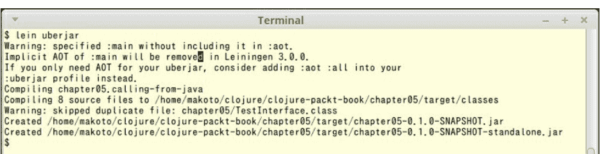

JAR 文件位于项目顶层目录下的 target 目录中：

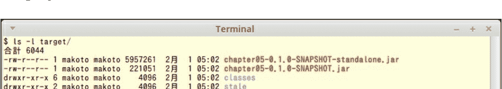

JAR 文件的名称为 chapter05-0.1.0-SNAPSHOT-standalone.jar。现在，让我们创建以下位于项目中并命名为 TestPerson.java 的 Java 源文件：

```
import cljbook.chapter05.Person;
public class TestPerson {
    public static void main(String[] args) {
        Person p1 = new Person();
        p1.setName("Makoto");
        p1.setCountry("Japan");
        System.out.println(p1.getName() + " from " + p1.getCountry());

        Person p2 = new Person("Nico","France");
```

```
System.out.println(p2.getName() + " from " +
 p2.getCountry());
    }
}
```

让我们编译并运行前面的 Java 代码：

```
$ javac TestPerson.java -cp target/chapter05-0.1.0-SNAPSHOT-standalone.jar
$ java -classpath .:target/chapter05-0.1.0-SNAPSHOT-standalone.jar TestPerson
Makoto from Japan
Nico from France
```

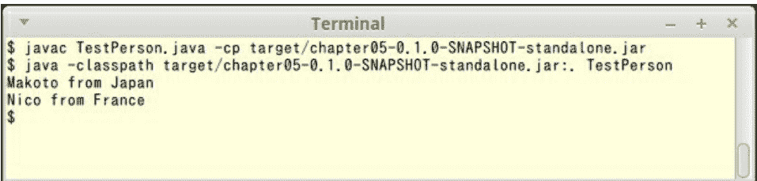

## 如何工作...

我们将解释如何编写 project.clj 使其可从 Java 调用。我们还展示了 ahead-of-time（AOT）编译是什么。

### 用于生成 Java 类的 project.clj

以下是本菜谱的 project.clj：

```
(defproject chapter05 "0.1.0-SNAPSHOT"
  :description "FIXME: write description"
  :url "http://example.com/FIXME"
  :license {:name "Eclipse Public License"
            :url "http://www.eclipse.org/legal/epl-v10.html"}
  :java-source-paths ["src/java"]
  :aot [chapter05.calling-from-java]
  :prep-tasks [
            ["compile" "chapter05.calling-from-java"]
            "javac" "compile" ]
```

```
:main chapter05.TestHello
:dependencies [[org.clojure/clojure "1.8.0"]
])
```

:java-source-paths 关键字声明 Java 源代码路径，在我们的例子中 Java 源文件位于 src/java 目录下。:aot 关键字声明要应用 AOT 编译的 Clojure 源文件。我们声明文件 chapter05/calling-from-java.clj 应该被编译并为调用者生成一个类文件。这对于调用者在 Clojure 中编写的类是必要的。

:prep-tasks 关键字控制编译的顺序。我们的定义如下：

```
:prep-tasks [
["compile" "chapter05.calling-from-java"]
"javac" "compile" ]
```

在前面的示例中，任务将按以下顺序执行：

- 1. chapter05.calling-from-java 的编译首先由 javac 第二次编译。
- 2. 然后，所有 Java 源文件都由 javac 编译。

然后编译其余的 Clojure 文件。

### AOT 编译

默认情况下，Clojure 在加载时即时将所有源代码编译为 JVM 字节码。但在以下情况下使用 AOT 编译：

- 为 Java 使用生成命名类文件
- 当我们不想交付源代码时
- 为了减少应用程序启动时间

我们使用 AOT 选项为本菜谱中由 Java 代码调用的生成命名类。

## 还有更多...

我们将学习如何在 Clojure 中定义接口和实现，以便可从 Java 调用。

### 定义可从 Java 调用的接口和实现类

definterface 在 Clojure 中定义 Java 接口，并在 deftype 中实现这些接口。以下 definterface 声明了 Calculation 的 Java 接口，它具有 getX、setX、add_ 和 _sub 方法。然后 _deftype 的 MyInt 实现这些方法：

```
(definterface Calculation
  (^long getX [])
  (^void setX [^long value])
  (^long add [^long x])
  (^long sub [^long x]))
;;=> chapter05.calling_from_java.Calculation
(deftype MyInt [^long x]
  Calculation
  (getX [this] (.x this))
  (setX [this val] (set! (.x this) val))
  (add [this x] (+ (.x this) x))
  (sub [this x] (- (.x this) x)))
;;=> chapter05.calling_from_java.MyInt
```

然后，让我们按如下方式测试代码：

```
(def myInt (MyInt. 15))
(.add myInt 30)
;;=> 45
(.sub myInt 11)
;;=> 4
(.getX myInt)
;;=> 15
(.setX myInt 10)
;;=> nil
(.getX myInt)
;;=> 10
```

我们将编写 Java 代码来调用用 Clojure 编写的接口的实现，如下所示：

```
package chapter05;
```

```
import chapter05.calling_from_java.MyInt;
public class TestInterface {
    public static void main(String[] args) {
        MyInt myInt = new MyInt(15);
        System.out.println("add result = " + myInt.add(30));
        System.out.println("sub result = " + myInt.sub(11));
        System.out.println("x = " + myInt.getX());
        myInt.setX(10);
        System.out.println("x = " + myInt.getX());
    }
}
```

我们将检查 Java 代码是否调用用 Clojure 编写的接口：

```
$ lein run -m chapter05.TestInterface
Compiling 2 source files to /home/makoto/clojure/clojure-packt-book/chapter05/target/classes
add result = 45
sub result = 4
x = 15
x = 10
```

## 使用 Maven 进行 Clojure 和 Java 项目

我们将演示如何将现有的 Leiningen 项目转换为 Maven 项目，以创建使用 Clojure 和 Java 的混合项目。现在开始吧！

```
$ lein pom
```

让我们查看生成的 pom.xml。Clojure 中使用的依赖 JAR（例如 Clojure JAR 和 Jackson 相关 JAR）在 pom.xml 的 dependencies 部分中声明：

```
<dependencies>
    <dependency>
        <groupId>org.clojure</groupId>
        <artifactId>clojure</artifactId>
        <version>1.8.0</version>
    </dependency>
    <dependency>
        <groupId>org.clojure</groupId>
        <artifactId>math.numeric-tower</artifactId>
        <version>0.0.4</version>
```


```
</dependency>
<dependency>
    <groupId>com.fasterxml.jackson.core</groupId>
    <artifactId>jackson-core</artifactId>
    <version>2.7.0</version>
</dependency>
<dependency>
    <groupId>com.fasterxml.jackson.core</groupId>
    <artifactId>jackson-databind</artifactId>
    <version>2.7.0</version>
</dependency>
    <dependency>
        <groupId>com.fasterxml.jackson.core</groupId>
        <artifactId>jackson-annotations</artifactId>
        <version>2.7.0</version>
    </dependency>
</dependencies>
</project>
```

以下命令运行 TestPerson 的 Java 类并打印结果：

```
$ mvn exec:java -Dexec.mainClass=chapter05.TestPerson
```

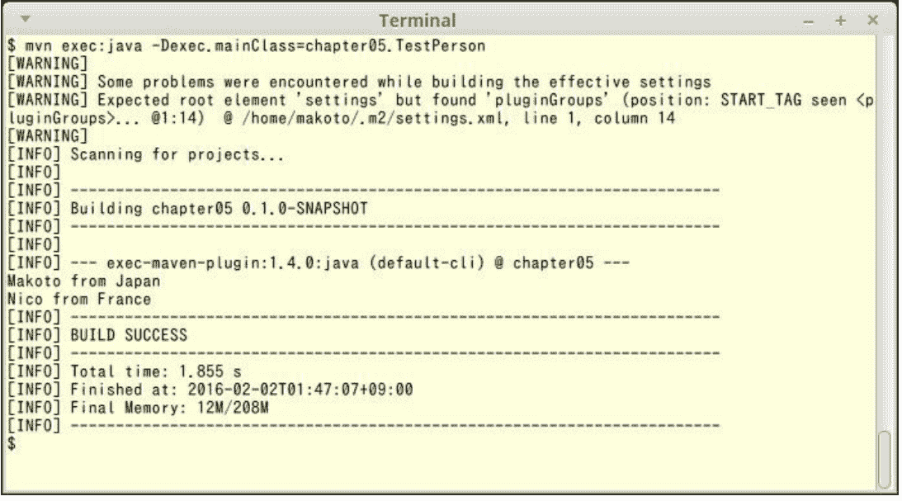

现在，让我们通过 `maven` **命令**向项目中添加 `clojure-maven-plugin` 以使用 Clojure REPL：

```
<plugin>
    <groupId>com.theoryinpractise</groupId>
    <artifactId>clojure-maven-plugin</artifactId>
    <version>1.3.10</version>
    <executions>
        <execution>
            <id>compile</id>
            <phase>compile</phase>
            <goals>
                <goal>compile</goal>
            </goals>
        </execution>
        <execution>
            <id>test</id>
            <phase>test</phase>
            <goals>
                <goal>test</goal>
            </goals>
        </execution>
    </executions>
</plugin>
```

```
$ mvn clojure:repl
[WARNING]
[WARNING] Some problems were encountered while building the effective settings
[WARNING] Expected root element 'settings' but found 'pluginGroups' (position: START_TAG seen <pluginGroups>... @1:14
) @ /home/makoto/.m2/settings.xml, line 1, column 14
[WARNING]
[INFO] Scanning for projects...
[INFO] ------------------------------------------------------------------------
[INFO] Building chapter05 0.1.0-SNAPSHOT
[INFO] ------------------------------------------------------------------------
[INFO]
[INFO] >>> clojure-maven-plugin:1.3.10:repl (default-cli) > test-compile @ chapter05 >>>
[INFO] --- build-helper-maven-plugin:1.7:add-source (add-source) @ chapter05 ---
[INFO] Source directory: /home/makoto/clojure/clojure-packt-book/chapter05/src/java added.
[INFO] --- maven-resources-plugin:2.6:resources (default-resources) @ chapter05 ---
[WARNING] Using platform encoding (UTF-8 actually) to copy filtered resources, i.e. build is platform dependent!
[INFO] Copying 0 resource
[INFO] --- maven-compiler-plugin:3.1:compile (default-compile) @ chapter05 ---
[INFO] Changes detected - recompiling the module!
[WARNING] File encoding has not been set, using platform encoding UTF-8, i.e. build is platform dependent!
[INFO] Compiling 8 source files to /home/makoto/clojure/clojure-packt-book/chapter05/target/classes
[INFO] --- clojure-maven-plugin:1.3.10:compile (compile) @ chapter05 ---
[INFO] --- maven-resources-plugin:2.6:testResources (default-testResources) @ chapter05 ---
[WARNING] Using platform encoding (UTF-8 actually) to copy filtered resources, i.e. build is platform dependent!
[INFO] Copying 0 resource
[INFO] --- maven-compiler-plugin:3.1:testCompile (default-testCompile) @ chapter05 ---
[INFO] Nothing to compile - all classes are up to date
[INFO] <<< clojure-maven-plugin:1.3.10:repl (default-cli) < test-compile @ chapter05 <<<
[INFO] --- clojure-maven-plugin:1.3.10:repl (default-cli) @ chapter05 ---
Clojure 1.8.0
user=>
```

# 从 Clojure 调用 Scala

在本教程中，我们将集成 Clojure 和 Scala。我们将使用 Leiningen 配置一个混合项目。

# 准备工作

我们通过 `lein new clojure-scala` 创建一个项目，并按如下方式配置 `project.clj`：

```
(defproject clojure-scala "0.1.0-SNAPSHOT"
  :description "FIXME: write description"
  :url "http://example.com/FIXME"
  :license {:name "Eclipse Public License"
            :url "http://www.eclipse.org/legal/epl-v10.html"}
  :dependencies [[org.clojure/clojure "1.8.0"]
                 [org.scala-lang/scala-library "2.11.7"]]
  :plugins [[io.tomw/lein-scala "0.1.2"]]
  :scala-source-path "src/scala"
  :scala-version "2.11.7"
  :prep-tasks ["scalac"]
  :main clojure-scala.core
)
```

修改 `project.clj` 后，启动 REPL。

# 如何操作...

我们将解释 Clojure 代码如何调用 Scala 方法以及如何访问 Scala 中定义字段。我们将使用 Leiningen 和 Scala 插件。这假设使用 Leiningen 的 Clojure 项目会使用现有的 Scala 库，如 Kafka 和 Spark。

# 使用 Leiningen 开发 Scala 和 Clojure

在 `src/scala` 目录下创建 `Main.scala`：

```
package chapter05
object Main {
  def hello(txt: String) = {
    "hello from Scala: " + txt + " !"

}
}
class Calculation {
  def factorial(n: BigInt): BigInt = {
    if (n <= 1) 1  else  n * factorial(n - 1)
  }
  def add(a:Int, b:Int):Int = a + b
}
```

```
class MyTuple {
  def tuple(x:Int, y:Int) = (x,y)
}
```

要编译 Scala 源代码，请执行以下操作：

```
$ lein scalac
```

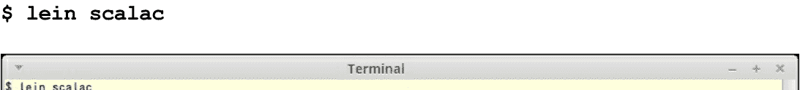

修改并编译 Scala 源代码后，我们需要重新启动 REPL 以便从 Clojure 进行测试。

# 导入 Scala 类

然后我们将从 Clojure 的 REPL 测试 Scala 代码。以下代码导入 Scala 类：

```
(ns clojure-scala.core)
;;=> nil
```

# 调用实例方法

让我们从 Scala 调用实例方法开始。这与调用 Java 的实例方法相同：

```
(import 'chapter05.Calculation)
;;=> chapter05.Calculation
(.add calc 10 2)
;;=> 12
```

```
(import 'scala.math.BigInt)
;;=> scala.math.BigInt
(import 'java.math.BigInteger)
;;=> java.math.BigInteger
(.factorial calc (BigInt. (BigInteger. "25")))
;;=> 15511210043330985984000000
```

调用 factorial 有点复杂。代码将其转换为 Scala 的 scala.math.BigInt。

# 调用单例方法

调用 Scala 的单例方法与调用 Java 的静态方法相同：

```
(import 'chapter05.Main)
;;=> chapter05.Main
(Main/hello "Makoto")
;;=> "hello from Scala: Makoto !"
(import 'chapter05.MyTuple)
;;=> chapter05.MyTuple
(def tuple1 (MyTuple/tuple 1 5))
;;=> #'clojure-scala.core/tuple1
```

# 访问元组

要访问元组，请使用 _1、_2 等：

```
(. _1 tuple1)
;;=> 1
(. _2 tuple1)
;;=> 5
```

# 访问 Scala 字段

让我们从 Clojure 访问 Scala 字段。在 Scala 中，声明字段会自动生成访问器方法，但方法名称与 Java 不同：

```
package chapter05
import scala.beans.BeanProperty

class Student {
  var name = new String("")
  var address = new String("")
}

class Person {
    @BeanProperty var name : String = _
    @BeanProperty var address : String = _
}
```

要为 Java 生成 getter/setter 方法，请在前面的代码中使用 BeanProperty 注解。以下代码展示了如何从 Clojure 访问 Scala 字段。要访问 Scala 类的默认字段，请分别使用 .field_name 和 .fieldname$eq 作为 getter 和 setter：

```
(import 'chapter05.Person)
;;=> chapter05.Person
(import 'chapter05.Student)
;;=> chapter05.Student
(def s (Student.))
;;=> #'clojure-scala.core/s
(.name_$eq s "Nico")
;;=> nil
(.name s)
;;=> "Nico"
(def p (Person.))
;;=> #'clojure-scala.core/person
(.setName p "Makoto")
;;=> nil
(.getName p)
;;=> "Makoto"
(.address_$eq p "Japan")
;;=> nil
(.address p)
;;=> "Japan"
```

# 它是如何工作的...

在 project.clj 中，我们按如下方式添加了 Scala 库：

```
:dependencies [[org.clojure/clojure "1.8.0"]
                [org.scala-lang/scala-library "2.11.7"]]
```

以下插件使 lein-scalac 能够编译 Scala 源代码：

```
:plugins [[io.tomw/lein-scala "0.1.2"]]
```

我们分别通过 :scala-source-path 和 :scala-version 指定了 Scala 源路径和 Scala 版本：

```
:scala-source-path "src/scala"
:scala-version "2.11.7"
```

我们使用 :prep-tasks 在编译 Clojure 代码之前预先编译 Scala 源代码：

```
:prep-tasks ["scalac"]
```

# 还有更多...

SBT 是 Scala 的事实标准构建工具，许多 Scala 项目使用 SBT。我们使用 Scala DSL 来描述 SBT 的项目配置。在这里，我们将学习如何在 SBT 项目中让 Scala 调用 Clojure。我们将使用 SBT 的 Clojure 插件。在本示例中，我们将学习如何使用 SBT 为使用 Scala 和 Clojure 语言的混合项目。

# 使用 SBT

我们将演示如何创建基于 SBT 的项目。在示例中，Scala 代码调用 Clojure 定义的方法。那就开始吧！

# 创建基于 SBT 的项目

让我们先创建一个 SBT 项目：

```
$ mkdir sbt-scala-clojure
$ cd sbt-scala-clojure
$ mkdir project
```

按如下方式创建 build.sbt：

```
seq(clojure.settings :_*)
libraryDependencies += "org.clojure" % "clojure" % "1.8.0"
```

project/plugins.sbt 指定了 sbt-clojure 插件：


// Comment to get more information during initialization
//logLevel := Level.Debug
logLevel := Level.Info
//lazy val root =
project.in(file(".")).dependsOn(clojurePlugin)

//lazy val clojurePlugin = file("../../sbt-clojure")
addSbtPlugin("com.unhandlederexpression" % "sbt-clojure" % "0.1")

## 编写源代码

我们将在 src/main/clojure 下创建 Clojure 源代码：

```
(ns helloworld)
(gen-class
  :name cljbook.chapter05.HelloWorld
  :methods [#^{:static true} [sayHello [] void]])
(defn -sayHello []
  (println "Hello world from Clojure!"))
(gen-class
  :name cljbook.chapter05.Calculator
  :methods
  [#^{:static false} [add [long long] long]
   #^{:static false} [sub [long long] long]])
(defn -add [this a b]
  (+ a b))
(defn -sub [this a b]
  (- a b))
```

前面的 Clojure 代码有两个类：
cljbook.chapter05.HelloWorld 和 cljbook.chapter05.Calculator。
然后，我们将查看 Scala 代码。以下是调用 Clojure 中定义的类的 Scala 代码：

```
import cljbook.chapter05.HelloWorld
import cljbook.chapter05.Calculator
object Main {
  def main(args: Array[String]) = {
    println("I'm calling methods defined by Clojure from Scala.")
    HelloWorld.sayHello();
    val calc = new Calculator
    println("add: "+calc.add(1,2))
    println("sub: "+calc.sub(10,5))
  }
```

以下是此项目的目录截图：

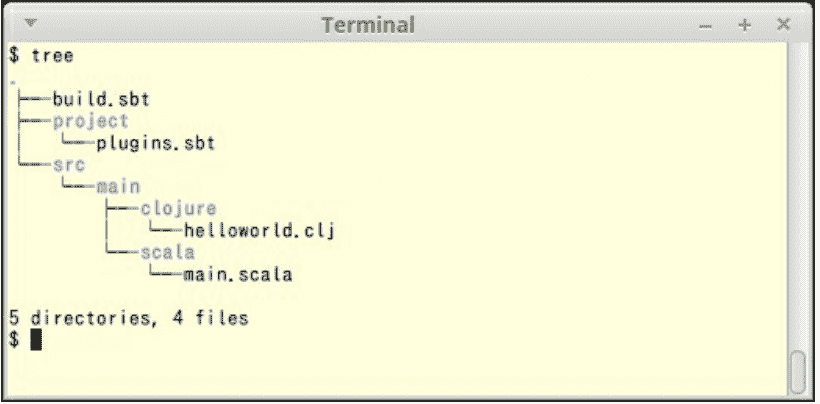

然后运行以下命令：

```
$ sbt run
```

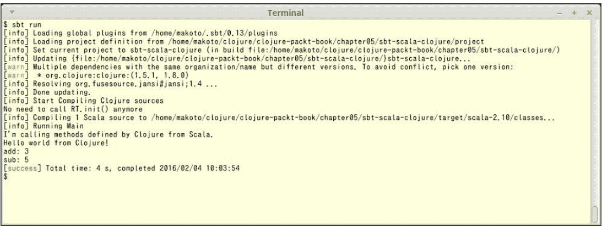

## ClojureCLR

ClojureCLR 是一种将你的 Clojure 代码使用和移植到 .NET 运行时的途径。实现这种集成有不同层次；你希望在 CLR 上运行 Clojure 代码的原因将成为你使用方式及其不同模式的根源。你可能只是偶然发现了一些看起来很棒的 Clojure 代码，但由于那些括号，你不确定是否能调试它，所以你只想嵌入 clj 算法并能够在命令行或通过 Windows 原生界面运行它。你可能想从通常的 Clojure REPL 创建 Windows 用户界面，这也是使用 ClojureCLR 可以实现的。你可能还想将你的 Clojure 代码分发到 Windows 动态链接库 DLL 中并交给客户，以便他可以原生调用它。

在本教程中，我们将查看所有这些不同的选项，并学习如何在 CLR 上保持生产力。

在完成本教程的过程中，你还会再次意识到，.NET 程序的内存占用通常低于其 Java VM 对应程序，这为在内存受限环境中运行 Clojure 提供了很好的论据。

编写本教程时，作者很想写更多 C# 和其他相关的 .NET 代码，甚至写一些移动应用。现在轮到你兴奋了。

## 准备工作

实际上，要为本教程做好准备，我们需要做很多工作。另外，请确保不要在网上到处查找并尝试将其他网络来源的说明与本教程结合起来。随着时间的推移，安装和集成方面已经有了很大的改进，因此没有必要回到过时的说明。

首先，在 Windows 上，建议你安装 Visual Studio。

### Note

本教程中的所有示例都是使用 Community Edition 编写的。其中相当多的截图也来自那里。

不需要特定的插件，但本章中的示例将使用一些 C# 示例。

在过程中，我们还将查看如何集成来自 Xamarin Studio 的 mono IDE。Mono 允许你在非 Windows 机器上运行 .NET 代码；因此，你不需要运行仅限 Windows 的 Visual Studio，而可以在任何地方运行你漂亮集成的 .NET 和 Clojure 代码。

## 安装 Visual Code Studio 并创建项目

除了所需的磁盘空间外，这应该很简单，它占用了你宝贵 SSD 驱动器上几乎 10GB 的空间：

### Visual Studio

Community 2015
with Update 1

Features   Languages

Select features

- Programming Languages
- Windows and Web Development
  - ClickOnce Publishing Tools
  - Microsoft SQL Server Data Tools
  - Microsoft Web Developer Tools
  - PowerShell Tools for Visual Studio [3rd Party]
  - Silverlight Development Kit
  - Universal Windows App Development Tools
  - Windows 8.1 and Windows Phone 8.0/8.1 Tools
  - Cross Platform Mobile Development
  - Common Tools

Select All

Reset Defaults

Setup requires up to 10 MB across all drives.

Back

UPDATE

安装完成后，你将创建一个新的基于命令行的 C# 项目，如以下截图所示：

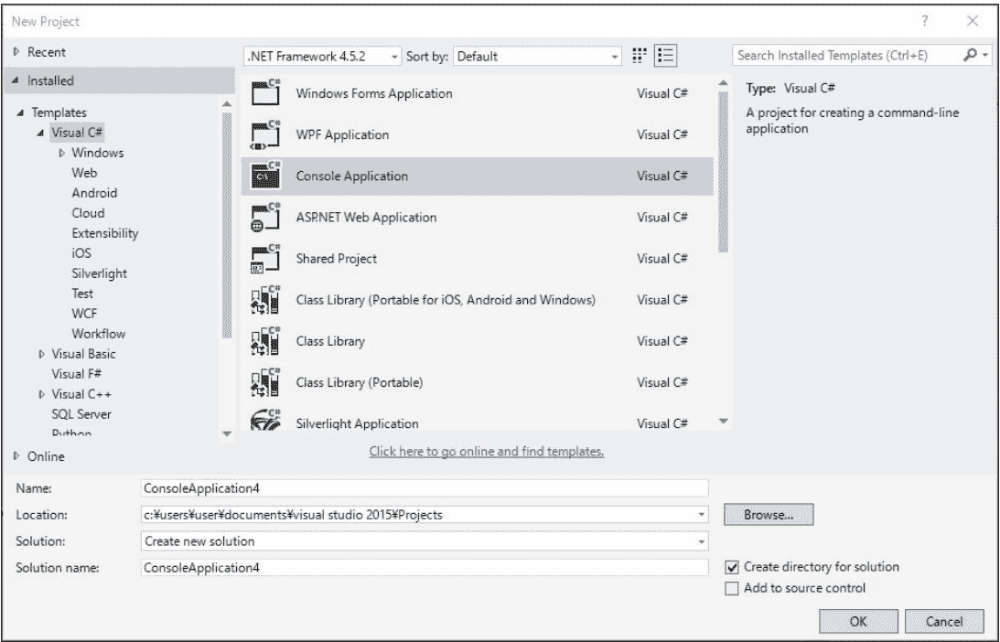

创建新项目会带你进入一个非常熟悉的设置。为了准备好使用 Clojure 使用我们的项目，我们将使用 NuGet 包管理器，它是 .NET 中安装 Clojure 库的事实标准：

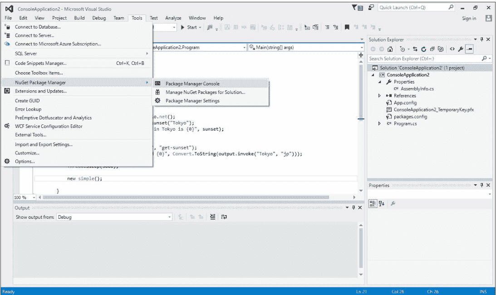

现在我们将 Clojure 库安装到当前项目中。在 NuGet 控制台中，输入以下内容：

```
Install-Package Clojure -Version 1.7.0
```

现在 NuGet 会为你抓取基本的东西：

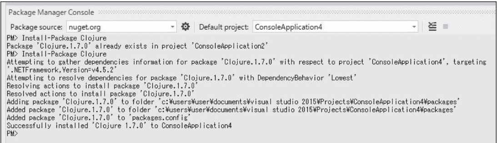

这里有一点说明：ClojureCLR 版本 1.8.0 在本书出版前无法成功测试，所以我们坚持使用稍旧的版本。对于我们的目的来说，这不会有问题。

你现在可以从你的 C# 项目中执行你的第一个 Clojure 代码片段。

让我们在主应用程序核心中加入一些通常的互操作代码：

```
using System;
using clojure.lang;
using System.Threading;
using clojure.clr.api;

namespace firstclojure
{
class Program
{
    {
        static void Main(string[] args)
        {
            IFn load = clojure.clr.api.Clojure.var("clojure.core",
"load-string");
            Console.WriteLine(Convert.ToString(load.invoke("(+ 1 1)")));
            Thread.Sleep(1000);
        }
    }
}
```

执行前面的代码，并假设安装顺利，以下内容将会显示：

2

这意味着 Clojure 代码已使用 load-string 方法有效编译，并且已被 eval。最后我们多睡了一会儿，这样我们就有时间看到消息。值得注意的是，Objects explorer 窗口显示了对核心 Clojure 库的引用：

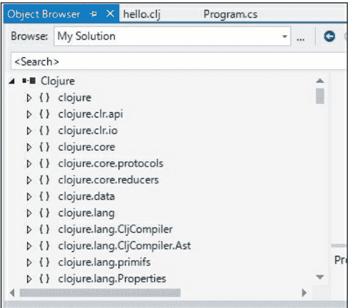

浏览层次结构，我们可以看到可用的不同方法，而且 Visual Studio 在你输入代码时确实很好地为你显示选项。

这非常基础，我们稍后将看到如何做更多与 Clojure 的交互。

现在，由于工作流程非常相似，让我们看看在使用 Mono Studio 时如何在平台无关环境中做好准备。

## 安装 Mono Studio IDE

对于我们这些没有机会在 Windows 上工作的人来说，我们可以改用安装 Xamarin Studio。会有一些更多的体操，所以如果你在 Windows 上，坚持使用 Visual Studio 的舒适度可能是更好的选择：

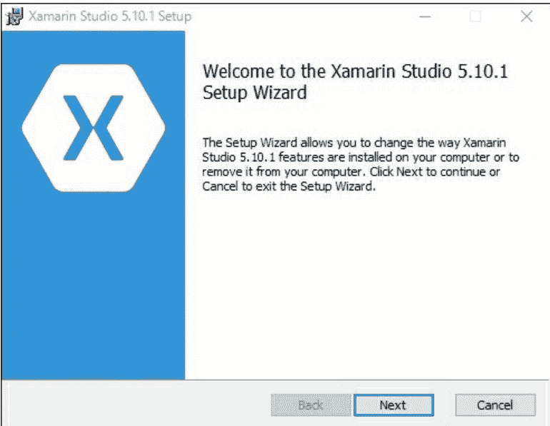

# Welcome to the Xamarin Studio 5.10.1 Setup Wizard

The Setup Wizard allows you to change the way Xamarin Studio 5.10.1 features are installed on your computer or to remove it from your computer. Click Next to continue or Cancel to exit the Setup Wizard.

设置完成后，新的项目流程应该感觉相似；你可以创建一个新的基于命令行的项目：

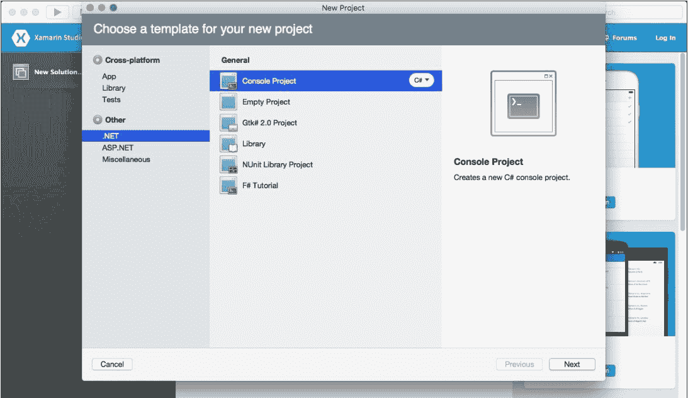

# Choose a template for your new project

- Cross-platform
  - App
  - Library
  - Tests
- Other
  - .NET
  - ASP.NET
  - Miscellaneous

- Console Project
- Empty Project
- Gtk# 2.0 Project
- Library
- NUnit Library Project
- F# Tutorial

Console Project
Creates a new C# console project.


我们还需要通过 NuGet 安装 Clojure：

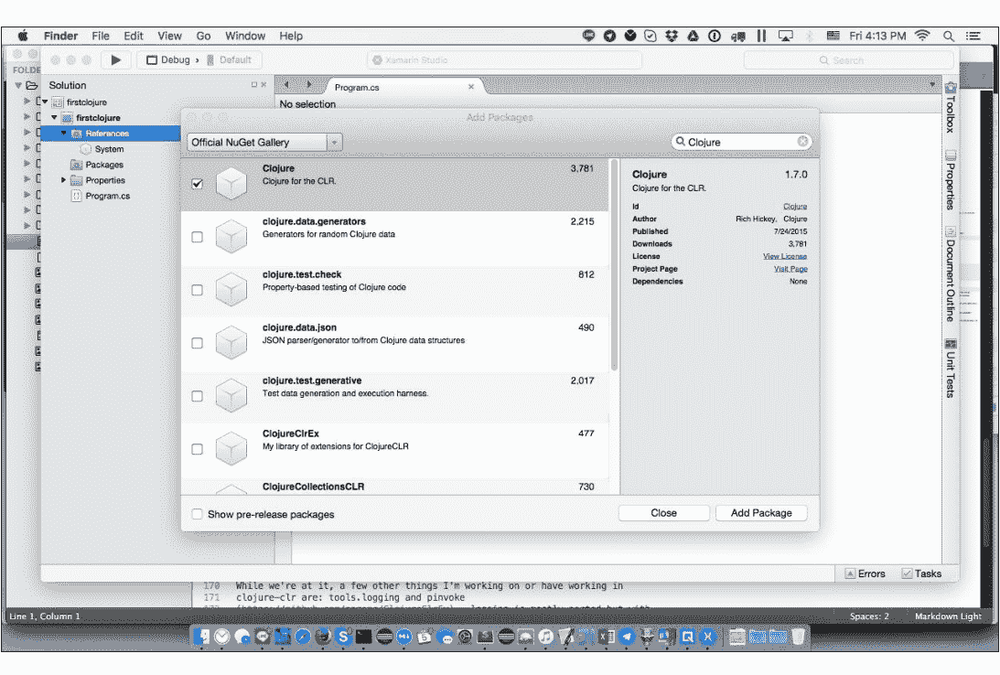

虽然看起来我们仍需逐个插入库，但在此阶段请确保你从 Clojure 网站 https://github.com/clojure/clojure-clr/wiki/Getting-binaries 获取的 CLR 二进制文件。

一旦你解压了 ZIP 文件的内容，请将所有 DLL 添加到当前项目中。引用解压文件夹中的所有动态库：

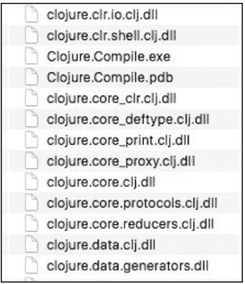

将它们添加到项目的引用中，如以下屏幕截图所示：

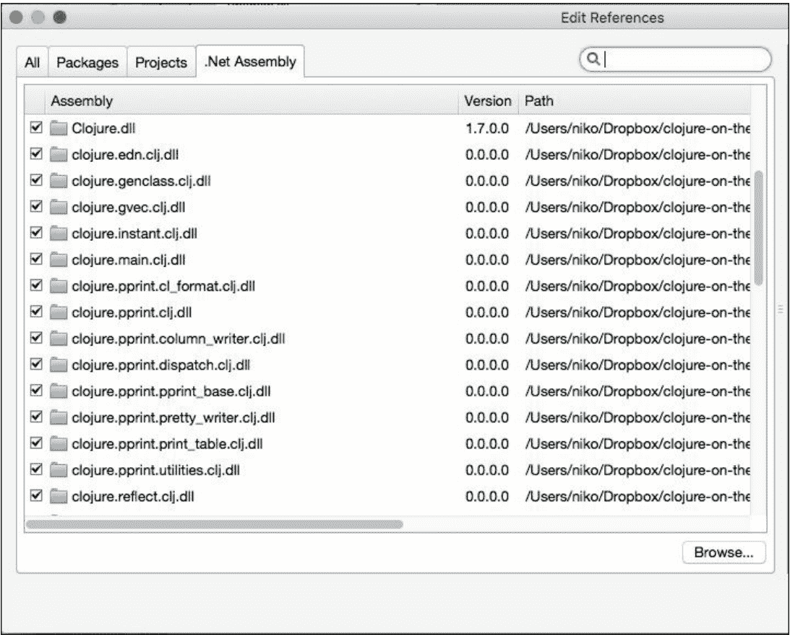

这被认为是对 CLJCLR-48 的临时变通方案，目前正在调查中。除此之外，你就绪了！那么，让我们重用几乎相同的代码。这里我们明确指出该函数应从 clojure.core 命名空间加载。然后我们可以在标准的 .NET 代码中引用该函数：

```
using System;
using clojure.lang;
using System.Threading;
using clojure.clr.api;

namespace firstclojure
{
    class MainClass
    {
        public static void Main (string[] args)
        {
            IFn load = Clojure.var("clojure.core", "load-string");
            Console.WriteLine(Convert.ToString(load.invoke(" (reduce * (range 2 10))")));
            Console.WriteLine ("Hello World!");
            Thread.Sleep (1000);
        }
    }
}
```

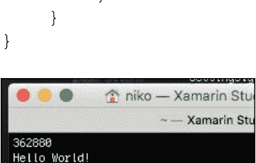

现在我们假设在此阶段能够在 Visual Studio 和 Xamarin Studio 中添加这两个库，后者基于 mono 运行时，即另一种 .NET 运行时实现。。

## Lein CLR

Leiningen 有一个基本的插件，支持开发可以从 .NET 编译和使用的 Clojure 代码，或反之，帮助我们从 Clojure 使用 .NET 代码。要创建新的基于 CLR 的项目，可以透明地使用 `lein clr` 模板使用 Leiningen CLR 插件。因此，要创建新项目，假设你在此阶段已安装 Leiningen，你只需输入以下命令：

```
lein new lein-clr bonjour-clr
```

将创建一个新的 Clojure 项目，但在你能够运行任何基于 CLR 的命令之前，你需要定义一个系统变量 `CLRCLR14_40`，它应指向之前在 Xamarin 部分看到的已下载的 Clojure .NET 二进制文件：

还有其他方法可以做到这一点，但你可能会同意我这是最快的方法。此时，如果你不在 Windows 上，你需要将一些 PATH 变量指向 Mono Framework，该框架应随 Xamarin Studio 安装一起下载；如果没有，现在是做的好时机。在 MacOS 上，类似以下内容应该可以帮你解决：

```
export PATH=$PATH:/Library/Frameworks/Mono.framework/Home/bin
```

就这样。现在你已准备就绪，让我们快速使用以下命令提示符运行默认加载的代码：

```
lein clr run -m bonjour-clr.core "this is a test"
```

; Received args: this is a test

哇。很棒。你也会惊讶地发现 Clojure 代码对其宿主一无所知，正如你从主文件中所确认的那样：

```
(ns bonjour-clr.core)

(defn foo
  "I don't do a whole lot."
  [x]
  (println x "Hello, World!"))

(defn -main
  [& args]
  (apply println "Received args:" args))
```

## 如何操作...

现在我们已全部准备就绪，我们将通过 CLR 进行一些操作，例如直接从 Clojure 调用 .NET 代码并了解从 .NET 运行 Clojure 代码的不同方式。所以准备好吧。

## 从 Clojure 调用 .NET 代码

即使你现在身处 .NET 的世界，你也不想放弃 Clojure 的 REPL 优势。让我们看看如何设置和使用它。

## 启动 REPL

这将会很简单，但我们在 .NET 平台上用 Clojure 编写的代码大部分可以直接使用 Leiningen CLR 插件运行。因此，例如，要启动 .NET REPL，只需输入以下内容：

```
lein clr repl
```

你可以通过输入以下两行来检查这不是作弊：

```
(System.Reflection.Assembly/LoadWithPartialName "System.Windows.Forms")
(System.Windows.Forms.MessageBox/Show "Hello world")
```

这将显示一个熟悉的 Windows 警告框：

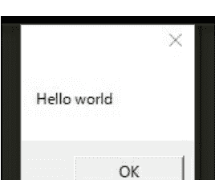

你必须喜欢代码的简洁性。如果我们快速浏览一下，第一行使用系统调用加载所需的库或 DLL。这里我们想加载 SystemSystem.Windows.Forms 库：

```
(System.Reflection.Assembly/LoadWithPartialName
"System.Windows.Forms")
```

第二行是使用 System.Windows.Forms.MessageBox 类的静态方法 Show 的常规 Clojure 互操作。请注意，该类之所以可用是因为我们之前加载了 DLL/库。

```
(System.Windows.Forms.MessageBox/Show "Hello world")
```

## 处理 IO

下一个示例将向你展示如何调用更多 .NET 方法。首先，我们可以回忆如何使用 C# 中的 WriteLine 方法：

```
(System.Console/WriteLine "Now we use Console Writeline")
```

这在功能上等同于 Clojure 函数 println，但在这里我们明确调用 C# 方法。

接下来，我们想将内容输出到文件；这将通过 StreamWriter 类和 WriteLine 方法完成。请注意，我们在 Clojure 中创建 .NET 对象的方式与为 Java 创建的方式相同，使用点。对 WriteLine 和 Close 的后续调用是在 .NET 对象的实例上完成的，再次使用点表示法：

```
(let [filename "test.txt" file  (System.IO.StreamWriter.
filename)]
    (.WriteLine file "===Hello Clojure ===")
    (.Close file))
```

避免所有对 .NET 的显式调用，你也可以使用 slurp 函数检索新创建文件的内容：

```
user=> (println (slurp "test.txt"))
; ===Hello Clojure ===
```

## 使用 C# 代码解析一些 XML

我们将快速看一个示例，说明如何从 .NET 上的 Clojure 解析 XML，因为这将是我们下一节集成示例的基础。对于此示例，我们将加载 System.Xml 库，正如我们之前所见，使用以下方法：

```
(System.Reflection.Assembly/LoadWithPartialName "System.Xml")
; #object[RuntimeAssembly 0xf097c6 "System.Xml,
Version=4.0.0.0, Culture=neutral,
PublicKeyToken=b77a5c561934e089"]
```

稍后请注意确认 DLL 是否正确加载，正如在控制台上输入时回显消息所示。
LoadWithPartialName 输出一些信息，显示从该新加载的库中，我们将导入一些类，与 Java 互操作时使用的相同。ns 声明使得将所有这些内容放在一起变得容易，所以：

```
(ns hello.parsing
  (:import [System.Xml XmlReader])
  (:import [System.IO StringReader])
  (:import [System.Text]))
```

在这里，你可以注意到 XML 定义完全通过通常的 Clojure 代码定义：

```
(def xml "<bookstore>
        <book genre='autobiography' publicationdate='1981-03-22' ISBN='1-861003-11-0'>
            <title>The Autobiography of Benjamin Franklin</title>
```

```
<author>
    <first-name>Benjamin</first-name>
    <last-name>Franklin</last-name>
</author>
<price>8.99</price>
</book>
</bookstore>")
```

最后，我们将从 C# StringReader 加载 XmlReader，然后使用一些晦涩的 C# Sax 解析方法我们可以访问书籍的名称：

```
(let [reader (XmlReader/Create (StringReader. xml))]
  (.ReadToFollowing reader "title")
  (println
    (.ReadElementContentAsString reader)))
; The Autobiography of Benjamin Franklin
```

这相当简洁！在下一个示例中，我们将更进一步，通过调用远程 Web 服务。

## 使用 Clojure/C# 调用 REST API

在此示例中，我们将从前一个示例的 XML 解析开始，解析来自远程 Web 服务的响应。远程 Web 服务将是 Yahoo Weather，我们将使其能够查找特定位置的日落时间。

如果你是从全新的 REPL 开始，或在文件顶部开始，先按之前完成的方式导入 XML 库：

```
(System.Reflection.Assembly/LoadWithPartialName "System.Xml")
; #object[RuntimeAssembly 0xf097c6 "System.Xml,
Version=4.0.0.0, Culture=neutral,
PublicKeyToken=b77a5c561934e089"]
```

除了与 XML 解析相关的类之外，我们还将导入 C# WebClient，它将为我们发送 HTTP 请求：

```
(ns hello.net
  (:import [System.Net WebClient])
  (:import [System.Xml XmlReader])
  (:import [System.IO StringReader]))
```


```
(:import [System.Text])
(:import [System.Text Encoding]))
```

在纯 Clojure 中，我们将创建一个函数，该函数将从字符串拼接中创建 API 端点。这在 Yahoo API 用法中大多有记录，并且仅提取了城市和国家以增加一点乐趣：

```
(defn api-uri [city country]
  (str "https://query.yahooapis.com/v1/public/yql?
q=select%20astronomy.sunset%20from%20weather.forecast%20where%20woeid%20in%20(select%20woeid%20from%20geo.places(1)%20where%20text%3D%22"
    city
    "%2C%20"
    country
"%22)&format=xml&env=store%3A%2F%2Fdatatables.org%2Falltableswithkeys"))
```

然后可以按如下方式调用前面的函数：

```
(api-uri "Tokyo" "Japan")
; ... a long string ...
```

让我们将 uri ref 定义为最后一次函数调用的返回值；请记住在 REPL 中引用之前结果的 * 标记：

```
(def uri *1)
```

然后让我们使用该 URI 端点通过 WebClient 查询日落时间：

```
(.GetString Encoding/UTF8 (.DownloadData (WebClient.) uri))
; "<?xml version="1.0" encoding="UTF-8"?>\n<query
xmlns:yahoo="http://www.yahooapis.com/v1/base.rng"
yahoo:count="1" yahoo:created="2016-02-09T02:04:09Z"
yahoo:lang="en-US"><results><channel><yweather:astronomy
xmlns:yweather="http://xml.weather.yahoo.com/ns/rss/1.0"
sunset="5:15 pm"/></channel></results></query><!-- total: 9 -->
<! -- main-37493228-cac5-11e5-b8c6-9cb6548278d0 -->\n"
;
```

只要你没有在代理后面并且已连接到互联网，前面的调用将返回 Yahoo Web 服务的 XML 响应。结合来自前一个示例的解析调用，我们现在可以创建一个函数，该函数将查询 Web 服务并仅返回标签的属性 sunset 的我们想要的值：

```
(defn get-sunset [city country]
  (let [
    uri (api-uri city country)
    res (.GetString Encoding/UTF8 (.DownloadData (WebClient.) uri))
    reader (XmlReader/Create (StringReader. res))
  ]
  (doto reader
    (.ReadToFollowing "astronomy" "http://xml.weather.yahoo.com/ns/rss/1.0")
    (.MoveToAttribute "sunset"))
  (str (.Value reader))))
```

这很不错，我们现在有了一种方法可以查询世界各地的日落时间。所以让我们稍后前往巴黎吧！

```
(get-sunset "Paris" "France")
; 6:00pm, at the time of the book writing ;
```

## UI 原型设计

现在为了将这一切收尾，我们将额外迈出一步，为我们调用 Yahoo API 的精彩函数设置一个基本用户界面（UI）。首先，我们将构建一个非常简单的 UI，然后我们将增强我们的示例以基于 ComboBox 调用 API！兴奋吗？当然你会！

我们首先加载并引用通常的一组类：

```
(System.Reflection.Assembly/LoadWithPartialName "System.Windows.Forms")

(ns hello.simpleui
  (:import [System.Windows.Forms Button Form Label])
  (:import [System.Drawing Size Point]))
```

然后，我们使用 let 块定义整体 UI 的新组件：

```
(let [
  form (Form.)
  load-btn (Button.)
```

```
title-label (Label.)
title-string "A very simple UI! "]
```

我们然后创建一个标准标签；注意互操作和对设置器的调用是使用 .set_ 调用对不同字段完成的：

```
(doto title-label
  (.set_Text title-string)
  (.set_Location (Point. 12 12))
  (.set_Size (Size. 360 22)))
```

要构建一个交互式按钮，我们使用 gen-delegate，这使我们能够插入到原生的事件处理系统中。gen-delegate 的块是当事件被触发时将被调用的回调的主体。在这里我们更改前一个标签的文本并在控制台上打印一个字符串：

```
(doto load-btn
  (.set_Name "loadButton")
  (.set_Location (Point. 12 78))
  (.set_Text "Button 1")
  (.set_Size (Size. 360 22))
  (.add_Click
    (gen-delegate EventHandler [sender args]
      (.set_Text title-label "clicked button1 !")
      (System.Console/WriteLine "Now we use Console Writeline"))))
```

我们通过将前两个 UI 控件添加到表单中然后显示表单本身来完成所有这些操作：

```
(doto (.Controls form)
  (.Add title-label)
  (.Add load-btn))
```

```
(doto form
  (.set_Text title-string)
  (.set_Size (Size. 400 200))
  .ShowDialog)
```

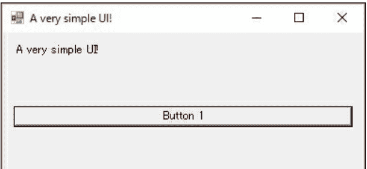

## 将其全部整合在一起

通过将顶级命名空间更改为包含你为 Yahoo API 编写的代码，你现在将添加一个 ComboBox 对象以能够选择城市并在 ComboBox 选择更新时发送请求：

```
(ns hello.simpleui2
  (:use [hello.net])
  (:import [System.Windows.Forms ComboBox MessageBox Button Form Label])
  (:import [System.Drawing Size Point]))
```

现在进入 ComboBox 核心代码；导入部分在 add_SelectedIndexChanged 调用上。事件本身是 SelectedIndexChanged，并且 CLR 与 Clojure 的互操作允许你通过带前缀的函数 add_ 来注册处理程序，如下所示：

```
( .AddRange
  (.get_Items combo)
  (into-array ["osaka" "Tokyo" "Sapporo"]))
```

```
(doto combo
  (.set_Location (Point. 12 78))
  (.set_Size (Size. 360 22))
  (.add_SelectedIndexChanged
    (gen-delegate EventHandler [sender args]
      (let [city (str (.Text combo))]
        (MessageBox/Show (str "sunset time in " city " : "
        (hello.net/get-sunset city "jp")))))))
```

其余代码很容易跟随，你当然会注意到对 get-sunset 函数的调用，你之前编写过。通过 REPL 或通过命令 lein clr run -m hello.simpleui2 运行所有这些，你现在将能够获取那些美丽的日本城市的日落时间：

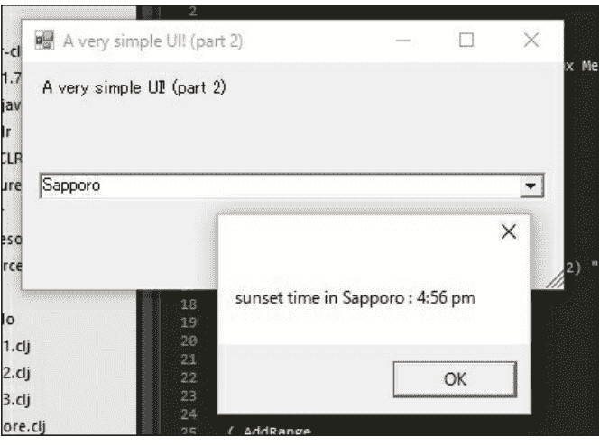

## 它是如何工作的...

现在你已经看到了大量 CLR 互操作的列表，是时候看看当从 .NET 调用 Clojure 代码时所有这些是如何工作的了。事情变得有点复杂，所以你必须保持专注。首先，你需要能够从你编写的 Clojure 代码中生成可执行文件和动态库。一旦所有这些顺利进行，我们将切换到将生成的对象导入到 Visual Studio 项目中，并且为了完整性，也导入到 Xamarin Mono-based 项目中。

## 为 .NET 编译 Clojure 代码

回到你之前创建的 hello.net 命名空间，通过添加通常的互操作胶水；我们可以添加一个 main 方法，当调用可执行文件时它将成为主要入口点：

```
(defn -main [& args]
  (println (get-sunset (first args) "jp")))
```

我们还确保命名空间定义中存在 :gen-class 指令：

```
(ns hello.net
  (:gen-class))
```

从命令行，预计结果是，接收城市作为参数，运行时将调用 Yahoo API。让我们用 Leiningen CLR 插件的 run 命令来检查一下：

```
lein clr run -m hello.net "Osaka"
; 5:34 pm
```

你很好。（你是对的？）现在为了使其可重用，我们将使用 Leiningen CLR 插件的 compile 命令来编译一个命名空间：

```
lein clr compile hello.net
```

请注意，这也会编译所需的命名空间。如果一切顺利，在 target\clr\bin 文件夹中，你现在有更多文件，尤其是两个新生成的 - DLL 和 EXE 文件：

```
-a----      2016/02/09      17:21          10240
hello.net.clj.dll
-a----      2016/02/09      17:21          4608 hello.net.exe
```

这些文件是可执行文件，前提是你已按前面解释添加了所需的 Clojure 和 Microsoft DLL。在命令行中，这次不需要插件！这是纯 .NET 代码：

```
.\hello.net.exe Osaka
; 5:34 pm
```

甜的！

为了更准备好下一步，我们将添加一个特定的方法，通过 DLL 生成并暴露。这是在 :gen-class 指令级别完成的：

```
(:gen-class
    :methods [[#^{:static true} getsunset [String] String]])
```

这告诉编译器暴露一个名为 getsunset 的函数，该函数以字符串作为输入参数，在括号中，并返回一个字符串，最右边的字符串定义。为此工作，我们实际上需要在 hello.net 命名空间的 Clojure 代码中添加一个新方法，因为暴露的方法定义默认需要使用 - 前缀：

```
(defn -getsunset [this city]
  (get-sunset city "jp"))
```

让我们重新运行 Leiningen CLR 插件，以确保你拥有最新的代码，使用：

```
lein clr compile hello.net
```

还在吗？太好了！让我们进行更多 C# 冒险吧！

## 向 Visual Studio 项目添加 Clojure 代码

所以，我们现在回到 Visual Studio，让我们创建一个全新的基于 C# 的命令行应用程序。在新创建的项目上，确保你首先通过 NuGet 添加 Clojure 库，如你之前所见，然后添加对我们新编译的二进制文件的引用：

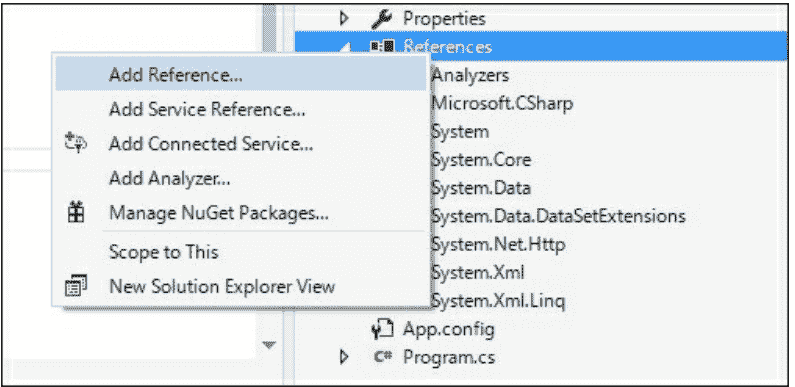


你需要浏览到目标\clr\bin 文件夹，然后选择 .dll 和 .exe 文件，如以下截图所示：

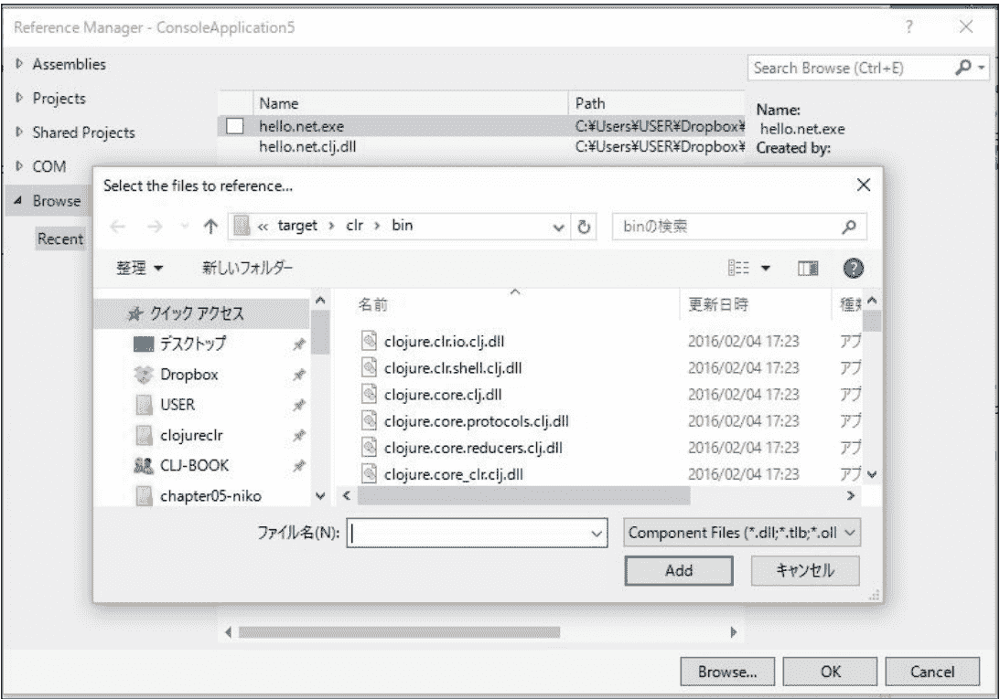

依赖项现在已显示在你的项目中：

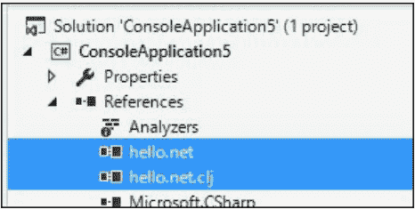

你现在准备好添加 C# 代码来调用新添加的库了：

```
hello.net fromclojure = new hello.net();
string sunset = fromclojure.getsunset("Tokyo");
Console.WriteLine("Sunset today in Tokyo is {0}", sunset);
Thread.Sleep(5000);
```

注意几点。我们需要创建一个新的对象实例来调用生成的代码。但随后 Clojure 编译的代码看起来就像其他任何 C# 库一样。

确保你按 Visual Studio 建议修复导入。让我们点击 Windows 风格的开始按钮！

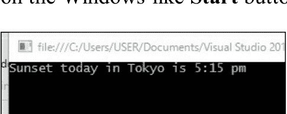

## 使用 Clojure.RT 运行 Clojure 代码

实际上还有另一种略有不同的方法，可以使用 clojure.lang.RT 类来调用 Clojure 代码。此调用具有 load 方法，其作用类似于 require 指令。这与你记得的常规 Java 互操作非常相似：

```
RT.load("hello.net");
IFn output = RT.var("hello.net", "get-sunset");
Console.WriteLine("Second method {0}", output.invoke("Tokyo", "jp"));
```

因此，我们创建一个 IFn 对象，该对象通过 RT.var 调用映射到 Clojure 函数。然后，你可以使用所需的参数，这里是 Tokyo，来调用此生成的 IFn 对象。

## 使用 Xamarin Mono Studio

如果你一直正确地跟随操作，即使你不在 Windows 机器上，本食谱的最后一部分实际上也会变得轻松。

在我们之前创建的 Xamarin C# 项目中，我们还将添加对生成的 DLL 和 EXE 文件的引用。这分为两步完成。首先，打开引用对话框，如以下截图所示：

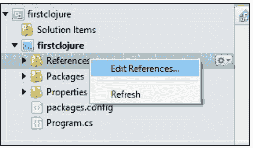

然后，浏览并选择 .NET 程序集，如下一张截图所示：

Xamarin IDE 的代码与为 Visual Studio 编写的代码完全相同，因此相同的 C# 代码也适用：

```
...
namespace firstclojure
{
    class MainClass
    {
        public static void Main (string[] args)
        {
            hello.net fromclojure = new hello.net();
            string sunset = fromclojure.getsunset("Tokyo");
            Console.WriteLine("Sunset today in Tokyo is {0}",
            sunset);
            Thread.Sleep (2000);
        }
    }
}
```

运行它会为你带来通常的日落时间！

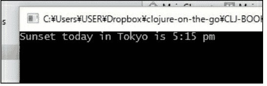

是时候让本食谱以自然的日落结尾了，你不觉得吗？

## 还有更多...

为了使事情完整，我们需要探索从 Clojure 调用用 C# 编写的库。这与调用常规 .NET 命名空间非常相似，但能够掌控代码的两边是很不错的。因此，假设你在 Visual Studio 中创建了一个新的库项目后编写了一个很棒的库：

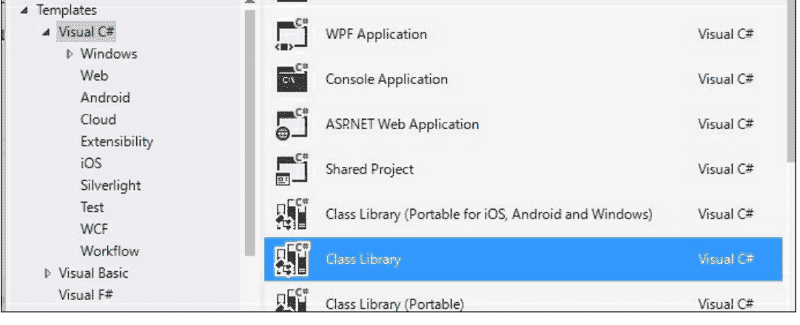

代码看起来可能有点...嗯...平淡无奇，在这个阶段，但稍后将由你来让它变得更有趣。这里我们有一个简单的 compute 函数，返回输入值加 1：

```
namespace ClassLibrary1
{
    public class Class1
    {
        public int compute(int a)
        {
            return a + 1;
        }
    }
}
```

当你从 Visual Studio 构建库，或 Xamarin 时，你会得到一个 DLL 文件，我们可以用 LoadWithPartialName 加载它，如果运行时可以猜出路径，或者用 LoadFrom 指定 DLL 的完整路径：

```
; (System.Reflection.Assembly/LoadWithPartialName "ClassLibrary1")
(System.Reflection.Assembly/LoadFrom "ClassLibrary1.dll")
```

在 Clojure 代码中，我们可以通过 import 调用引用代码，指定我们想要加载的命名空间和类：

```
(ns hello-clr2.core
  (:import [ClassLibrary1 Class1])
  (:gen-class)
)
```

最后，我们可以使用你之前编写的 C# compute 函数：

```
(defn -main
  [& args]
  (println  (.compute (Class1.) (first args))))
```

通过 lein 或直接通过编译后的 EXE 文件对 main 函数的常规调用即可完成！

```
lein clr run -m hello-clr2.core 10
; 11
```

.NET 集成的下一步是飞上天空，能够用 Clojure 脚本化 Unity 引擎...猜猜看！arcadia 项目为你准备了

这个！去玩得开心吧。

## ClojureScript

ClojureScript 是针对在 JVM 上运行的 Clojure。虽然它听起来像是运行 Clojure 的又一个平台，但它实际上将你的代码暴露给一个非常庞大的受众，并提出清理一些意大利面条代码。由于这不是一本关于 ClojureScript 的书，本食谱的目标是让你进入 ClojureScript 之旅，以便你感到自在并开始为 JVM 生产干净的 Clojure。

## 准备工作

虽然有几个 Leiningen 模板可以让你迅速准备就绪，但我们实际上将从头开始查看如何准备就绪。因此，除了你通常的命令行 lein 客户端之外，前期不需要任何东西。

在你选择的空文件夹中，首先创建一个新的 project.clj 文件，内容如下：

```
(defproject cljs-one "0.1.0-SNAPSHOT"
  :dependencies [[org.clojure/clojure "1.8.0"]
                  [org.clojure/clojurescript "1.7.228"]]
  :plugins [[lein-cljsbuild "1.1.2"]]
  :cljsbuild {
    :builds [{:source-paths ["src"]
              :compiler {
                :output-to "out/one.js"
                :output-dir "out"}}]})
```

你会注意到我们添加了对 ClojureScript 本身的依赖，以及另一个奇怪的东西，即 Leiningen 的 cljsbuild 插件。该插件将帮助你将 Clojure 代码编译为 JavaScript。为此，ClojureScript 编译器需要 project.clj 文件中 :cljsbuild :builds 部分包含的几个细节：

```
{:source-paths ["src"]
  :compiler {
  :output-to "out/one.js"
```

```
:output-dir "out"}}
```

我们在这里告诉编译器 ClojureScript 文件位于 `src` 文件夹中，编译后的文件应为 `out/one.js`，最后，其他编译后的文件应进入 `out` 文件夹。

这就是全部内容，所以让我们创建一个 `src/core.cljs` 文件并在其中添加一些看起来熟悉的 Clojure 代码：

```
(ns core)
(enable-console-print!)
(println "I'm home!")
```

`enable-console-print` 函数允许将打印函数绑定到 JavaScript 控制台对象。因此，你可以期望前面的代码在你喜欢的浏览器的开发者控制台上打印一条友好的欢迎消息。项目和源代码现在已准备就绪，因此在命令行中你现在将告诉 ClojureScript 插件根据我们在 `project.clj` 中设置的规则编译代码，并且 once 参数告诉编译器只编译一次，然后退出：

```
lein cljsbuild once
```

```
; Compiling ClojureScript...
; Compiling "out/one.js" from ["src"]...
; WARNING: core is a single segment namespace at line 1
src/core.cljs
; Successfully compiled "out/one.js" in 1.682 seconds.
```

现在很棒，但我们很想真正看到结果。通常，要运行 JavaScript，你可能使用过一种叫做 HTML 的东西，它会按需加载你的 JavaScript 代码。ClojureScript 依赖于 Google 的 **Closure**，是的，那是一个 s，来根据其命名空间定义加载代码等。因此，在项目文件夹根目录的 `index.html` 中，编写以下代码：

```
<html>
    <body>
        <script src="out/goog/base.js" type="text/javascript">
</script>
        <script src="out/one.js" type="text/javascript">
```

```
</script>
    <script type="text/javascript">goog.require("core");
</script>
    </body>
</html>
```

第一个 HTML 导入脚本指令告诉页面加载 Closure 库。第二个脚本导入指令告诉页面加载我们编译后的代码。最后，第三个脚本指令要求代码，即加载它，并且由于我们没有创建函数而只是纯代码，这将有效地、最终地运行你之前编写的代码。

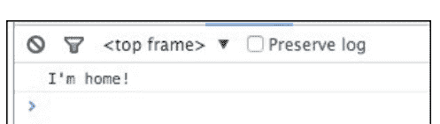

就这样，你现在可以打开 index.html 页面在任何浏览器中，除了 Internet Explorer。只是在开玩笑，甚至 IE 也能用。

## 如何操作...

现在你已经在本地机器上掌握了基础知识，从这里开始这将是一条通往 JavaScript 自由的道路。

## 自动编译你的代码

不必每次都运行 cljsbuild once 命令，cljsbuild 插件实际上还有第二种模式。是的，你猜对了，它叫做 auto：

```
lein cljsbuild auto
```

使用前面的命令，对 core.cljs 文件的任何更改都会触发你的代码重新编译。在 ClojureScript 文件中，让我们用以下代码更新 Clojure 代码：


```
(ns core)
(enable-console-print!)

(time
  (sort
    (reverse
      (range 10 100))))
```

前两行是相同的，但现在我们使用 `time` 宏来评估一个函数并打印执行该评估所花费的时间。保存文件后，插件的自动模式会检测到更改，正在运行 Leiningen 的控制台将显示一条不错的消息：

```
Compiling "out/one.js" from ["src"]...
```

然后你可以重新加载 HTML 页面，就会看到控制台打印出了之前编写的 Clojure 代码的新消息：

```
"Elapsed time: 1.305000 msecs"
```

## Fibonacci'ed

如果我们不尝试在这里运行标准的 Clojure 代码，那就不有趣了，对吧？在同一个 `core.cljs` 中，让我们添加一个未经过修改的基于 Clojure 的 Fibonacci 版本：

```
(def fib-seq
  ((fn rfib [a b]
     (lazy-seq (cons a (rfib b (+ a b)))))
    0 1))
(prn (take 20 fib-seq))
; in the console ..
; (0 1 1 2 3 5 8 13 21 34 55 89 144 233 377 610 987 1597 2584 4181)
```

## How it works...

到目前为止，这一路都很顺利，但我们还没有尝试自己与标准 JavaScript 代码进行交互，所以现在就做吧！

## Interacting with JavaScript

要与 JavaScript 交互，ClojureScript 将 `window` 对象公开为引用 `js`。让我们用永远流行的 alert 对话框来尝试一下：

```
(js/alert "I'm home!")
```

只要 Leiningen `cljsbuild` 命令仍在运行，重新加载 HTML 页面就会带给你熟悉的：


## Using jQuery from ClojureScript

假设你想将一些 jQuery 代码转换为 ClojureScript。由于我们可以使用 `js` 元素，所以应该能够或多或少顺畅地做到这一点。一个标准的 jQuery div 切换示例可能如下所示：

```
$(document.body).click(function () {
  if ($("div:first").is(":hidden")) {
    $("div").slideDown("slow");
  } else {
    $("div").hide();
  }
});
```

在前面的代码中，我们根据对 HTML body 元素的点击来显示和隐藏 div 元素。首先，让我们在 HTML 文件中像往常一样添加脚本导入指令：

```
<script src="http://ajax.aspnetcdn.com/ajax/jQuery/jquery-2.2.0.min.js" type="text/javascript"></script>
```

实际上，在一起转换整段代码之前，让我们简单地尝试捕获鼠标点击并打印一些消息。所以，这将是以下 jQuery 部分：

```
$(document.body).click(function () {
  ..
})
```

我们按如下方式定义打印点击函数，使用标准的 Clojure 代码：

```
(defn click-fn[]
  (println "Clicked!"))
```

现在你有了处理器，让我们对鼠标点击做出反应。我们要定位的 DOM 元素是 body。我们通过 `js/jQuery` 从 ClojureScript 访问 JavaScript 暴露的 jQuery 对象，并用参数 `"body"` 调用它：

```
(js/jQuery "body")
```

我们将 body 元素作为 jQuery 对象，所以让我们使用 click 函数。在通常的 Clojure 互操作中，可以使用 `.click` 分派：

```
(.click
  (js/jQuery "body")
  click-fn)
```

假设 `index.html` 页面中有一些文本，例如：

```
<body>
Click me!
...
</body>
```

没错，现在是展示一些鼠标点击能力的时候了！！而且是的，消息显示出来了，如以下屏幕截图所示：

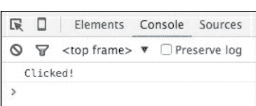

现在，前面的 jQuery 代码的完整 ClojureScript 版本就很容易编写了。让我们创建一个新的回调函数 `click-slide-fn`：

```
(defn click-slide-fn[]
    (if (.is (js/jQuery "div:first") ":hidden")
      (.slideDown (js/jQuery "div") "slow")
      (.hide (js/jQuery "div"))))
```

让我们用新的回调替换处理点击的代码：

```
(.click
  (js/jQuery "body")
  click-slide-fn)
```

为了检查 div 是否与我们很好地配合，让我们添加一些颜色和一些 div 元素，整个 HTML 页面看起来像这样：

```
<html>
<head>
  <style>
    div {
      background:#ccff55; margin:3px; width:80px;
      height:40px; display:none; float:left;
    }
  </style>
</head>
<body>
  Click me!
  <div></div>
  <div></div>
  <div></div>
  <script src="http://ajax.aspnetcdn.com/ajax/jQuery/jquery-2.2.0.min.js" type="text/javascript"></script>
  <script src="out/goog/base.js" type="text/javascript">
</script>
  <script src="out/one.js" type="text/javascript"></script>
  <script type="text/javascript">goog.require("core");</script>
</body>
```


注意，如果我们想让它看起来更像 jQuery 一些，我们可以再次将 `js/jQuery` 对象绑定到美元符号：

```
(def $ js/jQuery)

(defn click-slide-fn[]
    (if (.is ($ "div:first") ":hidden")
        (. ($ "div") slideDown "slow")
        (. ($ "div") hide)))
(.click
    ($ "body")
    click-slide-fn)
```

哇。这很有趣。

## Creating a ClojureScript library

ClojureScript 库也可以打包为 JAR 文件。这实际上与标准 Clojure 完全相同，因此常规的 Leiningen `jar` 命令就可以做到。让我们在当前的 JavaScript 项目中尝试一下：

```
lein jar
```

我们可以简单地检查内容：

```
~/D/c/C/c/s/cljs-three >>> jar tvf target/cljs-two-0.1.0-SNAPSHOT.jar
    117 Wed Feb 10 13:50:28 JST 2016 META-INF/MANIFEST.MF
    1895 Wed Feb 10 13:50:28 JST 2016 META-INF/maven/cljs-two/cljs-two/pom.xml
    401 Wed Feb 10 13:50:28 JST 2016 META-INF/leiningen/cljs-two/cljs-two/project.clj
    401 Wed Feb 10 13:50:28 JST 2016 project.clj
    ...
    428 Wed Feb 10 13:42:24 JST 2016 core.cljs
```

在本地，我们实际上会使用 `install` 命令使库可供其他项目使用：

```
lein install
; Installed jar and pom into local repo.
```

在 `project.clj` 中，你现在可以像通常的 Clojure 方式那样添加对新创建库的依赖：

```
[cljs-two "0.1.0-SNAPSHOT"]
```

而且，在新的 ClojureScript 文件中，你可以引用之前的库 ClojureScript 代码，就好像它就在这里一样：

```
(ns core2
  (:require [core]))
```

```
(def $ js/jQuery)
```

```
(.click
  ($ "body")
  core/click-slide-fn)
```

而且它仍然可以点击！

## Using a third-party library

这一小节将是对使用第三方 ClojureScript 库的简单后续。这里我们想尝试 ClojureScript money 库，一个帮助你玩转 Canvas 的库。你的 `project.clj` 将包含对发布版本的额外引用：

```
[rm-hull/monet "0.2.2"]
```

现在你就可以像之前看到的那样使用 money 命名空间：

```
(ns core
  (:require [monet.canvas :as canvas]))
(def canvas-dom
  (.getElementById js/document "canvas"))
(def monet-canvas
```

```
(canvas/init canvas-dom "2d")
(canvas/add-entity monet-canvas :background
  (canvas/entity {:x 0 :y 0 :w 600 :h 600}
    nil
    (fn [ctx val]
      (-> ctx
          (canvas/fill-style "#ccff55")
          (canvas/fill-rect val)))))
```

## There's more...

如果可以连接到 ClojureScript REPL 并实时与其交互，那不是很好吗？这就是我们可以使用随 `cljsbuild` 插件提供的 ClojureScript REPL 的地方！

## Running in the REPL

为了实现连接，我们将要求 ClojureScript 代码显式打开一个套接字连接，以便我们即将到来的 REPL。浏览器 REPL 是 ClojureScript 的一部分，可以按如下所示调用：

```
(ns core
  (:require
    [clojure.browser.repl :as repl]))

(repl/connect "http://localhost:9000/repl")
```

为了能够从浏览器打开到外部世界的连接，或这里的 REPL，你需要实际处于托管模式。在 `project.clj` 文件中，我们将添加一个插件来托管本地目录，特别是 `index.html` 页面。插件部分现在应该如下所示：

```
:plugins [
  [lein-cljsbuild "1.1.2"]
  [lein-simpleton "1.3.0"]
]
```

只需使用以下命令在端口 `8000` 上开始托管文件：

```
lein simpleton 8000
```

最后一步，现在，启动 ClojureScript REPL 的命令如下：

```
lein trampoline cljsbuild repl-listen
```

通过打开位于 http://localhost:8000/index.html 的 index.html 页面来完成对 REPL 套接字的连接。你将有一个熟悉的提示可用：

```
cljs.user=> (js/alert "Connected to the REPL!")
```


而且是的！这是实时的并且连接到浏览器。你可以发送代码，它将即时从 ClojureScript 编译代码到 JavaScript 并在浏览器 VM 上执行。

多么精彩的旅程！

## Compiling code for both Clojure and ClojureScript

为了正确完成这个配方，我们将展示如何简单地从 ClojureScript 调用 Clojure 代码，而且非常好的消息是，几乎不需要任何操作。自己看看吧！我们将在一个常规的 Clojure 文件中编写我们之前有的 Fibonacci 代码：

```
(ns example.shared)
(def fib-seq
  ((fn rfib [a b]
    (lazy-seq (cons a (rfib b (+ a b)))))
  0 1))
```


The ClojureScript file will reference this later on, so your new code can simply reference the Clojure code:

```
(ns example.hello
  (:require
    [example.shared :as shared]))
(js/alert (take 5 shared/fib-seq))
```

To compile all this, just make sure you have separate folders for ClojureScript files and regular Clojure files. This is done in project.clj by adding where the Clojure files are located:

```
:source-paths ["src-clj"]
```

And telling the ClojureScript compiler where the cljs file are:

```
:builds {
  :dev
  {:source-paths ["src-cljs"]
   :compiler {:output-to "out/seven.js"
              :output-dir "out"
              :optimizations :none}}}
```

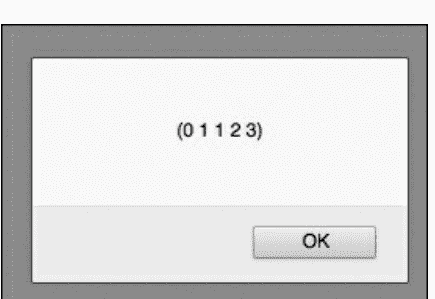

Et voila. All your Clojure-based algorithms can be reused for the web! Now it's your turn to go and explore.
