# Chapter 6. Concurrency and Parallelism

In this chapter, we will cover the following topics:

- Solving concurrent problems using Clojure
- Distributed actor-based dev with Akka
- Using Spyglass and Couchbase to share state between JVMs
- Reactive programming with meltdown
- Bridging core.async
- On Quasar/Pulsar

### Introduction

In this chapter, we will learn about the concurrency and parallelism that Clojure provides. First, we will take a look at concurrency and parallelism features. Next, we will try to use Scala's Akka library and Spyglass. Then we will learn Quasar/Pulsar, which are fibers, channels, and actors for Clojure and Java used in Netflix. Finally, we will have a look at meltdown, a nice Clojure wrapper for Reactor, which is a toolkit for asynchronous programming, event passing, and stream processing.

## Solving concurrent problems using Clojure

In this recipe, we will learn Clojure's atoms, refs, and agents. Then we will have a look at Clojure's parallel features.

### Getting ready

In this recipe, we will not use an external library. So, the only necessary thing is to start REPL to run code.

### How to do it...

Clojure provides solutions for the concurrency problem. Clojure's vars defined in `def` are ensured only in single thread and are not safe in concurrent environments. Clojure provides three types of resources for concurrent problem. Here, we will introduce you atoms, refs, and agents that work in concurrent environments.

### Using atoms

Atoms provide a way to manage shared, synchronous, and independent states.

#### Creating and referring atom

The `atom` function sets the initial value to atom. The following code initializes the atom to 1 and sets the atom to the var x:

```
(def x (atom 1))
;;=? #'chapter06.concurrency/x
```

So, the value of x binds to Atom instance:

```
x
;;=> #<Atom@541e8f8d: 1>
```

To see the values of the atoms, use the `deref` macro or the reader macro

```
@:

(deref x)
;;=> 1
@x
;;=> 1
```

#### Updating atom

There are a couple of ways to update atoms. The swap atomically applies a function to the original value and sets the atom to it:

```
(swap! x inc)
;;=> 2
@x
;;=> 2
(swap! x (partial + 1))
;;=> 3
```

The following image shows how the atom value changes by swap:

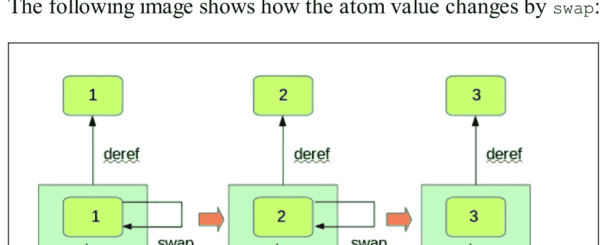

The reset! function sets the value of atom regardless of the current value of atom:

```
(reset! x 1)
;;=> 1
x
;;=> #<Atom@541e8f8d: 1>
```

#### Using validator

There is a validation mechanism for atom. Atom's validators check values of atoms. The following code checks the atom value should be less than 5:

```
(def y (atom 1 :validator (partial > 5)))
;;=> #'chapter06.concurrency/y
(swap! y (partial + 2))
;;=> 3
(swap! y (partial + 2))
;;=> IllegalStateException Invalid reference state
clojure.lang.ARef.validate (ARef.java:33)
```

#### Using CAS operation

**Compare-and-swap (CAS)** is an atomic instruction used in concurrent environments and achieves synchronization between race conditions. In Clojure, the `compare-and-set!` function updates the value of the `new-value` atom if the current value of the atom equals the `old-value`. The syntax is as follows:

```
(compare-and-set! atom old-value new-value)
```

The next function we define gets the current value of the atom, sleeps for the interval, and updates the value of atom using the `compare-and-set!`:

```
(defn cas-test! [my-atom interval]
  (let [v @my-atom u (inc @my-atom)]
    (println "current value = " v ", updated value = " u)
    (Thread/sleep interval)
    (println "updated " (compare-and-set! my-atom v u))))
;;=> #'chapter06.concurrency/cas-test!
```

Let's define an atom and see how `compare-and-set!` works:

```
(def x (atom 1))
;;=> #'chapter06.concurrency/x
```

The following test code updates twice by CAS operations, but both updates are successful since two updates occur sequentially and no race condition occurs:

```
```clojure
(do
  (cas-test! x 20)
  (cas-test! x 30))
;;=> current value = 1 , updated value = 2
;;=> updated true
;;=> current value = 2, updated value = 3
;;=> updated true
```
```

The following diagram depicts how two updates change the value of x:

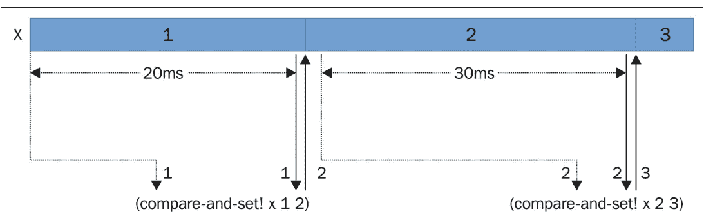

In the following code, concurrent updates cause a race condition, and the later update fails since the original value has been updated by the other:

```
```clojure
(do
  (def x (atom 1))
  (future (cas-test! x 20))
  (future (cas-test! x 30)))
;;=> current value = 1 , updated value = 2
;;=> current value = 1 , updated value = 2
;;=> updated true
;;=> updated false
```
```

In the following diagram, two updates make a race condition, and the later update fails because the earlier update changes the value of the x:

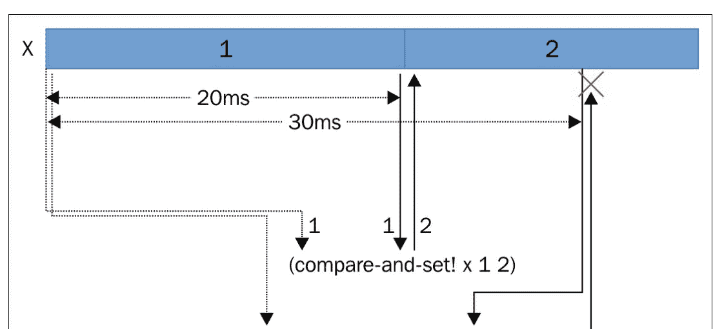

## Software Transactional Memory using ref and dosync

Software Transactional Memory (STM) provides transactional accesses to multiple resources on memory. STM coordinates multiple resources in a transaction and provides consistency, atomicity, and isolation. Inside dosync, resources defined by ref are coordinated.

Let's look at how STM works in Clojure. In the following example code, we use the ref, dosync, and alter functions for STM transactions.

#### Creating ref

The ref function creates a ref with an initial value. makoto-account and nico-account exist. They are credit balances for two customers. The ref function creates a ref, whose value is a map:

```
(def makoto-account (ref {:name "Makoto Hashimoto" :amount 1000}))
;;=> #'chapter06.concurrency/makoto-account
(def nico-account (ref {:name "Nicolas Modrzyk" :amount 2000}))
;;=> #'chapter06.concurrency/nico-account
```

#### Updating refs using alter

Then, the following transfer! function executes a transaction moving the amount of money between the from account and the to account:

```
(defn transfer! [from to amount]
  (dosync
    (println "transfer money from " (:name @from) " to " (:name @to) " amount = " amount " begins")
    (alter from assoc :amount (- (:amount @from) amount))
    (Thread/sleep 500)
    (alter to assoc :amount (+ (:amount @to) amount))
    (println "Now, " (:name @from) " amount is " (:amount @from) " and " (:name @to) " amount is " (:amount @to))
    ))
;;=> #'chapter06.concurrency/transfer!
```

There are a couple of alter calls inside the dosync in the transfer! function that form a transaction. Let's test to transfer 10 dollars from Makoto to Nicolas:

```
(transfer! makoto-account nico-account 10)
;;=> transfer money from Makoto to Nicolas amount = 10 begins
::=> Now, Makoto amount is 990 and Nicolas amount is 2010
;;=> nil
@nico-account
;;=> {:name "Nicolas Modrzyk", :amount 2010}
(deref makoto-account)
;;=> {:name "Makoto Hashimoto", :amount 990}
```

Great! It works correctly.

Then, let's run two transactions concurrently and see how they work. The first transaction transfers 200 dollars from Makoto to Nico and the second transaction transfers 300 dollars in the same direction:

```
(do
  (future
    (transfer! makoto-account nico-account 200))
  (future
    (transfer! makoto-account nico-account 300)))
;;=> transfer money from Makoto Hashimoto to Nicolas Modrzyk amount = 200 begins
;;=> #<Future@473dad05: :pending>


; ;=> 从 Makoto Hashimoto 转账到 Nicolas Modrzyk
amount = 300 begins
; ;=> 从 Makoto Hashimoto 转账到 Nicolas Modrzyk
amount = 300 begins
; ;=> 从 Makoto Hashimoto 转账到 Nicolas Modrzyk
amount = 300 begins
; ;=> 从 Makoto Hashimoto 转账到 Nicolas Modrzyk
amount = 300 begins
; ;=> 从 Makoto Hashimoto 转账到 Nicolas Modrzyk
amount = 300 begins
; ;=> 现在，Makoto Hashimoto 余额为 790，Nicolas
Modrzyk 余额为 2210
; ;=> 从 Makoto Hashimoto 转账到 Nicolas Modrzyk
amount = 300 begins
; ;=> 现在，Makoto Hashimoto 余额为 490，Nicolas
Modrzyk 余额为 2510

第二个事务等待第一个事务完成。第二个事务尝试更新同一个 ref 但失败了五次，因为同一个 ref 的更新被第一个转账阻塞了！在第一个事务完成后，第二个事务成功执行更新。

## 使用 ensure

ensure 函数保护 ref 不会在前一个更新正在进行时尝试更新。在下面的代码中，ensure-transfer! 函数为 transfer 添加了 ensure：

```
(defn ensure-transfer! [from to amount]
  (dosync
    (ensure from)
    (println "transfer money from " (:name @from)
             " to " (:name @to) " amount = " amount " begins")
    (alter from assoc :amount (- (:amount @from) amount))
    (Thread/sleep 500)
    (alter to assoc :amount (+ (:amount @to) amount))
    (println "Now, " (:name @from) " amount is " (:amount @from)
             " and " (:name @to) " amount is " (:amount @to))))
; ;=> #'chapter06.concurrency/ensure-transfer!
```

让我们测试前面的代码：

```
(do
    (future
        (ensure-transfer! nico-account makoto-account 100))
    (future
        (ensure-transfer! nico-account makoto-account 200)))
;;=> transfer money from Nicolas Modrzyk to Makoto Hashimoto
amount = 100 begins
;;=> Now, Nicolas Modrzyk amount is 2410 and Makoto
Hashimoto amount is 590
;;=> transfer money from Nicolas Modrzyk to Makoto Hashimoto
amount = 200 begins
;;=> Now, Nicolas Modrzyk amount is 2210 and Makoto
Hashimoto amount is 790
```

后续事务要等到前一个事务完成才尝试更新。

## 使用 watcher 和改进的事务代码

Using watcher traces modifications of refs. We will look at how it works.
The following add-watcher function adds a watcher for a ref:

```
(defn add-watcher [ref]
  (add-watch ref :watcher
    (fn [_ _ old-state new-state]
      (prn "--- ref changed --- " old-state " => " new-state)
      )))
;;=> #'chapter06.concurrency/add-watcher
(add-watcher makoto-account)
;;=> #ref[{:status :ready, :val {:name "Makoto Hashimoto", :amount 1000}} 0x52f5973a]
(add-watcher nico-account)
;;=> #ref[{:status :ready, :val {:name "Nicolas Modrzyk", :amount 2000}} 0x7ecca962]
```

然后，我们将改进之前的 ensure-transfer! 函数并将其名称改为 refined-transfer!：

```
(defn refined-transfer! [from to amount]
  (dosync
    (ensure from)
    (if (<= (- (:amount @from) amount) 0)
      (throw (Exception. "insufficient amount")))
    (alter from assoc :amount (- (:amount @from) amount))
(Thread/sleep 500)
(alter to assoc :amount (+ (:amount @to) amount)))
;;=> #'chapter06.concurrency/refined-transfer!
```

让我们使用 ref-set 设置 ref 的值：

```
(do
  (ref-set makoto-account {:name "Makoto Hashimoto" :amount 1000})
  (ref-set nico-account {:name "Nicolas Modrzyk" :amount 2000}))
;;=> IllegalStateException No transaction running
clojure.lang.LockingTransaction.getEx
(LockingTransaction.java:208)
```

哦！ref_set 应该在 dosync 内部调用。让我们再试一次：

```
(dosync
  (ref-set makoto-account {:name "Makoto Hashimoto" :amount 1000})
  (ref-set nico-account {:name "Nicolas Modrzyk" :amount 2000}))
;;=> "---- ref changed --- " {:name "Nicolas Modrzyk", :amount 2000} " => " {:name "Nicolas Modrzyk", :amount 2000}
;;=> "---- ref changed --- " {:name "Makoto Hashimoto", :amount 1000} " => " {:name "Makoto Hashimoto", :amount 1000}
;;=> {:name "Nicolas Modrzyk", :amount 2000}
```

更新成功，并且 watcher 检测到修改并打印消息。现在，让我们并发测试 refined-transfer! 函数：

```
(do
  (future
    (refined-transfer! makoto-account nico-account 100))
  (future
    (refined-transfer! nico-account makoto-account 300)))
;;=> #<Future@4c041c9: :pending>
;;=> "---- ref changed --- " {:name "Nicolas Modrzyk", :amount 2000} " => " {:name "Nicolas Modrzyk", :amount 2100}
;;=> "---- ref changed --- " {:name "Makoto Hashimoto", :amount 1000} " => " {:name "Makoto Hashimoto", :amount 900}
;;=> "---- ref changed --- " {:name "Nicolas Modrzyk", :amount 2100} " => " {:name "Nicolas Modrzyk", :amount 1800}
; ;=> "---- ref changed --- " {:name "Makoto Hashimoto", :amount 900} " => " {:name "Makoto Hashimoto", :amount 1200}
```

它运行良好！

让我们检查 refined-transfer! 中余额不得为负的控制是否正确工作。以下表达式将 1,500 美元从 Makoto 转移到 Nico，但 Makoto 的余额为 1,200 美元：

```
(refined-transfer! makoto-account nico-account 1500)
; ;=> Exception insufficient bound
chapter06.concurrency/transfer!/fn--20708 (form-init8938610057865502322.clj:87)
```

## 使用 commute

让我们看另一个使用 STM 的示例。下面的函数启动一个事务，休眠 500 毫秒，并向 ref 变量添加值：

```
(defn alter-add! [var val]
  (dosync
    (Thread/sleep 500)
    (alter var  (partial + val))))
; ;=> #'chapter06.concurrency/alter-add!
```

让我们并发运行五个线程，并使用 future 调用测量完成所有更新所需的时间：

```
(do
  (def v1 (ref 10))
  (time
    (doseq
      [x [
        (future (alter-add! v1 10))
        (future (alter-add! v1 10))
        (future (alter-add! v1 10))
        (future (alter-add! v1 10))
        (future (alter-add! v1 10))
      ]]
      @x))
  (println @v1)
)
; ;=> "Elapsed time: 2504.52562 msecs"
; ;=> 60
; ;=> nil
```

在前面的代码中，使用 dosync 中的 alter 会阻塞对同一 ref 的其他访问。因此，完成需要 500 ms * 5 = 2.5 秒。让我们看一下使用 commute 的相同更新。commute-add! 使用 commute 而不是 alter。

commute 是在 dosync 内部更新 refs 的函数，类似于 alter。区别在于使用 alter 提交是有序的，而使用 commute 提交是无序的。alter 检查当前（已更新）值和提交值。如果它们相同，则提交进行。否则没有提交操作并重试。commute 在提交时不检查差异。因此，让我们尝试以下 commute 版本：

```
(defn commute-add! [var val]
  (dosync
    (Thread/sleep 500)
    (commute var  (partial + val))))
; ;=> #'chapter06.concurrency/commute-add!
```

我们将测量使用 commute 进行更新的性能：

```
(do
  (def v1 (ref 10))
  (time
    (doseq
      [x [(future (commute-add! v1 10))
          (future (commute-add! v1 10))
          (future (commute-add! v1 10))
          (future (commute-add! v1 10))
          (future (commute-add! v1 10))]]
      @x))
    (println @v1)
  )
; ;=> "Elapsed time: 503.967362 msecs"
; ;=> 60
```

commute 版本比 alter 快，并且在高度并发的环境中运行，但更新操作应该是可交换的。

## 使用 agents

Agents 异步地变异状态。在这里，我们将学习如何创建 agents 并更新它们的值。

### 创建 agents

要创建 agent，我们将使用 `agent` 和初始值。我们将定义 `simple-agent`，其状态为零，并将异步更新：

```
(def simple-agent (agent 0))
;;=> #'chapter06.concurrency/simple-agent
simple-agent
;;=> #agent[{:status :ready, :val 0} 0x3aa1d3cc]
```

### 更新 agents

要更新现有的 agents，请使用 `send` 和更新函数。以下示例显示使用 `inc` 更新 `simple-agent`，并且 agent 值的结果将为 1：

```
(send simple-agent inc)
;;=> #agent[{:status :ready, :val 0} 0x3aa1d3cc]
@simple-agent
;;=> 1
```

让我们看下一个示例，其中 agent 表示名称和位置：

```
(def makoto-agent (agent {:name "Makoto" :location [100 200]}))
;;=> #'chapter06.concurrency/makoto-agent
```

`move` 函数移动 `dx` 和 `dy` 并花费 `t` 毫秒：

```
(defn move [a dx dy t]
  (println "moving takes " t "msecs")
  (Thread/sleep t)
  (assoc a :location
         [(+ ((:location a) 0) dx)
          (+ ((:location a) 1) dy)]))
;;=> #'chapter06.concurrency/move
```


```
(do
  (send makoto-agent move 10 20 1000)
  (println makoto-agent)
  (await makoto-agent)
  (println makoto-agent))
;;=> moving takes  1000 msecs
;;=> #agent[{:status :ready, :val {:name Makoto, :location [100 200]}} 0x34a8e8f]
;;=> #agent[{:status :ready, :val {:name Makoto, :location [110 220]}} 0x34a8e8f]
```

## How it works...

这里，我们将总结三种引用类型、STM 以及 alter/commute。

## Summary of three reference types in Clojure

并发操作可以分为协调/非协调以及同步/异步。

### Coordinated/uncoordinated

协调操作会在多个资源之间保持一致性。我们之前看到过在账户之间转账的例子。这需要一个协调操作。另一方面，非协调操作只对单个资源保持一致性。

### Synchronous/asynchronous

同步操作会等待其执行完成。异步操作只触发执行并且不等待。

我们将这三种引用类型总结在下面的表格中：

| Left align | Coordinated | Uncoordinated |
|------------|-------------|---------------|
| Synchronous | Refs | Atoms |
| Asynchronous | --- | Agents |

## How STM works in Clojure

STM 支持对共享资源的并发访问。STM 不使用基于锁的同步。相反，它使用 **Multiversion of Concurrency Control** (**MVCC**) 来解决对共享资源的并发更新。

使用 MVCC，每个事务都有状态的私有副本，并检查状态是否被其他事务更新。如果没有其他事务的更新，事务就会提交，否则该事务会回滚并重试。

数据库机制的传统事务具有 **ACID** (**Atomicity, Consistency, Isolation, and Durability**) 属性。然而，由于 STM 不持久化状态，因此它不具有 Durability 特性。

## Alter and commute

当更新的顺序无关紧要时，`commute` 比 `alter` 更快。对计数器的并发进程更新时，无论何时更新，结果都相同。在这种情况下可以使用 `commute`。

## There's more...

我们将在这里展示与并行相关的函数。让我们从 `promise` 和 `deliver` 开始。

## promise and deliver

`promise` 在 `deliver` 设置其值之前延迟其执行。让我们看一个简单的例子。x、y 和 z 由 `promise` 定义：

```
(def x (promise))
;;=> #'chapter06.concurrency/x
(def y (promise))
;;=> #'chapter06.concurrency/y
(def z (promise))
;;=> #'chapter06.concurrency/z
```

在下面的代码中，线程正在等待 deliver 对 x 和 y 的实现：

```
(future
  (do (deliver z (+ @x @y))
    (println "z value : " @z)))
```

var z 尚未实现：

```
(realized? z)
;;=> false
```

然后我们将通过 deliver 实现 x 和 y：

```
(deliver x 1)
;;=> #promise[{:status :ready, :val 1} 0x2f5df579]
(deliver y 1)
;;=> #promise[{:status :ready, :val 1} 0x1614985]
;;=> z value :  2
```

当 x 和 y 的值都被设置后，z 被计算，并且由 future 创建的线程退出：

```
@z
;;=> 2
```

我们将展示另一个例子。我们假设多个产品已准备就绪，并且已发生发货指令。

在下面的代码中，Order 记录具有 name、price 和 qty 属性：

```
(defrecord Order [name price qty])
;; => chapter06.concurrency.Order
```

merge-products 函数计算总价并将产品信息合并为一个向量：

```
(defn merge-products [m1 m2]
  {:total-price
   (+ (* (.price x) (.qty x)) (* (.price y) (.qty y)))}
  [m1 m2])
;; => #'chapter06.concurrency/merge-products
```

ship-products_ issues 函数在两个产品准备好发货时下单：

```
(defn ship-products [x y z]
  (deliver z (merge-products @x @y))
  (println "We can ship products  " @z))
;; => #'chapter06.concurrency/ship-products
```

deliver-product 函数通知产品已准备好发货并附带其价格：

```
(defn deliver-product [p name price]
  (deliver p [name price]))
;; => #'chapter06.concurrency/deliver-product
```

然后我们将相应地定义 product-a、product-b 和 shipping-ab 函数：

```
(def product-a (promise))
;; => #'chapter06.concurrency/product-a
(def product-b (promise))
;; => #'chapter06.concurrency/product-b
(def shipping-ab (promise))
;; => #'chapter06.concurrency/shipping-ab
```

让我们运行 ship-products 函数，该函数等待 product-a 和 product-b 准备就绪：

```
(future (ship-products product-a product-b shipping-ab))
;; => #future[{:status :pending, :val nil} 0x347af059]
```

product-a 和 product-b 已准备好发货，_ship-products 计算总价并下达发货订单：

```
(deliver product-a (->Order "book" 10.1 5))
;; => #promise[{:status :ready, :val
#chapter06.concurrency.Order{:name "book", :price 10.1, :qty 5}} 0x1a198bfe]
(deliver product-b (->Order "pencil" 2.1 10))
;; => #promise[{:status :ready, :val
#chapter06.concurrency.Order{:name "pencil", :price 2.1, :qty 10}} 0x458b44f6]
;;=> We can ship products  [#chapter06.concurrency.Order{:name book, :price 10.1, :qty 5} #chapter06.concurrency.Order{:name
pencil, :price 2.1, :qty 10}]
```

## pmap, pcalls, and pvalues

让我们在这里学习 pmap、pcalls 和 pvalues。这三个函数都与并行相关，并使用多核。pmap 函数是 map 的多线程版本。pcalls 和 pvalues 函数可以轻松地创建、执行和加入多线程。

pmap 函数有效地利用多核。它为元素的处理分配线程。然而，将过小的任务分配给线程会产生开销，并且比原始 map 更慢：

让我们研究 pmap 的性能方面。在下面的代码中，它根据边长计算立方体的体积：

```
(time (doall (map #(* % % %) (repeatedly 100 rand))))
;;=> "Elapsed time: 78.548941 msecs"
(time (doall (pmap #(* % % %) (repeatedly 100 rand))))
;;=> "Elapsed time: 184.195486 msecs"
```

对于前面的例子，原生的 map 更快。假设计算需要更长时间，pmap 更快：

```
(time (doall (map #(do (Thread/sleep 10) (* % % %)) (repeatedly 100 rand))))
;;=> "Elapsed time: 1012.360687 msecs"
(time (doall (pmap #(do (Thread/sleep 10) (* % % %)) (repeatedly 100 rand))))
;;=> "Elapsed time: 156.927029 msecs"
```

## pcalls

pcalls 并行执行函数并返回它们的值的惰性序列：

```
(pcalls fn-1 fn-2 fn-3 ...)
```

下面的代码并发调用 0 - 9999999 和 10000000 - 19999999 的总和，并等待结果作为序列：

```
(time
```

## Distributed actor-based dev with Akka

Akka 是一个由 Lightbend（前身为 Typesafe）开发的并发、分布式和容错的框架和运行时环境。它支持最初在 Erlang 中开发的 actor 模型。因此，Akka 大受 Erlang actor 的启发。

下面的图像显示了通过在 actors 之间发送消息而协作的任务。Actors 通过邮箱发送消息。接收 actors 检查它们的邮箱并处理它们。Actors 可以组织成层次结构。父 actors 可以请求其子 actors 执行子任务：

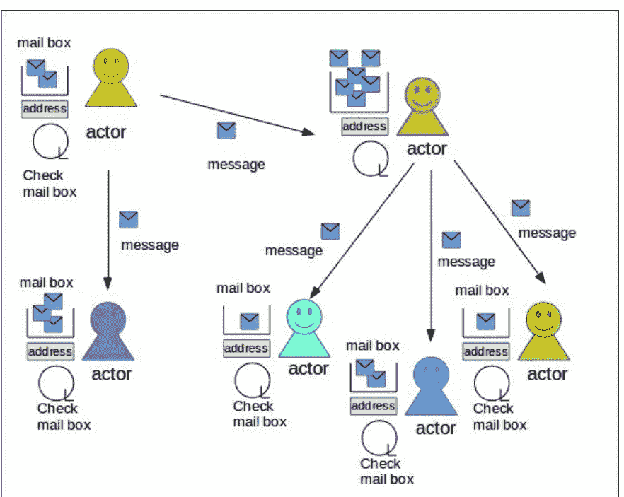

Akka 本身是用 Scala 开发的，但它支持 Java。我们将使用 Okku，一个用于 Akka 的 Clojure 包装器。

## Getting ready

okku 是 Akka 的一个小型包装器。为了运行示例（或您使用的任何其他依赖管理），我们需要在 project.clj 文件中添加 okku：

```
:dependencies
  [[org.clojure/clojure "1.8.0"]
   [org.clojure.gaverhae/okku "0.1.5"]
```

## How to do it...

让我们学习如何通过 okku 使用 Akka！

## Your first okku

让我们声明 okku.core 和一些 akka 库以供使用：

```
(ns chapter06.akka
  (:require [okku.core :as okku])
  (:import [akka.actor Actor Props]
           [akka.event.Logging]))
;;=> nil
```

okku/actor-system 使用其名称创建一个新的 actor 系统：

```
(def actor-system (okku/actor-system "actor-system-1"))
;;=> #'chapter06.akka/actor-system
```

按如下方式关闭 actor 系统：

```
(.shutdown actor-system)
;;=> nil
```

按如下方式使用名称、主机名和端口创建 actor 系统：

```
(def actor-system (okku/actor-system "actor-system-1" :hostname "localhost" :port 9999))
;;=> #'chapter06.akka/actor-system
```

现在，我们将按如下方式定义 actor-1，它接收消息并打印它：


```
(def actor-1
  (okku/spawn
    (okku/actor
      (okku/onReceive [m]
        (println m)))
    :in actor-system :name "print-m"))
;;=> #'chapter06.akka/actor-1
```

The tell function sends a message to an actor:

```
(defn tell [actor message]
  (.tell actor message nil))
;;=> #'chapter06.akka/tell
```

Now, let's send a string message and make sure the actor receives a message:

```
(tell actor-1 "Hello Akka Actor !")
;;=> Hello Akka Actor !
;;=> nil
```

Then, we will send a map message:

```
(tell actor-1 {:name "Makoto" :country "Japan" :message "Hello !"})
;;=> {:name Makoto, :country Japan, :message Hello !}
;;=> nil
```

## Creating actors

okku/actor creates akka.actor.props, and okku/spawn creates Actor objects using props. The following code generates the props object:

```
(def print-props
  (okku/actor
    (okku/onReceive [m]
      (println m))))
;;=> #'chapter06.akka/print-props
```

okku/spawn creates actors using props as follows:

```
(def print-actor
  (okku/spawn
    print-props
    :in actor-system :name "print-actor3"))
```

```
;;=> #'chapter06.akka/print-actor

Then, send a message to `print-actor`:

(tell print-actor "hello !")
;;=> hello !
;;=> nil
```

## Dispatching messages

okku has the `dispatch-on` function to dispatch messages with message types. The following `print-actor-by-key-props`:

```
(def print-actor-by-key-props
  (okku/actor
    (okku/onReceive [{type :type message :message}]
      (okku/dispatch-on type
        :normal (println "message: " message)
        :emergency (println "emergency !!!! : " message)
        :else (println "unhandled type")))))
;;=> #'chapter06.akka/print-actor-by-key-props
(def print-actor-by-key
  (okku/spawn print-actor-by-key-props
              :in actor-system
              :name "print-actor-by-key")
)
;;=> #'chapter06.akka/print-actor-by-key
```

Let's send two types of messages!

```
(tell print-actor-by-key {:type :normal :message "I'm very happy !"})
;;=> message: I'm very happy !
;;=> nil
(tell print-actor-by-key {:type :emergency :message "I don't have money. Please give me some !"})
;;=> emergency !!!! :  I don't have money. Please give me some !
;;=> nil
```

The following is another example of dispatch on classes:

```
(def print-actor-by-type-props
  (okku/actor
    (okku/onReceive [message]
      (okku/dispatch-on (class message)

clojure.lang.PersistentVector (println "vector => "message)

clojure.lang.PersistentArrayMap (println "array-map =>
"message)
clojure.lang.PersistentHashMap (println "hash-map => "message)
:else (println
"unhandled type")
))))
;;=> #'chapter06.akka/print-actor-by-type-props
(def print-actor-by-type
  (okku/spawn print-actor-by-type-props
    :in actor-system
    :name "print-actor-by-type")
)
;;=> #'chapter06.akka/print-actor-by-type
```

## Let's test the preceding code:

```
(tell print-actor-by-type [1 2 3])
;;=> vector =>  [1 2 3]
;;=> nil
(tell print-actor-by-type {:a 1 :b 2})
;;=> array-map =>  {:a 1, :b 2}
;;=> nil
(tell print-actor-by-type {:v1 1 :v2 2 :v3 3 :v4 4 :v5 5 :v6 6
:v7 7 :v8 8 :v9 9})
;;=> hash-map =>  {:v1 1, :v2 2, :v3 3, :v4 4, :v5 5, :v6 6,
:v7 7, :v8 8, :v9 9}
;;=> nil
```

## How it works...

We will explain actor systems and actors in okku.

## Actor system

Actor systems are entry points for actors and manage actors. We can create actors from actor systems. We defined actor-system in the preceding section. Let's see the definition as follows:

```
actor-system
;;=> #object[akka.actor.ActorSystemImpl 0x59236b90
"akka://actor-system-1"]
(class actor-system)
;;=> akka.actor.ActorSystemImpl
```

Okku's actor system is akka.actor.ActorSystemImpl, which is a subclass of akka.actor.ActorSystem, as shown in the following image:

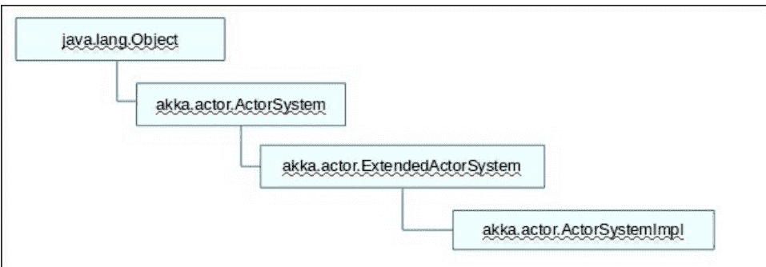

Actor systems have their addresses. The address of our actor system is akka://actor-system-1.

## Understanding actors

Actors have internal states similar to objects in object-oriented systems. However, actors don't have public methods. Instead, actors communicate via mail boxes. Actors usually process messages asynchronously. By default, they process messages in the order of their arrival but it can process different orders using priorities.

Actors sometimes delegate their tasks to child actors. Parent actors generate children and they request subtasks to their child actors. This workflow is explained in the following illustration:

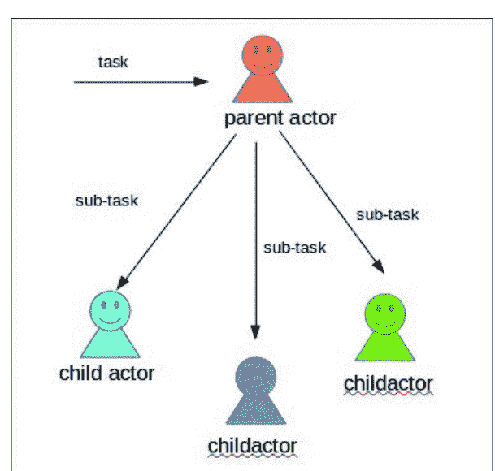

Okku's actor `akka.actor.RepointableActorRef` is created by `okku/spawn__`:

```
print-actor
;;=> #object[akka.actor.RepointableActorRef 0x186dd109 "Actor[akka://actor-system-1/user/print-actor#-652953659]"]
(class print-actor)
;;=> akka.actor.RepointableActorRef
```

Actors are created under an actor system. In the preceding example, `print_actor` is created as follows:

```
akka://actor-system-1/user/print-actor.
```

## There's more...

We will learn an advanced usage for Okku in this recipe.

## Calling remote actors

Here, we will show you how to communicate with remote actors. We will create a new `akka` project named `akka-service` and will define `hello-actor` under `actor-system-1`:

```
$ lein new akka-service
```

Go to the akka-service_ directory and modify _project.clj as follows:

```
:dependencies [
    [org.clojure/clojure "1.8.0"]
    [org.clojure.gaverhae/okku "0.1.5"]
]
```

We have to add the main: section as follows:

```
:main akka-service.core
```

Modify src/akka-service/core.clj as follows and save it:

```
(ns akka-service.core
  (:require [okku.core :as okku]))
(def actor-system (okku/actor-system "actor-system-1"
                    :hostname "localhost"
                    :port 2552))
(defn -main [& args]
  (println "launching akka service ...")
  (okku/spawn
    (okku/actor
      (okku/onReceive [m]
        (println m)))
    :in actor-system :name "hello-actor")
  )
```

The following command runs actor system and actor on localhost, and the port number is 2552:

```
$ lein run
```

The following image shows the output of the preceding command:

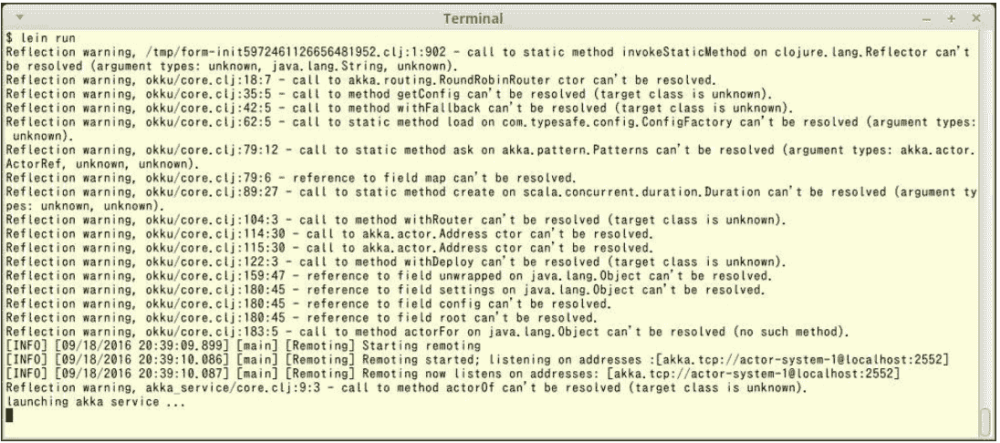

Now, we will access the preceding actor system and actor from the different REPL. So, let's start another REPL as follows:

```
```clojure
$ lein repl
```
```

Then, define namespace and load `okku` library. After that, create an actor system named `actor-system-2` and get the reference of the remote actor:

```
```clojure
(ns okku-client.core
  (:require [okku.core :as okku]))
;;=> nil
(defn tell [actor message]
  (.tell actor message nil))
;;=> #'okku-client.core/tell
(def actor-system
  (okku/actor-system "actor-system-2" :hostname "localhost"
  :port 2553))
;;=> #'okku-client.core/actor-system
(def actor-ref (okku/lookup
                "akka.tcp://actor-system-1@localhost:2552/user/hello-
actor"
                :in actor-system))
;;=> #'okku-client.core/actor-ref
```
```

The name of the remote actor system is `actor-system-1` and its port is

2552. The path to the target actor is /user/hello-actor/.

Let's invoke the remote actor via the reference:

```
(tell actor-ref "hello remote akka !")
;;=> nil
```

We can see the message in another REPL:

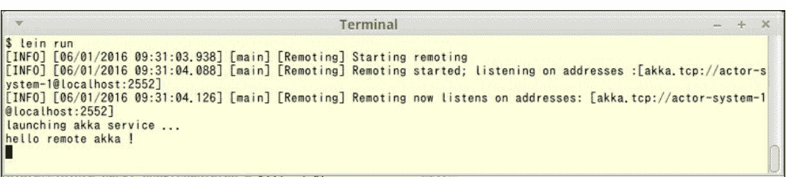

## Request and reply

We will implement request/reply messages between actors. Since communications between actors are asynchronous, receivers should reply to messages explicitly using okku.core/!

Let's restart the actor system:

```
(.shutdown actor-system)
;;=> nil
(def actor-system (okku/actor-system "actor-system-1" :hostname "localhost"))
;;=> #'chapter06.akka/actor-system
```

We will define stock-service-requester and stock-service-requester-actor to request the current stock price of the company. declare for stock-service-actor is necessary because it will be defined after the definition of stock-service-requester:

```
(declare stock-service-actor)
;;=> #'chapter06.akka/stock-service-actor
(def stock-service-requester
  (okku/actor


```
(okku/onReceive [{t :type m :message}]
    (okku/dispatch-on t
        :request
        (tell stock-service-actor
m)
        :reply
        (do
            (println (str "price of " (:company m) " is " (:price m)))))))
;;=> #'chapter06.akka/stock-service-requester
(def stock-service-requester-actor
    (okku/spawn
        stock-service-requester
        :in actor-system))
;;=> #'chapter06.akka/stock-service-requester-actor
```

然后，我们将定义 stock-service 和 stock-service-actor：

```
(def stock-service
    (let [stocks {"google" 10.0 "amazon" 200.0 "facebook" 10.0 "twitter" 20.0 "linkedin" 5.0}]
        (okku/actor
            (okku/onReceive [{company :company}]
                (okku/! stock-service-requester-actor
                    {:type :reply :message {:company company :price (stocks company)}})))))
;;=> #'chapter06.akka/stock-service
(def stock-service-actor
    (okku/spawn
        stock-service
        :in actor-system))
;;=> #'chapter06.akka/stock-service-actor
```

stock-service 接收公司名称并返回对应的价格。让我们按如下方式获取 Google 和 Amazon 的股价：

```
(tell stock-service-requester-actor {:type :request :message {:company "google"}})
;;=> price of google is 10.0
;;=> nil
(tell stock-service-requester-actor {:type :request :message {:company "amazon"}})
;;=> price of amazon is 200.0
;;=> nil
```

下图描述了 actors 之间的关系以及消息是如何传递的：

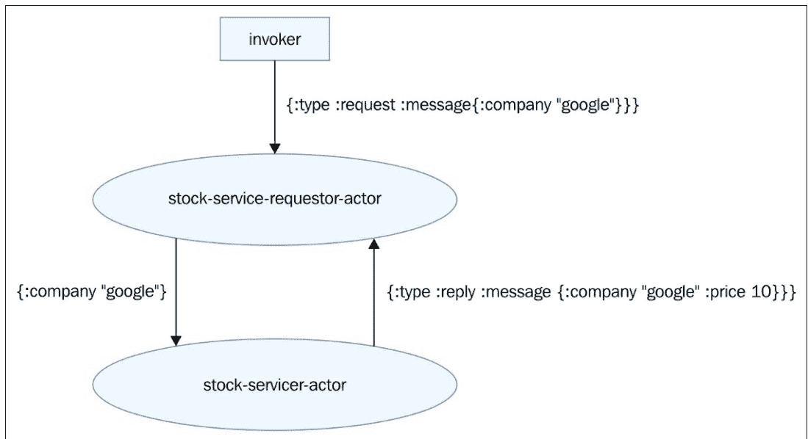

## 另请参阅

访问 Akka 主页 http://akka.io/。

## 使用 Spyglass 和 Couchbase 在 JVM 之间共享状态

Spyglass 是一个非常快的 Memcached 客户端，用于在 JVM 之间共享状态。

Spyglass 是一个未来完整的客户端，支持几乎所有 Memcached 协议操作，以及二进制和文本协议。Spyglass 不仅支持对 Memcached 的同步访问，还支持异步访问。

我们将使用 Couchbase Server 作为 Memcached 服务器，并使用 Spyglass 访问它。

## 准备工作

安装 Couchbase 并设置 Memcached 需要多个步骤。我们将指导你如何操作。

## 在 project.clj 中设置依赖项

你需要在 project.clj 文件中添加 spyglass 以运行示例（或你使用的任何其他依赖管理）：

```
:dependencies
  [[org.clojure/clojure "1.8.0"]
   [clojurewerkz/spyglass "1.0.0"]]
```

## 将 Couchbase Server 设置为 Memcached 服务器

Couchbase Server 是一个出色的超大规模文档型 NoSQL 服务器。Couchbase Server 可以设置为 Memcached 服务器。我们将使用 docker-compose 设置 Couchbase Server。

## 使用 docker-compose 启动 Couchbase Server

我们假设 Docker 已在你的 PC 上安装。按照以下简单步骤启动 Couchbase Server。

## 创建 docker-compose 的目录和文件

让我们创建一个 docker-compose 目录，并在其下创建 docker-compose.yaml：

```
$ cd (your-directory)
$ mkdir docker-couchbase-41
$ cd docker-couchbase-41
```

## 创建并编辑 docker-compose.yaml：

```
couchbase1:
  image: arungupta/couchbase
  volumes:
    - /export/var/couchbase/node41-1:/opt/couchbase/var
couchbase2:
  image: arungupta/couchbase
  volumes:
    - /export/var/couchbase/node41-2:/opt/couchbase/var
couchbase3:
  image: arungupta/couchbase
  volumes:
    - /export/var/couchbase/node41-3:/opt/couchbase/var
  ports:
    - 8091:8091
    - 8092:8092
    - 8093:8093
    - 11210:11210
```

## 启动 Couchbase 集群

以下命令使用 docker-compose 启动一个三节点 Couchbase 集群：

```
$ docker-compose up -d
```

```
$ docker-compose up -d
Unable to find image 'docker/compose:1.5.0' locally
1.5.0: Pulling from docker/compose

f5f17db9ef7c: Pull complete
1a5d7604b84c: Pull complete
edb9562a1a85: Pull complete
83f27339e1ae: Pull complete
fe338db44539: Pull complete
fd10e3d2c1a4: Pull complete
a3ed95caeb02: Pull complete
Digest: sha256:146e95775e3e1a79e0e31632d3b1842f84debed41a222188eb73d6c95163175b
Status: Downloaded newer image for docker/compose:1.5.0
dockercouchbase41_couchbase1_1 is up-to-date
Starting fa82e35b4f_dockercouchbase41_couchbase3_1
Starting dockercouchbase41_couchbase2_1
```

## 检查 Docker 进程是否正在运行

我们将检查 Docker 进程是否正在运行。docker ps 显示 Docker 进程的状态，docker-compose ps 显示 docker-compose 进程的状态：

```
$ docker ps
$ docker-compose ps
```

```
$ docker ps
CONTAINER ID   IMAGE                COMMAND                  CREATED          STATUS          PORTS
96e137dfc3cc   arungupta/couchbase  "/entrypoint.sh /opt/"  3 minutes ago    Up 3 minutes    8091-8093/tcp, 11207/tcp, 11210-11211/tcp, 18091-18
02/tcp          dockercouchbase41_couchbase2_1
ca9790431358   arungupta/couchbase  "/entrypoint.sh /opt/"  3 minutes ago    Up 3 minutes    0.0.0.0:8091-8093->8091-8093/tcp, 11207/tcp, 11211/
tcp, 0.0.0.0:11210->11210/tcp, 18091-18092/tcp   dockercouchbase41_couchbase3_1
6bb9483dff68   arungupta/couchbase  "/entrypoint.sh /opt/"  3 minutes ago    Up 3 minutes    8091-8093/tcp, 11207/tcp, 11210-11211/tcp, 18091-18
02/tcp          dockercouchbase41_couchbase1_1
$ docker-compose ps
Name                           Command                State   Ports
-------------------------------------------------------------------------------
dockercouchbase41_couchbase1_1  /entrypoint.sh /opt/couchb ...  Up      11207/tcp, 11210, 11211/tcp,
18091/tcp, 18092/tcp, 8091/tcp,
8092/tcp, 8093/tcp
dockercouchbase41_couchbase2_1  /entrypoint.sh /opt/couchb ...  Up      11207/tcp, 11210/tcp, 11211/tcp,
18091/tcp, 18092/tcp, 8091/tcp,
8092/tcp, 8093/tcp
dockercouchbase41_couchbase3_1  /entrypoint.sh /opt/couchb ...  Up      11207/tcp, 0.0.0.0:11210->11210/tcp,
11211/tcp, 18091/tcp, 18092/tcp,
0.0.0.0:8091->8091/tcp,
0.0.0.0:8092->8092/tcp,
0.0.0.0:8093->8093/tcp
$
```

```
$ docker inspect --format '{{ .NetworkSettings.IPAddress }}' dockercouchbase41_couchbase1_1
172.17.0.3
$ docker inspect --format '{{ .NetworkSettings.IPAddress }}' dockercouchbase41_couchbase2_1
172.17.0.5
```

```
$ docker inspect --format '{{ .NetworkSettings.IPAddress }}' dockercouchbase41_couchbase3_1
172.17.0.4
```

```
$ docker inspect --format '{{ .NetworkSettings.IPAddress }}' dockercouchbase41_couchbase1_1
172.17.0.3
$ docker inspect --format '{{ .NetworkSettings.IPAddress }}' dockercouchbase41_couchbase2_1
172.17.0.5
$ docker inspect --format '{{ .NetworkSettings.IPAddress }}' dockercouchbase41_couchbase3_1
172.17.0.4
$
```

## Couchbase 集群摘要

我们总结了 Couchbase 集群的节点名称、Docker 进程名称、IP地址和 Couchbase 安装目录，如下表所示：

| 节点 | Docker 进程名称 | IP 地址 | Couchbase 安装目录 |
|---|---|---|---|
| couchbase1 | dockercouchbase41_couchbase1_1 | 172.17.0.3 | /export/var/couchbase/node41-1 |
| couchbase2 | dockercouchbase41_couchbase1_2 | 172.17.0.5 | /export/var/couchbase/node41-2 |
| couchbase3 | dockercouchbase41_couchbase1_3 | 172.17.0.4 | /export/var/couchbase/node41-3 |

## 使用 Couchbase Web 管理员控制台

让我们设置一个由三个节点组成的集群。

## 登录 Web 控制台

如果你成功启动 Couchbase，你可以通过打开以下 URL 访问 Web 管理员控制台：
http://localhost:8091

系统会要求你输入用户名和密码，因此分别输入 Administrator 和 password，如以下屏幕截图所示：


如果你能登录控制台，则会出现以下页面。如果登录失败，请检查用户名和密码是否正确：

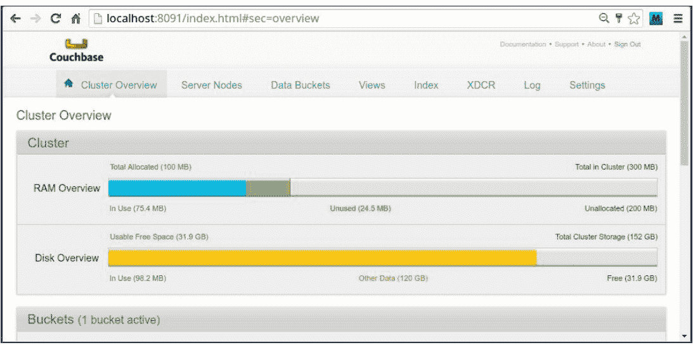

## 向集群添加节点

我们将向集群添加两个节点。点击浏览器中的 Server Nodes 进入服务器节点标签，如以下屏幕截图所示：


在前一页中，只有 IP 为 172.17.0.4 的节点加入了集群。

## 添加集群

让我们添加节点 172.17.0.3 和 172.17.0.5。点击 Add Server 并输入 172.17.0.3 作为 Server IP Address，password 作为 Password，如以下屏幕截图所示：


点击 **Add Server** 并输入 172.17.0.5 作为 **Server IP Address**，密码作为 **Password**，如下一个截图所示：


添加两个服务器后，我们会看到以下页面，显示需要进行rebalance。Rebalance 将相同数量的数据在集群节点之间进行分配。

点击 Rebalance 选项并等待 rebalance 完成：

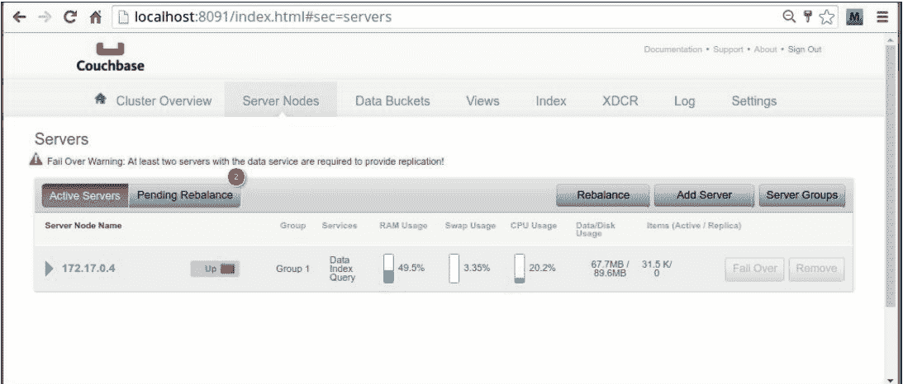

以下截图显示 rebalance 正在进行中：

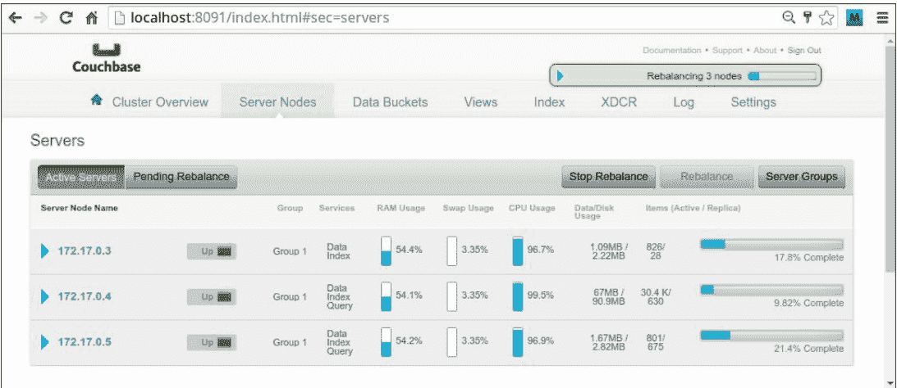

## 定义 Memcached bucket

进入 **Data Bucket** 选项卡并点击 **Create New Data Bucket** 选项：


让我们为新的 Memcached bucket 指定参数：

## 创建 Bucket

### Bucket 设置

Bucket Name: memcached-1
Bucket Type: Couchbase
Memcached

### 内存大小

Per Node RAM Quota: 128 MB
Cluster quota (900 MB)
Other Buckets (300 MB)  This Bucket (384 MB)  Free (216 MB)
Total bucket size = 384 MB (128 MB x 3 nodes)

### 访问控制

Standard port (TCP port 11211. Needs SASL auth.)
Enter password:
Dedicated port (supports ASCII protocol and is auth-less)
Protocol Port: 11212

### Flush

Enable  What's this?

我们将在下表中回顾参数：

| Parameter | Value |
|---|---|
| Bucket Name | memcached-1 |
| Bucket Type | Memcached |
| Per Node Ram Quota | 128 or higher |
| Access Control | Dedicated port |
| Protocol Port | 11212 |

在以下截图中，我们可以看到 memcached-1 bucket 已被创建：


现在，我们可以用 Couchbase Server 作为 Memcached 服务器！

## 如何操作...

那么，让我们尝试使用 Spyglass 来操作我们之前定义的 Couchbase 上的 Memcached。

### 定义使用 Spyglass 库

让我们先定义 clojurewerkz.spyglass.client：

```
(ns spyglass-example.core
  (:require [clojurewerkz.spyglass.client :as c]))
```

### 连接服务器

要连接 Memcached 服务器，使用 clojurewerkz.spyglass.client/text-connection：

```
(def tc (c/text-connection
"172.17.0.3:11212 172.17.0.4:11212 172.17.0.5:11212"))
;;=> #'spyglass-example.core/tc
```

text-connection 参数是一个字符串，可能包含多个由空格分隔的地址，如前所示。

### 设置值

设置值的语法如下：

```
(clojurewerkz.spyglass.client/text-connection connection key time-to-live-in-second value)
```

让我们为不同数据类型设置键：

```
(c/set tc "key-1" 0 "Hello !")
;;=> #clojurewerkz.spyglass.OperationFuture[{ :status :ready,
:val true} 0x50b6f787]
(c/set tc "key-1" 0 "Hello !")
;;=> #clojurewerkz.spyglass.OperationFuture[{ :status :ready,
:val true} 0x50b6f787]
(c/set tc "key-2" 0 1)
;;=> #clojurewerkz.spyglass.OperationFuture[{ :status :ready,
:val true} 0x81bbd8a]
(c/set tc "key-3" 0  [1 2 3])
;;=> #clojurewerkz.spyglass.OperationFuture[{ :status :ready,
:val true} 0x2e6b1c50]
```

### 从另一个 REPL 获取值

让我们启动另一个 REPL，以便我们可以在 JVM 之间共享内存中的数据：

```
$ lein repl
```

REPL 就绪后，让我们获取值：

```
(ns spyglass-example.core
  (:require [clojurewerkz.spyglass.client :as c]))
;;=> nil
(def tc (c/text-connection
"172.17.0.3:11212 172.17.0.4:11212 172.17.0.5:11212"))
;;=> #'spyglass-example.core/tc
```

```
(c/get tc "key-1")
;;=> "Hello !"
(c/get tc "key-2")
;;=> 1
(c/get tc "key-3")
;;=> [1 2 3]
```

### 测试生存时间

以下代码显示生存时间参数工作正确。我们将该参数设置为 3 秒并检查值在 3 秒后是否过期：

```
(let [tc (c/text-connection
"172.17.0.3:11212 172.17.0.4:11212
172.17.0.5:11212")]
  (c/set tc "key-1" 3  "Hello !")
  (println (c/get tc "key-1"))
  (println "sleeping ....")
  (Thread/sleep 3100)
  (println (c/get tc "key-1"))
  (c/shutdown tc))
;;=> Hello !
;;=> sleeping ....
;;=> nil
```

### 断开连接

要断开连接，使用 clojurewerkz.spyglass.client/shutdown：

```
(c/shutdown tc)
;;=> nil
```

## 它是如何工作的...

我们将简要描述 Memcached 和 Couchbase。

### 什么是 Memcached？

Memcached 是一个常用的分布式键值系统。它经常被用来通过将数据和对象缓存到内存中来提高性能，加速网站，减少对数据库的访问。

Memcached 最初由 Danga Interactive 为 LiveJournal 开发，但现在被许多其他系统使用，包括 Google、Facebook、Twitter 和其他知名公司。

Memcached 的 API 提供了一个跨多台机器分布的非常大的哈希表。当表已满时，后续的插入会导致旧数据按最近最少使用顺序被清除。

### 从 Telnet 访问 Memcached

Memcached 支持 Telnet 访问来操作缓存数据。让我们试试。如果已关闭，请在 REPL 中重新启动连接：

```
(def tc (c/text-connection
"172.17.0.3:11212 172.17.0.4:11212 172.17.0.5:11212"))
;;=> #'spyglass-example.core/tc
```

让我们进入终端并发出 Telnet 以连接到 Memcached 服务器：

```
$ telnet 172.17.0.3 11212
set key-1 0 60 5
test!
STORED
get key-1
VALUE key-1 0 5
test!
END
```

前面的命令使用 Telnet 访问 Memcached，进入你的 REPL 并设置 key-1 的值并获取它。到目前为止，让我们进入 REPL 获取 key-1 的值：

```
(c/get tc "key-1")
;;=> "test!"
(c/set tc "key-2" 100 "Hello !")
;;=> #clojurewerkz.spyglass.OperationFuture[{:status :ready,
:val true} 0x171ca0f1]
;;=> 1
```

再次切换到终端并发出以下命令：

```
get key-2
VALUE key-2 0 7
Hello !
END

quit
Connection closed by foreign host.
```


### Couchbase Server

Couchbase Server 是一个具有高性能、高可扩展性和高可用性的分布式 NoSQL 文档数据库服务器。Couchbase 集群可以由多达数百个节点组成以提供超高性能。Couchbase 中的 bucket 是类似于 DBMS 数据库或模式的一组文档。

有两种类型的 bucket：

- 一种是 Couchbase bucket 类型，提供基于 JSON 的文档数据库
- 另一种是 Memcached bucket 类型

我们使用后者类型。以下图表是我们运行在 Docker 容器上的 Couchbase 集群：

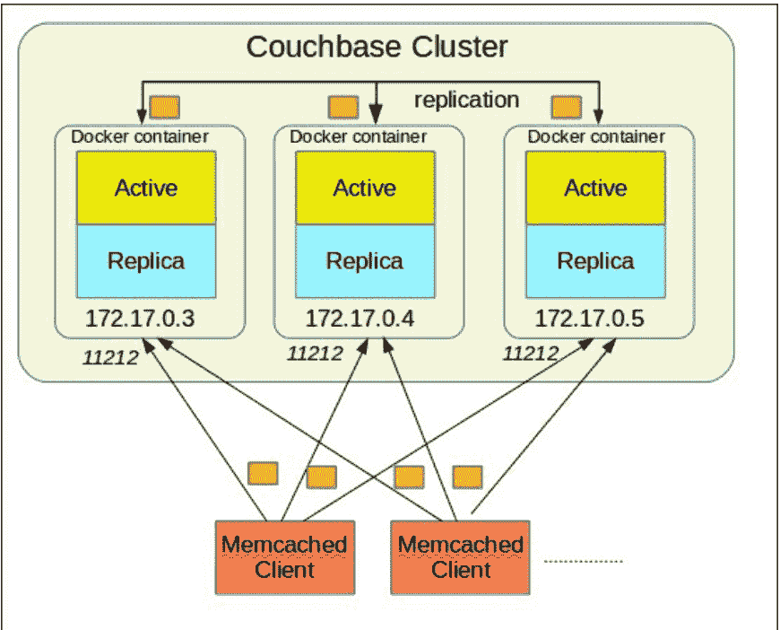

## 还有更多...

spyglass 有三个高级主题。让我们试试！

### 使用 get-multi

get-multi 一次获取多个值。让我们测试以下代码：

```
(doseq [x (range 1 11)]
  (c/set tc (str "key-" x) 300 (str "Hello " x " !")))
;;=> nil
```

我们将在不同的 REPL（JVM）中测试以下代码以获取结果：

```
(def x
  (c/get-multi tc (mapv #(str "key-" %) (range 1 11))))
;;=> #'spyglass-example.core/x
(println x)
;;=> {key-2 Hello 2 !, key-9 Hello 9 !, key-8 Hello 8 !, key-3
Hello 3 !, key-4 Hello 4 !, key-5 Hello 5 !, key-1 Hello 1 !, key-7 Hello 7 !, key-6 Hello 6 !}
;;=> nil
```

### 使用 async-get

async-get 将结果异步获取到 future 中。要获取结果，使用 deref 或 @：

```
(c/set tc "key-1" 300 "Hello !")
;;=> #clojurewerkz.spyglass.OperationFuture[{:status :ready, :val true} 0x3a7b844e]
(def x (c/async-get tc "key-1"))
;;=> #'spyglass-example.core/x
(c/replace tc "key-1" 300 "Good bye !")
;;=> #clojurewerkz.spyglass.OperationFuture[{:status :ready, :val true} 0xf0bd936]
(def x (c/async-get tc "key-1"))
;;=> #'spyglass-example.core/x
@x
;;=> Good bye!
```

在前面的代码中，replace 是用新值替换现有键的值。

### 使用 CAS 操作

Memcached 支持 CAS 操作以解决多线程或多进程环境中的并发问题。Spyglass 也支持它。

下一个语句定义并将 "key-1" 设置为 0：

```
(c/set tc "key-1" 0 0)
;;=> #clojurewerkz.spyglass.OperationFuture[{:status :ready, :val true} 0x4dc54398]
```

我们需要使用以下命令启动两个 REPL：

```
REPL-1
$ lein repl
REPL-2
$ lein repl
```

我们将测试对单个值 "key-1" 的并发更新。因此我们运行


以下代码来自两个 REPL。

在 REPL-1 中：

```
(require '(clojurewerkz.spyglass [client :as c]))
;;=> nil
(defn apply-fn [tc k fn]
  (let [ret (c/get tc k)
        v (fn ret)]
    (c/replace tc k 0 v)))
;;=> #'spyglass-example.core/apply-fn
(def tc (c/text-connection
         "172.17.0.3:11212 172.17.0.4:11212 172.17.0.5:11212"))
;;=> #'spyglass-example.core/tc
```

在 REPL-2 中：

```
(require '(clojurewerkz.spyglass [client :as c]))
;;=> nil
(defn apply-fn [tc k fn]
  (let [ret (c/get tc k)
        v (fn ret)]
    (c/replace tc k 0 v)))
;;=> #'spyglass-example.core/apply-fn
(def tc (c/text-connection
         "172.17.0.3:11212 172.17.0.4:11212 172.17.0.5:11212"))
;;=> #'spyglass-example.core/tc
```

现在让我们同时从两个 REPL 对 "key-1" 进行 10,000 次递增。

在 REPL-1 中：

```
(time
  (dotimes [_ 10000]
    (apply-fn tc "key-1" inc)
    ))
;;=> "Elapsed time: 2472.73951 msecs"
;;=> nil
```

在 REPL-2 中：

```
(time
  (dotimes [_ 10000]
```

```
(apply-fn tc "key-1" inc)))
;;=> "Elapsed time: 2467.011652 msecs"
;;=> nil
```

让我们在 REPL-1 或 REPL-2 中检查 "key-1"。它应该是 20,000：

```
(c/get tc "key-1")
;;=> 17258
```

错误！存在并发问题。

所以让我们使用 CAS 函数做同样的测试。我们将学习 CAS 如何工作。我们将在 REPL-1 或 REPL-2 中运行以下代码。

首先，让我们用简单的代码看看 CAS 如何工作。

clojurewerkz.spyglass.client/gets 获取当前值，而 clojurewerkz.spyglass.client/cas 使用 CAS 更新值。如果 CAS 更新成功，cas 返回 :ok。如果失败，它返回 :exists。

让我们将 "key-1" 设置为 0 并获取其 CAS 值：

```
(c/set tc "key-1" 0 0)
;;=> #clojurewerkz.spyglass.OperationFuture[{:status :ready, :val true} 0x7e0e69e5]
  (def cas-value (:cas (c/gets tc "key-1")))
  ;;=> 80010
  #'user/cas-value
```

前述情况下 CAS 值为 80010。然后我们将使用 cas 函数更新 "key-1"：

```
(c/cas tc "key-1" cas-value 1)
;;=> ok
(c/get tc "key-1")
;;=> 1
```

前述 CAS 操作更新了 CAS 值，并且使用之前的 CAS 值更新失败：

```
(:cas (c/gets tc "key-1"))
;;=> 80011
```

```
(c/cas tc "key-1" cas-value 1)
;;=> :exists
```

因此，让我们定义一个名为 apply-fn-with-cas 的修改版函数，该函数使用 CAS 更新 Memcached 值。我们将在两个 REPL 中定义 apply-fn-with-cas。

# 在 REPL-1 中：

```
(defn apply-fn-with-cas [tc k fn]
  (loop []
    (let [ret (c/gets tc k)
          v (fn (:value ret))]
      (when
        (= (c/cas tc k (:cas ret) v)  :exists)
        (recur)))))
;;=> #'spyglass-example.core/apply-fn-with-cas
```

# 在 REPL-2 中：

```
(defn apply-fn-with-cas [tc k fn]
  (loop []
    (let [ret (c/gets tc k)
          v (fn (:value ret))]
      (when
        (= (c/cas tc k (:cas ret) v)  :exists)
        (recur)))))
;;=> #'spyglass-example.core/apply-fn-with-cas
```

在后一种情况下，apply-fn-with-cas 会重试更新。

让我们再次同时从两个 REPL 对 "key-1" 进行 10,000 次递增。

# 在 REPL-1 中：

```
(time
  (dotimes [_ 10000]
    (apply-fn-with-cas tc "key-1"  inc)))
;;=> "Elapsed time: 4287.262212 msecs"
;;=> nil
```

# 在 REPL-2 中：

```
(time
  (dotimes [_ 10000]
    (apply-fn-with-cas tc "key-1" inc)))
;;=> "Elapsed time: 4559.814013 msecs"
;;=> nil
```

由于并发更新和重试，似乎存在很多冲突并且完成时间较长。但结果是正确的：

```
(c/get tc "key-1")
;;=> 20000
```

最后，让我们停止 Couchbase 集群的容器。

```
$ docker-compose stop
```

## 另请参阅

如需进一步阅读，请参考以下 Couchbase 和 Memcached 协议的链接：

- Couchbase 官方网站 http://www.couchbase.com/
- Memcached 协议 https://github.com/memcached/memcached/blob/master/doc/protocol

## 使用 meltdown 进行响应式编程

Meltdown 为 Clojure 带来了响应式编程的简便性。你的代码现在被转换为一组事件定义和对这些事件的监听器。你的运行代码现在绑定到一个状态（或一组多个状态），并且代码的每个部分现在都可以根据状态的值做出反应。事件流从代码中抽象出来。

假设你正在实现一个全新的邮件软件；屏幕上显示的消息将绑定到一个状态或状态的一部分。电子邮件的可视化表示是对状态本身的直接翻译。如果你需要替换或引入新的电子邮件，你只需向该状态列表添加一些消息。

Meltdown 也可以用作流处理工具包，这意味着你可以以某种方式管道化消息的处理，我们将在本食谱的最后一部分查看它。

## 准备工作

这里再次，为本食谱做准备并没有太多事情要做，我们只需将 meltdown 坐标添加到项目依赖列表中。我们稍后还将使用 MQTT 连接来展示响应式编程与远程服务之间的交互，所以现在一起添加它：

```
:dependencies [
  [org.clojure/clojure "1.8.0"]
  [clojurewerkz/meltdown "1.1.0"]
  [clojurewerkz/machine_head "1.0.0-beta8"]
  [org.slf4j/slf4j-simple "1.6.1"]
]
```

我们恢复使用 slf4j-simple 以避免关于日志记录器的烦人警告消息。

## 如何操作...

响应式编程围绕着单一的事件接收点和事件分发点展开，在 meltdown 术语中，这被称为 reactor。首先，我们将看到与 reactor 的基本交互。

### 定义一个 reactor

定义一个 reactor 是通过使用 def 对 meltdown 命名空间的适当 create 函数进行简单绑定完成的，如下所示：

```
(require '[clojurewerkz.meltdown.reactor :as mr])
(def reactor (mr/create))
```

这个响应点可以被视为与多个参与者进行对话的共同通信点。它也可以被视为一个主题。

现在假设你想对发送到该通信点的消息做出反应，或者更准确地说，你想要一个函数来对发送到 reactor 的消息或一组消息做出反应。

该函数将在消息发送到 reactor 时执行，并且可以通过我们的选择器选择消息键。

这如下所示，我们首先从 meltdown 要求选择器的正确命名空间，然后定义一个选择器和一个如果需要将被调用的函数：

```
(require '[clojurewerkz.meltdown.selectors :refer [$]])
```

```
; 在响应点上创建一个响应函数
(mr/on reactor
  ; 选择器
  ($ "key")
  ; 当选择器匹配时将被执行的函数
  (fn [event]
    (println event)))
```

### 向 reactor 发送消息

现在发送消息到 reactor 的部分，希望它会执行带有 println 块的函数。要发送消息，你将使用主 meltdown 命名空间的 notify 函数，后跟 reactor、键和消息本身，消息可以是任何类型，但这里我们将使用一个简单的映射：

```
; 发送消息
(mr/notify reactor "key" {:my "payload"})
```

因此，如果你一直在 REPL 中输入以上内容并在控制台中检查，你会看到 println 函数被调用并且事件被打印：

```
{:data {:my payload}, :reply-to nil, :headers {}, :key key, :id #uuid "42d33831-110b-11e6-f3e1-5dbaf4ef3e34"}
```

我们可以看到消息由一个负载组成，包含在 :data 键中，这是我们发送的消息相关的数据。消息显然有一个唯一的 ID，并附带一组头信息。

### 走同步方式

现在这种第二种发送消息的方式意味着我们希望消息与发送的消息进行一种 ping-pong。receive-event 调用也使用选择器和 reactor，但也会对数据进行一些处理：

```
(mr/receive-event
  ; 我们绑定到一个 reactor
  reactor
  ; 定义一个选择器
  ($ "hello-key")
  ; 做一些处理。并发送一些数据回来，这里是 "response"
  (fn [_] (Thread/sleep 2000)  "response"))
```

第二部分涉及使用 send-event 函数发送消息本身。前三个参数与使用 notify 函数时相同。最后一个参数是一个回调函数，该函数被调用


在消息事务的最后：

```
(mr/send-event
reactor
"hello-key"
"data"
(fn [event]
; print the data that was send by the receive-event
; definition above, so most likely "response"
(println (:data event))
(println "done")))
```

由于我们添加了回调，你会注意到在控制台打印 "done" 消息之前会有轻微的延迟。还请注意，回调中的 (:data event) 部分正确地接收了来自前面定义的 data。

## How it works...

你已经看到了 reactor 的基本用法以及如何发送消息。在本节中，我们将快速回顾如何使用选择器工作，并随后介绍如何通过组合或管道化回调函数来构建处理流。

## Selectors

到目前为止，你已经看到如何使用美元 $ 选择器选择给定的 key：

```
(require '[clojurewerkz.meltdown.selectors :refer [$]])
```

选择器可以使用通配符来实现类似基于正则表达式的选择。

假设你想基于食物和选项发送和接收消息，那么你可以使用 R 定义选择器，如下所示：

```
(require '[clojurewerkz.meltdown.selectors :as s :refer [R]])
```

```
(mr/on reactor
(R "Burger.*")
(fn [event] (println "Delicious Burger:" event)))
```

现在你可以在对 reactor 的 notify 调用上进行通配模式匹配：

```
(mr/notify reactor "Burger.withbacon" {:teh :payload})
(mr/notify reactor "Burger.withcheese" {:das :payload})
```

请注意，以下消息显然不会对 reactor 产生任何调用，也不会调用回调：

```
(mr/notify reactor "Sushi.salmon" {:das :payload})
```

继续尝试，看看你是否能让一些美味的寿司上桌。

## Streams

Streams 是一种抽象，基于响应式编程的概念，允许你对流经 streams 的消息或值应用实时转换。

meltdown 中的 Streams 可以被视为一个根 channel 和应用于该 channel 的函数。

Streams 有四个主要函数：

- `create`: 这就是一切的开始，你可以用它来定义一个新的 channel。
- `map*`: 这是一个辅助函数，其作用就像 Clojure 核心的 map 函数，但作用于从 channel 中来的值。
- `consume`: 这是组合函数中作用于值的最后一个函数。它将使用 `map*` 或类似函数的管道。
- `accept`: 这会向 channel 发送值。

下面的简单示例展示了如何简单地将 1 加到通过 channel 传输的整数值上：

```
(require '[clojurewerkz.meltdown.streams :as ms :refer [create consume accept map*]])
```

```
(def channel (ms/create))
(def incremented-values (map* inc channel))
```

```
(consume incremented-values (fn [i] (println "Incremented: " i)))
(accept channel 1)
; 2
(accept channel 2)
; 3

(ms/flush channel)
```

Streams 的有趣之处在于你可以组合应用于 channel 中值的函数。在这里我们重用了几乎相同的上一个示例，但你已经可以看到函数是如何通过使用基于 map* 的函数作为另一个基于 map* 的函数的输入而相互组合的：

```
(def channel (ms/create))
(def incremented-values (map* inc channel))
(def incremented-twice (map* inc incremented-values))

(consume incremented-twice
  (fn [i] (println "Incremented twice: " i)))

(accept channel 1)
; 3
(accept channel 2)
; 4

(ms/flush channel)
```

## Streams and reduce

使用同一个 ms meltdown 命名空间中的 reduce* 函数，将归约函数应用于 stream 也非常容易：

```
(require '[clojurewerkz.meltdown.streams :as ms :refer [create consume accept reduce*]])

(def channel2 (ms/create))
(def res (atom nil))
(def sum (reduce* #(+ %1 %2) 0 channel2))
(ms/consume sum #(reset! res %))

(ms/accept channel2 1)
```

```
(ms/accept channel2 2)
(ms/accept channel2 3)
(ms/flush channel2)

@res
; 6
```

前面的示例也突出了 flush 的使用，到目前为止它并没有真正被需要。正如大多数 Clojure 代码一样，评估大多是惰性的。因此，flush 会强制 channel 中的所有值被使用并经过应用于 streams 的所有函数。

## Combining functions with a graph

Meltdown 还提供了一个命名空间，称为 stream-graph。可以把它看作是当你需要组合应用于你的 channels 的函数时易于使用的语法糖：

```
(require '[clojurewerkz.meltdown.stream-graph :refer :all])

(def res (atom 0))
(def channel (graph  (create)
                    (map* inc
                    (reduce* #(+ %1 %2) 0
                    (consume #(reset! res %)))))
(accept channel 1)
(accept channel 2)
(accept channel 3)

(ms/flush channel)
@res
; 6
```

## Custom streams

这是一个非常酷的解决方案，用于一个常见问题，即你想要检查流经 stream 的值。假设你想在温度流持续传入时，如果温度过高就发出警报。你可以定义一个自定义 stream，它从上游获取值，并且只有当这些值高于 40 摄氏度时才将值发送到下游。

```
(def reactor
  (mr/create))

; function to proxy messages from mqtt to
; the above created reactive point
(defn proxy-to-meltdown
  [^String topic _ ^bytes payload]
  (mr/notify reactor topic (String. payload)))

; subcribe to mqtt messages and proxy
; all message to the function defined
(mh/subscribe
  conn
  ["#"]
  proxy-to-meltdown)

; lastly, when the reactor receives any message
; print the event
(mr/on reactor
  (sel/match-all)
  (fn [event]
    (println (:data event))))
```

## Bridging core.async

Clojure 的 `core.async` 是让你爱上异步编程的 Clojure 特性之一。虽然不包含在 Clojure 核心中，但它直接且易于使用，使得 Clojure 的 STM 变得轻而易举。不幸的是，大多数可以在 `core.async` 上找到的示例使得很难看出如何将其连接并与你当前的代码和其它框架集成。

本食谱希望弥合这一差距，帮助你将更多的 `core.async` 代码带出来。

## Getting ready

本食谱很大程度上基于 `core.async`，但我们将使用一些其它库。以下是 `project.clj` 文件的示例 dependencies 部分：

```
:dependencies [
[org.clojure/clojure "1.8.0"]
[org.clojure/core.async "0.2.374"]

[com.hellonico.gearswithingears/async-sockets "0.1.0"]
[jarohen/chime "0.1.9"]

; there's more
[com.keminglabs/jetty7-websockets-async "0.1.0"]
[ring "1.2.0"]

]
```

core async 库显然是必需的。其它示例还将展示与其它库集成的同步性，因此 async sockets 将帮助我们从 socket 消息创建 channels，而 chime 将为我们提供可与 `core.async` 一起使用的 timer channel。

请注意，`com.hellonico.gearswithingears` 只是 `async-sockets` 库的一个自定义版本，带有小的代码修复。

## Memories - reviewing core.async basics

首先，我们将通过一个简短的示例回顾 core.async 的工作原理。此示例将异步地从 core.async channel 读取摄氏温度值并将其转换为华氏度。

你可以把它想象成一些 Clojure 代码从传感器读取值，并且你需要将传感器值在准实时中转换：

```
(ns asyncing.simple
  (:require [clojure.core.async :refer :all]))

; convert Celsius to Fahrenheit
(defn c-to-f [c]
  (+ (* 1.8 c) 32))

; create an out channel that reads Celsius values from a
; channel
; and convert them to Fahrenheit asynchronously.
; remember that >! And <! can only be called within a go block,
; which is, simply said, an asynchronous block of code.
(defn c-to-fer
  [in]
  (let [out (chan)]
    (go (while true (>! out (c-to-f (<! in)))))
    out))

; the in channel that reads Celsius values
(def in-chan (chan))

; the out channel that output Fahrenheit values
(def c-to-fer-out (c-to-fer in-chan))

; a helper method that will print out values coming from the in
; channel.
; This is a simple go loop that reads value forever from the
; channel and prints them.
(defn printer
  [in]
  (go (while true (println (<! in)))))

; start the printer go loop on the Fahrenheit channel
(printer c-to-fer-out)


```
; put some Celsius values in the original channel
(>!! in-chan 30)
; 86

; remember that >!! runs on the main thread, and so if you want to
; make the code async as well, you can use go and >! As above.
(go (>! in-chan 10))
```

## Pub/sub

While we are looking at known stuff, a less famous pattern of core async is the included, easy-to-use pub/sub mechanism.

Let's have a look at some sushis and burgers. Create a publisher from a channel using pub, the channel, and a message key:

```
; publish
(def input-chan (chan))
(def our-pub (pub input-chan :food))
```

You can then define subscribers to this publisher using sub, the pub just defined, and an output channel:

```
; subscribe
(def burger-chan (chan))
(sub our-pub :burger burger-chan)

(def sushi-chan (chan))
(sub our-pub :sushi sushi-chan)
```

Finally, with some glue code to print the values from subscribers from different channels:

```
(defn print-loop [channel prefix]
  (go-loop []
    (let [{:keys [option]} (<! channel)]
      (println prefix " " option)
      (recur))))
(print-loop sushi-chan :sushi)
(print-loop burger-chan :burger)
```

You can know dispatch food at will and have a great lunch:

```
(>!! input-chan {:food :burger :option "with cheese"})
(>!! input-chan {:food :burger :option "with avocado"})
```

Also remember that thread can be used to spawn a separate thread and run its own inline code block:

```
(thread
  (>!! input-chan {:food :sushi :option "salmon"}))
```

Now that we have all this async code in mind, let's see how to integrate it nicely with other tools.

## How to do it...

Let's get back to the simple Celsius to Fahrenheit example and see how we can enhance things a bit using regular sockets, combined with core async channels. Remember you included the com.gearswithingears.async-sockets library in the project; we will make use of that just now.

### Async socket server

The idea here is to delegate the handling of connections to a channel, which itself will handle values coming to it through another channel.

Let's start with the glue code to include the library in the namespace, and the Celsius to Fahrenheit conversion code:

```
(ns asyncing.withsockets
  (:require [com.gearswithingears.async-sockets :refer :all]
            [clojure.core.async :as async]))
```

```
(defn c-to-f [c]
  (+ (* 1.8 (Integer/parseInt c)) 32))
```

Then, let's go to the connection handling block. On the socket connection, this function creates a new async loop that repeatedly reads lines of input. Each input is supposed to be an integer and the value is then simply converted to Fahrenheit and returned to the client:

```
(defn handle-connection [socket]
```

```
(async/go-loop []
    (when-let [line (async/<! (:in socket))]
(async/>! (:out socket)
(str "FAHRENHEIT: " (c-to-f line)))
(recur)))
```

Finally, the main server loop is just accepting connections and adding them to a regular core async channel:

```
(let [server (socket-server 12345)]
    (async/go-loop []
        (when-let [connection (async/<! (:connections server))]
            (handle-connection connection)
            (recur))))
```

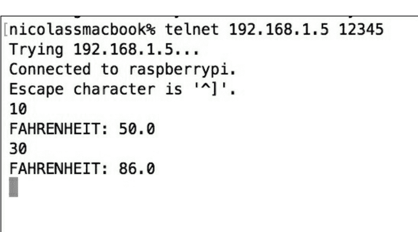

A bit of Telnet to talk to the socket and converts values. Note that for the purpose of this book, the socket server is actually running on a simple Raspberry Pi.

### Async socket client

The example would not be complete if there was not a client version of this. Since all this code is asynchronous, you can use the following code in the same REPL you were using until now. This is also using an async channel to put values on the socket connection and reads quite nicely:

```
```clojure
(def socket (socket-client 12345 "localhost")
(async/>!! (:out socket) "10")
(println (async/<! (:in socket)))
; CELCIUS TO FAHRENHEIT: 50.0

; close the socket.
(close-socket-client socket)
```
```

### Chiming

Sockets are nice, but a simple and fun way of showing that async's work is to deal with sound. Chime is a simple timer library that provides a channel around timed events. So, to play a short audio clip after a few seconds, you can pass init values to chime and it will push messages on the async channel, always on time, just like a Japanese train.

This example will do just that by asking chime to send a message to a core async channel after two seconds. The handling block will then, without blocking, play the sample audio clip in the background.

Let's start with the usual namespaces declarations:

```
```clojure
(ns asyncing.withchime
  (:import [javax.sound.sampled AudioSystem])
  (:require [chime :refer [chime-ch]]
            [clj-time.core :as t]
            [clojure.java.io :as io]
            [clojure.core.async :as a :refer [<! go-loop]]))
```
```

This is nothing more than a simple Java interop code block that will play a sound from a wav file:

```
```clojure
(defn play-sound [file]
  (let[
    sound (io/as-file file)
    input (AudioSystem/getAudioInputStream sound)
    clip (AudioSystem/getClip)]
    (doto clip
      (.open input)
      (.start))))
```
```

Finally, the chime channel takes a vector of clj-time inputs, here two

seconds from now, and creates what can be seen as a simple cron channel:

```
(let [chimes (chime-ch [ (-> 2 t/seconds t/from-now) ])]
  (a/<!! (go-loop []
    (when-let [msg (<!! chimes)]
      (play-sound "resources/pendolino.wav")
      (recur)))))
```

At the REPL, and after two seconds, you can hear the sound of a bullet train passing by and you can still keep on typing code.

## There's more...

To close this recipe, we will cover more on sockets, this time using WebSockets, with a bit of a mix with Python code.

### Client to Python WebSockets

With pip, the Python library manager installed, we will install the tornado server that has WebSocket support:

```
sudo pip install tornado
```

Then a simple WebSocket server can be written as follows. Since we do not want to go deep into Python details, it's best to simply copy and paste the following in a file named websockets.py for now:

```
import tornado.httpserver
import tornado.websocket
import tornado.ioloop
import tornado.web
import socket
```

```
class WSHandler(tornado.websocket.WebSocketHandler):
    def open(self):
        print 'new connection'

    def on_message(self, message):
        print 'sending back message: %s' % message
        self.write_message(message)

    def on_close(self):
```

```
print 'connection closed'

def check_origin(self, origin):
    return True

application = tornado.web.Application([
    (r'/ws', WSHandler),
])

if __name__ == "__main__":
    http_server = tornado.httpserver.HTTPServer(application)
    http_server.listen(8888)
    myIP = socket.gethostbyname(socket.gethostname())
    print '*** Websocket Server Started at %s***' % myIP
    tornado.ioloop.IOLoop.instance().start()
```

Basically, we implemented a WebSocket handler at path /ws and we hook this into a simple Tornado application. Running the server is then simply done through:

```
python websockets.py
```

Now that we have this, we can write some WebSocket client code from Clojure using the jetty-websocket-async library:

```
(require '[com.keminglabs.jetty7-websockets-async.core :refer [connect!]]
        '[clojure.core.async :refer [chan go >! <! >!! <!!]])

(def c (chan))
(connect! c "ws://localhost:8888/ws")
```

The core async chan contains the connection and we can then retrieve it to send messages to the Python WebSocket server with:

```
(go
  (loop []
    (when-let [ws-req (<! c)]
      (>! (:in ws-req) "Hello remote websocket server!")
      (recur))))
```

To make it more obvious that we can reuse those WebSockets connections, we confirm that we have two channels, in and out, to the

### WebSocket server:

```
(def in (atom nil))
(def out (atom nil))
```

Here, notice that both in and out are core async channel, as prepared for us by the Jetty WebSocket library:

```
(go
  (let [ws-req (<! c)]
    (reset! in (:in ws-req))
    (reset! out (:out ws-req))))
```

```
(defn printer
  [in]
  (go (while true (println (<! in)))))
```

```
(printer @out)
(>!! @in "sushi please")
```

### Clojure WebSocket server

This has been covered in other places, so we will quickly glance at this Clojure WebSocket server. You can already see that contrary to the Python code, this feels naturally integrated into our async programming code:

```
(require '[com.keminglabs.jetty7-websockets-async.core :refer [configurator]]
        '[clojure.core.async :refer [chan go >! <!]]
        '[ring.adapter.jetty :refer [run-jetty]])
```

```
(defn http-handler
  [req]
  {:response 200 :body "HTTP hello" :headers {}})
```

```
; this is the channel where new connections will be put in
(def c (chan))
```

```
(def ws-configurator (configurator c {:path "/ws"}))
```

```
(def server
  (run-jetty http-handler {:configurator ws-configurator
                            :port 8888, :join? false}))
```


; 这是 websocket 连接处理器。
; 它在通道 :out 上读取消息并仅在核心
; 异步通道 :in 上回显它们
(defn websocket-echo-handler [ws-req]
  (println "new websocket connection...")
  (go (loop []
    (when-let [msg (<! (:out ws-req))]
      (println "MSG:" msg)
      (>! (:in ws-req) "ECHO: " msg)
      (recur)))))

; 请注意，此 go-loop 的生命周期与
服务器生命周期分离。
(go (loop []
  (let [ws-req (<! c)]
    (websocket-echo-handler ws-req)
    (recur))))

## On Quasar/Pulsar

Pulsar 是 Quasar 库的 Clojure 包装器，Quasar 是一个面向 JVM 的基于 Actor 的编程工具包。在使用 Actor 库时，Actor 通常与线程一一映射，因此可能消耗比处理它们需要处理的有时很简单的代码更多的资源。

Quasar 和 Pulsar 引入了纤程的概念，或真正轻量级的处理单元，它们可以相互发送消息。这导致了一组易于阅读和使用的处理单元，将异步编程提升到了新的水平。

## Getting ready

需要对新的 `project.clj` 文件进行轻微更新以添加依赖项。还请注意添加 Quasar core 到运行时编织集合的 `java-agent` 指令。

请注意，代理的目的是为应用程序提供编织能力，换句话说，是在运行时重新定义类文件的签名的能力。花哨的细节需要阅读 Quasar 代码，但可以说 Quasar 通过一些字节码操作来创建和管理其纤程。

以下是 `project.clj` 文件：

```
(defproject quasarland "0.1.0-SNAPSHOT"
  :java-agents [[co.paralleluniverse/quasar-core "0.7.5"]]
  :dependencies [
    [org.clojure/clojure "1.8.0"]
    [co.paralleluniverse/quasar-core "0.7.5"]
    [co.paralleluniverse/pulsar "0.7.5"]
  ])
```

## How to do it...

本节简短地介绍如何定义、实例化这些 Actor 并使它们相互通信。

我们的命名空间声明将需要 Pulsar 的 core 和 actor 命名空间。请注意这里使用 refer-clojure 来避免 promise 和 await 的冲突：

```
(ns quasarland.firststeps
  (:use [co.paralleluniverse.pulsar core actors])
  (:refer-clojure :exclude [promise await]))
```

开始你的第一个 Actor，它们老实说会休息放松：

```
(defsf n relaxing-afternoon []
  (println "I am relaxing ..."))
```

defsf n 定义了一个可挂起函数，可以被纤程或 Actor 使用，并且使用方式与通常的 defn 完全相同。

现在我们基本上只是定义了一个函数，我们可以调用它作为常规函数：

```
(relaxing-afternoon)
;I am relaxing ...
```

我们想要的不是一个函数，而是作为独立处理单元的东西。这是通过使用 spawn 来完成的，它实例化一个 Pulsar Actor：

```
(spawn relaxing-afternoon)
; #object[co.paralleluniverse.actors.ActorRef 0x130599b8 "ActorRef@130599b8{PulsarActor@1fac12d3[owner: fiber-10000002]}"]
    ; I am relaxing ...
```

你仍然会在控制台上看到放松的消息，但你也会得到一个 Actor 的引用。我们的 Actor 仍然很懒惰，除了在星期日下午懒惰之外，并没有做太多事情。为了让他过一段时间醒来，我们可以使用一些睡眠代码：

```
(defsf n relaxing-afternoon-2 []
  (println "I am relaxing ...")
  ; (Thread/sleep 2000) fails here !
```

```
(sleep 2000)
(println "I am waking up ...")
)
```

```
(spawn relaxing-afternoon-2)
```

两秒后，你的放松下午开始有些动作。如注释所述，请确保你没有使用 Thread/sleep 的调用，这是 Quasar 无法编织的东西，并且会在定义时导致异常。

现在假设你想能够向 Actor 发送一个提示，让他醒来，而不是等待他自己去做。

为此，你可以使用 receive 函数，使用一个键，以及在消息到达时异步执行的代码块：

```
(defsf n relaxing-afternoon-3 []
  (println "I am relaxing ...")
  (receive
    :wakeup (println "Hey ! Someone woke me up!")))
```

生成这个下一个 Actor 后，你现在能够通过使用 ! 调用向它发送消息：

```
(def me
  (spawn relaxing-afternoon-3))
```

```
(! me :wakeup)
; Hey ! Someone woke me up!
```

酷！消息传递。现在发生了一些奇怪的事情，当你想再次唤醒 Actor 并发送相同的消息时：

```
(! me :wakeup)
```

什么都没有发生。这是因为 defsfn 的主体充当一个循环，一旦收到消息，循环自然会结束，除非我们用 recur 告诉它不要结束：

```
(defsf n relaxing-afternoon-4 []
  (println "I am relaxing ...")
```

```
(receive
    :bump (do (println "Hey ! Stop bumping me!") (recur)))
```

```
(def me
    (spawn relaxing-afternoon-4))
```

```
(! me :bump)
    ; Hey ! Stop bumping me!
; I am relaxing ...
```

```
(! me :bump)
    ; Hey ! Stop bumping me!
; I am relaxing ...
```

所有这些反复的碰撞一定很累人。recur 调用要求整个块再次被调用，以便 Actor 继续放松，这在如此阳光明媚的一天之后可能并不是问题！

我们的 Actor 有点自虐，并希望能够撞自己。幸运的是，defsfn 宏公开了一个自引用，可以用来指向自己：

```
(defsfn relaxing-afternoon-5 []
    (println "I am relaxing ...")
    (sleep 5000)
    (! @self :bump)
    (receive
        :bump
        (println "bumping myself!")))
```

```
(spawn relaxing-afternoon-5)
```

五秒后，放松的下午将开始向自己发送消息并对其做出反应。@self 非常有用，并且是不同 Actor 之间交换消息的广泛使用的模式。以下示例代码通过增强消息接收部分使其更加清晰，这样你就可以看到谁发送了消息。请注意，receive 部分现在接收的是向量而不是简单的消息关键字，并且还请注意消息发送部分也是发送向量：

```
(defsfn relaxing-afternoon-6 []
    (println "I am relaxing ...")
    (sleep 1000)
```

```
(! @self [:bump @self])
(receive
  [:bump who]
  (println who " is bumping!"))

(spawn relaxing-afternoon-6)
; ... ActorRef@32c9c341...  is bumping!
```

现在发送，人们通常不会撞自己，所以我们需要引入某个人来做这项艰苦的工作。

下一个示例采用两个 Actor，一个睡眠，一个发送唤醒提示。我们的两个 Actor，sleeping man 和 someone，可以很容易地定义如下：

```
(defsf n sleeping-man []
  (println "I keep on sleeping ...")
  (receive
    [:wakeup who]
    (do
      (println "Someone is telling me to wakeup!")
      (println "but ...")
      (recur))))
```

```
(defsf n someone [man]
  (sleep 1000)
  (! man [:wakeup @self]))
```

然后我们可以看到这两个人之间的交互。请注意，someone 接受对 man 的引用，以便能够向其发送消息。

生成 sleeping man 与平常一样：

```
(def man-asleep (spawn sleeping-man))
```

生成 someone 稍有不同，因为对 sleeping man 的引用被添加为 spawn 的第二个参数：

```
(spawn someone man-asleep)
;  Someone is telling me to wakeup!
; but ...
; I keep on sleeping ...
```

```
(spawn someone man-asleep)
; ... many people ...
; many more sleeping
```

现在你已经看到了如何在 Actor 之间发送消息，你已经完全准备好玩乒乓球了。

## How it works...

这个示例主要是 Pulsar 示例的直接复制，如果你已经跟随了本食谱的第一部分，应该很容易理解。

在这里我们声明了两个 Actor，ping 和 pong，它们相互递归调用一段时间，直到 ping 漏球并宣布游戏结束：

```
(ns quasarland.pingpong
  (:use [co.paralleluniverse.pulsar core actors])
  (:refer-clojure :exclude [promise await]))

(defsfn ping [pong]
  (if (>= (rand-int 10) 9)
    (do
      (! pong :gameover)
      (println "Missed the ball. Ping Finished"))
    (do
      (! pong [:ping @self])
      (receive
        :pong (println "Ping"))
      (recur pong))))

(defsfn pong []
  (receive
    :finished (println "Pong finished")
    [:ping ping] (do
      (println "Pong")
      (! ping :pong)
  (recur))))
```

## Let's start the game!

```
(let [a1 (spawn pong)
      b1 (spawn ping a1)])
;Pong
```


;Ping
;Pong
;Ping
;Pong
;Ping
;Missed the ball. Ping finished
;Pong finished

这种乒乓来回很不错，但同意，如果在 spawn 时能避免把另一个乒乓者作为引用传递会更好。是的！这可以通过 register! 和一个关键字来实现。让我们重写 ping，使其能够使用关键字而不是引用发送消息：

```
(defsf n ping []
  (if (>= (rand-int 10) 9)
    (do
      (! :pong :finished)
      (println "Missed the ball. Ping finished"))
    (do
      (! :pong [:ping @self])
      (receive
        :pong (println "Ping"))
      (recur))))
```

现在，在开始游戏之前，我们使用 register! 将 pong 注册为 :pong 到 Quasar 系统，然后依次 spawn ping 和 pong。注意 ping 知道存在 :pong，并且需要它被注册：

```
(register! :pong (spawn pong))
(spawn pong)
(spawn ping)
; a new game begins !
```

## Watching over other actors lifecycles

现在 actors 可以从其他 actor 生命周期获得自动通知，例如，某个 actor 即将结束其生命周期。你可以使用 watch! 来接收消息：

```
(let [actor1 (spawn #(sleep 1000))
      actor2 (spawn
               (fn []
                 (let [w (watch! actor1)]
                   (receive
```

```
ch (channel)
fiber (spawn-fiber
    (fn []
      (let [m1 (rcv ch)
            m2 (rcv ch)]
        (+ m1 m2))))]
(sleep 200)
(snd ch 10)
(sleep 200)
(snd ch 10)
(join fiber))
; 20
```

通道可以在不同的 fibers 之间使用和共享：

```
(let [ch (channel 0 :block true true)
      f #(rcv ch)
      fiber1 (spawn-fiber f)
      fiber2 (spawn-fiber f)]
  (snd ch "m1")
  (snd ch "m2")
  (close! ch)
  #{(join fiber1) (join fiber2)})
; #{"m1" "m2"})
```

最后，通道可以用突发模式使用 rcv-into 和 snd-seq：

```
(let [ch (channel)
      fiber (spawn-fiber #(rcv-into [] ch 1000))]
  (snd-seq ch (range 200))
  (close! ch)
  (join fiber))
; [0 1 2 3 4 ...])
```

## Blazar

事情发展到你想知道如何将 fibers 和 socket 服务器链接起来，这里就是 Blazar，一个基于 fibers 构建的超快 HTTP 服务器框架，同时支持 WebSocket。该项目没有最近的提交，但与新版本的 Pulsar 配合得很好，其核心思想很巧妙。

project.clj 文件需要一点注意：

```
(defproject blazarland "0.1.0-SNAPSHOT"
  :java-agents [[co.paralleluniverse/quasar-core "0.7.5"]]
  :profiles {
    :dev {
      :resource-paths ["resources" "profiles/dev/resources"]
      :source-paths ["src" "profiles/dev/src"]}}
  :dependencies [[org.clojure/clojure "1.8.0"]
  [blazar "0.1.1"]
  [co.paralleluniverse/pulsar "0.7.5"]])
```

但随后你的基于 fiber 的服务器可以用几行代码编写！

```
(ns quasarland.blazar
  (:require
    [co.paralleluniverse.pulsar.core :as pc]
    [blazar.http.server :as bs]))
(pc/join
  (pc/spawn-fiber
    # (bs/start-fiber-ring-adapter
      "0.0.0.0"
      8080
      (fn [req] "Hello fiber world!"))))
```

为了本书的目的，这在标准 Raspberry Pi 上扩展得相当不错。
