# Chapter 7. Advanced Tips

在本章中，我们将涵盖以下主题：

- Hacking the Clojure code
- Using Reader Conditionals, compile to Clojure, and ClojureScript
- Real-time shared development with an REPL
- Declarative data descriptions and validations with plumatic/schema

## Introduction

我们将在本章学习更高级的技巧。首先我们将 hack Clojure 代码以了解 Clojure 代码的工作原理。我们将从 Clojure 代码生成类文件然后反编译 Java 代码。理解 Clojure 代码很有趣且有用。

接下来，我们将看看如何编写在 Clojure 和 ClojureScript 之间保持兼容的源代码，并在两种环境中运行。随着 ClojureScript 如今越来越流行，单份代码在两种环境中运行可提高可维护性，尤其是在编写库时。

然后，我们将尝试从远程客户端实时共享 REPL。使用此机制，我们将尝试从你的 PC 控制 Raspberry Pi。

最后，我们将学习 prismatic schema，它使我们能够为数据定义和验证模式。此库非常有用，可用于定义数据形状和验证。我们将介绍 `core.types` 和 `clojure.spec`，它们是 Clojure 1.9 的最主要特性。

## Hacking the Clojure code

在你运行的大量代码中，如果你遇到过 Clojure 本身的 bug 会非常惊讶。

可能缺少一些特性，但核心令人印象深刻地健壮和稳定。

在幕后，Clojure 本身将字节码生成委托给一个名为 ASM 的库。ASM 生成 Java 机器可以执行的字节码。这在 Clojure 程序运行时实时完成，也可以在提前完成，例如当你想打包代码时。

这个非常简短的配方将查看如何编译 Clojure 代码并查看生成的 Java 字节码。

## Getting ready

Clojure 代码托管在 GitHub 上，因此要检索代码，请前往 https://github.com/clojure/clojure。执行 git checkout，请使用以下命令：

```
git clone https://github.com/clojure/clojure.git
```

要构建你自己的 Clojure 版本，你需要一个主要的 Java 构建工具，称为 maven，截至本文撰写时版本为 3。下载并将二进制文件 mvn 放在你的终端可访问的位置：

```
mvn package -Dmaven.test.skip=true
```

Clojure 令人惊讶地非常精简且编译速度很快。打包只需几秒钟。完成后，你可以在 target 文件夹中找到以下两个重要文件：

```
clojure-1.9.0-master-SNAPSHOT-slim.jar
```

## clojure-1.9.0-master-SNAPSHOT.jar

第一个 JAR 包含编译的 Java 类和未编译的 Clojure 代码，而第二个还包含编译的 Clojure 源代码。这使得 slim JAR 约为 1 MB，而普通 JAR 约为 3.5 MB。

拥有编译的 Clojure 文件的优点是启动虚拟机和 Clojure 环境时等待时间更少。

作为提醒，你可以像这样轻松启动 Clojure Server REPL：

```
java -cp \
target/clojure-1.9.0-master-SNAPSHOT-slim.jar \
-Dclojure.server.repl="{:port 5555 :accept clojure.main/repl}" \
clojure.main
```

或使用传统 REPL：

```
java -cp target/clojure-1.9.0-master-SNAPSHOT-slim.jar
clojure.main
```

我们将在几分钟后使用前面生成的 Clojure JAR，所以请记住它生成的位置。

现在来看生成的字节码。

## How to do it...

假设我们有一个非常简单的 Clojure 程序如下：

```
(ns gen3
  (:gen-class [:main true]))

(defn -main[]
  (println "hello world"))
```

前面的代码除了打印一些问候语外什么都不做，但它会使生成的代码更容易看到。

在解释这里使用的所有函数和单词之前，让我们先走一遍流程：

- 源文件需要在 Clojure 项目的通常源文件夹中，所以使用 Leiningen，这将是 `src/gen3.clj`
- 我们现在启动一个 REPL，再次使用 Leiningen，通过：

  `lein repl`
- 当 REPL 启动后，我们现在使用 compile 指令：

  ```
  (compile 'gen3)
  ; gen3
  ```

你会看到即使 REPL 很安静，类文件已被生成：

```
Nicolass-MacBook% ls -l target/classes
total 40
drwxr-xr-x@ 3 niko  staff    102 May 25 11:41 META-INF
-rw-r--r--@ 1 niko  staff    831 May 25 11:41 gen3$_main.class
-rw-r--r--@ 1 niko  staff   1302 May 25 11:41
gen3$fn__1248.class
-rw-r--r--@ 1 niko  staff   1494 May 25 11:41
gen3$loading__5569_auto___1246.class
-rw-r--r--@ 1 niko  staff   1788 May 25 11:41 gen3.class
-rw-r--r--@ 1 niko  staff   2372 May 25 11:41 gen3__init.class
```

那是生成了五个类，可能是最容易看到的是 `gen3.class` 文件。这是包含程序入口点的文件。让我们使用我们之前生成的 Clojure JAR 和新生成的类：

```
java -cp ../clojure/target/clojure-1.9.0-master-SNAPSHOT.jar:target/classes gen3
```

执行前面的命令将打印出预期的消息：

```
hello world
```

不错。所以我们现在可以看到 Clojure 代码正在被编译为字节


code in class files and can be executed as standard Java, through the use of only `clojure.jar` in the classpath.

## How it works...

If we look at the files generated from the previous command, we can see five classes, as shown in the following screenshot:

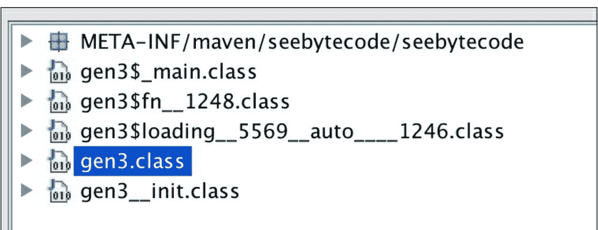

We will use a software called JD GUI, which you can download from http://jd.benow.ca/, to examine in detail the Java class files generated by the Clojure compiler.

Each function in Clojure is actually compiled to a separate class file, making it easier for class reloading. For example, the `-main` function that we defined, just like any other function, is compiled to a class.

See the following:

```
import clojure.lang.AFunction;
import clojure.lang.IFn;
import clojure.lang.RT;
import clojure.lang.Var;

public final class gen3$_main
    extends AFunction
{
```

```
public Object invoke()
{
    return invokeStatic();
}

public static final Var const__0 =
(Var)RT.var("clojure.core", "println");

public static Object invokeStatic()
{
    return ((IFn)const__0.getRawRoot()).invoke("hello world");
}
}
```

The main Java objects being used in Clojure are as follows:

- `clojure.lang.IFn`: This is Clojure function, something that can be invoked.
- `clojure.lang.AFunction`: This function is mostly an annotated Clojure function.
- `clojure.lang.RT`: This is the Clojure runtime.
- `clojure.lang.Var`: This is a variable, a threaded reference, that is also a IFn and so can be invoked.

With this in mind, we can see that the Clojure `println` function from `clojure.core` is being kept as a `Var` from within the `gen3` class:

```
public static final Var const__0 = (Var)RT.var("clojure.core", "println");
```

The `Var` is retrieved through questioning the runtime for a var through `RT.var`, a namespace, and a function.

What happens when the `-main` method is called is simply a static call to `invokeStatic`. This is rather generic, and calls invoke on an `IFn` object:

```
((IFn)const__0.getRawRoot()).invoke("hello world")
```

`const__0` is here a generated reference to the `println` function in the namespace `clojure.core`. Calling `-main` results in executing the body of `invokeStatic`, which, in turn, invokes the `println` function with parameters "hello world".

The class gen3 contains a reference to the -main function in namespace gen3:

```
private static final Var main__var = Var.internPrivate("gen3", "-main");
```

And this is invoked in a similar way as previously. gen3__init is a side class responsible for namespace loading, and registering the function under namespaces. This is what is generated for the namespace definition. This allows for easy namespace redefinition and easy reloading of functions.

In simple words, the remaining two classes, gen3$fn and gen3$loading, are a different way of loading the preceding namespace definition and can be bypassed for now.

Back to the Clojure code, you may remember the namespace had some metadata in it:

```
(:gen-class [:main true])
```

This is so that the generated entry point class for this Clojure namespace is customized for easier interaction with Java. In particular, the :main true directive tells the compiler to generate a static Java method. Remember you can also customize constructors, getters, setters, and so on here.

## There's more...

Now that you are used to it, you can have a look at some more complex Clojure to byte code generation:

```
(ns gen2)

(defn hello [b]
  (let[ a 1]
    (+ b a)))

(defn -main[]
  (println (hello 1)))
```

The preceding code compiles nicely to a few classes, one for each function. Let's look at the class corresponding to the hello function:

```
import clojure.lang.AFunction;
import clojure.lang.Numbers;

public final class gen2$hello
    extends AFunction
{
...

    public static Object invokeStatic(Object b)
    {
        long a = 1L;b = null;

        return Numbers.add(b, a);
    }
}
```

In namespace gen2, the hello function is a class extending AFunction, so it can be invoked through invoke, and the calling main function:

```
import clojure.lang.AFunction;
import clojure.lang.IFn;
import clojure.lang.RT;
import clojure.lang.Var;

public final class gen2$_main
    extends AFunction
{
...

    public static final Object const__2 = Long.valueOf(1L);
    public static final Var const__1 = (Var)RT.var("gen2",
"hello");
    public static final Var const__0 =
(Var)RT.var("clojure.core", "println");

    public static Object invokeStatic()
    {
        return
((IFn)const__0.getRawRoot()).invoke(((IFn)const__1.getRawRoot()
).invoke(const__2));
    }
}
```

Access `var` that has been registered (loaded) by the `__init` class and call it with the proper parameters.

We already saw macro in the previous recipe, so a good exercise for the reader would be to see that the Clojure code compile is actually the code after macro expansion. You should be able to do this!

## Using Reader Conditionals, compile to Clojure, and ClojureScript

Codes in Clojure and ClojureScript are almost the same but there are few differences. For instance, libraries provided by Java and JavaScript are quite different. Host environments between JVM and JavaScript runtimes are also different.

Before the version 1.7, we use the cljx plugin to keep compatibility between them. However, it requires a tooling and the style is not clean.

For such a situation, Clojure 1.7 introduced Reader Conditionals are introduced. Reader Conditionals have richer semantics than cljx, such as default expressions and form splicing and no preprocessing.

Using Reader Conditionals, we can share source code among Clojure, ClojureScript, and ClojureCLR. In this recipe, we will demonstrate how we can share single source files between Clojure and ClojureScript.

## Getting ready

We will use the Figwheel template to generate a Clojure and ClojureScript project:

```
$ lein new figwheel cljc-example -- --om
```

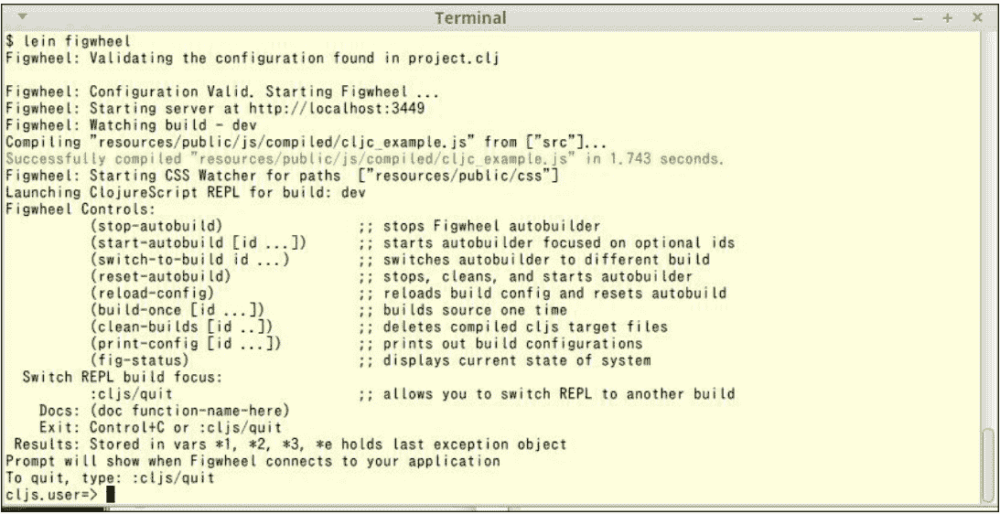

The generated directory structure is as follows:

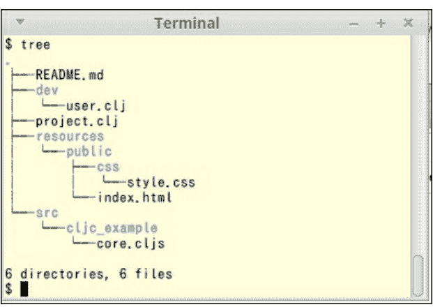

We will move the project directory:

```
$ cd cljc-example
$ lein figwheel
```

We can see the following output to run lein figwheel:

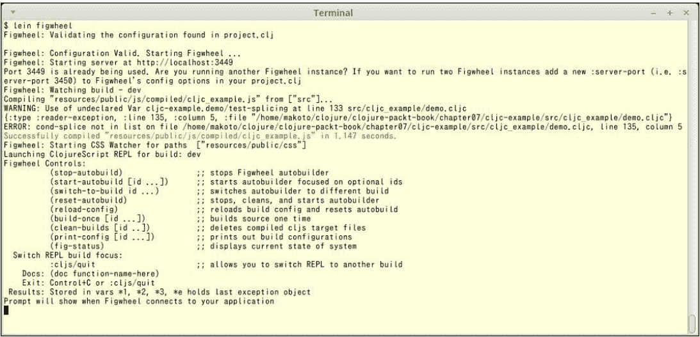

Then, open your browser and go to the following URL:

http://localhost:3449:

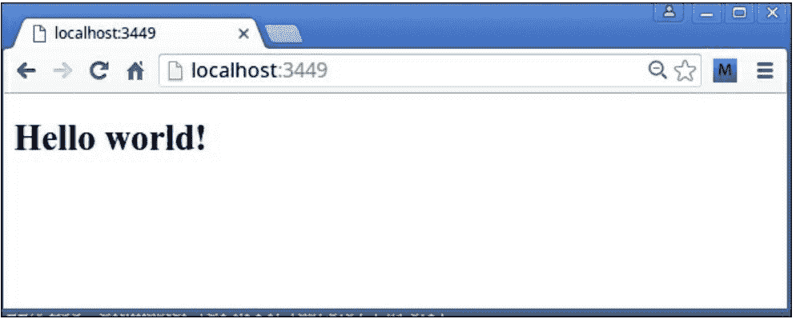

You can see the message in the browser. After seeing it, let's test the ClojureScript code in the REPL to show an alert dialog on your browser, as shown in the following screenshot:

```
(js/alert "hello !")
nil
```

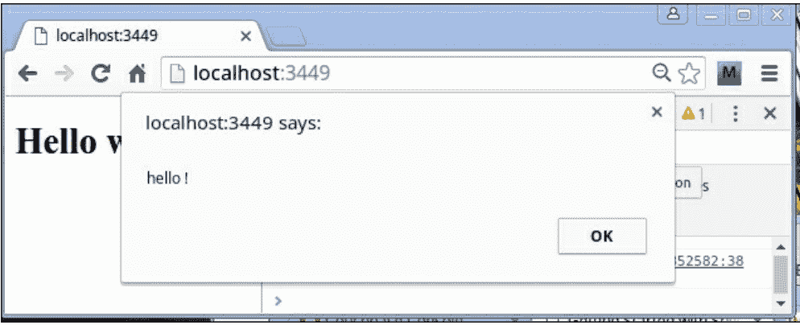

## How to do it...

First, we will create demo.cljc under the src/cljc_example in the project as follows:

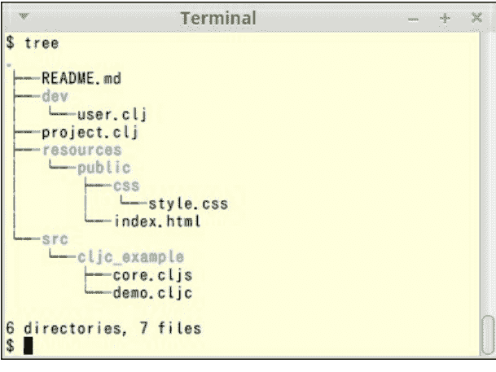

## Your first Reader Conditional

Let's start with a simple Reader Conditional expression. Reader Conditional start with #? as follows:

```
#?(:clj
```

```
"Hello Clojure !"
:cljs
"Hello Clojurescript !")
```

:clj is for Clojure code, and :cljs is for ClojureScript code. So, the results of REPLs are as follows:

- Clojure REPL

  ;;=> Hello Clojure !
- Figwheel REPL

  ;;=> Hello Clojurescript !

```
;;=> Hello Clojure !
```

```
;;=> Hello Clojurescript !
```

## Using Reader Conditionals in namespaces

You can use :require in the namespace in the following way:

```
(ns cljc-example.demo
  #?(:clj
    (:require [quil.core :as q])
    :cljs
    (:require [quil.core :as q :include-macros true])))
;;=> nil
```

We will use the quil library for both Clojure and ClojureScript. Using ClojureScript, we need to add :include-macros true. There are differences in handling exceptions in Clojure and ClojureScript. We use Reader Conditionals as follows:

```
(try
  (/ 1 0)
  (catch
    #?(
      :clj java.lang.Exception
      :cljs ;default
      ) e
    (.getMessage e)))
```

In JVM, dividing by zero causes an exception, java.lang.Exception; however, dividing by zero only returns Infinity:

- Clojure REPL


"Divide by zero"

+   - Figwheel REPL

Infinity

The next code is another example of Reader Conditionals for try and catch. The check-range checks whether the given value v is between the lower l and higher h. If the value is out of range, this function throws an exception or error:

```
(defn check-range [v l u]
  (if-not (and (>= v l) (<= v u))
    #?(:clj (throw (Exception. "out of range"))
       :cljs (throw (js/Error. "out of range")))
    v))
```

We will use js/Error in ClojureScript instead of _Exception in Clojure:

```
(try
  (check-range 0 1 10)
  (catch
    #?(
      :clj Exception
      :cljs js/Error
      ) e
    #?(:clj (println (.getMessage e))
       :cljs (println (.-message e)))))
```

In ClojureScript, (.-message e) retrieves the error message. .-function calls host JavaScript functions.

## How it works...

Here, we will explain the form of Reader Conditionals and Splice macros.

## The form of Reader Conditionals and Splice macros

The form of Reader Conditionals is as follows:

```
#?(:clj  (Clojure expression)
:cljs (ClojureScript expression)
:clr (Clojure CLR expression))
```

When the preceding code runs on Clojure, (Clojure expression) is evaluated. When the code runs on ClojureScript, (ClojureScript expression) is evaluated and vice versa.

Splice Reader Conditional macros are the same as Reader Conditional macros, but an expression must be a vector. The expression will be spliced into the resulting read.

We will write the following code:

```
(defn test-splicing-hello []
  #?@(:clj [(print "hello ") (print "world !") (print "\n")])
;;=> #'cljc-example.demo/test-splicing-hello
```

The expression for the Splice Reader Conditional macro is a vector, and the result of executing the method is as follows:

```
(test-splicing-hello)
;;=> hello world !
;;=> nil
```

The preceding code is equivalent to the following one:

```
(defn test-hello []
  (print "hello ") (print "world !") (print "\n"))
;;=> #'cljc-example.demo/test-hello
```

Splice Reader Conditional macros cannot be located at top level. If we do that, an exception like the following is thrown:

```
#?@(:clj
  [(print "hello ") (print "world !") (print "\n")])
;;=> RuntimeException Reader conditional splicing not allowed at the top level. clojure.lang.Util.runtimeException (Util.java:221)
```

Splice Reader Conditional macros are often used in require/import. We will show an example in this recipe.

## Macros in ClojureScript

ClojureScript's macros are different from those of Clojure. In ClojureScript, macros are defined in a different compilation stage rather than the one from where they are consumed.

So, we need to use the `:include-macros` or `:require-macros` keyword in namespace declarations for ClojureScript.

The `:include-macros` is a sugar for `:require-macros`:

```
(:require [quil.core :as q :include-macros true])
```

The preceding code is the equivalent to the following one:

```
(:require [quil.core :as q])
(:require-macros [quil.core :as q])
```

## There's more...

We will use Quil, which is an interactive library for drawings and animations. Quil supports both Clojure and ClojureScript. We will learn how our single source code runs on two different environments.

## Building an application for Clojure and ClojureScript

We will learn a more complex usage of Reader Conditionals. We will develop a graphical demonstration for Clojure and ClojureScript.

So, we will create runtimes for Clojure and ClojureScript with a single source file (.cljc). We will use Quil, which is a Clojure/ClojureScript library for interactive graphics. It provides over 200 functions that allows it to draw in 2D, 3D, and even in PDF.

The original demo is in the home page in Quil, so let's see how to run it in both Clojure and ClojureScript.

Although the steps here are rather long, we will not only learn how to write code for Clojure and ClojureScript using Reader Conditionals, but

we will also learn steps for building and running the two different environments from single source code.

## Adding a cljc file for demonstrating Quil

Let's add the quil_demo.cljc file, which shows the Quil demo for Clojure and ClojureScript. The location of the file is under the src/cljc_example directory, as shown in the following screenshot:

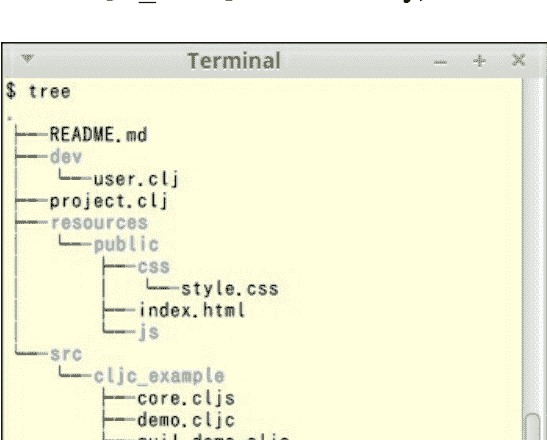

We will modify the generated project.clj. We will add the quil library as follows:

```
:dependencies [[org.clojure/clojure "1.8.0"]
                [org.clojure/clojurescript "1.8.51"]
                [org.clojure/core.async "0.2.374"
                 :exclusions [org.clojure/tools.reader]]
                [sablono "0.3.6"]
                [org.omcljs/om "0.9.0"]
                [quil "2.4.0"]]
```

In the dependency section, we have added [quil "2.4.0"]. Then we will replace the main namespace from cljc-example.core to cljc-example.quil-demo in the cljsbuild section as follows:

```
:cljsbuild {:builds
```

```
[{:id "dev"
  :source-paths ["src"]
  ;; If no code is to be run, set :figwheel true
for continued automagical reloading
  :figwheel {:on-jsload "cljc-example.quil-demo/on-js-reload"}
  :compiler {:main cljc-example.quil-demo
             :asset-path "js/compiled/out"
             :output-to
"resources/public/js/compiled/cljc_example.js"
             :output-dir
"resources/public/js/compiled/out"
             :source-map-timestamp true}}
  ;; This next build is an compressed minified
build for
  ;; production. You can build this with:
  ;; lein cljsbuild once min
  {:id "min"
   :source-paths ["src"]
   :compiler {:output-to
"resources/public/js/compiled/cljc_example.js"
              :main cljc-example.quil-demo
              :optimizations :advanced
              :pretty-print false}}]
```

After we finish the preceding modifications, let's restart REPL and Figwheel REPL. We will declare quil and om libraries for Clojure and ClojureScript:

```
(ns cljc-example.quil-demo
  (:require
   #?@(
     :clj
     [[quil.core :as q]
      [quil.middleware :as m]]
     :cljs
     [[quil.core :as q :include-macros true]
      [quil.middleware :as m]
      [om.core :as om :include-macros true]
      [om.dom :as dom :include-macros true]]
     ))
  #?(:clj (:gen-class)))
```

The following code is for ClojureScript to add the canvas tag for drawing graphics used by Quil:

```
#?( :cljs (defn on-js-reload [] ;; optionally touch your app-state to force rerendering depending on ;; your application ;; (swap! app-state update-in [:__figwheel_counter] inc) )) #?( :cljs (def app-state (atom {:text "Hello quil demo !"}))) #?( :cljs (enable-console-print!)) #?( :clj (println "Using Clojure !") :cljs (println "Using Clojurescript !")) #?( :cljs (om/root (fn [data owner] (reify om/IRender (render [_] (dom/canvas #js {:id "my-sketch" :height 400 :width 400}))) ) app-state {:target (. js/document (getElementById "app"))}))
```

Code here is animating a circle for Clojure and ClojureScript. Fortunately, code is the same in them:

```
(defn setup [] (q/frame-rate 60) (q/color-mode :hsb) {:color 0 :angle 0}) (defn update-state [state] {:color (mod (+ (:color state) 0.7) 255) :angle (+ (:angle state) 0.1)}) (defn draw-state [state] (q/background 240) (q/fill (:color state) 255 255) (let [angle (:angle state) x (* 150 (q/cos angle))
```

```
y (* 150 (q/sin angle))]
(q/with-translation [(/ (q/width) 2)
                    (/ (q/height) 2)]
  (q/ellipse x y 50 50)))
```

```
(defn run[]
  (q/defsketch my-sketch
    :host "my-sketch"
    :size [500 500]
    :setup setup
    :update update-state
    :draw draw-state
    :middleware [m/fun-mode]))
```

setup is the initial setup function, and update - state updates the current state.

## Testing cljc code in both Clojure and ClojureScript

We will test the preceding code in REPLs in both Clojure and ClojureScript. Let's test it in the Clojure REPL first. Let's type the following:

```
(run)
```

Then, a new window will open and you can see the following:

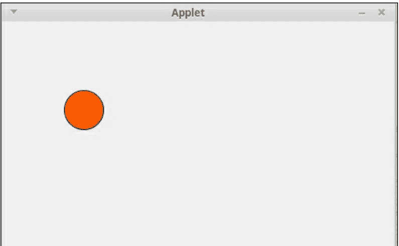


然后，我们将在 Figwheel REPL 下的 ClojureScript 中测试它。Figwheel 会检查代码更新并刷新浏览器。因此，让我们保存代码，就可以看到如下动画：

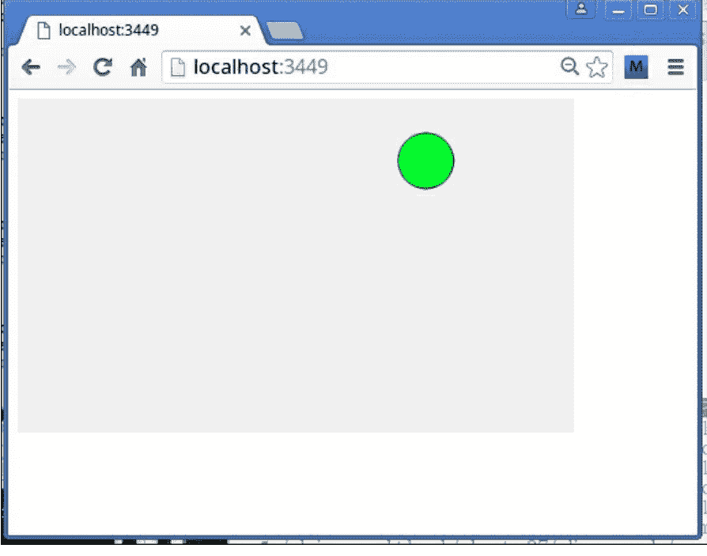

## 构建并运行演示

现在，让我们为 Clojure 和 ClojureScript 生成运行时代码，以便在没有 REPL 开发环境的情况下运行它们。我们将添加以下代码来在没有 REPL 的情况下运行演示：

```
#? (
  :clj
  (defn -main [& args] (run)
    )
  :cljs (run))
```

在 Clojure 中，需要从 REPL 外部调用名为 `-main` 的函数。另一方面，调用 `(run)` 会为 ClojureScript 启动动画。以下步骤是在 REPL 外部设置和测试 Clojure 演示。为此，让我们在 project.clj 中添加 main 部分：

```
:main cljc-example.quil-demo
```

然后，输入以下内容：

```
$ lein run
```

`lein run` 会调用 project.clj 的 `:main` 部分中声明的命名空间中的 `-main` 函数，并启动演示。现在，是时候在没有 REPL 的情况下运行演示了。我们必须修改 uberjar 的主类命名空间，如下所示：

```
:profiles {
    :uberjar {
        :aot [cljc-example.quil-demo]
        :main cljc-example.quil-demo
    }
    :dev {:dependencies [[figwheel-sidecar "0.5.3-1"]
                          [com.cemerick/piggieback
                           "0.2.1"]]
          ;; need to add dev source path here to get user.clj loaded
          :source-paths ["src" "dev"]
          ;; for CIDER
          ;; :plugins [[cider/cider-nrepl "0.12.0"]]
          :repl-options {; for nREPL dev you really need to limit output
                          :init (set! *print-length* 50)
                          :nrepl-middleware [cemerick.piggieback/wrap-cljs-repl]}}}
```

然后，我们将执行以下命令来生成 uberjar 文件：

```
$ lein uberjar
```

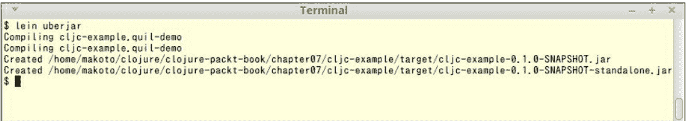

由 uberjar 生成的 JAR 文件包含 project.clj 的依赖部分中定义的所有类。它还包含 Clojure 核心类。因此，JAR 文件很大，生成需要时间。让我们在 JVM 下运行演示。以下命令行启动演示：

```
$ java -jar target/cljc-example-0.1.0-SNAPSHOT-standalone.jar
```

我们将为你的浏览器构建运行时。执行以下命令会将 ClojureScript 编译为 JavaScript：

```
$ lein cljsbuild once min
```

在下面的截图中，检查编译是否成功：

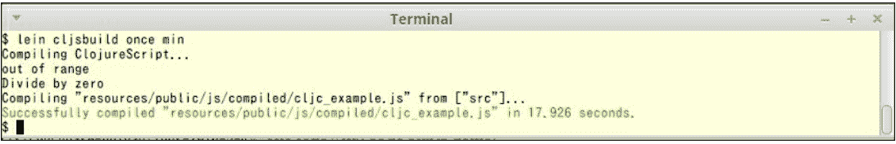

我们可以在 `:cljsbuild` 部分中指定 `dev` 或 `min` 作为构建选项：

```
:cljsbuild {:builds
  [{:id "dev"
    :source-paths ["src"]
    ......
    {:id "min"
    :source-paths ["src"]
    :compiler {:output-to
"resources/public/js/compiled/cljc_example.js"
```

```
:main cljc-example.quil-demo
:optimizations :advanced
:pretty-print false}]]}
```

`min` 选项以最高优化程度提升性能，并生成最小的 JavaScript 代码，将其打包到单个文件中。它会将变量和函数的名称改为更短的名称。`min` 选项会生成混淆代码。另一方面，`dev` 选项不进行优化，用于开发和调试；然而，它的性能较慢。`resources/public/js/compiled/cljc_example.js` 是从 ClojureScript 生成的单个 JavaScript 代码。

`auto` 选项会在 ClojureScript 代码被修改时自动生成 JavaScript 代码。以下选项对调试很有用：

```
$ lein cljsbuild auto min
```

现在，我们将在你的浏览器中运行演示。以下命令会打开一个新的浏览器会话并启动演示：

```
$ browser resources/public/index.html
```

运行 ClojureScript 演示只需要以下文件：

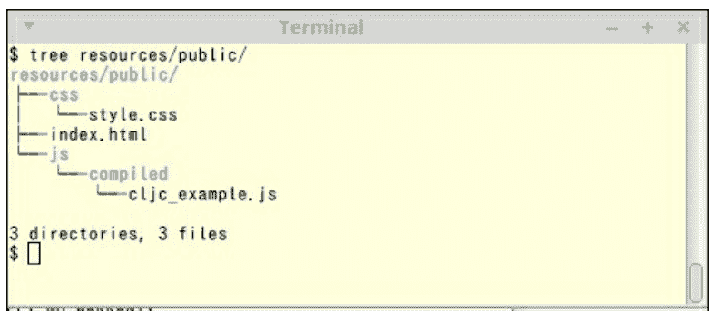

按照以下简单步骤在你的 github.io 上运行演示：

- 1. 如果你没有 GitHub 账户，请创建一个。

2. 按照以下步骤操作：

```
$ cd (another-directory)
$ git clone https://github.com/(your-username)/(your-username).github.io
$ cd (your-username).github.io
$ cp -r ($your-cljc-project)/cljc-example/resources/public .
$ git add .
$ git add --all
$ git commit -m "Initial commit"
$ git push -u origin master
```

3. 打开你的浏览器：

```
$ browser (your-username).github.io
```

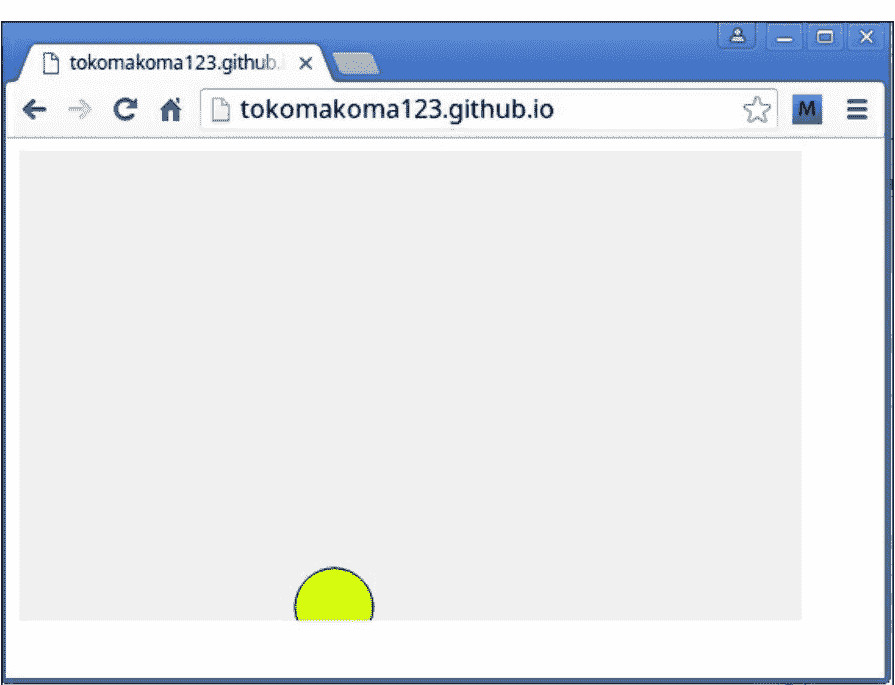

## 参见

请参见以下相关网站：

- - 有关与 Clojure 的差异，请参阅 https://github.com/clojure/clojurescript/wiki/Differences-from-Clojure。
- - 要在线试用 ClojureScript，请参阅 http://himera.herokuapp.com/index.html。
- - 关于 Quil，请参阅 http://quil.info/。

## 使用 REPL 进行实时共享开发

面对现实吧，你大部分 Clojure 时间都会花在 REPL 中，而那种从编写代码中获得即时反馈的满足感会让你彻夜难眠。

在本教程中，你将看到一些 REPL 技巧和诀窍，让你的编码更轻松，并帮助你创建属于自己的编码工作流。

我们首先介绍如何使用共享 REPL 的基础知识，然后在此基础上介绍即时反馈以及编写自定义 REPL 的想法。

### 准备工作

本教程的第一部分将展示如何使用 Atom 编辑器进行连接。请确保你之前已经安装它，如果没有，请前往 https://atom.io：

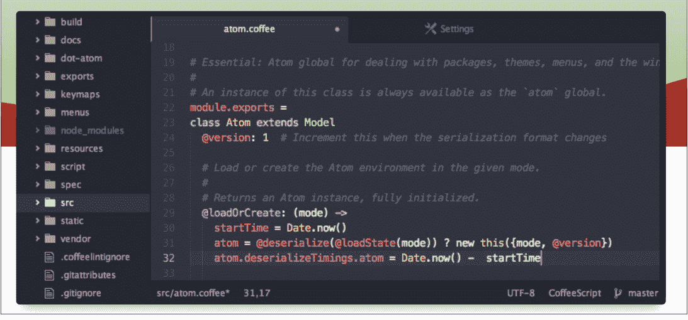

### 提示

默认设置不需要任何额外设置，但在你阅读的过程中，你需要向 project.clj 文件添加依赖项。

### 如何操作...

你会记得如何用以下命令启动一个简单的 REPL：

```
lein repl
```

但让我们更进一步，启动一个可以很好地与他人共享的 REPL。

### 共享 REPL

为了获得极致的 DIY 共享体验，现在是时候拿出你的 Raspberry Pi（或另一台机器或本地虚拟机）了。我们现在快速了解一下如何在 Raspberry Pi 上共享 REPL。请注意，它可以是任何计算机，但 Raspberry Pi 使这一点更加明显，并且流程更易于理解：

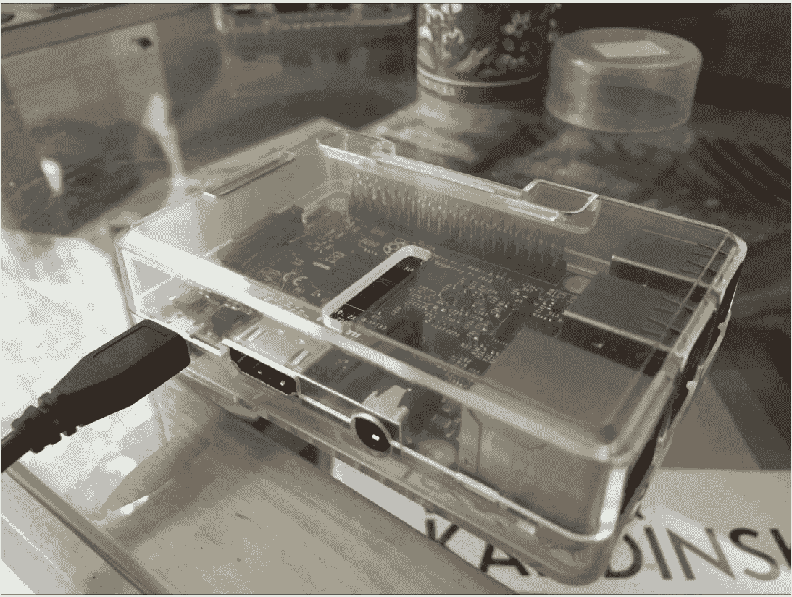

你可以使用以下命令启动一个无头 REPL，甚至可以在 Clojure 项目之外：

```
lein repl :headless :host 0.0.0.0 :port 9000
```

绑定到 `0.0.0.0` 或其 IPv6 等价地址非常重要，否则无法远程访问 REPL。为了避免选择随机端口，我们在这里也将其强制设为 9000。现在，连接到那个远程 REPL，我们将使用 `:connect` 指令来完成。考虑到 Raspberry Pi 的 IP 为 192.168.1.9，以下是连接方法：

```
lein repl :connect 192.168.1.9:9000
```

现在，为了在 Raspberry Pi 上演示一个小例子，让我们试着操作 HDD LED。让我们用以下命令移除该 LED 的保护：

```
sudo "echo none > /sys/class/leds/led0/trigger"
```

趁此机会，让我们也修改 brightness 的权限：

```
sudo chmod 777 /sys/class/leds/led0/brightness
```

这将允许我们使用标准用户访问它。现在，通过简单的 shell 交互，让我们发送以下命令使其闪烁：

```
(use '[clojure.java.shell])
; set this to 0 (off) or 1 (on)
(defn set-led [n]
  (sh "sh" "-c"
  (str "echo " n " > /sys/class/leds/led0/brightness")))

; now some looping
(dotimes [i 10] (set-led 0) (Thread/sleep 1000) (set-led 1))
```

圣诞节已经到来了！

### 使用 Atom 和 proto-repl

好吧，使用 REPL 很有趣，但你肯定会怀念一些文本编辑器的乐趣。进入 Atom 后，让我们一次性安装所有需要的包，享受一些 Clojure 的乐趣：

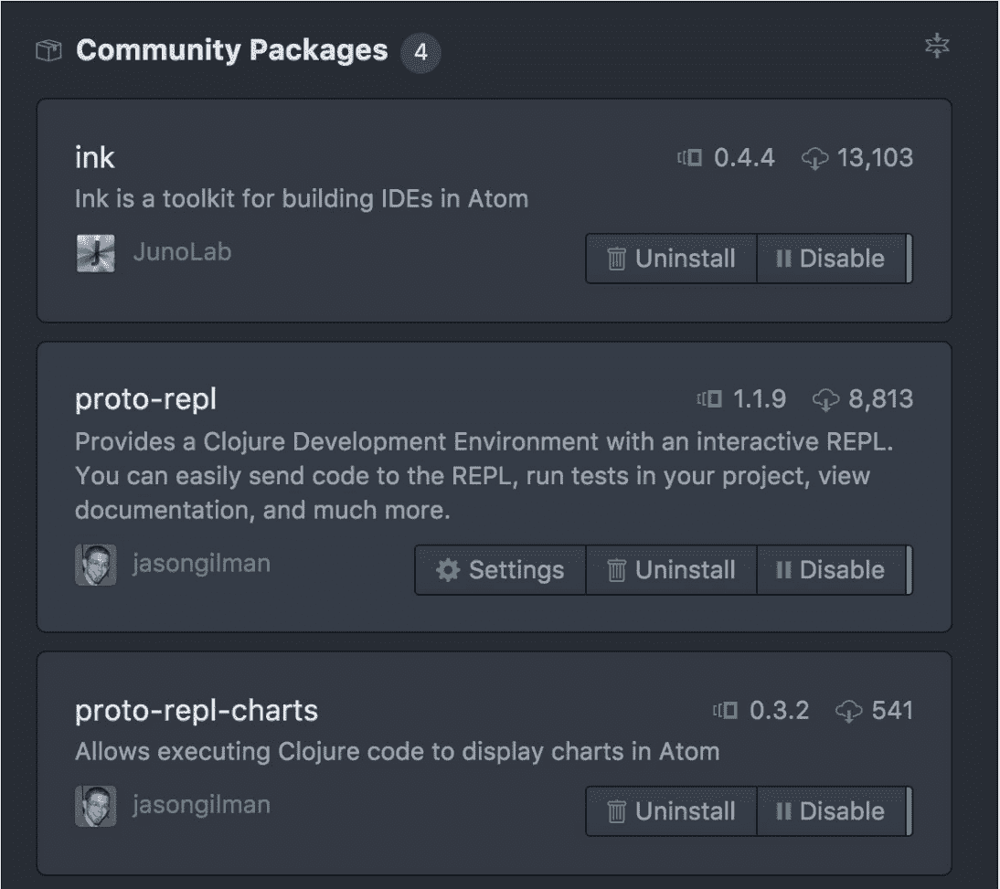

安装完前面截图所示的全部三个包后，让我们立即连接到已经运行的 REPL：

- 1. 打开“远程 Nrepl 连接”对话框，使用：

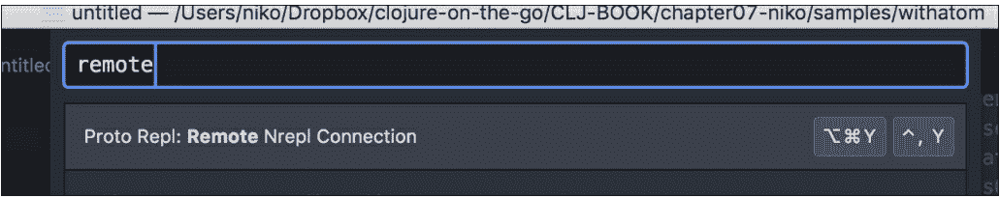


2. And open the connection itself with:

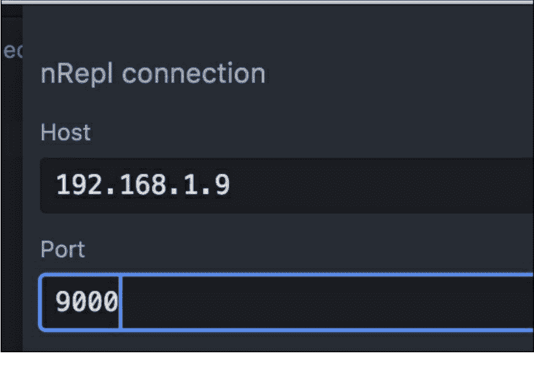

3. In the text editor area, let's type and execute the same code:

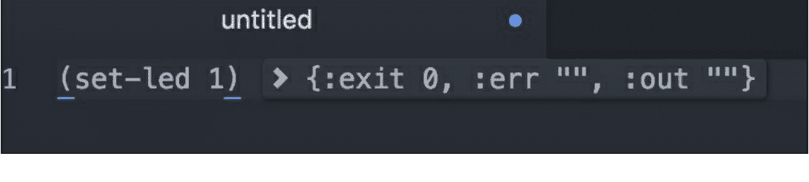

And yes, it is still Christmas on the Raspberry Pi (blink, blink)! If you have noticed, some messages are complaining about the lack of a dependency:

```
clojure.tools.namespace.repl not available. Add as a dependency to allow refresh.
Refresh Warning: IllegalArgumentException
No such namespace:
clojure.tools.namespace.repl
clojure.lang.Var.find (Var.java:141)
```

Let's add the two following ones in a new Leiningen project:

```
:dependencies [
[proto-repl-charts "0.2.0"]
[org.clojure/tools.namespace "0.2.11"]

[cheshire "5.6.1"]
[org.clojure/clojure "1.8.0"]]
```

Now, after starting a new REPL in this project, with the same command, you now have access to quite a few bonuses. First, you can use something similar to Light Table's instant evaluation. Open the command box and use the following auto eval command:

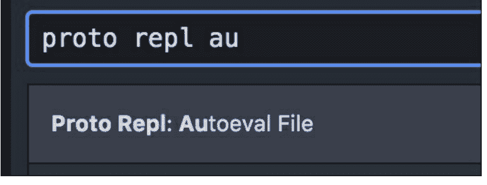

Now back to the text editor section, to see that the code is evaluated

instantly in the opened file. This saves a lot of extra key send to REPL shortcuts:

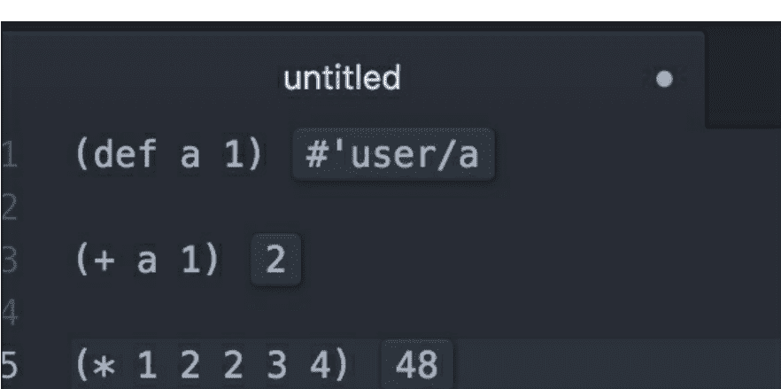

Remember this is still running on the Raspberry Pi, or wherever you started, so anyone else can contribute to the work.

If you remember, we have installed a package named proto REPL graph and added a dependency in the project as well for it. Let's try it out!

The dependency adds a prc namespace that does the integration for you. The default sample graph is already pretty impressive by itself:

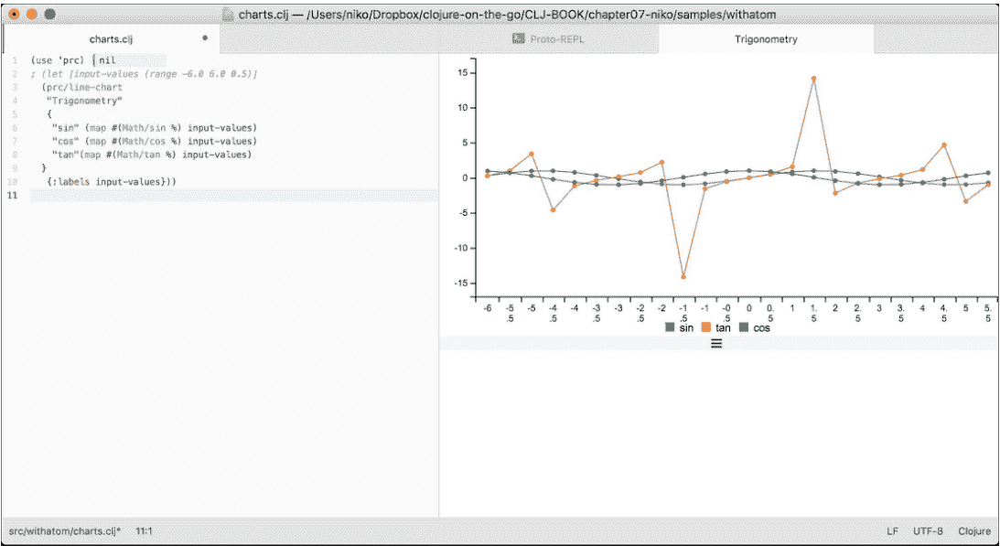

## Real-time chart alongside Clojure code

But let's go and do some integration by fetching quotes from Microsoft, and display them in real time in that graph preview:

```
(ns withatom.quotes
  (:require [cheshire.core :refer :all]))

(defn get-quotes
  [label start end]
  (let [query
        (str
          "https://query.yahooapis.com/v1/public/yql"
          "?q=select%20*%20from%20yahoo.finance.historicaldata%20"
          "where%20symbol%20%3D%20%22"
          label
          "%22%20and%20startDate%20%3D%20%22"
          start
          "%22%20and%20endDate%20%3D%20%22"
          end
          "%22&format=json&env=store%3A%2F%2Fdatatables.org%2Falltableswithkeys")]
    (reverse
      (get-in
```

```
(parse-string
  (slurp query))
["query" "results" "quote"]))))
```

```
(let[ result
  (get-quotes "MSFT" "2016-02-10" "2016-03-20")]
(prc/line-chart
  "MSFT"
  {"quote" (map #(% "Open") result)}
  {:labels (map #(% "Date") result)})
```

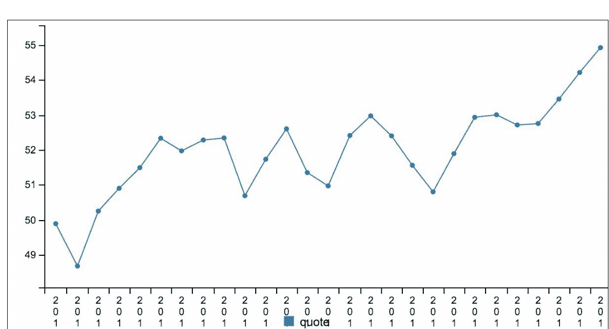

As a reminder, the Raspberry Pi was still fetching the quotes for you! And only the final rendering was done within the Atom editor!

## Using an embedded NREPL

You have seen how to use NREPL, which is a very powerful library for REPLing. Let's go one step beyond that and see how to embed your own REPL into your code using that library. First some project.clj tweaking:

```
[org.clojure/tools.nrepl "0.2.11"]
```

Then, this is how you start and bind a new REPL server within your code:

```
(use '[clojure.tools.nrepl.server :only
(start-server stop-server)])
(def server (start-server :bind "0.0.0.0" :port 7888))
```

Just for the fun of it, and if you were running this embedded REPL within Atom connected to the Raspberry Pi (!!), then the blinking code would still work!

Keep blinking.

## There's more...

Now that we have seen how to connect to a remote shared REPL and have quite a bit of fun with remote berries, let's go beyond and see how to write your own REPL.

## Custom REPL using Java interop

Here we will have a look at how to write a simple REPL server and a client, with standard Java interop code and regular socket connections.

### Server

The following server will be your point of entry to open a socket, send some Clojure forms for evaluation, eval or execute the code on the server, and send the result to the client.

Let's see how this is done:

```
(ns custom-repl.server
  (:import [java.net InetAddress ServerSocket Socket]
           [java.io InputStreamReader OutputStreamWriter]
           [clojure.lang LineNumberingPushbackReader]))
```

```
(defn on-thread [f]
  (doto (new Thread f) (.start)))
```

```
(defn create-server
  [accept-socket bind port]
```

```
(let [address (InetAddress/getByName bind)
      ss (new ServerSocket port)]
  (on-thread
    #(when-not (. ss (isClosed))
         (try (accept-socket (. ss (accept)))
              (catch Exception e))
         (recur)))
    ss))

(defn repl
  [ins outs]
  ; set some bindings for the evaluation
  (binding [*ns* (create-ns 'user)
            *warn-on-reflection* false
            *out* (new OutputStreamWriter outs)]
    (let [eof (new Object)
          r (new LineNumberingPushbackReader
              (new InputStreamReader ins))]
      (loop [e (read r false eof)]
        (when-not (= e eof)
          (prn (eval e))
          (flush)
          (recur (read r false eof)))))))

(defn socket-repl
  [s] (on-thread
       #(repl (. s (getInputStream)) (. s (getOutputStream)))))

(def server
  (create-server socket-repl "0.0.0.0" 9001))

; (. server (close))
```

You can see from the previous code, we create a set of local bindings in the repl function. The first binding *ns* create a user namespace to use for evaluation of the different forms. Another binding is *out* which simply pipes the output of the evaluation to the socket used for output.

Finally, each connection creates a thread, with input and output used as bindings in the eval function call.

### Client

Writing a simple client that would connect to the preceding server is also

quite simple. Say you want to programmatically send code to be evaluated remotely; this is how to do it, again with straightforward Java interop:

```
(ns custom-repl.client
  (:import [java.net Socket]
           [java.io InputStreamReader OutputStreamWriter]
           [clojure.lang LineNumberingPushbackReader]))

(def client
  (new Socket "localhost" 9001))

(def rdr (new LineNumberingPushbackReader
              (new InputStreamReader (. client
(getInputStream)))))
(def wtr (new OutputStreamWriter (. client (getOutputStream))))

(binding [*out* wtr]
  (prn '(+ 1 2 3))
  (flush)
  (read rdr))

(. client (close))
```

This can, of course, be used for regular REPLs as well and eventually any kind of socket connectivity.

## The async custom REPL server

Java interop is cool but is also a bit passe when you can use core.async. You will need one more dependency in your project.clj file:

```
[com.hellonico.gearswithingears/async-sockets "0.1.0"]
```

A dumb REPL will go on using core.async to handle the request and simply eval the string that has been sent to the server. This is very similar to what we saw in the async chapters applied to something practical!

```
(ns custom-repl.async
  (:require [com.gearswithingears.async-sockets :refer :all]
            [clojure.core.async :as async]))
```

```
(defn eval-everything [socket]
  (async/go-loop []
    (when-let [line (async/<! (:in socket))]
      (async/>! (:out socket) (eval (read-string line)))
      (recur))))
```

```
(let [server (socket-server 12349)]
  (async/go-loop []
    (when-let [connection (async/<!! (:connections server))]
      (eval-everything connection)
      (recur))))
```

The async code is nicely shorter and more readable.

## Server REPL or more on real-time work on production code

Now, onto one of the good news about the recently released Clojure 1.8! One of the new features that many of us have been waiting for a long time is the ability to just start a server REPL with ease.

Now it just became possible by simply declaring a parameter when starting the virtual machine, being able to connect to it using a simple socket, and having full access to an REPL.

Using the standard JAR file, for example, the one you build in the Clojure source code recipe, we will be using the following JVM parameter when starting clojure.main:

```
-Dclojure.server.repl="{:port 5555 :accept clojure.main/repl}"
```

This tells the Clojure runtime to start an repl on port 555, and when a socket connect request is about to be accepted, use the clojure.main/repl function to handle the call. Now, for the simplest of cases, this translates into the following command:

```
java \
-cp clojure-1.8.0.jar \
-Dclojure.server.repl="{:port 5555 :accept clojure.main/repl}" \
clojure.main
```


并且有效地，Clojure 将简单地输出通常的反馈消息：

```
Clojure 1.8.0
user=>
```

但现在，我们可以使用 __telnet__ 连接到它。我们将端口定义为 5555，所以让我们 telnet 到它：

```
niko> telnet 127.0.0.1 5555

Trying 127.0.0.1...
Connected to localhost.
Escape character is '^]'.
clojure.core=>
```

并且我们拥有对 REPL 和我们提供给正在运行应用程序的类路径的完全访问权限。所以如果我们重用我们之前看到的代码，比如说：

```
(def msg "I left a message here")
; #'clojure.core/msg
```

然后断开连接并重新连接，我们会看到在同一个命名空间中 def 的内容仍然存在并且已持久化：

```
niko> telnet 127.0.0.1 5555

Trying 127.0.0.1...
Connected to localhost.
Escape character is '^]'.
clojure.core=> msg
"I left a message here"
```

运行了多少个会话可以通过使用以下全局变量简单地看到：

```
clojure.core=> clojure.core.server/*session*
; {:server "repl", :client "5"}
```

启动 REPL 服务器的参数完整映射如下：

```
{:address "localhost" ;; host or dotted name, ipv4 or ipv6
:port 5555
:name "repl"
:accept clojure.main/repl
:args []
:bind-err true
:server-daemon true
:client-daemon true}
```

并且也可以从文件中读取配置。

## 使用 plumatic/schema 进行声明式数据描述和验证

Clojure 是动态类型语言，通常在你独自开发或在小型团队中时提供生产力。然而，在大型团队中的开发有时需要成员之间对数据有了解。prismatic/schema 提供了针对上述问题的解决方案。

在本教程中，我们将学习如何在 Clojure 中添加描述性表达式和验证。我们将使用 prismatic/schema 为各种数据类型定义模式并用模式验证它们。prismatic/schema 可以定义定义输入参数和返回的模式的函数。我们将然后学习如何将一种数据类型强制转换为另一种数据类型。

最后，我们将学习其他解决方案。我们将介绍 core/typed 尝试提供类似于 Scala 的类型推断系统。core/spec 是一个新功能，并在 Clojure 1.9 中引入。

## 准备工作

让我们使用 prismatic/schema 创建一个项目。prismatic/schema 支持 Clojure 和 ClojureScript。所以，让我们使用 Figwheel 创建一个项目：

```
$ lein new figwheel schema-example
$ cd schema-example
```

我们将在 project.clj 中添加 prismatic/schema 的库依赖：

```
:dependencies [[org.clojure/clojure "1.8.0"]
                [org.clojure/clojurescript "1.8.51"]
                [org.clojure/core.async "0.2.374"
                 :exclusions [org.clojure/tools.reader]]
                [prismatic/schema "1.1.1"]
[prismatic/schema-generators "0.1.0"]
]]
```

启动 REPL，然后创建 src/schema-example/cljexample.clj 并声明要使用的 _prismatic/schema 库：

```
(ns schema-example.clj-example
  (:require [schema.core :as s]))
;;=> nil
```

## 如何做...

我们将在这里学习 prismatic/schema 的基本用法。让我们从书籍的简单模式开始。

### 我的第一个模式

让我们为书籍定义一个模式。Book 是一个映射，模式如下：

| Name | Data type |
|------|-----------|
| name | String |
| author | Array of String |
| category | Set of keyword |
| publisher | String |

现在，让我们使用 prismatic/schema 定义前述模式：

```
(def Book
  {
    :name s/Str
    :author [s/Str]
    :category #{s/Keyword}
    :publisher s/Str})
;;=> #'schema-example.clj-example/Book
```

然后，让我们通过使用以下方式验证来检查给定数据是否正确

```
(s/validate {s/Keyword s/Int} {:year 2016})
;; => {:year 2016}
(s/validate #{s/Keyword} #{:lisp :functional})
;; => #{:lisp :functional}
```

我们将验证任意类型和枚举类型：

```
(s/validate s/Any "Makoto")
;;=> "Makoto"
(s/validate s/Any 1.0)
;;=> 1.0
(s/validate s/Regex #".*")
;;=> #".*"
(s/validate (s/enum "01" "02" "03") "01")
;;=> "01"
(s/validate (s/enum "01" "02" "03") "05")
;;=> ExceptionInfo Value does not match schema: (not (#{ "03" "02" "01"} "05"))  schema.core/validator/fn--38164
(core.clj:155)
```

## 使用模式进行记录和其他类型

我们可以使用模式进行记录。让我们定义 Order 类型并验证其实例：

```
(s/defrecord Order
  [name :- s/Str
   price :- s/Num
   qty :- s/Int])
;;=> #'schema-example.clj-example/strict-map->Order
(s/explain Order)
;;=> (record schema_example.clj_example.Order {:name Str,
:price Num, :qty Int})
(s/validate Order (map->Order {:name "Clojure Programming Cookbook" :price 32.00 :qty 10}))
;;=> #schema_example.clj_example.Order{:name "Clojure Programming Cookbook", :price 32.0, :qty 10}
```

Order 记录具有 name、price 和 qty 属性，它们的类型分别为字符串、数字和整数。prismatic/schema 提供了值的范围验证。下一段代码验证数字的范围：

```
(s/validate (s/pred #(and (< 0 %) (> 10 %))) 5)
```

```
;;=> 5
```

schema.core/maybe 检查值是否为指定类型或 nil：

```
(s/validate (s/maybe s/Keyword) :price)
;;=> :price
(s/validate (s/maybe s/Keyword) nil)
;;=> nil
(s/validate (s/maybe s/Keyword) 1)
;;=> ExceptionInfo Value does not match schema: (not (keyword? 1))  schema.core/validator/fn--38164 (core.clj:155)
```

在前面的示例中，关键字和 nil 是有效的，但整数无效。以下 NumMapOrSetOrList 验证检查的数据应为其键为关键字的映射、数字的集合或数字的数组：

```
(def NumMapOrSetOrList (s/conditional map? {s/Keyword s/Num} set? #{s/Num} :else [s/Num]))
;;=> #'schema-example.clj-example/NumMapOrSetOrList
(s/validate NumMapOrSetOrList {:qty 1.0})
;;=> {:qty 1.0}
(s/validate NumMapOrSetOrList #{1 2 3})
;;=> #{1 3 2}
(s/validate NumMapOrSetOrList [1 2 3])
;;=> [1 2 3]
```

```
(def SmallInt (s/constrained long #(and (<= -32768 %) (>= 32767 %))))
;;=> #'schema-example.clj-example/SmallInt
(s/validate SmallInt 10)
;;=> 10
(s/validate SmallInt 500000)
;;=> ExceptionInfo Value does not match schema: (not (schema-example.clj-example/fn--39713 500000))
schema.core/validator/fn--38164 (core.clj:155)
```

prismatic/schema 提供了递归数据类型：

```
(def Recursive {:key s/Int :value s/Str :children [(s/recursive #'Recursive)]})
;;=> #'schema-example.clj-example/Recursive
(s/validate Recursive
  {:key 1 :value "test", :children
   [{:key 2 :value "test2", :children [] }
{:key 3 :value "test3", :children [{:key 4 :value "test4" :children []}]}}
;;=> {:key 100, :value "test", :children [{:key 2, :value "test2", :children []} {:key 3, :value "test3", :children [{:key 4, :value "test4", :children []}]}]}
```

## 使用验证定义函数

schema.core/defn 验证输入参数和返回类型。以下示例定义 int-add 以添加整数加法。让我们定义 int-add，其参数和返回类型都是整数：

```
(s/defn int-add :- s/Int
  [& x :- [s/Int]]
  (reduce + x))
;;=> #'schema-example.clj-example/int-add
```

让我们测试该函数：

```
(int-add 1 1 2 3)
;;=> 7
(int-add 1 1.0 4)
;;=> 6.0
```

默认情况下没有模式检查。schema.core/set-fn-validation! 将模式检查设置为如下：

```
(s/set-fn-validation! true)
;;=> nil
(int-add 1 1.0 4)
;;=> ExceptionInfo Input to int-add does not match schema: [nil (not (integer? 1.0))]  schema-example.clj-example/eval49222/int-add--49227 (form-init3277965317664434982.clj:262)
(s/set-fn-validation! false)
;;=> nil
(int-add 1 1.0 4)
;;=> 6.0
```

所以，让我们检查如果返回类型无效。^:always-validate 总是验证模式类型：

```
(s/defn ^:always-validate wrong-int-add :- s/Int
  [& x :- [s/Int]]
(bigdec (reduce + x)))
;;=> #'schema-example.clj-example/wrong-int-add
(wrong-int-add 1 1)
;;=> ExceptionInfo Output of wrong-int-add does not match schema: (not (integer? 2M))  schema-example.clj-example/eval49476/wrong-int-add--49481 (form-init3277965317664434982.clj:284)
```

在前面的情况下，wrong-int-add 返回 BigDecimal，这导致错误。

## 它是如何工作的...

在本教程中，我们将检查 prismatic schema 的性能以及如何使用 schema 生成测试数据。

## 性能考虑

在这里，我们将使用 int-add 检查性能。让我们比较 schema.core/with-fn-validation 和 schema.core/without-fn-validation 的性能：

```
(time
  (dotimes [n 100000]
    (s/with-fn-validation
      (int-add 1 2))))
;;"Elapsed time: 587.858912 msecs"
;;=> nil
(time
  (dotimes [n 100000]
    (s/without-fn-validation
      (int-add 1 2))))
;;=> "Elapsed time: 150.847882 msecs"
;;=> nil
```

没有模式检查更快。然后，我们将测试 (s/set-fn-validation! true) 和 (s/set-fn-validation! false) 的性能：

```
(s/set-fn-validation! true)
;;=> nil
(time
  (dotimes [n 100000]
    (int-add 1 2)))
```


```
; ;=> "Elapsed time: 140.624018 msecs"
; ;=> nil
(s/set-fn-validation! false)
; ;=> nil
(time
  (dotimes [n 100000]
    (int-add 1 2)))
; ;=> "Elapsed time: 28.948555 msecs"
; ;=> nil
```

就性能而言，使用 set-fn-validation 比使用 with-fn-validation/without-fn-validation 来切换验证更快。最后，我们将测试原生 + 函数的性能：

```
(time
  (dotimes [n 100000]
    (+ 1 2)))
; ;=> "Elapsed time: 7.058001 msecs"
; ;=> nil
```

两个数字的加法太小，无法评估 prismatic/schema 的性能。让我们通过计算一百个数字的加法来衡量性能：

```
(time
  (dotimes [n 1000000]
    (apply int-add (range 100))))
"Elapsed time: 3387.52923 msecs"
; ;=> nil
```

```
(time
  (dotimes [n 1000000]
    (apply + (range 100))))
"Elapsed time: 3681.930561 msecs"
; ;=> nil
```

似乎使用 schema 和不使用 schema 之间没有区别。

## 生成测试数据

prismatic/schema 可用于生成测试数据。prismatic/schema-generators 可从模式生成测试数据。prismatic/schema-generators 仍处于 alpha 版本，但非常有用，可以生成测试数据并理解数据结构。所以，让我们看看它是如何工作的。

首先，我们将 schema-generators.generators 添加到命名空间声明的 :require 部分：

```
(ns schema-example.clj-example
  (:require [schema.core :as s]
            [schema.coerce :as coerce :include-macros true]
            [schema-generators.complete :as c :include-macros true]
            [schema-generators.generators :as g :include-macros true]
            [schema-generators.complete :as gc]
  ))
;;=> nil
```

让我们再添加一个映射键，其值是枚举类型：

```
(def Book
  {
    :name s/Str
    :author [s/Str]
    :keyword #{s/Keyword}
    :publisher s/Str
    :category (s/enum :it :romance :business-money)})
;;=> #'schema-example.clj-example/Book
```

然后，我们将从 Book 创建测试数据：

```
(g/generate Book)
;;=> {:name "gWTFZ>'", :author ["ECg5Q" " i>Y8z\\2"], :keyword #{}, :publisher "s@", :category :it}
```

以下代码将生成 100 条数据：

```
(g/sample 100 Book)
;;=> ({:name "", :author [], :keyword #{}, :publisher "", :category :business-money}
;;=> {:name "", :author [""], :keyword #{:Wt}, :publisher ">", :category :it}
;;=> {:name "z", :author [], :keyword #{:j}, :publisher "jK", :category :business-money}
;;=> ......
```

生成随机数据很容易：

```
(g/sample 10 s/Str)
;;=> ("" "'" "##" "r8" "" "'Uqn3" "" "F8602B1" "AR~2," "")
(g/sample 10 s/Int)
;;=> (-1 -1 -2 1N 0N -9 -1N 23 2 -6)
(g/sample 10 s/Num)
;;=> (0 0.75 0 1 -1 2.0 -4 -2 2.0 0.5)
```

schema-generators.complete 为定义的模式创建完整数据：

```
(gc/complete {:name "foo" :keyword #{:bar}} Book)
;;=> {:name "foo", :author ["ft?" "yY31"], :keyword #{:bar},
:publisher "kw", :category :romance}
```

## 还有更多...

prismatic/schema 运行在 ClojureScript 上。我们将运行 Figwheel 来测试它。

## 使用 prismatic/schema 进行数据强制转换

在学习本节之前，让我们运行 Figwheel REPL：

```
$ lein figwheel
```

然后，定义 schema-example.cljs-example 命名空间并按如下方式声明 schema 库：

```
(ns schema-example.cljs-example
  (:require [schema.core :as s :include-macros true]
            [schema.coerce :as coerce :include-macros true]
            [schema-generators.complete :as c :include-macros true]
            [schema-generators.generators :as g :include-macros true]
            [schema-generators.complete :as gc :include-macros true]))
;;=> nil
```

使用 ClojureScript，:include-macros 选项是必要的。假设一个订单有两个产品。defschema 是定义模式并在元数据中记录模式名称的宏：

```
(s/defschema RequestOrder
  { :id s/Str
    :product s/Str
    :qty s/Int
    :unit-price s/Num
    :product2 s/Str
    :qty2 s/Int
    :unit-price2 s/Num})
;;=> #'schema-example.cljs-example/RequestOrder
```

我们将定义 ReplyOrder，其格式与 RequestOrder 略有不同：

```
(s/defschema ReplyOrder
  { :order-id s/Str
    :ordered-product [[(s/one s/Str "s") (s/one s/Int "s") (s/one s/Num "s")]]
    })
;;=> #'schema-example.cljs-example/ReplyOrder
```

两个订单被分组到 :order-product 中，值的类型是数组的数组。prismatic/schema/one 限制了数组序列的顺序。之前的模式限制每个产品是 [String, Integer, Number]。

我们将按如下方式编写 RequestOrder 到 ReplyOrder 的映射：

```
(defn RequestOrder->ReplyOrder
  [{:keys [id product qty unit-price product2 qty2 unit-price2]
    :as request-params}]
  {:order-id id :ordered-product [[product qty unit-price]
                                   [product2 qty2 unit-price2]]})
;;=> #'schema-example.cljs-example/RequestOrder->ReplyOrder
```

然后，让我们定义 order-coercer 并测试它：

```
(def order-coercer
  (coerce/coercer ReplyOrder
                   {ReplyOrder RequestOrder->ReplyOrder}))
;;=> #'schema-example.cljs-example/order-coercer
(order-coercer

```
{:id "10" :product "pencil" :qty 5 :unit-price 1.0 :product2 "note" :qty2 5 :unit-price2 3.0})
    ; ;=> {:order-id "10", :ordered-product [["pencil" 5 1] ["note" 5 3]]}
```

我们可以看到输入映射被转换成了数组的数组。接下来，我们将尝试另一个 coercer。以下 coercer 将产品转换为映射的数组：

```
(s/defschema ReplyOrder2
  { :order-id s/Str
    :ordered-product
    [{(s/required-key :product-name) s/Str
      (s/required-key :qty) s/Int
      (s/required-key :unit-price) s/Num}]})
;;=> #'schema-example.cljs-example/RequestOrder
(defn RequestOrder->ReplyOrder2
  [{:keys [id product qty unit-price product2 qty2 unit-price2]
    :as request-params}]
  {:order-id id
   :ordered-product [
                    {:product-name product :qty qty :unit-price unit-price}
                    {:product-name product2 :qty qty2 :unit-price unit-price2}]})
;;=> #'schema-example.cljs-example/RequestOrder->ReplyOrder2
```

然后，让我们测试它：

```
(def order-coercer2
  (coerce/coercer ReplyOrder2
                   {ReplyOrder2 RequestOrder->ReplyOrder2}))
;;=> #'schema-example.clj-example/order-coercer2
(order-coercer2
  {:id "10" :product "pencil" :qty 5 :unit-price 1.0 :product2 "note" :qty2 5 :unit-price2 3.0})
;;=> {:order-id "10", :ordered-product [{:product-name "pencil", :qty 5, :unit-price 1} {:product-name "note", :qty 5, :unit-price 3}]}
```

## 使用 core.typed

这里，我们将简要介绍 core.typed，它与 prismatic/schema 不同。core.typed 是 Clojure 中的可选类型系统，能够在编译时对变量、函数参数和宏进行静态类型检查。还可能对协议和数据类型进行注解。

要开始使用 core.typed，让我们按如下方式修改 project.clj 并重新启动 REPL：

```
:dependencies [[org.clojure/clojure "1.8.0"]
                [org.clojure/core.typed "0.3.21"]]
:repositories {"sonatype-oss-public"
"https://oss.sonatype.org/content/groups/public/"}
:injections [(require 'clojure.core.typed)
            (clojure.core.typed/install)]
```

创建 src/typed_example/core.clj 并按如下方式声明命名空间：

```
(ns typed-example.core
  {:lang :core.typed}
  (:require [clojure.core.typed :as t]))
```

然后，让我们使用 clojure.core.typed/ann 定义 my-add 的注解：

```
(t/ann my-add [Number Number -> Number])
;;=> nil
```

我们将使用 clojure.core/defn 定义 my-add 并测试它：

```
(defn my-add [a b] (+ a b))
;;=> #'typed-example.core/my-add
(my-add 1 2)
;;=> 3
```

它有效！现在，我们将测试一个失败的案例，给出一个字符串参数：

```
(my-add 1 "a")
;;=> Type Error (*cider-repl typed-example:49585*:459:20)
Function add could not be applied to arguments:
;;=> Domains:
;;=>     Number Number
;;=> Arguments:
;;=>     (t/Val 1) (t/Val "a")
```


```
; ;=> Ranges:
; ;=>     Number
; ;=> in: (my-add 1 "a")
; ;=> ExceptionInfo Type Checker: Found 1 error
clojure.core/ex-info (core.clj:4617)
```

我们可以按如下方式在 vars 中定义类型：

```
(t/ann d-value BigDecimal)
; ;=> nil
```

让我们按如下方式测试前面的内容：

```
(def d-value 10.0M)
; ;=> #'typed-example.core/d-value
(def d-value 1)
; ;=> Type Error (*cider-repl typed-example:49585*:584:20) Type mismatch:
; ;=> Expected:     BigDecimal
; ;=> Actual:       (t/Val 1)
; ;=> in: 1
; ;=> ExceptionInfo Type Checker: Found 1 error
clojure.core/ex-info (core.clj:4617)
```

它无法将 1 赋给 d-value。

## core.spec

Clojure 1.9 支持 spec 库，用于通过 spec_ 按规范支持数据结构、验证和生成。它类似于 prismatic/schema_，但它包含在 Clojure 中，无需加载额外的库。

让我们创建一个名为 spec-example 的新项目：

```
$ lein new spec-example
```

然后替换 Clojure 的版本：

```
:dependencies [[org.clojure/clojure "1.9.0-alpha7"]]
```

我们将按如下方式声明使用 clojure.spec：

```
(ns spec-example.core
```

```
(:require [clojure.spec :as s])
)
```

我们使用 core.spec 按如下方式定义字符串序列：

```
(s/def ::seq-of-names (s/* string?))
;;=> :spec-example.core/seq-of-names
```

要查看定义，请使用 core.spec/describe：

```
(s/describe ::seq-of-names)
;;=> (* string?)
```

让我们测试一下：

```
(s/conform ::seq-of-names ["Makoto Hashimoto" "Nicolas Modrzyk"])
;;=> ["Makoto Hashimoto" "Nicolas Modrzyk"]
```

它工作正常，但以下检查失败：

```
(s/conform ::seq-of-names [:Makoto-Hashimoto "Nicolas Modrzyk"])
;;=> :clojure.spec/invalid
```

以下代码与本教程中 prismatic/schema 部分中的代码相同：

```
(s/def ::date (s/map-of keyword? integer?))
;;=> :spec-example.core/date
(s/conform ::date {:year 2016})
;;=> {:year 2016}
(s/conform ::date {:year 2016 :date 10 :month 7})
;;=> {:year 2016, :date 10, :month 7}
(s/valid? #{"01" "02" "03"} "01")
;;=> true
(s/valid? #{"01" "02" "03"} "04")
;;=> false
(s/valid? (s/nilable string?) "test")
;;=> true
(s/valid? (s/nilable string?) nil)
;;=> true
(s/valid? (s/nilable string?) 1)
;;=> false
(s/def ::small-int #(<=-32768 % 32767))
```

```
; ;=> :spec-example.core/small-int
(s/conform ::small-int 10)
; ;=> 10
(s/conform ::small-int 50000)
; ;=> :clojure.spec/invalid
```

要为函数定义函数规范，请使用 core.spec/fdef。我们将定义一个非常简单的函数，该函数限制参数值为整数且为正。首先，我们将使用 defn 定义 positive-int-add：

```
(defn positive-int-add [x  y]
  (+ x y))
; ;=> #'spec-example.core/positive-int-add
```

然后，我们将使用 core.spec/fdef 检查两个参数是否为整数且大于 0：

```
(s/fdef positive-int-add
  :args (s/and (s/cat :x integer? :y integer?)
              #(and (< 0 (:x %)) (< 0 (:y %))))
  :ret integer?)
; ;=> spec-example.core/positive-int-add
```

让我们检查 positive-int-add 函数：

```
(positive-int-add 1 10)
; ;=> 11
(positive-int-add 1 -20)
; ;=> -19
```

糟糕，函数没有检查参数 -20。要使其成为 core.spec/fdef 可用，我们必须按如下方式操作：

```
(s/instrument #'positive-int-add)
; ;=> #'spec-example.core/positive-int-add
```

让我们再试一次！

```
(positive-int-add 1 -20)
; ;=> ExceptionInfo Call to #'spec-example.core/positive-int-add did not conform to spec:
; ;=> val: {:x 1, :y -20} fails at: [:args] predicate: (and (< 0 (:x %)) (< 0 (:y %)))
; ;=> :clojure.spec/args  (1 -20)
```

; ;=>  clojure.core/ex-info (core.clj:4703)

在这里，`fdef` 对 `positive-int-add` 正确工作，就这样！
