# 第 8 章. Web 应用程序

在本章中，我们将介绍：

- Clojure with Vaadin - 轻松的 Web 小部件
- 使用 Liberator 快速创建 REST API
- 使用 Immutant 工作 - 重用基础设施
- 使用 om.next 开发，该库是下一代 ClojureScript 库

## 引言

在本章中，我们将使用 Clojure 学习 Web 应用程序开发。首先，我们将学习如何使用 Vaadin 进行基于小部件的开发。我们将学习使用 Vaadin 通过 Clojure 进行基于小部件的开发是多么容易。

然后，我们将看一下 Liberator。Liberator 是一个用于在 REST 中开发资源的库。我们将首先使用 Liberator 开发一个简单的 REST API，但我们将学习使用 Liberator 的更高级用法。

接下来，我们将学习 Immutant，这是一个基于 Undertow 用于 Web、HornetQ 用于消息传递、Infinispan 用于缓存、Quartz 用于调度和 Narayama 用于事务的 Clojure 库套件。使用 Immutant 进行应用程序开发时，我们可以部署到 WildFly 或 JBoss EAP 集群以获得增强功能。在本教程中，我们将学习如何使用 Immutant 开发高级 Web 应用程序。我们还将学习如何打包和部署我们的应用程序。

最后，我们来看一下 David Nolen 的 om.next。Om.next 是受 Facebook 的 Relay、Netflix 的 Falcor 和 Cognitect 的 Datomic 启发的 om 的继任者。它仍处于 alpha 阶段，但具有用于开发应用程序的新概念。在教程中，我们将学习 om.next 的基本功能。

## Clojure with Vaadin - 轻松的 Web 小部件

Vaadin 已存在相当一段时间，以其全代码式 UI 框架而闻名于 Web 应用程序。当然，还有许多框架可用于 Web 工作，甚至在本章中我们也介绍了基于 JavaScript 库的一些著名框架。

Vaadin 提出了一套一致的易于使用的通常用 Java 编写的 widgets。通过一点 Clojure 魔法，但主要是通过在编译代码和脚本之间架起桥梁的方式，你现在可以使用你喜欢的语言来脚本化 UI，使用这些 widgets 并实时查看更新。在本教程中，你还将被再次介绍 Vaadin 与 Clojure 相关的响应式编程概念的范围。享受吧！

## 开始准备

要开始使用 Clojure/Vaadin 编程，你将通过设置 `project.clj` 文件并使用一些简单但特定的设置开始。让我们看看里面有什么。

## 项目设置

要使用 Vaadin 类，我们将导入必要的库到我们的项目中。Vaadin 库将作为常规依赖项包含。`project.clj` 文件还引入了 `lein-servlet` 插件，这是一个插件，它插入了通常基于 Java 的服务器端编程环境，名为 `servlet`。该插件还嵌入了一个轻量级应用程序服务器，名为 Jetty。

最后，`project.clj` 文件通过启动 Jetty 服务器并指定参数来帮助将事物连接起来，即一个绑定到根路径 "/" 的 Web 应用程序，并将使用

web.xml 文件的内容进行配置，这曾经是通过 XML 文件配置 Java Web 应用程序的通常方式。

让我们开始将依赖项放在 project.clj 文件中：

```
(defproject vaadin2 "0.1.0-SNAPSHOT"
  :dependencies [
    [org.clojure/clojure "1.8.0"]
    [com.vaadin/vaadin-server "7.6.6"]
    [com.vaadin/vaadin-client-compiled "7.6.6"]
    [com.vaadin/vaadin-themes "7.6.6"]
    [javax.servlet/javax.servlet-api "3.1.0"]]
  :resource-paths ["example00"]

  :plugins [[lein-servlet "0.4.1"]]
    :servlet {:deps [[lein-servlet/adapter-jetty8 "0.4.1"]]
              :config {:engine :jetty :host "localhost"}
              :webapps
              {"/"
               {:public "resources"
                :web-xml "src/main/webapp/WEB-INF/web.xml"}}})
```

## Clojure/Vaadin 流程

配置的最后一部分可能仍然有点晦涩，所以让我们分解这些步骤：

- 1. Vaadin 框架以通用的 Vaadin servlet 开始，它基本上是服务器端 Web 编程的 Java 请求处理器。
- 2. 这个 Vaadin servlet 需要一个参数才能启动，那就是调用扩展 com.vaadin.ui.UI Java 类。
- 3. 该 Java 类有一个方法 init，它将接收一次性的请求参数和应用程序 UI 对象。
- 4. 前面的 UI 类将负责编写或委托描述应用程序的所有 Java 代码。
- 5. 最后，在本教程的上下文中，UI Java 类将使用在 Java 应用中插入 Clojure 脚本的通常方式，使处理动态化，并在每次请求时刷新。

这在 Clojure 中意味着什么呢？你希望在这里有 Clojure 代码实现 UI 类的 init 方法，其中该 init


method 加载一个 Clojure 脚本，并执行给定的方法；这里，我们将调用命名空间 ex1，以及方法 main：

```
(ns vaadin2.vaadin2ui
  (:gen-class
    :name vaadin2.vaadin2ui
    :extends com.vaadin.ui.UI))
(defn -init
  [main-ui request]
  (clojure.lang.RT/loadResourceScript "ex1.clj")
  (.setContent
    main-ui
    (.invoke (clojure.lang.RT/var "ex1" "main") main-ui)))
```

最后，你需要编写 ex1/main 函数，其中 main 函数设置主占位符的内容。

在这里，你可以随意使用 Vaadin 类；这就是开始的地方。一个应用程序通常需要一个布局，我们的第一个标签将说一些类似法语的 hello：

```
(ns ex1
  (:import [com.vaadin.ui VerticalLayout Label]))
(defn main[ui]
  (let [
    layout  (VerticalLayout.)
    label   (Label. "Bonjour le monde!")]
    (.addComponent layout label)))
```

所有元素都已就位；Leiningen servlet 插件会为你提供一个 servlet 子命令，包括一个用于启动服务器的 run 命令：

```
lein servlet run
```

在默认的开发模式下，该命令还会打开一个浏览器页面并显示正确的 URL，就这样，一些法语的 hello world！

## 如何操作...

在本节中，你将被介绍到新的小部件，并逐步学习如何使用 Vaadin 事件与小部件进行交互。

### 使用 Calendar 小部件

使用 `Calendar` 小部件是通过标准的 Java 互操作完成的。Calendar 的官方 Vaadin 文档可以在以下 URL 找到：https://vaadin.com/docs/-/part/framework/components/components-calendar.html。

将前一个链接中的示例翻译成 Clojure 得到：

```
(defn calendar []
  (let[ cal (Calendar. "Today Calendar")]
    (doto cal
      (.setWidth "600px")
      (.setHeight "500px")
      (.setStartDate (Date.))
      (.setEndDate (Date.)))))
```

你可以使用第一部分中介绍的方法将 `Calendar` 挂载到应用程序中：

```
(defn main [app]
  (let [layout  (VerticalLayout.)
    calendar (calendar)]
    (doto layout
      (.addComponent calendar))))
```

在 `project.clj` 文件中，对于每个示例，我们将更改 Clojure 资源路径；因此，例如，对于日历示例，添加以下内容：

```
:resource-paths ["example01-calendar"]
```

这将使 `loadResourceScript` 函数在正确的文件夹中查找文件。使用 `lein servlet run` 启动应用程序，然后：

### Today Calendar

### Sunday 6/19/16

- 1 AM
- 2 AM
- 3 AM
- 4 AM
- 5 AM
- 6 AM
- 7 AM
- 8 AM
- 9 AM
- 10 AM
- 11 AM
- 12 PM
- 1 PM
- 2 PM
- 3 PM
- 4 PM
- 5 PM
- 6 PM
- 7 PM
- 8 PM
- 9 PM
- 10 PM
- 11 PM

看起来你今天没什么可做的，所以让我们加点乐趣。你可能忘了那个生日聚会，所以现在让我们添加它：

```
(def sample-event
  (let [
  start (GregorianCalendar.)
  end (GregorianCalendar.)]
  (.add end java.util.Calendar/HOUR 2)
  (doto
    (BasicEvent.
      "Birthday Part7"
```

```
"At Ren's place"
(.getTime start)
(.getTime end)) )))
```

并且在日历方法中，你需要再添加一行来添加事件：

```
(defn calendar []
  (let[ cal (Calendar. "Today Calendar")] 
    (doto cal
...
      (.addEvent sample-event))))
```

刷新页面后事件会立即显示：


日历事件会响应 UI 的交互，例如拖放。

### 响应事件

使用 Vaadin 进行大量 UI 事件编程的方式是相似的，即实现事件监听器。当你移动日历事件时将被触发的 UI 事件是：

CalendarEvent$EventChangeListener。

你可以使用 `proxy` 或 `reify` 来实现接口：

```
; using proxy
(def event-change-fn
  (proxy [CalendarEvent$EventChangeListener] []
    (eventChange [eventChangeEvent]
      (println eventChangeEvent))))
```

```
; using reify
(def event-change-fn
  (reify CalendarEvent$EventChangeListener
    (eventChange [this eventChangeEvent]
      (println eventChangeEvent))))
```

选择权在你，但不要忘记在日历构造函数中添加处理器：

```
( .addEventChangeListener event-change-fn )
```

刷新页面后，拖动日历事件上下会触发处理器，并在命令行打印更新后事件的一些信息。

这种使用 `proxy` 或 `reify` 的方式将在本食谱中广泛使用，所以在继续之前请确保多加练习以掌握它。这是一个非常重要的构建块，所以让我们再看一个按钮处理器的例子。

### 点击按钮

点击按钮是关于实现 `ClickListener` 接口。让我们一起过一遍：

```
(defn main [ui]
  (let [layout (VerticalLayout.)
        first-name (TextField.)
        submit-button (Button. "Submit")]
    (.addComponent layout (Label. "First Name"))
    (.addComponent layout first-name)
    (.addComponent layout submit-button)
    (.addListener submit-button
```

```
(proxy [Button$ClickListener] []
    (buttonClick [event]
        (println (.getValue first-name))))
layout))
```

前面的片段向垂直布局添加了一个标签、一个字段和一个按钮。然后按钮会获得一个事件处理器来响应点击事件，因此在点击时将打印文本字段的值：

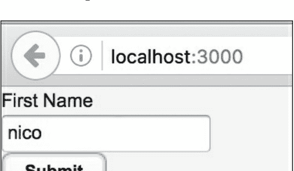

掌握了基础知识后，是时候开始稍微组织一下代码了；让我们看看如何将代码组织到不同的命名空间中，并在刷新后仍然看到更新。

### 使用和重新加载命名空间

在这个示例中，你将看到如何将 Vaadin 相关代码分离到不同的命名空间中。假设你有一个基本的布局，其中包含一个标签和一个按钮：

```
(defn- main-layout []
    (doto (VerticalLayout.)
        (.addComponent (Label. "Hello Clojure!"))
        (.addComponent (button "Press me" show-message))))

(defn main [ui]
(main-layout))
```

你现在希望将与按钮相关的代码放在单独的文件中，

```
buttons.clj:

(ns buttons
  (:import [com.vaadin.ui
Button
Button$ClickListener
Notification]))

(defn button-click-listener
  [action]
  (reify Button$ClickListener
    (buttonClick [_ evt] (action))))

(defn listener [button action]
  (.addListener button (button-click-listener action)))

(defn show-message []
  (Notification/show "clicked"))

(defn button [caption action]
  (doto (Button. caption) (listener action)))
```

第一个文件将通过以下方式引用 buttons 命名空间：

```
(ns ex1
  (:require [buttons :as b])
  (:import...))
```

加载服务器后，你可以看到应用程序和按钮显示：

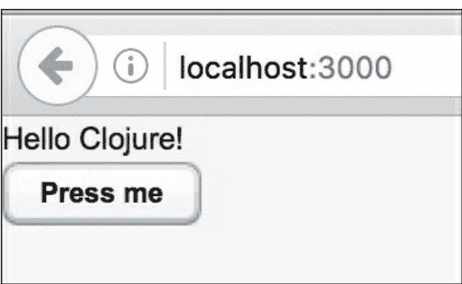

并且通过调用
Notification/show 出现了漂亮的 Vaadin 通知：

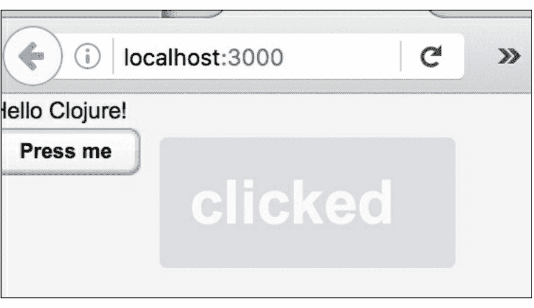

现在如果你尝试更改 buttons.clj 中的代码，并将显示 Vaadin 通知的函数更新为：

```
(defn show-message []
  (Notification/show "clicked again!"))
```

刷新页面并再次点击按钮可惜仍然显示之前的消息。事实上，命名空间的代码似乎没有在运行的容器中更新。

为了恢复更友好的开发工作流程，你可以在命名空间 require 指令中使用 reload-all 指令，如下所示：

```
(:require :reload-all [buttons :as b])
```

现在刷新页面将获得原始的重新加载行为，就像所有内容都在一个文件中一样。

### 服务器端推送

到目前为止，你一直在处理的 UI 是直接用 Vaadin 代码编写的，或者是通过用户交互和
响应式代码与监听器进行更新。要异步发送消息，而不响应用户交互，你将使用一种名为服务器端推送的东西。服务器端推送要求你做以下几件事：

- 设置一个额外的特定 Vaadin 库
- 设置应用程序以支持推送，并启动推送 WebSocket 框架
- 添加一些异步 UI 更新代码

让我们通过查看如何在应用程序启动后几秒钟向客户端发送消息的示例来了解。

首先，额外的库不出所料，名为 vaadin-push 并进入你的 project.clj 文件：

```
[com.vaadin/vaadin-push "7.6.6"]
```

其次，应用程序中 Clojure 代码的第一行将设置推送机制：

```
( .setPushMode
  (.getPushConfiguration ui)
  (com.vaadin.shared.communication.PushMode/AUTOMATIC))
```

这有点晦涩，但基本上这只是将推送机制设置为启动。第三，或者实际上在第三之前，让我们尝试编写一个异步 UI 更新：

```
(defn runme []
  (reify Runnable
    (run [_]
      (Thread/sleep 3000)
      ; (Notification/show "Does not work"))))
    (-> (UI/getCurrent) (.access async-ui-update))))
```

```
(defn main[ui]
  (.setPushMode
    (.getPushConfiguration ui)
    (com.vaadin.shared.communication.PushMode/AUTOMATIC))
```


```
(let [layout (VerticalLayout.)]
    (.addComponent layout (Label. "I am getting sleepy ~~~"))
    (.start (Thread. (runme)))
    layout
)
```

代码通过执行简单的布局、启动线程，并在 3 秒后显示通知来读取。自己运行代码... 你会很快注意到... 线程启动，等待 3 秒，然后... 什么也没做。仔细阅读后，它不起作用。问题出在哪里？

视觉更新缺乏的原因是已创建的线程不再是 UI 线程，因此刷新无法链接到现有 UI 对象，更新失败。

要执行异步更新，我们将实现一个新的 Runnable，并要求 UI 线程执行异步更新。这是通过 UI/getCurrent 获取 UI 线程，并使用 .access 执行异步更新来完成的。

因此，经过这些小的更新后，你现在有了以下代码：

```
(def async-ui-update
    (reify Runnable
      (run [_]
        (Notification/show "Let's sleep"))))

(defn runme []
    (reify Runnable
      (run [_]
        (Thread/sleep 3000)
        ; (Notification/show "Does not work"))))
    (-> (UI/getCurrent) (.access async-ui-update))))
```

最后，通知显示如下：

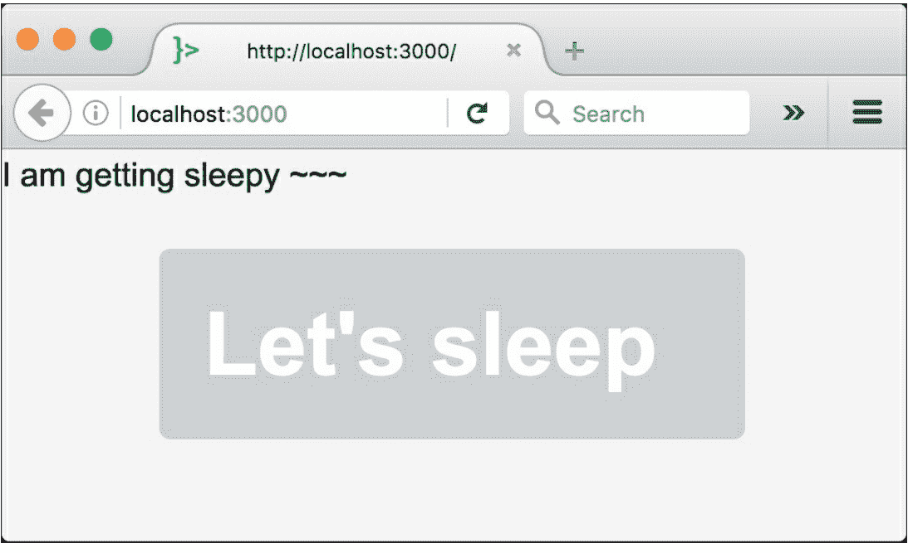

## 还有更多...

砖块已铺好，可以用 Vaadin 做一些响应式编程。让我们看一些案例。

## Reactive Vaadin - 思路

我们将在此处添加一个标准的 Clojure atom 作为响应点，再加上一个监听该 atom 以执行异步 UI 更新的监听器。

此示例添加了一个响应式文本字段，当其值被更新时会显示通知：

```
(def last-value
  (atom ""))

(defn runme [msg]
  (let [async-ui-update
        (proxy [Runnable] [] (run [] (Notification/show msg)))]
    (-> (UI/getCurrent) (.access async-ui-update))))
```

```
(defn my-layout [layout]
  (.addComponent layout (Label. "Write something"))

  (let [first-name (TextField.)]
    (.addComponent layout first-name)

    (.addValueChangeListener first-name
      (proxy [Property$ValueChangeListener] []
        (valueChange [event]
          (dosync (reset! last-value
            (-> event (.getSource) (.getValue))))))))

(defn main [ui]
  (.setPushMode
    (.getPushConfiguration ui)
    (com.vaadin.shared.communication.PushMode/AUTOMATIC))
  (let [base (VerticalLayout.)]
    (my-layout base)

    (add-watch last-value :listener
      (fn [key atom old-state new-state]
        (runme new-state)))
  base))
```

你已经看到了异步 UI 更新机制。这里，将被监听的新事件是 Property$ValueChangeListener，当文本字段在用户输入后获得不同值时触发。atom 然后将保存文本字段的最后和当前值。最后，atom 上的监听器将在 atom 值被更新时触发异步 UI 更新：

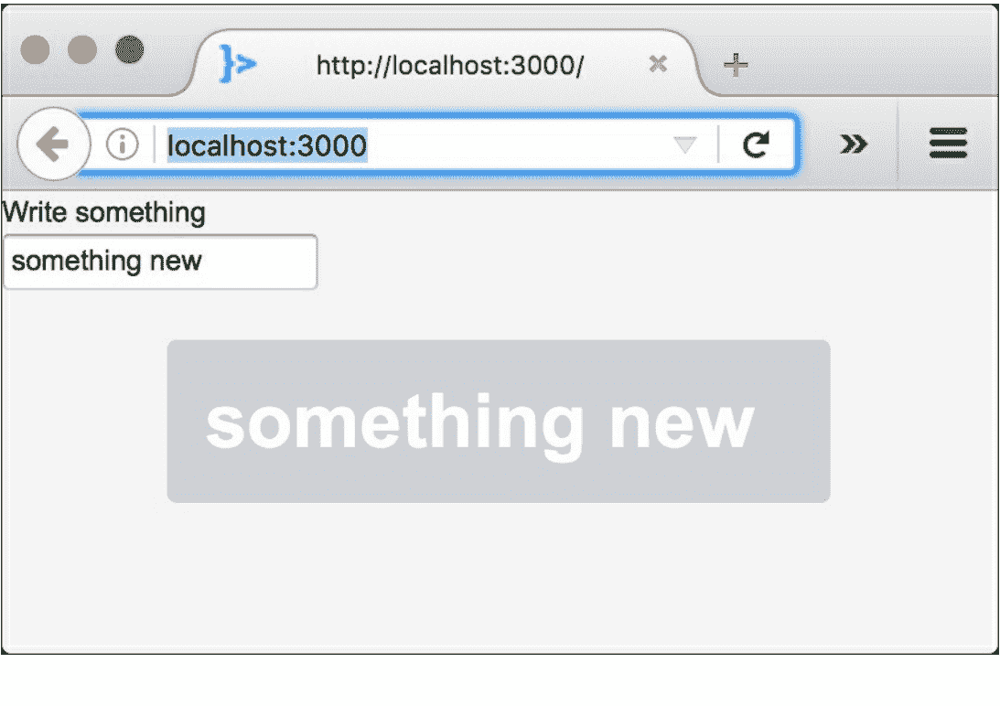

## Reactive Vaadin - CPU 监控

Vaadin 的一个明显优势是，你编写服务器端代码，其中一部分会被翻译到浏览器端。

因此，我们可以监控 Raspberry Pi 的 CPU 使用率并显示其 CPU 使用情况。我们将使用一个方便的调度库 hara.ui 来实现服务器端的 CPU 轮询，然后重用 atom + atom 监听器的技术在客户端显示更新。

要在项目中添加 hara.io，让我们在 project.clj 中添加一行：

```
[im.chit/hara.io.scheduler "2.3.6"]
```

然后扩展示例代码：

```
(ns ex1
  (:use [clojure.java.shell :only [sh]])
  (:use [hara.io.scheduler]))
```

```
...)

(def last-value
  (atom ""))

(defn collect-cpu-fn[t params]
  (let [
    ; linux
    command "grep 'cpu ' /proc/stat | awk '{usage=($2+$4)*100/($2+$4+$5)} END {print usage \"%\"}'"
    ; macos
    ; command "top -l 1 | head -n 10 | grep CPU | awk '{print $2}'"
    cpu (:out (sh "bash" "-c" command))]
    (dosync (reset! last-value cpu))))

(def cpu-task
  {:handler collect-cpu-fn
   :schedule "/3 * * * * * *"
   :params {}})

(def sch1 (scheduler {:print-task cpu-task}))
(start! sch1)
```

atom 值将每 3 秒更新一次，使用最新的轮询 CPU 使用率值。监控原始 CPU 使用率的命令在不同平台上略有不同；不幸的是，这几乎无法从 Java 访问。幸运的是，我们可以退回到 shell 来获取我们想要的信息。

以下是应用程序在 Raspberry Pi 上运行的屏幕截图：

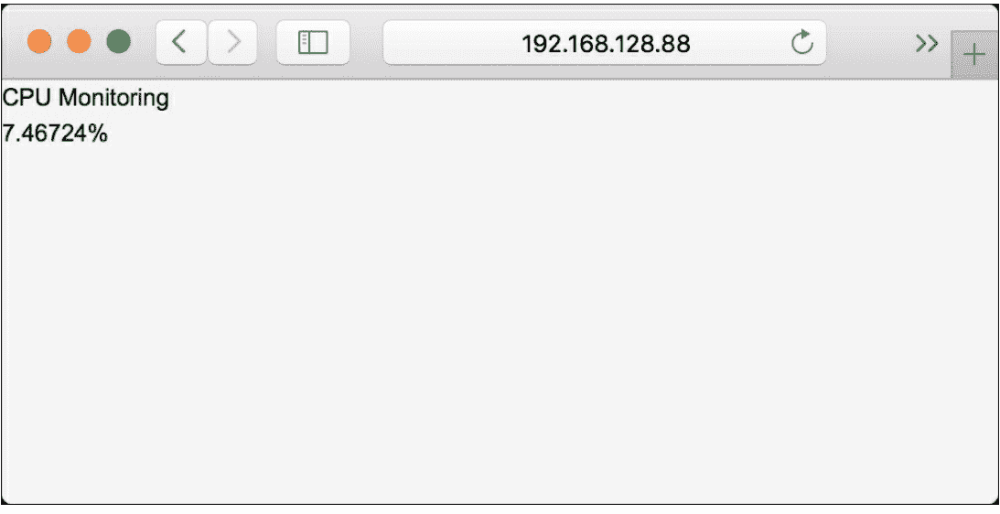

最后，Vaadin 应用程序是从访问 Raspberry Pi 的本地浏览器访问的。

安全提示：无。

## Reactive Vaadin - Raspberry Pi 上的 Telegram

本食谱的最后一个示例将 Telegram 机器人带到你的本地 Raspberry Pi。

库 morse，一个 Telegram API 的包装器，用于注册通过你注册的机器人传来的事件，这意味着基于 Vaadin 的应用程序将在 Raspberry Pi 上运行，并会监听由 morse 轮询引擎捕获的机器人消息。

在你的 project.clj 中，添加以下行：

```
[morse "0.1.1"]
```

然后 Vaadin/Clojure 代码基本上与我们迄今为止看到的相同，当向机器人发送新消息时更新 Clojure atom：

```
(ns ex1
```

```
(:use [clojure.java.shell :only [sh]])
(:require [morse.polling :as p])
(:require [morse.handlers :refer :all])
...)

(def token "<your bot token here ...>")

(def last-value
  (atom ""))

; telegram bot handler: update the atom when a message is received
(defhandler bot-api
  (message
    message
    (dosync (reset! last-value (:text message)))))

; for this example, simply start a polling method to get events
(def channel
  (p/start token bot-api))
...
```

从那里，发送给机器人的消息将被 Raspberry Pi 接收并显示在连接到 Vaadin 应用程序的浏览器上：

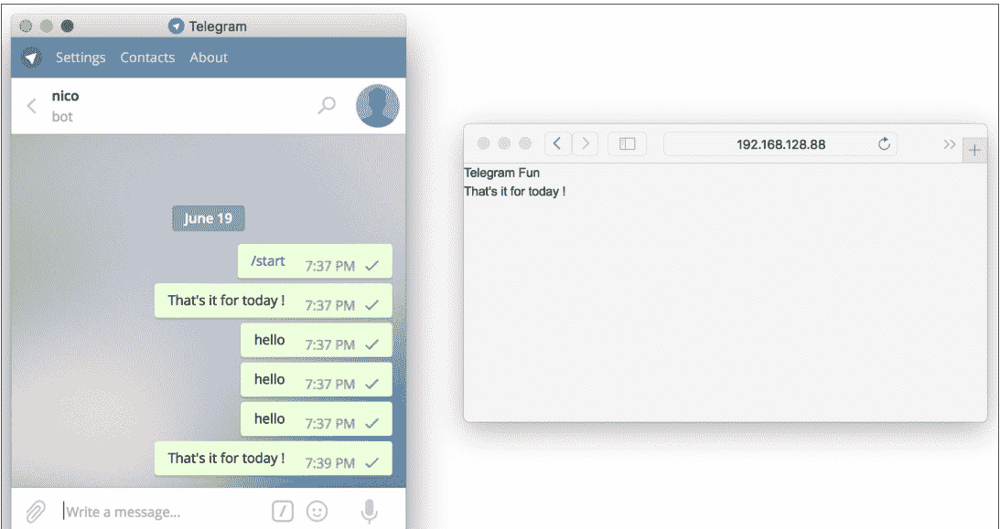

显然，事情并不止于此，本食谱应该激发了你的想象力并让你想要更多。这很好！

## 部署奖励

`lein servlet` 插件增加了额外的奖励，允许创建 Web Java 归档，即 WAR 文件。命令有两种模式：

```
lein servlet war
lein servlet uberwar
```

第一个版本只会包含与你的应用程序直接相关的代码，而第二个版本还会包含所有依赖项，具体取决于你的部署策略。显然，第二个 `uberwar` 更容易但占用更多磁盘空间，而第一个 `war` 需要一些思考。

无论哪种方式，都允许你随意部署到 Java Web 服务器，如果要求在 Java 环境中运行，这也是覆盖你的 Clojure 使用的一种不错方式！

## 快速使用 Liberator 创建 REST API

Liberator 是一个用于开发 REST Web 服务资源的 Clojure 库。REST 是 Representational State Transfer 的缩写，它是一种设计 Web 网络应用程序的架构风格。

Liberator 受到了 Erlang 的 Webmachine 的启发。Webmachine 由 Justin Sheehy 开发，他是 Basho Technologies 的 CTO，开发了 Riak。Webmachine 是一个用于编写行为良好的 HTTP 应用程序的 RESTful 工具包，帮助开发人员处理基于 HTTP 的应用程序的复杂性。

同样，使用 Liberator 使 Web API 开发变得更简单，但提供了 HTTP 丰富的特性，如内容协商和缓存。

## 准备就绪

在学习 Liberator 之前，我们将创建一个名为 liberator-example 的新项目。为此，使用 lein new 创建一个新的 Clojure 项目：

```
$ lein new liberator-example
```

然后，我们将修改生成的 project.clj 以使用 Liberator。除了 Liberator 库之外，我们还需要 ring 和 compojure 库。我们还需要 clj-http 和 cheshire 用于 HTTP 客户端以进行 REST API 调用：

```
:dependencies [[org.clojure/clojure "1.8.0"]
                [liberator "0.14.1"]
                [compojure "1.3.4"]
                [ring "1.5.0-RC1"]
                [ring/ring-core "1.5.0-RC1"]
                [buddy "0.13.0"]
                [ring/ring-jetty-adapter "1.4.0"]
                [clj-http "2.2.0"]]
```


[cheshire "5.6.1"]

Ring 服务器提供了一个简单的 Web 服务器，使测试变得更容易。我们将在 project.clj 中按如下方式添加一个 ring 插件：

```
:ring {:handler liberator-example.example/handler}
:plugins [[lein-ring "0.9.7"]]
```

## How to do it...

是时候尝试 Liberator 了。这里，我们将学习如何使用 Liberator 实现 GET、POST、PUT 和 DELETE。但让我们先使用 Liberator 创建一个简单的 hello Clojure 服务器！

## Your first Liberator

首先，我们将声明所需的库。我们还将使用 ring 服务器和 Compojure。Ring 服务器是用 Clojure 编写的著名 Web 服务器。Compojure 是一个用于将 Web 请求分派到目标资源的路由器。

clj.http 和 cheshire.core 使客户端能够向 Liberator 提供的 REST API 服务发出请求：

```
(ns liberator-example.example
  (:require
    [liberator.core :refer [resource defresource]]
    [ring.adapter.jetty :refer [run-jetty]]
    [ring.middleware.params :refer [wrap-params]]
    [compojure.core :refer
      [defroutes ANY GET PUT POST DELETE OPTIONS]]
    [clj-http.client :as client]
    [cheshire.core :refer [parse-string generate-string]]))
;;=> nil
```

以下代码为客户端生成静态 HTML 内容：

```
(defroutes app
  (ANY "/hello" []
    (resource :available-media-types ["text/html"]
              :handle-ok "<html><h1>Hello Clojure !</h1></html>"))
  (route/not-found "Not Found !"))
;;=> #'liberator-example.example/app
```

在之前的代码中，我们使用 compojure.core/defroutes 定义了 /hello 上下文，而 liberator.core/resource 定义了一个资源。

然后，让我们定义一个处理器并运行它。ring.middleware.params/wrap-params 解析请求的查询字符串和表单主体：

```
(def handler
  (-> app
      wrap-params))
;;=> #'liberator-example.example/handler
```

然后，启动服务器并从浏览器发出请求：

```
(def server (run-jetty handler {:port 3000 :join? false}))
;;=> #'liberator-example.example/server
```

使用 http://localhost:3000/hello 打开浏览器。你将在浏览器中看到以下字符串：


要从命令行发出请求，请使用 curl 命令：

```
$ curl -X GET http://localhost:3000/hello
```

下一张图片展示了 curl 命令的工作方式：

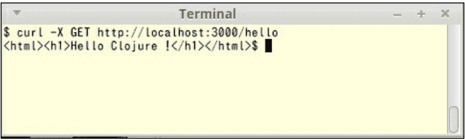

如果测试成功，让我们停止服务器以进行食谱中的后续主题：

```
(.stop server)
;;=> nil
```

## Using defresource

这里，我们将使用 defresource 宏来定义资源：

```
(defresource hello :available-media-types ["text/html"]
  :handle-ok "<html><h1>Hello Clojure from defresource
!</h1></html>")
;;=> #'liberator-example.example/hello
```

使用 defresource，你可以按如下方式使用任何路由重用资源：

```
(defroutes app
  (ANY "/hello" [] hello)
  (route/not-found "Not Found !"))
;;=> #'liberator-example.example/app
```

让我们按如下方式定义一个处理器并启动服务器：

```
(def handler
  (-> app
      wrap-params))
;;=> #'liberator-example.example/handler
(def server (run-jetty handler {:port 3000 :join? false}))
;;=> #'liberator-example.example/server
```

你将看到与第一个 Liberator 示例类似的结果。在完成对 defresource 的测试后，让我们停止服务器：

```
(.stop server)
;;=> nil
```

## Parameterized resources

我们将学习如何定义带参数的 REST API。因此，让我们按如下方式定义一个具有参数 x 的 parameterized-hello 资源：

```
(defresource parameterized-hello [x]
  :available-media-types ["text/html"]
  :handle-ok (format "<html><h1>Hello Clojure from %s !</h1>
</html>" x)
)
;;=> #'liberator-example.example/parameterized-hello
```

前面的示例使我们能够将任意字符串设置为 HTML 内容。

defroutes 也有参数 x 并传递给 parameterized-hello：

```
(defroutes parameterized-hello-app
  (ANY "/hello/:x" [x] (parameterized-hello x))
  (route/not-found "Not Found !"))
;;=> #'liberator-example.example/parameterized-hello-app
```

定义你的处理器并启动服务器：

```
(def handler
  (-> parameterized-hello-app
      wrap-params))
;;=> #'liberator-example.example/handler
(def server (run-jetty handler {:port 3000 :join? false}))
;;=> #'liberator-example.example/server
```

现在，使用以下 URL 打开浏览器：

```
http://localhost:3000/hello/your-name:
```


```
(.stop server)
;;=> nil
```

## Defining GET/POST/PUT/DELETE methods for REST APIs

这里，我们将为资源定义 HTTP 方法。我们将为客户定义一个资源，并在以下表格中为其定义五种方法：

| Method | Action | Parameter | URL |
| GET | Returns a list of customers | --- | http://localhost:3000/customer |
| POST | Creates a new customer | --- | http://localhost:3000/customer |
| GET | Gets a customer | Customer ID | http://localhost:3000/customer/id |
| PUT | Updates a customer | Customer ID | http://localhost:3000/customer/id |
| DELETE | Deletes a customer | Customer ID | http://localhost:3000/customer/id |

因此，让我们定义一个客户的 ref，其属性为 name 和 country：

```
(def customer-ref
  (ref
    {:makoto {:name "Makoto Hashimoto" :country "Japan"}
     :nico {:name "Nicolas Modrzyk" :country "France"}}))
;;=> #'liberator-example.example/customer-ref
```

资源 customer-list 没有参数。我们将定义 GET 和 POST 方法：

```
(defresource customer-list
  :allowed-methods [:get :post]
  :available-media-types ["application/json"]
  :exists? (fn [_]
            (let [result @customer-ref]
              (if-not (nil? result)
                {::entry result})))
  :post! (fn [ctx]
           (let [body (parse-string (slurp (get-in ctx [:request :body])) true)]
             (dosync
               (alter customer-ref assoc (keyword (:id body))
                 (dissoc body :id)))))
  :handle-ok ::entry
  :handle-not-found {:error "id is not found"})
;;=> #'liberator-example.example/customer-list
```

get 方法返回 customer-ref 的值。get 的回复由 :exists? 条目的匿名函数处理，如果 customer-ref 的值不为 nil，则返回一个带有 ::entry 键的映射。在这种情况下，:handle-ok? 的条目被应用并返回结果，状态代码为 200。否则，:handle-not-found 的函数被应用并返回 404 状态代码。

post 请求由与 :post? 关联的函数处理，该函数将 post 的主体添加到 customer-ref。post 请求的请求主体的格式如下：

```
{"id":"some-id","name":"some-name","country":"country-name"}
```

下一个名为 customer-entity 的资源用于参数化请求。此资源具有 GET、PUT 和 DELETE 方法：

```
(defresource customer-entity [id]
  :allowed-methods [:get :put :delete]
  :available-media-types ["application/json"]
  :exists? (fn [_]
            (let [result (get @customer-ref (keyword id))]
              (if-not (nil? result)
                {::entry result})))
```

```
:put!  (fn [ctx]
    (let [body (parse-string (slurp (get-in ctx [:request :body])) ) true)]
      (dosync
        (alter customer-ref assoc (keyword id) (dissoc body :id)))))
:delete!  (fn [_]
    (dosync
      (alter customer-ref dissoc (keyword id))))
:existed? (fn [_] (nil? (get @customer-ref id ::sentinel)))
:new? (fn [_] (nil? (get @customer-ref id ::sentinel)))
:handle-ok ::entry
:handle-not-found {:error "id is not found"}
;;=> #'liberator-example.example/customer-entity
```

然后，让我们使用 defroutes 按如下方式为 /customer 和 /customer/id 定义路径：

```
(defroutes customer
  (ANY "/customer" [] customer-list)
  (ANY "/customer/:id" [id] (customer-entity id)))
;;=> #'liberator-example.example/app
```

我们将定义一个处理器并启动 Jetty 服务器：

```
(def handler
  (-> customer
      wrap-params))
;;=> #'liberator-example.example/handler
(def server (run-jetty handler {:port 3000 :join? false}))
;;=> #'liberator-example.example/server
```

这里，我们将使用基于 Clojure 的 HTTP 客户端来测试客户 REST 服务。clj-http.client 对 GET、POST、PUT 和 DELETE 发出调用。

使用 http://localhost:3000/customer 的 get 方法检索 customer-ref 中的所有客户：

```
(client/get "http://localhost:3000/customer")
;;=> {:status 200, :headers {"Date" "Sun, 26 Jun 2016 20:14:34 GMT",
;;=> "Content-Type" "application/json;charset=UTF-8", "Vary" "Accept",


```
; ;=> "Connection" "close", "Server" "Jetty(9.2.10.v20150310)"},
; ;=> :body "{\"makoto\":{\"name\":\"Makoto Hashimoto\",\"country\":\"Japan\"},
; ;=> \"nico\":{\"name\":\"Nicolas Modrzyk\",\"country\":\"France\"}}\
```

然后，我们将测试 POST：

```
(client/post "http://localhost:3000/customer"
        {:body (generate-string {:id "rh" :name "Rich Hickey" :country "United States"})})
; ;=> {:status 201, :headers {"Date" "Sun, 26 Jun 2016 14:33:28 GMT",
; ;=> "Content-Type" "application/json", "Vary" "Accept",
"Connection" "close",
; ;=> "Server" "Jetty(9.2.10.v20150310)"}, :body "", :request-time 8,
; ;=> :trace-redirects ["http://localhost:3000/customer"],
:orig-content-encoding nil}
```

让我们检查之前的条目是否存在。我们只需要响应的 body：

```
(->
  (client/get "http://localhost:3000/customer/rh" )  :body
  (parse-string true))
; ;=> {:name "Rich Hickey", :country "United States"}
```

我们将检查 PUT 方法是否有效：

```
(client/put "http://localhost:3000/customer/rh"
        {:body (generate-string {:name "Rich Hickey" :country "USA"})})
; ;=> {:status 204, :headers {"Date" "Sun, 26 Jun 2016 22:04:35 GMT",
; ;=> "Content-Type" "application/json", "Vary" "Accept",
"Connection" "close",
; ;=> "Server" "Jetty(9.2.10.v20150310)"}, :body nil, :request-time 9,
; ;=> :trace-redirects ["http://localhost:3000/customer/rh"],
:orig-content-encoding nil}
```

因此，让我们验证更新是否成功：

```
(->
  (client/get "http://localhost:3000/customer/rh")
    :body
      (parse-string true))
;;=> {:name "Rich Hickey", :country "USA"}
```

最后，我们将测试 DELETE 方法：

```
(client/delete "http://localhost:3000/customer/rh")
;;=> {:status 204, :headers {"Date" "Sun, 26 Jun 2016 14:38:58 GMT",
;;=> "Content-Type" "application/json", "Vary" "Accept",
"Connection" "close",
;;=> "Server" "Jetty(9.2.10.v20150310)"}, :body nil, :request-time 8,
;;=> :trace-redirects ["http://localhost:3000/customer/rh"],
:orig-content-encoding nil}
(.stop server)
;;=> nil
```

## 它是如何工作的...

在这里，我们将回顾主要的 HTTP 响应代码，然后学习如何使用 Liberator 调试和追踪应用程序。

## HTTP 的方法和状态码

下表显示了主要的方法，以及它们在 Liberator 中的描述和操作：

| 方法 | 描述 |  |
|---|---|---|
| GET | 对资源的只读访问 | exists? |
| PUT | 创建新资源 | put! |
| DELETE | 用于删除资源 | delete! |
| POST | 更新现有资源或创建新资源 | post! |
| PATCH | 与 PUT 类似但只发送差异 | patch! |

主要的 HTTP 状态码如下：

| 处理键 | 状态码 |
|---|---|
| handle-ok | 200 |
| handle-created | 201 |
| handle-no-content | 204 |
| handle-moved-permanently | 301 |
| handle-malformed | 400 |
| handle-unauthorized | 401 |
| handle-forbidden | 403 |
| handle-not-found | 404 |
| handle-method-not-allowed | 405 |
| handle-not-acceptable | 406 |
| handle-exception | 500 |
| handle-not-implemented | 501 |
| handle-unknown-method | 501 |
| handle-service-not-available | 503 |

## 追踪请求

Liberator 具有追踪和调试功能。在下面的代码中，我们将使用 liberator.dev/wrap-trace 重新定义一个处理器，以显示追踪文本和追踪图：

```
(def handler
  (-> customer
    wrap-params
    (wrap-trace :header :ui)))
```

```
; ;=> #'liberator-example.example/handler
```

让我们再次启动服务器：

```
(def server (run-jetty handler {:port 3000 :join? false}))
; ;=> #'liberator-example.example/server
```

现在让我们发起一次调用并查看 X-Liberator-Trace 头中的决策追踪，如下所示：

```
(client/get "http://localhost:3000/customer")
{:status 200,
:headers
{"Date" "Mon, 27 Jun 2016 01:52:09 GMT",
"Content-Type" "application/json;charset=UTF-8",
"Vary" "Accept",
"X-Liberator-Trace-Id" "uren6",
"Link" "</ //x-liberator/requests/uren6>; rel=x-liberator-trace",
"X-Liberator-Trace"
[":decision (:initialize-context {})"
":decision (:service-available? true)"
":decision (:known-method? :get)"
":decision (:uri-too-long? false)"
":decision (:method-allowed? :get)"
":decision (:malformed? false)"
":decision (:authorized? true)"
":decision (:allowed? true)"
":decision (:valid-content-header? true)"
":decision (:known-content-type? true)"
":decision (:valid-entity-length? true)"
":decision (:is-options? false)"
":decision (:accept-exists? [false {:representation {:media-type \"application/json\"}}])"
":decision (:accept-language-exists? nil)"
":decision (:accept-charset-exists? nil)"
":decision (:accept-encoding-exists? \"gzip, deflate\")"
":decision (:encoding-available? {:representation {:encoding \"identity\"}})"
":decision (:processable? true)"
":decision (:exists? {:liberator-example.example/entry {:makoto {:name \"Makoto Hashimoto\", :country \"Japan\"}, :nico {:name \"Nicolas Modrzyk\", :country \"France\"}, :rh {:name \"Rich Hickey\", :country \"USA\"}}})"
":decision (:if-match-exists? nil)"
```

```
" :decision (:if-unmodified-since-exists? nil)"
" :decision (:if-none-match-exists? nil)"
" :decision (:if-modified-since-exists? nil)"
" :decision (:method-delete? false)"
" :decision (:method-patch? false)"
" :decision (:post-to-existing? false)"
" :decision (:put-to-existing? false)"
" :decision (:multiple-representations? false)"
" :handler (:handle-ok)"],
"Connection" "close",
"Server" "Jetty(9.2.10.v20150310)}",
:body
" {"makoto":{"name":"Makoto
Hashimoto","country":"Japan"},"nico":{"name":"Nicolas
Modrzyk","country":"France"},"rh":{"name":"Rich
Hickey","country":"USA"}}",
:request-time 8,
:trace-redirects ["http://localhost:3000/customer"],
:orig-content-encoding nil,
:links {:x-liberator-trace {:href "//x-liberator/requests/uren6"}}}
```

我们可以在以下 URL 中看到执行流程的追踪：
http://localhost:3000/x-liberator/requests/.

你可以在浏览器中看到你请求的请求历史，如下图所示：

## Liberator 请求追踪

get /customer at Mon Jun 27 10:52:09 JST 2016 (242s ago)
get /customer at Mon Jun 27 10:44:54 JST 2016 (677s ago)
get /customer/rh at Mon Jun 27 10:44:43 JST 2016 (688s ago)
put /customer/rh at Mon Jun 27 08:36:12 JST 2016 (8399s ago)
put /customer/rh at Mon Jun 27 08:36:09 JST 2016 (8402s ago)
put /customer/rh at Mon Jun 27 08:35:55 JST 2016 (8416s ago)
put /customer/rh at Mon Jun 27 08:35:41 JST 2016 (8431s ago)
post /customer at Sun Jun 26 23:32:59 JST 2016 (40992s ago)
get /customer at Sun Jun 26 23:32:35 JST 2016 (41016s ago)
get /customer at Sun Jun 26 23:32:02 JST 2016 (41049s ago)
get /counter at Sun Jun 26 23:28:15 JST 2016 (41276s ago)
get /customer at Sun Jun 26 23:28:13 JST 2016 (41278s ago)
get /counter at Sun Jun 26 23:28:11 JST 2016 (41280s ago)
get /customer at Sun Jun 26 23:28:09 JST 2016 (41282s ago)
get /counter at Sun Jun 26 23:28:07 JST 2016 (41284s ago)

让我们打开其中一个请求条目。里面有头信息、追踪和图：

所有追踪的列表

## Liberator 请求追踪 #uren6 at Mon Jun 27 10:52:09 JST 2016 (328s ago)

请求为 ":GET /customer"

## 参数

## 头信息

connection
    close
user-agent
    Apache-HttpClient/4.5.1 (Java/1.8.0_65)
host
    localhost:3000
accept-encoding
    gzip, deflate

## 追踪

+   1. decision: initialize-context {}
+   2. decision: service-available? true
+   3. decision: known-method? :get
+   4. decision: uri-too-long? false
+   5. decision: method-allowed? :get
+   6. decision: malformed? false

生成的图太大无法整体查看。以下是图的一部分，帮助你理解其结构。你可以参考此处创建的图生成自己的图：

我们将使用 `apache/derby` 和 `org.clojure/java.jdbc` 来访问 derby，这是一个小型 rdb 库。因此，我们将在 `project.clj` 中添加这些库：

```
```clojure
:dependencies [[org.clojure/clojure "1.8.0"]
               [liberator "0.14.1"]
               [compojure "1.3.4"]
               [ring "1.5.0-RC1"]
               [ring/ring-core "1.5.0-RC1"]
               [buddy "0.13.0"]
               [ring/ring-jetty-adapter "1.4.0"]
               [clj-http "2.2.0"]
               [cheshire "5.6.1"]
               [org.clojure/java.jdbc "0.6.1"]
               [org.apache.derby/derby "10.12.1.1"]]]
```
```

添加条目后，重启你的 REPL。

## 我们的服务规范

我们将创建一个小型应用程序来处理产品信息，如下所示：

| 产品 | 名称 | 描述 | 时钟 | RAM | 价格 |
|---|---|---|---|---|---|
| macbook air 11.6 | Apple | Apple MacBook Air MVM2JLL/A 11.6-Inch laptop | 1.6 | 4 | 797.00 |
| thinkpad x260 | Levovo | Lenovo ThinkPad X260 20F6005HUS 12.5" Ultrabook | 2.3 | 8 | 1,009.00 |
| ASUS VivoBook | ASUS | ASUS VivoBook E200HA-US01-GD Portable 11.6 | 1.8 | 2 | 199.99 |
| Dell Inspiron | DELL | Dell Inspiron 11.6-Inch 2 in 1 Convertible Touchscreen Laptop | 2.16 | 4 | 279.99 |

为了将之前的条目存储在数据库中，我们将在 Apache Derby 中创建以下表：

| id | name | maker | description | clock | ram | price |
|---|---|---|---|---|
| int | varchar(20) | varchar(10) | varchar(100) | float | Integer | BigDecimal |


# 创建产品表并定义访问函数

让我们在 src/liberator_example 下创建一个名为 using_db.clj 的文件并定义命名空间并声明其中要使用的库：

```
(ns liberator-example.using-db
  (:require
    [ring.adapter.jetty :refer [run-jetty]]
    [liberator.core :refer [resource defresource]]
    [ liberator.dev :refer [wrap-trace]]
    [ring.middleware.params :refer [wrap-params]]
    [compojure.route :as route]
    [compojure.core :refer
      [defroutes ANY GET PUT POST DELETE OPTIONS]]
    [clj-http.client :as client]
    [cheshire.core :refer [parse-string generate-string]]
    [clojure.java.jdbc :as j]))
```

在这里，我们将创建一个名为 product 的 derby 表。我们将使用 java.jdbc/create-table-ddl 来创建表：

```
(def db-path "/tmp/db/products")
;;=> #'liberator-example.using-db/db-path
(def db {
  :classname "org.apache.derby.jdbc.EmbeddedDriver"
  :subprotocol "derby"
  :subname db-path
  :create true})
;;=> #'liberator-example.using-db/db
(j/db-do-commands db
  (j/create-table-ddl
    :product
    [[:id :int "primary key"
      "generated always as identity
      (start with 1, increment by 1)"]
     [:name "varchar(20)" "not null"]
     [:maker "varchar(10)" "not null"]
     [:description "varchar(100)" ]
     [:clock :float]
     [:ram :int]
     [:price "decimal(7,2)"]]))
;;=> (0)
```

现在我们将在以下代码中定义 insert-product!、update-product! 和 delete-product!：

```
(defn insert-product! [db product]
  (j/insert! db :product product))
;;=> #'liberator-example.using-db/insert-product!
(defn update-product! [db id product]
  (j/update! db :product product ["id = ?" id]))
;;=> #'liberator-example.using-db/update-product!
(defn delete-product! [db id]
  (j/delete! db :product  ["id = ?" id]))
;;=> #'liberator-example.using-db/delete-product!
(defn select-product-by-id [db id]
  (first (j/query db ["select * from product where id = ?" id])))
;;=> #'liberator-example.using-db/select-product-by-id
```

我们还将定义选择函数 select-product-by-id 和 select-products。select-product-by-id 返回与 id 关联的单个映射。select-products 返回所有产品作为映射数组：

```
(defn make-query-string [m]
  (str (apply str
              (interpose " like ? and "
                (map name (keys m))))) " like ? "))
;;=> #'liberator-example.using-db/make-query-string
(make-query-string {:var-1 "a" :var-2 "b" :var-3 "c"})
;;=> "var-1 like ? and var-2 like ? and var-3 like ? "
(defn select-products [db & params]
  (let [qs
        (if-not params
          "select * from product"
          (str "select * from product where " (make-query-
string (first params))))
        v (vals (first params))]
    (println (vec (cons qs v)))
    (j/query db (vec (cons qs v)))))
;;=> #'liberator-example.using-db/select-products
```

我们将测试 insert-product! 以为 mac 和 thinkpad 添加两个产品：

```
(insert-product! db
                {:name "macbook air 11.6" :maker "Apple"
                 :description "Apple MacBook Air MJVM2LL/A
11.6-Inch laptop"
                 :clock 1.6 :ram 4 :price 797.00})
```

```
; ;=> ({:1 1M})
(insert-product! db
                {:name "thinkpad x260" :maker "Lenovo"
                :description "Lenovo ThinkPad X260 20F6005HUS
12.5 Ultrabook"
                :clock 2.3 :ram 8 :price 1009.00})
; ;=> ({:1 2M})
```

然后我们将测试 select-product-by-id 和 select-products：

```
(select-product-by-id db 1)
; ;=> {:id 1, :name "macbook air 11.6", :maker "Apple",
:description "Apple MacBook Air MJVM2LL/A 11.6-Inch laptop",
:clock 1.6, :ram 4, :price 797.00M}
(select-products db)
; ;=> ({:id 11, :name "macbook air 11.6", :maker "Apple",
:description "Apple MacBook Air MJVM2LL/A 11.6-Inch laptop",
:clock 1.6, :ram 4, :price 797.00M} {:id 12, :name "thinkpad x260", :maker "Lenovo", :description "Lenovo ThinkPad X260 20F6005HUS 12.5 Ultrabook", :clock 2.3, :ram 8, :price 1009.00M})
(select-products db {:name "%a%" :description "%M%"})
; ;=> ({:id 11, :name "macbook air 11.6", :maker "Apple",
:description "Apple MacBook Air MJVM2LL/A 11.6-Inch laptop",
:clock 1.6, :ram 4, :price 797.00M})
(select-products db {:maker "Apple"})
; ;=> ({:id 11, :name "macbook air 11.6", :maker "Apple",
:description "Apple MacBook Air MJVM2LL/A 11.6-Inch laptop",
:clock 1.6, :ram 4, :price 797.00M})
```

# 定义资源并启动服务器

我们将定义两个资源。它们是 product-list 和 product-entity：

```
(defn to-keyword-map [m]
  (into {}  (map #(vector (keyword (first %))  (str "%" (second %) "%")) m)))
; ;=> #'liberator-example.using-db/to-keyword-map
(defresource product-list
  :allowed-methods [:get :post]
  :available-media-types ["application/json"]
  :exists? (fn [ctx]
            (let [params (-> ctx
                             (get-in [:request :params])
                             to-keyword-map)
result (if (empty? params) (select-products db) (select-products db params))]
    (if-not (empty? result)
        {::entry result})))
:post!  (fn [ctx]
    (let [body (parse-string (slurp (get-in ctx [:request :body])) true)]
        (insert-product! db body)))
:handle-ok ::entry
:handle-not-found {:error "no product is not found"})
;;=> #'liberator-example.using-db/product-list
(defresource product-entity [id]
    :allowed-methods [:get :put :delete]
    :available-media-types ["application/json"]
    :exists? (fn [_]
        (let [result (select-product-by-id id)]
            (if-not (empty? result)
                {::entry result})))
    :put!  (fn [ctx]
        (let [body (parse-string (slurp (get-in ctx [:request :body])) true)]
            (insert-product! db body)))
    :delete!  (fn [_]
        (delete-product! db id))
    :existed? (fn [_] (empty? (select-product-by-id id)))
    :new? (fn [_] (empty? (select-product-by-id id)))
    :handle-ok ::entry
    :handle-not-found {:error "id is not found"})
#'liberator-example.using-db/product-entity
```

现在是启动服务器的时候了，如下所示：

```
(defroutes product
    (ANY "/product" [] product-list)
    (ANY "/customer/:id" [id] (product-entity id)))
#'liberator-example.using-db/product
(def handler
    (-> product
        wrap-params))
;;=> #'liberator-example.using-db/handler
(def server (run-jetty handler {:port 3000 :join? false}))
;;=> #'liberator-example.using-db/server
```

# 从 HTTP 客户端访问

我们将通过 HTTP 客户端访问产品 API 服务。所以我们将

```
(client/put "http://localhost:3000/product/4"
        {:body
          (generate-string
            {:price 259.99})})
;;=> {:status 204, :headers {"Date" "Fri, 01 Jul 2016 12:52:01 GMT", "Content-Type" "application/json", "Vary" "Accept", "Connection" "close", "Server" "Jetty(9.2.10.v20150310)"}, :body nil, :request-time 33, :trace-redirects ["http://localhost:3000/product/4"], :orig-content-encoding nil}
```

让我们确认价格已更改：

```
(-> (client/get "http://localhost:3000/product/4") :body
(parse-string true) :price )
;;=> 259.99
```

我们将从产品数据库中删除戴尔笔记本电脑：

```
(client/delete "http://localhost:3000/product/4")
;;=> {:status 204, :headers {"Date" "Fri, 01 Jul 2016 12:52:19 GMT", "Content-Type" "application/json", "Vary" "Accept", "Connection" "close", "Server" "Jetty(9.2.10.v20150310)"}, :body nil, :request-time 26, :trace-redirects ["http://localhost:3000/product/4"], :orig-content-encoding nil}
```

并确认它：

```
(-> (client/get "http://localhost:3000/product") :body (parse-string true) count)
;;=> 3
```

我们可以在浏览器中看到我们的产品：

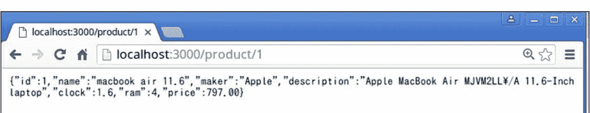

```
[{"id":1,"name":"macbook air 11.6","maker":"Apple","description":"Apple MacBook Air MJVM2LL/A 11.6-Inch laptop","clock":1.6,"ram":4,"price":797.00},{"id":2,"name":"thinkpad x260","maker":"Lenovo","description":"Lenovo ThinkPad X260 20F6005HUS 12.5 Ultrabook","clock":2.3,"ram":8,"price":1009.00},{"id":3,"name":"ASUS VivoBook","maker":"ASUS","description":"ASUS VivoBook E200HA-US01-GD Portable 11.6","clock":1.8,"ram":2,"price":199.99}]
```


# 使用 Immutant - 重用基础设施

Immutant 并不是你常见的 Clojure Web 框架。Immutant 允许你构建到现有的、健壮的中间件 WildFly，也就是 JBoss 中，并以优雅的方式部署你的软件。在本教程中，你将看到如何通过 Immutant 框架提供的各种服务来增强你的 ring 应用。

虽然 Immutant 使部署到 WildFly 变得简单，但开发环境完全自包含，可以在无需额外下载或安装的情况下完成。让我们来看看吧！

## 准备工作

本节的第一部分可能完全令人失望；在此时，我们完全处于 Clojure 的领域，一切开箱即用。糟糕，对吧？

以下是 project.clj 文件，其中列出了所需库的完整列表：

```
(defproject mutant1 "0.1.0-SNAPSHOT"
  :dependencies [
    [org.clojure/clojure "1.8.0"]
    [org.immutant/immutant "2.1.4"]
    [ring/ring-devel "1.5.0"]])
```

添加 ring-devel 是为了允许开发模式和重新加载工作流中的刷新。

构建 Web 应用的代码遵循 ring 路由模式，因此以下内容大部分是标准的：

```
(ns mutant1.core
  (:require [immutant.web :as web]))

(defn app [request]
  {:status 200
:body "Hello world"})

(defn -main []
(web/run-dmc app))
```

`web/run-dmc` 方法用于开发模式，而 `web/run` 将用于生产环境。

在命令行中，标准的：`lein run -m mutant1.core` 就足够让你开始了，并且可以看到美丽的页面呈现在你面前：

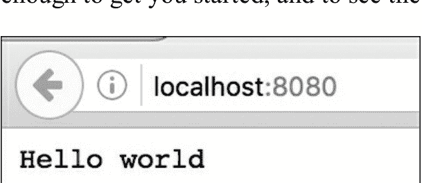

## 如何操作...

我们已经看到了基础知识，以及如何准备；现在让我们看看在使用 Immutant 时如何与不同的中间件框架交互。

### 使用 Artemis 进行简单消息传递

本示例将展示如何启动一个消息服务器，并创建消息上下文和队列，以及通过 Clojure 代码发送和监听该队列。

这里展示的内容实际上是相当非官方的，并不是因为它质量为 alpha，而是因为使事情变得容易的一些部分和命名空间最近发生了变化。

因此，与其使用在 Interweb 上大量文档中提到的 `hornetq` 框架，我们将使用 WildFly 最新版本中包含的新库消息框架 Artemis。

由于我们希望避免包含 hornetq 库，project.clj 文件变得稍微复杂一些，但这很快就会被修复：

```
(defproject mutant2 "0.1.0-SNAPSHOT"
  :dependencies [
    [org.clojure/clojure "1.8.0"]
    [org.immutant/immutant "2.1.4"
      :exclusions [org.projectodd.wunderboss/wunderboss-messaging-hornetq]]
    [org.projectodd.wunderboss/wunderboss-artemis "0.2.0"]
    [ring/ring-devel "1.5.0"]
    [compojure "1.5.0"]])
```

你也可以注意到 Compojure 的（重新）引入，并且你就可以开始了！

以下片段实际上要求框架通过略显误导的 msg/context 函数创建一个新的消息服务器：

```
(require '[immutant.web :as web] '[immutant.messaging :as msg])
(def messaging-server
  (msg/context :remote-type :hornetq-standalone))
```

一旦消息服务器以编程方式启动，我们就可以创建一个上下文，用于查找队列和主题。

在这里，我们连接到刚刚启动的消息服务器，并查找 hello 队列。这实际上会在队列不存在时创建队列，或者如果另一个服务已经注册了它，则简单地连接到它：

```
(def mycontext
  (msg/context :host "localhost"))

(def queue
  (msg/queue "hello" :context mycontext))
```

大多数新的函数调用都是使用 immutant.messaging 命名空间完成的，标记为 msg。

现在你有了队列，是时候监听它并发送消息了。listen 函数接受一个队列或主题以及一个回调，作为一个简单的 Clojure 函数：

```
(msg/listen queue
  (fn[msg]
    (println msg)))
```

然后一些常规的 Compojure 路由将允许你向同一队列发送消息：

```
(require '[compojure.core :refer :all]
        '[compojure.route :as route])
(defroutes app
  (GET "/" [] "<h1>Hello Compojure World</h1><br/><a href=\"/msg\">Send a message</a>")
  (GET "/msg" [] (msg/publish queue "world") "OK")
  (route/not-found "<h1>Page not found</h1>"))
```

开始吧：

```
(defn -main []
  (web/run-dmc app :host "0.0.0.0" :port 8080))
```

现在我们可以打开服务器在 8080 端口提供的页面：

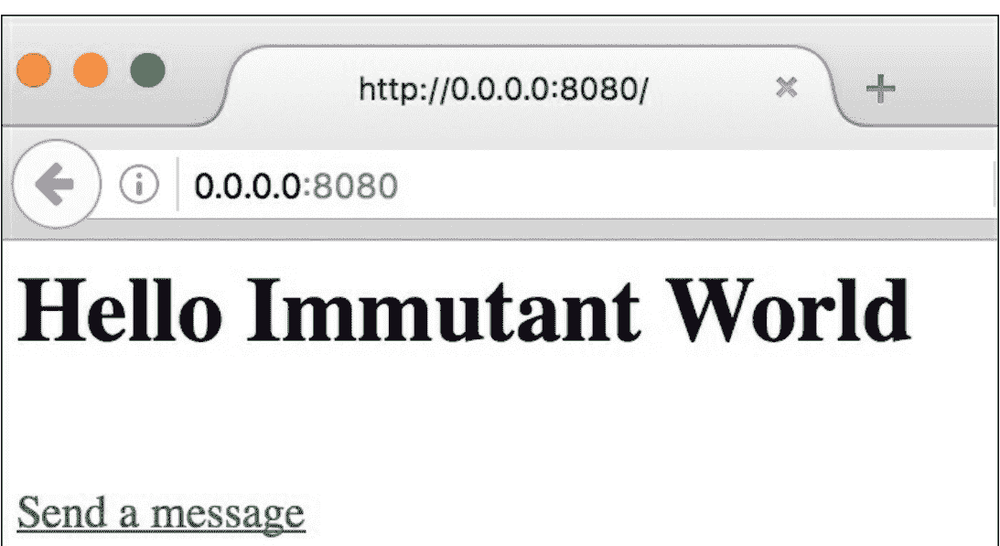

无论如何，在你的应用程序中你现在可以在哪里使用这种消息机制？通过注册到来自消息系统的消息。

如果一个消息系统只能与自身对话，那就不算是一个合适的消息系统了，所以让我们看看如何设置远程连接！

### 远程消息传递

现在我们希望设置两个服务器使用 WildFly 消息队列相互通信。

第一个服务器的设置几乎与前一个示例相同，只是为了远程连接，我们需要绑定到一个不同的、可外部访问的 IP 地址。这是通过向 Leiningen JVM 选项添加 JVM 设置来完成的，因此在 project.clj 中，我们将添加以下内容：

```
:jvm-opts ["-Dactivemq.netty.host=0.0.0.0"]
```

如果你仔细查看控制台日志，你会注意到消息系统确实使用上述设置绑定：

```
22:46:55.000 INFO [org.apache.activemq.artemis.core.server]
(main) AMQ221020: Started Acceptor at 0.0.0.0:5445 for
protocols [CORE]
22:46:55.003 INFO [org.apache.activemq.artemis.core.server]
(main) AMQ221007: Server is now live
```

太棒了。现在来设置第二个服务器。在本书的上下文中，第二个服务器实际上运行在 Raspberry Pi 上，最困难的事情实际上是让 IP 地址按正确的顺序排列。

这个第二个服务器使用与你到目前为止看到的类似的 Clojure 代码。队列查找和 ring 处理程序路由基本上是相同的。变化的是从远程位置检索队列的方式。

第一个服务器的 IP 为 192.168.1.3，因此以下示例将使用该地址。我们还给出了最多 30 次重连次数，以便如果第一个服务器宕机，这仍会等待并尝试获取连接。（试试看！！）

出发吧：

```
(def mycontext
  (msg/context
    :host "192.168.1.3" :port 5445 :reconnect-attempts 30))

(def queue
  (msg/queue "hello" :context mycontext))

(defroutes app
(GET "/" [] (msg/publish queue "world") "OK"))
```

第二个服务器以相同的命令启动：

```
lein run -m mutant3.core
```

这里的 Raspberry Pi 的 IP 地址是 192.168.1.7，所以让我们连接到它：

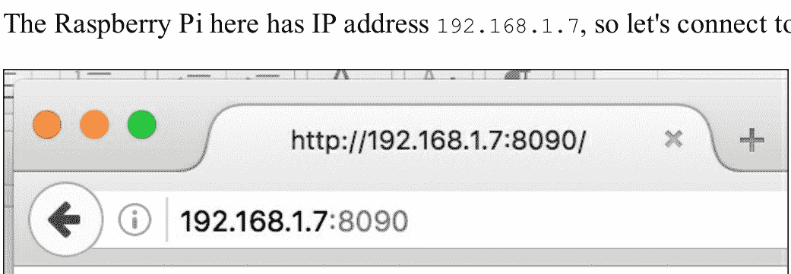

对于一个 Web 应用来说，这并不太健谈，但第一个服务器会相应地收到一条爱的消息，并且 hello world 会显示在控制台日志中。耶！远程通信。

### 使用队列进行远程过程调用

扩展前一个示例，Immutant 还提供了一种通过排队系统轻松进行 **远程过程调用 (RPCs)** 的方法。

这可以成为将负载分发到不同的 Raspberry Pis 的好方法！

让我们通过这个 RPC 框架来完成一个分布式 hello world。

第一个设置需要像上一教程中那样设置。我们将使用一个新的队列，`queue2`（富有创造性的命名是当今的潮流……）。这个 `queue2` 然后将从 respond 处理程序中使用，这是过程调用的入口，如下所示：

```
(def queue2 (msg/queue "hello2" :context mycontext))
```

```
(msg/respond
  queue2
  (fn[msg] (str "hello " msg)))
```

在这里，处理程序接收一个参数，并发送一些礼貌的问候消息。

请注意，每个 respond 处理程序都需要一个专用的队列。

在第二个服务器上，我们将查找 `queue2`，并创建一个 Compojure 路由来发送 RPC 请求。`msg/request` 函数调用实际上返回一个 future，因此如果我们想要同步答案，我们将使用 @ 符号等待执行结果。

这转化为：

```
(def queue2
  (msg/queue "hello2" :context mycontext))
```

```
(defroutes app
  (GET "/req" [] @(msg/request queue2 "world")))
```

这个第二个服务器再次运行在 Raspberry Pi 上。对它的请求会将消息发布到队列，该消息将被第一个服务器拾取，回调将被执行，结果发送回第二个服务器：


(ns mutant4.pipes
  (:require [immutant.messaging.pipeline :as pl]))
(defn barme [m]
  (map inc m))

(defonce bar-pipeline
  (pl/pipeline "bar"
    (pl/step barme)
    (pl/step barme)
  :concurrency 4))

管道使用特定的队列并且只能定义一次。对数据结构获取管道的结果就像调用一个常规函数一样。结果再次是一个 future，因此要直接获取结果你需要再次使用 deref：

```
(deref
  (bar-pipeline (take 1000 (repeat 1))))
```

Woohoo...multithreads for your many cores.

## 使用 WebSockets 变得简单

如果 Immutant 没有至少一些 WebSocket 支持，那它就不是一个框架了。

对于纯粹的 WebSocket 支持，Immutant 提供了 wrap-websocket 支持，它将请求和回调定义作为参数来创建一个异步通道。

这个小演示将等待 WebSocket 连接，在客户端连接时向队列发送一条消息，并向客户端发送一些异步简单消息：

```
    (require '[immutant.web.async :as async])
(def callbacks
  { :on-open (fn [ch] (println "open!"))
    :on-message (fn [ch msg]
      (dotimes [msg 10]
        (async/send! ch (str msg) {:close? (= msg 9)})
      (Thread/sleep 100)))} )
```

主应用只是等待请求：

```
(defn app [request]
  (async/as-channel request callbacks))
```

通常的主代码为套接字连接添加了一个额外的包装器：

```
(require '[immutant.web.middleware :as me])
(defn -main []
  (web/run-dmc (-> app
                   (me/wrap-websocket callbacks))
    :host "0.0.0.0"
    :port 8000))
```

对于测试，你可以编写自己的客户端，或使用 Chrome Simple Web Socket Client 插件：

## 服务器位置

URL: ws://192.168.1.7:8000

Status: OPENED

## 请求

hello

Send [Shortcut] Ctr + Enter

## 消息日志

Clear

```
hello
0
1
2
3
4
5
6
7
8
9
```

再次，这是在 Raspberry Pi 上运行的，没有任何不同的设置或努力。

## 还有更多...

所以你已经看到了所有这些编码框架，开发起来很不错，但现在如何分发你的应用呢？听起来很复杂...让我们看看是否能做点什么...

## 打包为独立

好消息是：要创建一个可分发的 JAR 文件，你什么都不用做！没错。没有什么不寻常的事情。

只要你使用 gen-class 指令为你的主命名空间，并将你的主命名空间定义在 project.clj 中，你就可以使用以下命令将所有这些打包到单个 JAR 文件中：

```
lein uberjar
```

本食谱中介绍的任何示例都会顺利进行。因此，在调用 uberjar 之后，WebSocket 服务器可以用以下命令启动：

```
java -jar target/mutant7-0.1.0-SNAPSHOT-standalone.jar
```

Chrome WebSocket 客户端的工作方式也完全相同。

## 打包为可部署的 Web 归档文件（WAR 文件）

对于部署，lein immutant 插件允许你将 Immutant 代码打包为 WAR，并使用简单的命令直接部署到 WildFly 服务器。WAR 是一个 Web 归档，本质上是 Java 打包 Web 应用程序以供部署的方式：

```
NicolassMacBook% lein immutant war
Created /Users/niko/Downloads/wildfly-10.0.0.Final/standalone/deployments/mutant7-dev.war
```

这对于验证代码按预期运行以及自动化部署很有用。插件和插件配置直接添加到 project.clj 文件中。你可以控制 WAR 文件的创建位置以及上下文路径：

```
:main mutant7.core
:plugins [[lein-immutant "2.1.0"]]
:immutant {
```

```
:war {
    :dev? true
    :destination "/Users/niko/Downloads/wildfly-10.0.0.Final/standalone/deployments"
    :context-path "/mutant7"}}
```

假设你已下载 WildFly（或另一个开源 Java 服务器，如 Tomcat 或 Jetty）；复制的 WAR 文件应触发应用程序的实时重新部署，如果服务器正在运行...正如在服务器日志中看到的那样：

```
00:17:17,688 INFO  [org.wildfly.extension.undertow]
(ServerService Thread Pool -- 65) WFLYUT0021: Registered web context: /mutant7
00:17:17,748 INFO  [org.jboss.as.server] (DeploymentScanner-threads - 2) WFLYSRV0016: Replaced deployment "mutant7-dev.war" with deployment "mutant7-dev.war"
00:17:17,761 INFO  [org.jboss.as.repository]
(DeploymentScanner-threads - 2) WFLYDR0002: Content removed from location /Users/niko/Downloads/wildfly-10.0.0.Final/standalone/data/content/30/2621044f4972384dc11214cf376f3525ffe9ec/content
```

你的基于 Immutant 的 Web 应用程序现在几乎可以在任何地方运行！

## 使用 om.next 进行开发，下一代 ClojureScript 库

在本食谱中，我们将学习 David Nolen 的 om 来构建 ClojureScript 应用程序。Om 是一个与 React 交互的 ClojureScript 库。React 是 Facebook 开发的非常著名的 JavaScript 库。React 使用户界面的开发变得更简单和可重用的 UI 组件。

最近，Nolen 开始开发 om.next。它是 om 的继任者，受 Facebook 的 Relay、Netflix 的 Falcor 和 Cognitect 的 Datomic 启发。它仍处于 alpha 阶段，但值得深入研究。om.next 的 project.clj 如下：

https://github.com/omcljs/om/blob/master/project.clj

## 准备工作

在学习 om.next 之前，我们将创建一个名为 om-next-example 的新项目并设置它。

## 为 om.next 创建新项目

要为 om.next 创建新项目，执行以下命令：

```
$ lein new figwheel om-next-example -- --om
```

## 更新 om 版本

进入 om-next-example 目录并更新 project.clj 中的 om 版本以启用 om.next 如下：

```
:dependencies [[org.clojure/clojure "1.8.0"]
                [org.clojure/clojurescript "1.8.51"]
                [org.clojure/core.async "0.2.374"
                 :exclusions [org.clojure/tools.reader]]
                [sablono "0.3.6"
```

```
:exclusions [cljsjs/react]]
[org.omcljs/om "1.0.0-alpha37"]
```

## 依赖项提示

在本食谱中，我们将使用支持 om.next 的 om 版本 1.0.0-alpha37。然而，使用 figwheel 模板会生成 sablono 依赖项版本 0.3.6，它使用旧版本的 react，这会导致 om.next 的运行时问题。

为了解决这个问题，我们检查了库的依赖项。\ 命令找到令人困惑的依赖项如下：

```
Possibly confusing dependencies found:
[sablono "0.3.6"] -> [cljsjs/react "0.13.3-0"]
overrides
[org.omcljs/om "1.0.0-alpha37"] -> [cljsjs/react-dom "15.0.1-1"] -> [cljsjs/react "15.0.1-1"]
and
[org.omcljs/om "1.0.0-alpha37"] -> [cljsjs/react "15.0.1-1"]
.....
[org.omcljs/om "1.0.0-alpha37"]
[cljsjs/react-dom "15.0.1-1"]
.....
[sablono "0.3.6"]
[cljsjs/react "0.13.3-0"]
.....
```

这就是为什么我们从 sablono 依赖项中排除 cljsjs/react 的原因，如下所示：

```
[sablono "0.3.6"
    :exclusions [cljsjs/react]]
```

## 启动 figwheel

启动以下命令并等待 ClojureScript 代码的提示：

```
$ lein figwheel
```

## 如何操作...

让我们从非常简单的 om.next 代码开始。

## 开始使用 om.next

让我们打开 src/om_next_example/core.cljs 并修改如下：

```
(ns om-next-example.core
  (:require [goog.dom :as gdom]
            [om.next :as om :refer-macros [defui]]
            [om.dom :as dom]))
(enable-console-print!)
(defui HelloClojure
  Object
  (render [this]
    (dom/h1 nil "Hello Clojure !")))

(def hello (om/factory HelloClojure))
(js/ReactDOM.render (hello) (gdom/getElement "app"))
```

保存文件并使用 http://localhost:3449 打开浏览器。你可以看到以下截图中的 Hello Clojure !：


然后让我们按如下方式修改并保存它：

```
(defui HelloClojure
  Object
  (render [this]
    (dom/h1 nil "Hello Clojurescript !")))
```

你可以在浏览器中看到以下更改：


## 使用状态

我们将学习如何在 om.next 中处理状态。我们将使用 REPL 以更交互的方式开发 ClojureScript 应用程序，就像实时编码一样。让我们定义要使用的命名空间和库：

```
(ns om-next-example.core
  (:require [goog.dom :as gdom]
            [om.next :as om :refer-macros [defui]]
            [om.dom :as dom]
            [cljs-time.core :as t]
            [cljs-time.local :as l]
            [cljs-time.format :as f]))
;;=> nil
(enable-console-print!)
;;=> nil
```

让我们定义 get-local-now-string 来生成本地时间字符串：

```
(defn get-local-now-string []
  (f/unparse
    ;; (f/formatters :date-hour-minute-second-ms)
    (f/formatters :date-time-no-ms)
    (l/local-now)))
;;=> #'om-next-example.core/get-local-now-string
```

它返回一个本地日期和时间：

```
(get-local-now-string)
;;=> "2016-07-04T00:25:31+09:00"
```

现在我们将定义一个 atom，它是一个本地日期的字符串：


```
(def app-state-date (atom {:date (get-local-now-string)}))
;;=> #'om-next-example.core/app-state-date
```

defui 是一个用于定义组件的宏。它会创建一个继承自 React.Component 的 js 类。下面的 DateDisplay 定义了一个用于渲染按钮和当前日期/时间的 HTML 页面：

```
(defui DateDisplay
  Object
  (render [this]
    (let [{:keys [date]} (om/props this)]
      (dom/div nil
        (dom/button
          #js {:onClick
               (fn [e]
                 (swap! app-state-date update-in [:date]
          get-local-now-string))}
          "Get current time ")
        (dom/h2 nil (str "Date : " date))
      ))))
;;=> #object[Function "function ....
```

让我们定义一个以 app-state-date 作为状态的 reconciler：

```
(def reconciler-date
  (om/reconciler {:state app-state-date}))
;;=> #'om-next-example.core/reconciler-date
```

让我们为 reconciler 添加一个 DOM 根节点。第一个参数是 reconciler，第二个是组件，最后一个是目标 DOM 节点：

```
(om/add-root! reconciler-date
              DateDisplay (gdom/getElement "app"))
;;=> #object[om-next-example.core.DateDisplay]
```

打开 http://localhost:3449 时，我们可以看到以下屏幕：

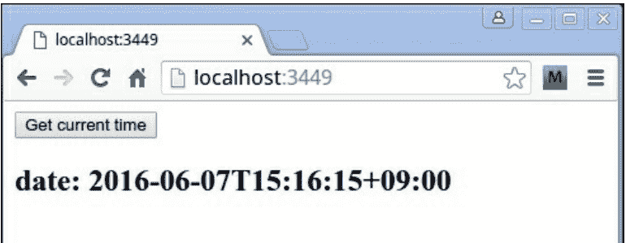

前面的代码相当直接；我们将学习一种更复杂的方法。首先，我们将在以下代码中为当前日期和时间定义一个 atom：

```
(def app-state-date2 (atom {:date (get-local-now-string)}))
;;=> #'om-next-example.core/app-state-date
```

然后，我们将使用 om.next 中的 readers 和 mutators 编写代码。Readers 是从状态读取数据的函数：

```
(defn read-date [{:keys [state] :as env} key params]
  (let [st @state]
    (if-let [[_ value] (find st key)]
      {:value value}
      {:value :not-found})))
;;=> #'om-next-example.core/read-date
```

另一方面，mutators 是用于更新状态中数据的函数，如下所示：

```
(defn mutate-date [{:keys [state] :as env} key params]
  (if (= 'get-current-time key)
    {:value {:keys [:date]}
     :action #(swap! state update-in [:date] get-local-now-string)}
    {:value :not-found}))
;;=> #'om-next-example.core/mutate-date
```

我们将创建一个 UI 组件。我们将在 defui 中实现 om/IQuery 以从 read 函数获得的属性中获取元素。:onClick
函数调用 om/transact!，它通过 mutator 更新状态，而不是直接更新它：

```
(defui DateDisplay2
  static om/IQuery
  (query [this] [:date])
  Object
  (render [this]
    (let [{:keys [date]} (om/props this)]
      (dom/div nil
        (dom/button
          #js {:onClick
            (fn [e] (om/transact! this '[(get-current-time)]))}
          "Get current time")
        (dom/h2 nil (str "Date: " date))))))
;;=> #object[Function "function
(this__41642__auto__,writer__41643__auto__,opt__41644__auto__)
;;=> {return
cljs.core._write.call(null,writer__41643__auto__,"om-next-example.core/DateDisplay2";}"]
```

我们将在创建 reconciler 时指定 read 和 mutate 函数，如下所示：

```
(def date-reconciler2
  (om/reconciler
    {:state app-state-date-2
     :parser (om/parser {:read read-date :mutate mutate-date})}))
;;=> #'om-next-example.core/date-reconciler2
```

现在是时候在浏览器中显示它了：

```
(om/add-root! date-reconciler2
  DateDisplay2 (gdom/getElement "app"))
```

## How it works...

我们将向你展示一个非常简单的 HTML 和 JavaScript，使用 Facebook 的 React。然后，我们将回顾 om.next 的基本功能。

## React fundamentals

为了理解 om 和 om.next，我们将查看一些简单的 om 代码。下面的 HTML。第一个 HTML 用于显示 “Hello Clojure !” 的消息。ReactDOM.render 简单地将字符串设置到元素上：

```
<!DOCTYPE HTML>
<html>
    <head>
        <meta charset="utf-8">
        <title>Hello Clojure</title>
    </head>
    <body>
        <div id='app'></div>
        <script src="https://fb.me/react-15.0.1.js"></script>
        <script src="https://fb.me/react-dom-15.0.1.js"></script>
        <script src="https://cdnjs.cloudflare.com/ajax/libs/babel-core/5.8.23/browser.min.js"></script>
        <script type="text/babel">
            ReactDOM.render(<h1>Hello Clojure !</h1>,

            document.getElementById('app'));
        </script>
    </body>
</html>
```

第二个 HTML 是参数化版本。它定义了 Message 函数，并在 ReactDOM.render 中设置消息，如下所示：

```
<!DOCTYPE HTML>
<html>
    <head>
        <meta charset="utf-8">
        <title>Hello Clojure</title>
    </head>
    <body>
        <div id='app'></div>
        <script src="https://fb.me/react-15.0.1.js"></script>
        <script src="https://fb.me/react-dom-15.0.1.js"></script>
        <script src="https://cdnjs.cloudflare.com/ajax/libs/babel-core/5.8.23/browser.min.js"></script>
        <script type="text/babel">
            var Message = React.createClass({
                render: function () {
                    return <h1>Hello {this.props.message} !</h1>;}});
            ReactDOM.render(<Message message="Clojure" />,

```

```
document.getElementById('app');
</script>
</body>
</html>
```

## defui

什么是 defui？defui 是用于定义 om.next 组件的宏。defui 具有以下语法：

```
(defui component-name & forms)
```

通常，defui 使用的参数如下所示：

```
(defui component-name
  static om/IQueryParams
  (params [this] .....)
  static om/Ident
  (ident [this {:keys [name]}] .....)
  static om/IQuery
  (query [this] .....)
  Object
  (render [this] .....))
```

## reconciler

什么是 reconciler？它管理 om.next 应用中的状态。reconciler 接受应用状态和 parser 如下：

```
(def reconciler
  (om/reconciler
    {:state app-state
     :parser (om/parser {:read read :mutate mutate})}))
;;=> nil
```

```
(om/add-root! reconciler
  root-component (gdom/getElement element-id))
;;=> nil
```

## Life cycle of components

除了在 defui 中定义 render 函数外，我们还将添加 componentWillMount 和 componentDidMount：

```
(defui HelloClojure
```

```
Object
(render [this]
    (dom/h1 nil "Hello Clojure !"))
(componentWillMount [this]
    (js/alert  "Will mount !")
)
(componentDidMount [this]
    (js/alert  "Did mount !"))
;;=> nil
(def hello (om/factory HelloClojure))
;;=> #'om-next-example.core/hello
(js/ReactDOM.render (hello) (gdom/getElement "app"))
;;=> #object[om-next-example.core.HelloClojure]
```

前面的代码在浏览器中显示 “Hello Clojure !” 字符串之前和之后向你展示一个对话框。我们在下表中总结了组件生命周期的<|message|> 方法：

| 生命周期方法 | 生命周期 | 描述 |
|---|---|---|
| componentWillMount | Mounting | 在初始渲染发生前立即调用一次，在客户端和服务器上均会调用。 |
| componentDidMount | Mounting | 在初始渲染发生后立即调用一次，仅在客户端调用，不在服务器上调用。 |
| componentWillReceiveProps | Updating | 当组件接收到新的 props 时调用。此方法不会在初始渲染时调用。 |
| shouldComponentUpdate | Updating | 在接收到新的 props 或 state 时渲染前调用。此方法不会在初始渲染或使用 forceUpdate 时调用。 |
| componentWillUpdate | Updating | 在接收到新的 props 或 state 时渲染前立即调用。此方法不会在初始渲染时调用。 |
| componentDidUpdate | Updating | 在组件的更新刷新到 DOM 后立即调用。此方法不会在初始渲染时调用。 |
| componentWillUnmount | Unmounting | 在组件从 DOM 中卸载前立即调用。 |

## There's more...

我们将使用 `om.next` 制作一个更现实的应用。

## Task list using om.next

我们将创建一个简单的任务列表来查看你的任务和截止日期。应用的截图如下：

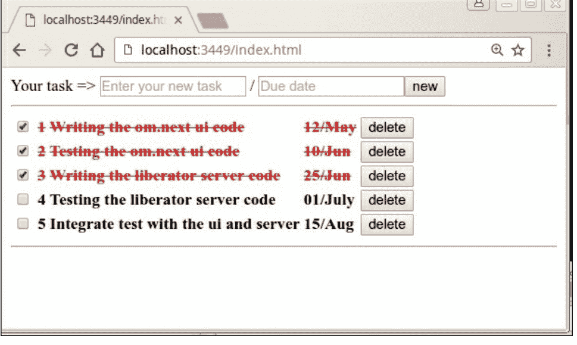

要创建新任务，你将添加任务描述和截止日期。如果你点击特定任务的复选框，则表示该任务已完成。**delete** 按钮用于取消你输入的任务。

## Defining the namespace and libraries to use

让我们定义要使用的命名空间和库：

```
(ns om-next-example.task
  (:require [goog.dom :as gdom]
            [om.next :as om :refer-macros [defui]]
            [om.dom :as dom]))
;;=> nil
```


```
(enable-console-print!)
;;=> nil
```

以下列表是应用程序管理的任务列表。

## 定义状态

在下面的代码中，我们将任务定义为一个映射的 atom：

```
(def task-state
  (atom {:task
          [{:id 1 :task "Writing the om.next ui code" :due-date "12/May" :finished false}
           {:id 2 :task "Testing the om.next ui code" :due-date "10/Jun" :finished false}
           {:id 3 :task "Writing the liberator server code" :due-date "25/Jun" :finished false}
           {:id 4 :task "Testing the liberator server code" :due-date "01/July" :finished false}
           {:id 5 :task "Integrate test with the ui and server" :due-date "15/Aug" :finished false}]})
;;=> #'om-next-example.task/task-state
```

## 定义读取

然后，我们将定义一个读取，它是多方法：

```
(defmulti read-task om/dispatch)
;;=> nil
(defmethod read-task :task
  [env key params]
  (let [state (:state env)]
    {:value (:task @state)}))
;;=> #object[cljs.core.MultiFn]
```

在之前的代码中，env 类似于以下内容：

```
{:query-root :om.next/root,
         ..........
  :children
  [{:type :prop, :dispatch-key :id, :key :id}
   {:type :prop, :dispatch-key :task, :key :task}
   {:type :prop, :dispatch-key :finished, :key :finished}
   {:type :prop, :dispatch-key :due-date, :key :due-date}]},
  :state
  #object [cljs.core.Atom {:val {:task [{:id 1, :task "Writing
```

```
the om.next ui code", :due-date "12/May", :finished true} {:id 2, :task "Testing the om.next ui code", :due-date "10/Jun", :finished true} ....]]}],
:parser
#object[om$next$impl$parser$parser__$self "function
(env,query,target) {
.........
```

而 read-task 返回任务数组：

```
{:value [{:id 1, :task "Writing the om.next ui code", :due-date "12/May", :finished true}
{:id 2, :task "Testing the om.next ui code", :due-date "10/Jun", :finished true}....]}
```

## 定义变异

我们将在下面定义名为 mutate-task 的多方法：

```
(defmulti mutate-task om/dispatch)
;;=> nil
```

变异有三种方法，如下表所示：

| 操作 | 描述 |
|---|---|
| task/new | 用于新建任务的变异 |
| task/toggle | 用于切换任务完成与未完成状态的变异 |
| task/delete | 用于删除任务的变异 |

让我们定义 task/new 的变异。在定义变异之前，我们将定义一个工具函数 get-next-id 来为新任务生成新的 ID：

```
(defn get-next-id [task]
(->>
(map :id task) (apply max) inc))
;;=> #'om-next-example.task/get-next-id
(get-next-id (@task-state :task))
;;=> 6
```

以下方法用于为新任务创建映射并将其插入到 task-state 中：

```
(defmethod mutate-task 'task/new [env key params]
  (let [
    state (:state env)
    id (get-next-id (:task @state))
    new-task (assoc params :id id)]
    {:action
     (fn []
       (swap! state update :task conj new-task))}))
;;=> #object[cljs.core.MultiFn]
```

然后，我们将定义一个方法来在完成/未完成之间切换任务的状态。get-index-for-id 用于获取 id 的数组位置：

```
(defn get-index-for-id
  [id task]
  (-> (for [[index task] (map-indexed vector task)
            :when (= id (:id task))]
        index) first))
;;=> #'om-next-example.task/get-index
```

以下方法在完成/未完成之间切换任务的状态：

```
(defmethod mutate-task 'task/toggle
  [env key params]
  (let [state (:state env)
        id (:id params)
        index (get-index-for-id id (:task @state))]
    {:action
     (fn []
       (swap! state update-in [:task index :finished] not))}))
;;=> #object[cljs.core.MultiFn]
```

最后，我们将定义一个用于删除任务的方法：

```
(defn delete-task
  [task id]
  (-> (remove #(= id (:id %)) task) vec))
;;=> #'om-next-example.task/delete-task
(defmethod mutate-task 'task/delete
  [env key params]
```

```
(let [state (:state env)
      id (:id params)
      task (delete-task (:task @state) id)]
  {:action
   (fn []
     (swap! state assoc :task task))})
;;=> #object[cljs.core.MultiFn]
```

## 定义 UI

我们将为任务应用程序定义两个 UI。它们是 ListView 和 TopView。ListView 与单个任务配合使用，并将它们显示为表格的行。每一行的元素为复选框、任务 ID、任务描述、截止日期和删除按钮。TopView 将任务显示为表格并处理新任务。

让我们先看 ListView：

```
(defui ListView
  static om/IQuery
  (query [this]
    [:id :task :finished :due-date])
  Object
  (render [this]
    (let [{:keys [id task finished due-date]} (om/props this)
      (dom/tr nil
        (dom/th nil
          (dom/input #js
            {:type "checkbox"
             :className "toggle"
             :checked (and finished "checked")
             :onChange #
             (om/transact! this `[(task/toggle {:id ~id})])}))
        (dom/th nil
          (dom/span #js
            {:className "id" :style #js
             {:color (if finished "red" "black")}}
            (if finished (dom/s nil id) id)))
        (dom/th nil
          (dom/span #js
            {:className "task" :style #js
             {:color (if finished "red" "black")}}
```

```
(if finished (dom/s
nil task) task))
(dom/th nil
(dom/span #js
{:className "due-date" :style #js
{:color (if finished "red" "black")}}
(if finished (dom/s
nil due-date) due-date))
(dom/th nil
(dom/button #js
{:onClick #
(om/transact! this `[(task/delete {:id ~id})])}
"delete")))))
;;=> #object[Function "function
(this__47196__auto__,writer__47197__...
```

我们已经为状态定义了查询。查询获取 id、task、due-date 和 finished 的值。

om/factory 从 UI 组件创建函数以供父组件调用：

```
(def list-view (om/factory ListView))
;;=> #'om-next-example.task/list-view
```

因此，让我们继续定义 RootView。我们将定义 get-element-value-by-id 和 set-element-value-by-id!。_get-element-value-by-id 通过 id 从特定输入字段获取值：

```
(defn get-element-value-by-id [id]
(.-value (. js/document (getElementById id))))
;;=> #'om-next-example.task/get-element-value-by-id
```

然而，set-element-value-by-id! 设置输入字段的值：

```
(defn set-element-value-by-id! [id value]
(set! (.-value (. js/document (getElementById id))) value))
;;=> #'om-next-example.task/set-element-value-by-id!
```

我们还将定义 not-white-space? 来检查输入字段是否不是空白：

```
(defn not-white-space? [s]
(not (= (clojure.string/trim s) "")))
```

```
;;=> #'om-next-example.task/not-white-space?
(defn handle-new-task!  [component _]
  (let [new-task (get-element-value-by-id "new-task")
        due-date (get-element-value-by-id "due-date")]
    (when (and (not-white-space? new-task) (not-white-space?
    due-date))
      (om/transact! component
                    `[(task/new ~{:task new-task :due-date due-date})])
      (set-element-value-by-id! "due-date" "")
      (set-element-value-by-id! "new-task" ""))))
;;=> #'om-next-example.task/handle-new-task!
```

现在我们将按如下方式定义 RootView：

```
(defui RootView
  static om/IQuery
  (query [this]
          (let [subquery (om/get-query ListView)]
            [{:task subquery}]))
  Object
  (render [this]
          (let [props (om/props this)
                task (:task props)]
            (dom/div nil
                     (dom/label nil "Your task =>  ")
                     (dom/input #js {:className "new-task" :id "new-task"
                                     :placeholder "Enter your new task"})
                     " / "
                     (dom/input #js {:className "due-date" :id "due-date"
                                     :placeholder "Due date"})
                     (dom/button #js
                                 {:onClick #(handle-new-task! this %)}
                                 "new")
                     (dom/hr nil)
                     (apply dom/table #js {:style #js {:text-align "left"}}
                            (map list-view task))
                     (dom/hr nil)))))
;;=> #object[Function "function (this__47196__auto__)...
```

我们已经定义了 ListView 和 RootView。是时候运行我们的应用程序了。


让我们定义 reconciler 并将 _RootView 设置为你的浏览器：

```
(def task-reconciler
  (om/reconciler {:state task-state
                  :parser (om/parser {:read read-task :mutate mutate-task})}))
;;=> #'om-next-example.task/task-reconciler
(om/add-root! task-reconciler
              RootView
              (gdom/getElement "app"))
;;=> #object[om-next-example.task.RootView]
```

初始页面如下：

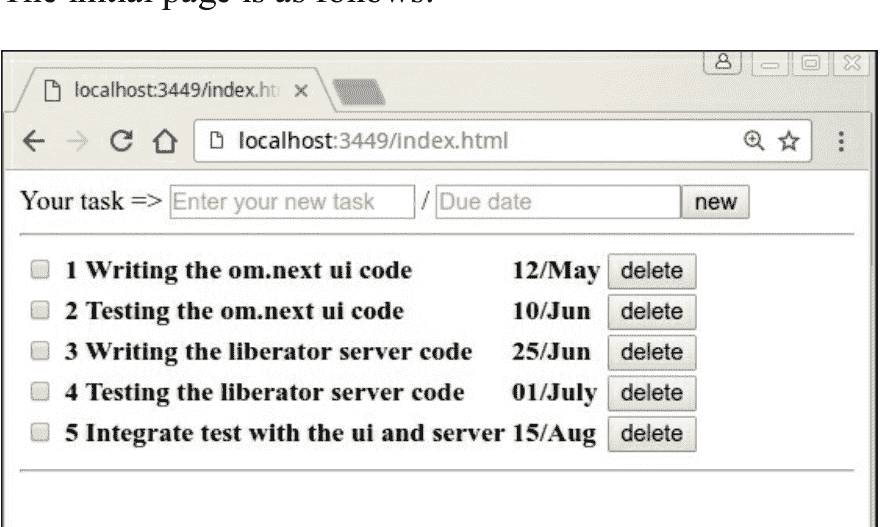

当你点击复选框时，文本的颜色会变成红色并被划掉：

让我们按如下方式输入一个新任务：

输入一个带日期的新任务并点击新建按钮；你会看到新任务已在你的任务列表中：

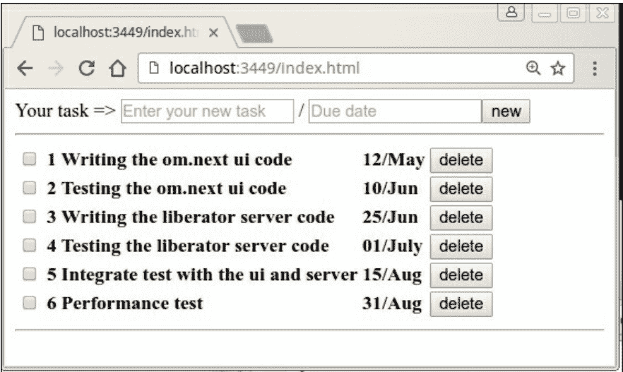

就这样！通过本章，你已学会如何使用 Clojure 的库来开发 Web 应用。接下来，我们将学习如何测试 Clojure 应用。让我们享受测试吧！
