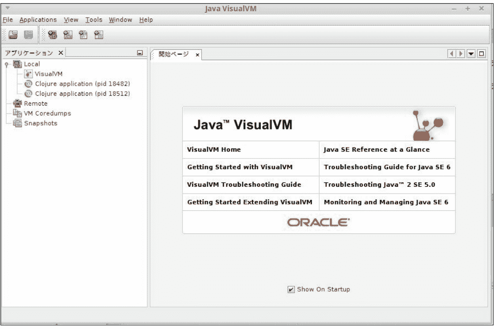
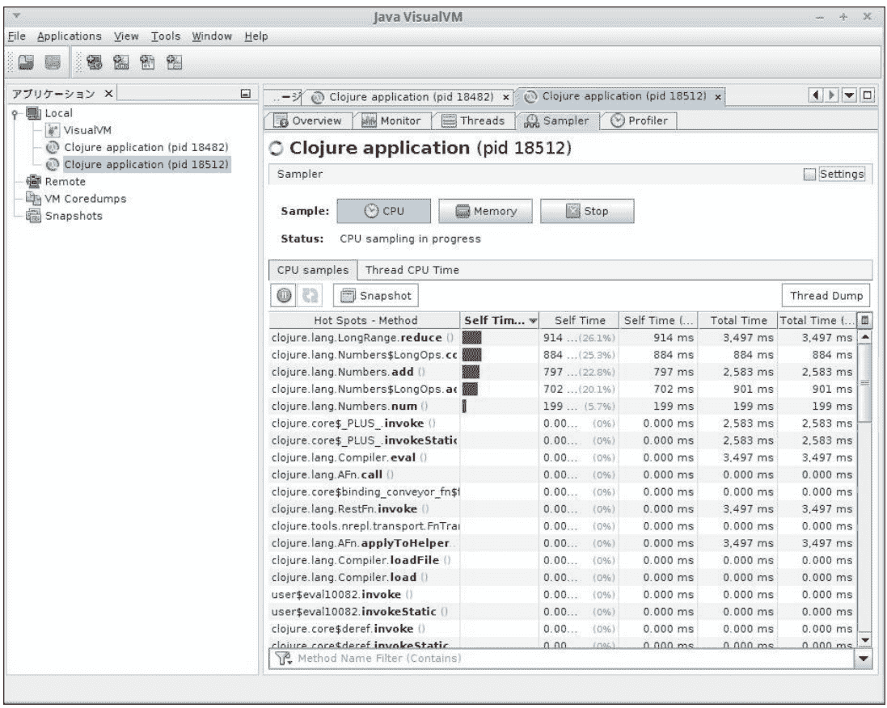
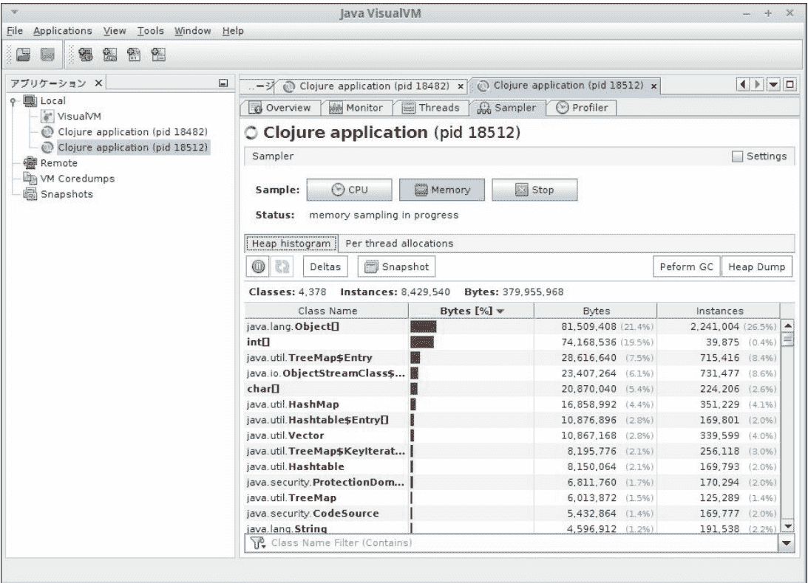
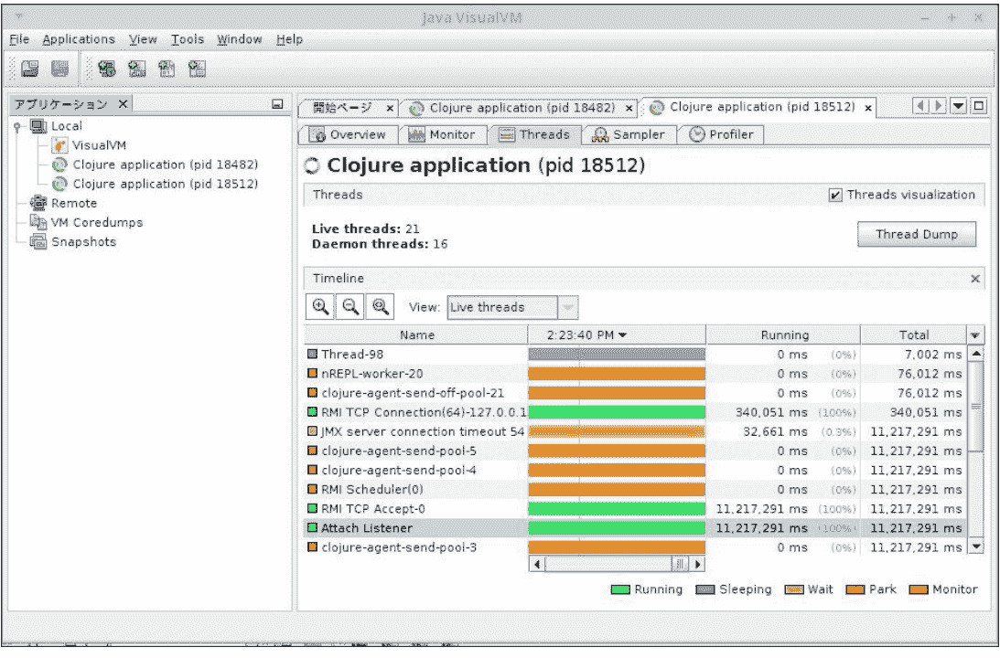

# 第 9 章。测试

在本章中，我们将涵盖：
- 行为驱动开发
- 使用随机输入和基于模式的测试进行测试
- 使用 Criterium 进行基准测试、性能提示和其他工具

## 引言

在本章中，我们将学习 Clojure 应用的测试方法。通过第一个配方，我们将介绍行为驱动开发。利用 Cucumber 进行行为驱动开发，该配方实现了一些有趣的 BDD 应用，包括 Spark 和 OpenCV。

下一个关于基于模式测试的配方，向你展示了 Clojure 中的著名 Haskell QuickCheck。在这个配方中，你将学习如何自动生成测试模式。

本章的最后一个配方 *使用 Criterium 进行基准测试、性能提示和其他工具*，将向你展示性能测试。Criterium 是 Clojure 中事实上的基准测试工具。你将学习如何使用 Criterium 测试你的性能。

你还将学习 Clojure 中的一些性能提示。最后但同样重要的是，你还将学习如何从性能角度分析你的应用。

## 行为驱动开发

**行为驱动开发 (BDD)** 并不是一种新技术，已经有不少博客文章写来介绍某些特定库的优势。

本配方是关于以新的方式使用 Cucumber 框架，使语言能够对话。你将为本配方使用的主要语言将不是 Clojure，而是简单的英语!!!!!!

你将从回顾基础知识开始，并沿着一些高度交互的模式构建，以使用 Spark、虚拟机和 OpenCV。让乐趣开始吧...

## 准备工作

这个 Clojure 项目开始时需要很少的东西。和往常一样，我们添加默认依赖项和一个 Leiningen 插件。

## 依赖项

随着你逐步进行，本配方的 `project.clj` 文件的更新将在过程中完成，所以这里，让我们先把基础部分搞定：

```
:plugins [[org.clojars.punkisdead/lein-cucumber "1.0.5"]]
:dependencies [
    [org.clojure/clojure "1.9.0-alpha7"]
]
```

Clojure 1.9 不是必需的，但也许正是尝试新事物的好时机。所以基本上你只需要 Leiningen 的 Cucumber 插件。

## 第一个特性

所以有了 Cucumber 和 BDD 总体来说，你用纯粹简单的英语编写特性。文件以 `.feature` 结尾的文件名保存，后续会被插件拾取。

特性文件位于 Leiningen 项目中某个文件夹的根目录，包含特性文件、一个 `step_definitions` 文件夹，以及该 `step_definitions` 文件夹内的一个 Clojure 文件。

在确认文件夹结构与之前所示相同后，`first_steps.clj` 文件在此阶段仍为空。你可以用以下命令运行此特性，通过参数调用 Cucumber 插件并指定文件夹：

```
lein cucumber features00
```

第一个输出应类似于以下内容：

```
Running cucumber...
Looking for features in: [features00]
Looking for glue in: [features00/step_definitions]
UU
1 Scenarios (1 undefined)
2 Steps (2 undefined)
0m0.000s
You can implement missing steps with the snippets below:

(Given #"^I add (\d+) and (\d+)$" [arg1 arg2]
  (comment Write code here that turns the phrase above into concrete actions )
  (throw (cucumber.api.PendingException.)))

(Then #"^the result is (\d+)$" [arg1]
  (comment Write code here that turns the phrase above into concrete actions )
  (throw (cucumber.api.PendingException.)))
```

这是什么意思？如所见，我们的文件中确实有一个场景，和两个步骤，一个 Given 步骤和一个 Then 步骤。场景中的每个步骤都使用正则表达式，以便能够将英语绑定到后台的某些适当的 Clojure 代码中。

正如输出所建议的，让我们在 `first_steps.clj` 中添加缺失的片段。整个文件将使用常规的 `eval` 调用进行求值，所以你在这里不会使用命名空间，而是像在

# REPL。

Given 接受一个正则表达式、绑定和一个主体。这将设置假设；在这里，我们通过 Given 句子中的模式匹配收集两个绑定 a 和 b：
- a 最终将被绑定到值 50
- b 最终将被绑定到值 100

Given 的主体将 result atom 设置为 a 和 b 的加法。Then 是放置 clojure.test 断言（或任何其他测试框架）的地方。这里，assert 验证句子中给出的值，与之前的加法：

```
(use 'clojure.test)
(def result (atom 0))
(Given #"^I add (\d+) and (\d+)$" [a b]
      (reset! result (+ (bigdec a) (bigdec b))))
(Then #"^the result is (\d+)$" [expected]
      (assert (= (bigdec expected) @result)))
```

让我们再次运行这个 features00，使用更新后的 Clojure 文件：

```
Running cucumber...
Looking for features in: [features00]
Looking for glue in: [features00/step_definitions]
..
1 Scenarios (1 passed)
2 Steps (2 passed)
0m0.192s
```

由于 100 + 50 仍然等于 150，我们是安全的！我们可以继续更有趣的场景。

## 如何做...

本节将向基础添加一些更多特性模式。

## 使用表格进行多重假设

用两个整数做加法确实很不错，也许我们可以扩展到更多值，但最终使用表格来添加值会更有意义。以下是一个在 Scenario 中使用表格的示例：

```
Feature: Cuking
    Working with tables
    Scenario: Reading a table
    Given the following cukes:
      | Niko        | 50  |
      | Makoto-san  | 100 |
      | Ikemoto-san | 100 |
    Then the total should be 250.
```

在语言层面没有什么非常惊人的；这里有一些 cukes。那里有一些 cukes。有趣的是显然如何将表格绑定到步骤定义中 Clojure 代码的值。

发送到 Given 方法参数的 Java 对象是一个 DataTable：

https://cucumber.github.io/api/cucumber/jvm/javadoc/cucumber/api/Data

并且，基本上，访问数据的主要方法将是：
- raw
- cells
- asList
- asMap

在这个使用表格的第一个示例中，你注意到对该表格的 raw 的简单调用后跟一个简单的 reduce 就能解决问题。其余部分应该很容易跟随：

```
(use 'clojure.test)
(def total (atom (long 0)))
(defn sum-table[table]
    (reduce + (map #(bigdec (second %)) table)))
(Given #"^the following cukes:$" [table]
    (reset! total (sum-table (.raw table))))
(Then #"^the total should be (\d+).$" [result]
    (assert (= (bigdec result) @total)))
```

结果确实是 250。

## 从 CSV 文件读取假设

好吧，表格很棒，但在这里，你最终会在需要将该数据在人们之间共享时遇到墙。在这种情况下，使用单独的文件来保存数据看起来更直接。让我们欢迎新的特性，cuking with CSV：

```
Feature: Cuking with csv
  I want to see how to cuke around with csv
  Scenario: Reading a table
  Given data from file "set1.csv":
    Then the total should be 350.
```

CSV 文件的内容很直接，包含类似的数据：

```
Niko,50
Abe-san,200
Makoto-san,100
```

步骤文件也没有什么惊人的；我们只是插入 data.csv 库来为给定的 CSV 文件读取一些数据。以下示例需要在运行前添加到 project.clj 中的一个额外库：

```
[org.clojure/data.csv "0.1.3"]
```

然后进入编码部分：

```
(require '[clojure.data.csv :as csv]
        '[clojure.java.io :as io])
(defn load-table [file]
  (with-open [in-file (io/reader (str "fixtures/" file))]
    (doall
      (csv/read-csv in-file))))

(defn load-table-from-env []
  (load-table  (env :fixtures)))

(Given #"^data from file "(.*?)"$:" [file]
  (reset! total (sum-table (load-table file))))
(Given #"^data from environment$" []
  (reset! total (sum-table (load-table-from-env))))


所以现在场景从给定的文件加载一些数据并验证一些规则。如果你还没有尝试过 environ，那么本书的示例也展示了如何使用环境变量在运行时插入 CSV 文件的文件名，这样以下命令就会告诉场景在运行时加载哪个文件：

```
export FIXTURES=set1.csv ; lein cucumber features02%
```

这留给读者作为一个小练习，我们可以继续到...

## 使用 Excel 实现

从之前的示例中，你会记得期望结果在 feature 文件中，而测试数据在 CSV 文件中，这意味着你必须以某种方式保持两者同步。

如果数据和结果都在 CSV 文件中，那么其他人就可以负责插入数据，而你只需使用用纯英文编写的特性来运行此测试。以下是 feature 文本可能的样子示例：

```
Feature: My First Cucumber
  Working with excel

  Scenario: Expenses Report Example
    Given I use sheet "List1"
    Then the result is validated
```

Excel 电子表格将包含你之前处理过的表格工作表，然后是一个包含期望结果的结果工作表：

使用 docjure，即 Apache POI 的包装器，来读取 Excel 电子表格，你将打开电子表格，从工作表中读取表格数据，以及期望结果：

```
(use 'dk.ative.docjure.spreadsheet)
(def result (atom 0))
(def expected (atom 0))
(defn load-list [sheet]
  (let [
    book (load-workbook "fixtures/data.xlsx")
    mm
```

```
(map #(:price %) (rest
    (->> book
        (select-sheet sheet)
        (select-columns {:A :name, :B :price}))))
results (->> book (select-sheet "Results") (select-columns
{:A :Name, :B :Total}))
_expected (:Total (first (filter #(= sheet (:Name %))
results)))]
(reset! result (apply + mm))
(reset! expected _expected))
```

这现在使得与外部数据交互变得更加容易。

## 使用 Web API 和 MongoDB 实现

是的，使用远程 Web API 的 Cucumber。因为数据可能并不总是本地可用，你可能希望在测试时检索数据，并对可用数据进行断言。

以下特性给你一个想法：

```
Feature: My First Cucumber
  Retrieve weather info from HTTP, compute average using MongoDB

  Scenario: Storing Data For Cities
  When I load weather data for the following cities:
    | Tokyo  |
    | Osaka  |
    | Kobe   |
  Then I expect the average temperature to be lower than 30
```

特性易于阅读，其步骤的底层代码也不复杂。

基本上，以下代码执行以下操作：
- 1. 从列表中获取下一个城市名称。
- 2. 向 openweathermap 发送请求。
- 3. 以 JSON 形式获取结果。
- 4. 直接将 JSON 存储到 MongoDB 中。
- 5. 最后，使用 MongoDB 聚合框架计算平均值。

以下代码片段遵循之前的要点：

```
(require  '[monger.core :as mg]
            '[monger.collection :as mc]
            '[monger.operators :refer :all])

(defn endpoint [city]
  (str
    "http://api.openweathermap.org/data/2.5/weather?q="
    city
    "&APPID=<KEY>&units=metric"))

(defn load-weather-data [city]
  (-> (get cl (endpoint city) {:as :json})
      <!
      :body
      <!))

(defn store-data-to-mongo [city]
  (mc/insert
    db
    "weather"
    (load-weather-data city)))

(When #"I load weather data for the following cities:$" [table]
  (mc/drop db "weather")
  (doseq [city (.raw table)]
    (store-data-to-mongo (first city))))

(Then #"^I expect the average to be lower than (\d+)$"
  [maximum]
  (let [
    coll "weather"
    average
      (:avg (first (mc/aggregate db coll [
        {$group {:_id "total" :avg {$avg "$main.temp"}}}]))) 
  ]
  (assert (< average (bigdec maximum) ))))
```

BDD 框架现在可以帮助你超越仅仅测试自己的代码，而且还能使与环境的交互以及特性的目标对每个人都清晰。它传达了意图，并允许任何普通用户理解目标，并且能够

更改参数并理解对测试的影响。

下一节中的示例将极大地扩展这一点，将 BDD 引入更多领域和想法。

## 还有更多...

食谱的最后一部分展示了 Cucumber 与 VirtualBox、Flambo、OpenCV 和其他框架交互的示例。所有这些示例中都有大量相似的代码，因此代码将被保持在最小限度，并且只有在书中突出的代码才会被呈现出来（你当然可以在示例中看到完整代码）。

这个小节的目的是向你展示一些想法并激发你的灵感。

## VirtualBox

在玩 VirtualBox 和其他虚拟机时，能够在启动后验证虚拟机的属性是很不错的。一些配置框架提供了该功能；其他则没有。你用启动时启动 sshd 配置虚拟机并不总是意味着 sshd 守护进程确实在启动时启动。

这里有一个特性来说明这一点：

```
Feature: VirtualBox Cucumber
    Example on using VirtualBox with Cucumber

    Scenario: Simple VirtualBox Interaction
    When I start the VM "debian"
    And Wait 10 seconds
    Then IP "172.16.2.204" has port "22" opened
    Then I can stop the VM "debian"
```

显然，如果你获取的是动态 IP，这就不太好用，但这仍然给出了一个想法。场景的不同部分是通过 bash 调用实现的。基本上，启动虚拟机，停止虚拟机，并使用 nc 检查端口是否打开：

```
(defn start-the-machine [vm-name]
  (sh/sh "bash" "-c"
    (str "VBoxManage startvm " vm-name " --type headless")))
(defn stop-the-machine [vm-name]
  (sh/sh "bash" "-c"
    (str "VBoxManage controlvm " vm-name " poweroff")))
(defn check-port [IP port]
  (sh/sh "bash" "-c"
    (str "nc -z " IP " " port)))
```

你显然也可以提供要启动的虚拟机列表...

## Freactive

Freactive 让使用 atoms 变得 freac-ing 容易...以及进行有状态测试。有了 atoms，你可以记录不同的步骤，并在整个过程中验证输入：

```
Feature: My First Freacting Cucumber
  Meeting people and counting ...

  Scenario: Meeting people
    Given It is a new day
    Given I met Niko
    Given I met Dave
    Then I have met 2 people and the last person was Dave
```

Freactive 的有趣部分之一是 cursors，以及创建 atoms 的 lenses 的能力，并且在 atoms 被更新或读取时也能拥有类似监听器的东西。

见下文；my-lens atom 正在查看 people，并在其被更新时添加一些操作。因此，如果 my-lens 被更新，people 也会被更新，但在调用 setter 函数之后：

```
(def people (atom 0))
(def total (atom 0))

(def getter identity)

(defn setter
  [my-atom-state new-cursor-state]
  (swap! total inc))
```

```
new-cursor-state)

(def my-lens
  (lens-cursor people getter setter))
```

Freactive 使在场景中跟踪历史变得容易，并且还能回溯测试期间已转换或访问过的数据类型。

## Flambo，或 BDD 遇见 Apache Spark

可能有些时候，你显然想要做纯 Apache Spark 工作，但有时这种 Apache Spark 的使用可能只是测试的副作用。

比如你想确认文件或一组文件的行数：

```
Feature: Flambing
  This is a great way to put some notes about Flambing

  Scenario: Word analysis in from a text file
    Given the following text file: "fixtures/sherlock.txt"
    Given we count the number of lines using shell
    Then we wanna check the number of lines is the same
```

给定一个文件，此场景只是计算行数，但你会得到这样的信息：这是你可以在文本内容上插入数据分析的地方。

你会记得启动 Apache Spark 并计算行数是多么容易：

```
(def c (-> (conf/spark-conf)
            (conf/master "local")
            (conf/app-name "flame_princess")))
(def sc (f/spark-context c))

(defn word-frequencies [text-file]
  (-> (f/text-file sc text-file)
      f/count))
```

这意味着，显然，在此场景中重要的是内容


of the text and what to express to the user. Using a sentiment analysis library, you could validate that your algorithm finds the right sentiment for the text files, but also that your assumptions on the text are correct; then I think this recipe would be a good mood document. It is obviously another example too!

## EEP for BDD

You may have heard of the EEP library for BDD. EEP stands for Embedded Event Processing. This is obviously a very useful library on its own, but how to use it in the context of Cucumber and BDD is also pretty interesting too.

Basically, you start by creating an emitter, which is the centralized place that receives events. Then you register a listener on that emitter, here :accumulator, and assign a function that is being called whenever some new event is being sent to the emitter, along with data:

```
(def emitter
  (eem/create {}))
```

```
(When #"^the emitter is created$" [])
```

```
(When #"^the aggregator is created$" []
  (eem/defaggregator
    emitter
    :accumulator ;; the event type to attach to
    (fn [acc i] (+ acc i)) ;; the function to apply to the stream
    0) ;; the initial state
  )
```

Definitions are in the bag, so during your test, you can send data to the aggregator at given times, using notify:

```
(When #"^some data is emitted to the aggregator$" []
  ;; send 0-9 down the stream
  (doseq [i (range 10)]
    (eem/notify emitter :accumulator i)))
```

Finally, whenever you need data, you can use eem/get-handler that will finalize the event stream and return the computed current result:

```
(Then #"^the state of the aggregator should be (\d+)$" [arg1]
;; state is 0 + 1 + 2 + 3 + 4 + 5 + 6 + 7 + 8 + 9
(assert (= 45
(eem/state (eem/get-handler emitter :accumulator)))))
```

Where this is good to use is, for example, to retrieve some statistics such as averages, on the data passing by the features of the scenario.

## OpenCV

Alright, this is going to be somehow a bit of a bonus! This is a great way to get excited and try new things though. The coming feature writes in easy-to-understand English "features" you expect to find in media content, say, pictures.

For example, the following is simply just adapting the standard face recognition opencv lena example, but you do have to agree that this is easier to read than the usual OpenCV code.

Now here, again, the context of this is not about the OpenCV library itself, it is about the content of the image, and how to express it to other people in simple language:

```
Feature: OpenCV Face Recognition
    Playing around with face recognition and cucumber

Scenario: Looking for faces in an image
    When I load the image "fixtures/lena.png"
    And setup the classifier for frontal face recognition
    Then I can find 1 face in the loaded image
```

The whole code includes everything, from reading the image as an object, setting the face detector, starting the face recognition, down to drawing the rectangles:

```
(import '[org.opencv.core Core Mat MatOfRect Point Rect Scalar])
(import '[org.opencv.objdetect CascadeClassifier]
      '[org.opencv.highgui Highgui])
(def image
  (atom nil))
(def faceDetector
```

```
(atom nil))

(When #"^I load the image "(.*?)"$" [_image]
  (reset! image
    (Highgui/imread _image)))

(When #"^setup the classifier for frontal face recognition$" []
  (reset! faceDetector
    (CascadeClassifier. "opencv-data/lbpcascade_frontalface.xml")))

(Then #"^I can find (\d+) face in the loaded image$" [arg1]
  (let[faceDetections          (MatOfRect.)]
    (.detectMultiScale @faceDetector @image faceDetections)
    (let [
      rect-array (.toArray faceDetections)
      len (alength rect-array)]

      ; output for the fun of it
      (doseq [^Rect rect rect-array]
        (Core/rectangle @image
          (Point. (.-x rect) (.-y rect))
          (Point. (+ (.-x rect) (.width rect)) (+ (.-y rect) (.height rect)))
          (Scalar. 0 255 0)))

      (Highgui/imwrite "target/last-detection.png" @image)

      (assert (= (Integer/parseInt arg1) len )))))
```


Finally, this is putting OpenCV to the use of media analysis in the context of testing and works quite nicely with simply running Cucumber's scenarios and features.

## Testing with random inputs and pattern-based testing

It often seems like reinventing the wheel while writing test cases. Always trying to use some handwritten random inputs and trying a few of those inputs on the newly written functions. In this recipe, you will be presented with the Clojure equivalent of QuickCheck patterns, which is a famous testing framework for the Haskell programming language. No need to learn Haskell today, but let's review some cool testing patterns!

### Getting ready

In this recipe, one of the main goals is to generate various kinds of data. To achieve that, we will have a mix of handmade data generators and some others will come through libraries. Let's go through the libraries setup.

### Libraries

The `project.clj` file is a bit dense today. We will use the `midje` library not for testing but for its `autotest` feature. The `autotest` feature lets you rerun the tests automatically while writing code, and get test reports.

Compojure is not to present anymore. We will use it a bit to generate randomly generated routes, and compare routing results.

The three main libraries - `test.check`, `test.chuck`, and `herbert` - are composing the main course of this recipe.

`test.check` is the base of the Clojure version of QuickCheck, the testing framework. `test.chuck` brings some more utilities and methods to `test.check`, and finally `herbert` brings schema-based random value generation.

That gives the following:

```
(defproject quickchecks "0.1.0-SNAPSHOT"
  :profiles {:dev {:dependencies [
  [midje "1.8.3"]

  :plugins [[lein-midje "3.2"]]}}}
  :dependencies [
  [org.clojure/clojure "1.8.0"]
  [compojure "1.5.1"]

  [org.clojure/test.check "0.9.0"]
  [com.velisco/herbert "0.7.0"]
  [com.gfredericks/test.chuck "0.2.6"]
  ])
```

Let's put all this into practice!

### Generating random values or groups of values

To understand property-based testing, we will start by having a look at some methods to generate random inputs.

Random inputs are generated using...generators. No, seriously. This is the name the test.check library is using.

You can see the output of a generator using another simple generator, named sample. sample takes a generator, and by default generates 10 values taken from the input generator.

In the following first example, the sample generator takes a generator that always returns the same value, 1.

Let's start an REPL:

```
(require '[clojure.test.check.generators :as gen])

(gen/sample (gen/return 1))
; (1 1 1 1 1 1 1 1 1)
```

As expected, sample returns 10 times the same value, here 1. The default size for the sample is 10, but you can also set a given size:

```
(gen/sample (gen/return 1) 5)
```

```
; (1 1 1 1)
```

Obviously, you are not going to be able to test much if the random testing always involves the same value, so let's move to a bit more variety. The elements generator takes a sequence, and takes random elements from it:

```
(gen/sample (gen/elements (range 10)))
; (6 2 6 1 0 0 0 5 2 7)
```

Running the same generator twice does return different random sequences. You can also generate a sequence of sequences, by using either the list or the vector generators. Here is how you would do it:

```
(gen/sample (gen/not-empty (gen/vector gen/int)) 5)
; ([-2 -2] [1] [-1 2 0] [2 0] [5 -5])
```

The vector generator takes a generator as parameter, and generates a vector of random size.

You can ask both the sample and the vector to be of size 3, and the sample generator will then generates three samples of size 3 as seen here:

```
(gen/sample (gen/not-empty (gen/vector gen/int 3)) 3)
; ([0 0 0] [0 1 0] [0 2 2])
```

Let's raise the bar a bit. To generate a group of values of different types, you can use tuples. The tuples generator takes as many generators as you want; here, one for random integers and one for random non-empty strings:

```
(gen/sample (gen/tuple gen/int (gen/not-empty gen/string)) 3)
; ([0 "1"] [0 "©"] [1 "8"])
```

The test.chuck utility brings some fun regexp based string generation to you:

```
(require '[com.gfredericks.test.chuck.generators :as gen'])

(gen/sample
```


```
(gen/not-empty (gen'/string-from-regex #"(B(A|O)M)+")) 1)
; ("BOM")
; try it !
(gen/sample
(gen/not-empty (gen'/string-from-regex #"B(A|O){2}M")) 1)
```

现在，在生成元组时，通常集合的不同值之间存在相关性，这正是 Herbert 库发挥作用的地方。

## 基于模式的随机值

Herbert 生成器将语法和生成器都带入了随机生成器的工具箱中。

### 提示

注意，使用的是不同的命名空间！但它们的使用方式相似，并且稍后将在相同的测试上下文中使用。

要使用 Herbert 生成 int 序列，你将使用 hg/sample 方法，可以像到目前为止我们看到的 test.check 一样使用它。

hg/sample 生成器然后接受一个语法，生成器将根据该语法生成值。

这给出以下内容：

```
(require '[miner.herbert.generators :as hg])
(hg/sample '[int*] 5)
; ([ ] () [2 0] () (-4 -2))
```

甜美的随机世界。

你可能已经对整数随机性感到足够了，所以让我们看看元组：

```
(hg/sample '{:a int :b [sym+] :c str} 3)
```

语法，被引用，是三个键值对的映射，键为 :a :b :c，值是：
- :a 的一个随机整数
- :b 的一个符号向量
- :c 的一个字符串

运行之前的 Herbert 生成器会得到：

```
; {:c "", :b (*mt), :a 0}
; {:c "", :b [_... !.Z _B3.], :a 0}
; {:c "}", :b (.14 .), :a 9223372036854775807})
```

显然，运行两次会得到不同的值，但所有值都符合语法。

另一个例子，这次生成一个更详细的映射：

```
(hg/sample '{:a num :b pos :c neg :d (vec int+ zero+)} 1)
; ({:c -2.0, :b 1, :d [9223372036854775807 0], :a 1.5E-5})
```

你现在已经回顾了如何使用生成器以及如何根据特定模式创建随机值。让我们付诸实践。

## 如何操作...

QuickCheck，基于随机的测试，取我们看到的随机生成器并用于测试。

为此，你需要：
- 编写一个规范，并命名
- 编写采样迭代的次数大小
- 为规范的输入定义随机模式
- 为每个随机值定义一组需要检查的属性

## 你的第一个 test.check 规范

记住这一点，让我们通过第一个规范和第一个示例。让我们导入一些用于属性、生成器以及名为 defspec 的测试辅助函数的命名空间：

```
(ns quickchecks.core
  (:require  [clojure.test.check.properties :as prop])
```

```
(:require [clojure.test.check.generators :as gen])
(:require [clojure.test.check.clojure-test :refer [defspec]])
```

你的第一个规范将如下所示：
- 给定一个名称，`some-ones`
- 设置调用生成器的次数，这里为 5
- 使用 `prop/for-all` 对生成器的所有值验证一个属性
- 总是生成值 1，使用之前看到的 `gen/return`

验证是对生成器值的断言，这里是 1：

```
(defspec some-ones
  5
  (prop/for-all [v (gen/return 1)]
    (= v 1)))
```

我们对这个应该相当有信心，这是一个应该经常通过的测试。

## 自动运行测试

要自动运行测试，一个不错的选择是使用 `midje` 的 `autotest`，使用：

```
lein midje :autotest
```

这会重新加载并重新运行需要的测试命名空间和依赖代码。示例输出如下：

```
================================================================================
===
Loading (quickchecks.core0)
{:result true, :num-tests 5, :seed 1466917660382, :test-var "some-ones"}
>>> Output from clojure.test tests:

0 failures, 0 errors.
>>> Midje summary:
```

请注意，至少通过 println 显示一些示例输出是非常有用的，并且请注意，你刚刚生成了 1,000 条条目的随机化输入，而随机定义相当简单。

这里的最后一个示例检查算术是否仍然有效：

```
(defn my-eq [a b]
  (> 1e10 (- b a)))
(defn my-tan [v]
  (/ (Math/sin v) (Math/cos v)))

(defspec cosintan
  1000
  (prop/for-all [v (gen/elements (range 1 10000))]
    (my-eq (Math/tan v) (my-tan v) )))
```

显然，你也可以使用测试执行类似操作，但必须承认之前的版本可读性很好。

## 生成器和解构

你之前见过 gen' 命名空间。这里，我们将看到来自 test.chuck 的另一个有用的工具，生成器的解构。

之前的示例之一展示了如何使用 apply 处理参数，但这样更容易：

```
...
; 在命名空间定义中
(:require [com.gfredericks.test.chuck.properties :as prop'])
...
(defn my-len [n]
  (count (str n)))

(defspec split-n-spec
  10
  (prop'/for-all [ [ele ele2] (gen/tuple gen/int gen/int)]
    (< 0 (my-len (+ ele ele2)))))
```

请注意 ele 和 ele2 如何被分配给元组的每个值。注意，我们使用的是来自 test.chuck 命名空间的 prop'/for-all，这与通常来自 test.check 的 prop 不同。

## Herbert

从食谱的第一部分，你还记得 Herbert，它允许使用语法生成随机输入。

要将 Herbert 的属性与 defspec 一起使用，你需要从到目前为止看到的内容中进行一些参数体操。

这里检查在前，生成模板在后。

示例生成一个包含两个键值对 :a 和 :b 的映射，并检查 :a 的第一个值的第二个参数中是否包含值为 0 的映射整数：

```
(defspec hello-again
  10
  (hg/property
    (fn [m] (== (get-in m [:a 1 :int]) 0))
    '{:a (vec kw {:int 0}) :b str}))
```

当你想要根据来自外部世界的数据结构生成和拥有大型映射或大型向量输入时，这种技术非常有用。

## 还有更多...

本食谱的最后一部分简要展示了如何将介绍的概念应用于 API 测试，在此上下文中为 compojure 路由。

假设你的 API 中有一组路由；生成随机输入并确保逻辑得到良好封装，并且至少不会破坏应用程序的基础会很棒。

我们将考虑非常简单的路由，其中带有 ID 的请求到达应用程序，应用程序始终返回 "Hello Foo"。

显然，这不是一个能赚取数百万美元的伟大应用程序，

但其中可能有些东西：

```
(def my-routes
  (routes
(GET "/:id" [] "Hello Foo")))
```

路由很简单，但你希望生成随机输入并向这些 compojure 应用发送请求以验证返回结果。

这里有一个简单的实用方法，显示发送到路由函数的映射。正如你注意到的，这只是发送一个包含请求类型、uri、头信息和一些参数的映射：

```
(defn request [uri app & params]
  (app {:request-method :get
        :headers {"content-type" "text/plain"}
        :uri uri
        :params params}))
```

有了这个工具，让我们使用应用程序 my-routes 和实用方法编写一个测试我们应用程序的规范：

```
(defspec ringing
  10
  (prop/for-all [a gen/int]
    (= "Hello Foo"
       (:body (request (str "/" a) my-routes [])))))
```

生成器为你提供一个随机 int，然后用于创建请求的 uri。最后，我们确保应用程序返回的结果非常稳定，始终返回友好的 Foo 问候语。

第一个示例相当静态，那么如果想要实际动态生成路由怎么办？

它几乎完全相同，唯一的新东西是使用 let 块在测试范围内绑定路由：

```
(defspec ringing-2
  100
  (prop'/for-all [a gen/int]
```

```
(let [local-routes
    (routes  (GET "/:id" [] (str "Hello Foo" a)))]
  (= (str "Hello Foo" a) (:body (request (str "/" a) local-routes []))))
```

有了这个食谱，你已经准备就绪！享受大量随机测试吧！


# 使用 Criterium 进行基准测试、性能提示和其他工具

在本教程中，我们将学习如何测试、衡量和改进应用程序的性能。我们将向您展示一个基于 Clojure 的基准测试工具。

# 准备工作

要使用 Criterium，我们需要在 `project.clj` 中按如下方式添加 `criterium` 库：

```
(defproject performance-example "0.1.0-SNAPSHOT"
  :description "FIXME: write description"
  :url "http://example.com/FIXME"
  :license {:name "Eclipse Public License"
            :url "http://www.eclipse.org/legal/epl-v10.html"}
  :dependencies [[org.clojure/clojure "1.8.0"]
                 [criterium "0.4.4"]])
```

然后，重启你的 REPL。

# 如何做...

在这里，我们将向您展示如何使用 Criterium 测试代码的性能。

# 使用 Criterium

Criterium 是用于衡量 Clojure 表达式计算时间的微基准测试工具。

它多次执行给定的表达式并报告统计信息，包括执行时间的均值和标准差。Criterium 还考虑 JVM 的特性，例如 JIT 编译器的优化和 GC 的影响。

假设我们将为 `apply`、`reduce` 和 reducers 衡量性能。

在本教程中，我们将使用一个小的基准测试来计算从 1 到 100 万的平方和：

```
1^2 + 2 ^2 + 3 ^2 + ..... + 1,000,000 ^2
```

首先，让我们按如下方式声明命名空间和使用库：

```
(ns performance-example.criterium-example
  (:require [criterium.core :refer
              [bench with-progress-reporting report-result
quick-bench benchmark quick-benchmark]]
            [clojure.core.reducers :as r]
            [criterium.stats :as stats]
            ))
```

我们将衡量 apply、reduce 和 reducers 的基准测试执行时间。我们将分别运行三次，如下所示：

```
(dotimes [_x 3]
  (time (apply + (map #(* % %) (range 1 1000001)))))
;;=> "Elapsed time: 158.034419 msecs"
;;=> "Elapsed time: 98.81966 msecs"
;;=> "Elapsed time: 92.167793 msecs"
(dotimes [_x 3]
  (time (reduce + (map #(* % %) (range 1 1000001)))))
;;=> "Elapsed time: 165.243023 msecs"
;;=> "Elapsed time: 103.53534 msecs"
;;=> "Elapsed time: 157.971972 msecs"
(dotimes [_x 3]
  (time (r/fold + (r/map #(* % %) (range 1 1000001)))))
;;=> "Elapsed time: 144.123838 msecs"
;;=> "Elapsed time: 89.670486 msecs"
;;=> "Elapsed time: 81.810268 msecs"
```

在前面的测试中，相同表达式的性能测试结果会有所不同。我们希望更准确地了解性能。Criterium 用于此类需求。现在我们将使用 Criterium 为 apply、map 和 reducers 运行基准测试：

```
(bench (apply + (map #(* % %) (range 1 1000001))))
Evaluation count : 660 in 60 samples of 11 calls.
    Execution time mean : 92.660075 ms
Execution time std-deviation : 1.823143 ms
Execution time lower quantile : 91.480376 ms ( 2.5%)
Execution time upper quantile : 98.511451 ms (97.5%)
Overhead used : 9.581787 ns
Found 5 outliers in 60 samples (8.3333 %)
low-severe      5 (8.3333 %)
Variance from outliers : 7.8662 % Variance is slightly inflated by outliers
(bench (reduce + (map #(* % %) (range 1 1000001))))
Evaluation count : 660 in 60 samples of 11 calls.
Execution time mean : 91.840883 ms
Execution time std-deviation : 1.425659 ms
Execution time lower quantile : 90.996427 ms ( 2.5%)
Execution time upper quantile : 95.662824 ms (97.5%)
Overhead used : 9.581787 ns
Found 2 outliers in 60 samples (3.3333 %)
low-severe      2 (3.3333 %)
Variance from outliers : 1.6389 % Variance is slightly inflated by outliers
(bench (r/fold + (r/map #(* % %) (range 1 1000001))))
Evaluation count : 840 in 60 samples of 14 calls.
Execution time mean : 76.441841 ms
Execution time std-deviation : 1.431449 ms
Execution time lower quantile : 75.755372 ms ( 2.5%)
Execution time upper quantile : 82.202533 ms (97.5%)
Overhead used : 9.581787 ns
Found 10 outliers in 60 samples (16.6667 %)
low-severe      6 (10.0000 %)
low-mild        4 (6.6667 %)
Variance from outliers : 7.8176 % Variance is slightly inflated by outliers
```

比较执行时间均值，reducers 最快。

默认情况下，bench 在基准测试进行时保持安静。为了避免这种情况，使用 with-progress-reporting 来获取进度信息。with-progress-reporting 报告基准测试的中间状态：

```
(with-progress-reporting
  (bench (Thread/sleep 1000) :verbose))
Estimating sampling overhead
Warming up for JIT optimisations 10000000000 ...
compilation occurred before 275187 iterations
compilation occurred before 35488371 iterations
compilation occurred before 69326040 iterations
```

# 类型提示

类型提示用于帮助编译器避免降低性能的反射。类型提示是 Clojure 放在符号上的元数据标签，用于函数参数、let 绑定名称、var 名称或表达式，并由编译器使用。

让我们展示一些减少反射开销的示例。以下代码使用 String 类中的 length 方法返回字符串的长度：

```
(def str "This is a String")
;;=> #'performance-example.performance-tips/str
(time (dotimes [_ 100000]
      (.length str)))
;;=> "Elapsed time: 660.444886 msecs"
;;=> nil
```

为了提高性能，为 str 添加类型提示 ^String：

```
(def ^String str "This is a String")
;;=> #'performance-example.performance-tips/s
(time (dotimes [_ 100000]
      (.length str)))
;;=> "Elapsed time: 14.516152 msecs"
;;=> nil
```

下一个示例展示了函数参数的类型提示以及它如何提高性能：

```
(defn my-concat [s1 s2]
  (.concat s1 s2))
;;=> #'performance-example.performance-tips/my-concat
(time
  (dotimes [_ 100000]
    (my-concat "Hello " "World !")))
;;=> "Elapsed time: 653.67418 msecs"
;;=> nil
(defn my-concat2 [^String s1 ^String s2]
  (.concat s1 s2))
;;=> #'performance-example.performance-tips/my-concat2
(time
  (dotimes [_ 100000]
    (my-concat2 "Hello " "World !")))
;;=> "Elapsed time: 20.369515 msecs"
;;=> nil
```

从性能角度来看，反射对你的应用程序是不期望的。要检查应用程序中的反射，将 *warn-on-reflection* 设置为 true。它会在发生反射时发出警告：

```
(set! *warn-on-reflection* true)
;;=> true
(def str "This is a String")
;;=> #'performance-example.performance-tips/str
(-> str .toString .toLowerCase)
;;=> Reflection warning, /home/makoto/clojure/clojure-packt-book/chapter09/performance-example/src/performance_example/performance_tips.clj:59:0 - reference to field toString can't be resolved.
;;=> Reflection warning, /home/makoto/clojure/clojure-packt-book/chapter09/performance-example/src/performance_example/performance_tips.clj:59:0 - reference to field toLowerCase can't be resolved.
;;=> "This is a String"
```

在前一种情况下，为 str 添加 ^String 以避免警告：

```
(-> ^String str .toUpperCase .toLowerCase)
;;=> "this is a string"
```

有时，始终将 *warn-on-reflection* 设置为 true 是有用的。要做到这一点，将以下内容添加到你的 ~/.lein/profiles.clj 文件中：

```
:warn-on-reflection true
```

# 使用适当的数据类型

让我们比较向量和列表。首先，我们将衡量访问向量的性能：

```
(def x (into [] (repeat 1000000 "Clojure Programming Cookbook")))
;;=> #'performance-example.performance-tips/x
(time (first x))
"Elapsed time: 0.093379 msecs"
;;=> "Clojure Programming Cookbook"
```

```
(time (nth x 999999))
;;=> "Elapsed time: 0.157437 msecs"
;;=> "Clojure Programming Cookbook"
(time (x 999999))
;;=> "Elapsed time: 0.134643 msecs"
;;=> "Clojure Programming Cookbook"
(time (last x))
"Clojure Programming Cookbook"
;;=> "Elapsed time: 59.058957 msecs"
;;=> 999999
```

然后，让我们用列表测试：

```
(def y (range 1000000))
;;=> #'performance-example.performance-tips/y
(time (nth y 999999))
;;=> "Elapsed time: 23.200696 msecs"
;;=> "Clojure Programming Cookbook"
(time (last y))
;;=> "Elapsed time: 48.545212 msecs"
;;=> "Clojure Programming Cookbook"
```

向量索引访问比列表快。然而，last 的性能都不理想。所以我们将定义一个新的 last 命名为 my-last：

```
(defn my-last [s]
  (nth s (dec (count s))))
;;=> #'performance-example.performance-tips/my-last
(time (my-last x))
;;=> "Elapsed time: 0.210762 msecs"
;;=> "Clojure Programming Cookbook"
(time (my-last y))
;;=> "Elapsed time: 23.701789 msecs"
;;=> "Clojure Programming Cookbook"
```

前者对向量和列表更好。

# 映射 vs 记录 vs 类型

我们将测试映射、记录和类型的性能。我们将定义 RecordLocation 和 TypeLocation；它们分别是记录和类型，如下所示：


```
(defrecord RecordLocation [x y z])
;;=> performance_example.performance_tips.RecordLocation
(deftype TypeLocation [x y z])
;;=> performance_example.performance_tips.TypeLocation
```

然后，我们将定义 map-location、record-location 和 type-location：

```
(def map-location {:x 0.0 :y 0.0 :z 0.0})
;;=> #'performance-example.performance-tips/map-location
(def record-location (->RecordLocation 0.0 0.0 0.0))
;;=> #'performance-example.performance-tips/record-location
(def type-location (->TypeLocation 0.0 0.0 0.0))
;;=> #'performance-example.performance-tips/type-location
```

下面让我们定义 ILocation 协议并为 map、record 和 type 扩展协议：

```
(defprotocol ILocation
  (move [self x y z]))
;;=> ILocation
(extend-protocol ILocation
  clojure.lang.PersistentArrayMap
  (move [self x y z]
    {:x (+ (map-location :x) x)
     :y (+ (map-location :y) y)
     :z (+ (map-location :z) z)})
  RecordLocation
    (move [self x y z]
      (->RecordLocation
        (+ (:x self) x) (+ (:y self) y) (+ (:z self) z)))
  TypeLocation
    (move [self x y z]
      (->TypeLocation
        (+ (.-x self) x) (+ (.-y self) y) (+ (.-z self) z))))
;;=> nil
```

现在，让我们测量它们的性能。首先，我们将测试 map 的 move 方法：

```
(with-progress-reporting
  (bench    (move map-location 2.0 3.0 2.0)))
```

结果如下：

Evaluation count : 386864340 in 60 samples of 6447739 calls.
Execution time mean : 147.959163 ns
Execution time std-deviation : 6.447521 ns
Execution time lower quantile : 139.499802 ns ( 2.5%)
Execution time upper quantile : 162.371977 ns (97.5%)
Overhead used : 9.727097 ns

# 然后，我们将测试 record：

```
(with-progress-reporting
  (bench (move record-location 2.0 3.0 2.0)))
```

# 我们得到了更好的结果：

Evaluation count : 455571960 in 60 samples of 7592866 calls.
Execution time mean : 121.687435 ns
Execution time std-deviation : 3.484611 ns
Execution time lower quantile : 117.866370 ns ( 2.5%)
Execution time upper quantile : 128.063522 ns (97.5%)
Overhead used : 9.727097 ns

# 最后，我们将测试 type：

```
(with-progress-reporting
  (bench (move type-location 2.0 3.0 2.0)))
```

# 这比前两种更好：

Evaluation count : 590518980 in 60 samples of 9841983 calls.
Execution time mean : 93.307679 ns
Execution time std-deviation : 2.608460 ns
Execution time lower quantile : 90.346986 ns ( 2.5%)
Execution time upper quantile : 99.742274 ns (97.5%)
Overhead used : 9.727097 ns

# 以下是基准测试的汇总表：

| Data type | Time (ns) |
|-----------|-----------|
| Map       | 147       |
| Record    | 121       |
|           |           |

# 原始数组

让我们考虑在 Clojure 中使用原始数组。下面的代码是使用 vector 计算 2 + 2^2 + 3^2 + ... + n ^2：

```
(def array1 (into [] (repeatedly 1000 #(rand 10))))
;;=> #'performance-example.performance-tips/array1
(defn my-calc1[ar]
  (reduce +
    (map (fn [x] (* x x))
      ar)))
;;=> #'performance-example.performance-tips/my-calc1
```

我们将定义 array2，它是一个 double 的原始数组：

```
(def array2 (double-array (repeatedly 1000 #(rand 10))))
;;=> #'performance-example.performance-tips/array2
```

这等价于以下内容：

```
double[] array2;
```

让我们检查数组是否创建正确：

```
(alength ^doubles array2)
;;=> 1000
Try to get the first element.
(aget ^doubles array2 0)
;;=> 7.069889039765091
```

我们将使用 amap 和 areduce 定义 my-calc2：

```
(defn my-calc2[ar]
  (let [xs
    (amap ^doubles ar
      idx ret
      (let [x (aget ^doubles ar idx)]
        (* x x)))]
    (areduce xs i ret (double 0)
      (+ ret (aget ^doubles xs i)))))
#'performance-example.performance-tips/my-calc2
```

让我们测试两种情况的性能：

```
(bench (my-calc1 array1))
(bench (my-calc2 array2))
Using a primitive type is faster.
Execution time mean : 69.387426 µs
Execution time mean : 54.874642 µs
```

# 使用瞬态数据结构

Clojure 的 `transient` 是一种允许可变更新的数据结构。我们将学习如何使用它并将其性能与 Clojure 的持久数据结构进行比较。

下面的代码使用 `transient`：

```
(defn rand-seq1 [n m]
  (loop [i 0 s (transient [])]
    (if (< i n)
      (recur (inc i) (conj! s (rand m)))
      (persistent! s))))
```

`transient` 数据结构允许可变函数如 `conj!`、`disj!`、`pop!`、`assoc!` 和 `dissoc!`。我们不能对持久数据结构使用这些函数。要获取持久数据，请使用 `persistent!`。

我们将定义一个不使用 `transient` 的相同函数：

```
(defn rand-seq2 [n m]
  (loop [i 0 s []]
    (if (< i n)
      (recur (inc i) (conj s (rand m)))
      s)))
```

然后，让我们运行基准测试：

```
(bench (rand-seq1 1000000 10))
(bench (rand-seq2 1000000 10))
```

我们得到了以下结果，使用原始数组更快：

```
transient => Execution time mean : 86.779352 ms
non-transient => Execution time mean : 128.905613 ms
```

# 记忆化函数

我们向你介绍 memoize，它缓存函数调用的参数和结果。如果函数重复使用相同的参数调用，memoize 会提高性能；另一方面，使用 memoize 会消耗内存。

我们将在下面定义一个阶乘函数：

```
(defn factorial [num]
  (if (= num 1)
    num
    (* num (factorial (dec num))))
```

然后，我们将定义阶乘的 memoize 版本：

```
(def memoize-factorial (memoize factorial))
```

现在，让我们测量非 memoize 版本和 memoize 版本的性能：

```
(time (factorial 3000N))
;;=> "Elapsed time: 11.111595 msecs"
;;=> 4149359603......
(time (factorial 3000N))
"Elapsed time: 11.260317 msecs"
;;=> 4149359603......
```

我们运行了两次非 memoize 版本的阶乘。执行时间几乎相同。接下来，我们将测试阶乘的 memoize 版本：

```
(time (memoize-factorial 3000N))
"Elapsed time: 11.258368 msecs"
;;=> 4149359603......
(time (memoize-factorial 3000N))
"Elapsed time: 0.084887 msecs"
;;=> 4149359603......
```

第一次执行几乎与非 memoize 版本相同。但第二次调用非常快。

# 还有更多...

在这里，我们将向你展示其他用于性能分析的工具。

# 使用 timbre 记录日志并使用 tufte 进行分析

ptaoussanis/timbre 是 Clojure/Script 的日志 API。timbre 快速、灵活，并且易于使用 map 配置。ptaoussanis/tufte 是 Clojure/Clojurescript 的简单分析与性能监控工具。

为了启用 timbre 和 tufte，我们将把它们的库添加到你的 project.clj 中并重启 REPL：

```
(defproject performance-example "0.1.0-SNAPSHOT"
  :description "FIXME: write description"
  :url "http://example.com/FIXME"
  :license {:name "Eclipse Public License"
            :url "http://www.eclipse.org/legal/epl-v10.html"}
  :dependencies [[org.clojure/clojure "1.8.0"]
                 [criterium "0.4.4"]
                 [com.taoensso/timbre "4.6.0"]
                 [com.taoensso/tufte "1.0.0-RC1"]])
```

然后，让我们创建 src/performance_example/timbre example.clj_。我们将添加命名空间和使用库：

```
(ns performance-example.timbre-example
  (:require
    [clojure.core.reducers :as r]
    [taoensso.timbre :as timbre
     :refer (log trace debug info warn error fatal report
             logf tracef debugf infof warnf errorf fatallf
             reportf
             spy get-env log-env)]
    [taoensso.tufte :as tufte :refer (defnp p profiled profile)]))
;;=> nil
```

现在，让我们测试日志：

```
(error "timbre error")
;;=> 16-07-18 14:40:12 phenix ERROR [performance-example.timbre-example:15] - timbre error
;;=> nil
(info "timble info")
```

```
; ;=> 16-07-18 14:40:49 phenix INFO [performance-example.timble-example:18] - timble info
; ;=> nil
```

我们测试了两个日志级别。下一个示例是使用 spy 查看表达式和结果：

```
(def x 10)
; ;=> #'performance-example.timble-example/x
(spy (* x 10) )
16-07-15 00:06:50 phenix DEBUG [performance-example.timble-example:16] - (* x 10) => 100
; ;=> nil
```

它打印表达式和求值的值。set-level! 更改当前日志级别：

```
(timbre/set-level! :info)
; ;=> {:level :info}
(debug "this is a debug message")
; ;=> nil
```

前一个示例将日志级别设置为 info。所以 debug 日志未打印。让我们将级别设置回 debug：

```
(timbre/set-level! :debug)
; ;=> {:level :debug}
(debug "this is a debug message")
; ;=> 16-07-18 13:28:03 phenix DEBUG [performance-example.timble-example:30] - this is a debug message
; ;=> nil
```

debug 日志已打印。我们将定义一个宏，用于在日志中打印表达式花费的毫秒数。我们将定义 ms-time 将纳秒转换为毫秒：

```
(defn ms-time[s]
  (double (/ (- (System/nanoTime) s) 1000000)))
; ;=> #'performance-example.timble-example/ms-time
```

然后，我们将定义一个用于在日志中打印时间的宏：

```
(defmacro with-perf-log [f s]
  `(let [st# (System/nanoTime)]
```


```
~s
    (~f (format "%s -> %10.3fms" '~s (ms-time st#))))
;;=> #'performance-example.timble-example/with-perf-log
```

让我们测试这个宏：

```
(with-perf-log info (Thread/sleep 1000))
;;=> 16-07-18 13:38:19 phenix INFO [performance-example.timble-example:?] - (Thread/sleep 1000) ->   1002.858ms
;;=> nil
(with-perf-log debug (Thread/sleep 1000))
;;=> 16-07-18 13:38:41 phenix DEBUG [performance-example.timble-example:?] - (Thread/sleep 1000) ->   1002.345ms
;;=> nil
```

我们将设置日志输出到文件。我们将使用 merge-config 并在其中设置日志文件：

```
(timbre/merge-config!
  {:appenders {:spit (appenders/spit-appender {:fname "/tmp/my-file.log"})}})
;;=> {:level :debug,  :ns-whitelist [],  :ns-blacklist [],
: middleware [],
;;=> :timestamp-opts {:pattern "yy-MM-dd HH:mm:ss", :locale
:jvm-default,
;;=> :timezone :utc}, :output-fn
#function[taoensso.timbre/default-output-fn],
;;=> :appenders {:println {:enabled? true, :async? false, :min-level nil, :rate-limit nil,
;;=> :output-fn :inherit, :fn
#function[taoensso.timbre.appenders.core/println-appender/fn--22162]},
;;=> :spit {:enabled? true, :async? false, :min-level nil,
:rate-limit nil, :output-fn :inherit,
;;=> :fn #function[taoensso.timbre.appenders.core/spit-appender/self--22170]}})
(debug "this is a debug message")
;;=> 16-07-18 14:38:37 phenix DEBUG [performance-example.timble-example:47] - this is a debug message
;;=> nil
```

我们将尝试使用 ptaoussanis/tufte。Criterium 基准测试的结果是准确的，然而它们测量起来需要时间。

tufte 简单得多且不需要预热。此外，它一次可以测量多个表达式并生成比较报告。

我们将使用 taoensso.tufte/profile 和 taoensso.tufte/p 来运行基准测试并获取它们的报告。以下是我们使用 profile 的方法。假设我们想比较三个表达式：

```
(tufte/add-basic-println-handler! {})
;;=> #{:basic-println}
(profile {}
  (dotimes [_ 10]
    (p :apply  (apply + (map #(* % %) (range 1 1000001))))
    (p :map  (reduce + (map #(* % %) (range 1 1000001))))
    (p :reducers (r/fold + (r/map #(* % %) (range 1 1000001))))))
;;=>          pId      nCalls      Min        Max        MAD
Mean  Time% Time
;;=>        :map        10     97.0ms   148.02ms   17.27ms
113.45ms    37 1.13s
;;=>        :apply      10     95.26ms  149.86ms   13.86ms
106.6ms     35 1.07s
;;=>  :reducers      10     75.67ms  106.29ms   9.25ms
84.31ms     28 843.07ms
;;=>    Clock Time
100 3.05s
;;=>Accounted Time
100 3.04s
;;=> nil
```

## 使用 jvisualvm

jvisualvm 包含在 Oracle 的 JDK 中。使用 jvisualvm，你可以看到 Clojure 运行的 JVM 的许多活动。让我们运行 jvisualvm 并连接到你的 Clojure REPL。

要运行 jvisualvm，你需要安装 Oracle 的 JDK。jvisualvm 位于 $JAVA_HOME/bin。你需要将该路径添加到 $PATH 并按如下方式启动 jvisualvm：

```
$ jvisualvm
```

然后，你可以看到以下内容：



运行 REPL 会启动两个 JVM 进程。一个用于客户端，另一个用于服务器。要识别 REPL 服务器的 JVM，请点击 Overview | System properties 并检查 sun.java.command。

sun.java.command 具有以下属性：

```
sun.java.command=clojure.main -m leiningen.core.main repl
sun.java.command=clojure.main -i /tmp/form-init800242616981374350.clj
```

选择后者：

## 有限元分析

有限元分析（Finite Element Analysis, FEA）是一种利用数学近似的方法对真实物理系统（几何和载荷工况）进行模拟的技术。其核心思想是将连续的求解区域离散为一组有限个、且按一定方式相互联结在一起的单元的组合体，利用在每个单元内假设的近似函数来分片地表示全求解域上待求的未知场函数。

### 基本步骤

- 1. 结构离散化：将连续体划分为有限个单元。
- 2. 单元分析：建立单元刚度矩阵。
- 3. 整体分析：组装总体刚度矩阵。
- 4. 约束处理并求解：施加边界条件，求解节点位移。
- 5. 后处理：计算应力、应变等物理量。

### 应用领域

- - 机械工程：结构强度、振动与疲劳分析
- - 航空航天：飞行器结构优化与热防护
- - 土木工程：桥梁、大坝等基础设施安全评估
- - 生物医学：骨骼与植入物力学仿真
- - 电子散热：芯片与散热器的热—流耦合分析

| 软件名称 | 开发公司 | 典型应用 |
| --- | --- | --- |
| ANSYS | ANSYS Inc. | 结构、流体、电磁多物理场 |
| Abaqus | Dassault Systèmes | 非线性结构分析 |
| COMSOL | COMSOL AB | 多物理场耦合仿真 |
| NASTRAN | MSC Software | 航空航天结构分析 |

> > 有限元分析的精度取决于单元划分的质量和边界条件的准确性，合理的网格密度是获得可靠结果的关键。



下面的代码使用 Leibniz 公式计算 pi：

```
(defn calculate-pi
  [iter]
  (let [n (filter odd? (iterate inc 1))]
    (* 4.0
      (apply + (map / (cycle [1 -1]) (take iter n))))))
```

我们将查看 jvisualvm 中哪些函数消耗了更多的 CPU 资源：

要查看消耗最多内存的函数的图表，请点击 Memory 按钮。你可以看到以下内容：



让我们选择 Threads 选项卡。我们可以在这里看到线程的活动。输入以下代码并看看会发生什么：

```
(.start (Thread. (fn [] (Thread/sleep 10000))))
```

你可以看到生成了一个新线程：



在前面的屏幕截图中，Thread-98 被生成并正在运行。就这样！在本章中，我们学习了关于测试的内容。在下一章中，我们将学习 DevOps 以及使用 Clojure 的 AWS。
