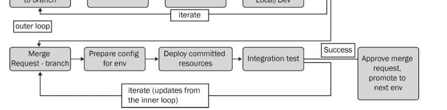
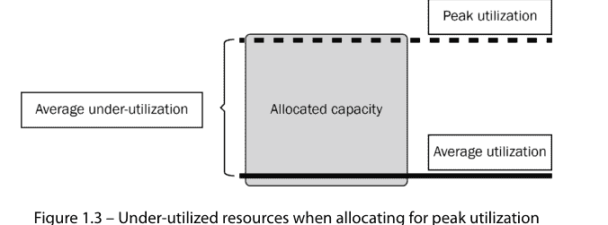

## 介绍 Google Cloud Build

要正确介绍 Google Cloud Build 及其为用户提供的价值，了解自动化为 IT 组织在云基础设施配置和软件交付等常见工作流程中带来的价值非常重要。

自动化这些任务可能有助于提高组织的开发人员生产力；使用托管服务实现自动化可以在更低的运营成本下实现这种生产力，使个人和团队能够专注于手头的业务任务，而不是管理运行自动化的所有基础设施。处理 AI/ML 类型工作负载的自动化需求有所增加（https://cloud.google.com/architecture/mlops-continuous-delivery-and-automation-pipelines-in-machine-learning），这超出了典型的开发人员工作流程。本书将重点关注 Cloud Build 的开发人员自动化工作流程（即持续集成）方面。

在本章中，我们将通过此视角审视 Google Cloud Build，具体讨论以下内容：

- 自动化的价值
- 云出现之前
- 使用托管服务减少琐事
- 使用 Google Cloud Build 进行云原生自动化

### 技术要求

- 数据中心和基础设施概念
- 公有云概念
- 软件构建概念

## 自动化的价值

应用程序和服务的编译形式多种多样。代码最终成为打包的构件似乎很简单，但对于许多场景，构建可能包含许多复杂步骤和依赖项。创建和测试构件所涉及的步骤可能是手动的、自动化的，或两者结合形成构建流水线。以下图表展示了一个示例构建流水线，其中包含构建应用程序的关键活动：

图 1.1 – 示例构建流水线

手动运行这些构建可能会导致粗心的错误，结果可能不一致或不可重复。在构建代码时，记录导致某事物正常工作而不是不工作的构建中甚至最小的更改非常重要。这就是使用源代码管理系统（SCM），例如 Git（https://git-scm.com），在我们整体流水线中变得至关重要的原因。如果更改实际上是本地更改的构建步骤的结果，无法重复这一点可能会导致挫败感和生产力损失。

这对于将工作移交给同事尤其相关。让同事理解和调整构建中的一组手动步骤并不是对同事时间的良好利用，而他们本可以专注于手头的代码。组织中每个成员的时间都很宝贵，最好让个人专注于提高生产力。这可能发生在生产事故期间，此时最好将时间花在尝试修复事故的根本原因上，而不是分析如何实际构建代码。根据事故的影响，每一秒都可能对组织产生货币影响。在从简单的开发移交到生产事故的情况下，构建的自动化对这种情况非常有益。

想象一下，如果开发人员可以完全专注于代码开发，而不是分析手动步骤或难以执行的构建。组织可能已具备自动化，但为了最大化生产力，它必须对开发人员无缝。这可以采用以下形式：

- 编码标准
- 样板代码
- 如何使用流水线的蓝图

上述参考点也可适用于软件开发的内循环和外循环自动化。开发的内循环通常由开发人员进行本地开发。一旦在内循环中完成代码，就会创建合并请求以添加到集成分支。一旦在集成分支中合并，这就是典型构建流水线开始的地方：外循环。提供标准形式的起点本身可能不是自动化；然而，它可以被烘焙到配置文件中。它可能只是起点，一个基础，也能为开发人员应用特定偏好提供一定的灵活性。

图 1.2 – 示例内循环和外循环

围绕 Git 构建的工具和集成生态系统有助于推动版本控制的重要性，不仅限于源代码，还包括定义构建流水线的配置。GitOps（https://www.weave.works/blog/the-history-of-gitops）主要关注基础设施即代码（IaC），确保运行时环境以声明方式表示存储在 Git 中的配置。开发和运维团队中对 Git 工具的共同使用减少了入职的摩擦，这使得 GitOps 对于端到端自动化也至关重要。

自动化帮助该组织减少了端到端部署时间：https://cloud.google.com/customers/reeport/。

一旦自动化得到简化，拥有流水线的团队能够聚合指标，以便大规模确定改进领域。与每个开发人员手动执行构建相比，这是一项更易实现的工作。如前所述，组织的流水线也可能包含手动步骤。这些指标可以识别出可能自动化的手动步骤模式。减少手动步骤将提高流水线的效率，同时减少可能发生的潜在人为错误。可能存在无法自动化的手动步骤情况，但识别是关键，以便将来考虑或让团队专注于可以改进的其他步骤。

这可以减少开发人员的挫败感并提高团队整体生产力，这可以使组织受益如下：

- 更快交付功能
- 减少解决问题所需的时间
- 让团队专注于其他业务关键活动
- 为流水线的持续改进提供反馈

自动化的价值可以帮助组织在许多方面。虽然指标可以手动收集，但在自动化流水线中聚合时效果最明显。可以做出决策以确定对构建流水线最有效的更改。从 GitOps 等框架中收集的指标也可以帮助改进端到端流水线，而不仅仅是源代码编译的自动化。当组织可以使用指标进行数据驱动决策时，持续改进变得更容易实现。

## 云出现之前

市场上有一系列工具，从开源到闭源，从自管理到托管服务，支持构建流水线。流水线解决方案的可用性对于确保代码及时构建至关重要；否则，它可能会影响多个团队的生产力。组织可能有单独的团队负责维护执行构建流水线的解决方案。

### 确保资源充足

对于自管理解决方案，维护包括构成流水线基础设施的底层基础设施、操作系统、工具和库。规模也是构建流水线的因素；根据复杂性，组织可能同时进行多个并发构建。构建流水线至少需要计算、内存和磁盘来执行，通常在构建平台内称为工作器。构建流水线可能由多个作业、步骤或任务组成，以完成特定流水线的执行。工作器从构建平台分配任务以完成。工作器需要可用，以便分配任务并执行这些任务。与应用程序的容量规划和规模需求类似，必须为工作器规划足够的计算、内存、存储或任何其他资源。

必须有足够的硬件来处理高峰期的构建。高峰是一个重要话题，因为在数据中心场景中，硬件资源可能相当有限，因为获取和设置硬件需要时间。虚拟化等技术使我们能够过度配置计算资源，但在某些时候，如果我们的构建需求变得更苛刻，物理硬件将成为增长的瓶颈。虽然组织需要按高峰规模设计，但这也意味着构建并不总是持续在高峰运行以充分利用分配的资源。如前所述，虚拟化可能有助于在非高峰时段让其他工作负载消耗计算，但这可能需要在整个组织中进行大量协调工作。我们可能会剩下未充分利用和浪费的资源。

图 1.3 – 为峰值利用率分配资源时未充分利用的资源

## 谁需要管理这一切？

通常，一个团队会在组织内部维护和管理构建基础设施。该团队可能致力于确保环境可用、资源保持最新，并添加新功能以支持组织需求。需求可能来自各个方向，例如开发人员、运维人员、平台管理员和基础设施管理员。市场上的不同构建和流水线工具通过提供插件和扩展来扩展功能，从而在一定程度上促进了这一过程。例如，在撰写本书时，Jenkins 拥有社区贡献的 1,800 多个插件（https://plugins.jenkins.io/）。虽然数量相当可观，但这也意味着团队必须确保插件得到更新并跟上插件的生命周期。例如，如果插件不再维护，替代方案是什么？如果多个插件执行相似功能，应该选择哪一个？丰富的社区是有益的，因为热门插件会脱颖而出，可能获得更好的支持。

如前所述，生产力会受到影响，如果容量不足或构建基础设施配置不当，可能导致构建变慢。构建各不相同；对某些构建而言可能只需几秒钟，而对另一些构建而言可能需要数小时。对于耗时数小时或较长时间的构建，这意味着开发人员以及许多下游团队都在等待。仅仅因为构建成功提交，并不意味着它也会成功完成；它可能在构建的任何阶段失败，导致时间浪费。

负责管理构建基础设施的团队可能还负责向系统用户维护**服务等级协议 (SLA)**。解决方案的设计也可能由另一个团队完成。如前所述，如果构建未运行，可能存在成本，因为它会影响开发人员的生产力、延迟产品发布或延迟向系统推送关键补丁。在自行管理解决方案时需要考虑这一点。在云出现之前，这在很大程度上是行业的常态，在本地企业中，厂商开发了工具和平台来减轻基础设施管理的负担。**托管服务提供商 (MSPs)** 也提供了工具层来帮助组织管理计算资源，但组织仍需考虑正在启动或关闭的资源。

安全是一个需要考虑的关键因素，当组织需要在基础设施之上或整个堆栈之上管理自己的软件组件时。不仅是所构建代码本身的漏洞，基础构建系统也需要得到安全维护。在过去几年中，一个重大的漏洞在所有行业中被暴露（https://orangematter.solarwinds.com/2021/05/07/an-investigative-update-of-the-cyberattack/）。

最终，当公共云资源可用时，可以使用许多类似的模式——在这种情况下，是云提供商提供的用于处理计算基础设施的**基础设施即服务 (IaaS)** 方案。这些减轻了处理计算资源的负担，但与 MSPs 类似，工作者的概念仍需确定和管理。

无论基础设施是在其数据中心本地管理、在托管设施中管理，还是由 IaaS 提供商管理，组织都必须处理构建软件流水线平台。确保平台可用并且工作者有足够的容量完成相关任务至关重要。在许多组织中，这由专门管理基础设施的团队或身兼数职以确保构建平台正常运行的团队负责。

## 使用托管服务减少琐事

在上一节中，我们讨论了维护用于构建应用程序和服务的平台所涉及的工作。确保环境始终正常运行所描述的许多活动可能涉及一些琐事。例如，Google 的 SRE 手册（https://sre.google/sre-book/eliminating-toil/）进一步深入探讨了可被视为琐事的 IT 任务要素。

如果我们能够避免琐事并知道提供商管理着基础构建基础设施，我们就能专注于更重要的事情，即推动我们业务的应用程序。这托管服务的目标之一，让提供商处理底层细节，提供成为团队间通用语言的一致语法，根据需要提供计算资源，并在服务未使用时不计费。

由于提供商维护着底层基础设施，并且能够在任何需要时为团队提供扩展能力，因此构建流水线中需要考虑的组件就少了一个。MSP 将负责确保有足够的工作者来执行构建流水线中的所有作业。然而，托管服务也可能被视为对特定厂商或云提供商的锁定形式。在大多数情况下，托管服务通常与提供商提供的服务具有最佳集成。在此基础上，添加额外功能会更加简化，但不限于以下内容：

- 触发机制
- 密钥管理
- 保护集成服务之间通信和数据传输的安全
- 可观测性

这些集成旨在节省时间，并参照本书的原始主题，让组织专注于手头的应用程序。尽管前一节中提到了重要主题，但在选择托管服务时，托管服务提供灵活性以及集成第三方特定功能的方式的重要性也很重要。

如前所述，如果组织选择自行管理构建解决方案，他们可能负责平台的可用性。在托管服务的情况下，提供商负责可用性，并可能与其服务的客户建立 SLA。客户必须自行判断所传达的 SLA 是否对业务可接受。

提供商提供的托管服务减少了保持构建平台正常运行所需的琐事量。它们使组织的团队能够专注于关键业务功能或创收活动。在本地部署的情况下，无需等待硬件采购或设置，可实现最大程度的业务灵活性。提供商将负责确保平台保持最新，并允许组织内快速发展的团队尝试更新的功能。

## 使用 Google Cloud Build 实现云原生自动化

这就引出了 Cloud Build，这是一款 Google Cloud 提供的无服务器平台。这意味着团队无需负责维护、扩展工作者或确保平台的可用性。Cloud Build 也是托管服务，因为 Google Cloud 负责确保服务对客户可用。这使组织能够纯粹专注于其应用程序代码和构建流水线配置。Google Cloud 负责根据需要扩展平台，计费按构建分钟计价（https://cloud.google.com/build/pricing）。

Cloud Build 利用了 Google Cloud 的固有安全性，其中 API 仅可由获得授权的个人和自动化系统访问。由于 Cloud Build 是一个无服务器平台，这将在整本书中成为一个常见主题。我们能够利用 Google Cloud 在安全、计算资源、集成以及用于访问平台的 API 和语言特定客户端 SDK 等方面的优势。

如前几节所述，工作者处理构建流水线中的步骤（或作业），而 Cloud Build 负责确保有工作者可用以完成整个流水线。Cloud Build 提供不同类型的 worker，称为默认池和私有池。在默认池中，worker 由 Google 主持，对最终用户不可见。构建运行时，它可以访问公共互联网，但无法访问私有托管资源。根据您需要的构建情况，这可能已足够。然而，如果在构建过程中需要访问私有网络上的资源，例如依赖项、本地化数据集、更高的并发限制、更多机器类型配置或与私有环境的集成测试，则选项将是私有

池。私有池允许通过 **Google 云平台 (GCP)** **虚拟私有云 (VPC)** 对等连接功能连接到私有网络。以下是默认池和私有池功能对比表：

| 功能 | 默认池 | 私有池 |
|---|---|---|
| 完全托管 | ✓ | ✓ |
| 按构建分钟计费 | ✓ | ✓ |
| 自动扩缩容，可缩至 0 | ✓ | ✓ |
| 访问公网 | ✓ | 可配置 |
| 通过 VPC 或共享 VPC 对等连接访问私有资源 | ⛔ | ✓ |
| VPC Service Controls 支持 | ⛔ | ✓ |
| 静态 IP 范围 | ⛔ | ✓ |
| 可禁用公网 IP | ⛔ | ✓ |
| 最大并发构建数 | 30 | 100+ |
| 机器类型 | 5 | 15 |
| 区域 | 全球 | 25 |

图 1.4 – 默认池与私有池功能对比

图中数据截至 2022-06-16 为最新（ https://cloud.google.com/build/docs/private-pools/private-pools-overview）。

Cloud Build 配置中的步骤通常保持不变，无论选择的池类型是默认池还是私有池。

在 Cloud Build 中，单个 worker 负责处理流水线中的所有步骤。worker 和机器类型（计算、内存和存储）可以配置，为每个构建过程提供灵活性，具体取决于关键程度。将构建过程暴露给资源更多的机器可能允许更快的构建，尤其是在机器资源被识别为较慢构建的瓶颈时。

这是 Cloud Build 中无服务器平台的一个显著优势，其中选项以配置选项的形式定义。Google Cloud 有责任根据有效配置中指定的内容提供资源。通过根据流水线要求为 worker 指定不同的机器类型，团队可以获得云的灵活性。

如果您还记得 Jenkins 的示例（在 *谁需要管理这一切？* 部分），它提供插件来添加集成或功能以完成流水线。在 Cloud Build 的情况下，每个单独的步骤都由一个名为 **云构建器** 的容器镜像组成。这提供了大量的灵活性，因为它允许使用 Google Cloud 提供的构建器、社区开发的构建器或自定义构建器，后者可以是在内部创建的容器镜像。这些自定义构建器可以是执行脚本或二进制文件的任何容器镜像，然后可作为构建步骤纳入。

组织可能会对代码的驻留位置施加不同的限制；例如，代码可能不驻留在开发人员的 workstation 上，只能驻留在组织维护的 SCM 系统上。Cloud Build 可以与私有托管的/非 GCP 解决方案集成，例如 GitHub Enterprise。通过使用私有池，构建的 worker 可以与私有网络内的资源交互。这非常重要，因为它使 Cloud Build 能够支持组织可能拥有的许多不同场景。

本章前面我们讨论了自动化的价值，其中包括构建步骤的自动化，以及构建本身如何被触发。触发构建可以基于使用 Cloud Scheduler 的 cron 调度（https://cloud.google.com/build/docs/automating-builds/create-scheduled-triggers）、通过 Cloud Pub/Sub 的异步消息（https://cloud.google.com/build/docs/automating-builds/create-pubsub-triggers）以及 webhooks，但通常由代码提交到 SCM 系统驱动。Webhooks 打开了许多其他选项的大门；例如，构建也可以通过现有工具的 API 或 CLI 调用触发。这使得与现有组件的集成和自动化成为可能。

## GCP 服务集成

与现有组件的集成至关重要，但 Cloud Build 的另一个优势是其与 Google Cloud 服务的原生集成：

- **Artifact Registry** – 存储构建产物（即特定语言的、容器镜像）：https://cloud.google.com/artifact-registry/docs/configure-cloud-build.
- **Secret Manager** – 原生管理敏感信息：https://cloud.google.com/build/docs/securing-builds/use-secrets.
- **VPC Service Controls** – 用于防止数据外泄的机制，例如构建可以从何处触发，或要求仅使用私有池的策略：https://cloud.google.com/build/docs/private-pools/using-vpc-service-controls.
- **Binary Authorization**（预览版） – 在构建时使用提供的 attestor 对镜像进行签名证明：https://cloud.google.com/build/docs/securing-builds/use-provenance-and-binary-authorization.

如果您还记得前面提到过，Cloud Build worker 负责执行配置流水线中指定的步骤。该 worker 的身份由一个名为 **服务账号** 的 GCP 资源建立。Cloud Build 有一个默认的服务账号供其使用，或者也可以指定用户指定的服务账号。

本书重点关注 Cloud Build 的构建方面，使用 Cloud Build 时构建的资源并不总是需要部署。然而，Cloud Build 还提供了与指令和镜像的集成，以便将构建的容器镜像部署到 GCP 运行时平台，例如以下内容：

- Google Kubernetes Engine
- Anthos-enabled clusters
- Cloud Run
- App Engine
- Cloud Functions
- Firebase

组织能够使用 Cloud Build 进行代码构建和 IaC 自动化能力，以为其团队提供更多自主权。一个示例在此处说明：https://cloud.google.com/customers/loveholidays.

作为无服务器平台，了解构建发生的情况非常重要。审计日志和构建日志默认存储在 GCP 的 Cloud Logging 服务中。审计日志涵盖对 Cloud Build 服务的 API 调用，例如创建和取消。实际的构建日志默认存储在 Cloud Logging 和 Google 创建的 Cloud Storage 存储桶中。Cloud Build 的日志可以配置为 GCP 内的您选择的存储位置（即仅 Google Cloud Storage、仅 Cloud Logging，或其他项目中的日志存储桶）。

Cloud Build 作为无服务器平台，也提供 SLA。与 GCP 服务一样，Cloud Build 的月度正常运行时间百分比为 99.95%（本书撰写时 – https://cloud.google.com/build/sla）。这被记为服务等级目标（SLO）。请参阅上一个链接以获取有关 SLA 的更多详细信息。对于云提供商提供的服务，这是衡量服务可靠性的重要指标。如前一节所述，如果团队负责管理构建基础设施，他们也需要提供可靠性指标。构建的解决方案通常需要设计、实现和测试以满足提供的指标。在提供 SLA 的 GCP 及其适用服务中，GCP 作为服务提供商承担此责任。

组织已从必须管理自己的基础设施和自己的流水线软件中走了很远。服务提供商提供了一种方式，使基础设施在他们的数据中心中得到管理，从而卸载硬件、操作系统，有时甚至是构建流水线平台本身的管理。下一个迭代是无服务器，这就是我们一直在谈论的，其中只是一个为客户端使用的 API。定义您期望的配置并以您期望的机制和语言执行 API。

Cloud Build 是一个无服务器构建流水线平台，允许组织专注于手头的代码。Google Cloud 负责确保平台在需要时可用，并且为 worker 提供足够的计算资源。每个步骤以容器镜像表示，为处理流水线需求提供了最大的灵活性。

### 摘要

到目前为止，我们已介绍构建流水线自动化如何使我们的生活更轻松，同时可能防止出错。元数据和指标可以帮助我们做出数据驱动的决策，使流水线更高效。构建平台需要有人管理，无论是 IT 团队、外包团队，还是云提供商管理的服务。如果由他人管理，可能让我们更专注于业务需求而非流水线平台需求。Cloud Build 是一个无服务器平台，通过使用容器镜像作为构建步骤为我们提供 worker 池的弹性和灵活性。

请继续关注后续章节，我们将深入探讨如何入门、Cloud Build 功能的更详细内容，并通过几个场景的示例进行演示。

在下一章中，我们将重点介绍如何设置 Cloud Build 环境。

