## 配置 Cloud Build 工作器

在讨论了自动化在行业中的一些背景以及 **Cloud Build** 在其中的定位之后，让我们深入了解 Cloud Build 的实现细节。我们将从 Cloud Build 工作器开始——执行您构建的机器。

构建可以自动化的内容和所能完成的工作多种多样。它们可以定义一系列步骤来测试源代码并将其翻译成可执行二进制文件。它们可以定义要创建、更新或拆除的若干云基础设施资源。它们可以从各种外部系统（如基于 Git 的存储库或容器注册表）读取和写入。它们可以为数据处理或 **机器学习 (ML)** 管道定义工作流。

编写 Cloud Build 构建时，每个步骤都在容器中运行，而该容器镜像可以由您构建并提供。如我们在上一章讨论的那样，运行构建步骤的这些容器镜像称为 **构建器**。

鉴于构建用例众多，了解如何配置这些构建运行的环境非常重要。这些构建对其执行环境可能有特定要求，包括以下内容：

- 特定数量的 **中央处理单元 (CPU)** 和内存资源
- 与在私有网络上运行的资源建立网络连接
- 由于合规或延迟需求，对特定区域的本地性要求

此执行环境运行在由 Google 完全管理的 **虚拟机 (VM)** 上，也称为 **工作池**。

在本章中，我们将回顾 Cloud Build 的架构以及您可以配置工作器以执行构建的各种方式，并带走以下主题的知识：

- Cloud Build 中工作池的配置方式
- 在工作池上运行构建的前提条件
- 使用默认池
- 使用私有池

### 技术要求

- 数据中心和基础设施概念
- 公有云概念
- 软件构建概念
- 网络概念

### 如何在 Cloud Build 中配置工作池

*托管服务* 一词在软件行业承担了大量工作，该术语对 *托管* 的定义因服务而异。因此，在使用任何托管服务时，了解架构中提供商与您用户之间的边界非常重要。Cloud Build 也不例外！

在 Cloud Build 中，工作器运行的架构取决于构建在哪个类型的工作池中执行。Cloud Build 中有两种类型的工作池，如下所述：

- **默认池**，这是以完全托管的工作器运行构建的最简单方式
- **私有池**，这些是完全托管的工作器，配置级别更高，包括与私有 **虚拟私有云 (VPC)** 网络的连接

尽管 Cloud Build 支持各种类型的工作池，但关键是要指出，无论使用哪种类型的工作池，构建在 Cloud Build 中运行的核心用户旅程旨在保持一致，无论是编写构建定义还是提交构建定义以供执行。在下面的图表中，我们可以看到 Cloud Build **应用程序编程接口 (API)** 应在所有工作池中保持一致：

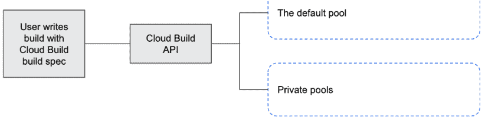

图 2.1 – 构建可在 Cloud Build 上在各种工作池类型上运行，最小化到无需更改

这意味着无论哪种类型的工作池执行您的构建，您指定构建外观的方式保持不变。我们将在后面的章节中深入回顾 Cloud Build 的构建规范，但首先让我们讨论在 Google Cloud Platform (GCP) 环境中开始使用 Cloud Build 的最低要求。

### 在工作池上运行构建的前提条件

开始使用 Cloud Build 时，了解其资源层次结构在您的 Google Cloud 环境中如何工作非常重要。Cloud Build 以及我们将讨论的各种工作池都限定在项目范围内。

您的 Google Cloud 项目将是包含您在使用 Cloud Build 时将利用的资源的顶级资源。在项目内，您可以利用身份和访问管理 (IAM) 创建用户帐户和服务帐户，以便您和其他人访问项目内的各种资源。为了确保您能够继续使用 Cloud Build 和以下示例，请确保您在 IAM 中为您的用户关联以下角色：

- Cloud Build 编辑器
- 网络管理员
- 日志管理员

这些角色将使您能够在 Google Cloud 中使用 Cloud Build 及其集成的服务，如下所示：

- Cloud Build，用于创建构建
- VPC，用于某些工作池的网络连接
- Cloud Logging，用于访问构建日志

这仅推荐用于沙箱环境。在后面的章节中，我们将回顾如何在应用最小权限原则的同时为 Cloud Build 利用 IAM。

使用 Cloud Build 时项目中使用的资源在下图中进行了总结：

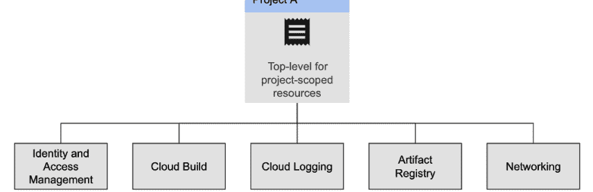

图 2.2 – 使用 Cloud Build 时通常使用的项目范围服务

在后面的章节中，我们将讨论如何将最小权限原则应用于 Cloud Build 及其相关服务，但现在，让我们继续前进。

为了能够在 Google Cloud 免费层之外启动资源，您还需要将 **结算帐号** 与您的项目关联。此帐户可以与多个项目关联。Cloud Build 的费用可在 https://cloud.google.com/build/pricing 找到。定价将根据使用的机器类型和工作池而有所不同；然而，这通常遵循 **美元 (USD)** $/构建分钟的模式，符合这些资源根据运行构建的量动态启动和停止的预期。下图显示了项目与结算帐号之间的关系：

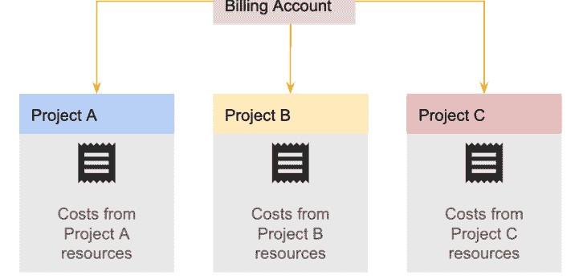

图 2.3 – 项目与结算帐号之间的关系

一旦您解决了项目、IAM 和结算帐号的问题，您将需要在项目中启用 Cloud Build 和服务网络 API。

对于本书中本例及所有后续示例，我们将使用 Cloud Shell，这是由 Google Cloud 提供的免费且临时的开发工作站。它运行一个 Debian 机器，已预装多个工具，包括 gcloud，即用于利用 Google Cloud 服务的 **命令行界面 (CLI)**。

打开 Cloud Shell (https://shell.cloud.google.com/) 并通过运行以下命令并按照响应中的说明进行身份验证，使用 gcloud 进行身份验证：

```
$ gcloud auth login
```

身份验证后，运行以下命令以启用使用 Cloud Build 和为私有池工作器配置网络所需的 API：

```
$ gcloud services enable cloudbuild.googleapis.com
servicenetworking.googleapis.com
```

在设置好 Google Cloud 项目后，让我们现在回顾工作池可以配置的各种方式！

### 使用默认池

在 2017 年的初始 **通用可用性 (GA)** 发布时，Cloud Build 被设计为为用户在 Google Cloud 中构建容器镜像和其他工件（如 Go 可执行文件或 Java 归档）提供简单界面和完全托管的体验。

> **注意**
> Cloud Build 最初于 2017 年以 **容器构建器** 的名称推出，凸显了其简单且专注的目的，即为终端用户提供自动化构建的方式。

从其诞生之日起，Cloud Build 旨在确保以下几点：

- 用户可以通过与 Google 的 API 或 **用户界面 (UI)** 交互来创建构建和构建触发器。
- 用户无需创建、修补、扩展或管理运行构建的工作器机器。
- 用户将拥有预先构建的日志记录和监控集成以 introspect 构建。

Cloud Build 首先通过为用户提供 Cloud Build 中工作器的第一种模式来实现此体验：**默认池**。

默认池的名称自然如此，因为它是 Cloud Build 为执行您的构建而配置工作器的默认方法。当向 Cloud Build 提交构建时，如果您未指定哪种类型

如果工作池应执行你的构建，它将在默认池中运行。此池在你启用 Cloud Build API 并具有执行构建的权限后即可使用。

此模式在可利用 Cloud Build 的各种方式中提供了最简单的用户体验（UX）。请考虑以下流程图，说明用户创建要在默认池中的 worker 上运行的构建时的情况：

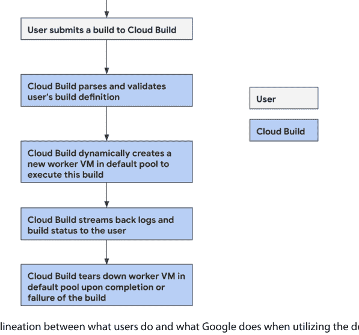

图 2.4 – 使用默认池时用户所做的工作与 Google 所做的工作之间的划分

用户主要关注其特定的构建步骤和要求，这确保他们的时间仅花费在希望实现的自动化上，而不会花费在管理将运行其构建的基础设施上。

Cloud Build 通过确保所有配置的基础设施都在 Google 拥有的环境中创建来实现此体验，在该环境中，Google 的工程师可以负责底层构建基础设施的配置、保护和管理。

Cloud Build 为每个构建配置一个专用 worker，其机器类型根据该构建的资源需求规范创建。如果未指定机器类型，则将使用默认机器类型，该类型使用一个虚拟 CPU（vCPU）和 4 千兆字节（GB）的内存。

> **注意**
> 
> Cloud Build 在项目级别针对构建的众多维度设置了配额和限制。
> 
> 最重要的限制之一是并发，即同时可以运行的构建数量。对于默认池，并发设置为给定项目中 30 个并发构建。对于私有池，你可以在给定的私有池中拥有多达 100 个并发构建，并且在给定项目中最多可拥有 10 个私有池。这意味着私有池在同时运行大量构建方面的并发限制要高得多。
> 
> 这基于项目中设置的默认限制；你可以在此处找到配额、限制和可能的例外情况的完整列表：`https://cloud.google.com/build/quotas`。

默认池将拥有与正在运行的构建数量一样多的 worker，确保每个构建都有一个隔离的环境来执行。如果同时运行许多具有资源需求的构建，单个默认池可能正在运行具有多种机器类型的 worker。以下图表显示了默认池架构：

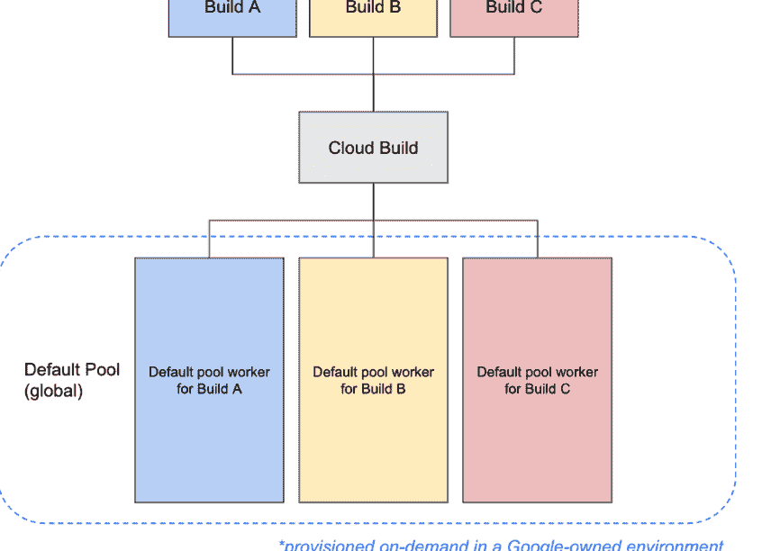

*按需在 Google 拥有的环境中配置

图 2.5 – 默认池架构

每个 worker 还配置了对公共互联网的出站访问。当你提交要在默认池中执行的构建时，可以配置以下内容：

- 构建将使用的 CPU 和内存
- 构建中所有构建步骤可用的存储

你通过为 worker 指定机器类型来分配 CPU 和内存资源。每种机器类型都有预定的 CPU 和内存量；你可以根据构建的计算需求在这些机器类型之间进行选择。截至发布时，默认池中可用的机器类型如下：

| 机器类型 | vCPUs | 内存 (GB) | 预热启动 | 默认 |
|---|---|---|---|---|
| E2-medium | 1 | 4 | 是 | 是 |
| E2-highcpu-8 | 8 | 8 | 否 | 否 |
| E2-highcpu-32 | 32 | 32 | 否 | 否 |
| N1-highcpu-8 | 8 | 8 | 否 | 否 |
| N1-highcpu-32 | 32 | 32 | 否 | 否 |

表 2.1 – 默认池机器类型及其各自的资源

至于存储，每个 worker 默认具有 100 GB 的网络连接固态硬盘（SSD）存储。用户可以在其构建配置中指定多达额外的 1,000 GB 网络连接 SSD 存储，我们将在后续章节中介绍。

> **注意**
> 
> 这些 worker 无法访问你在私有 VPC 网络中机器上的资源。话虽如此，Cloud Build worker 确实使用指定的服务账号运行，可以授予其权限通过 Google API 与项目中的资源交互，例如托管工件存储（如 Container Registry 和 Artifact Registry）。

要在 Cloud Build 默认池上开始运行构建，用户无需准备创建任何资源。相反，用户只需将构建定义提交给 Cloud Build，我们将在后续章节中介绍。

现在，让我们继续介绍 Cloud Build 中私有池的概念。

## 使用私有池

私有池与默认池类似，因为它们是完全托管的 worker，位于 Google 管理的环境中。私有池专为希望运行完全托管构建的、具有更复杂需求集的用户而设计，可帮助需要以下功能的用户：

- 在私有 VPC 网络上运行资源，该网络必须从构建中访问
- 关于机器类型的更多选择，例如高内存机器
- 进一步保护其构建环境的网络边界

与默认池不同，你可以在单个 Google Cloud 项目中拥有多个私有池。你创建空的私有池资源，其中包含私有池 worker 应是什么样子的定义，包括其机器类型和应连接的网络等详细信息。然后，当安排构建在其上运行时，Google 将把这些私有池从零 worker 扩展。

话虽如此，提交构建的最终用户的 workflow 保持一致，如下所示：

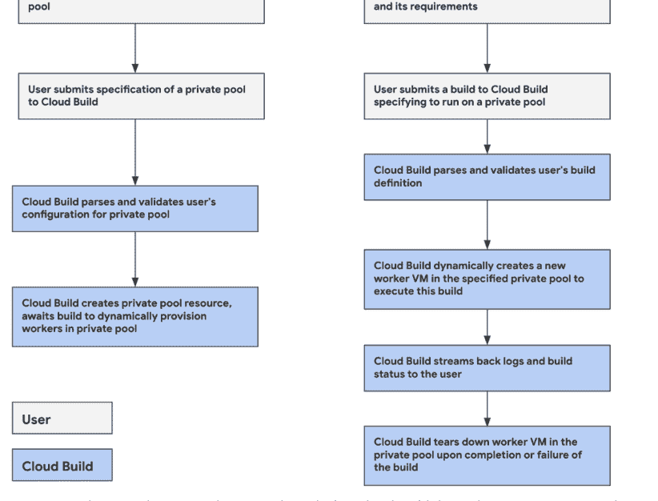

图 2.6 – 使用私有池时用户所做的工作与 Cloud Build 所做的工作之间的划分

架构本身与默认池略有不同。如前所述，你可以在单个项目中拥有多个私有池，每个私有池具有各种配置。保持不变的是，构建被隔离到其运行的私有池中的单个 worker 中。以下图表显示了私有池架构：

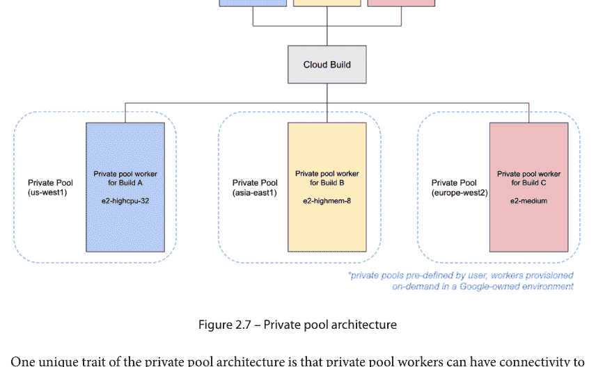

图 2.7 – 私有池架构

私有池架构的一个独特特征是，私有池 worker 可以连接到你在 Google Cloud 项目中的 VPC 网络。这种网络连接是通过私有池的架构实现的，其中 Google 拥有的环境利用所谓的 Service Producer 网络，在该网络中，这些 worker 被分配内部互联网协议（IP）地址。

你可以使用 Service Networking API 然后在该 Service Producer 网络与你自己的 VPC 之间创建对等连接，从而实现 worker 与你的私有 VPC 范围资源之间的网络连接，如下图所示：

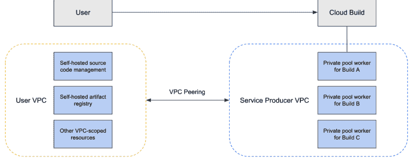

图 2.8 – 私有池网络架构

通过此网络功能，你不仅可以访问 VPC 内的资源，还可以访问可能驻留在本地并通过私有连接（如虚拟专用网络（VPN）隧道或 Direct Interconnect）连接到 VPC 的源代码管理系统和工件注册表。

除了可配置的网络外，私有池还允许用户指定其私有池和 worker 所在的特定 Google Cloud 区域。这与默认池形成对比，默认池在 worker 上执行，该 worker 可以根据资源可用性在全球多个区域运行。

截至发布时，私有池可以在以下区域创建：

- 亚洲：
  - asia-east1（台湾）
  - asia-east2（香港）
  - asia-northeast1（东京）
  - asia-northeast2（大阪）
  - asia-northeast3（首尔）
  - asia-south1（孟买）
  - asia-south2（德里）
  - asia-southeast1（新加坡）
  - asia-southeast2（雅加达）
- 澳大利亚：
  - australia-southeast1（悉尼）
  - australia-southeast2（墨尔本）
- 欧洲：
  - europe-central2（华沙）
  - europe-north1（芬兰）
  - europe-west1（比利时）
  - europe-west2（伦敦）
  - europe-west3（法兰克福）
  - europe-west4（荷兰）
  - europe-west6（苏黎世）
- 北美：
  - northamerica-northeast1（魁北克）
  - northamerica-northeast2（多伦多）
  - us-central1（爱荷华）
  - us-east1（南卡罗来纳）
  - us-east4（弗吉尼亚）
  - us-west1（俄勒冈）
  - us-west2（洛杉矶）
  - us-west3（盐湖城）
  - us-west4（拉斯维加斯）
- 南美：
  - southamerica-east1（圣保罗）
  - southamerica-west1（圣地亚哥）

私有池还扩展了可为 worker 指定的机器类型集合。可用机器类型如下所示：

| 机器类型 | vCPU | 内存 (GB) | 预热启动 | 默认 |
|---|---|---|---|---|
| E2-medium | 1 | 4 | 否 | 是 |
| E2-standard-2 | 2 | 8 | 否 | 否 |
| E2-standard-4 | 4 | 16 | 否 | 否 |
| E2-standard-8 | 8 | 32 | 否 | 否 |
| E2-standard-16 | 16 | 64 | 否 | 否 |
| E2-standard-32 | 32 | 128 | 否 | 否 |
| E2-highmem-2 | 2 | 16 | 否 | 否 |
| E2-highmem-4 | 4 | 32 | 否 | 否 |
| E2-highmem-8 | 8 | 64 | 否 | 否 |
| E2-highmem-16 | 16 | 128 | 否 | 否 |
| E2-highmem-32 | 32 | 256 | 否 | 否 |
| E2-highcpu-2 | 2 | 2 | 否 | 否 |
| E2-highcpu-4 | 4 | 4 | 否 | 否 |
| E2-highcpu-8 | 8 | 8 | 否 | 否 |
| E2-highcpu-16 | 16 | 16 | 否 | 否 |
| E2-highcpu-32 | 32 | 32 | 否 | 否 |

表 2.2 – 私有池机器类型及其各自资源

虽然私有池保持了默认池提供的相同完全托管体验，但私有池必须在实际构建执行之前创建。让我们通过创建私有池来回顾如何实现这一点。

首先，为了演示私有池提供的一些网络功能，我们应该创建一个沙箱 VPC，以便与托管您私有池的 Google 拥有环境进行对等连接。以下是我们为实现此目的所需的代码：

```
$ project_id=$(gcloud config get-value project)

$ vpc_name=packt-cloudbuild-sandbox-vpc

$ vpc_range_name=packt-cloudbuild-sandbox-vpc-peering-range

$ gcloud compute networks create $vpc_name --subnet-mode=custom
```

一旦 VPC 创建完成，接下来，创建一个不与 VPC 中任何 IP 空间重叠的 IP 范围，可用于私有池中工作器的内部 IP。

在以下示例中，您将使用 192.168.0.0/16 空间，如 addresses 和 prefix-length 参数所定义。请注意，您的范围大小将决定此私有池中可以拥有的工作器数量：

```
$ gcloud compute addresses create packt-cloudbuild-sandbox-vpc-peering-range \
    --global \
    --purpose=VPC_PEERING \
    --addresses=192.168.0.0 \
    --prefix-length=16 \
    --description="IP range for private pool workers" \
    --network=$vpc_name
```

最后，使用以下 gcloud 命令创建 VPC 对等连接；这将引用您希望将 VPC 与私有池工作器所在的服务生产者网络 VPC 进行对等连接：

```
$ gcloud services vpc-peerings connect \
    --service=servicenetworking.googleapis.com \
    --ranges=$vpc_range_name \
    --network=$vpc_name \
    --project=$project_id
```

现在我们已经配置了私有池可以连接到的 VPC，让我们自己创建一个私有池。目前有几种方法可以实现，如下所述：

- 通过 Cloud 控制台
- 通过向 gcloud 传递基于 YAML Ain’t Markup Language (YAML) 的配置文件
- 通过直接向 gcloud 传递配置

私有池中可用的一些配置与您能够在默认池中配置的相似，具体如下：

- 每个工作器的机器类型，尽管可用的机器类型更多
- 每个工作器的网络附加 SSD，最多 1,000 GB

然而，您还会注意到一些新的配置选项，如下所述：

- 对等网络，用于指定私有池中的工作器将与之对等的 VPC
- 区域，因为私有池及其中的工作器限定于单个区域
- 公共出站，因为您可以指定私有池中的工作器是否具有公共 IP 地址

现在让我们通过使用 gcloud 并直接传递配置来创建私有池，从而演示私有池的一些功能。在此情况下，我们将创建一群具有 e2-standard-2 机器类型、100 GB 网络附加 SSD 且位于 us-west1 的工作器私有池。代码如下所示：

```
$ gcloud builds worker-pools create packt-cloudbuild-privatepool \
  --project=$project_id \
  --region=us-west1 \
  --peer-network=projects/$project_id/global/networks/$vpc_name \
  --worker-machine-type=e2-standard-2 \
  --worker-disk-size=100GB \
  --no-public-egress
```

一旦私有池实际创建完成，我们可以在 Cloud 控制台中查看它，如以下屏幕截图所示：

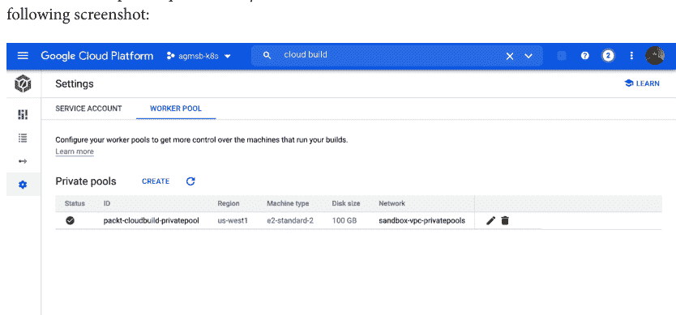

图 2.9 – 在 Cloud 控制台中查看之前创建的私有池

创建完成后，我们就可以开始在私有池定义的工作器上运行构建。

### 摘要

本章中，我们讨论了如何在您的 Google Cloud 项目中开始启用 Cloud Build，以及如何导航创建用于执行构建的工作器的多种方式。

具体来说，我们回顾了默认池和私有池的架构。我们还讨论了创建私有池的用户要求。

在下一章中，我们将继续回顾 Cloud Build 中构建的规范并运行您的第一个构建！

## 开始使用 – 我可以获得哪些构建信息？

作为一项托管服务，Cloud Build 允许个人和组织专注于构建管道中的步骤。尽管它是托管的，了解构建启动后会发生什么以及哪些资源可用于通过自动化方式或 **图形用户界面 (GUI)**（例如 Google Cloud 控制台）通过日志跟踪状态和查看进度仍然是很有益的。

本章将涵盖以下主题：

- 如何访问您的构建资源
- 构建提交和状态
- 使用 **Google Cloud Platform (GCP)** 控制台
- 构建操作

### 技术要求

- 软件构建概念和工具
- GCP 控制台熟悉度

### 如何访问您的构建资源

为了创建可重复且一致的构建，构建期间使用的文件和资源应可引用。最快且最简单的方法是当使用 **源代码管理 (SCM)** 工具时，可以通过不可变的提交标签引用它。这使我们基本上可以获得构建期间使用的文件的快照，因此如果需要再次运行，至少有一个恒定因素。

Cloud Build 需要一种获取构建文件的方式，这可以来自 SCM 工具。但是，如果构建文件位于文件系统上并且构建是由 `gcloud` **命令行界面 (CLI)** 命令启动的怎么办？在这种情况下，`gcloud` 将打包指定文件夹中的文件，如果存在则包括子文件夹。文件被打包成 tarball（gzipped 归档）并上传到 **Google Cloud Storage (GCS)**。然后 Cloud Build 将从 GCS 获取打包的文件并开始构建。

`gcloud` 命令还通过 `.gcloudignore` 文件为用户提供了灵活性，该文件使用与 `gitignore` 相同的语法 (https://git-scm.com/docs/gitignore)。如果未创建 `.gcloudignore` 文件，`gcloud` 可以根据顶级文件夹中的 `.gitignore` 文件生成一个。

无论是通过可以提供文件快照的 SCM，还是通过 `gcloud` 打包并上传到 GCS 的快照，我们始终会对每次运行的构建有一个参考点。如前所述，这对于追溯构建中包含的内容以进行审计和调试目的非常重要。Cloud Build `gcloud` 命令还允许用户在具有某些本地构建自动化时手动指定 gzipped 归档。

### 构建提交和状态

作为一项托管服务，Cloud Build 提供了多种启动构建的方法以实现最大灵活性。例如，它可以通过以下方式触发：

- 手动
- 通过其他工具自动
- 发布到 **发布/订阅 (Pub/Sub)** 的消息
- 按计划
- 推送到 SCM 系统的更改

触发器是 Cloud Build 中启动构建管道的机制；例如，这可以是 SCM 系统中源代码的更改或来自另一个系统的事件。触发器将在 *第 5 章，触发构建* 中更深入地介绍。

> **注意**
> 本章中的命令和输出仅用于说明性目的，以描述功能以及在适用情况下对输出的分析。其中一些命令可能需要在执行前配置先决条件。


首先，我们从一个简单的 cloudbuild.yaml 文件开始，其中包含两个步骤，用于构建 Docker 镜像并将其推送到 Artifact Registry。以下示例是 cloudbuild.yaml 文件的简化版本。片段可以在此处找到： https://github.com/GoogleCloudPlatform/cloud-build-samples/blob/main/basic-config/cloudbuild.yaml。请注意，GitHub 中的内容可能会随时间变化：

```
### Docker Build
- name: 'gcr.io/cloud-builders/docker'
  args: ['build', '-t',
    'us-central1-docker.pkg.dev/${PROJECT_ID}/image-repo/myimage',
    '.']

### Docker Push
- name: 'gcr.io/cloud-builders/docker'
  args: ['push',
    'us-central1-docker.pkg.dev/${PROJECT_ID}/image-repo/myimage']
```

在本章中，我们将重点关注手动方法，因为其他自动化机制将在后续章节中介绍。为了开始，最快启动构建的方式是通过 gcloud CLI 工具。Cloud Build 作为提供自动化平台的管理服务，能够抽象出构建执行所需管理资源和基础设施的需求。如第 2 章《Configuring Cloud Build Workers》中所述，私有池需要一些额外的配置，但配置中的步骤基本保持不变。以下命令将提交构建并包含当前路径及其子路径的内容：

```
$ gcloud builds submit
```

以下是上述命令的示例输出：

```
[1] Creating temporary tarball archive of 2 file(s) totalling 952 bytes before compression.
Uploading tarball of [..] to [gs://##project-id_redacted##_cloudbuild/source/1641339906.759161-f251af6f4c9745438a4730c3c6f94cd0.tgz]
[2] Created [https://cloudbuild.googleapis.com/v1/projects/##project-id_redacted##/locations/global/builds/ca6fd20f-7da3-447e-a213-7b542f9edb5c].
[3] Logs are available at [https://console.cloud.google.com/cloud-build/builds/ca6fd20f-7da3-447e-a213-7b542f9edb5c?project=##project-number_redacted##].
----------------------------------------------- REMOTE BUILD
OUTPUT -----------------------------------------------
starting build "ca6fd20f-7da3-447e-a213-7b542f9edb5c"

FETCHSOURCE

[4] Fetching storage object: gs://##project-id_redacted##_cloudbuild/source/1641339906.759161-f251af6f4c9745438a4730c3c6f94cd0.tgz#1641339907144359
Copying gs://##project-id_redacted##_cloudbuild/
source/1641339906.759161-f251af6f4c9745438a4730c3c6f94cd0.tgz#1641339907144359...
/ [1 files][  695.0 B/  695.0 B]
Operation completed over 1 objects/695.0 B.
BUILD

[5] Starting Step #0
...
Step #0: Successfully tagged us-central1-docker.pkg.dev/##project-id_redacted##/image-repo/myimage:latest
Finished Step #0
Starting Step #1
Step #1: Already have image (with digest): gcr.io/cloud-builders/docker
...
Finished Step #1
PUSH
DONE

------------------------------------------------
------------------------------------------------

ID: ca6fd20f-7da3-447e-a213-7b542f9edb5c
CREATE_TIME: 2022-01-04T23:45:07+00:00
DURATION: 9S
SOURCE: gs://##project-id_redacted##_cloudbuild/
source/1641339906.759161-f251af6f4c9745438a4730c3c6f94cd0.tgz
IMAGES: -
[6] STATUS: SUCCESS
```

下面将更详细地说明前面的输出（请注意，前面的数字是为说明目的而添加的；它们不在命令输出中）：

[1] 创建临时 tarball 归档然后上传到 GCS 的输出。这有两个目的，如下所述：

- 允许 Cloud Build 服务获取构建文件
- 为审计和调试提供构建文件的快照

[2] Cloud Build **全局唯一标识符 (GUID)** 唯一标识构建，也会以链接形式生成，以便从 Google Cloud 控制台 UI 访问构建。

[3] 一个链接，可从 Google Cloud 控制台 UI 访问构建日志。

[4] Cloud Build 获取由 `gcloud` 上传到 GCS 的归档文件。

[5] 构建从 `cloudbuild.yaml` 文件中指定的第一个步骤开始。

[6] 构建的最终状态。

手动使用 CLI 调用构建时，默认情况下是同步执行的，这意味着构建的输出会锁定在终端。终端提示符不会在构建成功完成或失败之前返回。如果用户选择退出构建（按 Ctrl + C），这也会取消构建。或者，您可以传入 `--async` 选项以排队构建并将用户返回到提示符。以下命令将列出构建及其状态：

```
$ gcloud builds list
```

以下是上述命令的示例输出：

```
ID: ca6fd20f-7da3-447e-a213-7b542f9edb5c
CREATE_TIME: 2022-01-04T23:45:07+00:00
DURATION: 9S
SOURCE: gs://##project-id_redacted##_cloudbuild/
source/1641339906.759161-f251af6f4c9745438a4730c3c6f94cd0.tgz
IMAGES: -
STATUS: SUCCESS

ID: 2522e42e-c31f-4b7a-98bc-404b441a5f2c
CREATE_TIME: 2022-01-04T23:38:44+00:00
DURATION: 1M50S
SOURCE: gs://##project-id_redacted##_cloudbuild/
source/1641339523.810603-97be6bc031b44b83bded5a6b0133e093.tgz
IMAGES:  -
STATUS:  FAILURE
```

前面的示例输出提供了项目中每个构建的简要摘要。使用构建提交或列表中的构建 ID，我们能够详细描述构建，如下所示：

```
$ gcloud builds describe ca6fd20f-7da3-447e-a213-7b542f9edb5c
```

以下是上述命令的示例输出：

```
createTime: '2022-01-04T23:45:07.383980674Z'
finishTime: '2022-01-04T23:45:17.496050Z'
id: ca6fd20f-7da3-447e-a213-7b542f9edb5c
logUrl: https://console.cloud.google.com/cloud-build/builds/ca6fd20f-7da3-447e-a213-7b542f9edb5c?project=##project-number_redacted##
logsBucket: gs://##project-number_redacted##.cloudbuild-logs.googleusercontent.com
name: projects/##project-number_redacted##/locations/global/builds/ca6fd20f-7da3-447e-a213-7b542f9edb5c
...
startTime: '2022-01-04T23:45:08.020795233Z'
status: SUCCESS
steps:
- args:
  - build
  - -t
  - us-central1-docker.pkg.dev/##project-id_redacted##/image-repo/myimage
  - .
name: gcr.io/cloud-builders/docker
pullTiming:
  endTime: '2022-01-04T23:45:13.814938454Z'
  startTime: '2022-01-04T23:45:13.811085177Z'
status: SUCCESS
timing:
  endTime: '2022-01-04T23:45:15.114544455Z'
  startTime: '2022-01-04T23:45:13.811085177Z'
...
timeout: 600s
timing:
  BUILD:
    endTime: '2022-01-04T23:45:17.020766002Z'
    startTime: '2022-01-04T23:45:13.227178424Z'
  FETCHSOURCE:
    endTime: '2022-01-04T23:45:13.227099439Z'
    startTime: '2022-01-04T23:45:08.417349649Z'
```

构建描述的输出提供了有关构建的详细信息以及每个步骤的详细信息，例如开始和停止时间。作为 gcloud 的一部分，输出可以以其他格式输出，例如 **JavaScript Object Notation (JSON)**，用于查询和汇总多个构建的输出。

有多种方式与 Cloud Build 交互。前面的示例中使用 gcloud 的场景来与 Cloud Build 交互，但也有其他方法，如下所述：

- **表述性状态转移 (REST) 应用程序编程接口 (API)** (https://cloud.google.com/build/docs/api/reference/rest)
- 客户端库 (https://cloud.google.com/build/docs/api/reference/libraries)

这有助于在尝试与现有工具、基础设施以及开发人员/操作员偏好集成时提供灵活性。Cloud Build 可以是 **端到端 (E2E)** 流水线，也可以仅在需要时参与特定步骤。

定义不同 worker 平台上流水线步骤的标准模式的简便性是关键，使组织能够更专注于其业务应用程序和服务，而非自动化平台本身。一旦提交构建，快速获取构建状态并在必要时进行审计和故障排除也非常重要。对于推送 Docker 镜像到 Artifact Registry 的构建，还提供了额外的审计元数据。该元数据称为构建出处，可包含源代码存储库、构建步骤和镜像路径。虽然它是元数据，但它还包含签名数据，可针对 Cloud Build 公钥进行验证以确保完整性，这有助于确保元数据未被篡改。此内容将在后续章节中介绍。仅仅因为服务是托管的，并不意味着在需要集成或解决问题时它应该是一个黑盒。

## 使用 GCP 控制台

与 CLI 或 API 交互对于自动化非常重要，但对于某些场景，能够以组织良好的方式在 UI 上快速获得高层级摘要也同样重要。Cloud Build 还具有 UI 功能，可执行某些操作，而无需与 API 交互。


Cloud Build 摘要 **Dashboard** 部分提供以下信息：

- 触发器的摘要
- 各自触发器的最新构建
- 按触发器筛选的构建历史
- 构建的平均持续时间
- 基于最近 20 次构建，通过和失败构建的百分比

如果项目配置了大量触发器或希望显示某些项目，触发器列表也可以按以下方式筛选：

- 触发器来源
- 触发器名称
- 触发器描述

还可以为应显示在列表顶部的触发器放置图钉。对于每个触发器，如果构建配置包含批准或拒绝步骤，则也可以在特定触发器的最新构建的 **Dashboard** 视图上执行此操作，如以下屏幕截图所示：

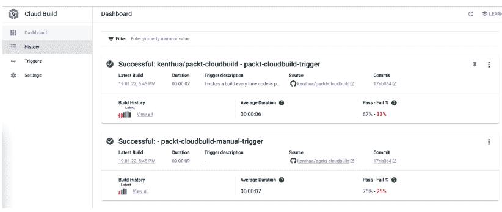

图 3.1 – 示例仪表板

可以通过 **History** 部分访问每个构建的列表，其中可以自定义列以显示所需信息。筛选器也可以用于仅显示具有特定元数据的特定构建，如以下屏幕截图所示：

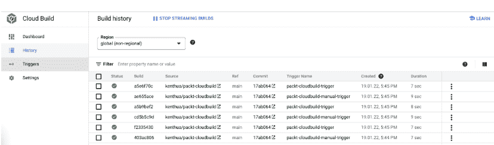

图 3.2 – 示例历史记录

触发器是 Cloud Build 中自动化构建的关键组件。UI 的这一部分允许创建触发器并设置将由触发器使用的 SCM 仓库，如以下屏幕截图所示：

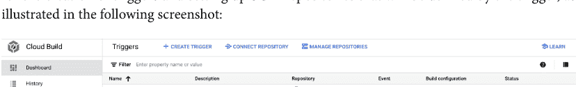

图 3.3 – 示例触发器

Cloud Build 支持许多 SCM 方案，从托管的公共仓库到私有仓库，例如 GitHub Enterprise。可以在以下屏幕截图中看到此示例：

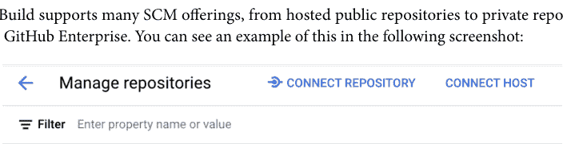

图 3.4 – 示例触发器：管理仓库

Cloud Build 托管服务的其他设置允许进行权限设置和管理私有池。

具体到权限，Cloud Build 使用默认服务账号，在此视图中，用户能够为特定云服务设置权限，范围从计算运行时到密钥存储。可以在以下屏幕截图中看到此示例：

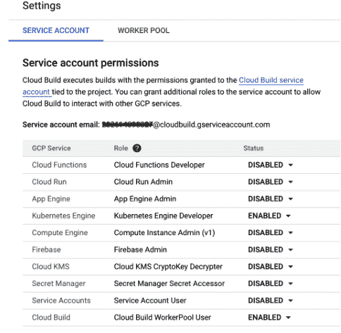

图 3.5 – 示例设置：服务账号

私有池的创建和详细信息也在 UI 上提供，如以下屏幕截图所示：

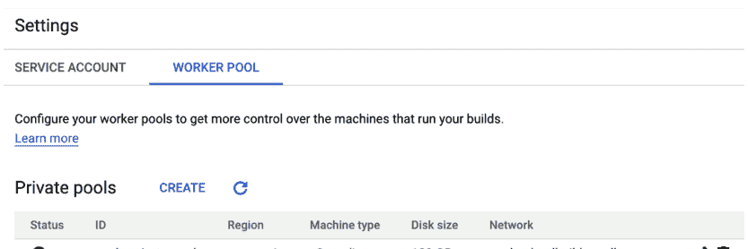

图 3.6 – 示例设置：工作池

GCP 控制台 UI 为用户与 Cloud Build 托管服务交互提供了另一种方式。对于刚开始使用或仅有少量构建的用户，仅集成 UI 可能是有意义的。然而，通过使用 CLI 和/或 API 集成，可以减少人为错误和重复。

## 构建操作

恭喜——我们已通过 CLI 提交了构建并在 UI 中导航以获取更多详细信息！在操作上，构建启动后我们可能想要做的事情相当多。以下是一些想法：

- 查看日志
- 查看构建历史
- 重新构建
- 查看审计日志
- 构建来源

让我们开始了解如何访问已启动的构建的日志。我们将继续使用 gcloud 的示例。利用构建的 ID，我们也可以检索构建的日志，如下所示：

```
$ gcloud builds log ca6fd20f-7da3-447e-a213-7b542f9edb5c
```

以下是前述命令的示例输出：

```
--------------------------------------------- REMOTE BUILD
OUTPUT -----------------------------------------------
starting build "ca6fd20f-7da3-447e-a213-7b542f9edb5c"

FETCHSOURCE
Fetching storage object: gs://##project-id_redacted##_cloudbuild/source/1641339906.759161-f251af6f4c9745438a4730c3c6f94cd0.tgz#1641339907144359
Copying gs://##project-id_redacted##_cloudbuild/source/1641339906.759161-f251af6f4c9745438a4730c3c6f94cd0.tgz#1641339907144359...
/ [1 files][ 695.0 B/ 695.0 B]
Operation completed over 1 objects/695.0 B.
BUILD
Starting Step #0
```

```
Step #0: Already have image (with digest): gcr.io/cloud-builders/docker
Step #0: Sending build context to Docker daemon  3.584kB
Step #0: Step 1/2 : FROM alpine
Step #0: latest: Pulling from library/alpine
Step #0: Digest: sha256:21a3deaa0d32a8057914f36584b5288d2e5ecc984380bc0118285c70fa8c9300
Step #0: Status: Downloaded newer image for alpine:latest
Step #0:  c059bfaa849c
Step #0: Step 2/2 : CMD ["echo", "Hello World!"]
Step #0:  Running in 35337ee2efec
Step #0: Removing intermediate container 35337ee2efec
Step #0:  1071be434322
Step #0: Successfully built 1071be434322
Step #0: Successfully tagged us-central1-docker.pkg.dev/##project-id_redacted##/image-repo/myimage:latest
Finished Step #0
Starting Step #1
...
Finished Step #1
PUSH
DONE
```

构建中每个步骤的日志输出有助于了解构建期间发生的情况，也有助于在必要时进行调试。了解发生的情况，结合每个步骤花费时间的详细信息，也有助于推动流水线步骤的优化。如果构建使用 --async 选项异步启动，我们可以使用 log 命令的 --stream 选项来实时查看日志输出。

日志也可以通过 GCP 控制台 UI 中的 Cloud Build 从构建历史记录中查看。对于每个构建，我们可以看到完整构建的日志，如以下屏幕截图所示：

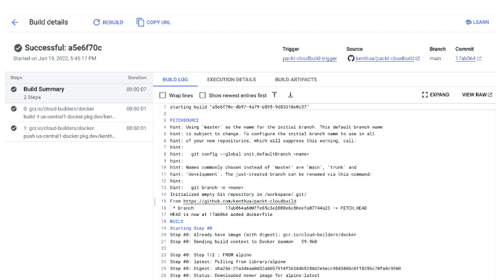

图 3.7 – 通过 GCP 控制台 UI 查看的示例整体构建日志输出：Cloud Build 视图

可以通过选择单个构建步骤来访问构建中特定构建步骤的日志，如以下屏幕截图所示：

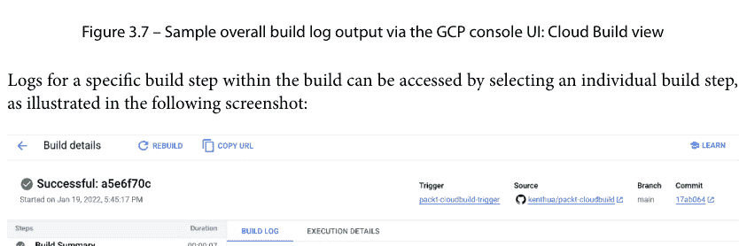

图 3.8 – 通过 GCP 控制台 UI 查看的示例单个构建步骤日志输出：Cloud Build 视图

原始日志也可以通过 GCP 控制台 UI 的 Cloud Logging 服务查看。请注意，在以下屏幕截图中，每个日志条目都包含日志数据的 textPayload，同时还包含将文本与构建关联的元数据（如 build_id）：

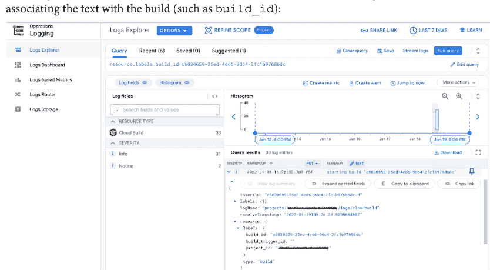

图 3.9 – 通过 GCP 控制台 UI 查看的示例整体构建日志输出：Cloud Logging 视图

重新构建也可以通过 GCP 控制台 UI 进行；它基于特定的提交或源工件。启动重新构建将使用原始源工件创建一个具有新构建 ID 的新构建。如果源工件导致构建失败，那么重新构建很可能仍会失败，因为它使用的是相同的资源。然而，如果构建在集成测试期间依赖于外部系统或构建的一部分的单独源文件，这可能会导致构建产生不同的行为。

审计日志对于了解谁对构建执行了某些操作（如创建、批准、更新）以及谁访问了构建元数据也至关重要。审计日志可通过 Cloud Logging 服务获得。Cloud Logging 服务可在 GCP 控制台上使用，也可通过 API（例如 REST API；软件开发工具包 (SDK)；CLI）使用。以下是使用 CLI 通过 gcloud 工具查看审计日志的示例：

```
$ gcloud logging read "logName:cloudaudit.googleapis.com%2Factivity AND \
resource.type=build"
```

以下是前述命令的示例输出：

```
insertId: 166b01hd1dvc
logName: projects/##project-id_redacted##/logs/cloudaudit.googleapis.com%2Factivity
operation:
  id: operations/build/##project-id_redacted##/
    YzYwMzA2NTktMjVlZC00ZWQ2LTlKyzQtMmZjMWI5NzY4NmRj
  last: true
  producer: cloudbuild.googleapis.com
protoPayload:
  '@type': type.googleapis.com/google.cloud.audit.AuditLog
  authenticationInfo:
    principalEmail: ##email_redacted##
  authorizationInfo:
  - granted: true
    permission: cloudbuild.builds.create
    resource: projects/00000041cd1ce997
    resourceAttributes: {}
  methodName: google.devtools.cloudbuild.v1.CloudBuild.CreateBuild
  requestMetadata:
    destinationAttributes: {}
    requestAttributes: {}
  resourceName: projects/##project-id_redacted##/builds
  serviceName: cloudbuild.googleapis.com
  status: {}
receiveTimestamp: '2022-01-19T00:26:46.102748864Z'
resource:
  labels:
    build_id: c6030659-25ed-4ed6-9dc4-2fc1b97686dc
    build_trigger_id: ''
    project_id: ##project-id_redacted##
  type: build
severity: NOTICE
timestamp: '2022-01-19T00:26:45.655472495Z'
```


虽然前面的文本是 CLI 的输出，但以下截图是可通过 GCP 控制台 UI 访问的审计日志的表示：

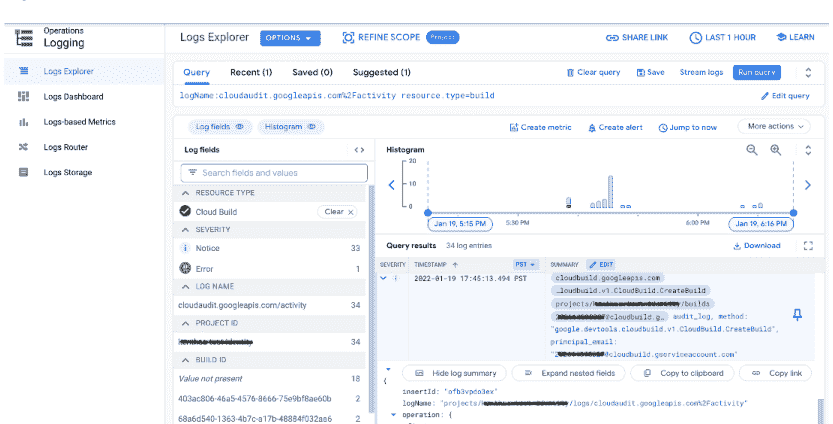

图 3.10 – 通过 GCP 控制台的示例输出审计日志

此审计日志可能具有信息价值，可为安全、运维和开发等不同团队提供谁（个人或自动化的服务账号）创建了构建的访问权限。您可以在以下链接查看 Cloud Build 可用的已审计操作列表，以更深入地了解 Cloud Build 的使用情况：https://cloud.google.com/build/docs/securing-builds/audit-logs#audited_operations。有关审计构建信息的构建来源将在 *第 6 章，管理环境安全* 中介绍。

The `gcloud logging read` command can also be used to view build logs as well as other GCP services.

启动构建对于使用 Cloud Build 至关重要，但了解还可以执行哪些其他操作或可获得何种类型的数据同样重要。

### 摘要

在提供有效的配置清单以及一些 Cloud Build 设置后，执行构建管道可以相当直接。托管服务负责幕后的配置验证、资源配置和构建本身的执行。由于它是一个托管服务，信息会被提供出来以通过各种方式向用户提供状态，无论是通过 GCP 控制台 UI 的视觉方式还是标准 API 集合。

请继续关注下一章，我们将深入探讨 Cloud Build 的清单配置。
