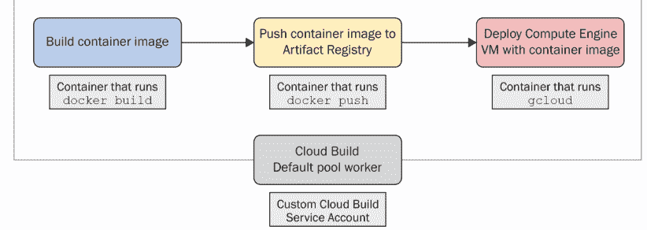
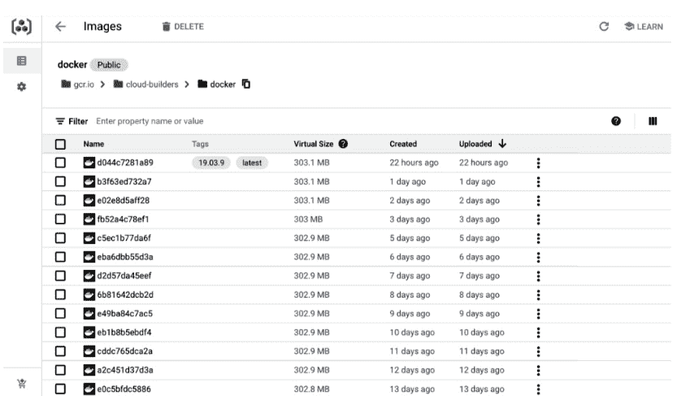
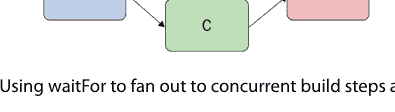
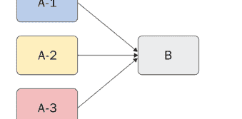

## 构建配置和架构

我们已经讨论了您可以在 Cloud Build 中运行的构建的多样性。作为用户，您能够定义构成构建中每个构建步骤的任务。

实现这一点的方式是根据特定于 Cloud Build 的声明式架构编写构建定义。此架构使您不仅可以定义各个构建步骤，还可以定义它们之间的顺序和关系，以及 Cloud Build 执行环境中的其他特定构建范围配置，例如超时或权限。

在本章中，我们将回顾以下主题：

- 定义构建步骤的最小配置
- 调整构建步骤的默认配置
- 定义各个构建步骤之间的关系
- 配置构建范围规范

### 定义构建步骤的最小配置

在 Cloud Build 中，构建是您作为用户将处理的首要资源。通常，构建是通过根据 Cloud Build 架构用 YAML 编写的配置文件定义的，尽管也支持 JSON。还有一些创建构建时不提供配置文件的例外情况，我们将在第 9 章《使用 Cloud Build 自动化无服务器》中回顾。

让我们回顾一下这些配置文件是什么样子的，从我们已经在一定程度上熟悉的构建开始。

### 设置环境

在上一章中，我们回顾了一个使用以下 `cloudbuild.yaml` 配置文件的简化版本的构建，该文件可在 https://github.com/GoogleCloudPlatform/cloud-build-samples/tree/main/basic-config 找到。

此构建配置文件定义了三个按顺序执行的独立构建步骤：

- 构建 Docker 容器镜像。
- 将 Docker 容器镜像推送到 **Artifact Registry** (https://cloud.google.com/artifact-registry)。
- 创建 **Compute Engine** (https://cloud.google.com/compute) VM 并将之前构建的容器镜像部署到新创建的 VM。

此外，我们可以在此处查看构建的可视化表示：



图 4.1 – 一个简单的构建，构建容器，将其推送到注册表，并在新 VM 上运行

Google Cloud Platform 的 GitHub 仓库中的内容可能会随时间变化，因此让我们创建自己的副本，以便运行本章中的构建练习所需的文件。让我们利用 **Cloud Shell** (`shell.cloud.google.com`)，这是 Google Cloud 提供的临时 Linux 工作站。

强烈建议您在沙箱或测试 Google Cloud 项目中运行这些练习，因为您不仅可以完全控制运行练习，还可以轻松清理创建的任何资源。

一旦在 Cloud Shell 中打开终端会话，请设置我们将传递给构建配置文件的环境变量：

```
$ PROJECT_ID=$(gcloud config get project)
```

```
$ SERVICE_ACCOUNT=packt-cloudbuild-chp4-sa
```

接下来，创建工作目录以存储本章构建练习的文件：

```
$ mkdir packt && cd packt && \
mkdir cloudbuild && cd cloudbuild && \
mkdir chapter4 && cd chapter4 && \
mkdir first-build && cd first-build
```

从上述构建创建第一个构建配置文件，该文件将构建容器镜像，将其推送到 Artifact Registry，并创建 VM 来运行容器镜像：

```
$ cat > cloudbuild.yaml <<EOF
steps:
  - name: 'gcr.io/cloud-builders/docker'
    args: ['build', '-t',
           'us-central1-docker.pkg.dev/${PROJECT_ID}/my-docker-repo/myimage',
           '.']
  - name: 'gcr.io/cloud-builders/docker'
    args: ['push',
           'us-central1-docker.pkg.dev/${PROJECT_ID}/my-docker-repo/myimage']
  - name: 'gcr.io/google.com/cloudsdktool/cloud-sdk'
    entrypoint: 'gcloud'
    timeout: 240s
    args: ['compute', 'instances',
           'create-with-container', 'my-vm-name',
           '--container-image',
           'us-central1-docker.pkg.dev/${PROJECT_ID}/my-docker-repo/myimage']
    env:
      - 'CLOUDSDK_COMPUTE_REGION=us-central1'
      - 'CLOUDSDK_COMPUTE_ZONE=us-central1-a'
serviceAccount: 'projects/${PROJECT_ID}/serviceAccounts/${SERVICE_ACCOUNT}@${PROJECT_ID}.iam.gserviceaccount.com'
images: ['us-central1-docker.pkg.dev/${PROJECT_ID}/my-docker-repo/myimage']
options:
  logging: CLOUD_LOGGING_ONLY

EOF
```

> **注意**
> 在处理容器镜像时，最佳实践是使用 `images` 字段指定您正在创建的镜像。这可启用诸如构建来源等功能，我们将在 *第 6 章，管理环境安全* 中讨论。
> 
> 对于在构建运行结束时推送容器镜像即可的简单构建，您可以省略构建此镜像的独立构建步骤，而只指定 `images` 字段。这样将提示 Cloud Build 在构建运行结束时推送该字段中的镜像。
> 
> 然而，在本示例中，由于我们正在创建运行新构建的容器镜像的 VM，因此我们仍然保留独立的构建步骤。

创建 Dockerfile 以用于在此构建中构建的容器镜像：

```
$ cat > Dockerfile <<EOF
FROM alpine
CMD ["echo", "Hello World!"]
EOF
```

在本书前面，我们简要提到构建利用来自 **Identity and Access Management (IAM)** 的 **Service Account** 来执行访问 Google Cloud API 的某些操作。对于本章，我们将创建一个临时服务账号：

```
$ gcloud iam service-accounts create packt-cloudbuild-chp4-sa \
--description="Temporary SA for chp 4 exercises" \
--display-name="packt-cloudbuild-chp4-sa"
```


现在，让我们为服务账号授予本章练习中构建执行所需的权限：

```
$ gcloud projects add-iam-policy-binding ${PROJECT_ID} \
  --member="serviceAccount:packt-cloudbuild-chp4-sa@${PROJECT_ID}.iam.gserviceaccount.com" \
  --role="roles/iam.serviceAccountUser" \
  --role="roles/cloudasset.owner" \
  --role="roles/storage.admin" \
  --role="roles/logging.logWriter" \
  --role="roles/artifactregistry.admin" \
  --role="roles/compute.admin"
```

现在我们已经拥有本章所需的文件和权限。现在，让我们在 Artifact Registry 中为本章将使用的容器镜像创建一个仓库：

```
$ gcloud artifacts repositories create my-docker-repo \
  --repository-format=Docker \
  --location us-central1
```

现在，你可以启动我们的第一个构建练习：

```
$ gcloud builds submit . --region=us-central1
```

在我们回顾的概念基础上调整构建文件并重新运行构建的机会将会出现。然而，由于再次运行 gcloud 创建 VM 会导致构建失败，因为 VM 已存在，因此在重新提交此构建到 Cloud Build 之前，请运行以下命令：

```
$ gcloud compute instances delete my-vm-name --zone=us-central1-a
```

完成此示例后，你可以使用以下命令删除所使用的服务账号：

```
$ gcloud iam service-accounts delete packt-cloudbuild-chp4-sa@${PROJECT_ID}.iam.gserviceaccount.com
```

现在设置已完成，让我们深入了解构建配置文件。此构建中的每个构建步骤都在自己的容器中运行，并且给定构建的所有构建步骤都在同一个 Cloud Build worker 上执行。

你的构建可能更复杂，包含的构建步骤比提供的示例更多，但构建步骤的定义方式与此示例保持一致。因此，让我们逐一拆解构建。

## 定义你的构建步骤容器镜像

让我们从顶层字段 `steps` 开始。此字段涵盖构成构建的所有构建步骤。示例中的三个构建步骤均由 `steps` 字段下的段落定义。

> **注意**
> 在撰写本文时，单个构建中最多可以有 100 个构建步骤。你可以在 https://cloud.google.com/build/quotas#resource_limits 处找到最新的限制。

在这些段落中的任何一个中，我们可以看到用户必须定义以指定单个构建步骤的字段。最少，我们需要定义以下两个字段：

- `name`
- `args`

这里，`name` 是一个字段，引用将运行你的构建步骤的构建器镜像的具体镜像路径。当你指定容器镜像时，你的 Cloud Build worker 将拉取该容器镜像并使用 `docker run` 运行其实例。

在前面的示例中，我们可以看到第一步和第二步都使用 `gcr.io/cloud-builders/docker` 镜像，而第三步使用 `gcr.io/google.com/cloudsdktool/cloud-sdk` 镜像。

请注意，要在上一章运行此构建，你实际上不需要自己构建这些镜像。相反，这些镜像是 Google 提供的托管的预构建容器镜像的一部分，其中包含 `docker` 或 `gcloud` 等常用工具。这些由 Google 提供的公开可用镜像称为 **cloud builders**（https://cloud.google.com/build/docs/cloud-builders）。

在撰写本文时，cloud builders 为以下工具提供预构建镜像：

- 通用构建器，例如 `wget`、`curl` 和 `git`
- 语言特定构建器，例如 `dotnet`、`go`、`mvn`、`javac`、`npm` 和 `yarn`
- Google Cloud 特定构建器，例如 `gcloud`、`gsutil`、`gcs-fetcher` 和 `gke-deploy`
- 容器和 Kubernetes 特定构建器，例如 `docker` 和 `kubectl`

由于这些 cloud builders 由 Google 公开提供，你实际上可以导航到镜像路径并查看 Google 已发布的该镜像的所有版本。例如，在浏览器中导航到 `gcr.io/cloud-builders/docker`：



图 4.2 – gcr.io/cloud-builders/docker 的 Google 发布容器镜像

如果你想自定义这些容器镜像，可以查看提供的源代码（https://github.com/GoogleCloudPlatform/cloud-builders）并构建这些镜像的自己的变体。对于每个构建器，你可以找到一个 Dockerfile 来定义 cloud builder 的容器镜像，以及一个 cloudbuild.yaml 文件来构建你自己的 cloud builder 版本。

如果单个构建步骤的用例未被提供的 cloud builder 镜像之一覆盖，你也可以使用 Cloud Build 社区提供的构建器（https://github.com/GoogleCloudPlatform/cloud-builders-community）。

这些数量远多于官方构建器，并且更新频率或所需维护的节奏各不相同，因为它们由社区拥有。一些更常用的社区贡献构建器包括以下内容：

- 容器和 Kubernetes 构建器，例如 `helm`、`kustomize`、`ko` 和 `pack`
- 基础设施即代码构建器，例如 `terraform`、`pulumi` 和 `terragrunt`
- 移动开发构建器，例如 `firebase` 和 `flutter`

与官方 cloud builders 类似，每个社区贡献的构建器都提供一个 Dockerfile，定义构建器容器镜像，以及一个 cloudbuild.yaml 配置文件，实际使用 Cloud Build 构建构建器容器镜像。

> **注意**
> 
> 如果你希望构建 cloud builder 镜像的自己的变体或构建社区提供的构建器之一，你需要将这些镜像托管在自己的仓库中，例如 Container Registry 或 Artifact Registry。你甚至可以使用 JFrog 的 Artifactory 等第三方制品库。
> 
> 在这样做时，最佳实践是使用容器镜像标签明确指定你希望为构建步骤运行的容器的版本。
> 
> 这将使你能够确保了解特定版本的容器镜像将如何运行你的构建。此外，它将确保你的构建不会因上游容器镜像的不可预见更改而中断。

最后，你可以利用托管在 **Docker Hub** 上的公开可用容器镜像用于构建步骤。我们将在 *调整构建步骤的默认配置* 部分稍后使用托管在 Docker Hub 上的镜像向我们的示例添加一个构建步骤。

现在我们已经回顾了如何使用 `name` 来定义构建步骤将使用的容器镜像，让我们谈谈如何使用 `id` 字段更明确地标识每个构建步骤。

在我们现有的 `cloudbuild.yaml` 文件中，我们没有为每个构建步骤提供除其执行的构建器镜像之外的标识符。如果在构建中多次重复使用相同的构建器镜像，这对于调试构建或筛选构建日志可能存在问题。

如果你导航到 `console.cloud.google.com/cloud-build/builds` 并访问你执行的构建，默认情况下，你会看到每个构建步骤都由其使用的构建器镜像标识：

| 步骤 | 持续时间 |
|---|---|
| **构建摘要** 3 个步骤 | 00:01:49 |
| 0: gcr.io/cloud-builders/docker build -t us-central1-docker.pkg.dev/agmsb-k8s/my-docker-repo/myima... | 00:00:02 |
| 1: gcr.io/cloud-builders/docker push us-central1-docker.pkg.dev/agmsb-k8s/my-docker-repo/myimage | 00:00:03 |
| 2: gcr.io/google.com/cloudsdktool/cloud-sdk gcloud compute instances create-with-container my-vm-name --contai... | 00:01:36 |

图 4.3 – 未为每个构建步骤定义 ID 字段时的构建步骤

利用 id 字段与 name 字段结合使用，我们可以为构建步骤单独提供一个对人类友好的标识符。运行带有构建步骤 ID 的相同构建将如下所示：

```
steps:
  - name: 'gcr.io/cloud-builders/docker'
    id: 'Docker Build'
    args: ['build', '-t',
        'us-central1-docker.pkg.dev/${PROJECT_ID}/my-docker-repo/myimage',
        '.']

  - name: 'gcr.io/cloud-builders/docker'
    id: 'Docker Push'
    args: ['push',
        'us-central1-docker.pkg.dev/${PROJECT_ID}/my-docker-repo/myimage']

  - name: 'gcr.io/google.com/cloudsdktool/cloud-sdk'
    id: 'Deploy container to VM'
    entrypoint: 'gcloud'
    timeout: 240s
    args: ['compute', 'instances',
        'create-with-container', 'my-vm-name',
        '--container-image',
        'us-central1-docker.pkg.dev/${PROJECT_ID}/my-docker-repo/myimage']
    env:
      - 'CLOUDSDK_COMPUTE_REGION=us-central1'
      - 'CLOUDSDK_COMPUTE_ZONE=us-central1-a'
```

如果你想亲自查看，欢迎使用不同的定义每个构建步骤 ID 的样式调整 cloudbuild.yaml 示例并重新运行构建。

现在，你可以利用这些构建步骤 ID 更轻松地识别每个步骤正在做什么。此外，你可以以实用方式使用它们，例如从 Cloud Logging 查询在多次构建运行中来自特定构建步骤的日志。


您可以通过访问 console.cloud.google.com/logs 并在日志浏览器中输入查询，例如以下查询，来搜索与构建步骤 ID 关联的日志，并筛选出 textPayload 中包含构建步骤 ID 的日志：

```
resource.type = "build"
textPayload =~ "Deploy container to VM"
```

此外，在 Cloud Build 控制台中，您可以看到每个构建步骤现在都由其 id 字段引用：

| 步骤 | 时长 |
|---|---|
| **构建摘要**
3 个步骤 | 00:01:32 |
| 0: Docker 构建
build -t us-central1-docker.pkg.dev/agmsb-k8s/my-docker-repo/myima... | 00:00:01 |
| 1: Docker 推送
push us-central1-docker.pkg.dev/agmsb-k8s/my-docker-repo/myimage | 00:00:03 |
| 2: 部署容器到 VM
gcloud compute instances create-with-container my-vm-name --contai... | 00:01:20 |

图 4.4 – 为每个构建步骤定义 ID 字段时的构建步骤

使用 id 字段对于在需要以复杂模式运行的情况下定义构建步骤之间的关系也至关重要，例如按特定顺序运行多个构建步骤。我们将在“定义各个构建步骤之间的关系”部分稍后回顾此内容。

现在我们已经回顾了如何在 name 字段中提供构建步骤将运行的镜像，以及如何使用 id 字段更好地标识构建步骤，让我们回顾 args 字段。

## 定义构建步骤参数

这里，args 是您提供给云构建器以在执行构建步骤任务时使用的参数的字段。

请注意，args 可以使用多种样式用 YAML 编写：

- 流式样式 (https://yaml.org/spec/1.2.2/#flow-sequences)
- 块式样式 (https://yaml.org/spec/1.2.2/#block-sequences)

在我们的示例构建配置中，每个构建步骤的 args 字段均以流式样式定义：

```
args: ['build',
    '-t',
    'us-central1-docker.pkg.dev/${PROJECT_ID}/my-docker-repo/myimage',
    '.']
```

对于较小的参数集，流式样式提供了一种简单且可读的方式来编写 args。您还可以为提高可读性而在流式样式中为每个项目换行。

然而，对于更大、更复杂的参数集，使用块式样式可能更容易编写。以下是以块式样式编写的来自前一个示例的同一组 args 字段：

```
args:
  - 'build'
  - '-t'
  - 'us-central1-docker.pkg.dev/${PROJECT_ID}/my-docker-repo/myimage'
  - '.'
```

随意使用不同样式定义 args 的 cloudbuild.yaml 示例进行调整并重新运行构建。

> 注意
> 
> 您为单个构建步骤提供的 args 最大数量为 100，且单个 args 字段中的字符总数上限为 4,000。

无论您以何种方式编写参数，都有两种使用 args 启动构建器执行任务的方法：

- 如果云构建器提供入口点，则 args 中的值将用作该入口点的参数。
- 如果云构建器未提供入口点，则 args 中的第一个值将用作云构建器的入口点，其余值用作参数。

让我们查看我们第一个和第二个构建步骤的构建器镜像。如果我们查看源 Dockerfile (https://github.com/GoogleCloudPlatform/cloud-builders/tree/master/docker)，我们可以看到容器镜像已定义了 ENTRYPOINT。由于 Google Cloud Platform 的 GitHub 仓库中的内容可能会随时间变化，我们还分享了以下 Dockerfile 的内容：

```
FROM gcr.io/gcp-runtimes/ubuntu_20_0_4
ARG DOCKER_VERSION=5:19.03.9~3-0~ubuntu-focal
RUN apt-get -y update && \
    apt-get -y install \
    apt-transport-https \
    ca-certificates \
    curl \
    make \
    software-properties-common && \
    curl -fsSL https://download.docker.com/linux/ubuntu/gpg | apt-key add - && \
    apt-key fingerprint 0EBFCD88 && \
    add-apt-repository \
    "deb [arch=amd64] https://download.docker.com/linux/ubuntu \
    $(lsb_release -cs) \
    edge" && \
    apt-get -y update && \
    apt-get -y install docker-ce=${DOCKER_VERSION} docker-ce-cli=${DOCKER_VERSION}
ENTRYPOINT ["/usr/bin/docker"]
```

在 Dockerfile 的最后一行，我们看到 ENTRYPOINT 定义为 ["/usr/bin/docker"]，这意味着云构建器将执行 Docker 二进制文件。由于情况如此，我们的第一个和第二个构建步骤提供参数以指示 Docker 构建容器镜像并将其推送到 Artifact Registry。

然而，情况并非如此，第三个构建步骤我们使用 gcr.io/google.com/cloudsdktool/cloud-sdk 构建器。在此构建步骤中，我们实际上使用 entrypoint 字段在我们的 cloudbuild.yaml 中定义入口点。这是因为用于构建构建器镜像的 Dockerfile 未定义入口点：

```
- name: 'gcr.io/google.com/cloudsdktool/cloud-sdk'
  entrypoint: 'gcloud'
```

您可以在配置文件中使用 entrypoint 字段出于两个主要原因：

- 如果构建器容器镜像未指定，则显式定义入口点
- 覆盖构建器容器镜像中定义的 ENTRYPOINT

在配置文件中定义入口点的最常见用例之一是能够将 shell 定义为入口点，然后将任意命令传递给 shell。

您可以按以下示例运行，其中使用块式 YAML 并将 '-c' 作为第一个参数传递，然后将多行字符串管道传输以运行其余的任意命令。

此示例采用 Python 3.9 的公共 Docker Hub 镜像并将其作为构建步骤运行，覆盖默认的 python3 CMD 以将入口点更改为 bash，同时在 shell 中运行一些命令：

```
$ cd .. && mkdir arbitrary-commands && cd arbitrary-commands
$ cat > cloudbuild.yaml <<EOF
steps:
  - name: 'python:3.9'
    id: 'Arbitrary commands in bash'
    entrypoint: 'bash'
    args:
      - '-c'
      - |
        pwd
        ls
        whoami
EOF
$ gcloud builds submit . --region=us-central1
```

构建日志中的输出应与 args 中定义的任意命令相匹配：

```
/workspace
cloudbuild.yaml
root
```

这在运行构建步骤时可以访问 shell 时增加了灵活性和可配置性。

现在我们已经回顾了 name、id、args 和 entrypoint 作为构建步骤运行的核心功能，让我们深入了解配置这些构建步骤的额外方法。

## 调整构建步骤的默认配置

除了定义构建步骤的容器镜像和参数之外，您可能还需要自定义其他配置，以便以特定方式执行该步骤中的任务。

这些可能是您希望在执行环境中设置的环境变量，使特定密钥可用于构建步骤，或在执行构建步骤的工作器上写入特定目录。

build step 段具有涵盖以下情况的附加字段：

- `env`
- `secretEnv`
- `timeout`
- `dir`

让我们从 env 字段开始 – 这提供了一种为执行任务的云构建器设置环境变量的方法。这提供了一种方式，让您提供多个可能希望传递到在构建步骤中运行任务的容器中的环境变量。

> **注意**
> 
> 有趣的是，`env` 和 `secretEnv` 不仅可以为单个构建步骤定义，还可以为构建中的所有构建步骤在全局级别定义。虽然我们将在 *配置构建范围规范* 部分回顾全局配置，但对于任何敏感信息，建议您在单个构建步骤级别配置这些值。

在我们示例的第三个构建步骤中，您可以看到我们定义 env 以包含两个不同的变量：

- `CLOUDSDK_COMPUTE_REGION=us-central1`
- `CLOUDSDK_COMPUTE_ZONE=us-central1-a`

鉴于我们的入口点正在运行 gcloud CLI，提前定义这些环境变量使 gcloud 能够使用这些属性已定义来引导。具体来说，已定义这些属性后，构建步骤能够在 us-central1-a 区域创建将运行容器镜像的 VM。

这代表了定义环境变量的典型用例 – 为构建步骤能够执行其任务做好环境准备。

如果我们想将凭据或密码投影到环境变量中，我们将改用 secretEnv。我们将在第 8 章《使用 Cloud Build 保护向 GKE 的软件交付》中更详细地回顾这一点。


不仅在我们的构建步骤段中看到了 `env` 的定义，我们还看到了 `timeout` 的定义。这个字段相当直接；你定义一个时间段，如果构建步骤在此期间未完成，它将使整个构建失败。

我们正在处理的示例中，创建 VM 的构建步骤的超时设置为 240 秒或 4 分钟。超时被定义为持续时间；如果未指定，默认单位为秒。然而，你可以通过小时 (h) 和分钟 (m) 指定额外的单位。

此外，你可以将多个时间单位组合成一个超时值。例如，`timeout: 2h10m45s` 为 2 小时、10 分钟和 45 秒。

> **Note**
> 在发布时，构建的最大超时为 24 小时。

如果存在已知依赖于调用不可靠外部系统或 API 的构建步骤，或者当你担心最小化成本时，超时在单个构建步骤级别很有用，因为构建按使用的 vCPU 构建分钟计价——尤其是在使用更大的工作器时。

与 `env` 和 `secretEnv` 类似，`timeout` 不仅可以为单个构建步骤定义，还可以为整个构建在全局级别定义，我们将在 *Configuring build-wide specifications* 部分对此进行回顾。

现在，让我们继续讨论 `dir` 字段。当构建执行时，默认情况下当前工作目录设置为 `/workspace`。默认情况下，这由挂载在此路径的 Docker 卷支持，相同的卷提供给每个运行的构建步骤：


图 4.5 – 每个构建步骤都将访问挂载在 /workspace 的相同卷

对于许多构建步骤，使用 `/workspace` 作为工作目录就足够了。然而，有些工具需要从特定的工作目录运行，也许是某些配置文件所在的位置，这些文件会传递给该工具。

以下是此类工具的几个示例：

- Skaffold (https://skaffold.dev/) 是一种 Kubernetes 持续开发工具，旨在让 Kubernetes 用户在本地环境以及软件交付管道中运行。为此，用户必须从包含 `skaffold.yaml` 配置文件的同一目录中执行 `skaffold` 二进制文件。
- Terraform (https://www.terraform.io/) 是一种基础设施即代码工具，旨在让用户使用一致的语言在多个基础设施提供商之间创建资源。通常，`terraform` CLI 应该从存在 `.tf` 配置文件的工作目录中执行，尽管它也支持传入 `--chdir` 作为参数，允许你更改工作目录。

对于这些场景，用户可以利用 `dir` 字段自动为特定构建步骤设置工作目录。使用 dir 有两个选项：

- 相对路径
- 绝对路径

将 `dir` 指定为相对路径是更常见的用例。让我们创建一个构建，继续我们在之前的构建中所做的工作，并在新的 `cloudbuild.yaml` 文件中运行几个构建步骤：

```
$ cd .. && mkdir generate-validate-terraform && cd generate-validate-terraform
$ PROJECT_ID=$(gcloud config get project)
$ ZONE=us-central1-a
$ cat > cloudbuild.yaml <<EOF
steps:
- name: 'gcr.io/google.com/cloudsdktool/cloud-sdk'
  id: 'Generate terraform for existing VMs'
  entrypoint: 'sh'
  args:
  - '-c'
  - |
    apt-get install google-cloud-sdk-config-connector
    gcloud beta resource-config bulk-export \
    --resource-format=terraform \
    --resource-types=ComputeInstance \
    --project=$PROJECT_ID \
    --path=tf
- name: 'hashicorp/terraform:1.0.0'
  id: 'Validate generated terraform'
  entrypoint: 'sh'
  args:
  - '-c'
  - |
    terraform init
    terraform validate
dir: 'tf/projects/agmsb-k8s/ComputeInstances/$ZONE'
serviceAccount: 'projects/${PROJECT_ID}/
serviceAccounts/${SERVICE_ACCOUNT}'
EOF
$ gcloud builds submit . --region=us-central1
```

此构建执行两件事：

- 首先，我们利用 **Cloud Asset Inventory** API 提供的功能，将我们刚刚创建的资源导出为有效的 Terraform 配置文件。具体来说，通过不定义 `dir`，我们使用 `/workspace` 作为工作目录并创建一个名为 `tf` 的目录。
- 其次，我们将工作目录更改为上一个构建步骤导出的 terraform 配置所在的位置：`tf/projects/$PROJECT_ID/ComputeInstances/$ZONE`。这是一个相对路径，因此我们期望该目录位于 `workspace/` 下。从此目录运行构建步骤可以更轻松地在传递到 shell 的 `terraform` 命令中编写更简洁的命令。

此外，此构建提供了我们可以在本章中讨论的概念的应用示例。以下是一些注意事项：

- 我们在第一个步骤中使用了 Google 提供的镜像：`gcr.io/google.com/cloudsdktool/cloud-sdk`。然而，我们还必须将 `sh` 定义为入口点，以便安装运行示例所需的包。这将是我们将构建固定到此构建器此特定版本或构建我们自己的自定义镜像以在构建之外执行此安装的绝佳机会。
- 我们在 Docker Hub 上使用 Hashicorp 的注册表中的公共镜像来利用 `terraform`。这是一个很好的机会来指出 Google 会将 Docker Hub 上最受欢迎的镜像镜像到 Container Registry。然而，如果拉取镜像太慢，我们也可以使用社区提供的 terraform 镜像构建我们自己的构建器。

现在我们已经介绍了其他字段，可以配置以调整我们各个构建步骤，让我们继续了解如何在同一构建中的构建步骤之间协调任务。

## 定义各个构建步骤之间的关系

构建步骤很少独立存在，必须了解它们与其他构建步骤之间的关系。构建步骤可能需要写入后续构建步骤需要访问的文件。多个构建步骤可能需要并行运行，在开始其任务之前等待其他构建步骤完成，甚至启动单独的构建。

让我们讨论两个可用于定义构建步骤之间这些关系的特定参数：

- `volumes`
- `waitFor`

volumes 是在 Cloud Build 工作器上在构建步骤之间持久化数据的方式。我们已经回顾了默认卷 workspace/，作为默认工作目录，也是构建步骤之间持久化文件的最简单位置。

然而，如果你的工具需要将文件写入特定位置，或期望文件位于特定目录中，你也可以创建自己的卷并将其挂载以在你自己的自定义位置持久化文件。

这可能的一个示例是在构建中使用 SSH 密钥时。诸如 git 之类的工具可能期望 SSH 密钥位于 /.ssh 中，该目录位于容器用于运行的用户的主目录下。

指定你自己的专有卷以在构建步骤之间持久化数据看起来像这样：

```
steps:
  - name: 'gcr.io/cloud-builders/git'
    secretEnv: ['SSH_KEY']
    entrypoint: 'bash'
    args:
      - -c
      - |
        echo "$$SSH_KEY" >> /root/.ssh/id_rsa
        chmod 400 /root/.ssh/id_rsa
        cp known_hosts.github /root/.ssh/known_hosts
    volumes:
      - name: 'ssh'
        path: /root/.ssh

  # Clone the repository
  - name: 'gcr.io/cloud-builders/git'
args:
- clone
- --recurse-submodules
- git@github.com:GIT_USERNAME/GIT_REPOSITORY
volumes:
- name: 'ssh'
  path: /root/.ssh
```

这意味着你可以使用 ssh 卷或 workspace 卷在这两个构建步骤之间持久化数据。你可以在 https://cloud.google.com/build/docs/access-github-from-build 找到此示例的完整教程。

数据可能不是你希望在构建步骤之间编排的唯一内容；你可能还希望对它们的执行有更大的控制。

这就是 waitFor 字段派上用场的地方。此字段允许你更改构建步骤的默认顺序执行。

waitFor 字段接受两种值：

- **-**: 这意味着构建步骤将在构建执行时立即运行。
- **id**: 这意味着构建步骤将等待具有指定 id 字段的构建步骤完成后再执行。你也可以指定多个 id 字段，如果你希望构建步骤等待多个构建步骤完成。

这使我们能够创建更像图的步骤排序，我们可以在特定顺序中执行多个构建步骤，并在构建的各个阶段实现阻塞功能。

在这里，我们使用每个构建步骤的 waitFor 字段使用了一个简单的扇入、扇出模式：



图 4.6 – 使用 waitFor 扇出到并发构建步骤然后扇入

现在我们可以使用简单的 bash 构建器镜像执行此构建，以演示 Cloud Build 如何处理每个构建步骤中的 waitFor 字段。


请注意，虽然这些步骤可以并行发生，但并不能保证。相反，被尊重的是构建步骤执行的顺序：

```
$ cd .. && mkdir fan-out-fan-in && cd fan-out-fan-in
$ cat > cloudbuild.yaml <<EOF
steps:

- name: 'bash'
  id: A
  args:
  - 'sleep'
  - '10'
  waitFor: ['-']

- name: 'bash'
  id: B
  args:
  - 'sleep'
  - '20'
  waitFor: ['A']

- name: 'bash'
  id: C
  args:
  - 'sleep'
  - '20'
  waitFor: ['A']

- name: 'bash'
  id: D
  args:
  - 'sleep'
  - '30'
  waitFor: ['B', 'C']
EOF

$ gcloud builds submit . --region=us-central1
```

在此示例中，步骤 A 会立即执行，而步骤 B 和 C 都等待 A 完成执行。完成后，两者并行启动，而步骤 D 则在 B 和 C 都完成后才执行。

此外，我们可以使用相同的功能来执行类似准备的步骤，例如从多个位置获取文件，以便后续的构建步骤可能需要执行任务。通过声明 A-1、A-2 和 A-3 可以同时运行来移除阻塞功能，可能可以加快构建速度，并且还可以通过减少整体构建分钟数来帮助降低成本。然而，虽然这是可能的，但并不能保证它们都会并行运行：



图 4.7 – 使用 waitFor 同时并发并立即运行多个构建步骤

在讨论了构建步骤之间共享数据以及编排构建步骤的顺序之后，让我们现在回顾一下不特定于任何一个构建步骤的全局配置。

## 配置构建范围规范

最后，有一些配置集可用于配置适用于所有构建步骤的全局设置。我们在前一章中已经讨论了一些：

- `timeout`
- `env`
- `secretEnv`

前述字段的行为与在单个构建步骤级别定义的对应字段相同；核心区别在于，现在全局定义它们会使它们可用于构建中的所有构建步骤。

然而，当您使用 `secretEnv` 时，无论是在单个构建步骤级别还是全局级别，都必须指定一个额外的全局字段：

- `availableSecrets`

在此字段中，您声明希望在构建的某个阶段使用的 `availableSecrets`，以及它们的来源。建议您利用 **秘密管理器** 来存储将在构建中使用的敏感凭据；我们将在 *第 8 章，使用 Cloud Build 将软件交付到 GKE 的安全性* 中详细回顾此内容。

您可以在 https://cloud.google.com/build/docs/build-config-file-schema 上找到 Cloud Build 中构建的完整配置字段列表。发布时的完整架构如下所示：

```
steps:
  - name: string
    args: [string, string, ...]
    env: [string, string, ...]
    dir: string
    id: string
    waitFor: [string, string, ...]
    entrypoint: string
    secretEnv: string
    volumes: object(Volume)
    timeout: string (Duration format)
  - name: string
    ...
  - name: string
    ...
timeout: string (Duration format)
queueTtl: string (Duration format)
logsBucket: string
options:
  env: [string, string, ...]
  secretEnv: string
  volumes: object(Volume)
  sourceProvenanceHash: enum(HashType)
  machineType: enum(MachineType)
  diskSizeGb: string (int64 format)
  substitutionOption: enum(SubstitutionOption)
  dynamicSubstitutions: boolean
  logStreamingOption: enum(LogStreamingOption)
  logging: enum(LoggingMode)
```

```
pool: object(PoolOption)
requestedVerifyOption: enum(RequestedVerifyOption)
substitutions: map (key: string, value: string)
tags: [string, string, ...]
serviceAccount: string
secrets: object(Secret)
availableSecrets: object(Secrets)
artifacts: object (Artifacts)
images:
- [string, string, ...]
```

虽然我们没有回顾此架构中的每个字段，但我们将在 *第 7、8、9 和 10 章* 中的实际应用中继续介绍剩余的配置。

### 摘要

Cloud Build 配置架构提供了一种直观、灵活且集成的方法来定义构建步骤和构建。无论您只是想运行云构建器涵盖的简单常见任务，还是构建和运行自己的自定义构建步骤以用于复杂管道，Cloud Build 的配置都具有很强的可配置性。

现在我们可以使用架构编写相当复杂的构建，让我们深入了解如何根据某些事件触发这些构建的执行，内容见 *第 5 章，触发构建*。
