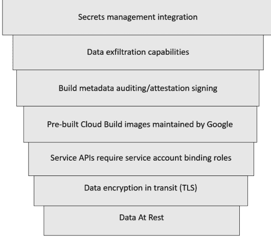
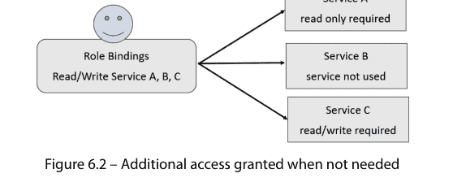
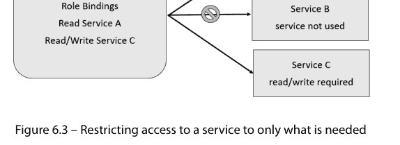
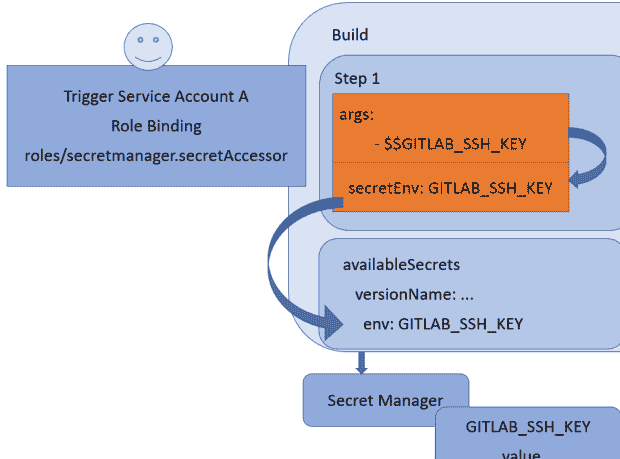
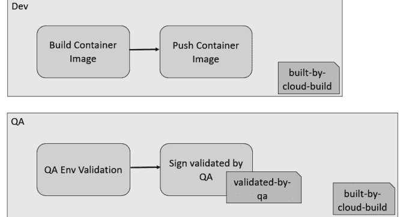
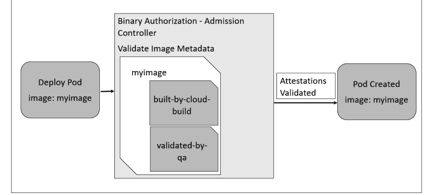

## 管理环境安全

在托管服务中，必须考虑保护资源的共同责任。提供商负责保护基础设施、管理其上运行的服务以及提供安全相关功能。消费者负责谁有权访问该服务以及保护托管服务之外的数据。

在本章中，我们将介绍 Cloud Build 如何在与其它安全相关服务集成的同时提供安全性的以下主题：

- 防御纵深
- 最小权限原则
- 访问敏感数据和密钥
- 为容器镜像构建元数据
- 保护网络边界

## 防御纵深

计算中的纵深防御概念由信息安全使用，以确保在每一层都部署安全结构以进行保护。Cloud Build 确保这些安全结构到位；一些示例在图 6.1 中注明：



虽然 Cloud Build 提供了此处提到的功能，但某些服务必须在管道中启用或利用。市场上还有其他安全相关解决方案可能与 Cloud Build 没有直接集成，但由于 Cloud Build 对每个步骤中自定义容器镜像的支持，它们仍可用于管道步骤。例如，如果您的容器镜像具有正确的库和工具，您可能能够从 HashiCorp Vault 检索值。

还有一些需要注意的其他示例，可能会导致管道共享敏感信息：

- 输出并记录敏感信息的步骤
- 使用不安全协议与其它系统通信的步骤
- 在管道中使用未知或存在漏洞的容器镜像作为步骤
- 在步骤之间将敏感信息存储在 Cloud Build 工作目录中

纵深防御是整体安全策略的组成部分；因此，共同责任模型也适用。如前所述，Cloud Build 提供了许多用于保护管道的元素；然而，服务消费者也必须采取某些步骤和措施。

## 最小权限原则

最小权限原则是保护资源的另一个安全结构。其目标是仅提供完成工作所需的资源访问权限。如果管道不需要访问对象存储中的数据，则没有理由授予调用管道的参与者的访问权限。例如，组织在开发阶段可能对安全权限限制较少，但在生产阶段限制更严格。虽然这可能使启动变得更容易，但不一致可能会导致团队进入更高级别的环境时出现问题，造成不必要的故障排除任务。组织内部将安全左移的文化运动可能涉及对资源的最小特权访问概念。这因组织而异，因为不同的监管机构和行业可能有不同的要求。

想象一下，如果恶意行为者获得访问权限或组织中的某人无意中使用了服务账号。图 6.2 以视觉形式描绘了该场景：他们将能够写入服务 A，影响数据的完整性，同时还能在不需要完成管道时访问或写入服务 B 中的数据：



图 6.2 – 在不需要时授予额外访问权限

在利用最小权限原则时，仅向特定管道必需的服务授予访问权限。图 6.3 描绘了尽管服务存在，但由于在管道中不需要而未授予访问权限。虽然这是在构建管道的上下文中，但可以应用于组织中所有服务的各个方面：



图 6.3 – 将对服务的访问限制为仅所需内容


Cloud Build 利用 **Google 云平台 (GCP)** 中的服务账号来识别将在流水线中用于连接其他 Google Cloud 服务的执行主体。服务账号可以分配给每个触发器，这使得相同的流水线配置，例如，可以根据触发构建的参数由不同的服务账号执行。如果你还记得，在 *第 5 章，触发构建* 中，Cloud Build 提供了正则表达式模式来确定如何触发构建或不同的事件调用模式。这使我们能够在不同的 Git 分支、标签和拉取请求模式、webhook 以及手动调用上使用不同的服务账号。这些不同类型的触发机制已在 *第 5 章，触发构建* 中介绍过。

组织可以创建具有不同角色权限和细粒度权限的服务账号，以定义成功完成流水线所需的最小权限。利用唯一的服务账号也有助于生命周期管理，并为管理员提供在定义的服务账号内监控使用模式的能力。

通过最小权限原则限制对资源的访问可以降低组织的暴露风险，同时减少非预期资源被意外操作的可能性。

## 访问敏感数据和密钥

数据在构建流水线的各步骤之间至关重要；有时，流水线中使用的数据也可能是敏感的。在 *第 5 章，触发构建* 中，我们将 GitLab 私有 SSH 密钥存储在 Secret Manager 中。该密钥在流水线中用于克隆私有仓库。敏感数据或密钥可以从各种来源检索。Cloud Build 与两个用于密钥的 GCP 服务集成：

- Secret Manager
- Cloud Key Management

重要的是将密钥安全地保存在未在构建配置中指定的位置。这里的每个服务也会发出审计和数据访问日志，记录何时以及哪个主体尝试访问密钥或密钥。使用上述两种服务访问敏感密钥的操作在 Cloud Build 中会被记录以供审计。

## 密钥管理器

Cloud Build 的 Secret Manager 集成由 cloudbuild.yaml 中的一段配置引用。以下是上一章中的示例片段：

```yaml
- name: gcr.io/cloud-builders/git
  args:
    - '-c'
    - |
      echo "$$GITLAB_SSH_KEY" > /root/.ssh/id_rsa
chmod 400 /root/.ssh/id_rsa
ssh-keyscan gitlab.com > /root/.ssh/known_hosts
entrypoint: bash
secretEnv:
  - GITLAB_SSH_KEY
...
availableSecrets:
  secretManager:
    - versionName: projects/282614098327/secrets/GITLAB_SSH_KEY/versions/1
      env: GITLAB_SSH_KEY
```

secretManager 键用于标识将使用 Secret Manager 服务。versionName 是要检索的密钥和版本的唯一标识符。然后密钥的值存储在环境变量 GITLAB_SSH_KEY 中，可在流水线的构建步骤中使用。在此构建步骤中，注意变量名 GITLAB_SSH_KEY 如何与 secretEnv 键关联，以便在 args 构建参数中利用它。

在 Cloud Build 中指定 availableSecrets 并不会自动授予对指定密钥的访问权限。必须指定特定密钥的 roles/secretmanager.secretAccessor 角色绑定——在此情况下，引用由 Cloud Build 触发器使用的服务账号。



图 6.4 – 密钥如何由构建和构建步骤访问

*图 6.4 描述了构建流水线如何与具有适当角色绑定的特定服务账号关联。然后构建可以从 Secret Manager 检索密钥，并使用 secretEnv 在构建步骤中使其可用。*

## 云密钥管理

如前所述，Cloud Build 还可以使用另一个 GCP 服务 Cloud Key Management 来访问敏感数据。以下是用于从 Cloud Key Management 访问加密密钥以解密编码密钥的示例语法：

```yaml
availableSecrets:
  inline:
  - kmsKeyName: projects/**PROJECT_ID_redacted**/locations/
    global/keyRings/secret_key_ring/cryptoKeys/secret_key_name
    envMap:
      MY_SECRET: '**ENCRYPTED_SECRET_encoded**'
```

与前一个示例中使用 secretManager 引用不同，inline 键用于标识将使用 Cloud Key Management 服务。请注意此示例片段与 Secret Manager 场景相比的一些差异。在 Cloud Key Management 场景中，kmsKeyName 引用加密密钥的唯一标识符。Cloud Build 将使用此密钥解密指定为 MY_SECRET 值 的文本。密钥的值存储在 cloudbuild.yaml 中，但以加密形式存储。

与 Secret Manager 一样，Cloud Build 也需要通过 Cloud Key Management 服务获得密钥的权限。在 Cloud Key Management 的情况下，我们需要为 Cloud Build 触发器服务账号授予以下角色，roles/cloudkms.cryptoKeyDecrypter。

Cloud Build 提供了与多个 GCP 云服务集成的功能，用于访问敏感密钥和加密数据。敏感数据不应存储在构建配置或源代码管理 (SCM) 仓库中。

> **注意**
> 虽然我们提供了 Cloud Key Management 的说明，但建议使用 Secret Manager 来存储和检索 Cloud Build 的敏感信息。

## 容器镜像的构建元数据

Cloud Build 会为容器镜像生成元数据，可用于识别构建详情、构建步骤、证明或仓库来源。SCM 仓库提交哈希和构建 ID 哈希可用于跟踪每个构建的仓库来源和步骤。Cloud Build 可以在构建时生成并签署证明，以允许组织强制执行仅 `built-by-cloud-build` 的构建可在运行时部署。我们将在以下各节中介绍每个概念。

## 来源证明

Cloud Build 与 Artifact Registry 结合使用时，可以关联容器镜像的额外元数据以验证构建详情。在大多数情况下，具有 SCM 和 Cloud Build 访问权限的人员可以使用元数据和日志验证用于触发特定构建的 SCM 仓库提交。作为组织可用的额外审计层，构建来源证明允许组织验证标识容器镜像来源和构建步骤的元数据未被篡改或操纵。此元数据以 **软件工件供应链级别 (SLSA)** 框架 (`https://slsa.dev/provenance`) 定义的格式存储。Cloud Build 会生成此元数据并对其进行签名，以便组织在需要时验证其内容。在撰写本文时，Cloud Build 可达到 SLSA 2 级 (L2)，其定义为“构建服务的防篡改性” (`https://slsa.dev/spec/v0.1/levels#summary-of-levels`)，并使用具有内置集成的 SCM 仓库的 Cloud Build 触发器。

**注意**
要使 Cloud Build 生成元数据，必须启用以下服务：Artifact Registry 和 Container Analysis。`cloudbuild.yaml` 配置还必须包含 `images` 字段。对于私有池以启用构建来源证明，必须将 `requestedVerifyOption` 选项设置为 `VERIFIED`。

Artifact Registry 提供了 API，可通过 `--show-provenance` 开关显示由 Cloud Build 生成的来源证明元数据。请参见此处示例命令：

```
$ gcloud artifacts docker images describe \
us-central1-docker.pkg.dev/**PROJECT_ID-redacted**/image-repo/
myimage@sha256:e4637b83784b96cb...93349a8864cc9b8be1 \
--show-provenance
```

这里提供了一个截断的示例输出。请注意，数字是为说明目的添加的——它们不在命令输出中：

```
image_summary:
...
provenance_summary:
  provenance:
  - build:
...
[1]     materials:
        - uri: https://github.com/**REPO-redacted**/packt-cloudbuild/commit/497985408c6f656944dd8d2f2ffd42160c59334e
...
```

这是源材料的所在位置——在此情况下为仓库和特定提交：

```
[2]     subject:
        - digest:
            sha256:
 e4637b83784b96cbdc aad40cde0622bd3c0e0bfe4cd4c993349a8864cc9b8
 be1
            name: https://us-central1-docker.pkg.dev/**PROJECT_ID-redacted**/image-repo/myimage
...
```

请参阅以下容器镜像 SHA 和位置：

```
[3] envelope:
        payload: eyJfdHlwZSI6Imh0dHBzOi...
mZkNDIxNjBjNTkzMzRlIn1dfX0=
        payloadType: application/vnd.in-toto+json
        signatures:
        - keyid: projects/verified-builder/locations/global/keyRings/attestor/cryptoKeys/builtByGCB/cryptoKeyVersions/1
          sig: MEUCIQDkyICeKz0Assa6Dgj4ss-rsd0RJ2ZXJWmBI-6lycoV_wIgZnSaPYCRAGR0oBVYGx_3aofMJS0YifWLcNtwXQpmtQ0=
...
```


验证元数据内容未被篡改或操纵的关键组件，即编码信封、签名和公钥，如下所示：

- `payload` - 遵循 SLSA 规范的构建元数据和构建步骤的 JSON 格式
- `keyid` - 用于验证签名的 `builtByGCB` 公钥的位置
- `sig` - Cloud Build 为验证负载而生成的签名

这可能是 Cloud Build 日志中已有的信息的重复，但它为组织提供了另一种审计机制，并确保容器镜像未被篡改或操纵。

## 证明

GCP 使用证明的形式，即数字文档，作为认证容器镜像的一种方式。证明可以添加到构建步骤中，以确保这些步骤是由指定的系统完成的。Cloud Build 可以生成一份证明，表明构建已在 Cloud Build 中完成，并且可以由容器运行时进行验证。

Binary Authorization 是 GCP 中的一项服务，容器运行时（如 **Google Kubernetes Engine (GKE)** 和 Cloud Run）使用它来确定镜像是否可以部署。例如，GKE 可以因为镜像不是由 Cloud Build 构建而拒绝使用。组织可以生成证明，表明镜像已通过 QA。使用 Binary Authorization，组织只能允许通过 QA 的容器镜像部署到运行时。可以将额外的证明作为为 Cloud Build 定义的构建步骤添加。

当启用 Binary Authorization 时，Cloud Build 会创建一个证明者，然后使用它创建 `built-by-cloud-build` 证明，并使用 `builtByGCB` 加密密钥进行签名。在指定的容器镜像部署之前，受支持的容器运行时会对其进行验证。图 6.5 显示了 Cloud Build 如何自动为镜像签名 `built-by-cloud-build` 证明，以及在 QA 流水线中，如何配置的构建步骤也可以签名 `validated-by-qa` 自定义证明：



图 6.5 – Cloud Build 签名证明

在以下示例中，Binary Authorization 的 enforcementMode 设置为 DRYRUN_AUDIT_LOG_ONLY，这意味着运行时会检查证明，但仅记录违规行为。如果 GKE（作为容器运行时）启用 Binary Authorization，当请求创建 Pod 时，它不会被拒绝，但会记录以下内容：

```
imagepolicywebhook.image-policy.k8s.io/dry-run: "true"
imagepolicywebhook.image-policy.k8s.io/overridden-verification-result: "nginx" : Image nginx denied by attestor projects/**PROJECT_ID-redacted**/attestors/built-by-cloud-build: Expected digest with sha256 scheme, but got tag or malformed digest
```

在前面的示例中，请求部署一个通用的 nginx 容器镜像，但被 Binary Authorization 捕获并记录。Binary Authorization 可以设置为在构建过程的不同阶段（如 QA）通过时要求多个证明。

图 6.6 显示 Binary Authorization 在 GKE 的准入控制器中检查证明。如果所有必需的证明都存在且 enforcementMode 为 ENFORCED_BLOCK_AND_AUDIT_LOG，则允许其进入集群。这会阻止容器镜像的准入，如果必需的证明不可用：



图 6.6 – GKE 容器运行时使用 Binary Authorization 来确定镜像是否可以被准入

Cloud Build 和支持 Binary Authorization 的 GCP 容器运行时的结合可以帮助提高组织的整体安全态势。拒绝未经过组织内部安全严格流程的容器镜像是可实施的额外防御层。Binary Authorization 也可以配置为在紧急情况下允许部署没有适当证明的镜像。该机制称为 breakglass，它将绕过验证。

Cloud Build 的数据在整个端到端流水线中具有多用途的审计和验证功能。特定的 GCP 服务可以利用元数据（如签名）来确定资源是否已在相应环境中完成所有必需步骤。

## 保护网络边界

Cloud Build 可以利用名为 VPC Service Controls（https://cloud.google.com/vpc-service-controls）的 GCP 安全机制来防止数据外泄。VPC Service Controls（VPC SC）允许组织设置策略，以定义访问 GCP 服务所需的用户信息、服务账号、IP地址和 IP 子网。

在 Cloud Build 的上下文中，只有使用私有池的构建（如 *第 2 章，配置 Cloud Build 工作器* 中所述）才能支持 VPC SC。私有池实例可以利用此功能，因为它们与您的 VPC 相关联，即使它由 GCP 管理。组织还可以通过仅允许构建在组织策略中使用私有池来进一步限制 Cloud Build。可以通过仅在各种 GCP 层级允许某些私有工作器池来应用进一步限制：

- 组织
- 文件夹
- 项目

通过利用这种细粒度的规则层级，我们在每个层级限制允许的工作器池。这通过根据所需资源限制某些团队使用池来进一步隔离。它还将拒绝使用默认池，这在组织要求构建在私有网络内运行时可能适用。

当配置 VPC SC 边界时，只有获得授权的人员才能触发构建或调用 Cloud Build API，例如。在 *纵深防御* 部分的先前示例中，我们重点关注防止访问特定服务和数据的服务账号角色绑定。VPC SC 通过配置相关策略在网络层提供另一层保护。要创建初始 VPC SC 边界，我们将 Cloud Build 指定为边界内的受限服务。这意味着 Cloud Build 服务受到保护，并且边界的任何入站或出站流量都必须由入站或出站策略定义。

> **注意**
> 
> 刚开始的组织可能希望以 dry run 模式配置 VPC SC，以审计定义边界的影响。立即启用强制模式可能会导致构建失败。以 dry run 模式创建的任何边界都可以在无需重写策略的情况下转换为强制模式。

例如，作为入站策略，我们可能希望允许触发器中定义的用户指定的服务账号访问 Cloud Build API。对于内循环场景，如果我们希望为特定开发人员提供触发构建的访问权限，我们可以通过创建访问级别策略来实现，该策略允许特定 IP/CIDR 范围或国家/地区的特定开发人员，或使用符合特定策略的设备的开发人员。

通过使用 VPC SC 和定义的服务边界，我们在 **身份和访问管理（IAM）** 和 VPC 网络层都限制了访问。服务边界可以扩展以允许来自其他连接网络的通信，用于从本地系统或特定开发人员机器触发构建和服务访问。

VPC SC 为 GCP 上的服务在网络层提供额外的安全层。在本章中，我们讨论了 Cloud Build 如何利用此 GCP 服务来保护构建的触发方式，但同时构建配置可以访问的资源也可以访问它们。

### 摘要

Cloud Build 与各种 GCP 服务集成，为用户提供不同的安全功能。这些功能有助于为组织的纵深防御策略提供层级。Cloud Build 使在流水线中实施安全变得容易，但 GCP 服务与组织之间的共享责任模型对于确保端到端安全态势至关重要。

在下一章中，我们将开始研究如何利用 Cloud Build 实现基础设施资源的自动化。


