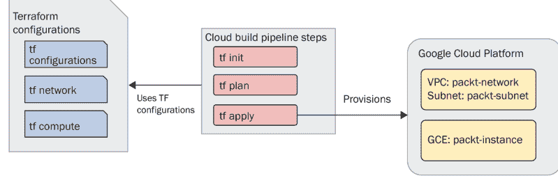
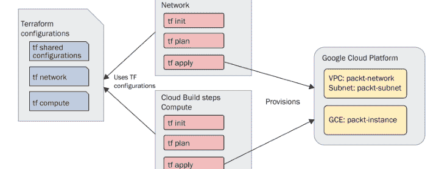
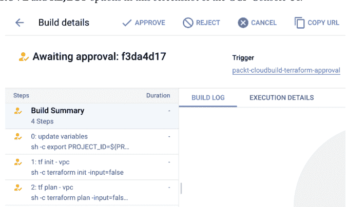

# 第 3 部分：安全与部署
实际应用

在本书的这一部分，我们将重点回顾 Cloud Build 在实际应用中的功能，包括针对 GKE 的安全 CI/CD、通过基础设施即代码管理云基础设施的安全发布、从本地源到 Cloud Run 生产环境的构建工作流，以及在生产环境中运行时可利用的功能。你将带走可在自己的 Cloud Build 和 GCP 环境中逐步操作并实施的具体工作流。

本部分包含以下章节：

- 第 7 章，使用 Terraform 和 Cloud Build 自动化部署
- 第 8 章，使用 Cloud Build 为 GKE 保护软件交付
- 第 9 章，使用 Cloud Build 自动化无服务器
- 第 10 章，在生产环境中运行 Cloud Build 的运维

### 使用 Terraform 和 Cloud Build 自动化部署

**Cloud Build** 的灵活性为自动化不仅仅是构建应用程序和服务的流水线提供了基础。Cloud Build 内在的功能，例如利用 Git 作为事实来源以及使用容器镜像驱动构建步骤的执行，有助于制定基础设施配置的自动化。其中一种模式是结合使用 Cloud Build 和 **Terraform** (https://www.terraform.io/)。在本章中，我们将通过一个示例介绍如何使用 Cloud Build 自动配置应用程序基础设施，使用 Terraform 的配置语言，即 **HashiCorp 配置语言 (HCL)** 和 **命令行界面 (CLI)**。

本章将涵盖以下主题：

- 将基础设施视为代码
- 构建自定义构建器
- 管理构建的最小权限原则
- 人工介入与手动审批

### 将基础设施视为代码

将 **基础设施即代码 (IaC)** 是什么意思？基础设施可以通过多种方式配置，例如以命令式方式或手动执行一系列命令来启动环境。IaC 提供程序旨在使用一系列配置定义您希望如何设置环境或组件。如介绍中所述，使用 Terraform 时，我们将使用其 HCL 来定义由 `terraform` CLI 工具解释的标准配置。此配置决定了提供程序的类型，例如插件，以与服务的 API 交互并配置指定的内容。配置文件有助于定义您希望创建的资源，最好存储在 **源代码管理 (SCM)** 仓库中以进行版本控制管理。

构建代码需要一套指令和成功编译和打包代码所需的定义前提条件。此配置在 Cloud Build 配置中定义，同时包括每个步骤的支持容器镜像以及存储在 SCM 仓库中的配置依赖项。在处理基础设施时，特别是像 Google Cloud 这样的云提供商时，我们还将定义一个 Cloud Build 配置、用于执行 Terraform CLI 的支持容器镜像、Terraform 配置文件以及存储在 SCM 仓库中的配置依赖项。

Cloud Build 可以使用其 CLI 工具帮助编排 Terraform 配置的执行和处理。Terraform 配置旨在是幂等的，这意味着在首次运行后使用相同配置重新运行 Terraform 命令应导致零更改，前提是基础设施配置未在流水线之外更改。这允许 Cloud Build 触发器引用和 SCM 仓库多次执行，并且仅在配置更改时才更改基础设施。

每个 Cloud Build 执行（即构建）都是无状态的。如果需要持久化状态，可以在构建步骤中将其保存到 Google Cloud Storage (GCS) 等服务中。否则，总体而言，构建中支持的工件可以存储在 Artifact Registry 等服务中。对于 Terraform，它还要求状态存储在外部，以便它知道已配置的配置。如果状态仅存储在运行中，Terraform 不会知道之前的执行情况。对于 Google Cloud，建议将此状态存储在启用了版本控制的 GCS 存储桶中。这允许状态得到维护、版本化、通过权限保护、静态加密，并且可选地使用加密密钥加密。可以在此处找到另一个示例教程：https://cloud.google.com/architecture/managing-infrastructure-as-code。

本章中的示例侧重于使用 Terraform 配置 Google Cloud 计算和网络服务。值得注意的是，Terraform 资源也可用于配置 Cloud Build 组件，例如触发器和私有 worker 池。

### 简单直接的 Terraform

让我们开始通过在 GCS 中准备一个存储桶来存储我们的 Terraform 状态。

> 注意
> 本章中的示例通过 GCP Cloud Shell 环境执行——您可以在终端中运行这些示例，但可能需要配置 gcloud 和其他工具。

设置您希望在此处创建存储桶的项目：

```
$ gcloud config set project ${PROJECT_ID}
$ PROJECT_ID=$(gcloud config get-value project)
```

创建存储桶并启用版本控制：

```
$ gsutil mb gs://${PROJECT_ID}
$ gsutil versioning set on gs://${PROJECT_ID}
```

> 注意
> 
> 通过启用版本控制功能，我们要求 GCS 在保存新对象时保留对象的旧版本。存储桶名称还必须在整个 Google Cloud 中唯一，而不仅仅是在您的项目中。

Terraform 状态（在 GCS 中管理）也不同于 Terraform 配置（例如 .tf 或 .tfvars），后者通常存储在 SCM 中以进行版本控制。

在我们设置好存储桶后，在开始使用 Cloud Build 自动化我们的基础设施流水线之前，让我们快速测试一下启动一个 Google Compute Engine (GCE) 虚拟机 (VM)。

我们将从一些快速文件开始以启动 Terraform。

> 注意
> 
> 示例中包含在本书撰写期间有效的语法和版本。然而，可能需要根据 Terraform CLI 工具和 Google Cloud 的 Terraform 提供程序的版本进行更改。
> 
> 在此示例中，我们使用在上一个命令中存储的环境变量 PROJECT_ID 来生成以下 backend.tf 文件。Terraform 不允许我们使用 Terraform 变量动态指定用于存储状态的后端存储桶。

我们将引用在上一个命令中创建的存储桶，以告诉 terraform 在何处存储和检索状态：

```
$ mkdir ~/packt/cloudbuild-terraform; cd ~/packt/cloudbuild-terraform
cat << EOF > backend.tf
terraform {
  backend "gcs" {
    bucket     = "${PROJECT_ID}"
    prefix     = "tfstate"
  }
}
EOF
```

指定与此配置兼容的 terraform 版本，以及 Google Cloud 提供程序版本：

```
$ cat << EOF > versions.tf
terraform {
  required_version = ">= 1.0.0, < 1.2.0"
  required_providers {
    google = {
      source  = "hashicorp/google"
      version = ">= 3.68.0"
    }
  }
}
provider "google" {
  project = var.project_id
  region  = var.region
  zone    = var.zone
}
EOF
```

设置 Google Cloud 提供程序和我们将要求 Terraform 启动的 GCE VM 实例所需的变量列表及其默认值。以下示例分为不同的部分：

```
$ cat << EOF > variables.tf
variable "project_id" {
  description = "Unique identifier of the Google Cloud Project that is to be used"
  type        = string
  default     = "${PROJECT_ID}"
}
variable "region" {
  description = "Google Cloud Region in which regional GCP resources are provisioned"
  type        = string
  default     = "us-west1"
}
variable "zone" {
```


```
description = "Google Cloud Zone in which regional GCP resources are provisioned"
  type      = string
  default   = "us-west1-a"
}
EOF
```

Network-related variables, such as name and network range, will be used by the compute instance:

```
$ cat << EOF >> variables.tf
variable "network_name" {
  description = "The name of the network to be used when deploying resources"
  type        = string
  default     = "packt-network"
}
variable "subnet_name" {
  description = "The name of the subnet to be used when deploying resources"
  type        = string
  default     = "packt-subnet"
}
variable "subnet_cidr" {
  description = "The name of the subnet to be used when deploying resources"
  type        = string
  default     = "10.128.0.0/24"
}
EOF
```

以下是定义机器类型、名称和操作系统（OS）镜像的计算相关变量：

```
$ cat << EOF >> variables.tf
variable "instance_name" {
  description = "The name of the GCE VM instance named to be provisioned"
  type        = string
  default     = "packt-instance"
}
variable "instance_machine_type" {
    description = "The machine type you want the GCE VM to use"
    type        = string
    default     = "e2-medium"
}
variable "instance_image" {
    description = "The OS image you want the GCE VM boot disk to use"
    type        = string
    default     = "rocky-linux-cloud/rocky-linux-8-v20220406"
}
EOF
```

设置 GCE VM 实例使用的网络：

```
$ cat << EOF > vpc.tf
resource "google_compute_network" "packt_network" {
  name                         = "vpc-network"
  auto_create_subnetworks      = false
}
resource "google_compute_subnet" "packt_subnet" {
  name          = var.subnet_name
  ip_cidr_range = var.subnet_cidr
  region        = var.region
  network       = google_compute_network.packt_network.name
}
EOF
```

启动 GCE VM 实例所需的最小配置如下：

```
$ cat << EOF > gce.tf
resource "google_compute_instance" "packt_instance" {
  name         = var.instance_name
  machine_type = var.instance_machine_type
  boot_disk {
    initialize_params {
      image = var.instance_image
}
}
  network_interface {
    subnetwork = google_compute_subnetwork.packt_subnet.name
  }
}
EOF
```

现在我们已经定义了所有 Terraform 配置文件，可以运行一些 Terraform 命令来测试并启动我们配置的 GCE 实例。我们首先使用 terraform init 命令来验证我们与后端以及配置中指定的必要模块的连接性：

```
$ terraform init
```

以下是 init 命令的示例输出：

```
Initializing the backend...
Successfully configured the backend "gcs"! Terraform will automatically
use this backend unless the backend configuration changes.
Initializing provider plugins...
- Reusing previous version of hashicorp/google from the dependency lock file
- Installing hashicorp/google v4.16.0...
- Installed hashicorp/google v4.16.0 (signed by HashiCorp)
Terraform has been successfully initialized!
```

我们运行 terraform plan 命令来预览配置中指定的更改，并使用 -out 开关将计划输出为 Terraform 推荐的方式。这将允许对 Terraform 将尝试在指定的 Google Cloud 项目上执行的操作进行验证和代码审查。开发人员和运维人员可以使用 terraform show terraform.tfplan 来查看计划：

```
$ terraform plan -out terraform.tfplan
```

以下是计划的示例输出：

```
Terraform used the selected providers to generate the following execution plan. Resource actions are indicated
with the following symbols:
  + create

Terraform will perform the following actions:
  # google_compute_instance.main will be created
  + resource "google_compute_instance" "main" {
      + can_ip_forward      = false
      + cpu_platform        = (known after apply)
...
          + node_affinities {
              + key      = (known after apply)
              + operator = (known after apply)
              + values   = (known after apply)
          }
      }
  }
Plan: 1 to add, 0 to change, 0 to destroy.
...
Saved the plan to: terraform.tfplan
To perform exactly these actions, run the following command to apply:
    terraform apply "terraform.tfplan"
```

而不是直接使用 terraform apply 来实施更改，我们现在有一个计划文件，可以在流水线中专门应用已批准的更改：

```
$ terraform apply terraform.tfplan
```

以下是 apply 函数的示例输出：

```
google_compute_instance.main: Creating...
google_compute_instance.main: Still creating... [10s elapsed]
google_compute_instance.main: Creation complete after 11s
[id=projects/**REDACTED_project_id**/zones/us-west1-a/
instances/test-instance]
Apply complete! Resources: 1 added, 0 changed, 0 destroyed.
```

现在我们已经手动测试了 Terraform 执行，可以将其添加到 Cloud Build 配置流水线以自动化此过程。在 Cloud Build 中，我们将执行前面描述的各个 Terraform 命令步骤，每个步骤都表示为一个构建步骤。如果不取消配置（即销毁）先前创建的资源，Cloud Build 配置将不会进行任何更改，因为之前创建的 Terraform 配置会被重复使用。运行以下命令以销毁已创建的资源：

```
$ terraform destroy --auto-approve
```

在开始使用 Cloud Build 之前，我们需要授予 Cloud Build 默认服务账号网络和计算权限以创建我们的资源。之前的命令在终端中运行 terraform 时使用了你的本地服务账号。当我们使用 Cloud Build 执行且未指定服务账号时，它将使用 Cloud Build 默认服务账号：



图 7.1 – Cloud Build 和 Terraform，一体化方法

首先，我们需要检索 Google Cloud 项目编号，因为它用于构造 Cloud Build 默认服务账号 PROJECT_NUMBER@cloudbuild.gserviceaccount.com：

```
$ export PROJECT_NUMBER=$(gcloud projects list \
  --filter="$(gcloud config get-value project)" \
  --format="value(PROJECT_NUMBER)"
)
```

为 Cloud Build 服务账号授予我们将创建的资源的管理权限：

```
$ gcloud projects add-iam-policy-binding ${PROJECT_ID} \
  --member=serviceAccount:${PROJECT_NUMBER}@cloudbuild.gserviceaccount.com \
  --role=roles/compute.networkAdmin
```

```bash
$ gcloud projects add-iam-policy-binding ${PROJECT_ID} \
  --member=serviceAccount:${PROJECT_NUMBER}@cloudbuild.
gserviceaccount.com \
  --role=roles/compute.instanceAdmin.v1
```

在此示例中，我们将使用 hashicorp/terraform:1.0.0 容器镜像来提供 terraform 可执行文件，从 terraform init 开始：

```bash
$ cat << EOF > cloudbuild.yaml
timeout: 3600s
steps:
- id: 'tf init'
  name: 'hashicorp/terraform:1.0.0'
  env:
  - "TF_IN_AUTOMATION=true"
  entrypoint: 'sh'
  args:
  - '-c'
  - |
    terraform init -input=false
EOF
```

下一个构建步骤是 terraform plan，用于概述更改：

```bash
$ cat << EOF >> cloudbuild.yaml
- id: 'tf plan'
  name: 'hashicorp/terraform:1.0.0'
  env:
  - "TF_IN_AUTOMATION=true"
  entrypoint: 'sh'
  args:
  - '-c'
  - |
    terraform plan -input=false -out terraform.tfplan
EOF
```

最后一个构建步骤是 terraform apply，用于应用已概述的更改：

```
$ cat << EOF >> cloudbuild.yaml
- id: 'tf apply'
  name: 'hashicorp/terraform:1.0.0'
  env:
  - "TF_IN_AUTOMATION=true"
  entrypoint: 'sh'
  args:
  - '-c'
  - |
    terraform apply -input=false terraform.tfplan
EOF
```

一旦我们拥有 Cloud Build 配置，就可以通过运行在前几章中用于提交构建的命令手动执行构建。将会使用默认的 Cloud Build 服务账号：

```
$ gcloud builds submit --region us-west1
```

成功构建将产生以下截断输出，并显示 SUCCESS 状态：

```
...
Step #2 - "tf apply": Apply complete! Resources: 3 added, 0 changed, 0 destroyed.
Finished Step #2 - "tf apply"
PUSH
DONE
...
STATUS: SUCCESS
```

**注意**
在自动化中，TF_IN_AUTOMATION 变量被设置为这样一些说明会被截断，并且不会呈现手动说明。例如，在设置该变量后自动执行 terraform plan 后，以下语句不会输出到控制台：“To perform exactly these actions...”


如果你还记得之前的内容，已提到 Terraform 旨在实现幂等性，因此使用相同配置进行后续构建提交时，terraform plan 执行将产生以下输出：

```
Step #1 - "tf plan": No changes. Your infrastructure matches the configuration.
Step #1 - "tf plan":
Step #1 - "tf plan": Your configuration already matches the changes detected above. If you'd like
Step #1 - "tf plan": to update the Terraform state to match, create and apply a refresh-only plan.
```

对无变更的计划执行 tf apply 将产生以下结果：

```
Step #2 - "tf apply": Apply complete! Resources: 0 added, 0 changed, 0 destroyed.
```

我们可以在此示例基础上做很多扩展，例如将创建的文件放入 SCM 仓库以进行版本控制和审计。你可以在 https://github.com/PacktPublishing/Cloud-Native-Automation-With-Google-Cloud-Build/tree/main/chapter07/terraform 找到此示例——我们之前创建的文件位于 single 文件夹中。

## 资源创建与构建步骤的分离

在以下章节中，我们将查看 multiple 文件夹，在此文件夹中，我们在上一节的示例基础上进行扩展，将 VPC 和子网的创建与 GCE VM 实例分离。这将允许以更分离和可控的方式进行资源管理。此配置和设置可在以下仓库的 multiple 文件夹中找到：https://github.com/PacktPublishing/Cloud-Native-Automation-With-Google-Cloud-Build/tree/main/chapter07/terraform。



图 7.2 – Cloud Build 和 Terraform（VPC 和计算资源供应作为独立管道）

大多数示例保持不变，只是将特定的资源配置移至各自的 vpc 和 compute 文件夹中。在之前的示例中，它只需执行一次 terraform init、plan 和 apply 命令三部曲——然而，当资源被分离后，terraform 命令三部曲将执行两次，每组资源配置执行一次。另一个不同之处是由于它们是分开执行的，我们需要使用 Terraform 中提供的另一个功能，即 remote state。

remote state 允许我们引用来自其他已应用 Terraform 配置的已供应资源，因此无需手动利用变量来引用资源，我们可以检索之前 Terraform 执行的输出以链接到已创建的资源。当我们创建 GCE VM 实例时，我们需要访问资源将关联到的子网。

请注意 gce.tf 配置的以下输出：

```
resource "google_compute_instance" "packt_instance" {
  name           = var.instance_name
  machine_type   = var.instance_machine_type
  boot_disk {
    initialize_params {
      image = var.instance_image
    }
  }
  network_interface {
    subnetwork = data.terraform_remote_state.vpc.outputs.subnet_name
  }
}
```

该 subnetwork 引用了我们 VPC 配置中的 remote state。VPC Terraform 配置输出的 subnet_name 值将由我们的 GCE VM 使用。

类似于 Terraform 后端配置，remote state 引用 VPC 后端指定的 GCS 存储桶和路径中的 VPC 状态。

```
data "terraform_remote_state" "vpc" {
  backend = "gcs"
  config = {
    bucket  = "${PROJECT_ID}"
    prefix  = "tfstate/vpc"
  }
}
```

在管道中，使用文件夹来分离资源，因此 Cloud Build 步骤需要知道在哪里找到适当的 Terraform 配置——我们使用 dir 标记来表示执行 terraform 命令的位置。

```
- id: 'tf init - vpc'
  name: 'hashicorp/terraform:1.0.0'
  dir: chapter07/terraform/multiple/vpc
  env:
  - "TF_IN_AUTOMATION=true"
  entrypoint: 'sh'
```

让我们继续执行此 Cloud Build 基础设施管道。虽然配置已更改并添加了额外的构建步骤，但结果与本章前面构建的单实例相同。如果你想自己执行，在克隆仓库后，你需要替换一些变量：

```
$ gcloud config set project ${PROJECT_ID}
$ PROJECT_ID=$(gcloud config get-value project)
$ envsubst < chapter07/terraform/multiple/variables.tf_tmpl > multiple/variables.tf
$ envsubst < chapter07/terraform/multiple/vpc/backend.tf_tmpl > multiple/vpc/backend.tf
```

```
$ envsubst < chapter07/terraform/multiple/compute/backend.tf_tmpl > multiple/compute/backend.tf
$ envsubst < chapter07/terraform/multiple/compute/vpc-remote-state.tf_tmpl > multiple/compute/vpc-remote-state.tf
```

现在，我们可以提交 Cloud Build 配置：

```
$ gcloud builds submit --region us-west1 --config cloudbuild-multiple.yaml
```

请注意，与简单示例不同，Apply complete! Resources: 3 added，之前已部署的 VPC 资源和计算资源的创建步骤是分开的：

```
Step #2 - "tf apply - vpc": Apply complete! Resources: 2 added, 0 changed, 0 destroyed.
Step #2 - "tf apply - vpc":
Step #2 - "tf apply - vpc": Outputs:
Step #2 - "tf apply - vpc":
Step #2 - "tf apply - vpc": subnet_name = "packt-m-subnet"
...
Step #5 - "tf apply - compute": Apply complete! Resources: 1 added, 0 changed, 0 destroyed.
Finished Step #5 - "tf apply - compute"
```

就像之前的简单示例一样，反复执行 multiple 示例时，尝试供应的每个资源都会输出以下内容：

```
Apply complete! Resources: 0 added, 0 changed, 0 destroyed.
```

> **注意**
> 仓库中提供了相应的 cloudbuild-destroy.yaml 和 cloudbuild-multiple-destroy.yaml 用于清理创建的资源。你需要对变量、后端和 remote state 进行调整以引用你的项目：
> 
> $ gcloud builds submit --region us-west1 --config cloudbuild-multiple-destroy.yaml

以下示例输出显示了先前创建的 multiple 示例中创建的已销毁资源：

```
Step #2 - "tf apply - compute": Apply complete! Resources: 0 added, 0 changed, 1 destroyed.
```

```
...
Step #5 - "tf apply - vpc": Apply complete! Resources: 0 added, 0 changed, 2 destroyed.
```

本书的主要重点是存储在 SCM 仓库中的源代码的编译。Cloud Build 的灵活性允许每个步骤使用容器镜像——在此案例中，我们使用 terraform 镜像通过多个构建步骤部署 Terraform 配置。到目前为止，我们在构建步骤中使用了预构建镜像并描述了自定义构建器的概念。我们将在下一节开始创建自己的自定义构建器。

## 构建自定义构建器

Cloud Build 为每个构建步骤使用一个容器镜像，这提供了灵活性的本质上可以执行构建所需的任何二进制文件或命令。另一种模式是构建一个自定义构建器镜像，其中包含团队所需的所有必要构建二进制文件。这可以通过只使用一个镜像在构建步骤中使用，从而降低复杂性，同时也只有一个镜像需要维护。

让我们从一个示例开始，其中你的构建需要访问一些 Google Cloud 资源，例如 gcloud 和 gsutil，但你仍希望为整体构建添加一些其他工具，例如 terraform、kustomize 和 skaffold。虽然基础镜像提供了前两个，但我们必须为每个工具使用可用的社区构建器镜像（https://github.com/GoogleCloudPlatform/cloud-builders-community），为每个工具构建新的自定义镜像，或构建一个团队可以维护的包含后三个工具的单一镜像。

我们从一个我们定义的 Dockerfile 开始，基于 alpine 的较小的 cloud-sdk 镜像，然后添加一些我们想要的工具，并进行一些清理：

```
$ mkdir ~/packt/cloudbuild-custombuilder; cd ~/packt/cloudbuild-custombuilder
$ gcloud config set project ${PROJECT_ID}
$ PROJECT_ID=$(gcloud config get-value project)

$ cat << EOF > Dockerfile
FROM gcr.io/google.com/cloudsdktool/cloud-sdk:alpine
ENV TERRAFORM_VERSION=1.1.0
RUN echo "INSTALL TERRAFORM v${TERRAFORM_VERSION}" \
&& wget -q -O terraform.zip https://releases.hashicorp.com/terraform/${TERRAFORM_VERSION}/terraform_${TERRAFORM_VERSION}_linux_amd64.zip \
&& unzip terraform.zip \
&& chmod +x terraform \
```


```
&& mv terraform /usr/local/bin \
&& rm -rf terraform.zip
RUN gcloud components install \
kustomize \
skaffold \
&& rm -rf $(find google-cloud-sdk/ -regex ".*/__pycache__") \
&& rm -rf google-cloud-sdk/.install/.backup
EOF
```

以上仅为示例，但虽然我们主要将 Cloud Build 作为执行 Cloud Build 配置的机制，但它也可以构建前面章节中提到的容器镜像。根据你的环境，你可能需要额外的权限，以启用 Artifact Registry，并创建一个名为 core-image 的仓库：

```
$ gcloud builds submit --region us-west1 --tag us-docker.pkg.dev/${PROJECT_ID}/core-image/builder:latest
```

我们可以在以下 Cloud Build 配置文件中所述的方式使用构建镜像：

```
$ cat << EOF > cloudbuild.yaml
steps:
- id: 'See what gcloud components are installed'
  name: 'us-docker.pkg.dev/${PROJECT_ID}/core-image/builder:latest'
  entrypoint: 'sh'
  args:
  - '-c'
  - |
    gcloud components list --only-local-state --format "value(id)"
- id: 'Check terraform version'
  name: 'us-docker.pkg.dev/${PROJECT_ID}/core-image/builder:latest'
  entrypoint: 'sh'
  args:
  - '-c'
  - |
    terraform version
EOF
```

手动提交上述配置的构建将安装 gcloud 组件并验证可用的 terraform 版本：

```
$ gcloud builds submit --region us-west1
```

以下是该镜像本地安装的 gcloud 组件以及 terraform 版本的示例输出：

```
Step #0 - "See what gcloud components are installed": Your
current Google Cloud CLI version is: 381.0.0
Step #0 - "See what gcloud components are installed": kubectl
Step #0 - "See what gcloud components are installed": bq
Step #0 - "See what gcloud components are installed": core
Step #0 - "See what gcloud components are installed": kustomize
...
Step #1 - "Check terraform version": Terraform v1.1.0
Step #1 - "Check terraform version": on linux_amd64
...
```

镜像的所有团队可能因组织而异，但理想情况下应由单一团队维护。在端到端构建中，需求、建议和反馈可能来自组织内的不同团队。当某些构建依赖于特定的工具版本和组合时，版本控制在维护自定义构建器镜像时也变得至关重要。这取决于什么适合组织，但不同团队需求的灵活性可以带来最佳结果。

## 管理构建的最小权限原则

在上一章中，我们介绍了构建管道的底层最小权限原则。虽然本章第一部分的示例使用了 Cloud Build 默认服务账号，这很方便，但根据我们想要运行的管道或自动化的类型，我们可能不希望提供一个能够同时操作网络和计算的服务账号。实现此目的的一种方法是分离我们的 Cloud Build 管道配置——我们还可以最大限度地减少错误的影响或攻击面。

如果尚未克隆仓库，请继续克隆它 (https://github.com/PacktPublishing/Cloud-Native-Automation-With-Google-Cloud-Build)：

```
$ git clone https://github.com/PacktPublishing/Cloud-Native-Automation-With-Google-Cloud-Build
```

导航到本章的示例：

```
$ cd Cloud-Native-Automation-With-Google-Cloud-Build/chapter07/terraform
```

在 Cloud Build 配置文件 cloudbuild-multiple-network.yaml 中，我们指定此构建要使用的特定 serviceAccount：

```
$ serviceAccount: 'projects/${PROJECT_ID}/serviceAccounts/${CLOUDBUILD_NETWORK}@${PROJECT_ID}.iam.gserviceaccount.com'
```

我们首先需要准备同时用于 Cloud Build 和 Terraform 配置的变量：

```
$ gcloud config set project ${PROJECT_ID}
$ export PROJECT_ID=$(gcloud config get-value project)
$ export CLOUDBUILD_NETWORK=cloudbuild-network
$ export CLOUDBUILD_COMPUTE=cloudbuild-compute
```

创建我们的两个服务账号并分配将由各自 Terraform 配置使用的权限。创建将构建我们的 VPC 的账号：

```
$ gcloud iam service-accounts create ${CLOUDBUILD_NETWORK} \
  --display-name="Cloud Build Network Admin"
$ gcloud projects add-iam-policy-binding ${PROJECT_ID} \
  --member=serviceAccount:${CLOUDBUILD_NETWORK}@${PROJECT_ID}.iam.gserviceaccount.com \
  --role=roles/compute.networkAdmin
$ gcloud projects add-iam-policy-binding ${PROJECT_ID} \
  --member=serviceAccount:${CLOUDBUILD_NETWORK}@${PROJECT_ID}.iam.gserviceaccount.com \
  --role=roles/iam.serviceAccountUser
$ gcloud projects add-iam-policy-binding ${PROJECT_ID} \
  --member=serviceAccount:${CLOUDBUILD_NETWORK}@${PROJECT_ID}.iam.gserviceaccount.com \
  --role=roles/logging.logWriter
$ gcloud projects add-iam-policy-binding ${PROJECT_ID} \
  --member=serviceAccount:${CLOUDBUILD_NETWORK}@${PROJECT_ID}.iam.gserviceaccount.com \
  --role=roles/storage.objectAdmin
```

接下来，我们创建将配置我们的 GCE VM 实例的账号：

```
$ gcloud iam service-accounts create ${CLOUDBUILD_COMPUTE} \
  --display-name="Cloud Build Compute Admin"
$ gcloud projects add-iam-policy-binding ${PROJECT_ID} \
  --member=serviceAccount:${CLOUDBUILD_COMPUTE}@${PROJECT_ID}.iam.gserviceaccount.com \
  --role=roles/compute.instanceAdmin.v1
$ gcloud projects add-iam-policy-binding ${PROJECT_ID} \
  --member=serviceAccount:${CLOUDBUILD_COMPUTE}@${PROJECT_ID}.iam.gserviceaccount.com \
  --role=roles/iam.serviceAccountUser
$ gcloud projects add-iam-policy-binding ${PROJECT_ID} \
  --member=serviceAccount:${CLOUDBUILD_COMPUTE}@${PROJECT_ID}.iam.gserviceaccount.com \
  --role=roles/logging.logWriter
$ gcloud projects add-iam-policy-binding ${PROJECT_ID} \
  --member=serviceAccount:${CLOUDBUILD_COMPUTE}@${PROJECT_ID}.iam.gserviceaccount.com \
  --role=roles/storage.objectAdmin
```

权限可能需要几分钟才能传播——提交构建并查看以下内容：

```
ERROR: (gcloud.builds.submit) INVALID_ARGUMENT: could
not resolve source: googleapi: Error 403: cloudbuild-compute@**REDACTED_project_id**.iam.gserviceaccount.com does
not have storage.objects.get access to the Google Cloud Storage
object., forbidden
```

我们需要在 Cloud Build 配置中替换一些变量。在此示例中，我们在配置中指定服务账号，因为我们将通过 CLI 手动提交它。如果你使用触发器，你也可以将服务账号作为触发器的一部分指定：

```
$ envsubst < cloudbuild-multiple-network.yaml_tmpl > cloudbuild-multiple-network.yaml
$ envsubst < cloudbuild-multiple-compute.yaml_tmpl > cloudbuild-multiple-compute.yaml
$ envsubst < cloudbuild-multiple-network-destroy.yaml_tmpl > cloudbuild-multiple-network-destroy.yaml
$ envsubst < cloudbuild-multiple-compute-destroy.yaml_tmpl > cloudbuild-multiple-compute-destroy.yaml
```

一旦变量被替换，我们就可以准备好提交构建配置了。就像在之前的场景中我们分别提交网络和计算构建一样，这里我们也会分别进行。主要区别在于此场景中我们使用的是具有执行任务所需权限的服务账号：

```
$ gcloud builds submit --region us-west1 --config cloudbuild-multiple-network.yaml
```

> **Note**
> 
> 因为我们使用的是用户指定的服务账号，并且使用 CLOUD_LOGGING_ONLY 指定它，所以我们将无法在终端中看到日志流。截至撰写本文时，使用 gcloud beta，你可以在终端中流式传输日志。或者，gcloud 命令的输出是一个选项，可以点击 Logs are available at 链接打开控制台以通过 UI 查看它。如果你在另一个终端窗口中打开，你可以使用 gcloud builds log YOUR_BUILD_ID 查看日志。

由于每个服务账号都有特定的资源权限，如果你将 cloudbuild-multiple-compute.yaml 配置中的 serviceAccount 替换为 cloudbuild-network 服务账号，它将没有创建计算实例的适当权限。我们将得到以下错误：

```
Step #2 - "tf apply - compute": google_compute_instance.packt_instance: Creating...
Step #2 - "tf apply - compute": |
Step #2 - "tf apply - compute": | Error: Error creating instance: googleapi: Error 403: Required 'compute.instances.create' permission for 'projects/**REDACTED-project_id**/zones/us-west1-a/instances/packt-m-instance'
Step #2 - "tf apply - compute": | More details:
Step #2 - "tf apply - compute": | Reason: forbidden,
Message: Required 'compute.instances.create' permission for 'projects/**REDACTED-project_id**/zones/us-west1-a/instances/packt-m-instance'
Step #2 - "tf apply - compute": | Reason: forbidden,
Message: Required 'compute.disks.create' permission for 'projects/**REDACTED-project_id**/zones/us-west1-a/disks/packt-m-instance'
```

利用最小权限原则有助于确定哪些账号能够操作其各自的资源，从而允许独立管理每个账号的生命周期。如前所述，它还可以通过将权限限制在特定资源上来减少攻击面。


## 人工介入与手动审批

与代码一样，在处理与基础设施相关的构建时，可能需要在构建开始前由人工介入并批准。通过像上一节那样将资源分离到不同的构建配置中，我们可以确定在构建流水线执行前哪些资源需要审批。

> **注意**
> 对于本节，我们将通过一个示例进行讲解——它并非 intended for you to copy and paste，因为您的设置和配置可能不同。

在本示例中，我们将使用已连接到 GCP 项目的公开托管 GitHub 仓库。我们需要这样做，因为审批机制仅通过触发器可用。假设您已通过控制台（即 GitHub（Cloud Build GitHub 应用））或您选择的受支持 SCM 提供商连接了仓库，您可以使用以下 CLI 创建触发器。

此示例可在 https://github.com/PacktPublishing/Cloud-Native-Automation-With-Google-Cloud-Build/tree/main/chapter07/terraform 使用 cloudbuild-multiple-network-approval.yaml Cloud Build 配置文件获得。以下是本节的示例命令。仓库作为起点提供，但您的 fork 或仓库布局可能不同：

```
$ gcloud beta builds triggers create github \
  --name=packt-cloudbuild-terraform-approval \
  --repo-name= Cloud-Native-Automation-With-Google-Cloud-Build \
  --repo-owner=PacktPublishing \
  --branch-pattern='^main$' \
  --require-approval \
  --build-config=/chapter07/terraform/cloudbuild-multiple-network-approval.yaml \
  --service-account "projects/**REDACTED-project_id**/serviceAccounts/cloudbuild-network@**REDACTED-project_id**.iam.gserviceaccount.com"
```

正如前一章所述，控制台也可以用于创建触发器。

一旦触发器创建完成，并且构建通过 SCM 提交或在 Cloud Build 中手动 **RUN** 触发，构建将处于等待状态，直到被批准或拒绝。请注意 GCP 控制台 UI 此截图中的 **APPROVE** 和 **REJECT** 选项：



Figure 7.3 – 等待审批的构建

如果选择 **APPROVE** 选项，将提示用户进行审批确认。

> **注意**
> 要批准或拒绝构建，用户必须在其帐户上分配了 **Cloud Build Approver** 角色。

### 审批构建

审批将导致此构建运行。了解更多

可选消息

approved, this resource is necessary

在构建审批时添加可选消息以显示
36 / 1000

SHOW ADDITIONAL OPTIONS

CANCEL   APPROVE

Figure 7.4 – 审批对话框

一旦在前述对话框中选择了 APPROVE 选项，构建将开始。这也可以使用 gcloud CLI 执行。使用 CLI，用户需要知道要批准或拒绝的构建 ID：

```
$ gcloud alpha builds approve f3da4d17-d832-449a-b925-9ae95245f5b0 \
  --project=**REDACTED-project_id**
```

使用 CLI 执行审批时的示例输出如下：

```
metadata:
  '@type': type.googleapis.com/google.devtools.cloudbuild.v1.BuildOperationMetadata
  ...
    result:
      approvalTime: '2022-04-14T23:45:41.598449Z'
    ...
    decision: APPROVED
  state: APPROVED
```

手动审批允许人工或服务介入以确定是否应执行构建。随着时间的推移，让系统验证并做出决定或最终完全移除审批要求可能变得更可行。其目的是为组织提供一定的灵活性。

### 摘要

Cloud Build 不仅仅用于构建和编译服务和应用程序。该平台的灵活性，包括预构建的 cloud builders、自定义 cloud builders、用户指定的服务帐户和人工审批，可以帮助组织自动化任务。在本章中，利用 Terraform，我们能够使用 IaC 概念在 GCP 上配置资源。

在下一章中，我们将深入探讨在 **Google Kubernetes Engine (GKE)** 中保护您的服务交付。
