## 使用 Cloud Build 保护向 GKE 的软件交付

近年来，软件供应链安全已成为行业关注的重点，众多入侵导致了对公司和用户造成严重后果。这种关注催生了更严格的软件交付安全实践，强调了验证所部署工件的信任以及应用最小权限原则（POLP）等实践的重要性。由于 Cloud Build 是在 Google Cloud 中自动化软件交付的推荐机制，了解其安全功能和最佳实践非常重要。

在本章中，我们将通过一个示例讲解如何利用 Cloud Build 将一组应用程序部署到私有 Google Kubernetes Engine（GKE）集群，同时使用 Cloud Build 功能实施多项安全最佳实践。

具体来说，本章将涵盖以下主题：

- 创建构建基础设施和部署目标
- 保护构建和部署基础设施
- 将 POLP 应用于构建
- 配置构建的发布管理
- 启用构建工件的可验证信任

### 创建构建基础设施和部署目标

本示例中的部署目标是一个 GKE 集群。Cloud Build 将我们的软件交付流水线作为构建来实现，同时执行容器镜像的构建以及将 Kubernetes 清单发布到 GKE 集群中运行容器镜像。

在深入了解如何从 Cloud Build 保护向 GKE 的软件交付之前，我们应回顾与软件交付流程相关的 Kubernetes 和 GKE 方面。

Kubernetes (https://kubernetes.io) 是一个流行的 **开源软件 (OSS)** 项目，由 **Cloud Native Computing Foundation (CNCF)** (https://www.cncf.io) 拥有，负责在众多机器上运行容器化应用程序。

在高层次上，它通过软件实现，该软件充当控制平面，协调在注册到控制平面的服务器集上容器化应用程序的生命周期，这些服务器称为 **节点**。这些节点可以由多个容器化应用程序共享，也可以为特定应用程序隔离。此外，Kubernetes 还允许通过 Kubernetes 资源 **命名空间** 对应用程序进行逻辑分离。

这些组件共同构成了一个 Kubernetes 集群，如下图所示：

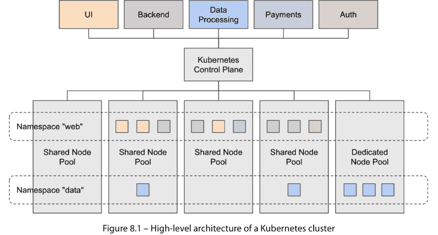

Figure 8.1 – Kubernetes 集群的高级架构

控制平面对于本章的示例至关重要，因为它是用户和自动化与集群交互的基础点。它提供了一个网络端点，公开 Kubernetes **应用程序编程接口 (API)**，并运行执行诸如将容器化应用程序接收到集群中等功能的软件。

这意味着控制平面的交互必须安全，我们必须利用 Cloud Build 的安全功能及其准入控制能力。

如果您是 Kubernetes 新手并希望深入了解，建议访问官方文档 (https://kubernetes.io/docs) 了解其运行方式。

GKE 是一个平台，Google 以服务形式向用户提供托管 Kubernetes 集群。GKE 提供的管理级别取决于您使用的集群模式。您可以从以下集群模式中选择：

- **GKE Standard**，其中控制平面由 Google 完全管理，但您仍可控制节点配置和升级生命周期的某些方面
- **GKE Autopilot**，其中控制平面和节点生命周期均由 Google 完全管理

在本示例中，您将使用 GKE 创建一个 GKE Standard 集群，这意味着控制平面将在 Google 拥有的环境中运行并由 Google 完全管理：

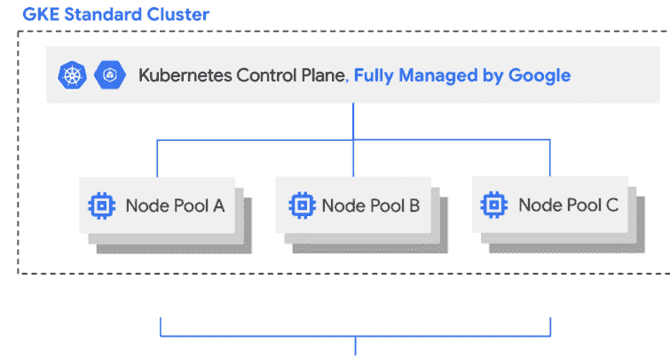

Figure 8.2 – GKE Standard 集群的高级架构

具体来说，您将创建一个私有 GKE Standard 集群。这是对 GKE 集群的配置，其中控制平面只能通过 Google 管理的网络上的私有端点访问，该网络与您自己的 Google 虚拟私有云（VPC）对等。

这意味着我们可以通过在 Cloud Build 中使用私有池来构建和部署到私有 GKE 集群，从而使 Cloud Build 和 GKE 的安全最佳实践保持一致。这可确保 Cloud Build 对 Kubernetes 控制平面的调用不会通过公共互联网传输，而是通过私有网络连接。

### 启用基础 Google Cloud 服务

要开始此示例并创建安全的构建基础设施，您必须首先确保在 Google Cloud 项目中启用所有相关服务。


强烈建议您在沙箱或测试 Google Cloud 项目中运行本章的示例，因为您不仅可以完全控制运行示例，还可以轻松清理创建的资源。

您将通过在 Cloud Shell (shell.cloud.google.com) 中启动会话开始，该会话是 Google Cloud 提供的临时 Linux 工作站。

使用以下命令从 GitHub 克隆示例存储库：

```
$ cd ~ && git clone https://github.com/agmsb/cloudbuild-gke.git && cd cloudbuild-gke/08
```

运行 gcloud 命令以配置 gcloud 使用适当的 Google Cloud 项目，如下所示，将 <add-project-id> 替换为您要使用的 Google Cloud 项目：

```
$ gcloud config set project <add-project-id>
```

鉴于建议在沙箱 Google Cloud 项目中运行此示例，最好将项目所有者角色分配给您在身份和访问管理 (IAM) 中的用户来完成。

使用项目所有者角色，您可以使用以下命令启用此项目所需的服务：

```
$ gcloud services enable container.googleapis.com cloudbuild.googleapis.com artifactregistry.googleapis.com binaryauthorization.googleapis.com servicenetworking.googleapis.com containeranalysis.googleapis.com
```

此命令将在您的项目中启用以下服务：

-   GKE
-   Cloud Build
-   Artifact Registry
-   Binary Authorization
-   Service Networking API
-   Container Analysis API

启用这些服务后，您现在可以开始设置本章示例的资源。

## 为您的环境设置 VPC 网络

我们将运行许多命令，这些命令需要为各种资源命名；为了方便您，默认名称已提供在可通过 GitHub 存储库访问的文件中。

建议您使用这些变量名称逐步完成此示例；完成后，您可以返回重用示例并将变量名称更改为更符合您用例含义的名称。

通过以下方式将 bin/variables.sh 文件中的环境变量读入当前会话：

```
$ source bin/variables.sh
```

设置好正确的变量后，我们可以继续创建第一组资源，如下所示：

-   为您的 GKE 集群提供 VPC
-   您的完全托管私有池工作节点可以与其建立对等连接的 VPC
-   通过私有加密连接连接上述 VPC 的 Cloud **虚拟专用网络 (VPN)** 隧道

更改到 vpc 目录，其中包含 main.tf 文件。此文件包含 Terraform 配置代码，用于创建上述资源。以下是您需要执行的代码：

```
$ cd infra/vpc
```

要使用 Terraform 配置代码，您需要在该目录中初始化 Terraform，方法是使用 terraform 命令行界面 (CLI) 运行以下命令。此命令最后在 terraform 版本 1.2.7 上进行了测试：

```
$ terraform init
```

使用以下命令通过 terraform CLI 查看将要创建的所有资源：

```
$ terraform plan
```

要实现这些更改，请按如下方式运行 terraform apply。终端提示时您还需要输入“yes”；这允许您继续在 main.tf 中预配资源：

```
$ terraform apply
```

完成此操作需要几分钟时间。创建完示例的 VPC 网络资源后，我们可以继续创建 GKE 集群。

## 设置您的私有 GKE 集群

由于 GKE 是一种托管的 Kubernetes 服务，因此在集群创建时通过传递的参数启用了众多即用型功能。

作为提醒，如果您在上一节工作后丢失了上下文，请运行以下命令导航到正确的目录并获取正确的环境变量。

将此处显示的 <add-project-id> 替换为您正在使用的项目：

```
$ gcloud config set project <add-project-id>
```

按如下方式导航到您正在工作的目录：

```
$ cd ~/cloudbuild-gke/08
```

通过运行以下命令获取所需的环境变量：

```
$ source bin/variables.sh
```

现在，我们可以创建 GKE 集群。运行以下命令开始集群创建。请注意，这会消耗 Google Compute Engine (GCE) 和 Persistent Disk 的配额，创建一个总共包含六个节点的集群，每个节点具有 20 GB 的 Persistent Disk：

```
$ gcloud container clusters create $CLUSTER_NAME \
  --project=$PROJECT_ID \
  --cluster-version=$CLUSTER_VERSION \
  --enable-ip-alias \
  --network=$CLUSTER_VPC_NAME \
  --subnetwork=$CLUSTER_SUBNET_NAME \
  --cluster-secondary-range-name=pod \
  --services-secondary-range-name=svc \
  --region=$REGION \
  --num-nodes=2 \
  --disk-size=20 \
  --enable-private-nodes \
  --enable-private-endpoint \
  --master-ipv4-cidr=$CLUSTER_CONTROL_PLANE_CIDR \
  --workload-pool=$PROJECT_ID.svc.id.goog \
  --enable-binauthz
```

此集群配置中有几件事值得注意。首先，我们能够通过 --enable-private-nodes、--enable-private-endpoint 和 --master-ipv4-cidr 参数将集群锁定为仅私有网络。

The --enable-private-nodes 参数确保 GKE 集群中运行的节点没有公共互联网协议 (IP) 地址。这默认阻止节点从 Docker Hub 等位置提取任何公开托管的容器镜像。通过以这种方式配置集群，您隐式地拒绝这些镜像在集群中运行——这是确保集群运行已知且受信任软件的良好开端。

本章后面，在 *在构建中启用工件的可验证信任* 部分，我们将回顾如何使用我们指定的最后一个参数 `--enable-binauthz` 显式确保您运行已知且受信任的软件。

鉴于此配置，这也意味着我们无法通过公共 IP 地址从 Container Registry 或 Artifact Registry 中提取。为了仍然确保我们的集群可以运行托管在 Google Cloud 注册表中的容器，我们需要 Private Services Access。这是在 Google Cloud 中的一项功能，使 Google 和第三方能够通过私有 IP 地址而不是公共端点提供可访问的服务。

默认情况下，这对于 GKE 私有集群是启用的；但是，如果您希望使用共享 VPC 重现此示例，则需要手动启用 Private Services Access。您可以在此处找到有关如何执行此操作的更多信息： https://cloud.google.com/vpc/docs/private-google-access.

`--enable-private-endpoint` 参数确保我们仅通过私有 IP 地址使 GKE 控制平面可用。这意味着人类和自动化的 API 调用都不会经过公共互联网。这些 API 调用可能包含敏感信息，会泄露有关您软件的详细信息，例如容器镜像名称、环境变量或密钥。因此，确保这些调用私下进行非常重要。

最后，`--master-ipv4-cidr=$CLUSTER_CONTROL_PLANE_CIDR` 定义了 Google 将用于分配私有 IP 地址以供您与控制平面交互的范围。这是因为控制平面实际上由 Google 拥有和运行；它与节点交互的方式是通过与您的 VPC 创建的对等连接，而您的 GKE 节点和其他创建的资源就位于该 VPC 中。

虽然此对等连接在集群创建时会自动为您创建，但我们实际上需要更新此对等连接以执行以下操作：

-   导出自定义路由以连接到私有池。
-   拒绝为公共 IP 目标交换路由。

运行以下命令以提取自动创建的对等连接的名称，并根据上述要点对其进行更新：

```
$ export GKE_PEERING_NAME=$(gcloud container clusters describe
$CLUSTER_NAME \
    --region=$REGION \
    --format='value(privateClusterConfig.peeringName)')
$ gcloud compute networks peerings update $GKE_PEERING_NAME \

```
--network=$CLUSTER_VPC_NAME \
--export-custom-routes \
--no-export-subnet-routes-with-public-ip
```

让我们回顾一下 GKE 集群的当前架构，现在我们已经创建了用于 GKE 私有集群的 VPC 以及集群本身。你可以在这里查看：

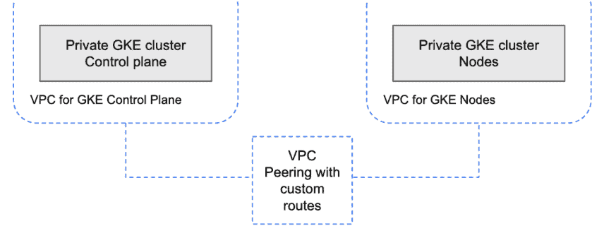

图 8.3 – 已创建的私有 GKE 集群的高级架构

总结一下，你所创建的关键方面包括以下内容：

- 确保对 GKE 控制平面的访问仅通过私有连接可用。
- 节点无法从公共镜像仓库拉取容器镜像。
- 节点通过私有内部 IP 地址拉取容器镜像。

完成此项后，让我们继续使用 Cloud Build 私有池创建安全的构建和部署基础设施。

## 保护构建和部署基础设施

在 Cloud Build 中保护软件交付流程时，重要的是从运行构建本身的底层基础设施开始。如果遭到入侵，攻击者可以访问敏感信息，例如你的源代码、构建可能访问的机密信息，以及构建所交互的部署目标。

*本章示例中的底层基础设施*具体指以下内容：

- 执行 Cloud Build 构建的私有池工作器
- VPC 网络，将工作器连接到 Artifact Registry 和 GKE 等系统
- 执行构建步骤的最小化或受管容器镜像

我们将首先为示例创建一个私有池。

## 使用安全最佳实践创建私有池

在第 2 章《配置 Cloud Build 工作器》中已介绍过，私有池是 Cloud Build 工作器的特定模式，其功能与默认池不同，包括 VPC 连接性和更大的机器类型可用性，同时仍完全托管在 Google 拥有的环境中。

在本示例中，我们将使用私有池运行四个构建，具体如下：

- 团队 A，构建 1—为 Python 应用构建容器镜像。
- 团队 A，构建 2—将容器镜像部署到 GKE。
- 团队 B，构建 1—为 Python 应用构建容器镜像。
- 团队 B，构建 2—将容器镜像部署到 GKE。

这模拟了这样一种场景：两个不同的团队都将工作负载部署到同一个 Kubernetes 集群，该集群通过使用 Kubernetes 命名空间隔离集群中的应用程序而配置为简单的多租户，如下图所示：

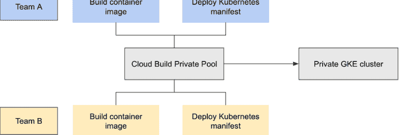

图 8.4 – 本章软件交付工作流的高级架构

在运行构建之前，我们必须创建私有池并将其设置好以与我们的 GKE 集群通信，同时牢记以下目标：

- 创建安全的 worker 在私有池中运行构建。
- 安全地访问 GKE 控制平面。
- 通过允许列表限制对 GKE 控制平面的访问。
- 保护 Cloud Build 和 GKE 通信的网络边界。

作为提醒，如果你在处理上一节后丢失了上下文，请运行以下命令导航到正确的目录并加载适当的环境变量。

将此处显示的 <add-project-id> 替换为你正在使用的项目：

```
$ gcloud config set project <add-project-id>
```

按如下方式导航到你正在工作的目录：

```
$ cd ~/cloudbuild-gke/08
```

按如下方式加载所需的环境变量：

```
$ source bin/variables.sh
```

牢记第一个目标，你将创建一个 Cloud Build 私有池，并确保我们可用的安全配置得到利用。但在创建私有池之前，我们必须创建以下几个额外的网络资源：

- 私有池工作器的私有 IP 范围
- VPC 对等，以便将我们之前创建的 VPC 与 Service Networking API (https://cloud.google.com/service-infrastructure/docs/enabling-private-services-access) 进行对等，使其能够连接到私有池工作器

要为私有池创建 IP 范围，请运行以下命令：

```
$ gcloud compute addresses create $PRIVATE_POOL_IP_RANGE_NAME \
  --global \
  --addresses=$PRIVATE_POOL_IP_RANGE \
  --purpose=VPC_PEERING \
  --prefix-length=$PRIVATE_POOL_IP_RANGE_SIZE \
  --network=$PRIVATE_POOL_VPC_NAME
```

要与我们之前创建的 VPC 创建对等连接，请运行以下命令：

```
$ gcloud services vpc-peerings connect \
  --service=servicenetworking.googleapis.com \
  --ranges=$PRIVATE_POOL_IP_RANGE_NAME \
  --network=$PRIVATE_POOL_VPC_NAME \
  --project=$PROJECT_ID
$ gcloud compute networks peerings update servicenetworking-googleapis-com \
  --network=$PRIVATE_POOL_VPC_NAME \
  --export-custom-routes \
  --no-export-subnet-routes-with-public-ip
```

我们使用两个值得注意的配置创建了对等连接：--export-custom-routes 和 --no-export-subnet-routes-with-public-ip。这些配置分别允许我们在私有池和私有 GKE 控制平面之间导出路由，同时防止任何带有公共 IP 地址的路由被导出。

在对等连接正确设置后，我们将通过以下方式完成网络配置，发布我们的私有池和 GKE 控制平面 IP 地址：

```
$ gcloud compute routers update-bgp-peer ${PRIVATE_POOL_ROUTER} \
  --peer-name=$PRIVATE_POOL_ROUTER_PEER_0 \
  --region=${REGION} \
  --advertisement-mode=CUSTOM \
  --set-advertisement-ranges=${PRIVATE_POOL_IP_RANGE}/${PRIVATE_POOL_IP_RANGE_SIZE}

$ gcloud compute routers update-bgp-peer ${PRIVATE_POOL_ROUTER} \
  --peer-name=$PRIVATE_POOL_ROUTER_PEER_1 \
  --region=${REGION} \
  --advertisement-mode=CUSTOM \
  --set-advertisement-ranges=${PRIVATE_POOL_IP_RANGE}/${PRIVATE_POOL_IP_RANGE_SIZE}

$ gcloud compute routers update-bgp-peer ${CLUSTER_ROUTER} \
  --peer-name=${CLUSTER_ROUTER_PEER_0} \
  --region=${REGION} \
  --advertisement-mode=CUSTOM \
  --set-advertisement-ranges=$CLUSTER_CONTROL_PLANE_CIDR

$ gcloud compute routers update-bgp-peer ${CLUSTER_ROUTER} \
    --peer-name=${CLUSTER_ROUTER_PEER_1} \
    --region=${REGION} \
    --advertisement-mode=CUSTOM \
    --set-advertisement-ranges=$CLUSTER_CONTROL_PLANE_CIDR
```

现在，我们可以继续创建私有池。要创建你的私有池，请先加载所需的环境变量，并在 infra/ 目录下创建名为 private-pool.yaml 的私有池配置文件，如下所示：

```
$ cat > infra/private-pool.yaml <<EOF
privatePoolV1Config:
  networkConfig:
    # egressOption: NO_PUBLIC_EGRESS
    peeredNetwork: projects/$PROJECT_ID/global/
networks/$PRIVATE_POOL_VPC_NAME
  workerConfig:
    machineType: e2-standard-2
    diskSizeGb: 100
EOF
```

在此配置文件中，与安全相关的最重要部分位于 networkConfig 部分。私有池由于完全由 Google 管理，其运行方式类似于 GKE 控制平面，即通过 VPC 对等获得对你 VPC 中资源的访问权限。你可以在下图中看到对此的说明：

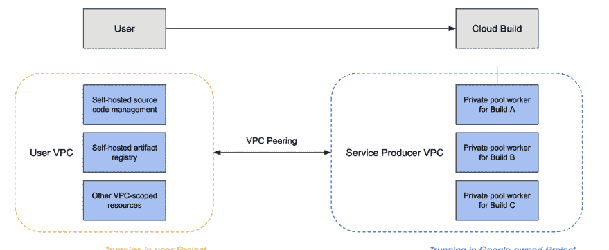

图 8.5 – 你 VPC 与私有池运行的 VPC 之间的网络架构

让我们回顾一下 `egressOption` 和 `peeredNetwork` 字段以及它们对我们私有池的含义，如下所示：

- 将 `egressOption` 设置为 `NO_PUBLIC_EGRESS` 会从私有池中的工作器中移除公共 IP 地址。
- 将 `peeredNetwork` 设置为与我们的 GKE 集群 VPC 分开的独立 VPC 是必需的。这是因为缺乏传递式对等功能。

如果我们从私有池中移除公共 IP 地址，这意味着我们还可以拒绝工作器基础设施访问公共互联网以及可能具有恶意或易受攻击的工件。这有助于减少软件交付管道可能被入侵的攻击面。

> **注意**
> 
> 对于本示例，我们将在私有池配置中省略 `NO_PUBLIC_EGRESS` 选项，因为我们将连接到的源代码仓库将是 `GitHub.com`。这是为了简化并避免任何许可需求。
> 
> 在安全的软件交付设置中，你理想情况下会将此参数与私有 **源代码管理 (SCM)** 系统（如 GitHub Enterprise）一起使用，私有池可以通过私有连接访问该系统。


现在，使用上一条命令中创建的配置文件创建一个私有池，如下所示：

```bash
$ gcloud builds worker-pools create $PRIVATE_POOL_NAME
--config-from-file infra/private-pool.yaml --region $REGION
```

然而，对许多人来说，仅使构建系统与 GKE 控制平面之间的通信保持私有是不够的。如果攻击者能够在具有该 VPN 访问权限的 VPC 中创建资源，他们仍可能与你的私有 GKE 控制平面进行交互。

让我们回顾一下如何从网络边界内的其他资源保护控制平面。

## 保护对私有 GKE 控制平面的访问

作为提醒，如果你在处理上一节后丢失了上下文，请运行以下命令以导航到正确的目录并加载正确的环境变量。

将此处显示的 <add-project-id> 替换为你正在使用的项目：

```bash
$ gcloud config set project <add-project-id>
```

按如下方式导航到你正在工作的目录：

```bash
$ cd ~/cloudbuild-gke/08
```

按如下方式加载所需环境变量：

```bash
$ source bin/variables.sh
```

建议使用 GKE 中的 GKE 控制平面访问功能的授权网络配置允许列表（https://cloud.google.com/kubernetes-engine/docs/how-to/authorized-networks），如下图所示：

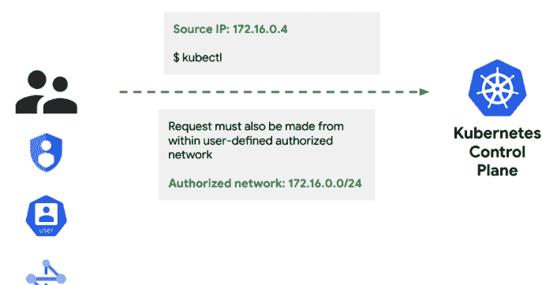

图 8.6 – 确保用户来自已知且受信任的网络身份

这将使你能够通过拒绝不在特定允许列表上的网络身份发来的任何流量来限制对控制平面的访问。这也意味着你必须向 GKE 提供应被授权调用控制平面的网络范围。你可以通过运行以下命令来实现：

```bash
$ gcloud container clusters update $CLUSTER_NAME \
  --enable-master-authorized-networks \
  --region=$REGION \
  --master-authorized-networks=$PRIVATE_POOL_IP_RANGE/$PRIVATE_POOL_IP_RANGE_SIZE
```

这现在意味着你只能利用此私有池中的 Cloud Build 工作器与你的 GKE 控制平面交互。如果你想使用 Compute Engine 虚拟机（VM）创建一个私有工作站或堡垒主机，你还需要将其私有 IP 地址添加到允许列表中，以便使用 kubectl 与 GKE 控制平面交互。

在工作器、集群和网络配置设置完成后，是时候开始评估我们的构建在此环境中运行的权限了。

## 将 POLP 应用于构建

当构建运行并与其他 Google Cloud 资源交互时，默认情况下它们会使用 Cloud Build 服务账号作为其身份，并为其分配权限。

然而，这并不能使构建或用户应用 POLP；如果有一个 GCP 服务账号被多个执行不同任务或与不同资源交互的构建使用，那么使用该服务账号的所有构建都会过度授权。

Cloud Build 支持按构建或按触发器的服务账号；这使你能够有意地并根据 POLP 创建每个服务账号。

这一原则确保每个构建拥有的权限不超过其成功执行所需的最小权限；这是通过特定用途的 GCP 服务账号实现的。

## 创建特定于构建的 IAM 服务账号

让我们首先创建两个 GCP 服务账号，每个模拟的团队一个。

作为提醒，如果你在处理上一节后丢失了上下文，请运行以下命令以导航到正确的目录并加载正确的环境变量。

将此处显示的 <add-project-id> 替换为你正在使用的项目：

```bash
$ gcloud config set project <add-project-id>
```

按如下方式导航到你正在工作的目录：

```bash
$ cd ~/cloudbuild-gke/08
```

按如下方式加载所需环境变量：

```bash
$ source bin/variables.sh
```

现在，创建第一个服务账号。它将与团队 A 相关联，并将与负责构建容器镜像并将其推送到 Artifact Registry 中团队 A 仓库的构建相关联。以下是你需要执行的代码：

```bash
$ gcloud iam service-accounts create $GCP_SA_NAME_01 \
  --display-name=$GCP_SA_NAME_01
```

该服务账号所需的权限是能够向 Artifact Registry 中的特定仓库写入容器镜像。这符合 POLP，因为我们不想授予对 Artifact Registry 中所有仓库的访问权限，特别是如果我们有其他团队构建和存储与团队 A 无关的镜像。以下截图中展示了其表示：

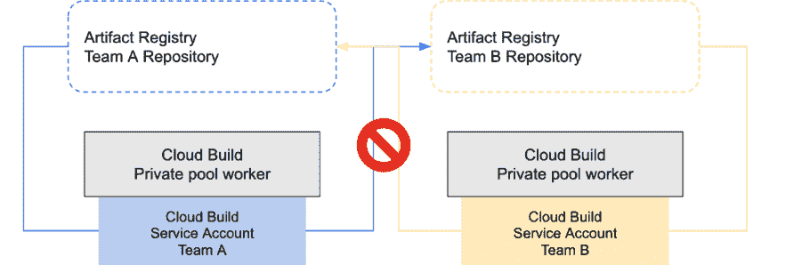

图 8.7 – 仅对特定 Artifact Registry 仓库具有权限的按构建服务账号

让我们在 Artifact Registry 中创建一个仓库，并附带一个角色绑定，该绑定将使服务账号获得对 Artifact Registry 中团队 A 的单个命名仓库的权限，如下所示：

```bash
$ gcloud artifacts repositories create $REPOSITORY_A \
  --repository-format=docker \
  --location=$REGION

$ gcloud artifacts repositories add-iam-policy-binding team-a-repository\
  --location us-west1 --member=$GCP_SA_NAME_01 --role=roles/artifactregistry.writer
```

现在让我们重复相同的过程，只是针对团队 B 用于构建和推送容器镜像到其在 Artifact Registry 中自己的仓库的特定服务账号，如下所示：

```bash
$ gcloud iam service-accounts create $GCP_SA_NAME_02 \
  --display-name=$GCP_SA_NAME_02

$ gcloud artifacts repositories create $REPOSITORY_B \
  --repository-format=docker \
  --location=$REGION

$ gcloud artifacts repositories add-iam-policy-binding team-b-repository\
  --location us-west1 --member=$GCP_SA_NAME_02 --role=roles/artifactregistry.writer
```

我们还必须授予服务账号日志访问权限，以便将构建日志写入 Cloud Logging，使用以下两个命令：

```bash
$ gcloud projects add-iam-policy-binding ${PROJECT_ID} \
--member="serviceAccount:${GCP_SA_NAME_01}@${PROJECT_ID}.iam.gserviceaccount.com" \
--role=roles/logging.logWriter
$ gcloud projects add-iam-policy-binding ${PROJECT_ID} \
--member="serviceAccount:${GCP_SA_NAME_02}@${PROJECT_ID}.iam.gserviceaccount.com" \
--role=roles/logging.logWriter
```

完成此操作后，我们将继续配置 GKE 集群侧服务账号的最小权限。与我们在 Artifact Registry 中所做的一样，我们将对集群访问应用 POLP。

## 构建服务账号的自定义 IAM 角色

由于团队 A 和团队 B 在你的 GKE 集群中将拥有自己的命名空间，我们只希望他们的服务账号对这些命名空间具有权限，而不是整个 GKE 集群，如下图所示：

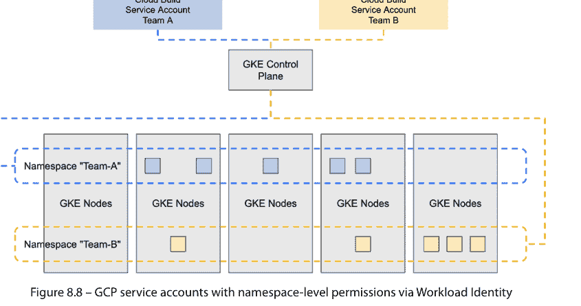

为此，我们必须在你的 GKE 集群中创建命名空间，为团队 A 和团队 B 的构建服务账号创建自定义 IAM 角色，并利用 Kubernetes 基于角色的访问控制（RBAC）以在 GKE 集群内拥有最小权限。

为了区分名称非常相似的资源，请参阅下图：

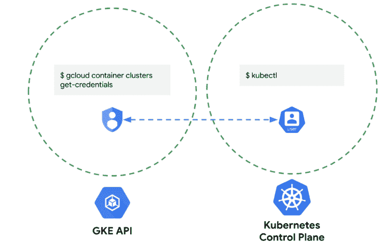

图 8.9 – 用于获取凭据的 GCP 服务账号；用于其他所有事物的 Kubernetes 服务账号

首先创建每个服务账号将用于获取 GKE 集群凭据的自定义角色，如下所示：

```bash
$ cat << EOF > infra/minimal-gke-role.yaml
title: minimal-gke
description: Gets credentials only, RBAC for authz.
stage: GA
includedPermissions:
- container.apiServices.get
- container.apiServices.list
- container.clusters.get
- container.clusters.getCredentials
EOF
$ gcloud iam roles create minimal-gke-role --project=$PROJECT_ID \
  --file=infra/minimal-gke-role.yaml
```

现在，将该自定义角色绑定到将用于部署 Team A 和 Team B 各自容器化应用程序到 GKE 集群的每个构建的每个服务帐户，如下所示：

```
$ gcloud projects add-iam-policy-binding ${PROJECT_ID} \
--member="serviceAccount:${GCP_SA_NAME_01}@${PROJECT_ID}.iam.gserviceaccount.com" \
--role=projects/${PROJECT_ID}/roles/minimal_gke_role
$ gcloud projects add-iam-policy-binding ${PROJECT_ID} \
--member="serviceAccount:${GCP_SA_NAME_02}@${PROJECT_ID}.iam.gserviceaccount.com" \
--role=projects/${PROJECT_ID}/roles/minimal_gke_role
```

在为 GCP 服务帐户设置了用于从 GKE 集群获取凭据的自定义角色后，我们现在必须设置 Kubernetes 资源。运行以下命令以在集群中创建命名空间和 Kubernetes 服务帐户：

```
$ gcloud projects add-iam-policy-binding ${PROJECT_ID} \
--member="serviceAccount:${GCP_SA_GCB_DEFAULT}" \
--role=roles/container.admin
$ cat << EOF > infra/bootstrap-cluster.yaml
steps:
  - name: gcr.io/cloud-builders/gcloud
    id: Bootstrap GKE cluster
    entrypoint: bash
    args:
      - '-c'
      - |
        gcloud container clusters get-credentials cluster
        --region $REGION --project $PROJECT_ID
        kubectl create ns $NAMESPACE_01
        kubectl create ns $NAMESPACE_02
        kubectl create role team-a-admin
        --verb=get,list,watch,create,update,patch,delete
        --resource=deployments.apps,services --namespace=$NAMESPACE_01
        kubectl create role team-b-admin
        --verb=get,list,watch,create,update,patch,delete
        --resource=deployments.apps,services --namespace=$NAMESPACE_02
        kubectl create rolebinding team-a-gcp-sa-binding
        --role=team-a-admin --user=${GCP_SA_NAME_01}@${PROJECT_ID}.iam.gserviceaccount.com --namespace=$NAMESPACE_01
kubectl create rolebinding team-b-gcp-sa-binding
--role=team-b-admin --user=${GCP_SA_NAME_02}@${PROJECT_ID}.iam.gserviceaccount.com --namespace=$NAMESPACE_02
options:
    workerPool: 'projects/$PROJECT_NUM/locations/$REGION/workerPools/$PRIVATE_POOL_NAME'
EOF
$ gcloud builds submit . --config=infra/bootstrap-cluster.yaml
```

现在让我们验证 GKE 和 Kubernetes 资源是否已相应设置。我们将创建一个测试构建，在其中尝试从我们创建的每个团队命名空间获取 Kubernetes 部署。

运行以下命令以创建并运行 Team A 的测试构建。构建应失败，但日志应显示该服务帐户能够获取 team-a 命名空间的资源，同时无法获取 team-b 命名空间的资源：

```
$ cat << EOF > bin/test-build-a.yaml
steps:
  - name: gcr.io/cloud-builders/gcloud
    id: Test GCP SA for Team A
    entrypoint: bash
    args:
      - '-c'
      - |
        gcloud container clusters get-credentials $CLUSTER_NAME
        --region $REGION --project $PROJECT_ID
        kubectl get deployments -n $NAMESPACE_01
        kubectl get deployments -n $NAMESPACE_02
serviceAccount: 'projects/$PROJECT_ID/serviceAccounts/${GCP_SA_NAME_01}@${PROJECT_ID}.iam.gserviceaccount.com'
options:
    workerPool: 'projects/$PROJECT_NUM/locations/$REGION/workerPools/private-pool'
    logging: CLOUD_LOGGING_ONLY
EOF

$ gcloud builds submit . --config=bin/test-build-a.yaml
```

您 Cloud Build 日志中的输出应类似于以下内容：

```
>2022-07-01T15:02:23.226364190Z No resources found in team-a namespace.

>2022-07-01T15:02:23.625289198Z Error from server (Forbidden): deployments.apps is forbidden: User "build-01-sa@agmsb-lab.iam.gserviceaccount.com" cannot list resource "deployments" in API group "apps" in the namespace "team-b": requires one of ["container.deployments.list"] permission(s).
```

如果您愿意，也可以使用 Team B 服务帐户进行测试。

在现在已保护构建基础设施并确保构建运行的权限保持最小化之后，是时候开始设置构建执行了。

## 配置构建的发布管理

在第 5 章《触发构建》中，我们介绍了构建触发器；在本文示例中，我们将使用与 GitHub.com 的触发器，尽管理论上此工作流可以应用于 GitHub Enterprise 等其他集成。

本示例中的工作流将按以下步骤顺序进行：

- 1. 开发者在功能分支上工作。
- 2. 开发者将代码更改推送到该功能分支上的 GitHub 仓库。
- 3. 开发者向主分支打开拉取请求（PR），触发第一次构建。
- 4. Cloud Build 运行测试并为应用程序构建容器镜像。
- 5. GitHub 仓库所有者合并 PR，触发第二次构建。
- 6. Cloud Build 运行并将容器镜像部署到私有 GKE 集群。

该工作流对 Team A 和 Team B 保持相同。为了开始逐步了解此工作流，请先设置 GitHub.com 以与 Cloud Build 集成。

## 将 SCM 与 Cloud Build 集成

运行此示例需要 GitHub.com 帐户。您可以开始在浏览器中登录您的 GitHub 帐户（https://www.github.com）。如果您没有，可以在此免费注册（https://docs.github.com/en/get-started/signing-up-for-github/signing-up-for-a-new-github-account）。

您还需要在 Cloud Shell 中使用内置的 gh 命令行实用程序进行身份验证，我们将使用它来自动创建 Team A 和 Team B 的仓库。

作为提醒，如果您在处理上一节后丢失了上下文，请运行以下命令以导航到正确的目录并加载适当的环境变量。

将 <add-project-id> 替换为，如图所示，您正在使用的项目：

```
$ gcloud config set project <add-project-id>
```

按如下方式导航到您正在工作的目录：

```
$ cd ~/cloudbuild-gke/08
```

按如下方式加载所需的环境变量：

```
$ source bin/variables.sh
```

现在，运行以下命令以逐步完成 GitHub 身份验证流程并按照收到的提示操作：

```
$ gh auth login
```

首先在 GitHub.com 上创建并推送两个仓库，一个用于 Team A，一个用于 Team B。我们将使用预建的仓库模板，其中包含 Team A 和 Team B 的各自文件。

使用以下命令创建并克隆 Team A 仓库：

```
$ cd bin
$ gh repo create $GH_A --public
$ gh repo clone $GH_A && cd $GH_A
```

通过运行以下命令使用 Team A 的仓库模板为该空仓库播种：

```
$ cp -r ../../repo_templates/team_a/. .
```

现在，按如下方式提交更改并将其推送到上游仓库：

```
$ git add .
$ git commit -m "Copy over example repo."
$ git push --set-upstream origin HEAD
```

我们将对 Team B 重复这些步骤，使用以下命令创建并克隆 Team B 仓库：

```
$ cd ..
$ gh repo create $GH_B --public
$ gh repo clone $GH_B && cd $GH_B
```

通过运行以下命令使用 Team B 的仓库模板为该空仓库播种：

```
$ cp -r ../../repo_templates/team_b/. .
```

现在，按如下方式提交更改并将其推送到上游仓库：

```
$ git add .
$ git commit -m "Copy over example repo."
$ git push --set-upstream origin HEAD
```

在我们设置触发器以从这些仓库的事件启动构建之前，我们需要安装 Cloud Build 的 GitHub 应用以与 GitHub.com 集成（https://cloud.google.com/build/docs/automating-builds/build-repos-from-github#installing_gcb_app）。

> **注意**
> 在本示例中，我们使用基于 GitHub.com 的集成与 Cloud Build，以简化操作并避免任何许可要求。
> 在更现实的示例中，您希望使用私有 SCM 系统（如 GitHub Enterprise）设置集成，Cloud Build 将与之具有私有连接。
> 要查看如何设置此类集成，请在此处查看文档：https://cloud.google.com/build/docs/automating-builds/build-repos-from-github-enterprise。

现在，按如下方式为 Team A 创建两个触发器：

```
$ gcloud beta builds triggers create github \
  --name=team-a-build \
  --region=$REGION \
  --repo-name=$GH_A \
  --repo-owner=$GH_USERNAME \
  --pull-request-pattern=master --build-config=build-a.yaml \
  --service-account=projects/$PROJECT_ID/
```

```
serviceAccounts/${GCP_SA_NAME_01}@${PROJECT_ID}.iam.gserviceaccount.com
$ gcloud beta builds triggers create github \
  --name=team-a-deploy \
  --region=$REGION \
  --repo-name=$GH_A \
  --repo-owner=$GH_USERNAME \
  --branch-pattern=master --build-config=deploy-a.yaml \
  --service-account=projects/$PROJECT_ID/serviceAccounts/${GCP_SA_NAME_01}@${PROJECT_ID}.iam.gserviceaccount.com \
  --require-approval
```

让我们回顾一下这两个触发器之间的一些差异。

在创建的第一个触发器中，我们利用了 Cloud Build 通过使用 --pull-request-pattern 参数来触发 PR 的支持。通过指定 main，这意味着在针对 master 分支打开 PR 时将运行构建。

在创建的第二个触发器中，我们改用 --branch-pattern 来触发 master 分支的任何更改。

现在，创建 Team B 的触发器，其模式将与 Team A 的触发器相同，如下所示：

```
$ gcloud beta builds triggers create github \
  --name=team-b-build \
  --region=$REGION \
  --repo-name=$GH_B \
  --repo-owner=$GH_USERNAME \
  --pull-request-pattern=master --build-config=build-b.yaml \
  --service-account=projects/$PROJECT_ID/serviceAccounts/${GCP_SA_NAME_02}@${PROJECT_ID}.iam.gserviceaccount.com
$ gcloud beta builds triggers create github \
  --name=team-b-deploy \
  --region=$REGION \
  --repo-name=$GH_B\
  --repo-owner=$GH_USERNAME \
  --branch-pattern=master --build-config=deploy-b.yaml \
  --service-account=projects/$PROJECT_ID/serviceAccounts/${GCP_SA_NAME_02}@${PROJECT_ID}.iam.gserviceaccount.com \
  --require-approval
```

触发器创建完成后，我们现在可以回顾如何对这些构建进行门控，确保在构建实际运行之前可以进行额外的人工审查。

## 使用手动审批对构建进行门控

这引出了您可能注意到的每个团队的两个触发器之间的最后一个差异——添加了 -require-approval 标志，该标志引入了构建的显式和手动审批方法。

这为具有 Cloud Build Approver 明确 IAM 权限的管理员提供了批准需要审批的构建的基础。如果没有此批准，构建将处于等待状态且不会执行。

对于此示例工作流，我们在 Team A 和 Team B 的第二个触发器前面放置手动审批，从而在模拟生产环境发布之前提供一个门控。

如果您访问 Cloud Build 控制台，您将看到等待审批的构建的以下选项：

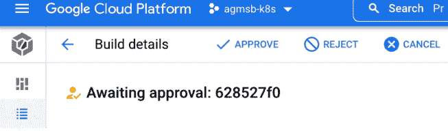

图 8.10 – 查看单个构建审批请求

实际批准构建时，此操作不仅会被记录在 Cloud Audit Logging 中以了解谁在何时执行了哪个发布，而且还使 Cloud Build Approver 能够提供理由和元数据来为批准构建的决定辩护，如以下屏幕截图所示：

## 批准构建

批准将导致此构建运行。了解更多信息

此触发器有 8 个较旧的构建正在等待审批。这是最新的一项。

添加一条可选消息以与构建的审批一起显示 0 / 1000

显示附加选项

取消   批准

图 8.11 – 从 Cloud Build 控制台查看构建审批对话框

这允许设置多个门控，既有隐式的也有显式的，以便人工审查决定代码和工件是否会被提升到不同的环境中，包括生产环境。

现在，让我们从头到尾运行此示例，通过分别触发我们为 Team A 和 Team B 描述的全部四个构建。

## 通过构建触发器执行构建

首先为这些触发器中的每个触发器创建 Cloud Build 配置文件。

作为提醒，如果您在处理上一节后丢失了上下文，请运行以下命令以导航到正确的目录并加载适当的环境变量。

将此处显示的 <add-project-id> 替换为您正在使用的项目：

```
$ gcloud config set project <add-project-id>
```

按如下方式导航到您正在工作的目录：

```
$ cd ~/cloudbuild-gke/08
```

按如下方式加载所需的环境变量：

```
$ source bin/variables.sh
```

首先创建用于构建 Team A 和 Team B 容器镜像的构建文件。这些构建将负责构建容器镜像并分别将其推送到 Artifact Registry 中的 Team A 和 Team B 仓库。以下是您需要执行的代码：

```
$ cat << EOF > bin/$GH_A/build-a.yaml
steps:
  - name: gcr.io/cloud-builders/docker
    id: Build container image
    args: ['build', '-t', '${REGION}-docker.pkg.dev/${PROJECT_ID}/${REPOSITORY_A}/team-a-app:v1',  '.']
images: [${REGION}-docker.pkg.dev/${PROJECT_ID}/${REPOSITORY_A}/team-a-app:v1]
serviceAccount: 'projects/${PROJECT_ID}/serviceAccounts/${GCP_SA_NAME_01}@${PROJECT_ID}.iam.gserviceaccount.com'
options:
  requestedVerifyOption: VERIFIED
  workerPool: 'projects/${PROJECT_NUM}/locations/${REGION}/workerPools/${PRIVATE_POOL_NAME}'
  logging: CLOUD_LOGGING_ONLY
images: [${REGION}-docker.pkg.dev/${PROJECT_ID}/${REPOSITORY_A}/team-a-app:v1]
EOF

$ cat << EOF > bin/build-b.yaml
steps:
  - name: gcr.io/cloud-builders/docker
    id: Build container image
    args: ['build', '-t', '${REGION}-docker.pkg.dev/${PROJECT_ID}/${REPOSITORY_B}/team-b-app:v1',  '.']
images: [${REGION}-docker.pkg.dev/${PROJECT_ID}/${REPOSITORY_B}/team-b-app:v1]
serviceAccount: 'projects/${PROJECT_ID}/serviceAccounts/${GCP_SA_NAME_02}@${PROJECT_ID}.iam.gserviceaccount.com'
options:
  requestedVerifyOption: VERIFIED
  workerPool: 'projects/$PROJECT_NUM/locations/$REGION/workerPools/$PRIVATE_POOL_NAME'
  logging: CLOUD_LOGGING_ONLY
images: [${REGION}-docker.pkg.dev/$PROJECT_ID/$REPOSITORY_B/team-b-app:v1]
EOF
```

接下来，按如下方式创建用于将 Team A 和 Team B 的应用程序部署到 GKE 集群中各自命名空间的构建文件：

```
$ cat << EOF > bin/$GH_A/deploy-a.yaml
steps:
- name: gcr.io/cloud-builders/gke-deploy
  id: Prep k8s manifests
  args:
  - 'prepare'
  - '--filename=k8s.yaml'
  - '--image=${REGION}-docker.pkg.dev/$PROJECT_ID/$REPOSITORY_A/team-a-app:v1'
  - '--version=v1'
- name: gcr.io/google.com/cloudsdktool/cloud-sdk
  id: Get kubeconfig and apply manifests
  entrypoint: sh
  args:
  - '-c'
  - |
    gcloud container clusters get-credentials $CLUSTER_NAME --region $REGION --project $PROJECT_ID
    kubectl apply -f output/expanded/aggregated-resources.yaml -n $NAMESPACE_01
serviceAccount: 'projects/${PROJECT_ID}/serviceAccounts/${GCP_SA_NAME_01}@${PROJECT_ID}.iam.gserviceaccount.com'
options:
  workerPool: 'projects/$PROJECT_NUM/locations/$REGION/workerPools/$PRIVATE_POOL_NAME'
  logging: CLOUD_LOGGING_ONLY
EOF

$ cat << EOF > bin/$GH_B/deploy-b.yaml
steps:
  - name: gcr.io/cloud-builders/gke-deploy
    id: Prep k8s manifests
    args:
      - 'prepare'
      - '--filename=k8s.yaml'
      - '--image=${REGION}-docker.pkg.dev/${PROJECT_ID}/${REPOSITORY_A}/team-b-app:v1'
      - '--version=v1'
  - name: gcr.io/google.com/cloudsdktool/cloud-sdk
    id: Get kubeconfig and apply manifests
    entrypoint: sh
    args:
      - '-c'
      - |
        gcloud container clusters get-credentials $CLUSTER_NAME --region $REGION --project $PROJECT_ID
        kubectl apply -f output/expanded/aggregated-resources.yaml -n $NAMESPACE_02
serviceAccount: 'projects/${PROJECT_ID}/serviceAccounts/${GCP_SA_NAME_02}@${PROJECT_ID}.iam.gserviceaccount.com'
options:
  workerPool: 'projects/$PROJECT_NUM/locations/$REGION/workerPools/$PRIVATE_POOL_NAME'
  logging: CLOUD_LOGGING_ONLY
EOF
```

为每个团队的仓库准备好构建文件后，让我们现在将这些更改推送到上游。我们将创建一个测试分支并将其推送到 GitHub.com 上的远程仓库，如下所示：

```
$ cd bin/$GH_A
$ git branch test
$ git checkout test
$ git add .
$ git commit -m "Add Cloud Build YAML files."
$ git push --set-upstream origin HEAD
$ cd ../$GH_B
$ git branch test
```


```
$ git checkout test
$ git add .
$ git commit -m "Add Cloud Build YAML files."
$ git push --set-upstream origin HEAD
$ cd ../..
```

我们现在可以访问 `GitHub.com` 的网页 **用户界面 (UI)**，在其中我们将被提示在每个仓库中分别创建 PR，以合并添加到测试分支的更改。

打开每个仓库的 PR 后，我们将看到第一对触发器启动。它们应分别构建 Team A 和 Team B 的容器镜像。通过指定 `images` 字段，我们还确保它们将由 Cloud Build 推送，并自动生成构建来源，如 *第 6 章、环境安全管理* 中所述。

现在，我们可以合并每个仓库的 PR，这将启动我们的第二对触发器。这些构建各运行两个步骤：首先，通过为每个容器镜像插入摘要来准备 Kubernetes 清单，其次，将这些清单应用到 GKE 集群。

由于需要审批，您必须在构建启动前批准每个构建。批准构建并成功完成后，导航到侧边栏中 GKE 菜单中的 **工作负载**。我们现在可以看到 `team-a-app` 和 `team-b-app` 已成功部署。您也可以导航到侧边栏中 GKE 菜单中的 **服务和入口**，以访问面向您各自应用请求的负载均衡器端点。

## 从构建中启用工件的可验证信任

最后，在通过 Cloud Build 将软件从源代码安全地交付到 GKE 时，您希望确保能够验证在集群中运行的软件工件确实是在受信任的环境中构建的——在这种情况下，是您的 Cloud Build 工作器。

Cloud Build 提供自动构建来源 (`https://cloud.google.com/build/docs/securing-builds/view-build-provenance`)，它使 Cloud Build 能够为其构建的每个容器镜像生成签名元数据，证明该工件源自 Cloud Build 中的构建，而不是通过 **场外 (OOB)** 的恶意行为者。

## 使用构建来源构建镜像

最后，在通过 Cloud Build 将软件从源代码安全地交付到 GKE 时，您希望确保能够验证在集群中运行的软件工件确实是在受信任的环境中构建的——在这种情况下，是您的 Cloud Build 工作器。您可以在此处看到此过程的说明：


图 8.12 – 构建来源提供证明工件来源的加密签名元数据

我们可以通过运行以下命令查看此元数据：

```
$ gcloud artifacts docker images describe \
$REGION-docker.pkg.dev/$PROJECT_ID/$REPOSITORY_A/team-a-app:v1 \
  --show-provenance
```

现在，我们将看看如何在部署过程中使用此元数据。

## 利用 Binary Authorization 进行准入控制

有了从 Cloud Build 角度生成的此元数据，我们现在可以通过启用 Binary Authorization 并创建策略来保护目标环境，这些策略将拒绝运行没有由 Cloud Build 生成的构建来源的容器镜像。

这使您能够生成对 Cloud Build 的可验证信任，并在 GKE 或 Cloud Run 中在运行时验证该信任。该过程在以下图表中说明：

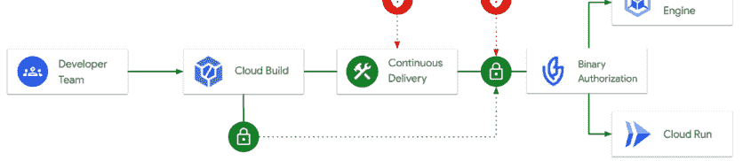

图 8.13 – 利用证明自动将工件准入或拒绝到生产 GKE 集群

在此示例中，我们将通过导入策略来启用 Binary Authorization，该策略要求来自 built-by-cloud-build 证明者的证明，该证明者在运行生成构建来源的构建时会自动为您生成。

运行以下命令创建所需的策略：

```
$ cat << EOF > infra/policy.yaml
globalPolicyEvaluationMode: ENABLE
defaultAdmissionRule:
    evaluationMode: REQUIRE_ATTESTATION
    enforcementMode: ENFORCED_BLOCK_AND_AUDIT_LOG
    requireAttestationsBy:
    - projects/${PROJECT_ID}/attestors/${ATTESTOR_ID}
EOF
```

运行以下命令导入所需的策略：

```
$ gcloud container binauthz policy import infra/policy.yaml
```

启用此策略后，我们现在可确保只有由 Cloud Build 构建并具有构建来源的镜像才会在部署时被准入到我们的集群。

让我们通过尝试部署一个 OOB 容器镜像来测试这一点，该镜像在 Cloud Shell 中本地构建，而不是通过 Cloud Build 中的工作器构建。

我们将通过将一个未由 Cloud Build 构建的现有示例容器拉取到我们的项目中来实现此目的。在 Cloud Shell 中配置 Docker 以从 Artifact Registry 拉取镜像，并像这样从 google-samples 拉取 hello-app 镜像：

```
$ gcloud auth configure-docker $REGION-docker.pkg.dev

$ docker pull us-docker.pkg.dev/google-samples/containers/gke/hello-app:1.0
```

然后，将容器镜像标记为 out-of-band-app 并推送到 Artifact Registry 中 Team A 的仓库，如下所示：

```
$ docker tag us-docker.pkg.dev/google-samples/containers/gke/hello-app:1.0 $REGION-docker.pkg.dev/$PROJECT_ID/$REPOSITORY_A/out-of-band-app:tag1
```

```
$ docker push $REGION-docker.pkg.dev/$PROJECT_ID/$REPOSITORY_A/out-of-band-app:tag1
```

现在，让我们使用 Cloud Build 中的构建创建 Kubernetes 清单并将其应用到我们的集群，如下所示：

```
$ cd bin
$ mkdir out-of-band && cd out-of-band

$ DIGEST=$(gcloud artifacts docker images describe $REGION-docker.pkg.dev/$PROJECT_ID/$REPOSITORY_A/out-of-band-app:tag1 --format="json" | jq '.image_summary."digest"' | cut -d "\"" -f 2)

$ cat << EOF > k8s.yaml
apiVersion: apps/v1
kind: Deployment
metadata:
  name: out-of-band-app
spec:
  selector:
    matchLabels:
      app: out-of-band
  replicas: 1
  template:
    metadata:
      labels:
        app: out-of-band
    spec:
      containers:
      - name: app
        image: $REGION-docker.pkg.dev/$PROJECT_ID/$REPOSITORY_A/out-of-band@$DIGEST
        imagePullPolicy: Always
EOF

$ cat << EOF > cloudbuild.yaml
steps:
- name: gcr.io/google.com/cloudsdktool/cloud-sdk
  id: Get kubeconfig and apply manifest of out of band app
  entrypoint: sh
  args:
    - '-c'
    - |
        gcloud container clusters get-credentials $CLUSTER_NAME --region $REGION --project $PROJECT_ID
        kubectl apply -f k8s.yaml -n $NAMESPACE_01
  serviceAccount: 'projects/${PROJECT_ID}/serviceAccounts/${GCP_SA_NAME_01}@${PROJECT_ID}.iam.gserviceaccount.com'
  options:
    workerPool: 'projects/$PROJECT_NUM/locations/$REGION/workerPools/$PRIVATE_POOL_NAME'
    logging: CLOUD_LOGGING_ONLY
EOF
$ gcloud builds submit . --config=cloudbuild.yaml
```

当在您的 GKE 集群中导航到 out-of-band-app 时，您应该会看到类似于此处的错误：

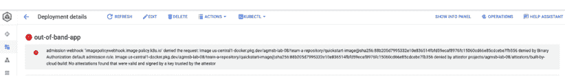

图 8.14 – 显示 out-of-band-app 没有所需证明的错误

Binary Authorization 具有灵活性和可扩展性；您还可以基于自定义证明和元数据创建策略，或利用与安全扫描的集成，并基于与工件内容相关联的漏洞级别创建策略。

使用 Binary Authorization 创建符合您要求和组织策略的策略是最佳实践——您可以在此处找到更多策略和用例示例：https://cloud.google.com/container-analysis/docs/ods-cloudbuild#build_your_container.

### 摘要

在本章中，我们回顾了如何为共享 GKE 集群的多个团队在 Cloud Build 中设置安全的软件交付管道。我们使用私有连接和具有最小权限的每个构建 GCP 服务账户设置了安全的基础设施。我们引入了带有人机回路审查的 Cloud Build 审批，同时确保我们只将受信任且经过验证的容器镜像准入到我们的 GKE 集群。

这些功能和实践使您能够开始实施更安全的软件交付管道到 GKE，这是 Google Cloud 中最受欢迎的运行时之一。

接下来，我们将把重点转移到使用 Cloud Build 通过更以开发者为中心、无服务器的平台——Cloud Run 来自动化工作流。


