## 使用 Cloud Build 自动化无服务器

无服务器平台通常专注于开发者体验，力求在尽可能少的运维开销下让开发者专注于代码。在 Google Cloud 中，Cloud Functions 和 Cloud Run 等平台力求提供无缝的开发者体验，将部署生产就绪代码所需的运维工作降至最低。

尽管如此，这些平台并未忽视某些运维任务的需求，而是提供了简单而强大的抽象，供开发者在生产环境中管理代码使用。这些任务可能包括将代码构建为制品、推出代码新版本、水平扩展代码、通过私有网络连接服务等。

Cloud Build 通常用于编排此类活动。凭借与 Google 无服务器产品原生的集成，Cloud Build 帮助开发者完成这些任务，同时仍忠于无服务器的愿景——专注于代码，而非运维。

在本章中，我们将涵盖以下主题：
- 了解 Cloud Functions 和 Cloud Run
- 无需配置即可构建容器
- 为 Cloud Run 和 Cloud Functions 自动化任务

### 了解 Cloud Functions 和 Cloud Run

我们将首先回顾本章范围内的“无服务器”平台 Cloud Functions 和 Cloud Run。在了解开发者在各自平台上的职责后，我们再介绍如何使用 Cloud Build 来管理这些职责。

### Cloud Functions

当希望以尽可能少的运维开销运行代码时，**Cloud Functions** 是大多数开发者首先选择的起点。在该平台上，开发者可以选择 Cloud Functions 支持的语言运行时并编写小块代码。开发者随后可以将代码部署到 Cloud Functions，并在生产环境中运行，而无需执行以下操作：
- 将代码构建为制品
- 构建运行代码的容器
- 创建运行代码的基础设施
- 管理运行和扩展代码的基础设施
- 设置代码实例的连接性
- 为运行中的代码配置日志记录和监控

相反，开发者可以专注于编写代码，并使用单个 `gcloud` 命令部署到 Cloud Functions：

```
$ gcloud functions deploy function-name --source .
```

Cloud Functions 支持来自包括 **Python**、**Node.js**、**Go** 和 **Java** 在内的语言的特定版本运行时。你可以在此处找到当前支持版本的完整列表：https://cloud.google.com/functions/docs/writing.

使用 Cloud Functions 最常见的模式是编写事件驱动的函数，即它们响应特定事件的发生而执行。这可能是数据库的更改、云资源的创建，或对 Webhook 的响应。

### Cloud Run

**Cloud Run** 旨在为那些已经或将对在容器中运行代码感兴趣，但仍希望开销尽可能少的开发者提供友好的平台。

一旦开发者拥有容器，他们就可以使用单个 `gcloud` 命令将其部署到 Cloud Run：

```
$ gcloud run deploy my-backend --image=us-docker.pkg.dev/project-name/container-image
```

在容器中运行代码的需求或必要性可能来自多项要求：
- 开发者希望确保从开发到生产的多個执行环境中行为一致。
- 企业中的开发者可能需要为代码轻松迁移到不同平台（如 Kubernetes）做好准备。
- 开发者可能将代码部署到多个位置，需要统一的打包标准来部署该代码。

对于这些开发者，他们可能首先需要自行构建容器，然后将其带到运维最少的“无服务器”平台。Cloud Run 提供了这样的平台，允许开发者使用容器作为部署机制，同时仍受益于 Cloud Run 管理以下任务：
- 创建运行代码的基础设施
- 管理运行和扩展代码的基础设施
- 设置代码实例的连接性
- 为运行中的代码配置日志记录和监控

Cloud Run 还允许开发者在“服务”和“作业”之间做出区分。Cloud Run 服务允许通过 HTTPS 端点访问的长期运行服务，而 Cloud Run 作业允许运行至完成的服务，可并行运行实例执行工作，并为每个实例分配一个索引，开发者可利用该索引分配工作。

最后，Cloud Run 允许开发者使服务遵循 Knative API。

Knative 是一个开源项目，使运营者能够在 Kubernetes 集群之上托管自己的自管理无服务器平台。由于 Cloud Run 遵循 Knative API 规范，当用户部署 Cloud Run 服务时，他们还将获得可用于将同一容器部署到任何地方运行的 Kubernetes 集群的配置。

这使得 Cloud Run 不仅是一个无服务器容器平台，而且可以扩展到 Google Cloud 之外的环境，且几乎无需或不需要配置更改。

### Cloud Functions 第二代

有一个较新的 Cloud Functions 版本，名为 Cloud Functions 2nd gen（https://cloud.google.com/functions/docs/2nd-gen/overview），于 2022 年发布。在本章剩余部分，我们将主要与此版本交互。Cloud Functions 2nd gen 的关键变化之一是它构建于 Cloud Run 之上。

这意味着 Cloud Functions 在 Cloud Run 之上提供了一个抽象层，满足构建容器并部署到 Cloud Run 的要求，使不熟悉容器的用户仍可使用该平台。它保持了前一版 Cloud Functions 建立的开发者契约：编写代码，让平台处理其余部分。

与第一个版本一致，部署 Cloud Functions 2nd gen 也可以通过单个命令完成：

```
$ gcloud functions deploy function-name --gen2 --source .
```

此次重平台化在内部带来了多项改进：
- 更长的代码执行超时时间
- 支持对单个代码实例的并发请求
- 支持在代码修订版本之间拆分流量
- 支持更大类型的实例

Cloud Functions 2nd gen 还与 Google Cloud 的 Eventarc（https://cloud.google.com/eventarc/docs）集成，后者是一种托管事件传递服务，提供了数十种开箱即用的来自 Google Cloud 资源的事件支持。

### 比较 Cloud Functions 和 Cloud Run

由于 Cloud Functions 2nd gen 构建为 Cloud Run 之上的抽象层，应注意使用场景可能存在重叠。虽然本章不讨论何时使用其中一个的完整讨论，但应注意一般而言，Cloud Functions 通常执行单一任务，对事件做出某种处理响应。此外，虽然 Cloud Functions 2nd gen 在内部使用 Cloud Run，但你无法自定义其创建和部署的容器。相反，你受限于提供的运行时，并在这些约束内工作。

另一方面，Cloud Run 是一个功能完善的容器即服务平台。这意味着你可以将任何内容构建到容器镜像中并在 Cloud Run 上运行——从 Web 服务到单体应用程序！

接下来，让我们回顾开发者如何简化标准包——容器——的生产，该容器由 Cloud Run 和 Cloud Functions 2nd gen 使用。这种简化有助于在认知上最小化开销，减少个人工作站资源的占用，并避免导致信息孤岛的本地优化。

### 无需构建配置即可构建容器

如果在无服务器上构建的使命是让开发者尽可能轻松地运行软件，那么考虑可以减少认知负担的领域就很重要——尤其是那些不独特或不特定于为其业务提供独特价值的领域。


## Dockerfile

对于已经为其应用程序使用过容器的开发者，他们可以将 Dockerfile 带来到 Cloud Build，并且无需编写任何构建配置即可立即运行构建：

```
$ gcloud builds submit --tag REGION-docker.pkg.dev/PROJECT_ID/REPO/IMAGE_NAME
```

使用 gcloud 时，它可以检测到当存在 Dockerfile 但缺少构建配置时，你的意图是提交一个单步构建，该构建运行 Docker 并构建你的容器镜像。

然而，如果你没有编写高效且结构良好的 Dockerfiles 的先前经验和历史，你可能希望不仅利用无需编写构建配置的优势，还避免从零开始优化 Dockerfile。

## Language-specific tooling

 heavily 使用单一语言（如 Java 或 Go）的开发者可能会改用语言特定的工具，这些工具抽象掉了编写任何 Dockerfile 或构建的需求，而是 a) 为你处理这些，b) 包含针对你的应用程序语言和运行时的特定优化。

虽然这里的示例并不详尽，让我们回顾一些有助于开发者构建容器且与 Cloud Build 等平台兼容的语言特定工具的示例。

对于 Java 开发者，通常使用 Maven 或 Gradle 等工具将项目构建为 JAR 文件。没有语言特定的工具，开发者就需要经历编写 Dockerfile 的过程——这意味着确保他们选择正确的基镜像、适当排序图层等等。

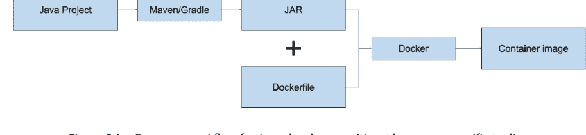

Figure 9.1 – 没有语言特定工具的 Java 开发者的常见工作流程

Google 已开源一个名为 **Jib** 的项目，它可以直接从 Java 项目构建并生成容器镜像，而无需开发者处理 Dockerfile。它还已作为 Maven 和 Gradle 的插件发布。

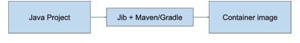

Figure 9.2 – 使用 Jib 简化构建容器的工作流程

Java 开发者随后可以在 Cloud Build 中将 Jib 与 Maven 或 Gradle 一起作为构建步骤运行，从而将构建需求从本地资源中卸载。一旦在云中使用 Jib 运行构建，他们还可以开始利用与其他 Google Cloud 服务（如 **Cloud Storage**）的集成来缓存构建文件。

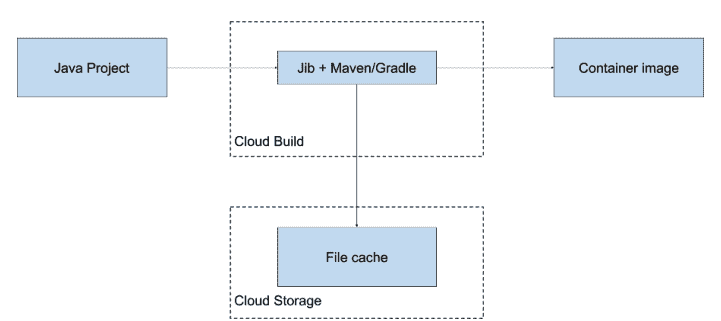

Figure 9.3 – 将 Jib 作为 Cloud Build 步骤运行并使用 Cloud Storage 作为构建缓存

对于 Go 开发者，Google 开源了一个类似的项目 **Ko**。Ko 为 Jib 提供了类似的优势，通过让拥有 Go 应用程序的人直接使用 Ko 来生成标准且一致的容器镜像，而无需编写 Dockerfile。

尽管如此，Cloud Run 和 Cloud Functions 2<sup>nd</sup> 代并未原生公开使用语言特定工具来构建底层容器镜像的使用。让我们现在回顾 Cloud Run 和 Cloud Functions 2<sup>nd</sup> 代如何抽象掉容器镜像的构建过程：buildpacks。

## Buildpacks

在 Google Cloud 中，Cloud Functions 和 Cloud Run 等无服务器产品都结合 Cloud Build 使用 Google 支持的 **Cloud Native Buildpacks** (https://buildpacks.io) 来为开发者提供此体验。

Cloud Functions 和 Cloud Run 都旨在抽象掉使用 buildpacks 构建容器镜像的过程，但仍然有必要回顾其底层原理以及它们如何与 Google Cloud Build 交互。

Cloud Native Buildpacks 是一个开源项目，旨在为开发者提供一种简化的方式，直接从源代码构建容器，而无需开发者自行定义容器。

其实现方式是提供可执行文件来检查你的源代码，并据此规划和执行容器镜像的创建。

Buildpacks 使用两个主要阶段构建容器镜像：

- Detect
- Build

这些阶段发生在名为 **builder** 的资源中。Google 的 builder 以托管在 **Container Registry** 中的容器镜像形式提供。你可以通过运行以下命令找到并检查此容器镜像：

```
$ docker pull gcr.io/buildpacks/builder
```

Google 的 builder 容器镜像打包了可构建 Go、Python、Java 和 .NET 应用程序的 buildpacks。你可以在此处找到最新的运行时支持 here (https://github.com/GoogleCloudPlatform/buildpacks#general-builder-and-buildpacks)。

这些 buildpacks 将使用 detect 可执行文件在你的源代码上运行 detect 阶段。在 detect 阶段，buildpack 将确定你的应用程序是否具有构建所需的先决条件——在 Python 中，我们可以认为是 requirements.txt 文件；这些先决条件会根据你的运行时而有所不同。

如果满足这些先决条件，则构建阶段将开始。构建阶段将使用构建基镜像构建你的应用程序，然后将输出内容复制到所谓的运行基镜像中，以完成托管你的应用程序的镜像的创建。

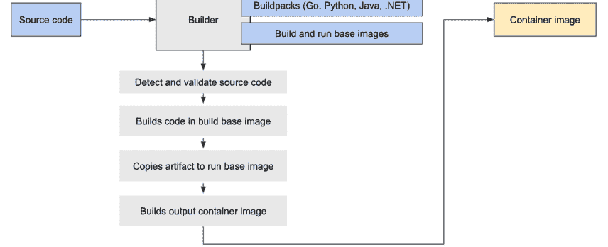

Figure 9.4 – 使用 builder 与 buildpacks 直接从源构建容器镜像的工作流程

> **Note**
> 如果你需要自定义此过程中使用的 builder 或运行镜像，可以按照此处的过程进行：https://github.com/GoogleCloudPlatform/buildpacks#extending-the-run-image。
> 这通常是需要将自己的系统级软件包安装到这些镜像中的用户所必需的。

此过程由一个抽象掉该过程的平台封装；最常见的消费方式之一是通过 pack CLI。此工具使你能够直接从应用程序目录快速运行并启动两个阶段来构建容器镜像。

要在本地使用 pack 与 Google 的 builder 容器镜像，你可以从应用程序源代码目录运行以下命令：

```
$ pack build my-app --builder gcr.io/buildpacks/builder
```

运行 pack 会在运行它的机器上调用 Docker daemon，使用它来执行 builder 容器。许多开发者经常面临安全限制——有时还有资源限制——这些限制阻止他们在本地运行 Docker。因此，Google Cloud Build 提供了在 Cloud Build 工作器上使用 buildpack builder 构建容器镜像的原生功能。

要使用 Cloud Build 对使用 buildpacks 构建容器镜像的原生支持，请从源代码目录运行以下命令：

```
$ gcloud builds submit --pack image=gcr.io/$PROJECT_ID/my-app
```

运行此命令将在 Cloud Build 中启动构建，以构建、标记并将你的容器镜像推送到 Container Registry。

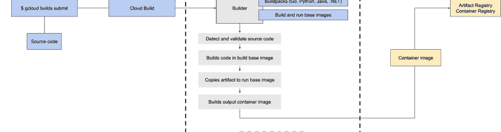

Figure 9.5 – 使用 Cloud Build 使用 builder 与 buildpacks 直接从源构建容器镜像的工作流程

此构建需要访问公共互联网来拉取 builder，因此请记住，如果你使用的是私有池，必须在项目的 Container Registry 或 Artifact Registry 中自行托管 builder 镜像。

对于希望建立标准化镜像并将自定义或专用工具打包到生成的最终容器镜像中的 DevOps 或安全团队，你也可以遵循相同的流程。

构建和托管你自己的 builder 允许你通过使用 Google 提供的 builder 镜像作为基础镜像然后添加自己的软件包，为开发者提供标准但定制的镜像，类似于以下示例：

```
# For demonstration purposes only, to run this build would require setup beyond the scope of its inclusion
FROM gcr.io/buildpacks/builder:v1
USER root
RUN apt-get update && apt-get install -y --no-install-recommends \
    subversion && \
    apt-get clean && \
```

```
rm -rf /var/lib/apt/lists/*
USER cnb
```

使用 Cloud Build，您可以通过在提交构建时将其设置在 builder 标志中来提供自定义构建器镜像，示例如下：

```
$ gcloud builds submit --pack builder=gcr.io/$PROJECT_ID/my-builder image=gcr.io/$PROJECT_ID/my-app
```

通过此模式，我们兼得两者之利：

- 开发人员可以更专注于编写代码，因为此方法不需要任何 Dockerfile 或 Cloud Build 配置。
- 运营和安全团队可以建立最佳实践和标准，要么使用 buildpacks 团队提供的开箱即用方案，要么在其基础上使用自己的定制工具构建。

现在我们已经回顾了 buildpacks 的基础知识，让我们深入了解 Cloud Run 和 Cloud Functions 如何使用 Cloud Build 来自动化 buildpacks 的使用——以及许多其他任务。

## 用于 Cloud Run 和 Cloud Functions 的任务自动化

本章的这一部分，我们将回顾与 Cloud Run 和 Cloud Functions 相关的众多任务，您可以使用 Cloud Build 对其进行自动化。

## 部署服务和作业到 Cloud Run

第一个，也可能是最简单的可自动化任务是构建和部署容器镜像。本书前面在第 4 章《Build Configuration and Schema》和第 7 章《Automating Deployment with Terraform and Cloud Build》中，我们已回顾了使用 Google Cloud API 的多种方法，具体如下：

- gcloud
- Terraform

两者都封装了 API，使开发人员能够使用 Google Cloud API 管理资源，包括 Cloud Run 服务和作业。

从开发者体验角度来看，在考虑如何从 Cloud Build 与 Cloud Run 交互时，优先使用 gcloud，因为对于希望将运营开销降至最低的开发者来说，它更容易理解。Terraform 使用一种类似 JSON 的语言编写，称为 HashiCorp 配置语言（HCL），它有自己的语法，开发者必须学习（https://www.terraform.io/language/syntax/configuration）。

> **Note**
> 需要注意的是，许多企业和组织确实要求其开发人员使用 Terraform 创建所有云资源，以实现一致性和可重用性。

首先，让我们回顾一个简单的构建，它模仿了本书前面回顾过的构建配置，具体在第 3 章《Getting Started – Which Build Information Is Available to Me?》和第 4 章《Build Configuration and Schema》中：

```
# For demonstration purposes only, to run this build would
require setup beyond the scope of its inclusion
steps:
# Build the container image
- name: 'gcr.io/cloud-builders/docker'
  args: ['build', '-t', 'gcr.io/PROJECT_ID/IMAGE', '.']
# Push the container image to Container Registry
- name: 'gcr.io/cloud-builders/docker'
  args: ['push', 'gcr.io/PROJECT_ID/IMAGE']
# Deploy container image to Cloud Run
- name: 'gcr.io/google.com/cloudsdktool/cloud-sdk'
  entrypoint: gcloud
  args: ['run', 'deploy', 'SERVICE-NAME', '--image', 'gcr.io/PROJECT_ID/IMAGE', '--region', 'REGION']
images:
- gcr.io/PROJECT_ID/IMAGE
```

这里的核心区别是第三个构建步骤，其中使用 gcloud 将容器镜像部署到 Cloud Run。虽然这相当直接，但它提供了一个有用的机会来强调所使用的特定构建器，即 cloud-sdk 镜像。

在第 4 章《Build Configuration and Schema》中，我们讨论了 Cloud Builders 的概念，即由 Cloud Build 团队为构建步骤提供的容器镜像。在 Cloud Builders 项目中，已经有一个用于 gcloud 的镜像。然而，在此示例中，我们使用的是官方 Cloud SDK 团队提供的 cloud-sdk 镜像。

你可以使用非常相似的构建来启动 Cloud Run 作业：

```
# For demonstration purposes only, to run this build would
require setup beyond the scope of its inclusion
steps:
# Build the container image
- name: 'gcr.io/cloud-builders/docker'
  args: ['build', '-t', 'gcr.io/PROJECT_ID/IMAGE', '.']
# Push the container image to Container Registry
- name: 'gcr.io/cloud-builders/docker'
  args: ['push', 'gcr.io/PROJECT_ID/IMAGE']
# Deploy container image to Cloud Run
- name: 'gcr.io/google.com/cloudsdktool/cloud-sdk'
  entrypoint: gcloud
  args: ['beta', 'run', 'jobs', 'create', 'JOB-NAME', '--image', 'gcr.io/PROJECT_ID/IMAGE', '--region', 'REGION']
images:
- gcr.io/PROJECT_ID/IMAGE
```

虽然知道 gcloud 构建步骤足以部署 Cloud Run 服务和作业是有用的，但 Cloud Run 的资源中内置了多个生命周期功能。这些功能要么在底层原生使用 Cloud Build，要么可以使用与前面所示类似的构建进行自动化。

## 部署到 Cloud Functions

对于 Cloud Functions，您可以使用相同的 cloud-sdk 镜像来使用 gcloud 调用 gcloud functions deploy 命令：

```
# For demonstration purposes only, to run this build would require setup beyond the scope of its inclusion
steps:
- name: 'gcr.io/google.com/cloudsdktool/cloud-sdk'
  args:
  - 'gcloud'
  - 'functions'
  - 'deploy'
  - 'FUNCTION_NAME'
  - '--gen2'
  - '--region=FUNCTION_REGION'
  - '--source=.'
  - '--trigger-http'
  - '--runtime=RUNTIME'
```

使用前一个命令部署代码时，Cloud Functions 在底层实际上会“编译”为两件事：

- Cloud Functions 在 Cloud Build 中启动一个单步构建，在 Cloud Build 的默认 worker 上运行 pack CLI。
- Cloud Functions 获取构建的镜像并自动化 Cloud Functions 及其底层 Cloud Run 资源的部署。

> **Note**
> 您还可以使用 `--build-worker-pool` 标志在使用 gcloud functions deploy 时指定 Cloud Build 中的特定 worker 池来构建函数代码的后端容器镜像。

如果您正在处理全新工作负载，建议您采用 Cloud Functions 2ⁿᵈ gen 而非第一代 Cloud Functions。

## 从源代码直接部署到运行在 Cloud Run 中的容器

我们现在已经讨论了 buildpacks 的工作原理以及如何使用 Cloud Build API 调用 buildpacks 来构建容器镜像。我们还回顾了 Cloud Functions 如何将其部署方法中原生集成 buildpacks。

Cloud Run 也在其资源中公开了 buildpacks 的使用，允许开发人员直接使用这些 API 不仅运行其代码，还可以在没有任何 Dockerfile 或 YAML 配置的情况下自动构建其容器。

以下示例命令显示了一个额外的标志，引用了源目录的位置：

```
$ gcloud run deploy my-app --source .
```

与 Cloud Functions 2nd gen 类似，带有 --source 标志的此命令同样会“编译”为两个 gcloud 命令：

- 创建并执行一个构建，在 Cloud Build 的默认 worker 上运行 pack CLI 以构建容器镜像并将其推送到 Container Registry
- 运行 gcloud run deploy，将 image 字段设置为前一步刚构建的容器镜像

这使开发人员能够快速测试其应用程序在 Cloud Run 中打包在容器镜像中运行。

> **Note**
> 
> 在出版时，与 Cloud Functions 2ⁿᵈ gen 不同，通过 Cloud Run 启动的所有构建都将安排并在默认池中的 worker 上执行。

然而，正如我们在前几章中所讨论的，更可能的是，您将实现带有触发器的构建以自动化上述步骤的执行。

要在 Cloud Run 的上下文中配置此项，您需要在创建服务时查看 Cloud Run UI 控制台——选择 **从源代码库持续部署新版本** 然后 **使用 Cloud Build 设置**：

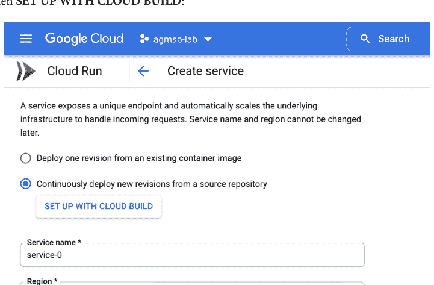

图 9.6 – 创建一个直接从已连接源代码库部署的服务

然后，您可以定义要使用的源代码库，定义使用正则表达式想要触发新构建的分支或分支，并选择 Google Cloud Buildpacks 作为 Cloud Build 在构建容器镜像时要使用的机制。

> **Note**
> 
> 为了完成此步骤，您需要将诸如 GitHub、GitHub Enterprise 或 Bitbucket 等源代码库连接到 Cloud Build。您可以在 Cloud Build 文档（https://cloud.google.com/build/docs/）中找到设置此项的最新说明。


## 设置 Cloud Build

借助 Cloud Build 提供的持续部署，对源代码仓库的更改会自动构建为 Container Registry 中的容器镜像并部署到 Cloud Run。

您的代码应监听 $PORT 上的 HTTP 请求。您的仓库必须包含 Dockerfile 或 Go、Node.js、Python、Java、.NET Core 或 Ruby 的源代码，以便构建为容器镜像。

### 源代码仓库

### 构建配置

分支 *
^main$
使用正则表达式匹配特定分支 了解更多

匹配分支：main

构建类型
Dockerfile
Go, Node.js, Python, Java, .NET Core 或 Ruby via Google Cloud Buildpacks
构建上下文目录 *
/
该目录将用作 Buildpack 构建上下文。
入口点
启动服务器的命令，留空以使用默认行为？
保存

图 9.7 – 在 Cloud 控制台中为 Cloud Run 服务启用使用 buildpacks 的构建

通过此设置，您源代码仓库中指定分支的更改现在将触发 Cloud Run 设置的相同构建。虽然不是必须的，但如果您想查看构建或构建日志，可以导航到 Cloud Build 控制台。

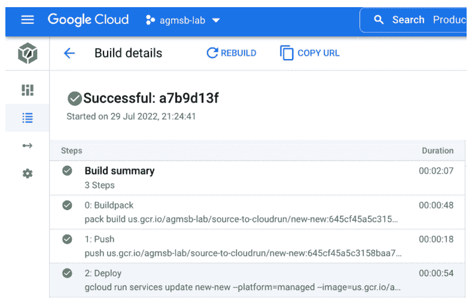

图 9.8 – Cloud Run 在 Cloud Build 中自动创建的三步构建

话虽如此，Cloud Run 还会在 Cloud Run 控制台中直接展示整个服务的构建历史以及每个修订版本的构建日志。

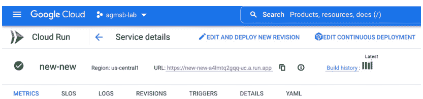

图 9.9 – Cloud Run 控制台中可用的构建历史

### 主容器（端口 8080，1 CPU，512MiB 内存）

| 属性 | 值 |
|---|---|
| 镜像 URL | us.gcr.io/agmsb-lab/source-to-cloudrun/new-new@sh... |
| 端口 | 8080 |
| 构建 | Cloud Build (logs) |
| 源 | https://github.com/agmsb/source-to-cloudrun/comm... |
| 命令和参数 | (container entrypoint) |
| CPU 限制 | 1 |
| 内存限制 | 512MiB |

图 9.10 – Cloud Run 控制台中可用的构建日志

Cloud Run 在其即用型源到生产功能之下使用 Cloud Build。通过将 Cloud Build 的功能原生地编织到 Cloud Run 资源中，开发人员能够实现无服务器平台所承诺的易用性。

话虽如此，刚刚回顾的方法提供了一种有主见的部署模型，可自动化蓝绿部署的逐步过程。

蓝绿部署是一种方法，其中部署了应用程序的两个版本，并且 1-100% 的流量从旧的“蓝色”版本切换到新的“绿色”版本：

### 修订版本 管理流量

| 名称 | 流量 | 已部署 | 修订版本 URL（标签） | 操作 |
|---|---|---|---|---|
| new-new-00006-pim | 100% (to latest) | 38 分钟前 | green | |
| new-new-00005-rig | 0% | 41 分钟前 | blue | |

然而，Cloud Run 为开发人员带来的亮点之一是对声明式更复杂发布模式的支持。

让我们现在讨论如何使用 Cloud Build 来自动化这些内置于 Cloud Run API 中的发布模式。

## Cloud Run 服务修订版本的渐进式发布

Cloud Run 使开发人员能够直接从其 API 自动化其容器各种修订版本之间的流量整形。使用 gcloud 时，您可以使用特定标志的集合来控制修订版本之间的流量转移。

使用 gcloud run deploy 部署 Cloud Run 服务的新修订版本时，您可以指定以下标志：

- `--no-traffic`
  这确保您刚刚部署的修订版本在部署时不会接收任何流量。

部署后，您可以运行 gcloud run services update-traffic 命令来精细控制服务：

- `--to-revisions`
  使用此标志允许您明确指定发送到服务命名修订版本的流量百分比。
- `--to-latest`
  使用此标志将把所有流量转移到服务的最新修订版本。

虽然您也可以手动运行这些命令，但让我们回顾一下如何将此功能与 Cloud Build 中的源代码管理和触发器集成。

使用 --no-traffic 标志指定您的新修订版本将可用并与您的 Cloud Run 服务关联，但默认情况下不会向其发送流量。

以下示例构建步骤使用此标志：

```
# For demonstration purposes only, to run this build would
require setup beyond the scope of its inclusion
steps:
- id: Rollout version with no traffic
  name: 'gcr.io/google.com/cloudsdktool/cloud-sdk'
  args:
  - 'gcloud'
  - 'run'
  - 'deploy'
  - 'SERVICE_NAME'
  - '--image'
  - 'gcr.io/PROJECT_ID/IMAGE_NAME:IMAGE_TAG'
  - '--region'
```
```
- 'REGION'
- '--platform'
- 'managed'
- '--no-traffic'
```

这有效地允许蓝绿部署模型，您可以控制切换发生的时间——因为两个修订版本同时与 Cloud Run 服务关联。

这还有额外的好处，即不会产生 VM 或 Kubernetes 集群中蓝绿部署模型通常会产生的额外成本，因为 Cloud Run 仅按计算分钟计费——如果我们的新修订版本不提供流量，则不产生费用。

新修订版本现在已部署，您可以开始实施流量的渐进式发布。--to-revisions 标志允许您明确命名修订版本或指定 LATEST 并定义要定向到该命名修订版本的流量百分比。

以下示例构建步骤使用此标志：

```
# For demonstration purposes only, to run this build would require setup beyond the scope of its inclusion
steps:
- id: Send 20% of traffic to latest version
  name: 'gcr.io/google.com/cloudsdktool/cloud-sdk'
  args:
  - 'gcloud'
  - 'run'
  - 'services'
  - 'update-traffic'
  - 'SERVICE_NAME'
  - '--to-revisions'
  - 'LATEST=20'
  - '--region'
  - 'us-central1'
```

将此付诸实践被认为是一种金丝雀部署方法，其中您将生产流量的子集发送到新的或“金丝雀”修订版本。在本例中，为生产流量的 20%。

在此期间，您的金丝雀和之前的“稳定”版本共存，通常您会利用这段时间进行金丝雀分析。在金丝雀分析期间，您可以将金丝雀修订版本与稳定修订版本进行比较，观察诸如延迟等指标，以判断金丝雀修订版本是否可以提升以接收所有流量。

当您准备做出此判断时，--to-latest 标志允许您明确将所有生产流量发送到最新修订版本，从而有效地将该修订版本提升到生产环境。

以下示例构建步骤使用此标志：

```
# For demonstration purposes only, to run this build would
require setup beyond the scope of its inclusion
steps:
- id: Send 100% of traffic to latest version
  name: 'gcr.io/google.com/cloudsdktool/cloud-sdk'
  args:
  - 'gcloud'
  - 'run'
  - 'services'
  - 'update-traffic'
  - 'SERVICE_NAME'
  - '--to-latest'
  - '--region'
  - 'us-central1'
```

此模型也扩展到 Cloud Functions 第二代。虽然 Cloud Functions 第二代抽象掉了用户与 Cloud Run 需要做的许多工作，但流量管理仍然通过 Cloud Run API 进行。

使用 Cloud Build 来编排此操作可以使您手动触发这些相应流程，或根据源代码仓库的更改触发。

流量管理并不是 Cloud Run 和 Cloud Build 可以利用的唯一复杂部署模式。现在让我们回顾一下在部署到 Cloud Run 时如何实施安全最佳实践。

## 使用 Binary Authorization 保护生产环境

鉴于 Cloud Run 允许开发人员理论上部署他们想要的任何容器镜像，管理员如何防止开发人员部署任意镜像，更糟糕的是防止恶意行为者部署有害或恶意镜像？

与我们在第 8 章中为 GKE 回顾的内容类似，使用 Cloud Build Binary Authorization 保护软件交付到 GKE 的功能也适用于 Cloud Run 开发人员。

这是执行容器镜像部署时准入控制的功能，拒绝违反云或安全管理员预定义策略的容器镜像。


虽然可以在 Cloud Run 服务级别启用二进制授权，但建议在更高级别（如组织、文件夹或项目）强制要求 Cloud Run 服务启用二进制授权。

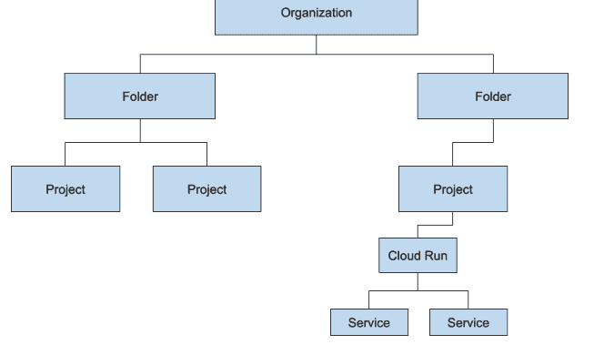

图 9.12 – Cloud Run 服务资源的层级结构

如果仅在每个服务的基础上设置，任何拥有 Cloud Run 权限的开发者都可以同样轻松地从其服务中移除二进制授权。

您可以在组织、文件夹或项目级别通过以下 gcloud 命令启用此功能，将相应的资源 ID 添加到 --organization、--folder 或 --project 标志中：

```
$ gcloud resource-manager org-policies allow run.allowedBinaryAuthorizationPolicies default
```

设置完成后，您现在可以使用 gcloud run deploy 创建 Cloud Run 服务，同时传递 --binary-authorization=default 标志。

与第 8 章《使用 Cloud Build 保护交付到 GKE 的软件》中所述的示例类似，您现在可以通过运行以下命令来更新您的准入策略：

```
$ gcloud container binauthz policy export > /tmp/policy.yaml
```

这将获取启用了二进制授权的默认准入策略。您可以通过在策略文件下的 defaultAdmissionRule 中添加如下块来编辑此策略文件：

```
...
requireAttestationsBy:
- projects/PROJECT_ID/attestors/built-by-cloud-build
...
```

这是上一章中包含的相同证明，它只会准入由 Cloud Build 签名的证明的镜像，从而证明在 Cloud Run 中运行的容器镜像具有可信的构建来源。

策略文件更新后，您现在可以将策略重新导入到二进制授权中：

```
$ gcloud container binauthz policy import /tmp/policy.yaml
```

在部署时违反策略时，Cloud Run 现在将返回类似于以下屏幕截图的错误消息：

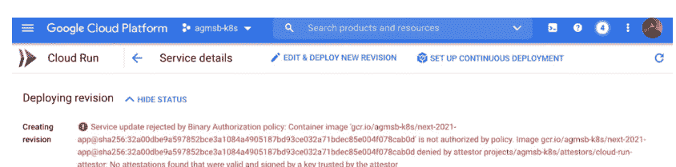

图 9.13 – 部署时违反二进制授权策略

您也可以创建自己的证明者来为容器镜像签名证明，并通过遵循相同的流程让二进制授权强制执行这些证明！

### 摘要

本章中，我们回顾了 Cloud Run 和 Cloud Functions 在 Google Cloud 中的工作原理，以及它们如何原生集成 Cloud Build，使无服务器部署更简单，并使开发人员能够尽可能多地专注于代码。

我们还回顾了开发人员如何使用 Cloud Build 来自动化和扩展 Cloud Run 和 Cloud Functions API 提供的原生功能。

在更深入了解 Cloud Build 如何与基础设施即代码、Kubernetes 集群和无服务器平台协同工作后，我们现在将转向 Cloud Build 实践，这些实践可以帮助您在任何用例中大规模地在生产环境中运行构建。

## 10

## 在生产环境中运行 Cloud Build 操作

到目前为止，本书已描述了托管服务的价值、如何使用 Cloud Build、描述了 Cloud Build 的功能，并提供了 Cloud Build 实际操作的端到端示例。在本章中，我们将重点介绍特定的 Cloud Build 功能并介绍新概念，以帮助您在生产环境中利用 Cloud Build。本章的主题将帮助您优化 Cloud Build 的使用及其构建的可观察性。

本章将涵盖以下主题：

- 在生产环境中执行
- 生产环境中需要考虑的配置
- 加快构建速度

### 在生产环境中执行

作为托管服务，Cloud Build 通过指定导致管道的构建步骤来使用，无论是构建代码还是操作基础设施组件。它不会区分环境；在开发环境中运行的管道与在生产环境中运行的管道被同等对待。两者都将具有相同的 Cloud Build **服务等级协议 (SLA)** 99.95% (https://cloud.google.com/build/sla)。环境之间的差异可能包括但不限于以下内容：

- 配置中构建步骤的独特性
- 项目中定义的不同的计算资源（默认或私有池）
- 定义的安全边界（身份、角色绑定、权限和网络资源）

对于所引用的这些标准，重要的是决定将托管构建管道的项目（们）。这可能是构建管道负责的内容以及组织中负责与管道交互的成员角色的因素。

组织会决定最适合自己的模式；然而，最常见的模式是将生产环境与被视为非生产环境的资源分开托管。然而，管道往往模糊了非生产和生产资源之间的界限。例如，可能有一组中立的项目仅用于管道。当集成管道负责生成供下游环境使用的容器镜像时，它必须能够访问共享的容器注册表（例如 Artifact Registry），以便将构建的镜像推送到其中。镜像一旦首次构建，最好实践是在从开发到测试再到生产的所有下游环境中继续使用相同的镜像。如果它需要与部署到其他环境的工具通信，它也需要获得与该工具通信的权限。镜像还可以用特定的证明签名，证明它已通过每个相应环境的每个管道。

一旦项目类型确定了 Cloud Build 服务管道的执行位置，就必须确保可以分配足够的资源。这要求您了解 Cloud Build 服务的配额和限制 (https://cloud.google.com/build/quotas)。截至撰写本文时，以下是 Cloud Build 服务的配额。请参阅上述链接以获取最新信息：

| 资源 | 描述 | 默认限制 | 可以增加 | 范围 |
|---|---|---|---|---|
| 私有池 | 私有池数量 | 2 到 10 | 是。 | 按区域 |
| 构建触发器 | 构建触发器数量 | 300 | 是。 | 按区域 |
| CPU | 区域私有池中运行的并发 CPU 数量 | 0 * 到 2,400 | 是。当此配额已满时，对额外 CPU 的请求将被排队并串行处理。 | 按区域 |
| CPU | 区域默认池中运行的并发 CPU 数量 | 5 到 100 | 否。如果您需要超过 100 个并发 CPU，请使用私有池。 | 按区域 |
| 请求 | 全局默认池中运行的并发构建数量 | 10 到 30 | 否。如果您想运行超过 30 个并发构建，请考虑使用私有池。 |  |

表 10.1 – Cloud Build 服务的配额

从上表中需要牢记的一个重要因素是您需要在每个相应项目中运行多少个并发构建。例如，开发和集成管道运行的项目可能比生产环境所需的管道更活跃，反之亦然，具体取决于您的环境。这强调了利用私有池为您的管道提供的重要性和灵活性。私有池允许以下操作：

- 您可以为构建指定更多机器类型
- 您可以拥有更多并发构建 – 即 30+
- 您可以访问 VPC 连接的资源
- 您可以拥有网络灵活性

确定如何组织 Cloud Build 管道、利用的功能以及识别依赖资源是规划过程中的重要考虑因素。

### 从不同项目利用 Cloud Build 服务

如果目标是在多个团队或环境中利用 Cloud Build 服务，共享同一个 Google Cloud 项目将需要额外的考虑。在第 6 章《管理环境安全》中，我们讨论了最小权限原则，我们在其中为每个配置的触发器定义了特定的 Cloud Build 用户指定服务账号。当团队共享项目时，您可能拥有托管在不同项目的服务账号。如果是这种情况，可能需要为服务账号在 Cloud Build 管道将执行的项目中使用提供额外的权限。

以下内容仅用于示例和说明目的，因为您的环境中可能配置了不同的存储库。

设置将在本示例其余命令中使用的适当变量，因为您的值将根据环境而有所不同。GCS 存储桶应是唯一的：

```
$ SA_NAME=build-dev
$ DEV_PROJECT=dev-project
```


```
$ BUILD_PROJECT=build-project
$ ARTIFACT_REGISTRY_IMAGE_REPO=image-repo
$ GCS_BUCKET=packt-cloudbuild-dev-bucket
$ GIT_REPO=packt-cloudbuild
$ GIT_OWNER=user
```

> **注意**
> 在以下示例中，dev-project 必须禁用 iam.disableCrossProjectServiceAccountUsage 组织策略。组织策略在组织级别配置，但可以根据约束类型应用于文件夹和单个项目。约束可能有所不同，但决定了可以执行的操作，超出 IAM 权限所定义的范围，后者决定谁可以执行什么。

以下图表显示了此示例将创建的内容，以及构建与用户指定的服务帐户之间的关系：

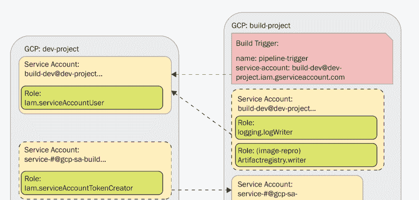

图 10.1 – 在单独项目中的用户指定服务帐户

上述图表显示了两个项目之间的关系以及每个项目相关的权限，以便在另一个项目中利用用户指定的服务帐户。

创建服务帐户以用作 Cloud Build 管道的用户指定服务帐户：

```
$ gcloud iam service-accounts create ${SA_NAME} \
  --description="Build Dev Service Account" \
  --project ${DEV_PROJECT}
```

服务帐户需要服务帐户用户权限，以便 Cloud Build 服务代理可以在将使用 Cloud Build 服务的项目中使用它：

```
$ gcloud projects add-iam-policy-binding ${DEV_PROJECT} \
  --member=serviceAccount:${SA_NAME}@${DEV_PROJECT}.iam.gserviceaccount.com \
  --role=roles/iam.serviceAccountUser
```

将利用 Cloud Build 服务的 Google Cloud 项目的项目编号是必需的，以便可以执行服务帐户模拟。我们设置 Cloud Build 服务代理的权限，使其能够创建服务帐户令牌，以代表托管在我们开发项目上的服务帐户执行命令：

```
$ export BUILD_PROJECT_NUMBER=$(gcloud projects list \
  --filter="${BUILD_PROJECT}" \
  --format="value(PROJECT_NUMBER)"
)
$ gcloud projects add-iam-policy-binding ${DEV_PROJECT} \
  --member="serviceAccount:service-${BUILD_PROJECT_NUMBER}@gcp-sa-cloudbuild.iam.gserviceaccount.com" \
  --role="roles/iam.serviceAccountTokenCreator"
```

尽管服务帐户位于开发项目上，但我们授予服务帐户向将使用 Cloud Build 服务的构建项目写入日志的权限：

```
$ gcloud projects add-iam-policy-binding ${BUILD_PROJECT} \
  --member=serviceAccount:${SA_NAME}@${DEV_PROJECT}.iam.gserviceaccount.com \
  --role=roles/logging.logWriter
```

由于我们使用的是用户指定的服务帐户，因此需要使用我们的 `cloudbuild.yaml` 配置进行配置以仅记录日志。以下代码显示了 `cloudbuild.yaml` 文件的一部分。本章后面我们将介绍一个场景，其中日志存储在 **Google Cloud Storage (GCS)** 存储桶中：

```
...
options:
  logging: CLOUD_LOGGING_ONLY
...
```

触发器是在构建项目上创建的，但用户指定的服务帐户是我们开发项目中创建的那个：

```
$ gcloud beta builds triggers create github \
  --repo-name=${GIT_REPO} \
  --repo-owner=${GIT_OWNER} \
  --branch-pattern=^main$ \
  --name=pipeline-trigger \
  --build-config=cloudbuild.yaml \
  --project=${BUILD_PROJECT} \
  --service-account=projects/${DEV_PROJECT}/serviceAccounts/${SA_NAME}@${DEV_PROJECT}.iam.gserviceaccount.com
```

在此示例中，我们将容器镜像推送到 Artifact Registry 的镜像存储库，该存储库也托管在同一个 Cloud Build 项目上。写入镜像存储库需要权限：

```
$ gcloud artifacts repositories add-iam-policy-binding ${ARTIFACT_REGISTRY_IMAGE_REPO} \
  --location=us-central1 \
  --member=serviceAccount:${SA_NAME}@${DEV_PROJECT}.iam.gserviceaccount.com \
  --role=roles/artifactregistry.writer \
  --project ${BUILD_PROJECT}
```

这是前述示例中触发构建的构建详细信息的示例输出。构建执行的 Project ID 在 `build-project` 中，服务帐户来自 `dev-project`。我们可以通过描述构建来获取此信息：

```
$ gcloud builds describe 2ddd7e2e-1b75-49e2-b3a9-4781ad509f18 --project build-project
```

以下是运行前述命令的输出，其中标识了正在使用的用户指定服务帐户：

```
id: 2ddd7e2e-1b75-49e2-b3a9-4781ad509f18
...
projectId: build-project
...
serviceAccount: projects/dev-project/serviceAccounts/build-dev@dev-project.iam.gserviceaccount.com
```

由于构建在构建项目中运行，并且在存储库有提交时会自动触发，很可能出现开发人员或特定团队成员仅有权访问特定项目的情况——在本例中为 dev-project。在前面的示例中，我们将日志写入 build-project，但我们可以设置一个接收器并将日志从 build-project 转发到 dev-project（https://cloud.google.com/logging/docs/export/configure_export_v2#supported-destinations）。

另一种方法是将日志写入由 dev-project 管理和托管的 GCS 存储桶。构建日志数据由 build-project 创建并存储在 dev-project 中以供进一步分析：

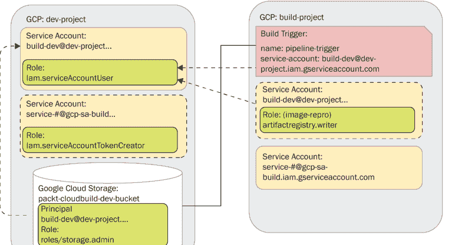

图 10.2 – 记录到另一个项目中的 GCS 存储桶

上述图表显示了构建如何写入 GCS 存储桶，以及用户指定服务帐户在存储桶级别所需的特定权限。

首先，让我们在 dev-project 中创建存储桶：

```bash
$ gsutil mb -p ${DEV_PROJECT} \
    gs://${GCS_BUCKET}
```

为了允许 Cloud Build 服务使用我们的用户指定服务帐户写入 GCS 存储桶，我们需要为我们的服务帐户授予必要的权限：

```bash
$ gsutil iam ch \
    serviceAccount:${SA_NAME}@${DEV_PROJECT}.iam.gserviceaccount.com:roles/storage.admin \
    gs://${GCS_BUCKET}
```

我们还需要在 cloudbuild.yaml 文件中告诉 Cloud Build 我们希望将日志存储在 GCS 存储桶中：

```yaml
...
logsBucket: "gs://${REPLACE_WITH_YOUR_GCS_BUCKET_NAME}"
options:
  logging: GCS_ONLY
...
```

成功运行构建后，我们可以看到日志现在可在我们的存储桶中使用。我们可以在示例输出中看到这一点：

```bash
$ gsutil ls gs://${GCS_BUCKET}
gs://packt-cloudbuild-dev-bucket/log-44045da7-3a03-4f9d-8aa0-f9599e3efd47.txt
```

> **注意**
> 如果未正确设置 Cloud Build 记录到 GCS 存储桶的权限，构建将无法正常执行。在这种情况下，您可能会收到来自 Cloud Build 服务的以下错误：
> 
> ```
> generic::invalid_argument: invalid bucket "packt-cloudbuild-dev-bucket"; builder service account does not have access to the bucket
> ```

利用不同的项目时，可能需要在不同的项目中存储日志数据。本节中的示例展示了如何实现这一点。

## 进一步保护构建触发器

在 *第 6 章，管理环境安全* 中，我们讨论了 **虚拟私有云服务控制** (VPC-SC) 作为一种机制，有助于防止 GCP 服务（包括 Cloud Build）的数据外泄。Cloud Build 中提供的另一种机制可防止来自外部源的触发器以保护构建环境，即通过组织策略。通过设置此约束，我们可以指定哪些域可以执行功能或拒绝特定域。

到目前为止，我们的示例都是通过 github.com 触发的。现在，我们将拒绝来自 github.com 的触发器。为此定义，我们必须设置约束并指定权限：

```
name: projects/**REDACTED_project_number**/policies/cloudbuild.allowedIntegrations
spec:
  inheritFromParent: false
  rules:
    - values:
        deniedValues:
          github.com
```

我们将拒绝源自 github.com 的触发器。请注意我们将强制执行的约束——即 cloudbuild.allowedIntegrations。一旦强制执行，前一节中的触发器将不再能够执行并创建构建。以下 Cloud Logging 输出片段显示了构建无法触发和执行的原因：

```
status: {
code: 9
message: "Constraint \"constraints/cloudbuild.allowedIntegrations\" violated for \"**REDACTED_project_id**\" attempting to process an event from \"github.com\""
}
```

这提供了另一种帮助保护构建的功能。

## 通知

当您最初设置构建或手动触发构建时，您可能会在逐步测试构建配置时与构建交互并监视构建。您会知道构建何时失败或成功。然而，当构建基于外部事件（如对 **源代码管理 (SCM)** 仓库的提交）自动触发时，这并不是典型的使用模式。组织有不同类型的机制来通知开发人员和运营团队构建的状态。这些机制可以从发布有关构建消息的系统各不相同

在聊天基础设施、电子邮件通知或自定义基础设施中提供状态，以便团队消化构建事件状态。

根据所需的详细程度，组织最终可能会跟踪以下内容：

- Git 提交到存储库分支
- 分支之间的合并
- 触发的构建流水线状态（例如，成功、失败、待处理等）
- 构建成功率

这有助于为组织提供其构建的健康状况和频率的洞察，以便用于优化或识别组织内的瓶颈。

Cloud Build 通过在特定主题上发布消息使用 Cloud Pub/Sub (https://cloud.google.com/pubsub)。虽然这些消息可以通过使用 Cloud Pub/Sub 客户端订阅主题来使用，但 Cloud Build 包含一个 Cloud Build notifier (https://cloud.google.com/build/docs/configuring-notifications/notifiers) 客户端，该客户端也可以订阅主题、消费消息并将消息推送到受支持的平台。Cloud Build notifier 客户端是基于容器的镜像，在 Cloud Run (https://cloud.google.com/run) 上运行，后者是一个根据使用情况自动扩缩容的管理型无服务器平台。下表显示了可用的通知器支持的平台：

| 通知器 | 描述 |
|---|---|
| bigquery | 将构建数据写入 BigQuery 表 |
| googlechat | 使用 Google Chat webhook 将消息发布到 Google Chat 空间 |
| http | 向另一个 HTTP 端点发送 JSON 负载 |
| slack | 使用 Slack webhook 将消息发布到 Slack 频道 |
| smtp | 通过 SMTP 服务器发送电子邮件 |

表 10.2 – Cloud Build 通知器平台

上表显示了撰写本文时可用的通知器。如果您使用的是此处未列出的平台，可以使用提供的示例 (https://cloud.google.com/build/docs/configuring-notifications/create-notifier) 开发通知器。

## 从日志中获取更多价值

日志为调试和验证构建的进度提供了重要细节。

日志的输出通常需要个人查看日志才能理解输出内容。

在聚合具有大量流水线运行的构建时，查看日志可能不可行。

在上一节中，我们讨论了通知作为聚合构建流水线事件状态的一种方式，以了解流水线的健康状况。

如果我们想知道在构建步骤期间某些日志条目被输出了多少次怎么办？

我们可以用它来识别某些模式并帮助自动化或审批。

如果相同的日志输出累积到指定的阈值，我们也可以发出警报。

基于日志的指标可以通过 Cloud Logging 功能实现。

例如，假设在构建 Node.js 应用程序时，我们想跟踪弃用警告出现的次数。

在此示例中，Node.js bookshelf 应用程序 (https://github.com/GoogleCloudPlatform/nodejs-getting-started/tree/main/bookshelf) 正在构建并输出以下 Cloud Build 日志输出：

```
...
Step 4/6 : RUN npm install
Running in 30f414a77c43
npm WARN deprecated ...
...
```

我们希望能够跟踪在构建期间此输出出现的次数。

由于这是一个 Node.js 警告，构建仍会成功，但我们想知道它发生的次数；如果超过某个阈值，我们可能需要采取行动。

构建现在可能成功，但还能成功多久才开始失败？

让我们为此输出创建一个基于日志的计数器指标：

```
$ gcloud logging metrics create npm_dep_warning \
  --description "NPM Deprecation Warnings" \
  --log-filter "resource.type=build AND npm WARN deprecated"
```

计数器指标在日志过滤器的评估返回新条目时每次递增 1。

计数可以通过 Cloud Monitoring Metrics Explorer 面板查看。

更多详细信息可在文档 (https://cloud.google.com/monitoring/charts/metrics-selector) 中找到。

以下屏幕截图显示，在 10 分钟内，基于日志的指标已统计出我们的 npm WARN deprecated 日志条目出现了两次：

### 指标资源管理器

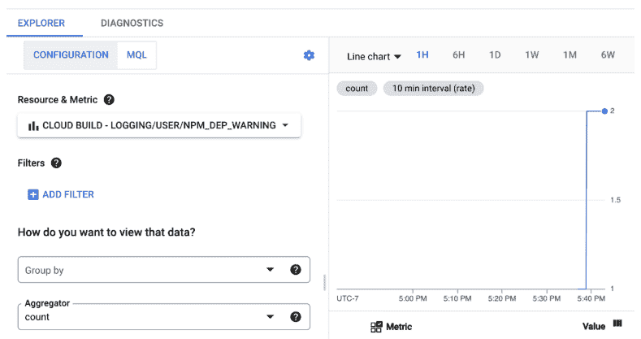

图 10.3 – Cloud Monitoring 指标资源管理器 NPM_DEP_WARNING

我们可以基于最合理的任何阈值发出警报。

在以下示例中，我们有一个警报策略，如果在滚动的 10 分钟窗口内发生五次，则会触发。

有关如何创建警报的更多详细信息可在文档中找到，可通过 **用户界面 (UI)** 或 API (https://cloud.google.com/monitoring/alerts/using-alerting-ui) 创建。

以下示例警报策略将在警告阈值超过 5 的计数时创建事件：

### Cloud Build npm 弃用警告

### 条件

策略违反条件为满足任意条件

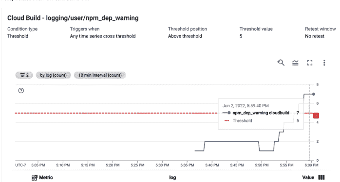

图 10.4 – Cloud Monitoring 警报策略 Cloud Build npm 弃用警告

从 **警报** 面板，我们可以看到已提出事件以及可能需要采取的措施。Cloud Monitoring 通知渠道包括用于 Cloud Mobile App、Cloud Pub/Sub、Email、SMS、PagerDuty、Slack 和 webhooks 等工具的各种预构建集成：

### 事件

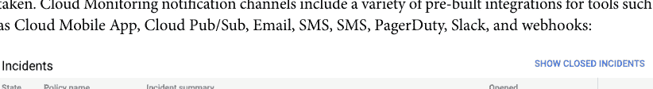

图 10.5 – Cloud Monitoring 警报事件

虽然此示例包括跟踪条目在日志中出现的次数，但我们也可以跟踪相反的情况——即在指定期间内某事物未出现的次数。

基于日志的指标还支持另一种称为分布指标的指标，可测量条目之间的延迟或持续时间，以识别构建中的瓶颈。

Cloud Logging 和 Cloud Monitoring 提供的计数器和分布指标的组合可以帮助推断出超出默认构建统计信息之外的更多详细信息。

在生产环境中执行需要超出仅运行流水线的额外考虑。

重要的是测试并为每个构建确定最佳机器类型，以获得可接受的构建时间和相关成本。

私有池提供更多机器类型选择，同时提供额外的网络和安全功能。

根据组织的 Google Cloud 项目架构、团队角色和用户角色，可能需要考虑对不同项目的访问权限。

充分利用日志并从日志和通知中推导出模式对于 Cloud Build 在后台平稳运行至关重要。

## 生产环境中需要考虑的配置

在 *第 4 章，构建配置和架构* 中，我们介绍了可用于自定义 Cloud Build 如何执行构建的几个配置选项。

在生产环境中，有一些配置突出显示，应配置以优化生产环境中的构建。

我们在上一节中讨论了 Cloud Build 请求限制，其取决于所选池的类型。

无论池的类型如何，我们都可以优先考虑或确定某些构建流水线如果排队时间过长应失败。

要配置此设置，我们将在构建配置中使用 `queueTtl` 语法。

一旦构建进入队列，计时器就会开始。

如果在 `queueTtl` 配置中指定的持续时间之前无法执行，它将被取消，从队列中移除，并赋予 `EXPIRED` 状态。

这可以帮助为构建提供一定的优先级。

如果队列中太多，构建将积压，关键任务可能会延迟，从而影响生产力。

解决此问题的一种方法可以是增加私有池中的计算资源数量，或从默认池切换到私有池。

组织可能有定义的预算或某些构建可以在构建较不繁忙时稍后重新排队。

## 使构建更具动态性

变量可用于 Cloud Build 的配置中，使流水线更具动态性和可重用性。

在 *第 5 章，触发构建* 中，我们介绍了使用变量执行带有提交 SHA 的 Git checkout 以及从 secret 存储 Git SSH 密钥。

提交 SHA 值在配置时未知，并且可能对每次触发的构建发生变化。

SSH 密钥最好在外部管理，以便存储在具有更安全 secret 的平台上。

Cloud Build 包含一些可在构建中使用的默认元数据相关变量，例如 `${PROJECT_ID}` 和 `${BRANCH_NAME}` 以触发 Git 仓库。

默认变量提供元数据，但用户定义的变量可以允许额外的元数据，以及驱动构建流水线内的行为。

您可能希望利用变量来定义构建的环境，例如 `${__ENV}`。

这可用于构建配置中，将特定元数据作为构建或运行时配置的一部分进行设置。

为了使构建步骤或流水线更灵活，您可以在变量中使用变量。

Cloud Build 通过使用名为 `dynamic_substitutions` 的配置选项启用此功能。


动态替换在构建触发器上自动启用，但手动调用的构建需要在构建配置中将此设置设为 true。

让我们通过一个 Docker 构建的示例来说明。这里，我们希望使用用户定义的变量来自定义容器镜像仓库、名称和标签。我们还希望使用动态替换来构建完整的镜像 URL。

我们将继续使用 Node.js 书架应用程序 (https://github.com/GoogleCloudPlatform/nodejs-getting-started/tree/main/bookshelf) 作为此示例。以下代码来自 cloudbuild.yaml 配置文件，该文件用于构建容器镜像：

```yaml
steps:
- name: gcr.io/cloud-builders/docker
  args:
  - "build"
  - "-t"
  - "${IMAGE_URL}:${BUILD_ID}"
  - "-t"
  - "${IMAGE_URL}:${TAG_VERSION}"
  - "."
substitutions:
_IMAGE_URL: "${IMAGE_BASE}/${IMAGE_NAME}"
_IMAGE_BASE: "us-central1-docker.pkg.dev/${PROJECT_ID}/image-repo"
_IMAGE_NAME: "nodejs-bookshelf"
_TAG_VERSION: "dev"
options:
  dynamic_substitutions: true
images:
- ${IMAGE_URL}:${BUILD_ID}
- ${IMAGE_URL}:${TAG_VERSION}
```

动态替换设置已配置，因为示例构建是手动调用的。${IMAGE_BASE} 变量包含仓库信息并动态注入 ${PROJECT_ID}。${IMAGE_URL} 用于构建步骤，是 ${IMAGE_BASE} 和 ${IMAGE_NAME} 的组合。这将允许我们在需要时替换仓库信息以及镜像名称；否则，将使用配置中定义的默认值。

在构建步骤中，请注意容器镜像标签被追加，其中之一是 ${BUILD_ID}。这来自 Cloud Build 元数据。还有 ${TAG_VERSION}，它是一个变量。

如果是手动调用，只需执行简单的 gcloud builds submit 即可。如果是通过触发器触发，则不需要 dynamic_substitutions 选项，并且可以在触发器中根据需要自定义变量。构建完成后，Artifact Registry 中包含镜像和我们配置的标签：

```
$ gcloud artifacts docker images list us-central1-docker.pkg.dev/**REDACTED_project_id**/image-repo/nodejs-bookshelf --include-tags
```

以下是在运行上述命令后的输出：

```
IMAGE: us-central1-docker.pkg.dev/**REDACTED_project_id**/image-repo/nodejs-bookshelf
DIGEST:
sha256:aa4ba108423771db58502095fbc8a70a7f54fbb56fdd09b38bbcf78a7a39bcc5
TAGS: 36e3094e-be72-41ee-8f02-874dc429764e, dev
```

利用变量和动态变量可以帮助我们创建更灵活的流水线，并允许团队在不修改构建配置的情况下根据需要调整值。

## 与密钥管理相关的 Cloud Build 变更

在第 6 章《管理环境安全》中，我们介绍了在使用两种不同的 GCP 服务时使用密钥：Secret Manager 和 Cloud Key Management Service（KMS）。虽然 Secret Manager 是推荐方式，但 Cloud KMS 也可以用于声明密钥。推荐的方式是在 Cloud Build 配置中使用 availableSecrets 语法。availableSecrets 语法可用于声明 Secret Manager 和 Cloud KMS 资源。

以下为之前的声明方法：

```
...
secret:
  - kmsKeyName: projects/**PROJECT_ID_redacted**/locations/global/keyRings/secret_key_ring/cryptoKeys/secret_key_name
    envMap:
      MY_SECRET: '**ENCRYPTED_SECRET_encoded**'
...
```

以下为推荐的声明方法，如第 6 章《管理环境安全》所述：

```
...
availableSecrets:
  inline:
    - kmsKeyName: projects/**PROJECT_ID_redacted**/locations/global/keyRings/secret_key_ring/cryptoKeys/secret_key_name
      envMap:
        MY_SECRET: '**ENCRYPTED_SECRET_encoded**'
...
```

availableSecrets 语法提供了一种持续定义密钥的方式，可与多个 Google Cloud 服务一起使用。

Cloud Build 中的配置参数可以帮助组织为生产环境做好准备。虽然私有池允许进行更多并发构建，但管理构建生命周期仍然很重要。例如，在构建排队时间过长时设置过期时间是一个好习惯。变量替换提供了更灵活和动态的构建流水线，有助于确定构建的行为和输出。Secret Manager 与 Cloud Build 的集成引入了一种新的语法，可同时用于 Secret Manager 和 Cloud KMS。

## 加快构建速度

无论您是刚刚开始还是已经使用 Cloud Build 一段时间，寻求减少构建所需时间的方法始终是好的。以下是一个示例列表：

- 指定具有更多资源的 machineType，例如 standard、highmem 和 highcpu（在第 2 章《配置 Cloud Build 工作器》中介绍）
- 使用 waitFor 并行化步骤（在第 4 章《构建配置和架构》中介绍）
- 每个构建步骤使用更精简的构建器容器镜像
- 缓存中间镜像层以供后续构建使用

优化 Docker 镜像的技术（https://docs.docker.com/develop/dev-best-practices/）也适用于 Cloud Build 构建器镜像。镜像越小，Cloud Build 工作器拉取镜像并开始执行步骤所需的时间就越少。用于构建应用程序代码的依赖项和运行时执行应用程序所需的库可能不同，因此应将它们隔离为不同的镜像。删除不必要的文件、包缓存和临时文件对于减小容器镜像大小也至关重要。

**Caching** 是另一种可以减少涉及构建 Docker 容器镜像的流水线时间的机制。Cloud Build 支持使用 **Kaniko**（https://github.com/GoogleContainerTools/kaniko）作为构建容器镜像的工具，而不是传统的 Docker 二进制文件。Kaniko 允许您为 Dockerfile 中的中间步骤分配唯一键。这些键用于识别容器镜像构建步骤是否因更改而需要重新执行或利用缓存，从而有助于提高容器镜像构建的性能。

在此示例中，我们将在容器镜像中使用 Node.js 书架应用程序（https://github.com/GoogleCloudPlatform/nodejs-getting-started）。

以下是我们将在此示例中使用的示例 Dockerfile（https://cloud.google.com/build/docs/kaniko-cache#example_using_kaniko_cache_in_a_nodejs_build）：

```
FROM node:8
WORKDIR /usr/src/app
COPY package*.json ./
RUN npm install
COPY . .
CMD [ "npm", "start" ]
```

而不是使用典型的 docker build -t image，我们将使用 Kaniko executor 在此示例 cloudbuild.yaml 文件中指定缓存详细信息：

```
steps:
- name: 'gcr.io/kaniko-project/executor:latest'
  args:
  - --destination=us-central1-docker.pkg.dev/${PROJECT_ID}/image-repo/nodejs-bookshelf
  - --cache=true
  - --cache-ttl=1h
```

Kaniko executor 用于构建 Node.js 应用程序。缓存层不可用，并拍摄快照：

```
...
INFO[0002] No cached layer found for cmd RUN npm install
INFO[0002] Unpacking rootfs as cmd COPY package*.json ./ requires it.
...
INFO[0019] Taking snapshot of files...
```

```
...
INFO[0019] RUN npm install
INFO[0019] Taking snapshot of full filesystem...
...
DURATION: 1M
```

在后续无更改的运行中，构建时间减少到几乎一半——从 1 分钟减少到 31 秒。缓存层被找到并在镜像构建中使用：

```
...
INFO[0001] Checking for cached layer us-central1-docker.pkg.dev/**REDACTED_project_id**/image-repo/nodejs-bookshelf/
cache:5bf2e0a45d0c8dd3109fa3ff73a1ebc195c64b476951c28bf25065c25250cd4...
INFO[0001] Using caching version of cmd: RUN npm install
INFO[0001] Unpacking rootfs as cmd COPY package*.json ./ requires it.
...
INFO[0015] RUN npm install
INFO[0015] Found cached layer, extracting to filesystem
...
DURATION: 31S
```

在此示例中，Artifact Registry 用于存储容器镜像，Kaniko 创建 nodejs-bookshelf/cache 以供后续构建使用。我们可以使用 gcloud 命令列出我们的镜像：

```
$ gcloud artifacts docker images list us-central1-docker.pkg.dev/**REDACTED_project_id**/image-repo --include-tags
```

以下输出显示了 Artifact Registry 中的镜像，其中包含构建的容器镜像，以及 Kaniko 创建的缓存层：

```
...
IMAGE: us-central1-docker.pkg.dev/**REDACTED_project_id**/image-repo/nodejs-bookshelf
DIGEST:
sha256:6c31e49a502904fa73a466547876d38d3b6ed39c81a95c9050a2747d167d1b2f
TAGS: latest
..
```

IMAGE: us-central1-docker.pkg.dev/**REDACTED_project_id**/
image-repo/nodejs-bookshelf/cache
DIGEST:
sha256:687201b973469a84dee8eb5519f9bebf630cd2e8a5599d2579760250
520672b9
TAGS:
5bf2e0a45d0dc8dd3109fa3ff73a1ebc195c64b476951c28bf25065c25250
cd4

前述输出中列出的缓存镜像的镜像标签有助于 Kaniko 识别是否需要重建特定的容器镜像层。

可以采取并应考虑多种路径以总体减少构建时间，这有助于提高生产力。应整合工具以帮助促进整体流水线时间的减少。本节中，我们参考了 Kaniko，但代码构建也可以通过 Bazel (https://bazel.build/) 得到改进。Bazel 是一个开源的构建和测试工具，带有云构建器镜像 (https://github.com/GoogleCloudPlatform/cloud-builders/tree/master/bazel)。

### 摘要

Cloud Build 不区分环境（例如开发、非生产和生产），但应考虑配置和推荐实践以最大化其所有功能。在本章中，我们涵盖了从优化、可观测性、安全性和模式等主题，以帮助在您的组织中采用 Cloud Build。每个主题都可以纳入您的构建配置中以满足您的需求。

在下一章中，我们将提供 Cloud Build 的前瞻性视角，并展望即将到来的内容。
