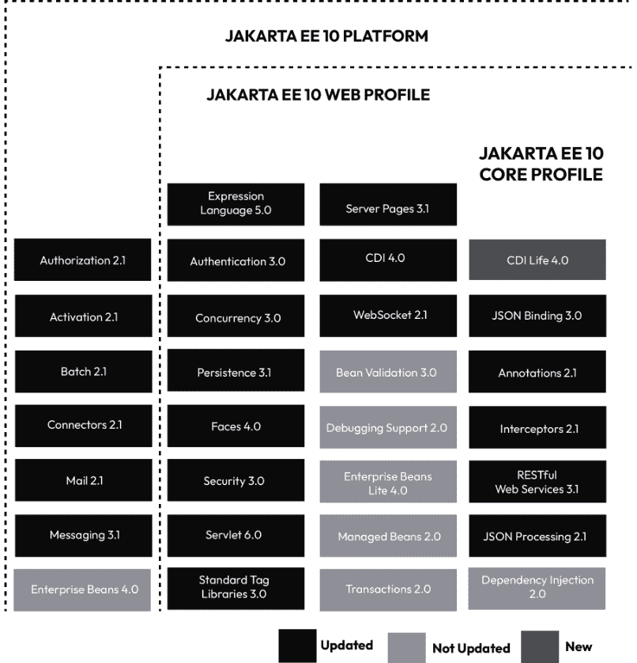

## 企业级Java的历史

在本章中，我们将回顾Java EE和Jakarta EE的历史。自创立以来，Java企业技术曾有过多个名称——最初是J2EE，随后更名为JEE，接着是Java EE，最后是Jakarta EE。

在本章中，我们将涵盖以下主题：

- 什么是Java EE，以及为何要创建它？
- Web服务器与应用服务器
- Java EE 5，第一个用户友好的版本
- Java EE自版本5以来新增关键特性的历史

到本章结束时，你将对Java EE和Jakarta EE有一个更深入的历史性理解，并会了解Java EE新增的一些关键特性。Jakarta EE的更改将在后续章节中讨论。

### 什么是Java EE，以及为何要创建它？

Java语言于1996年问世。它由一个编译器和一台Java虚拟机组成。这两个组件都依赖于平台，这意味着针对Windows、Linux、macOS等平台，需要有不同的版本。这被称为**Java标准版（Java SE）**。

Java语言的独特之处在于，它不编译为原生机器代码，而是编译为一种被称为**字节码**的东西。这种字节码与平台无关，意味着它可以被传输到前述任何平台。

要执行字节码，你需要一个**Java虚拟机（JVM）**。JVM将中间字节码转换为特定于其执行平台的机器代码。

这种编译为字节码并能在任何平台上执行的原则被称为**一次编写，到处运行（WORA）**。这已被证明是Java在商业环境中取得成功的显著特性。

最初，Java被设计在浏览器中运行，即在所谓的小应用程序中运行。这些小应用程序为早期浏览器（如微软的Internet Explorer和网景的Navigator）增加了许多功能。

Java的免费版本被提供给了几个流行的平台，这帮助了该语言的迅速成功。

第三方可以获得JVM规范许可，从而构建自己的编译器和JVM实现。多家公司已经这样做了，这意味着现在有多个供应商提供自己的实现。最常见的如下（按字母顺序排列）：

- Alibaba Dragonwell
- Amazon Corretto
- Azul Zulu
- BellSoft Liberica
- Eclipse Adoptium Temurin
- J9
- Oracle JDK and OpenJDK
- Red Hat OpenJDK
- SAP SapMachine

但不久，Java从浏览器领域转向了商业世界。很明显，开发业务应用程序需要语言本身不具备的额外功能。

与其将这些功能添加到语言本身，不如让一组独立的API来提供。为了避免混淆并区分Java SE和这些新API，它们被称为**Java企业版**（Java EE）。

Java EE增加了事务、安全性、可扩展性、组件管理和并发等特性。它允许你创建动态Web应用程序，并为分布式事务提供了强大的平台。

### Web服务器与应用服务器

**Web服务器**和**应用服务器**这两个术语经常被Java EE新手混淆并互换使用，尽管这并不正确。在本节中，我们将重点说明两者之间的差异，因为我们相信，作为Java EE的关键组件，了解二者之间的差异很重要，而且两者各自扮演着不同的角色。

要开始理解它们之间的区别，最好的方法是突出它们各自的目标。

#### Web 服务器

Web 服务器实现了 Servlet API，这是一组在规范中定义好的类和接口，允许你创建动态 Web 应用程序。基于 Servlet API 的应用程序，称为 Servlet，在 Web 服务器内部运行，并向其用户提供可能动态的内容。

多年来，出现了许多支持 Servlet API 的技术。诸如 **Java Server Pages (JSP)**、**Java Standard Tag Libraries (JSTL)**、**Java Server Faces (JSF)** 以及 Bean 验证等规范是最值得注意的。后来，添加了 **Java API for XML Web Service (JAX-WS)** 和 **Java API for Restful Web services (JAX-RS)**。

Servlet API 有许多流行的独立实现，例如以下：

- Tomcat
- Jetty
- NGINX

所有这些都提供了一个 Servlet 容器，servlet 可以在其中运行。

了解你可以在一个 servlet 容器内运行多个 servlet 是很有益的。在早期，这是一种常见做法，因为它允许你在同一硬件上运行多个应用程序。

顺便说一下，应该指出的是，像 Spring Boot 这样的框架仍然使用 Servlet API。这意味着在核心层面上，仍然在运行某种 Servlet API 的实现。在 Spring Boot 的情况下，使用哪种 servlet 容器实现是可插拔的，这意味着你自己选择。

#### 应用服务器

相反，应用服务器确实有提供支持 Servlet API 的实现的必要，但它们提供的远不止于此。应用服务器提供更丰富的环境，更针对执行业务逻辑。它们提供 **Enterprise Java Beans (EJBs)**。EJB 有三种主要类型：

- **Session Beans (SBs)**
- **Entity Beans (EBs)**
- **Message-Driven Beans (MDBs)**

会话 Bean 可以进一步分为 **Stateful Session Beans (SFSBs)** 和 **Stateless Session Beans (SLSBs)**。会话 Bean 包含业务逻辑。

实体 Bean 处理数据库操作，分为 **Container Managed Persistence (CMP)** 和 **Bean Managed Persistence (BMP)** 实体 Bean。在前者中，应用服务器负责处理数据的持久化和检索，而在后者中，应用程序开发人员必须自己编写查询来选择和更新数据库。

我们用过去时来写，因为实体 Bean 在 EJB 规范的第 3 版中被完全删除，该版本发布于 Java EE 5，取而代之的是 **Java Persistence API (JPA)**。

此外，应用服务器提供用于声明式和编程式事务管理的 API。与实体 Bean 一样，区别在于前者中容器会自动启动、提交或回滚事务，而在后者中，这必须在代码中完成。

**Java Messaging Service (JMS)** 是应用服务器的另一个必需功能。JMS 允许你在不同的应用程序或应用程序组件之间异步交换消息。

JMS 通过队列在两个组件之间提供一对一连接，同时通过主题提供一对多消息交换。

此外，应用服务器允许通过 **Java Naming and Directory Interface (JNDI)** 注册和发现组件。例如，可以实例化一个用于发送电子邮件的 EJB 并随后在 JNDI 注册表中注册。另一个需要发送电子邮件功能的 EJB 然后能够通过其名称在注册表中查找此电子邮件服务并使用它。

除此之外，应用服务器还提供诸如声明式安全、并发和拦截器等功能。

一些非常流行的应用服务器如下：

- IBM Websphere
- JBoss Application
- Oracle Glassfish
- Oracle Weblogic
- Payara Server Enterprise

应用服务器往往很笨重，启动时间很糟糕。在早期，启动需要 10-15 分钟并将部署的应用程序带到初始化状态是很常见的。然而，如今，它们通常在几秒钟内启动。

### 配置文件来救援

在 Java EE 的早期，如果你想成为一个 Java EE 兼容的服务器，就有一个简单的规则——你必须实现所有规范。然而，很快就变得清楚，并非每个应用程序都需要一个功能齐全的应用服务器。经常，Web 服务器已经足够了。

为了使这种区别更清晰，引入了配置文件。第一个是 Web Profile，它首次出现在 Java EE 6 中。它由 Servlet、JSF、JSP、EJB、CDI、JTA、JPA 和 Bean Validation 规范组成。

所有规范的完整集合被称为 Full Platform Profile。

在 Jakarta EE 10 中，引入了 Core Profile。它包含更小的规范子集，针对微服务、边缘计算和提前编译。在 *第 2 章*，我们将更深入地探讨这些主题。

下图描绘了不同的配置文件以及它们需要实现的规范。图像取自 Jakarta EE 网站（https://jakarta.ee/release/10/）。

图 1.1 – 不同的 Jakarta EE 配置文件及其规范

### Java EE 6

在 Java EE 版本 6 中引入的最著名变化无疑是对 RESTful API Web 服务的支持。REST 已成为比 SOAP Web 服务更受欢迎的 Web 服务形式，因为其灵活的特性。

此外，版本 6 引入了 Context and Dependency Injection (CDI) API。这使得在 Java EE 应用程序中使用依赖注入成为可能，其中之一。

### Java EE 7

Java EE 版本 7 引入了批处理应用程序的概念。这些是一系列无需用户干预即可执行的任务。

它还引入了一些额外的并发实用程序，例如托管执行器服务、其计划变体和托管线程工厂。

此外，引入了 WebSocket API 的第一个版本。WebSocket 允许两个对等方之间进行全双工通信。

最后，JSON-P 规范的引入也不容忽视。它允许 Java 对象序列化为 JSON 格式，反之亦然。随着 RESTful API Web 服务的兴起，这已成为 Java EE 平台的关键规范。

### Java EE 8

Java EE 8 是由 Oracle 发布 Java EE 的最后一个版本。Java EE 版本 7 和版本 8 之间相隔相当长的时间（确切地说是 4 年 3 个月零 3 天）。Java EE 在 Oracle 方面开始衰落变得越来越明显。

尽管如此，这个最终版本引入了一些不错的功能。最重要的是，有 JAXB，即 Java API for XML binding。此外，还引入了基于注解的安全性，使用 Java Security EE API。

### 总结

本章简要介绍了 Java EE 的历史，直到版本 8。在此版本之后，Java EE 被移交给 Eclipse 基金会，并重新命名为 Jakarta EE。

有了这段历史，你现在可以开始你的 Jakarta EE 之旅。在下一章中，我们将向你介绍我们的示例应用程序，而在接下来的章节中，我们将开始迁移到更新版本的 Jakarta EE。
