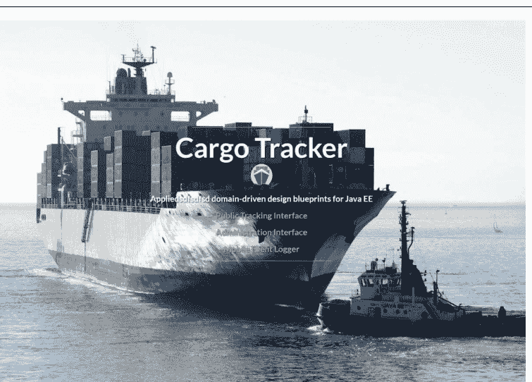
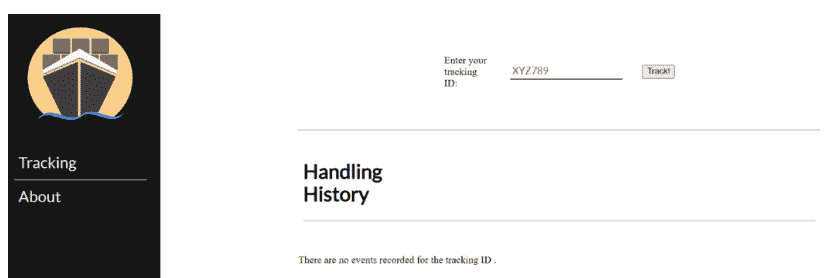
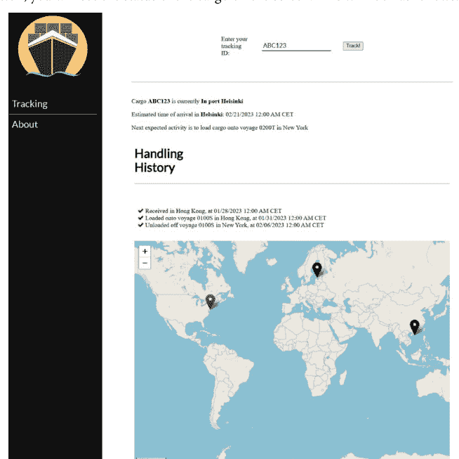
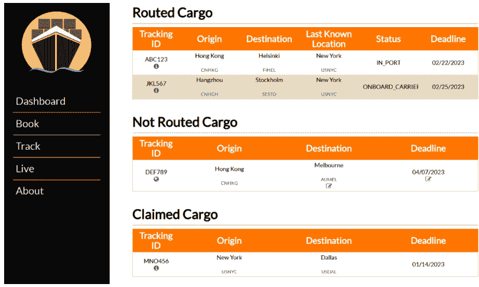
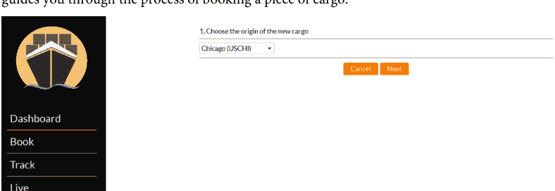
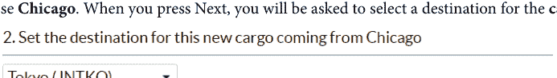
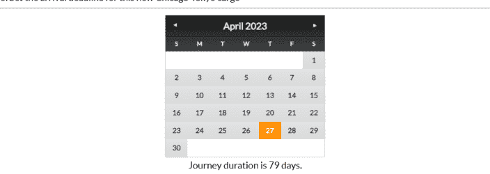
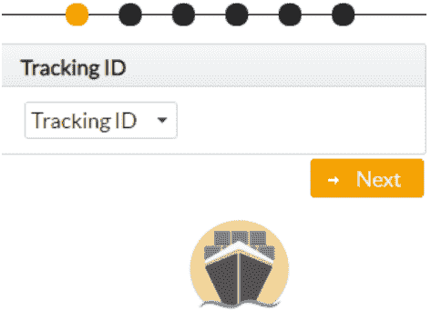
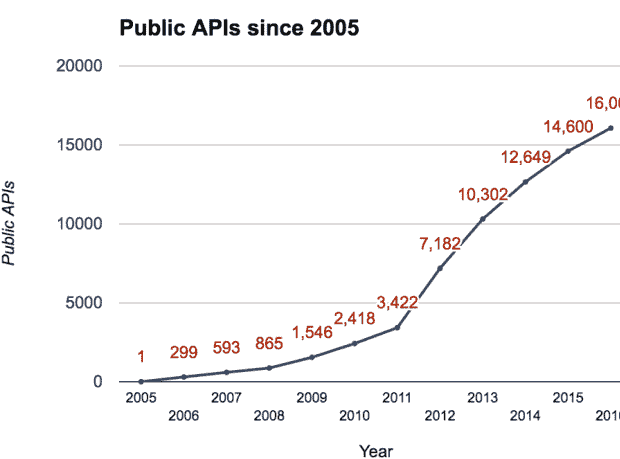

## 介绍 Cargo Tracker 应用程序

在本章中，我们将介绍 Cargo Tracker 应用程序，该应用程序使用 Java EE 7 构建。我们将在本书中始终使用 Cargo Tracker 应用程序。这是我们将从 Java EE 7 迁移到 Jakarta EE 10 的应用程序。在开始迁移应用程序之前，了解 Cargo Tracker 应用程序是很有益的。本章将提供 Cargo Tracker 应用程序及其功能的概述，以及当前架构和设计。

此外，我们将介绍 Cargo Tracker 应用程序的各个组件以及它们如何相互交互。我们将涵盖使用 REST、WebSockets 和 JavaServer Faces (JSF) 进行展示、Enterprise Java Beans (EJB) 进行业务逻辑以及 Java Persistence (JPA) 进行数据持久化的主题。我们还将强调使用 Contexts and Dependency Injection (CDI) 进行组件间依赖管理的用法。

在本章中，我们将涵盖以下主题：

- 安装和运行 Cargo Tracker 应用程序
- Cargo Tracker 应用程序能做什么？
- Cargo Tracker 应用程序中使用的 Java EE 功能

到本章结束时，你将对 Cargo Tracker 应用程序及其底层技术栈有扎实的理解。这将为本书的其余部分奠定基础，在那里我们将深入探讨将 Cargo Tracker 应用程序迁移到 Jakarta EE 10 的具体细节。


### 安装并运行 Cargo Tracker 应用程序

在安装并运行 Cargo Tracker 应用程序之前，我们需要先从 GitHub 上的官方仓库获取源代码。第一步是将项目克隆到本地目录。为此，打开终端或命令提示符，然后运行以下命令：

```
git clone https://github.com/eclipse-ee4j/cargotracker.git
```

该命令将创建一个名为 cargotracker 的目录，并将 GitHub 中的源代码复制到该目录中。下一步是进入该目录，以便更改项目的分支。为此，使用以下命令：

```
cd .\cargotracker\
```

现在，我们已经进入了正确的目录，可以使用以下命令更改分支：

```
git checkout javaee7
```

运行此命令后，你将获得一个使用 Java EE 7 的 Cargo Tracker 应用程序版本。这将是迁移到 Jakarta EE 10 的源代码起点。

源代码准备好后，我们就可以首次运行该项目。使用新的或现有的终端或命令提示符，导航到 cargotracker 目录。使用以下命令通过 Maven Cargo 运行项目：

```
mvn package cargo:run
```

首次启动项目可能需要一段时间，因为 Maven 必须下载 Cargo Tracker 应用程序的依赖项。下载完成后，将继续构建项目。当你在控制台中看到以下文本时，就知道项目已经构建完成并可以使用了：

```
[INFO] [talledLocalContainer] Command deploy executed successfully.
[INFO] [talledLocalContainer] GlassFish 4.1.2.181 started on port
[8080]
[INFO] Press Ctrl-C to stop the container...
```

当你在控制台中看到这些内容时，请使用你喜欢的浏览器并导航到 http://localhost:8080/cargo-tracker/。这是 Cargo Tracker 应用程序的主页。如果你的浏览器显示如下界面，你会知道 Cargo Tracker 应用程序已成功部署：



图 2.1 – Cargo Tracker 启动界面

至此，我们已经成功安装并运行了 Cargo Tracker 应用程序。使用屏幕上的三个链接，你可以导航到 Cargo Tracker 应用程序的不同部分。接下来，我们学习如何操作。

### Cargo Tracker 应用程序的功能

在开始迁移 Cargo Tracker 应用程序之前，深入了解该应用程序非常重要。这种理解将作为整个迁移过程的基础，并提高项目的成功率。通过清晰地理解应用程序，你将能够识别类、模块或功能，以及需要解决的潜在挑战。这将帮助我们做出明智的迁移决策，降低风险，并确保迁移项目的顺利进行。在本节中，我们将深入了解 Cargo Tracker 应用程序的各种功能。

#### 公共追踪界面

此页面面向追踪货物的用户。他们可以使用此页面查看货物在系统中的状态。当你点击 **公共追踪界面** 链接时，你将看到以下屏幕：

图 2.2 – 追踪界面

例如，如果在“输入你的追踪 ID”字段中输入追踪 ID ABC123，然后按“追踪！”按钮，你将在屏幕上看到货物状态。界面将如下所示：





图 2.3 – 处理历史

该屏幕显示以下信息：

-   追踪 ID 为 ABC123 的货物当前所在位置
-   到达目的地赫尔辛基的预计时间
-   下一个预期活动
-   处理历史
-   一张世界地图，其中标记了处理活动发生的位置

#### 管理界面

该界面面向管理不同货物、航次及其路线的用户。它向你展示系统中所有货物的信息：



图 2.4 – 管理界面

在顶部，你可以看到已规划路线的货物，随后是未规划路线的货物。在页面底部，你可以看到已被认领的货物。

#### 货物详情

当你点击已规划路线货物的追踪 ID 时，会进入一个新屏幕，显示更多货物信息。如果我们点击追踪 ID ABC123，将看到以下屏幕：

##### 货物 ABC123 的路线详情

始发地：香港 CNHKG
目的地：赫尔辛基 FIHEL
到达截止时间：02/22/2023

##### 行程

| 航次 | 装货 | 日期 | 卸货 | 日期 |
|---|---|---|---|---|
| 0100S | 香港 CNHKG | 01/31/2023 | 纽约 USNYC | 02/06/2023 |
| 0200T | 纽约 USNYC | 02/09/2023 | 达拉斯 USDAL | 02/13/2023 |
| 0300A | 达拉斯 USDAL | 02/15/2023 | 赫尔辛基 FIHEL | 02/21/2023 |

图 2.5 – 路线详情

此页面显示有关货物的更多信息，例如始发港、目的地和到达截止时间。在底部，你将看到属于此货物的行程。

### 规划货物路线

要规划货物路线，首先必须在管理界面的“未规划路线货物”部分中选择一件货物。要开始规划一件货物的路线，请点击任何尚未规划路线的追踪 ID。

当你点击任意 ID 时，你将看到以下屏幕，其中显示了几条可供所选货物选择的可能路线：

#### 为货物 DEF789 设置路线

始发地：香港 CNHKG
目的地：墨尔本 AUMEL
到达截止时间：04/07/2023 12:00 AM CEST
可选路线：5

路线选项 #1

选择

| 航次 | 装货 | 日期 | 卸货 | 日期 |
| 0100S | 香港 → | 02/10/2023 | 汉堡 | 02/11/2023 |
| 0200T | 汉堡 | 02/13/2023 | →墨尔本 | 02/14/2023 |

路线选项 #2

选择

| 航次 | 装货 | 日期 | 卸货 | 日期 |
| 0301S | 香港 → | 02/13/2023 | 汉堡 | 02/14/2023 |
| 0301S | 汉堡 | 02/16/2023 | →墨尔本 | 02/17/2023 |

图 2.6 – 货物路线规划界面

当你点击任意路线选项时，该路线将被选择用于此货物。选择路线后，货物状态将从“未规划路线”变为“已规划路线”。

当我们回到管理界面中的概览时，会看到该货物不再列在“未规划路线货物”部分，而是列在“已规划路线货物”部分：

#### 已规划路线货物

| 追踪 ID | 始发地 | 目的地 | 最后已知位置 | 状态 | 截止时间 |
| ABC123 ⓘ
CNHKG | 香港 | 赫尔辛基
FIHEL | 纽约
USNYC | IN_PORT | 02/22/2023 |
| JKL567 ⓘ
CNHGH | 杭州 | 斯德哥尔摩
SESTO | 纽约
USNYC | ONBOARD_CARRIER | 02/25/2023 |
| DEF789 ⓘ
CNHKG | 香港 | 墨尔本
AUMEL | 未知位置 | NOT_RECEIVED | 04/07/2023 |

图 2.7 – 已规划路线的货物

### 预订货物

当你点击屏幕左侧的 **预订** 时，将进入一个界面，该界面会引导你完成预订一件货物的过程：



图 2.8 – 货物预订界面

此过程的第一步是选择新货物的发货港口。在此示例中，我将选择 **芝加哥**。按“下一步”后，系统将要求你选择货物的目的地：

2. 为从芝加哥发运的新货物设置目的地



图 2.9 – 选择货物目的地

我选择了 **东京** 并按下 **下一步**。下一个问题涉及货物的到达截止时间，该时间必须是未来的日期：

3. 为此趟芝加哥—东京的新货物设置到达截止时间



图 2.10 – 预订货物到达日期

为货物选择任意日期，然后点击 **预订货物** 将货物预订到系统中。点击此按钮后，你将返回管理界面，但我们刚刚预订的货物将显示在 **未规划路线货物** 部分：

#### 未规划路线货物

| 追踪 ID | 始发地 | 目的地 | 截止时间 |
|---|---|---|---|
| DEF789
CNHKG | 香港 | 墨尔本
AUMEL | 04/07/2023 |
| 5B32EFBD
USCHI | 芝加哥 | 东京
JNTKO | 04/27/2023 |

图 2.11 – 未规划路线的货物

### 移动事件记录器

**移动事件记录器** 是一个用于向 Cargo Tracker 应用程序发送事件的界面。你可以使用该界面来操作系统中的数据。它使你能够在整个系统中移动货物。

为了展示该界面的功能，我们将演示如何向 Cargo Tracker 应用程序的后端发送一条关于 ID 为 DEF789 的货物的事件。在这里，我们将为 ID 为 DEF789 的货物发送一个事件，告知系统该货物已抵达达拉斯。


当你点击移动事件查看器时，你会看到以下屏幕，它引导我们完成事件创建流程：



图 2.12 – 移动事件记录器界面

要创建我们想要的事件，请按照以下步骤操作：

- 1. 从下拉列表中选择 DEF789 的跟踪 ID。
- 2. 点击 Next 按钮。
- 3. 选择货物到达的位置 – 例如，达拉斯。
- 4. 点击 Next 按钮。
- 5. 选择 UNLOAD 事件类型。
- 6. 选择货物当前所在的航次。在我们的例子中，这是 0301S。
- 7. 点击 Next 按钮。
- 8. 选择事件发生的日期。在我们的例子中，我选择了 16-02-2023。
- 9. 点击 Next 按钮。

完成这些步骤后，你将看到一个确认屏幕，显示你在之前步骤中填写的所有信息。检查它们是否正确；如果正确，你可以点击 Submit 按钮，这将把事件发送到 Cargo Tracker 应用程序。

当我们查看管理界面时，我们会看到货物的状态现在是 IN_PORT，并且货物 ID 为 DEF789 的最后已知位置是达拉斯。

## Cargo Tracker 应用程序中使用的 Java EE 特性

现在你对 Cargo Tracker 应用程序的工作原理有了一个大致的了解，是时候看看使其正常运行所涉及的技术了。Java EE 由多个项目和技术组成，其中每个项目都可以利用其他功能的特性。

Cargo Tracker 应用程序使用了大量 Java EE 功能。在接下来的几个部分中，我们将介绍其中最常用的功能。我们将简要描述该功能是什么以及它在 Cargo Tracker 应用程序中的使用方式。

我们将使用 Java EE 对这些技术的命名。Jakarta EE 对这些技术有不同的名称。我们将讨论以下 Java EE 7 技术：

- Enterprise Java Beans
- Java Persistence
- Java Messaging System
- Context and Dependency Injection
- Java Server Faces
- JAX-RS
- JSON-B
- Java Batch

请注意，在从 Java EE 切换到 Jakarta EE 期间，由于法律要求，许多技术的名称不得不更改。在 *附录 A* 中，你可以找到一个列表，比较了按原始 Java EE 名称和新的 Jakarta EE 名称的技术。

### Enterprise Java Beans

Enterprise Beans 从第一天就存在了。在旧的“J2EE 时代”，有几种不同类型的企业 Bean：**Session Beans (SB)、Entity Beans (EB) 和 Message Driven Beans (MDB)。**

会话 Bean 还可以进一步细分为有状态会话 Bean、无状态会话 Bean 和单例会话 Bean。前两种一直存在，而后一种是在规范的 3.x 版本中添加的。

有状态会话 Bean 与客户端保持对话状态。这意味着客户端与特定的 Bean 之间有一对一的连接，并且该 Bean 在对话期间仅为该客户端服务。例如，我们可以有一个 `ShoppingCartSession`，它与 Faces 购物车连接。

无状态会话 Bean 在其生命周期中不知道它们与哪些客户端进行了对话。应用程序服务器通常会对其进行池化。一旦对无状态会话 Bean 的请求到达该应用程序，就会从池中选择一个 Bean 并在其上调用请求的方法。无状态 Bean 为容器提供了很大的灵活性，因为它可以根据需要增加或减少池大小。

最后一种会话 Bean 是单例会话 Bean。它与无状态会话的工作方式相同，但整个应用程序中只有一个该 Bean 的实例。单例会话 Bean 通常用于数据库升级或其他批处理相关任务等任务。

接下来是另一种类型的企业 Bean，我们有实体 Bean。这些 Bean 在规范的 1.0 版本中引入，有两种类型：Bean 管理持久性 (BMP) 和容器管理持久性 (CMP)。前者要求应用程序开发人员调用持久性操作并执行事务管理，而后者则让 EJB 容器调用适当的数据检索/存储和事务控制操作。这些类型的 Bean 变得非常不受欢迎，因为所有操作和参数都需要在特殊的部署描述符文件 (ejb-jar.xml) 中指定，导致 XML 文件经常包含数百条 XML 语句。它们变得如此不受欢迎，以至于在企业 Bean 规范的第 3 版中，它们被完全放弃，取而代之的是 Java Persistence。

最后一种 Bean 是消息驱动 Bean。这是一种专门的 Bean，它作为 JMS（或消息传递）消息的消费者注册，这些消息放置在队列或主题上。一旦消息到达队列或主题，该 Bean 的回调方法将被调用以执行一些业务逻辑。

### Persistence (JPA)

如前所述，Java Persistence 是实体 Bean 的替代品。JPA 应以最广泛的意义来看待：创建、更新、检索、删除和查询。要持久化的对象会用 @Entity 注解进行注解。此外，实体之间的关系可以在代码中建模。

JPA 受到了 Hibernate 的思想和概念的很大影响，Hibernate 是一个流行的对象关系映射器。它试图为以下事实提供一种变通方法：在代码中，我们使用可以嵌入其他对象的对象，而在持久化或检索数据时，我们使用的是平面表。

JPA 还提供了通过传统 SQL、面向对象的查询 DSL 以及称为 Criteria API 的基于对象的查询定义来查询数据的可能性。

### Messaging (JMS)

JMS 是通过交换消息使不相干的系统集成的概念。消息传递绝对不是 Java EE 发明的。早在 Java 兴起之前，就已经有许多所谓的面向消息中间件 (MoM) 的实现。示例包括 IBM MQ 和 Tibco Messaging Service。最近，Apache Kafka 在 Java 社区内外都引起了巨大的关注。JMS 为消息传递提供了一种标准工作方式的规范。

JMS 支持两种类型的消息传递：**点对点 (PTP)** 和 **发布和订阅 (pub-sub)**。PTP 使用队列，即参与消息传递过程的两个客户端可以在其中相互交换消息。所以，这通常是一对一的连接。另一方面，pub-sub 的工作方式是，一个客户端将在主题上发布消息，而无限制数量的客户端将通过订阅该主题来表示对接收这些消息的兴趣。

异步通信通过消息传递的主要优点之一是，发送系统不会受到预期接收系统不可用性的严重影响。对发送系统而言，消息仍然似乎已发送。它将闲置在队列中，直到接收系统上线以检索它。将此与通过 REST 等直接调用另一个系统的情况进行比较，如果该系统不可用。这可能会由于两种系统同步耦合的方式而导致各种问题。现在，增加连接系统的数量，你就会开始明白为什么消息传递是如此出色的解决方案。

### Context and Dependency Injection

CDI 是上下文和依赖注入 API。很明显，多年来，Java EE 受到 Spring 框架的很大压力和影响。CDI 是最好的例子，因为 Spring 框架普及了 **依赖注入 (DI)**。DI 的概念是对象不应自行实例化它所需的对象，而应将这些对象注入其中。DI 鼓励你对依赖注入进行 **控制反转 (IoC)**，而 CDI 在此规范之上构建。

除了在运行时将对象注入类之外，CDI 还具有生产者概念。这些不是依赖对象本身，而是知道如何获取依赖对象的对象。

CDI 不仅仅是注入依赖对象 – 它还提供了一个事件机制。这允许一个 Bean 触发事件，而另一个 Bean 已注册为对这些事件感兴趣。因此，一旦事件被触发，监听器类就可以对其做出反应。作为示例，想象一个名为 `CustomerRegistrationBean` 的 Bean，它将触发 `CustomerCreatedEvent` 事件。`EmailBean` Bean 将监听这些事件，并在接收到 `CustomerCreatedEvent` 事件后，向新客户发送欢迎邮件。

值得指出的是，CDI 并不是 Jakarta EE 中唯一可用的依赖注入机制。自 3.0 版本以来，EJB 也支持依赖注入的注解：

- @EJB
- @Resource

@EJB 允许你将其他 EJB 注入到 EJB 中，而 @Resource 允许你注入提供与其他系统连接的程序对象，例如 SQL DataSource 或 Jakarta Messaging MessageFactory。


其他API可能会提供注入注解。例如，JPA中的`@PersistenceUnit`注解，它会注入一个`EntityManagerFactory`对象。

### JavaServer Faces（JSF）

JSF是一种基于服务器端组件的用户界面框架。它是用于在浏览器中渲染用户界面的可用技术之一。Java EE中的UI开发经历了许多迭代，从基本的servlet开始，即HTML被写入输出流。然后，加入了Java服务器页面（JSP），它允许业务逻辑和表示逻辑分离。接着，支持自定义标签库和标准标签库集，即Java标准标签库（JSTL）。最后，出现了JSF。

JSF遵循著名的**模型-视图-控制（MVC）**模式。它是一系列UI小部件和控件的集合。由于它是一个规范，随着时间的推移出现了许多竞争性实现。著名的例子有IceFaces、OpenFaces和MyFaces。

工作流程如下：你有一个网页，在上面添加表示UI元素的JSF自定义标签。每个页面都有一个或多个所谓的支持bean。支持bean由容器运行时管理，它们用于保存UI元素的属性和方法。此外，它们还可以保存事件监听器。

作为一个简单示例，请看下面的JSF代码，它取自Jakarta EE教程的Hello World示例：

```
<html lang="en"
    <h:body>
        <h:form>
            <h:graphicImage url="#{resource['images:duke.waving.gif']}" alt="Duke waving his hand"/>
            <h2>Hello, my name is Duke. What's yours?</h2>
            <h:inputText id="username"
                title="My name is: "
                value="#{hello.name}"
                required="true"
                requiredMessage="Error: A name is required."
                maxlength="25" />
            <p></p>
            <h:commandButton id="submit" value="Submit" action="response">
            </h:commandButton>
            <h:commandButton id="reset" value="Reset" type="reset">
            </h:commandButton>
        </h:form>
        ...
    </h:body>
</html>
```

这里，`<h:inputText>`元素定义了一个文本输入字段，而`<h:commandButton>`定义了一个可点击的按钮。所有这些元素都以`h`为前缀，`h`是JSF命名空间的缩写。

以下是该JSF页面的支持bean的代码：

```
```java
@Named
@RequestScoped
public class Hello {
    private String name;
    public Hello() {
    }
    public String getName() {
        return name;
    }
    public void setName(String user_name) {
        this.name = user_name;
    }
}
```
```

`inputText`字段通过`value="#{hello.name}"`声明与支持bean的`name`属性相连，其中`hello`是bean类的名称，以小写字母开头，`name`与支持bean中的`name`属性匹配。

Cargo Tracker应用对所有UI元素使用JSF。如果你想浏览JSF页面的源代码，请转到`src/main/webapp`。

### JAX-RS

很长一段时间里，SOAP在Web服务领域占据主导地位。Java通过JAX-WS（Java API for XML Web服务）支持SOAP。但新世纪之初，一种新型Web服务进入了舞台。Roy Fielding撰写了一篇关于这一新概念的论文，并将其命名为**表述性状态转移**（Representation State Transfer），简称REST。

RESTful Web服务，即遵循REST原则的Web服务，是一种以可被其他机器或服务访问的方式暴露机器上资源的方法。SOAP Web服务对开发者施加严格规则，而RESTful Web服务可以用多种编程语言开发。与SOAP只允许XML作为其内容相比，RESTful服务支持多种数据格式。重要的是要理解，REST使用标准HTTP动词（GET、POST、PUT、PATCH、DELETE和HEAD）来执行其操作。

REST变得极其流行，因为它允许组织以非常简单、易于理解的方式与外界共享其数据和信息。2002年，亚马逊创始人杰夫·贝佐斯写了一份备忘录，他在其中要求“_所有团队都应通过服务接口暴露其数据和功能，所有团队必须通过这些服务接口相互通信，_”

*并且最终不允许任何其他形式的相互通信。* 虽然亚马逊并不是第一家采用REST的大型公司，但以这种严格的方式采用REST为它的发展铺平了道路。

下图显示了自2005年以来公共API的惊人增长：



图2.13 – 公共API可用性的上升

从最初的那些日子起，基于REST的公共API数量稳步增长，事实上，可以稳妥地说REST现在是最常见的Web服务类型。

### JSON绑定

JSON绑定是一种API规范，用于将Java对象序列化为JSON，反之亦然。JSON是一种简单的数据表示格式。它经常被用来代替XML，因为它不那么冗长。默认情况下，它支持Java默认的简单数据类型及其对应的对象类型。除此之外，还支持`java.util`包中几个与日期/时间相关的类，以及`java.time`包中的大多数类。许多集合接口（如`List`、`Map`和`Set`）及其在`java.util`包中的实现的（反）序列化也开箱即用地支持。

将来自RESTful调用的JSON负载绑定到其对应的对象，大部分由Java EE REST API运行时自动完成。同样，将RESTful调用的结果对象转换为JSON，也由Java EE REST API运行时自动处理。

尽管如此，在某些情况下，你可能希望自己在代码中执行这些转换——例如，通过使用众多转换选项中的任何一种来对转换过程进行更多控制。

默认情况下，映射是通过将JSON属性名与Java实例变量名匹配来完成的。以下JSON中的JSON `firstname`属性将映射到Java Person类中的Java `firstname`实例变量。

（反）序列化过程可以通过在类级别、实例变量级别或实例方法级别添加注解来影响。由于`@JsonProperty("familyname")`注解覆盖了默认映射，JSON `familyname`属性将映射到Java `name`实例变量：

```
```json
{
  "familyname": "Mc Nealy",
  "firstname": "Scott"
}
```

```java
public class Person {
    @JsonProperty("familyname")
    private String name;
    private String firstname;
}
```
```

Cargo Tracker应用不使用注解或自动（反）序列化。相反，它使用编程式转换，如`org.eclipse.cargotracker.interfaces.booking.rest`包中的`CargoMonitoringService`类所示。

### 事务

业务数据的基本特性之一是完整性。如果这种完整性丧失，任何基于这些数据的决策就会变得如同行走在流沙之上。事务有助于维护数据完整性。

它通过两种方式做到这一点：首先，通过控制对数据的并发访问；其次，在系统故障时，将数据恢复到先前状态。事务的结果只能是两种可能之一：要么所执行的操作成功完成并执行提交（commit），要么发生了某种错误并执行回滚（rollback）。提交将持久化操作的结果——例如，将更新后的值存储到数据库中。而回滚则会恢复系统到开始事务之前的状态。

Java EE支持两种类型的事务管理：**容器管理事务（CMTs）**和**Bean管理事务（BMTs）**。如果EJB上未指定任何内容，则CMT是默认机制。


使用 CMTs 时，EJB 容器完全控制事务的启动、提交和回滚。默认情况下，容器会为 EJB 中的每个公共方法添加事务管理。如果您希望将某些公共方法排除在事务内运行之外，可以通过在方法上指定 `TransactionAttribute` 来实现。

在 BMTs 中，EJB 中的代码以编程方式定义事务的边界。这意味着事务是在代码中启动、提交或回滚的。在无状态会话 bean 的方法调用中启动的事务必须在该方法完成时始终完成。

Cargo Tracker 应用使用 CMTs，并通过 `@Transactional` 和 `@TransactionAttribute` 注解来配置事务管理。

#### Batch

Java EE 平台包含运行批处理作业的功能。这些作业可以在无需任何用户交互的情况下运行。批处理作业的示例包括财务中的月末处理、生成报告，或定期检查文件系统是否有需要处理的新文件。

这些批处理作业的共同点是，它们都由一个或多个需要执行的步骤组成。在 Java EE 中，批处理作业及其步骤在 XML 文件中描述。每个步骤要么是 Chunk 要么是 Task。Chunk 步骤可以同时在多个线程中执行，而 Task 不能。

将多个步骤分组在一起称为 flow。分组后，它们作为一个单元执行。可以并行执行的多个 flows 称为 split。

### Summary

Cargo Tracker 应用内部包含大量优秀的技术。它是一个为突出 Java EE 是构建应用的优秀框架而构建的应用。在本书中，我们将把 Cargo Tracker 应用迁移到更优秀的 Jakarta EE 框架。

该应用用于预订新货物并跟踪已预订货物。跟踪视图显示货物的状态。管理界面显示状态并允许您预订和路由货物。

我们还介绍了 Cargo Tracker 应用中使用的一些 Java EE 技术并解释了其用法。
