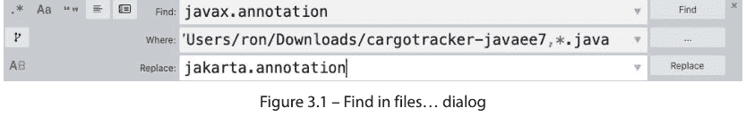
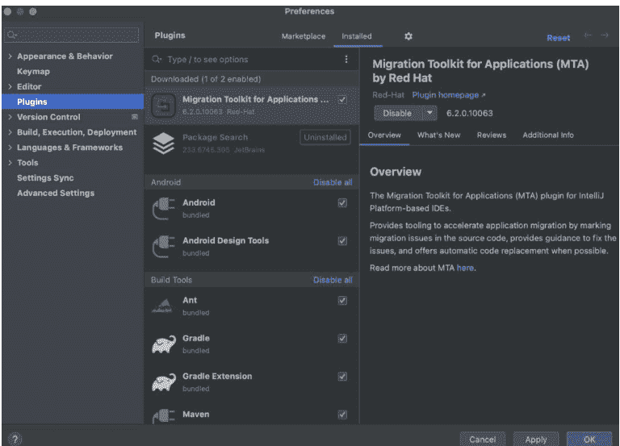
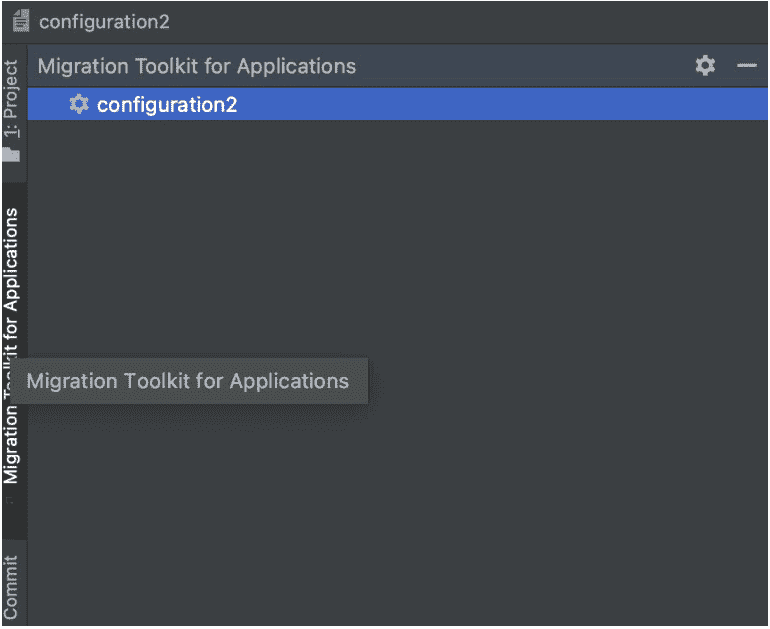
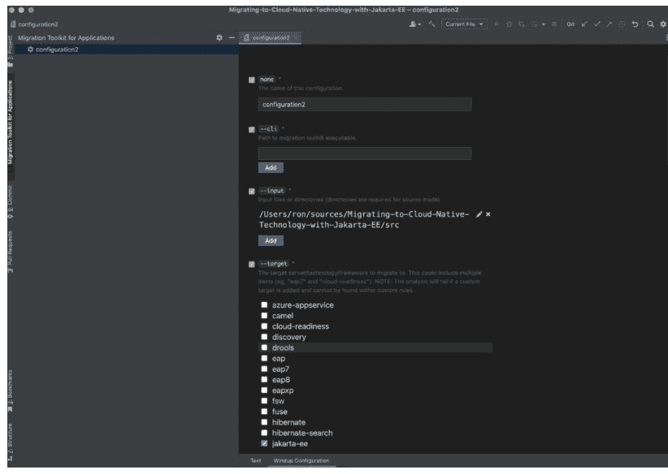
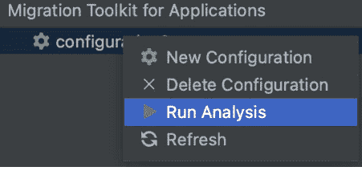
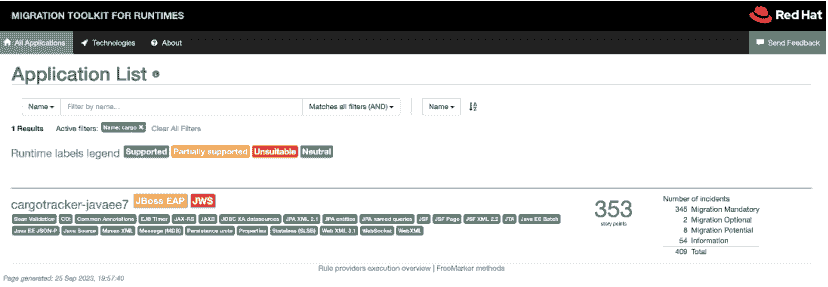
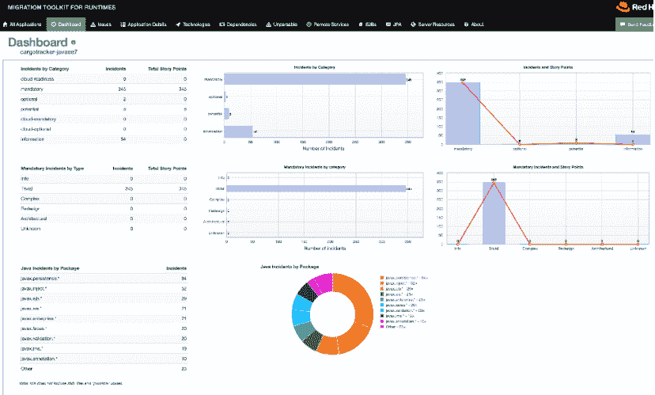
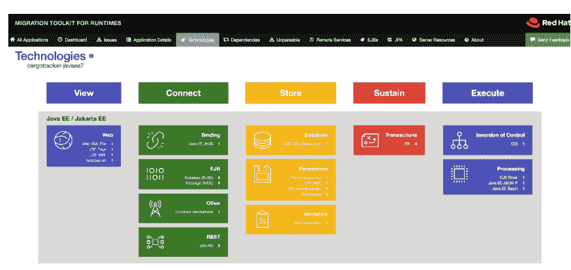
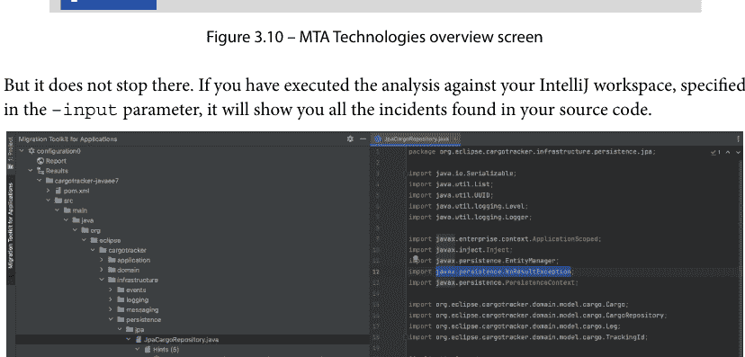
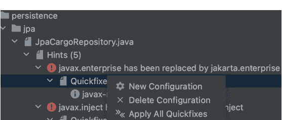

## Moving from Java EE to Jakarta EE

在上一章中，您了解了 Cargo Tracker 应用的工作原理和技术细节。您现在应该对该应用的功能相当熟悉，并对底层技术有基本了解。

在本章中，我们将涵盖以下主要主题：

- Migrating namespaces
- Migrating dependencies
- Upgrading your application server

升级到 Jakarta EE 9 是使现有应用能够使用 Jakarta EE 规范工作的第一步。我们特意选择这种方法，因为我们从经验中了解到这是更简单的方法。一旦我们完全进入 Jakarta EE 生态系统，我们就可以开始升级到 Jakarta EE 10 中提供的新的功能。这将在下一章中介绍。

### Technical requirements

您需要一些工具来迁移命名空间。其中一些工具取决于操作系统。您应选择最适合您特定情况的方法。对于每个主要操作系统：Linux、Windows 和 macOS，都会有不止一个选项可用。

这里提供的一些解决方案需要额外软件的存在：一些是开源的，一些需要付费许可证。

您还需要某种编辑器或集成开发环境（IDE）来更改部分源代码。我们将由您自行选择工具。

### It’s all about namespaces

当 Oracle 将 Java EE 转移到 Eclipse 基金会时，没有人能预见到接下来会发生什么。Eclipse 基金会及其众多志愿者开始着手更新代码和文档，以反映从 Oracle 到 Eclipse 基金会的变更。谈判持续了数月，试图就 Jakarta EE 规范中 `javax` 包命名空间的演进达成一致。不幸的是，由于无法克服的版权问题，这一努力失败了。因此，`javax` 命名空间只能“按原样”与 Jakarta 组件规范一起使用，这意味着任何随时间演进的规范都需要将其命名空间从 Java EE 规范更改为 Jakarta EE 规范。此外，缩写也需要更改；例如，**Enterprise JavaBeans (EJB)** 变成了 Jakarta Enterprise Beans。

版本 8 是 Java EE 规范的最后一个版本。Jakarta EE 版本 8 完全相同，但由 Eclipse 处的源代码构建。

Jakarta EE 9 在功能上等于 Jakarta EE 8，但命名空间现已从 `javax` 重命名为 `jakarta`。

以下是所有更改的命名空间的概述，其原始缩写以及新的命名空间和缩写。

| Java EE namespace | Jakarta EE namespace |
| --- | --- |
| `javax.activation` | `jakarta.activation` |
| `javax.annotation` | `jakarta.annotation` |
| `javax.batch` | `jakarta.batch` |
| `javax.cache` | `jakarta.cache` |
| `javax.decorator` | `jakarta.decorator` |
| `javax.ejb` | `jakarta.ejb` |
| `javax.el` | `jakarta.el` |
| `javax.enterprise` | `jakarta.enterprise` |
| `javax.inject` | `jakarta.inject` |
| `javax.interceptor` | `jakarta.interceptor` |
| `javax.jms` | `jakarta.jms` |
| `javax.json` | `jakarta.json` |
| `javax.jws` | `jakarta.jws` |
| `javax.management` | `jakarta.management` |
| `javax.persistence` | `jakarta.persistence` |
| `javax.resource` | `jakarta.resource` |
| `javax.security` | `jakarta.security` |
| `javax.servlet` | `jakarta.servlet` |
| `javax.transaction` | `jakarta.transaction` |
| `javax.validation` | `jakarta.validation` |
| `javax.websocket` | `jakarta.websocket` |
| `javax.ws.rs` | `jakarta.ws.rs` |
| `javax.xml` | `jakarta.xml` |

*Table 3.1 – Namespace changes*

### Migrating strategies

从应用开发者的角度来看，所有这些中最痛苦的部分是命名空间已经更改。这意味着迁移到 Jakarta 涉及重构代码库中所有 Java EE import 语句。在较小程度上，项目的 POM 文件也需要进行更改。

在本节中，我们将研究三种迁移项目的方法。我们将使用以下工具进行操作：

- An open source multiplatform editor
- The sed command line tool
- A specialized plugin for your IDE

但在这样做之前，最好先在 Git 中创建一个新分支，其中将包含我们更新后的源代码。

在 cargotracker 目录内输入以下命令：

```
git checkout -b jakarta-ee9
```

Git 将回复消息 `Switched to a new branch 'jakarta-ee9'`。

如果您想立即将此新本地分支推送到远程服务器，可以通过输入以下命令来实现：

```
git push -u origin jakarta-ee9:jakarta-ee9
```

您可能更喜欢先进行必要的更改，然后再提交和推送。在这种情况下，您现在可以跳过立即将新分支推送到远程服务器。


### 使用跨平台开源编辑器

此转换选项可在所有主要操作系统上运行。我们使用的是开源编辑器 Sublime Text，可从 `https://www.sublimetext.com/` 下载。

编辑器具有 **Find in Files** 选项，可递归搜索目录树中指定文件组中的特定文本。

启动编辑器，从 **Find** 下拉菜单中选择 **Find in files…**，然后执行以下步骤或输入 *Figure 3.1* 中显示的信息：

1. 在 **Find** 文本字段中输入 `javax.activation`。
2. 按下位于 Find 和 Replace 之间的按钮 …。
3. 选择 **Add Folder**。
4. 从选择对话框中选择您的 cargo tracker 根目录。
5. 再次按下按钮 …。
6. 选择 **Add Include Filter**。
7. 文本 `*.txt` 将插入到 **Where** 文本字段中。
8. 将 `*.txt` 改为 `*.java`。
9. 在 **Replace** 文本字段中，输入 `jakarta.activation`。



如果现在按下 **Find** 按钮，编辑器将打开一个文档，列出所有 `javax.activation` 的出现位置。它在 9 个不同文件中出现了 10 处。

再次打开 **Find in Files** 对话框并按下 **Replace** 按钮，这次会先询问您是否要在 9 个文件中替换这 10 处出现。按下 **Yes** 将应用更改。

虽然此更改很容易，但它要求您为 *Table 3.1* 中的每一行输入值，并且对您想要迁移的每个项目都要这样做。如果您运行的是 Linux 或 macOS，下一个选项会更吸引您。

请注意，此迁移选项可从您喜爱的 IDE 内使用。

#### Sed

Sed 是 Linux 和 macOS 操作系统上的标准工具。此流编辑器在 Windows 平台上不可用。如果您使用的是 Windows 操作系统，建议您使用其他两种转换选项之一。

以下代码是用于自动替换 Java EE 命名空间使用为 Jakarta EE 命名空间的小型 Bash 脚本的源代码。它由一个包含旧命名空间和新命名空间以逗号分隔列表的文本文件驱动。然后它告诉 sed 从当前目录开始递归遍历目录树，并在每个 Java 扩展名的文件上执行替换：

```
#!/bin/bash
input="./jee-jakartaee.txt"
while IFS= read -r line
do
  IFS=',' read -r -a array <<< "$line"
  sed -i -e "s/${array[0]}/${array[1]}/g" $(find ./ -name *.java)
done < "$input"
```

需要牢记两点。首先，最好将此脚本放在 cargotracker 目录的根目录中。其次，jee-jakartaee.txt 输入文件需要在同一目录中。两者均可从本书附带的 GitHub 项目下载——更准确地说，在这里：https://github.com/PacktPublishing/Cloud-Native-Development-and-Migration-to-Jakarta-EE。

#### 使用 IDE 的专用插件

到目前为止，您已经看到了迁移源代码的两种选项。我们现在将展示第三种选项——可从 IDE 获得的选项。在此情况下，我们谈论的是 IntelliJ Ultimate Edition。重构是现代 IDE 中的常见功能，IntelliJ 也不例外。事实上，此迁移选项让您可以非常具体地触发想要转换的内容以及不转换的内容。更方便的是，它预定义了 Java EE 到 Jakarta EE 的迁移。

您需要在 IntelliJ 中导入并打开项目。然后，执行以下步骤：

1. 选择 Refactor 菜单选项。
2. 从下拉菜单中选择 Migrate Packages and Classes。
3. 选择 Java EE to Jakarta EE。

会出现以下对话框：

4. 选择 Whole project 选项。
5. 按下 Run 按钮。

IntelliJ 将按包名分组显示所有出现的位置。您可以通过单击对话框中显示的树来检查更改。

*Figure 3.2 – Migration dialog in IntelliJ*

*Figure 3.3 – Overview of files to migrate*

6. 最后，按下 Do Refactor 以应用更改。

完成后，编辑器将报告已更改 308 处出现。

虽然 IntelliJ Ultimate 在更改导入的命名空间方面做得很好，但它无法识别 Strings 和 XML 文件中内部的 javax 用法。为修复此缺陷，我们必须手动修复一些文件或使用前面的一种方法。

RejectedRegistrationAttemptsConsumer、MisdirectedCargoConsumer、HandlingEventRegistrationAttemptConsumer、DeliveredCargoConsumer 和 CargoHandledConsumer 都使用了一个在属性值中使用名称 javax 的注解。此注解如下所示：

```
@ActivationConfigProperty(propertyName = "destinationType", propertyValue = "javax.jms.Queue")
```

由于 propertyValue 中存在 javax，此激活配置将无法工作。为修复此问题，将注解更改为以下示例，该示例使用 jakarta：

```
@ActivationConfigProperty(propertyName = "destinationType", propertyValue = "jakarta.jms.Queue")
```

我们还需要在 web.xml 中进行更改，因为 IntelliJ 未对该文件进行任何更改。在 web.xml 文件中，javax 名称用于 javax.faces 上下文参数。在 web.xml 文件的顶部部分，您可以看到正在使用 javax 命名空间。它如下所示：

```xml
<context-param>
    <param-name>javax.faces.PROJECT_STAGE</param-name>
    <param-value>Development</param-value>
</context-param>
<context-param>
    <param-name>javax.faces.CLIENT_WINDOW_MODE</param-name>
    <param-value>url</param-value>
</context-param>
```

这些上下文参数也需要更改为新的 jakarta 命名空间。为此，您需要将类路径中的 javax 部分替换为 jakarta。结果如下所示：

```xml
<context-param>
    <param-name>jakarta.faces.PROJECT_STAGE</param-name>
    <param-value>Development</param-value>
</context-param>
<context-param>
    <param-name>jakarta.faces.CLIENT_WINDOW_MODE</param-name>
    <param-value>url</param-value>
</context-param>
```

完成这些更改后，`javax` 名称将在整个项目中被替换为 `jakarta`。最后要做的事情是在再次运行项目之前升级 POM 文件和依赖项。

### 升级您的 pom.xml 文件

我们还需要对代码库应用一个更改。我们需要告诉它现在正在使用 Jakarta EE 9 API。这是通过更新 `pom.xml` 文件中的依赖项来完成的。

打开 `pom.xml` 文件并找到依赖项部分。它应如下所示：

```xml
<dependency>
    <groupId>javax</groupId>
    <artifactId>javaee-api</artifactId>
    <version>${javaee_api.version}</version>
    <scope>provided</scope>
</dependency>
```

现在，将其更改为以下内容：

```xml
<dependency>
    <groupId>jakarta.platform</groupId>
    <artifactId>jakarta.jakartaee-api</artifactId>
    <version>9.0.0</version>
    <scope>provided</scope>
</dependency>
```

您现在已告诉 Maven 它应使用新的 Jakarta EE 9 依赖项。

现在，继续通过调用 `mvn clean install` 重新构建应用程序。

### 迁移依赖项

随着从 **Java EE** 到 **Jakarta EE** 命名空间的迁移，我们需要更新项目使用的三个依赖项。在本节中，我们将了解如何升级项目的 Java 版本、**Payara** 应用服务器以及 **PrimeFaces** 依赖项。

#### 升级项目

要更改 Maven 使用的 Java 版本，我们需要在 `pom.xml` 文件中进行两次更改。在项目目录根目录中的 `pom.xml` 文件中，您可以找到 cargo tracker 应用程序的源和目标 Maven 使用。

目前，项目使用 Java 7 版本，并且在 pom.xml 文件中，您可以找到以下两行来确认这一点：

```
<maven.compiler.source>1.7</maven.compiler.source>
<maven.compiler.target>1.7</maven.compiler.target>
```

我们将 cargo tracker 应用程序升级到当前可用的最新长期支持 LTS 版本的 Java，即 17。要升级项目，请将 1.7 替换为 17，使其如下所示：

```
<maven.compiler.source>17</maven.compiler.source>
<maven.compiler.target>17</maven.compiler.target>
```

重要的是，您现在还应更改在第 2 章中设置的 JAVA_HOME 系统变量。在继续之前，下载 Java 17 SDK 并将其设置为 JAVA_HOME 系统变量。如果不这样做，项目将无法编译。

接下来是升级 Payara 应用服务器到最新版本。升级 Payara 需要两个步骤。我们需要将 Cargo 插件升级到支持 Payara 版本 6 的版本，并需要将 Payara 从 4 升级到 6。

要升级 Cargo，我们需要将版本号从 1.8.1 更改为 1.10.5。为此，请更改以下行：

```
<cargo.version>1.8.1</cargo.version>
```

结果应如下所示：

```
<cargo.version>1.10.5</cargo.version>
```

#### 升级 Payara 应用服务器

我们已在 pom.xml 文件底部更改了 cargo 插件的版本。下一步是更改 Payara 容器 ID 和下载 URI。我们正从 Payara 4 迁移到 6；为此，请更改以下行：

```
<cargo.payara.container_id>glassfish4x</cargo.payara.container_id>
<cargo.payara.download_uri>https://repo1.maven.org/maven2/fish/payara/distributions/payara/6.2023.2/payara-6.2023.2.zip</cargo.payara.download_uri>
```

将其更改为如下示例：

```
<cargo.payara.container_id>glassfish6x</cargo.payara.container_id>
<cargo.payara.download_uri>https://repo1.maven.org/maven2/fish/payara/distributions/payara/6.2023.2/payara-6.2023.2.zip</cargo.payara.download_uri>
```


`glassfish6x` 容器 ID 告诉 Cargo 插件我们想要使用哪个版本的 Payara。Cargo 使用下载 URI 来下载 Payara 的一个版本。为了完成 Cargo 的升级，我们需要更新插件内部定义的 artifact ID。在 `pom.xml` 文件底部，你会找到 Cargo 插件。我们需要获取这个 artifact ID：

```
<artifactId>cargo-maven2-plugin</artifactId>
```

并且我们需要将其更改为以下内容：

```
<artifactId>cargo-maven3-plugin</artifactId>
```

这就完成了 Payara 和 Cargo 升级到最新版本。

Cargo 跟踪器使用 **Derby** 作为内存数据库来存储货物信息，但如果我们想要使用 Payara 6，则不再可能。Payara 已出于若干原因用 **H2** 替换了 Derby。这意味着我们必须更改 `web.xml` 文件中的数据源。

在 `web.xml` 中，我们需要将如下所示的数据源替换为使用 H2 的数据源：

```xml
<data-source>
    <name>java:app/jdbc/CargoTrackerDatabase</name>
    <class-name>org.apache.derby.jdbc.EmbeddedDriver</class-name>
    <url>jdbc:derby:${webapp.databaseTempDir}/cargo-tracker-database;create=true</url>
</data-source>
```

要使用 H2，我们需要将类名替换为告诉 Payara 用于连接数据库的驱动程序。URL 告诉 Payara 数据库的位置，而 `:mem:` 告诉 H2 我们想要使用内存数据库。最后一个参数是 H2 需要创建的数据库的名称：

```xml
<data-source>
    <name>java:app/jdbc/CargoTrackerDatabase</name>
    <class-name>org.h2.Driver</class-name>
    <url>jdbc:h2:mem:cargo-tracker-database</url>
</data-source>
```

### 升级 PrimeFaces

我们需要升级的最后一个依赖项是 **PrimeFaces**。此升级也包含两个步骤：升级依赖项到最新版本并更改 PrimeFaces 主题，因为项目使用的主题不再受支持。

要升级 primefaces 依赖项，我们需要更改版本并添加一个 classifier。

当前的 primefaces 依赖项如下所示：

```xml
<dependency>
    <groupId>org.primefaces</groupId>
    <artifactId>primefaces</artifactId>
    <version>8.0</version>
</dependency>
```

升级后，它应如下所示示例。我们将版本更改为 10.0.0 并添加了 `jakarta` classifier：

```xml
<dependency>
    <groupId>org.primefaces</groupId>
    <artifactId>primefaces</artifactId>
    <version>10.0.0</version>
    <classifier>jakarta</classifier>
</dependency>
```

如前所述，我们需要更改主题。为此，请转到 `web.xml` 文件并在文件顶部查找以下行：

```xml
<context-param>
    <param-name>primefaces.THEME</param-name>
    <param-value>omega</param-value>
</context-param>
```

`param-value` 告诉 PrimeFaces 我们想要为项目使用 omega 主题。此主题与 PrimeFaces 10 版本不兼容。要切换到不同的主题，请将之前的代码行更改为以下内容：

```xml
<context-param>
    <param-name>primefaces.THEME</param-name>
    <param-value>saga</param-value>
</context-param>
```

执行完最后一步后，我们完成了从 `javax` 到 `jakarta` 的迁移。现在你可以使用 `mvn clean` 和 `mvn package cargo:run` 运行 Cargo 跟踪器应用程序，使用 Jakarta EE 在 Payara 6 上运行。

### Red Hat MTA

**MTA**，即 **Migration Toolkit for Applications**，可以自动将你的 Java EE 项目转换为 Jakarta EE。它通过应用一组特定的规则来实现。MTA 是一个非常全面的产品。转换可以通过以下方式完成：

- 用户界面
- 命令行工具
- OpenShift 操作符
- IDE 插件

在使用 MTA 之前，你需要 [下载](https://developers.redhat.com/products/mtr/download) 并安装它。有关安装说明，我们请你参考 [官方文档](https://access.redhat.com/documentation/en-us/migration_toolkit_for_applications/6.2/html/cli_guide/index?extIdCarryOver=true&sc_cid=701f2000001Css5AAC)。你应该安装命令行工具，因为它们是在你的机器上执行迁移时需要使用的工具。

一旦你安装了命令行工具，就可以开始迁移了。我们再次使用 IntelliJ 插件来执行迁移。你需要从插件页面安装 MTA 插件：



图 3.4 – MTA 插件安装屏幕

插件安装后，你的 UI 中会出现一个新标签页，标签为 **Migration Toolkit for Applications**。请按以下步骤操作：

1. 点击该标签。

   列表中应该有一个默认的配置条目。如果没有，请右键单击并选择 **New Configuration**。你的屏幕现在应如下所示：

   

   图 3.5 – MTA 插件中的配置条目

2. 双击配置。
3. 按以下图所示输入信息（注意我们在底部选择了 **Windup Configuration**）。

   

   图 3.6 – MTA 的配置详情

4. 确保你输入了安装 MTA 命令行工具的位置。
5. 关闭配置。
6. 返回配置列表，你现在可以选中刚刚修改的配置，右键单击它并选择 Run Analysis：

   

   图 3.7 – Run Analysis 弹出菜单选项

7. 分析完成后，左面板中的配置将更新为报告和结果部分。

   

   图 3.8 – 迁移报告概览

8. 点击报告以进入迁移报告。接下来，点击 `cargotracker-javaee7`。
9. 你将看到项目工件的摘要、检测到的事件类型，甚至应用更改所需故事点的估计。

   

   图 3.9 – MTA 仪表板主屏幕

请注意，顶部还有多个标签可以提供有关应用程序的出色信息，例如此处显示的 **Technologies** 屏幕：



图 3.10 – MTA Technologies 概览屏幕

但并不止于此。如果你在 `-input` 参数中指定的 IntelliJ 工作区上执行了分析，它将向你显示在源代码中发现的所有事件。



图 3.11 – 与源文件相关的事件视图

如果可以应用快速修复，你可以通过右键单击事件并选择 Apply All Quickfixes 来执行此操作。



快速修复可以应用于单个事件、文件中的所有事件，或更高级别。

### 升级你的应用程序服务器

现在，你已将源代码升级到 Jakarta 命名空间并更新了依赖项。你还升级到了较新版本的应用程序服务器。

如果你在项目中使用与 Payara 不同的应用程序服务器，可以使用本节中的信息来选择要使用的应用程序服务器的正确版本。

Jakarta EE 9 有两个版本：Jakarta EE 9 和 Jakarta EE 9.1。两者之间没有功能差异；它们不包含独特的功能。然而，由于迁移工作量巨大，因此决定仅在 Jakarta EE 9.1 中引入对 Java 11 的兼容性。因此，如果你计划在 Java 8 上运行应用程序服务器，Jakarta EE 9 服务器就足够了；否则，请在 Java 11 及更高版本上使用 Jakarta EE 9.1。

下表列出了一些更常见的应用程序服务器。

| 应用程序服务器 | Jakarta EE 9 兼容 | Jakarta EE 9.1 兼容 |
|---|---|---|
| Eclipse GlassFish | 6.0 | 6.1 |
| Open Liberty | 21.0.0.12 | 21.0.0.12 |
| WildFly | 23.0.2 | 25.0.0 |
| Payara Enterprise Server | 6.2021.1 | 6.2021.1 |
| IBM WebSphere Liberty | 21.0.0.12 | 21.0.0.12 |

表 3.2 – Jakarta EE 9 兼容应用程序服务器


### Summary

在本章中，你学习了如何将 Cargo Tracker 应用从 Java EE 迁移到 Jakarta EE。你学习了多种迁移代码的方法。你还学习了如何升级应用的依赖项。最后，你学习了应为运行 Cargo Tracker 应用以及你自己的应用选择哪个应用服务器版本。

这些步骤对于我们将在下一章中介绍的内容至关重要，即升级应用以利用 Jakarta EE 10 提供的全新功能。
