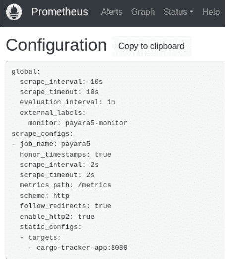
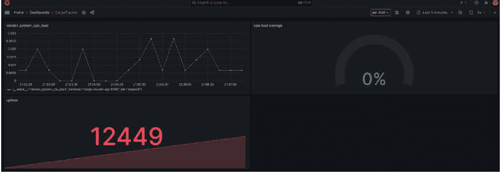

## Modernizing Your Application with the Latest Features
### 

你正在迁移的应用，在我们的例子中是 Cargo Tracker 应用，近年来并未进行重大升级，这导致它错过了许多新功能，并且没有使用云所提供的功能，例如监控和扩展。在本章中，我们将专注于 Jakarta EE 10 以及如何将应用升级到云原生标准。在本章中，你将使你的应用现代化，使其能够在云中运行，同时使用 Jakarta EE 10 的最新功能。

在本章中，我们将涵盖以下主题：

- Jakarta EE 10 所做的最重要更改
- 添加第一个云原生功能 – 弹性
- 添加第二个云原生功能 – 监控
- 使用 Prometheus 和 Grafana 可视化监控过程

完成本章后，你将能够将应用升级为可使用云以及 Jakarta EE 10 最新功能的应用。你还将知道如何监控应用的健康状况。这将使你能够跟上 Jakarta EE 的最新版本。

### Technical requirements

要跟上本章的学习，你需要完成过 *Chapter 3*。对于本章而言，拥有一个运行在 Jakarta EE 10 或更新版本上但尚未使用新功能的应用是很重要的。

## The most significant changes to Jakarta EE 10

Jakarta EE 10 是加入 Eclipse 基金会以来首次增加功能的 Jakarta EE 版本。在本节中，我们将介绍所做的最有意义的更改。它绝不是对所有更改的详尽概述。我们也不会将这些更改应用到现有的 Cargo Tracker 应用。进行这些更改将非常依赖于具体用例，例如设置不同的身份验证机制或更改主键。

### Core Profile

我们已经指出，增加 Core Profile 是主要功能之一。该配置文件针对较小的应用，例如微服务。事实上，根据官方文档，它针对的是现代云应用，重点是一个最小的 API 集合，支持微服务，并侧重于启用使用即时编译 AOT 编译构建的实现，以最小化启动时间和内存占用。

这是一个相当长的句子，为了完全理解它的含义，我们将对其进行分解。它针对较小的应用。这是一个有趣的观察。在关于 Java EE/Jakarta EE 历史的章节中，你读到原始的配置文件针对两种类型的实现：Web 服务器和应用服务器。Web 配置文件针对的是不使用许多规范的较小应用，而由应用服务器实现的完整配置文件则针对更大、更复杂的应用。这些完整配置文件实现为部署在这些服务器上的应用提供各种功能：EJB、安全、事务管理、JNDI 等。这与核心配置文件形成对比，后者针对的是不使用太多 Jakarta 规范的非常精确的微服务。

转向较小的应用与这些完整配置文件实现形成对比。但它与当前软件架构的趋势一致，即单体应用被拆分为较小的应用。因此，Jakarta EE 希望成为一个允许微服务的平台。

它允许创建现代、云原生的应用。我们已经看到云原生应用都是关于什么的。为了实现这种云原生性，可以使用 Jakarta EE 和 Micro Profile，因为它们彼此互补。

专注于支持微服务的最小 API 集合。在 Core Profile 出现之前，我们使用 Web Profile 来创建微服务。但与 Web Profile 不同，Core Profile 只要求有七个规范可用：

- Jakarta Annotations
- Jakarta CDI Lite
- Jakarta Dependency Injection
- Jakarta Interceptors
- Jakarta JSON Processing
- Jakarta JSON Binding
- Jakarta RESTful Web Services

仅有七个需要实现的规范的另一个好处是，它使得创建符合 Jakarta EE 10 core profile 规范的有效应用服务器变得更容易。这使得社区能够创建更适合其用例的应用服务器。

然后，重点是启用使用 AOT 编译的实现。这与 Java 运行时默认使用的正常 JIT 编译过程大不相同。

通常，Java 文件在执行代码之前被编译成类文件。在代码执行期间，**Java Virtual Machine (JVM)** 将字节码翻译成平台特定的机器码。为此，它内置了两个编译器，名为 C1 和 C2。C1 快速生成未优化的机器码。在某个时刻，方法执行计数阈值可能会被通过，然后 JVM 决定是时候优化生成的机器码了。这就是 C2 编译器发挥作用的地方。它生成代码所需的时间更长，但生成的机器码高度优化。

重要的是要记住，所有这些编译都是在应用执行期间完成的。

另一方面，AOT 编译是在应用执行之前进行的。在一个复杂且耗时的过程中，AOT 编译器将遍历每一种可能的执行路径并生成所需的机器码。这有几个优点：

- 运行应用时无需完整的 JVM
- 应用已处于二进制格式，因此在运行时无需花费时间进行编译
- 所有类在启动时已知，因此无需扫描 JAR/WAR/EAR 文件
- 优化的内存消耗
- 快速启动时间，因为所有需要启动的内容都是预先知道的

与许多事情一样，AOT 并非免费。最显著的缺点如下：

- 极长的编译时间
- 动态类加载的能力丢失
- 生成的二进制文件针对特定平台，失去了编写一次到处运行的理念
- 你失去了像 C2 编译器那样在运行时优化代码执行的能力

目前最著名的 AOT 编译器是来自 Oracle 的 GraalVM。它有开源和许可两种版本。虽然前者提供最多的功能，但后者附带支持并且更优化。

#### Using UUIDs as keys

在了解如何使用 **Universally Unique Identifiers (UUIDs)** 之前，我们应该定义它们是什么以及为什么你会想使用它们。UUID 用于唯一标识对象或实体。它们在 RFC-4122 中定义。

UUID 有几种不同的类型：

- **Type 1:** 基于日期时间 and MAC 地址
- **Type 2:** 基于日期时间、MAC 地址和 **Distributed Computing Environment (DCE)**
- **Type 3:** 命名空间和名称的 MD5 哈希
- **Type 4:** 随机生成的数字
- **Type 5:** 命名空间和名称的 SHA-1 哈希

尽管其名称暗示它们总是唯一的，但存在重复值的可能性。尽管因类型而异，但总体可能性极低，可以安全地忽略。

Jakarta Persistence 现在可以使用 UUID 作为键值。UUID 主要是唯一值。这使它们可用于需要唯一性的键的值。虽然可能出现重复，并且根据所选的 UUID 类型这种可能性可能更高，但在实践中发生的可能性极低。

考虑以下代码，它正是这样做的：

```
```java
@Entity
public class Vehicle {
    @Id
    @GeneratedValue(strategy = GenerationType.UUID)
    private UUID id;
    private String license;
    private String type;
}
```
```

Vehicle 类的 ID 是 java.util.UUID 类型。由 GenerationType.UUID 生成的 UUID 是一个 rfc-4122 兼容的 UUID。

### Multi-part form parameters

多部分表单数据对于上传大量数据很有用，例如图片或文件的内容。

虽然这对于应用来说是很常见的行为，但 Jakarta EE 目前没有为此提供标准解决方案。通常，开发人员不得不依赖来自其应用服务器供应商的不可移植实现。


最后，在 Jakarta EE 10 中，多部分表单参数开箱即用地得到支持：

```
@POST
@Path("upload/picture")
@Consumes(MediaType.MULTIPART_FORM_DATA)
public Response postImage(@FormParam("userId") String memberId, @FormParam("image") EntityPart image) {
    String fileName = image.getFileName().orElseThrow(NotSupportedException::new);
    InputStream content = image.getContent();
    return Response.ok("image is uploaded").build();
}
```

我们需要定义该端点消费 MULTIPART_FORM_DATA。接下来，我们需要定义要注入到变量中的各个表单参数的内容。在前面的代码中，EntityPart 将保存包含图像数据的流。尽管这里可以使用字符串，但更明智且更具可扩展性的解决方案是使用输入流来读取数据，以防止图像内容一次性加载到方法中。

### 纯 Java Jakarta Faces 视图

没错，你读对了！如果你想以编程方式组合你的 Jakarta Faces 视图，现在你可以了。你可以跳过所有脚本部分，只使用 Java 代码。

这样做有各种优势。在动态构建视图时，你只需遍历 Java 类并为每个字段按需创建组件。如果你想从视图中排除某些字段，可以在 Java 中编写执行此操作的条件。最后，事件处理程序可以是简单的 Java Lambda——无需通过 EL 表达式使用方法引用。

如果你以前使用 Java SE 编写过 Swing 代码，那么下面的示例可能看起来非常熟悉：

```
HtmlForm form = components.create(HtmlForm.COMPONENT_TYPE);
body.getChildren().add(form);

HtmlOutputText message = components.create(HtmlOutputText.COMPONENT_TYPE);
form.getChildren().add(message);

HtmlCommandButton actionButton = components.create(HtmlCommandButton.COMPONENT_TYPE);
actionButton.addActionListener(
    e -> message.setValue("I was pressed"));
actionButton.setValue("Press");
form.getChildren().add(actionButton);
```

在这里，我们在代码中创建了一个简单的 HTML 表单。我们向表单添加了一个 HtmlOutputText 组件。最后，我们创建并添加了一个 HtmlCommandButton 组件。按钮的 action listener 方法接收一个 Lambda，当按钮被按下时会执行该 Lambda。

### 使用 OpenID 进行身份验证

你在应用程序中如何处理用户身份验证？最常见的方式是提供一个专用的登录，使用用户名和密码。一旦输入，你的应用程序就会尝试将用户与本地数据库或 LDAP 中可用的信息进行身份验证。

然而，用户并不总是希望为每个想要访问的新站点创建新账户。这就是 OpenID 的用武之地。想象一下，你有一个 Google 账户。访问站点 A 时，你指定想要使用你的 Google 凭据登录。站点 A 本身没有任何了解或验证你的 Google 凭据的能力。因此，它将身份验证中继到 google.com。一旦 Google 确定你声称自己是谁，此信息就会返回给站点 A。

随着使用 OpenID 进行身份验证变得越来越普遍，Jakarta Security 现在通过一组注解支持 OpenID。让我们看一个示例：

```
@OpenIdAuthenticationDefinition(
providerURI = "https://accounts.google.com",
clientId = "${config.clientId}",
clientSecret = "${config.clientSecret}",
redirectURI = "${baseURL}/callback",
)
@ApplicationScoped
public class GoogleOpenIdSecurityBean {
}
```

@OpenIdAuthenticationDefinition 接受多个可配置参数。providerUri 指向 OpenId 提供者——即执行实际身份验证的参与者。clientId 和 clientSecret 告知提供者它正在为谁进行身份验证。最后，redirectUri 包含提供者在身份验证完成后返回到你的应用程序的回调端点。

### 改进的并发

Jakarta concurrency 在版本 10 中有大量更改。其中两个最值得注意的是 @Asynchronous 注解的引入以及能够配置 ManagedExecutorService。

虽然该注解可通过 Jakarta Enterprise Beans 规范获得，但新注解有几个明显的优势。首先，EJB 需要完整的 Jakarta EE 配置文件才能工作——例如在 Core Profile 中不可用。

其次，旧注解使用来自应用程序服务器的默认线程池，而新版本允许你指定要使用的线程池，如果你不想使用默认线程池的话。这可能带来巨大的好处，因为它允许你为某些任务组使用专用线程池。

这里有一个示例：

```
```java
public class PaymentService {
    @Asynchronous(executor = "java:app/concurrent/OrderExecutorService")
    public CompletableFuture<OrderStatus> processOrder
        (final Order order) {
        try {
            var status = processAvailability(order);
            return CompletableFuture.completedFuture(status);
        } catch (OrderProcessingException ex) {
            throw new CompletionException(ex);
        }
    }
}
```
```

我们只需用 @Synchronous 注解该方法，并可选择指定要使用的执行器服务。

## 添加第一个云原生特性——弹性

从技术角度来看，为你的系统添加弹性并不困难。真正的挑战在于决定在哪里为代码添加弹性以及添加哪种类型的弹性。为了为代码添加弹性，我们将使用 MicroProfile，因为它非常适合 Jakarta EE 应用程序。

你可以通过向 pom.xml 文件添加以下条目来添加 MicroProfile：

```
```xml
<dependency>
    <groupId>org.eclipse.microprofile</groupId>
    <artifactId>microprofile</artifactId>
    <version>5.0</version>
    <type>pom</type>
    <scope>provided</scope>
</dependency>
```
```

通过将此 xml 添加到你的 pom.xml 文件中，你就可以在应用程序中使用 MicroProfile。

接下来，执行构建和启动应用程序的标准步骤。它们现在应该不再让你感到惊讶了。

对于 CargoTracker 应用程序，你需要运行以下命令：

- `mvn clean install`
- `mvn cargo:run`

在应用程序中可以使用 MicroProfile 后，我们可以使用以下选项为应用程序添加弹性：

- `@Timeout`
- `@Retry`
- `@Fallback`
- `@Bulkhead`
- `@CircuitBreaker`
- `@Asynchronous`

如前所述，@Asynchronous 是一个特例，因此此处不予处理。我们将在此处提供其他弹性方法的示例。

@Timeout 是一种弹性方法，我们希望将其添加到对可能花费很长时间的操作或其他系统的调用中。为了防止系统变得无响应，我们可以限制操作运行的时间，在此之后将其切断。

在我们的代码中使用 @Timeout 选项的理想位置是图遍历代码。它位于 ExternalRoutingService 类中。在那里，fetchRoutesForSpecification 方法执行 web 客户端调用以检索路由规范。

从技术上讲，外部系统可能响应缓慢，甚至更糟，无法使用。

为了限制这对我们系统的影响，我们可以添加 @Timeout 注解。代码现在看起来像这样：

```
```java
@Timeout(value = 2000)
public List<Itinerary> fetchRoutesForSpecification(RouteSpecification
routeSpecification) {
```
```

如果对外部系统的调用失败，现在由于你添加的注解，它会尽早失败。但如果它失败了，你难道不想重试吗？毕竟，这可能只是导致此问题的简单网络故障。它可能是一个可恢复的错误。

为了支持重试，我们需要添加以下代码。它将使我们在重试之间等待 250 毫秒，并且它只会重试两次，而不是默认的 3 次：

```
```java
@Timeout(value = 2000)
@Retry(maxRetries = 2, delay = 250)
public List<Itinerary> fetchRoutesForSpecification(RouteSpecification
routeSpecification) {
```


Cargo Tracker 提供了更改目的地的功能。这将在 `changeDestination` 屏幕上完成。`.xhtml` 文件由一个名为 `ChangeDestination` 的 `@Named` 后备 bean 支持。它为用户提供了一个下拉菜单来选择新位置的名称。该下拉菜单由一个名为 `potentialDestinations` 的位置列表支持。此列表在 bean 初始化期间加载。它通过 `BookingServiceFacade` 的 `listShippingLocations` 获取位置。此方法通过查询数据库来实际加载。

呼——这可真是相当曲折的一段旅程！它向我们展示了事情会变得多么复杂，尤其是对于 Cargo Tracker 这样的应用程序，该应用程序是考虑到 **领域驱动设计 (DDD)** 而设置的，并且应用程序的不同架构层之间有明确的区分。

无论如何，如果由于某种原因（是的，网络，我们在看你！）无法检索所需的值，提供一个默认响应会很好。让我们诚实一点——一个空的位置列表仍然比向用户报告一些奇怪的错误要好。

我们将通过 `@Fallback` 为 `listShippingLocations` 注解一个默认响应。

请看以下代码：

```java
@Override
@Fallback(fallbackMethod = "shippingLocationsFallback")
public List<org.eclipse.cargotracker.interfaces.booking.facade.dto.Location> listShippingLocations() {
```

请注意，任何导致 `listShippingLocations` 抛出异常的情况都会触发 fallback 方法。您可以使用 `applyOn` 和 `skipOn` 参数配置此行为。

接下来，我们需要为 `fallbackMethod` 参数中指定的方法提供实现。

它看起来像这样：

```java
private List<org.eclipse.cargotracker.interfaces.booking.facade.dto.Location> listShippingLocationsFallback() {
    return List.of();
}
```

请注意，fallback 方法可以是私有的，并且在大多数情况下，它应该是私有的，以防止其他类对该方法进行不必要的访问。

我们在这里简单返回一个空列表，因为我们没有合理的替代值。

## 添加第二个云原生特性——监控

因此，通过添加一些弹性功能，我们使应用程序比以前更健壮。接下来，我们将更进一步，为我们的应用程序添加监控功能。

监控背后的想法是双重的。

首先，它应该为您提供系统按预期运行的信息。任何错误、异常、网络故障、数据库卡顿等都应被识别、记录并报告。

其次，监控应为您提供有关系统使用情况的信息。我们有多少新用户，系统中有哪些订单，某个 REST 端点被访问的频率如何，以及关键业务方法被调用的频率如何？

监控过程包含几个步骤：

1. 向您的代码添加注释，以主动监控指标。
2. 暴露指标数据以供采集。
3. 采集数据。
4. 生成警报并创建可视化数据。

在本节中，我们将讨论第一步，并确定我们想要监控的内容以及如何进行必要的代码更改。

### 查看运行系统的默认指标

开箱即用，MicroProfile Metrics 在应用程序状态方面已经收集了大量信息。它定义了三类信息：

1. 系统指标。
2. 应用指标。
3. 厂商特定指标。

让我们来看看这些指标。我们将使用 Cargo Tracker 应用程序来演示。导航到 http://localhost:8080/metrics；您将看到所有默认指标的列表。以下是输出的一部分：

```text
# TYPE base_cpu_availableProcessors gauge
base_cpu_availableProcessors 10
# TYPE base_cpu_systemLoadAverage gauge
base_cpu_systemLoadAverage 5.9248046875
# TYPE base_gc_total_total counter
base_gc_total_total{name="G1 Young Generation"} 54
base_gc_total_total{name="G1 Old Generation"} 0
# TYPE base_jvm_uptime_seconds gauge
base_jvm_uptime_seconds 56.064
# TYPE base_memory_committedHeap_bytes gauge
base_memory_committedHeap_bytes 2.87309824E8
# TYPE base_memory_committedNonHeap_bytes gauge
base_memory_committedNonHeap_bytes 2.17448448E8
# TYPE base_memory_maxHeap_bytes gauge
base_memory_maxHeap_bytes 5.36870912E8
# TYPE base_memory_maxNonHeap_bytes gauge
base_memory_maxNonHeap_bytes -1
# TYPE base_memory_usedHeap_bytes gauge
base_memory_usedHeap_bytes 2.28326272E8
```

请注意，为简洁起见，我们省略了 #HELP 行。

其中一些指标可能非常有用，因为它们允许您监控系统的行为和健康状况。这些数据对于需要在生产环境中支持应用程序的团队来说非常重要。指标可以是处理器数量、处理器的平均负载、垃圾回收次数、运行时间以及多个内存统计信息。后者可能有助于确定应用程序中的内存泄漏。

在输出的末尾，我们可以看到一个厂商特定的指标：

```text
# TYPE vendor_system_cpu_load gauge
vendor_system_cpu_load 0.08853118712273642
```

### 向系统添加指标

接下来，我们将在 Cargo Tracker 应用程序中添加一些自己的指标。第一步是确定您或您的利益相关者可能感兴趣的指标。技术部门可能会非常感兴趣于可以帮助验证系统按预期工作的指标。另一方面，业务利益相关者可能更感兴趣于一些面向业务的关键绩效指标。在本节中，我们将向我们的应用程序添加一些这两种类型的指标。

回想一下 *第 2 章*，我们介绍了 Cargo Tracker 应用程序，它有一个 REST 端点用于检索有关现有货物的信息。该端点可通过 `http://localhost:8080/cargo-tracker/rest/cargo` 访问，并将显示未完成的货物列表。

以下是输出的一部分：

```json
{
  "trackingId": "ABC123",
  "routingStatus": "ROUTED",
  "misdirected": false,
  "transportStatus": "IN_PORT",
  "atDestination": false,
  "origin": "CNHKG",
  "lastKnownLocation": "USNYC"
},
{
  "trackingId": "JKLS67",
  "routingStatus": "ROUTED",
  "misdirected": true,
  "transportStatus": "ONBOARD_CARRIER",
  "atDestination": false,
  "origin": "CNHGH",
  "lastKnownLocation": "USNYC"
}
```

我们可能对该端点被调用的频率感兴趣。为了为此设置指标，我们需要按如下方式更改 CargoMonitorService 类中的代码：

```java
@GET
@Produces(MediaType.APPLICATION_JSON)
@Counted(name = "getAllCargo", absolute = true)
public JsonArray getAllCargo() {
```

这里，我们添加了 @Counted 注解。我们将指标命名为 `getAllCargo`。通过指定 `absolute=true`，指标将在输出中作为 `application_getAllCargo` 注册。当我们将 `absolute` 设置为 `false` 时，给定名称前会加上完整的包路径和类名。

让我们向 REST 端点 (`http://localhost:8080/cargo-tracker/rest/cargo`) 发起几次 HTTP 请求以多次调用该方法。然后，当我们再次通过 `http://localhost:8080/metrics` 调用指标端点时，我们应该会看到底部添加了一个条目，如下所示：

```text
# TYPE application_getAllCargo_total counter
application_getAllCargo_total 3
```

另一个有用的指标涉及确定方法运行了多长时间。为此，我们可以使用 @Timed 注解。

我们将此指标应用于同一方法，因此它看起来像这样：

```java
@GET
@Produces(MediaType.APPLICATION_JSON)
@Counted(name = "getAllCargo", absolute = false)
@Timed(name = "getAllCargoTiming", absolute = false, tags = {"type=performance"})
public JsonArray getAllCargo() {
```

请注意，我们将指标信息存储在 `getAllCargoTiming` 下，并且我们还添加了一个选择器键/值对。这将使我们能够对结果数据进行更精确的选择。


Go 并通过访问 `http://localhost:8080/cargo-tracker/rest/cargo` 调用指定的方法，然后检索新的指标。

这些应该看起来像这样：

```
```text
# TYPE application_org_eclipse_cargotracker_interfaces_booking_rest_CargoMonitoringService_getAllCargoTiming_rate_per_second gauge
application_org_eclipse_cargotracker_interfaces_booking_rest_CargoMonitoringService_getAllCargoTiming_rate_per_second{_app="cargo-tracker",type="performance"} 0.14885107622981664
# TYPE application_org_eclipse_cargotracker_interfaces_booking_rest_CargoMonitoringService_getAllCargoTiming_one_min_rate_per_second gauge
application_org_eclipse_cargotracker_interfaces_booking_rest_CargoMonitoringService_getAllCargoTiming_one_min_rate_per_second{_app="cargo-tracker",type="performance"} 0.2
# TYPE application_org_eclipse_cargotracker_interfaces_booking_rest_CargoMonitoringService_getAllCargoTiming_five_min_rate_per_second gauge
application_org_eclipse_cargotracker_interfaces_booking_rest_CargoMonitoringService_getAllCargoTiming_five_min_rate_per_second{_app="cargo-tracker",type="performance"} 0.2
# TYPE application_org_eclipse_cargotracker_interfaces_booking_rest_CargoMonitoringService_getAllCargoTiming_fifteen_min_rate_per_second gauge
application_org_eclipse_cargotracker_interfaces_booking_rest_CargoMonitoringService_getAllCargoTiming_fifteen_min_rate_per_second{_app="cargo-tracker",type="performance"} 0.2
# TYPE application_org_eclipse_cargotracker_interfaces_booking_rest_CargoMonitoringService_getAllCargoTiming_mean_seconds gauge
application_org_eclipse_cargotracker_interfaces_booking_rest_CargoMonitoringService_getAllCargoTiming_mean_seconds{_app="cargo-tracker",type="performance"} 0.006363875
# TYPE application_org_eclipse_cargotracker_interfaces_booking_rest_CargoMonitoringService_getAllCargoTiming_max_seconds gauge
application_org_eclipse_cargotracker_interfaces_booking_rest_CargoMonitoringService_getAllCargoTiming_max_seconds{_app="cargo-tracker",type="performance"} 0.006363875
# TYPE application_org_eclipse_cargotracker_interfaces_booking_rest_CargoMonitoringService_getAllCargoTiming_min_seconds gauge
application_org_eclipse_cargotracker_interfaces_booking_rest_CargoMonitoringService_getAllCargoTiming_min_seconds{_app="cargo-tracker",type="performance"} 0.006363875
# TYPE application_org_eclipse_cargotracker_interfaces_booking_rest_CargoMonitoringService_getAllCargoTiming_stddev_seconds gauge
application_org_eclipse_cargotracker_interfaces_booking_rest_CargoMonitoringService_getAllCargoTiming_stddev_seconds{_app="cargo-tracker",type="performance"} 0
# TYPE application_org_eclipse_cargotracker_interfaces_booking_rest_CargoMonitoringService_getAllCargoTiming_seconds summary
application_org_eclipse_cargotracker_interfaces_booking_rest_
```
```

Prometheus 使用拉取机制从其监控的应用程序收集指标。这有几个好处，例如可以提前知道应用程序是否宕机。在上一节中，你设置了一个 Prometheus 可以用来拉取指标的端点。

### 设置 Docker Compose

我们将使用 Docker 运行一个 Prometheus 实例。为此，我们需要修改已有的 Docker Compose 文件，以便添加一个 Prometheus 服务。

在 Docker Compose 文件中，添加以下行：

```
```text
prometheus:
  image: bitnami/prometheus:latest
  ports:
    - "9090:9090"
```
```

前一个示例中的第一行是我们想要创建的服务的名称。在本例中，它是 Prometheus。然后，我们必须定义属于该服务的镜像。这里，我们使用 Bitnami 构建的最新 Prometheus 镜像。最后，我们需要定义一些端口，以便在实例运行后可以连接。我们选择将 `9000` 端口转发到 `9000`。运行此代码后，你将拥有一个正在运行的 Prometheus 实例，但它不会凭空开始收集指标。如果你访问 `localhost:9000`，你会看到一个空的 Prometheus 实例，没有任何可查询的数据。为了解决这个问题，在下一节中，我们将创建一个作业来收集数据。

### 设置 Prometheus 配置

第一次启动 `docker-compose` 时，你会看到一个空的 Prometheus 实例，它不收集也没有任何指标。如果你只想尝试一些东西，这是可以的。如果你删除了 Prometheus 实例的容器，你将不得不重新开始，如果你经常删除容器，这可能会很麻烦。同样的情况也适用于想要与你相同设置的同事。你的同事必须像你一样设置他们的 Prometheus 实例。如果你必须为整个团队和每个想要运行 Prometheus 服务的环境，例如测试、验收和生产，这样做也会变得乏味。

为了解决这个问题，首先要做的是在项目中创建一个目录来存放配置文件。我们在项目文件夹内直接创建了一个目录。完整路径如下：`cargo-tracker/prometheus`。在 Prometheus 实例内部，你需要为配置创建一个文件；我们选择将此文件命名为 `prometheus.yml`。这将是一个 YAML 文件，指定一些全局设置以及 Prometheus 对 `cargo-tracker` 应用程序执行的抓取作业的设置。

在 `prometheus.yml` 文件中，你需要放置以下配置：

```
```yaml
global:
  scrape_interval:     10s

  external_labels:
    monitor: 'payara5-monitor'

scrape_configs:
  - job_name: 'payara5'
    scrape_interval: 2s
    metrics_path: '/metrics'
    static_configs:
      - targets: ['cargo-tracker-app:8080']
```
```

此配置为 Prometheus 创建了一个抓取配置。这告诉 Prometheus 以下内容：

- 作业的名称
- 它应该多久抓取一次给定的指标
- 目标上的指标路径
- 抓取的目标

在上一节中，你可以在 `localhost:8080/metrics` 查看 `cargo-tracker` 的指标。你必须做同样的事情，让 Prometheus 知道它可以在哪里找到指标。由于我们使用 docker-compose，我们不必使用 localhost；我们可以使用服务名称代替。在之前的章节的 `docker-compose` 中，我们有一个名为 `cargo-tracker` 的服务。我们可以在作业配置中使用该名称，Docker 将其解析为 Prometheus 实例可用的实际地址。使用服务名称，我们可以像这样指定目标应用程序：`cargo-tracker-app:8080`。Prometheus 将使用的完整 URL 将是 `cargo-tracker-app:8080/metrics`。

配置好配置文件后，你需要在 `docker-compose` 文件中添加一行。我们创建了配置文件，但没有告诉 Prometheus 使用它，因此我们需要使此文件在容器内可用。为此，我们需要在 `docker-compose` 文件中使用 volume 关键字挂载 `prometheus.yml` 文件，像这样：

```
```yaml
volumes:
  - ./prometheus/prometheus.yml:/opt/bitnami/prometheus/conf/prometheus.yml
```
```

添加此行后，配置将可供 Prometheus 使用。完整的 docker-compose 将如下所示：

```
```yaml
version: "3.9"
services:
  cargo-tracker-app:
    build: .
    ports:
      - "4848:4848"
      - "8080:8080"
      - "8181:8181"
      - "9009:9009"
  prometheus:
    image: bitnami/prometheus:latest
    volumes:
      - ./prometheus/prometheus.yml:/opt/bitnami/prometheus/conf/prometheus.yml
    ports:
      - "9090:9090"
```
```

现在配置文件和 docker-compose 都已准备就绪，我们可以启动 docker-compose 文件并查看是否有效。在浏览器中，访问 `http://localhost:9090/config`。在这里，你可以看到 Prometheus 实例的配置。如果一切正常，你应该会看到以下输出：



图 4.1 – Prometheus 中的配置


### 设置 Grafana

Grafana 是一种用于查询和可视化数据的工具，这些数据来自我们创建的仪表板中的指标。创建仪表板的好处在于可以展示数据，让用户能够看到系统的状态。如果某些指标处于 100% 或 0%，这可能意味着系统出现了问题需要修复。与使用原始指标相比，通过仪表板更容易发现这些问题。

### 设置 docker-compose

在本节中，我们将像之前对 Prometheus 所做的那样，在容器中运行 Grafana。为此，我们需要再次修改 docker-compose 文件。我们需要为 Grafana 添加一个新服务。下面的示例展示了如何使用 Grafana 提供的最新 Grafana 镜像来添加该服务：

```
grafana:
  image: grafana/grafana:latest
  ports:
    - "3000:3000"
```

该服务将创建一个 Grafana 容器，并将容器的 3000 端口转发到宿主机的 3000 端口。

当你访问 http://localhost:3000/login 时，将看到 Grafana 的登录界面：


图 4.2 – Grafana 登录界面

稍后我们会在容器内挂载这个路径。在 data sources 目录下，创建一个名为 `automatic.yml` 的文件。你将使用此文件来存储数据源配置。完整路径为 `grafana/provisioning/datasources/automatic.yml`。请确保将以下配置放入该 YAML 文件中。此配置告知 Grafana 以下信息：

- 数据源的名称
- 访问类型
- 可以找到资源的 URL
- 这是否为要使用的默认数据源：

```
datasources:
  - name: Prometheus
    access: proxy
    type: prometheus
    url: http://prometheus:9090
    isDefault: true
```

数据源设置完成后，我们就可以开始将仪表板导入 Grafana。

### 设置仪表板以便自动加载

如果你在 Grafana 容器内创建了一个仪表板，那么每次销毁容器并重新启动时，你的仪表板都会消失，不再存在。这并不理想，尤其是当你与同事共享项目时，他们可能完全没有仪表板。要共享仪表板并在每次创建新的 Grafana 容器时都可用，最简单的方法就是让它成为项目的一部分。将仪表板作为项目的一部分并传递给容器，这样每次创建新容器或与你共享项目的同事都能使用它。

将仪表板纳入项目并传递给 Grafana 容器需要两步。我们需要创建一个 YAML 文件来指定 Grafana 在哪里可以找到仪表板，还需要创建一个目录来存放我们将要创建的仪表板。

第一步是创建 YAML 文件，用于指定仪表板的目录。首先，你必须创建一个目录来存放 YAML 文件。我们创建了以下目录结构来存放该 YAML 文件：`grafana/provisioning/dashboards/`。在 dashboards 目录下，你需要创建一个名为 `local.yml` 的文件。你将使用此文件来存储配置。在此文件内，你需要包含以下配置：

```
apiVersion: 1
providers:
  - name: 'default'
    org_id: 1
    folder: ''
    type: 'file'
    options:
      folder: '/var/lib/grafana/dashboards'
```

配置中的第一行指定了配置的版本，此处为 1。在版本之后，我们必须指定提供程序（providers）；这会让 Grafana 知道在哪里可以找到仪表板。最重要的选项在最后一行。这一行指定了容器内仪表板将存储的目录。

下一步是创建一个仪表板，并将其存放在项目目录下的某个目录中。我们选择将 cargo-tracker 的仪表板存放在 `grafana/mydashboards/` 目录下。在 mydashboards 目录中，我们创建了一个名为 `CargoTracker-1684667357857.json` 的 JSON 文件，该文件将保存配置。下一步是让这个 JSON 文件中包含一个仪表板。我们已经为你创建好了仪表板，因此你不必再执行此操作。用于创建仪表板的完整 JSON 文件太大，无法放入本书。请查看 GitHub 上的文件：https://github.com/PacktPublishing/Cloud-Native-Development-and-Migration-to-Jakarta-EE/blob/chapter-4-fix/grafana/mydashboards/CargoTracker-1684667357857.json。

该 JSON 配置会在 Grafana 中创建一个仪表板，它将使用你在本章前面创建的 Prometheus 数据源，并将其中一些数据显示在仪表板上，稍后你就会看到。

### 展示 Grafana Docker

在创建好仪表板的配置和仪表板本身之后，我们需要将它们添加到容器中。为此，你需要在 Docker 文件中的 Grafana 服务中添加以下示例的最后两行：

```
grafana:
  image: grafana/grafana:latest
  ports:
    - "3000:3000"
  volumes:
    - ./grafana/provisioning:/etc/grafana/provisioning
    - ./grafana/mydashboards:/var/lib/grafana/dashboards
```

这两行会将你创建的目录传递给容器，使 Grafana 能够读取它们。

### 展示完整的 Docker 文件

完整的 Docker 文件如下所示。如果你按照本章的所有步骤操作，你将会修改 Cargo Tracker 应用程序，使其包含指标。创建一个 Prometheus 和 Grafana 服务，它们将从 cargo-tracker 应用程序加载配置：

```
version: "3.9"
services:
  cargo-tracker-app:
    build: .
    ports:
      - "4848:4848"
      - "8080:8080"
      - "8181:8181"
      - "9009:9009"
  prometheus:
    image: bitnami/prometheus:latest
    volumes:
      - ./prometheus/prometheus.yml:/opt/bitnami/prometheus/conf/prometheus.yml
    ports:
      - "9090:9090"
  grafana:
    image: grafana/grafana:latest
    ports:
      - "3000:3000"
    volumes:
      - ./grafana/provisioning:/etc/grafana/provisioning
      - ./grafana/mydashboards:/var/lib/grafana/dashboards
```

现在，当你运行 `docker-compose up` 时，将创建三个服务：cargo-tracker、Prometheus 和一个 Grafana 服务。当你访问 http://localhost:3000 上的 Grafana 实例，并使用 admin 作为用户名和 admin 作为密码登录时，你将看到以下仪表板。这些指标来自 Prometheus 实例，而 Prometheus 从 cargo-tracker 应用程序中拉取它们：



图 4.4 – Grafana 中的仪表板

这些指标每隔几秒刷新一次，使你可以深入了解 `cargo-tracker` 应用程序内部，并查看其内部发生的情况。在下一章中，我们将基于本章的 Cargo Tracker 应用程序，向你展示有哪些选项可以让该应用程序更易于测试。

### 总结

在本章中，你了解了 Jakarta EE 10 最重要的变更，包括有哪些不同的 profile，以及它们何时会被使用。你还了解了 Jakarta EE 10 为你的应用程序带来的一些新特性，以及如何将 MicroProfile 与你的应用程序结合使用，使其更具弹性。

接下来，你了解了如何通过使用 Prometheus 存储健康指标，并使用 Grafana 在仪表板中显示这些指标，为你的应用程序添加监控，从而让团队更容易了解其应用程序内部发生的情况。

现在，应用程序已更新到最新版本，下一步是通过添加测试来确保应用程序持续工作。下一章将介绍如何测试你的应用程序，以确保每次更改后一切都能正常工作。
