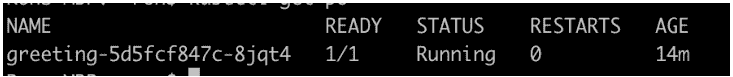

## 认识 Kubernetes

在本章中，我们将向您介绍 Kubernetes。如果您已经熟悉这项技术，可以跳过本章。如果您还在与我们同行，请准备好了解以下主题：

- Kubernetes 的历史
- 为什么需要 Kubernetes？
- Kubernetes 的主要特性
- Kubernetes 的架构
- 在哪里运行 Kubernetes
- 使用 Kubernetes 的示例

在本章结束时，您将清楚地了解像 Kubernetes 这样的容器编排系统做什么、它们如何工作，以及您自己如何利用它们。

### 技术要求

本章没有任何技术要求。如果您想尝试使用 Kubernetes，这里有一些项目可以试一试。Minikube 是一个在本地机器上安装单节点集群的项目。另一个项目是 Kubernetes in Docker（KinD），它启动一组容器，这些容器将启动 Kubernetes。虽然这些选项可以让您对 Kubernetes 是什么以及它如何工作有一个良好的印象，但如果您想进行一些认真的研究，您可能需要考虑云提供商选项。有很多产品可供选择，例如 Azure 的 AKS、Google 的 GKE 和 Amazon 的 EKS。一个有趣的替代方案是 Civo 的 K3S，它使用廉价的硬件来运行 Kubernetes。

在本章末尾，我们将通过本地安装的 Minikube 对 Kubernetes 执行一次简单的部署。

到本章结束时，您应该对 Kubernetes 在云原生环境中的位置有一个很好的理解。您还将了解 Kubernetes 提供了哪些功能。


### 起始

如果你在 IT 行业从事开发或基础设施工作，你很可能听说过 *Kubernetes* 这个名字。它在 2015 年登上舞台，比我们撰写本书早了大约八年。

Kubernetes 起源于 Google 的一个项目。Google 以完全拥抱云计算而闻名。它的所有产品都以云为中心。只要想想 Gmail，可能最常用的基于云的电子邮件产品，以及 Google 文档、Google 云端硬盘和 YouTube 等产品。

Google 的所有服务都在容器中运行。在 2014 年 InfoQ 上的一篇文章中估计，Google 每周启动 20 亿个容器。这意味着每秒超过 3,300 个容器。面对如此庞大的数量，难怪在运行和管理容器方面拥有出色的专业知识。

Google 内部使用一个名为 Borg 的系统，名字恰如其分地取自 *星际迷航* 中同化一切进入中央蜂巢的外星群体。

Kubernetes 本身并非基于 Borg。例如，Kubernetes 使用 Google 自家的编程语言 Golang 编写，而 Borg 则是用 C++ 编写的。

然而，Kubernetes 的核心开发者对 Borg 有着深入的了解，并且 Borg 的许多概念被迁移到了 Kubernetes。

### 什么是容器编排？

在 *第 6 章* 中，你已经了解了 Docker。你了解到 Docker 是一种构建和打包软件的方式，便于更轻松地分发和执行。你还在关于 Jakarta EE 的章节中了解到，它引入了一个专门的配置文件 Core Profile，针对微服务和容器化。你很可能运行着许多容器，这就是容器编排发挥作用的地方。

容器编排是创建、调度、扩展和监控容器的过程。运行一个应用程序所需的容器数量会迅速增长，即使是标准的包含前端、后端和数据库的架构——那已经是三个容器了。而且你还有额外的需求，例如缓存实例、反向代理和 CDN（https://en.wikipedia.org/wiki/Content_delivery_network）服务器。

此外，你可能希望每个组件都有多个实例，以防出现故障。正如你所见，数量很快就会增长。如果我们再加入微服务，其中前端和后端会被拆分为多个服务，情况就更加明朗了。

手动处理所有这些容器——监控其运行状态并重启失败的容器——已不再现实。

这就是容器编排器的用武之地——它们尽可能自动化这些任务。请注意，Kubernetes 并不是唯一的容器编排器，也不是第一个。替代方案包括 Apache Mesos、HashiCorp 的 Nomad 和 Docker Swarm。然而，在过去几年里，Kubernetes 已成为容器编排事实上的标准。

### 为什么你需要 Kubernetes？

你可能会想知道为什么你需要 Kubernetes。即使你的公司规模没有 Google 那么大，或者你在生产环境中没有运行数以亿计的容器，通过 Kubernetes 进行容器编排也是你将需要的东西。

事实证明，Kubernetes 具有一些极其有用的功能，即使对小型公司也很有吸引力。在本章的剩余部分，我们将更详细地讨论这些功能。

### 自愈

Kubernetes 最有用的功能之一是自我修复能力。如果 Kubernetes 判定某个 Pod 已崩溃，它将启动一个新的 Pod 来替换失败的 Pod。这样，集群就会恢复到期望的状态。

当然，这一过程有一些限制。其中之一是必须有足够的资源来启动新的 Pod。资源可以指（虚拟化的）机器、内存、CPU 和存储容量。

Kubernetes 的自愈能力体现在两个方面：

- 如果现有 Pod 崩溃，则启动新的 Pod
- 如果 Pod 不再处理用户请求且因此不再具有功能，则将其终止

Kubernetes 有多种方式来判断 Pod 是否仍具有功能，基于对 Pod 的回调方法（存活探针和就绪探针）。

另一个体现其自适应能力的特性是水平 Pod 自动扩缩容。如果你认为这意味着 Kubernetes 可以根据标准扩展 Pod 数量，那么你是对的。

水平 Pod 自动扩缩容的工作方式如下——如果 Pod 的负载增加，Kubernetes 将启动额外的 Pod 来减轻已运行 Pod 的压力。

如果在某个时间点 Pod 的负载下降，而我们仍在运行比最初配置更多的 Pod，自动扩缩器会再次将 Pod 数量降下来。当然，这会谨慎进行，以防止剩余 Pod 再次过载。

请注意，此过程称为 **水平自动扩缩**，因为我们启动了更多相同类型的资源，即 Pod。如果 Kubernetes 为已运行的 Pod 分配更多 CPU 时间或更多内存，则为垂直扩缩。

Kubernetes 会在固定的间隔内查询资源利用率，该间隔目前默认为 15 秒（可配置值），查询方式依据自动扩缩资源定义中指定的方式。

此资源利用率可以基于每个 Pod 的指标、自定义指标，甚至对象或外部指标。

### 负载均衡和网络

Kubernetes 在网络方面也表现出色。运行许多 Pod，每个 Pod 需要唯一的地址，很容易意味着你有大量容器端口到主机端口的映射。

幸运的是，Kubernetes 会为你处理这个问题，通过为每个 Pod 分配唯一的集群范围 IP 地址。

这使得例如服务发现变得轻而易举；每个 Pod 都可以与集群中的其他 Pod 通信。如果一个 Pod 包含多个容器，则所有这些容器共享相同的 IP 地址。这意味着每个服务都可以通过 localhost 地址访问另一个服务。这也意味着节点中的每个容器必须具有唯一的端口号以避免冲突。

Kubernetes 支持两种形式的服务发现。服务发现是指一个服务需要找到并访问不同的服务以执行其操作。这可能很简单，例如应用程序需要知道数据库 URL 以建立 JDBC 连接。

或者，这可能是一个情况，例如 Order Service 需要确定产品是否有足够的库存才能放入购物车。检索库存水平将是另一个服务的责任——比如 StockService。OrderService 需要知道在何处（即哪个 IP 地址）可以找到 StockService。

Kubernetes 提供的最简单的机制是通过一组环境变量，指定每个服务的 hostname 和端口号。在我们的示例中，OrderService 可以简单地查找这些环境变量以确定 hostname 和端口号。

此外，Kubernetes 还支持 DNS。如果你在集群中设置了 DNS 服务器，那么它将监视 Kubernetes API 以查找新服务和已删除的服务。这允许同一集群中的 Pod 基于名称找到服务。

假设我们有一个服务，它公开了一个名为 mydb 的 PostgreSQL 数据库服务。其他服务现在可以通过此名称引用该数据库服务，而无需使用其 IP 和端口组合。这为你的服务提供了巨大的灵活性和独立性。

Kubernetes 通过所谓的 Ingress 服务支持负载均衡。Ingress 使用 HTTP 和 HTTPS 使你的服务能够从集群外部访问。很合理的是，在某个时候，你应用程序的一部分应该对集群之外的外部世界可访问。如果我们继续之前 OrderService 的示例，为了能够将产品添加到购物车，用户/买家必须能够访问一个网站，例如。这就是入口的用武之地。它可以将外部 URL 转换为在 Kubernetes 集群内部运行的服务。


负载均衡是 Ingress 功能的一部分。可能有许多 Pod 在运行 OrderService。现在，如果有一个请求进来要将商品添加到购物车，应该选择哪项服务？负载均衡将通过应用某种策略来选择期望的 Pod，从而解决这个问题。

一些相当常见的策略如下：

- Round-robin 是一种简单的方法，其中一组 Pod 结合使用。每次请求时，都会从池中选择下一个 Pod，每个 Pod 都轮流使用。
- 另一种方法可能是最快的。在这种情况下，下一次会选择响应请求最快的 Pod。
- 再次，一个不同的方法可能是最小的，这意味着创建一个仅有足够 Pod 来处理当前负载的组。

正如你所见，可能性几乎是无限的，复杂性也是如此。通常，标准就足够了，只有在达到限制时才需要对负载均衡器进行微调。

### 持久存储和卷

容器和 Pod 本质上是短暂的。它们通常寿命很短，一旦终止，Pod 内部存储的数据就会永远丢失。突然间，将你的宝贵数据存储在数据库容器中似乎没那么有吸引力了，对吗？

解决方案似乎很简单——将数据存储在容器之外。这正是 Kubernetes 允许你做的事情，并且在这样做的同时，它给了你巨大的自由和选择。

Kubernetes 使用一种称为 **volumes** 的抽象来存储数据。从本质上讲，卷只是在磁盘上用于存储数据的目录。我们知道两种卷，**ephemeral** 和 **persistent**，并且你可以在一个 Pod 内混合使用它们。Ephemeral 卷在 Pod 终止时会被删除，而 persistent 卷会在 Pod 生命周期之外继续存在。

Kubernetes 支持许多类型的卷，包括一些基本类型，例如 emptyDir，它只是在 Pod 启动时为空的 Pod 内部目录。然而，还有几种特定的卷，针对主要云提供商的存储服务。Kubernetes 将卷抽象为一个配置片段，称为 **Persistent Volume (PV)**。它描述了卷的技术细节。

每当服务需要一些存储时，它就会提出一个 **Persistent Volume Claim (PVC)**。PVC 包含卷必须满足的要求。想想诸如可用大小、存储类型、速度等。

Kubernetes 在所有这些中的作用是找到合适的 PV 来满足 PVC。通过这种方式抽象事物，可以防止服务与存储选项之间产生紧密耦合。

举例来说，假设你的应用程序目前使用的是类型为 azureDisk 的 PV。现在，如果出于某种原因，你要放弃它并切换到 GCE 提供的 gcePersistentDisk，你需要更改什么？

你需要为 gcePersistentDisk 添加一个 PV，并且你希望使 azureDisk PV 不可用。然而，在应用程序重新启动时，它会声明它需要一个磁盘卷，并且 PVC 未被修改，Kubernetes 现在会将 gcePersistentDisk Persistent Volume 附加到你的服务上。这就是 Kubernetes 中无处不在的抽象的力量，在 Pod 中，在卷中，等等。

### General

Kubernetes 的基本思想出奇地简单——集群的期望情况以声明方式描述并存储（soll-state）。Kubernetes 然后执行一个连续的循环，在其中验证集群的实际状态（ist-state）。

如果实际状态与期望状态不同，Kubernetes 将对实际状态采取适当的操作，使两者再次匹配。

### Pods versus containers

Kubernetes 使用对容器的抽象，称为 Pod。这是 Kubernetes 中最小的单元。你部署、启动、重启、停止和取消部署 Pod。你永远不会直接在容器中做任何事情。

一个 Pod 可以包含多个容器，即所谓的 multi-container pod。虽然这是一个有效的场景，但大多数 Pod 只包含一个容器。可能有多个容器在 Pod 中的有效场景是启动容器、使用 sidecar 模式的服务网格以及监控导出器。然而，这些都是超出本章范围的高级概念。如需更多信息，请访问：https://kubernetes.io/blog/2015/06/the-distributed-system-toolkit-patterns/

### Some Kubernetes lingo

之前，我们提到“cluster”这个词，但没有明确定义我们的意思。我们认为现在做这个定义是个好时机。

我们已经说过，Pod 是 Kubernetes 中最小的部署单元，并且一个 Pod 可以包含一组容器。

让我们定义一些更多 Kubernetes 术语：

- 一个 Pod 被调度并在节点上执行。
- 节点是 Kubernetes 中的工作机器。它可以是物理设备或虚拟设备。
- 工作节点执行实际的工作负载。
- 节点由控制平面控制。控制平面是暴露 API 并管理 Kubernetes 中所有资源的控制器编排层。
- 一组节点可以组织成一个集群。
- 服务是一组相关 Pod 的集合，具有相同的一组功能。

### Extending Kubernetes

Kubernetes 开箱即用提供了大量的功能，其核心每天都在扩展。Kubernetes 拥有庞大的开源开发者社区。

然而，有时，Kubernetes 可能没有你、你的团队或你的公司所需的某些功能。你该怎么办？是否应该深入源代码？Fork Kubernetes 仓库并向其核心添加你需要的东西。

（Kubernetes 用 Golang 编写，这是一种来自 Google 的编程语言。与 Java 不同，Golang 编译为原生二进制文件。大量属于 CNCF (**Cloud Native Computing Foundation**) 的开源项目（有关更多详细信息，请参阅 https://landscape.cncf.io/）使用 Golang——例如 Prometheus 和 InfluxDB。Uber 也以用 Golang 编写大量服务器代码而闻名）。

这些解决方案当然不可持续；没有人会这么做。（尽管，一些项目确实这样做了并且仍然保持理智；Rancher 的 K3S 就是这样的项目。）

Kubernetes 提供了一个非常强大的替代方案，正如你所预期的那样。我们已经提到 Kubernetes 中的一切都是资源，因此在资源 `.yaml` 文件中描述。Pods、deployments、stateful sets、services 和 PVs 都在这样的 YAML 文件中描述。Kubernetes 允许你以 Custom Resource Definitions 的形式将你的功能添加到核心产品中。这是一个你需要实现的契约，然后你的资源将成为 Kubernetes 的一等公民。

这种能够扩展 Kubernetes 但仍能与标准产品一起工作的能力，是在可维护性方面的一大亮点。不是在 Kubernetes 核心中修修补补从而偏离主要开发，你仍然留在主包中。

### Kubernetes architecture

以下是 Kubernetes 高级配置的图表。在左侧，我们可以看到控制平面，即控制 Pod 和服务的调度、启动和停止的部分

图中未显示的是 **container runtime (CRI)**。当然，要运行容器，每个节点上都应安装容器运行时。CRI 是一个接口，支持以下内容：

- Cri-o
- Containerd
- Docker

总之，这就是 Kubernetes 的架构。正如你所见，Kubernetes 不仅仅是一个应用程序。它是一组应用程序的集合——一些在服务器上，一些在客户端——它们协同工作以管理可能大量的容器集合。

### Where to run Kubernetes

那么，现在你知道了 Kubernetes 的用途和它提供的功能（尽管我们只触及了皮毛），下一个问题是，我如何自己运行 Kubernetes？

如果你想运行 Kubernetes，有几个选项可供选择。我们这里的列表并不详尽，仅仅是因为几乎每天都有新选项出现。我们将列出我们认为最受欢迎或最有前景的选项。

#### Use your own hardware

这可能是开始的最简单方法。在你自己的硬件上下载并安装 Kubernetes。根据你的需求，你可能需要相当多的计算机。然而，在少数大型服务器上使用虚拟化可能足以满足你的硬件需求。此外，计算机数量越少，管理它们的成本就越低。

请记住，此选项仍然要求你管理这台计算机集群并更换故障的网络接口卡和其他损坏的硬件。你仍然负责备份数据和监控 Kubernetes 集群。别忘了应用软件更新的需求。

尽管如此，如果你已经有一个负责这些任务的运维部门，并且有一些闲置硬件，这可能是一个不错的开始选择。我们建议从官方文档中的设置指南开始。关于 Kubernetes 生产环境需求，也有有价值的信息可供使用。由于你将自行管理集群，KubeAdm 是推荐的工具。

#### Using a hosted service

如果你热衷于维护自己的硬件和集群，那么使用云提供商是一个可行的选择。他们可以减轻提供硬件、管理集群和执行运维任务的负担。


你可以通过输入以下命令来验证部署是否创建了一个 Pod：

```
kubectl get pods
```



图 7.3 – 运行中 Pod 的概览

会创建一个与部署同名并带有唯一后缀的 Pod。同时，还会创建一个服务，可以通过输入以下命令查看：

```
kubectl get service
```

部署尚未暴露到你的计算机。为此，我们需要通过以下方式将其暴露：

```
kubectl port-forward service/greeting 8080:8080
```

最好在一个新的终端窗口中执行此操作，因为端口转发会阻塞终端，使其无法继续输入。这里我们告诉 Kubernetes，到达端口 8080 的流量应转发到名为 greeting 的服务的端口 8080。

现在，当你打开浏览器并输入 http://localhost:8080/api/greet?name=Packt 时，你将看到以下内容：


Hello, Packt!

图 7.4 – 我们部署应用的输出

### 总结

在本章中，我们简要介绍了 Kubernetes 的起源、它对你有用的原因、它的主要功能以及它的架构。

一旦你决定将代码迁移到更现代的云原生方法，或者开始使用容器，你很可能将不得不与 Kubernetes 这类容器管理系统打交道。本章让你对它们的工作原理以及可以在何处使用它们有了很好的了解。

Kubernetes 是 CNCF 下载量最大的产品。到底什么是云原生，将在下一章中讨论。

但这还不是全部。如今，我们许多人将云用作备份。在手机上存储照片时，不仅存储在设备本身，还会在某种云存储中保留一份副本以妥善保管，这非常普遍。苹果的 iCloud 就是一个很好的例子，但还有其他的云存储提供商，如 Google Cloud 和 Dropbox。

如今，有许多云提供商，其中以 **亚马逊网络服务（AWS）**、Microsoft Azure 和 Google Cloud 为主。也许在西方国家不太为人所知，阿里云是全球第四大云提供商，其在云市场的份额距离 Google Cloud 并不遥远。因此，我们可以有把握地说，如今云无处不在。

*云原生*意味着我们正在使应用程序适应云所提供的新可能性。不过，我们需要记住，云是由一组不同的架构约束所驱动的。在接下来的章节中，我们将以简单的方式解释这些约束。
