## 在云中部署 Jakarta EE 应用

在前面的章节中，你了解了什么是云原生、Docker 和容器。基于我们在那些章节中所学的知识，我们将部署 Cargo Tracker 应用到云环境中。

在本章中，我们将设置一个云环境，让 Cargo Tracker 应用可以在其中运行。为此，我们需要先设置云环境。你将学习如何在云中设置容器注册表以存储 Cargo Tracker 应用的 Docker 镜像，如何从镜像创建容器实例，以及如何查看容器的指标。

在本章中，我们将涵盖以下主要主题：

- 部署到 Azure
- 创建容器注册表
- 创建容器实例
- 云中容器的指标

本章结束时，你将拥有一个在云中完全运行且可从你自己的机器访问的 Cargo Tracker 应用。

### 技术要求

对于本章，你需要拥有一个 Azure 账户。你可以在以下网站创建账户：https://azure.microsoft.com/en-us/free。使用此账户，你可以跟随本章的示例进行操作。该账户用于创建容器注册表和容器实例。你可以跟随本章了解在云环境中部署 Cargo Tracker 容器所需的步骤，但我们建议你创建账户并动手实践。

### 部署到 Azure

Azure 是由微软提供的云计算平台和服务。它为个人和企业提供了一套全面的基于云的解决方案，用于构建、部署和管理应用及服务。Azure 利用微软庞大的全球数据中心网络，提供广泛的计算资源、存储选项和网络功能。

在本节中，我们将介绍如何将 Cargo Tracker 应用部署到 Azure 云环境。为了跟随这些步骤，你需要拥有一个 Azure 账户。为了部署该应用，我们将在 Azure 环境中创建两种类型的资源：容器注册表和容器实例。在创建容器实例时，我们将把 Cargo Tracker 应用部署到云中。在下一步中，你将能够从本地浏览器访问它。

#### 创建容器注册表

我们要创建的第一个资源是容器注册表。容器注册表是一个资源，我们可以用它来存储和管理我们创建的镜像。我们将使用容器注册表来存储 Cargo Tracker 应用的 Docker 镜像。第一步是登录 Azure 门户 `https://portal.azure.com/#home`。登录后，你会看到类似的屏幕：

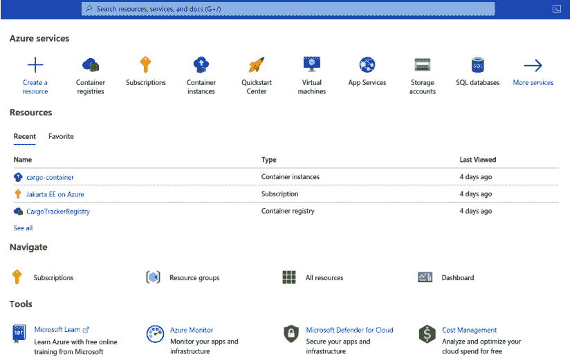

使用顶部的 **搜索** 栏查找 **容器注册表** 服务：

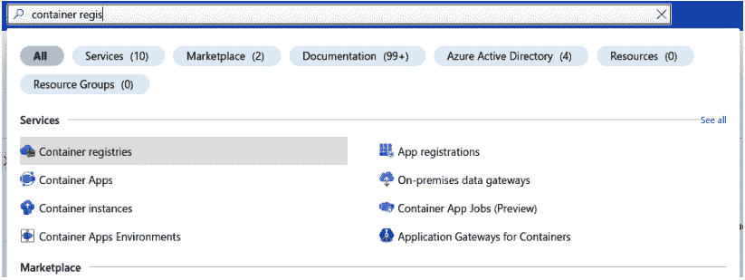

图 9.2 – 搜索容器注册表服务

当你点击 **容器注册表** 时，你会进入 **容器注册表** 服务的概览页面。目前这个视图会显得很空，因为我们还没有创建注册表。让我们现在创建一个。你可以通过点击 **容器注册表** 服务视图中的 **创建** 按钮来完成：

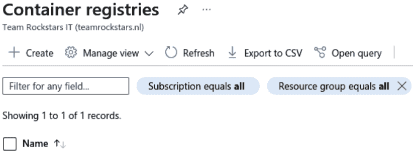

图 9.3 – 容器注册表概览

当你按下 **创建** 按钮时，你会被引导到一系列需要填写的表单以创建注册表。在我们的案例中，它看起来像这样：

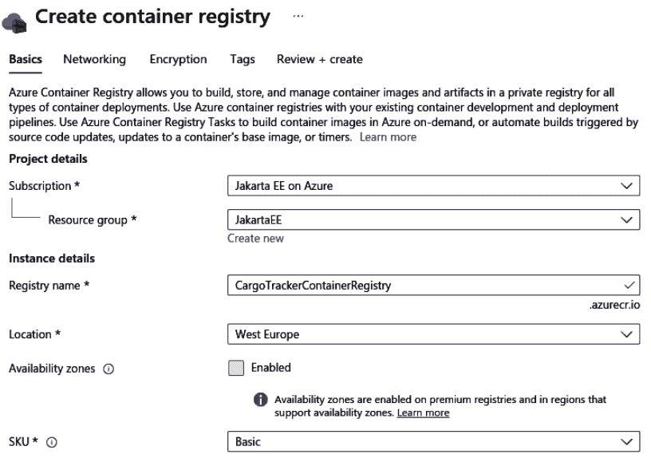

在这里，我们选择了当前的订阅和资源组。如果你还没有资源组，可以创建一个。我们选择了 `CargoTrackerContainerRegistry` 作为容器注册表的名称。对于 **位置** 字段，选择一个离你最近的位置。对于 **SKU** 字段，我们选择了 **基础版** 选项，因为我们不需要 **标准版** 或 **高级版** 选项的扩展性能。填写完所有内容后，按 **下一步：网络** 按钮。

使用我们选择的 **基础版** SKU（服务层级），我们无法更改网络连接设置。你可以跳过此步骤，通过点击 **下一步：加密** 按钮前往 **加密** 部分。在这个视图中，由于选定的 SKU，我们同样不会更改任何设置，可以通过点击 **下一步：标签** 按钮进入下一个视图。在此视图中，你可以添加标签。标签对于分组某些容器非常有用，但标签也不是强制性的，所以你可以继续到下一个视图，该视图将让你审查注册表并创建它。在点击 **创建** 按钮之前，请核实所有内容是否正确。我们本章将创建并使用的注册表看起来像这样：

创建容器注册表

验证通过

基本  网络  加密  标签  审查 + 创建

注册表详情

| 部分 | 字段 | 值 |
|---|---|---|
| 基本 | 注册表名称 | CargoTrackerContainerRegistry |
| 基本 | 订阅 | Jakarta EE on Azure |
| 基本 | 资源组 | JakartaEE |
| 基本 | 位置 | 西欧 |
| 基本 | 可用性区域 | 已禁用 |
| 基本 | SKU | 基础版 |
| 网络 | 公共网络访问 | 是 |
| 加密 | 客户管理的密钥 | 已禁用 |
| 加密 | 标识 | 无 |
| 加密 | 密钥库 | 无 |
| 加密 | 加密密钥 | 无 |
| 加密 | 版本 | 无 |

创建   < 上一步   下一步 >   下载自动化模板

图 9.5 – 容器注册表创建概览

如果一切正确，你可以点击创建按钮。这将在 Azure 中为你创建一个容器注册表。如果一切正确，你将看到如下屏幕，显示该新资源的部署已完成：


图9.6 – 容器注册表的完整部署

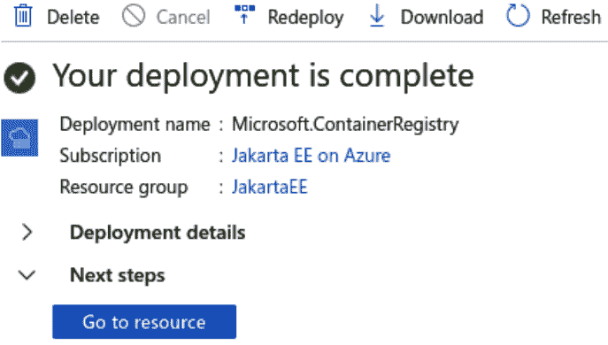

使用**转到资源**按钮转到刚刚创建的容器注册表。这将显示你创建的注册表的概览。对于我们创建的 **CargoTrackerContainerRegistry** 容器注册表，其外观如下：

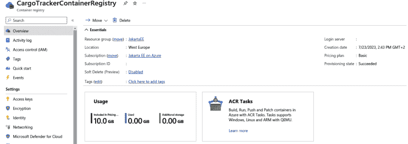

图9.7 – 已创建的 CargoTrackerContainerRegistry 容器注册表概览

现在注册表已创建并准备就绪，是时候将 Cargo Tracker 应用程序的镜像上传到此注册表了。稍后我们将使用此镜像创建实际运行 Cargo Tracker 应用程序的容器实例。

#### 将镜像上传到注册表

在上传镜像之前，我们需要先有一个镜像。因此，在继续下一步之前，让我们先创建一个镜像，步骤如下：

1. 导航到 Cargo Tracker 应用程序的目录并运行以下命令：

```
docker build . -t cargo-tracker
```

2. 运行此命令后，将使用上一章创建的 Dockerfile 为 Cargo Tracker 应用程序创建一个镜像。该镜像将被标记为 cargo-tracker。这样，镜像就为后续步骤做好了准备。

3. 下一步是将已标记的镜像上传到注册表。为此，我们需要两样东西：一个注册表和一个镜像。要上传镜像，你需要先登录注册表。因此，打开终端并运行以下命令：

```
docker login -u USERNAME -p YOURPASSWORD cargotrackercontainerregistry.azurecr.io
```

运行上述命令时，别忘了使用你自己的密码和用户名。运行上述命令后，你将登录到在上一节中创建的注册表。

1. 下一步是正确标记 Cargo Tracker 镜像。为此，运行以下命令：

```
docker tag cargo-tracker cargotrackercontainerregistry.azurecr.io/cargo-tracker
```

2. 这将为 cargo-tracker 镜像添加一个新标记。执行上述命令后，镜像就可以推送到注册表中了。要将镜像推送到 Azure 云环境中的容器注册表，请运行以下命令：

```
docker push cargotrackercontainerregistry.azurecr.io/cargo-tracker
```

3. 运行此命令后，镜像将被推送到注册表中。当你在控制台中看到以下输出时，说明镜像已成功推送到 Cargo Tracker 容器注册表：

```
~/Projects/Migrating-to-Cloud-Native-Technology-with-Jakarta-EE
docker push cargotrackercontainerregistry.azurecr.io/cargo-tracker
Using default tag: latest
The push refers to repository [cargotrackercontainerregistry.azurecr.io/cargo-tracker]
514967d1e96a: Pushed
78ae8cbe633a: Pushed
ade321fc98e5: Pushed
cff05070dbef: Pushed
74b370e873af: Pushed
99413601f258: Pushed
a67a1a1c78da: Pushed
d543b8cad89e: Pushed
latest: digest: sha256:326a5f726e6b09a117d2a70649be00c35a3410d04fc1320464c853a93f358ce8 size: 2004
```

这意味着推送成功，接下来我们看看能否在容器注册表中查看该镜像。使用浏览器转到 Azure 门户中的 CargoTrackerContainerRegistry 服务。在左侧菜单中，你会看到“仓库”服务：

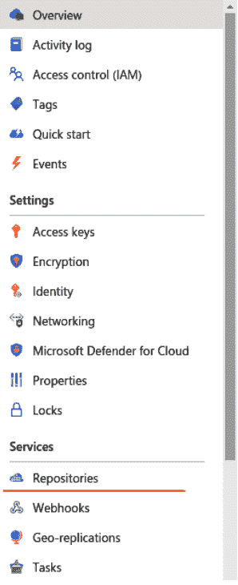

图9.8 – 仓库菜单项

点击**仓库**按钮；这将导航到所有可用仓库的概览。目前，这里只有 `cargo-tracker` 仓库，如下面的截图所示：

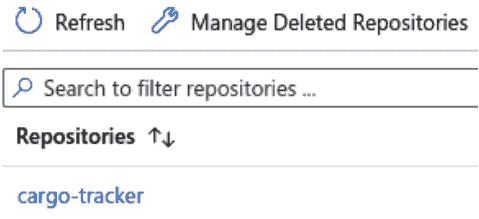

图9.9 – 仓库列表

当你点击 `cargo-tracker` 仓库时，你可以看到刚刚上传到该仓库的镜像：

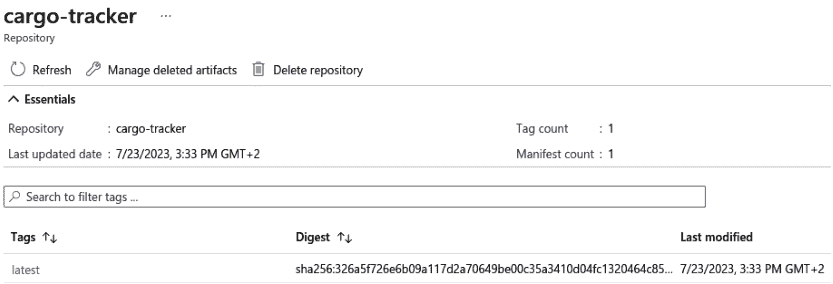

图9.10 – Cargo Tracker 应用程序的最新镜像

至此，我们完成了注册表的创建以及将镜像上传到 `cargo-tracker` 注册表。所有准备工作已经就绪，下一步是创建一个将使用 `cargo-tracker` 镜像的容器实例。

#### 创建容器实例

在上一节中，你执行了所有步骤，最终在 Azure 中创建了一个容器实例。你创建了一个容器注册表和一个镜像，并将镜像上传到注册表内的一个仓库。在本节中，我们将创建一个使用 Cargo Tracker 应用程序已上传镜像的容器实例。使用 Azure 门户顶部的**搜索**栏，搜索 `container instances`：

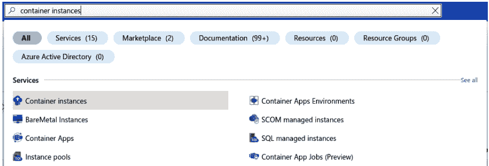

图9.11 – 搜索容器实例

点击选中的结果“容器实例”，这将带你进入容器实例概览页面。在此概览中，点击概览屏幕左上角的“创建”按钮。这将带你进入一系列需要填写的表单，以创建容器实例。界面如下所示：

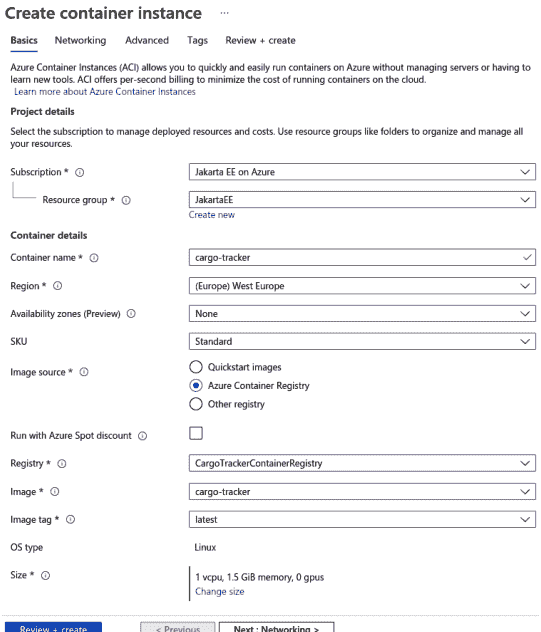

图9.12 – 容器实例的基本信息概览

你需要填写以下部分：

- **容器名称：** 你希望为容器指定的名称
- **镜像来源：** 选择 **Azure 容器注册表** 选项

当你选择此选项时，将出现需要填写的新字段，如下所示：

- **注册表：** 选择你在上一节中创建的注册表的名称
- **镜像：** 你要部署的注册表中的镜像
- **镜像标记：** 你要部署的镜像版本

点击**下一步：网络**按钮进入网络步骤。

在此表单中，你需要填写以下字段：

- **DNS 名称标签：** 这将是此容器实例的**完全限定域名（FQDN）**的一部分。在此示例中，我们使用了 `cargo-tracker`。
- **端口：** 添加端口 8080，因为这是 Cargo Tracker 应用程序监听的端口。

结果将如下所示：

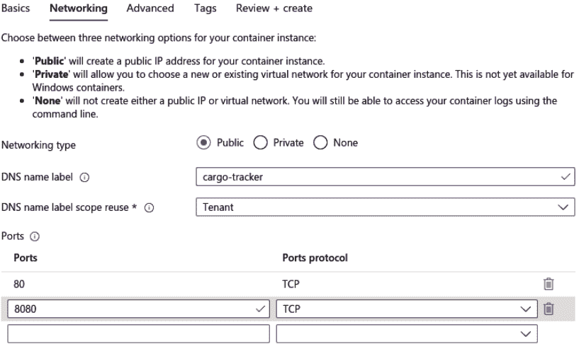

点击**下一步：高级**按钮进入下一步。我们不需要更改此表单中的任何内容，因此可以跳过此步骤，进入下一步：**标记**。**标记**步骤也可以跳过，因为我们同样不需要更改表单中的任何内容。这将带我们进入最后一步：**查看 + 创建**。查看此部分以确认一切正确无误。对于我们正在构建的 Cargo Tracker 应用程序，其界面应如下所示：

#### 创建容器实例

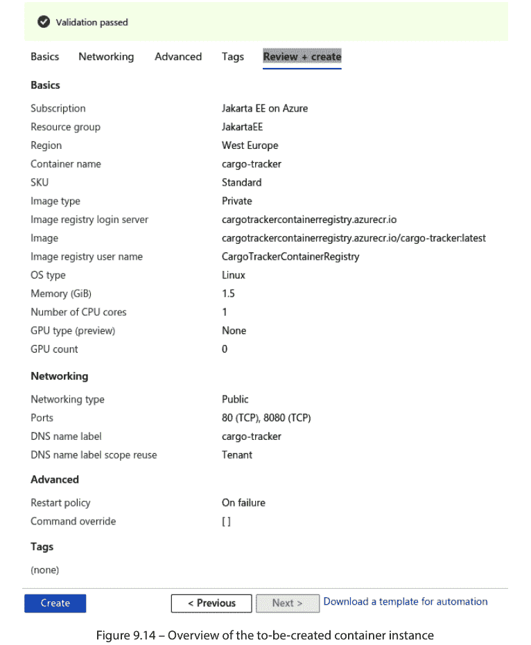

如果一切正确，你可以点击“创建”按钮，容器将被部署。当你导航到 cargo-container 实例概览时，可以查看有关该容器的信息，如下面的截图所示：

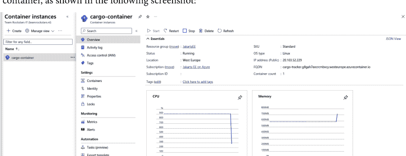

图9.15 – 在 Azure 云中运行的 cargo-container 实例概览

从 CPU 和内存图中可以看出，容器已启动并正在运行。让我们通过访问此容器内运行的 Cargo Tracker 应用程序的主页来验证它是否正常工作。要访问此容器，我们需要从右侧的概览中复制 FQDN。仅复制 FQDN 还不够，还需要在 FQDN 末尾添加以下内容：`:8080/cargo-tracker/`。我们需要添加这些内容，因为容器监听端口 8080，而应用程序本身监听 cargo-tracker 路径。完整的 URL 将类似于：`http://cargo-tracker.g8gah7eecrmbxcy.westeurope.azurecontainer.io:8080/cargo-tracker/`。当你导航到此 URL 时，你将看到 Cargo Tracker 应用程序的主页，这意味着容器和应用程序正在云中运行：

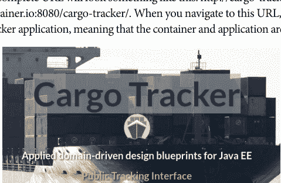

图9.16 – Cargo Tracker 应用程序的主页


FQDN 是你在云计算中经常遇到的那类典型缩写之一。它通过指定主机名、域名和顶级域名，在**域名系统（DNS）**中精确定位相应位置。例如，www.packt.com 的顶级域名是 .com。

### 云中容器的指标

在云环境中工作的一个好处是，它自带许多开箱即用的功能。除了自动备份和扩展之外，监控也是其中之一。

在本节中，我们将简要介绍云环境标配的监控功能。这里展示的功能是 Microsoft Azure 特有的，但其他云环境也提供类似功能。

容器实例启动后，你便可以查看它的指标。

为此，请在左侧菜单栏的**监控**标题下选择**指标**选项。随后你应看到类似这样的屏幕：

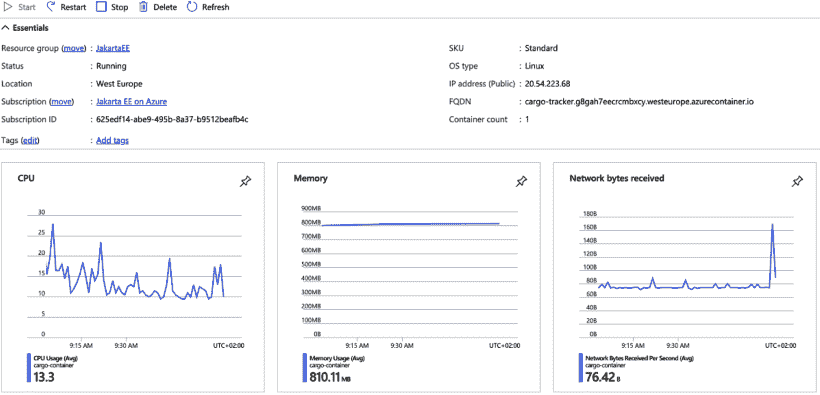

图 9.17 – 容器指标概览

此视图显示应用的基本指标——CPU 使用率、已用内存量以及通过网络发送和接收的字节数。这些指标始终可用，这理所当然，因为它们是衡量应用当前负载大小的主要指标。因此，你可以根据这些指标来决定是否扩展应用，可以手动扩展，或者更可能是自动扩展。

其中一个有趣的选项是，如果将鼠标悬停在某个指标上，所有其他指标的时间线也会随之改变。例如，如果将鼠标移到 **CPU** 指标窗口的某个峰值上，内存指标窗口也会移到同一时刻。在比较系统出现某个状况的同一时刻的不同指标时，这极为有用：

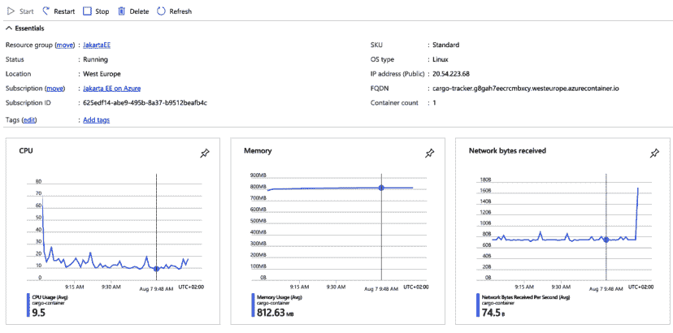

图 9.18 – 容器实例指标概览

单击某个指标时，你会看到详细视图，并且还可以在可用的不同类型图表之间切换：

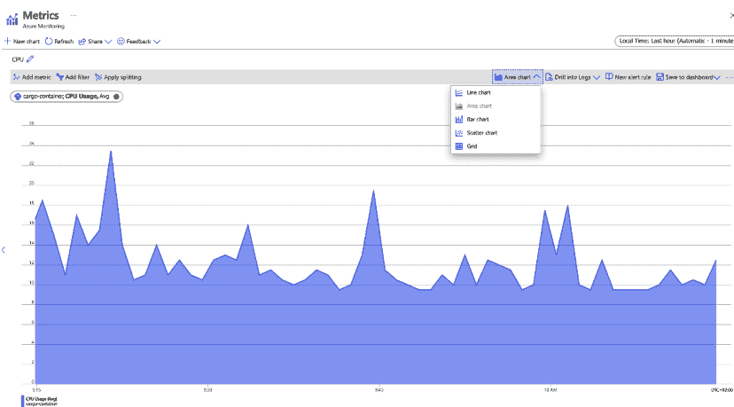

图 9.19 – 指标的详细视图，可选择切换图表类型

在可以更改图表类型的同一菜单中，你还可以设置告警。告警功能允许在某个指标的预定义阈值被超过时采取特定操作。

这里展示的是创建新告警时显示的屏幕：

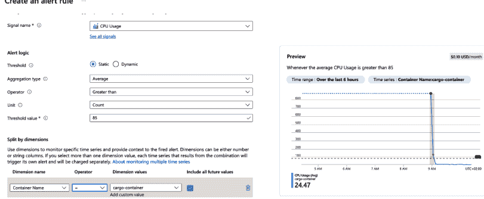

图 9.20 – 设置告警

我们选择了一个基于 CPU 的告警，规则是：如果平均 CPU 使用率超过 85，就触发告警。我们还要求每 5 分钟检查一次此告警，并且它还应查看最近 5 分钟的数据来确定该值。通常，你会希望这个时间段稍长一些，以便对应用负载有一个可靠的了解，并防止因偶然的峰值而触发告警。

将多个此类指标放在容器实例的专用仪表板上非常有用，幸运的是，我们确实可以这样做。通过“保存到仪表板”选项，你可以将常用指标添加到个人或共享仪表板。

### 总结

在本章中，我们将应用迁移到了云平台。我们选择了 Microsoft Azure，但也可以是任何云提供商。我们演示了如何设置容器注册表、如何进行实际部署，以及如何查看正在运行的容器实例的指标。

现在，你已经将现有的单体应用迁移到了云端。你已经通过弹性等云原生特性对其进行了增强。你已经走了很长一段路，也许这正是你打算止步的地方。或者，你可能会选择走上将单体拆分为独立应用或微服务的道路。这里无所谓好坏，怎么做完全取决于应用本身及其预期用途。在下一章，我们将了解 MicroProfile，因为它可以帮助你为应用添加更多云原生特性。
