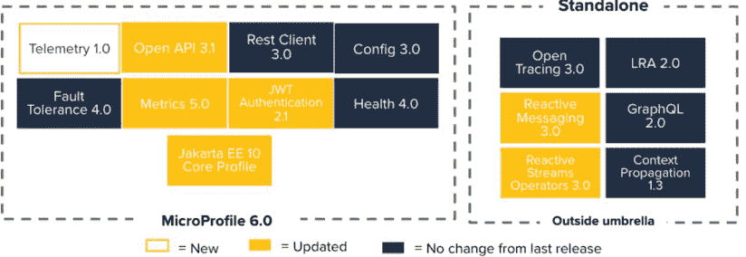

## 10 介绍 MicroProfile

到目前为止，你应该已经清楚如何将应用迁移到云端。尽管你的应用现在已在云端运行，但这并不意味着它就展示出了云原生能力。要实现这一点，还需要一些额外步骤。这些额外步骤可以通过使用 MicroProfile 来完成。

在本章中，我们将介绍以下主题：

- MicroProfile 的简要历史
- MicroProfile 由什么构成
- 了解 MicroProfile 中的核心 API

完成本章后，你将透彻理解什么是云原生行为，以及 MicroProfile 如何帮助你为应用添加这种行为。

### 技术要求

MicroProfile 由多个针对不同任务的 API 组成。要利用这些功能，你只需选择一种 MicroProfile 实现并添加依赖项即可。这需要向你的 pom.xml 或 build.gradle 文件添加依赖项。有关示例可参见第 4 章。

请注意，MicroProfile 有多种实现可用。其中一些已集成到完整的 Jakarta EE 产品中，另一些则可以独立使用。有关这些实现的完整列表，请参阅 MicroProfile 网站 https://microprofile.io/。

### MicroProfile 简史

2010 年，Java EE 经历了一段艰难时期。新版本的创建耗时异常漫长。从 Java EE 6 到 Java EE 7 花了 40 个月的时间。而从 Java EE 7 到 EE 8 更是花了整整 43 个月。与此同时，互联网瞬息万变，云带来了新的机遇和挑战。微服务正成为最新的架构热潮，而 Java EE 并没有提供默认的采用方式。

Java EE 应用服务器供应商感到有必要为其平台的开发者提供额外功能。不幸的是，每个供应商都各行其是。看似矛盾的是，本应提供统一 API 的平台，现在却导致多个相互竞争且互不兼容的实现被开发出来。每个实现都有一套与其他实现不同的独特 API。

多个供应商都意识到了这种不匹配。由于 Java EE 规范流程的速度无法提升，他们决定在 Eclipse 旗下创建一个新项目，该项目将提供一套规范，并带来 Java EE 所缺失的那些必需的云原生功能。这促成了 MicroProfile 的诞生。

相关讨论始于 2016 年 9 月，到 2017 年 8 月，第一个版本正式发布。MicroProfile 当时仅包含 JAX-RS、JSON-P 和 CDI。这些都是已有的 Java EE API。

不久，Config 被加入；在下一个版本 1.2 中，又加入了 JWT、Fault Tolerance、Metrics 和 Health Check。该版本于 2018 年 1 月发布，展示了快速的发布周期。越来越多的特性被添加到 MicroProfile 中，同时其中一些特性变为可选。这意味着实现方不需要实现这些特性，仍然可以被认证为一种实现。

在撰写本书时，MicroProfile 6.0 是当前版本。下面这张图展示了它所具备的全部特性：



此版本的一个新变化是，它不再提及各个 Jakarta EE API——它现在依赖于 Jakarta EE Core Profile。

在接下来的小节中，我们将详细介绍以下主题：

- Config
- Health
- Fault Tolerance

因此，当使用 `java -jar myapp.jar -Dmp.config.profile=testing` 时，它会首先从 `META-INF/microprofile-config.properties` 加载设置，然后再从 `META-INF/microprofile-config-testing.properties` 加载。如果某个属性在这两个文件中都有定义，则后者将覆盖前者。

### MicroProfile Health（健康检查）

健康是件奇妙的事——不仅对我们人类如此，对微服务也是如此。一旦部署了微服务，你会想偶尔检查一下它们的“体温”。这就引出了 MicroProfile Health 规范，它允许你定期验证服务的健康状况。

需要注意，虽然该规范公开了一个 API，但它并不是为人类使用而设计的，而更多是用于机器对机器的交互。可以想象一个容器管理系统（如 Kubernetes），它需要查询某些 pod 的状态，以判断它们是否仍按预期运行。

可以执行三种健康检查，如下表所述：

| 类型 | 注解 | 用途 |
|---|---|---|
| 就绪 | `@Readiness` | 确定应用是否已准备好处理请求 |
| 存活 | `@Liveness` | 确定应用是否正在运行 |
| 启动 | `@Startup` | 确定应用是否仍在启动中 |

表 11.1 – 健康检查注解

要完成有效的健康检查，你的 bean 需要实现 `HealthCheck` 接口。该函数式接口包含 `call` 方法，返回值是一个 `HealthCheckResponse` 对象。

`HealthCheckResponse` 需要返回服务是 *up* 还是 *down*。它还可以提供额外的信息，比如名称。此外，它还可以包含更多关于故障资源的详细信息。这可以通过 `withData` 方法指定。

下面是一个 HealthCheck 服务的示例：

```
@ApplicationScoped
@Readiness
@Liveness
@Startup
public class HealthService implements HealthCheck {
    @Override
    public HealthCheckResponse call() {
        return HealthCheckResponse.named("Project")
            .up()
            .withData("redis", "Not available")
```


```java
.withData("postgres", "Available")
.build();
}
}
```

这里有几个有趣的特性：

1. 该 bean 是 `@ApplicationScoped`，因为对于你的应用程序，通常只需要一个这种类型的 bean。
2. 该 bean 实现了 `HealthCheck` 接口。
3. 在示例中，该 bean 负责就绪性、存活性和启动。你当然也可以定义三个不同的 bean，每个 bean 只负责一项任务。
4. `up()` 方法表示服务按预期工作。要表示服务失败，则应改用 `down()` 方法。
5. `withData` 方法提供更多信息。可以有无限数量的此类方法。
6. 最后，返回一个 `HealthCheckResponse` 对象。

MicroProfile Health 在 http://www.acme.com:9080/health 上公开了一个端点。

以下是前面健康服务的示例：

```json
{
  "checks": [
    {
      "data": {
        "redis": "Available",
        "postgres": "Available"
      },
      "name": "Project",
      "status": "UP"
    }
  ],
  "status": "UP"
}
```

这里，我们向健康端点询问微服务的状态，它回复说状态为 "UP"。我们还可以看到，数据元素中发送了额外的信息。使用的两个数据库都在线。如果该服务所依赖的任何系统不可用，也可以将其添加在此处。这对于快速识别和解决问题非常有用。

### MicroProfile Fault Tolerance

因此，我们已经配置了服务，并且可以检查其健康状况。微服务成为云原生的下一步是添加一些弹性。服务应在一定范围内能够自我修复。

MicroProfile Fault Tolerance 中有六个注解可以帮助使你的服务更健壮：

- `@Asynchronous`
- `@Retry`
- `@Timeout`
- `@Bulkhead`
- `@CircuitBreaker`
- `@Fallback`

值得注意的是，这些注解可以添加到 CDI bean 以及这些 bean 中的公共方法中。在内部，它们是通过拦截器实现的。

#### @Asynchronous

@Asynchronous 为其所注解的方法添加了异步行为。它将它们包装成返回 `CompletionStage` 的方法，其他容错注解可以应用于该方法。

@Asynchronous 允许你的代码并发运行。让我们看一个示例：

```java
@Inject
// is annotated with @Asynchronous
private CustomerDetailsService customerDetails;

@Inject
// is annotated with @Asynchronous
private CustomerSalesHistoryService customerSalesHistory;

public CompletionStage<Customer> retrieveCustomerAsynchronously() {
    CompletionStage<CustomerDetails> result1 = customerDetails.getDetails(customerNo);
    CompletionStage<CustomerHistory> result2 = customerSalesHistory.getHistory(customerNo);

    ...
}
```

```java
@RequestScoped
public class CustomerDetailsService {

    @Retry
    @Asynchronous
    public CompletionStage<CustomerDetails> getDetails(String customerNo) {
        var details = retrieveDetails(customerNo);
        return CompletableFuture.completedFuture(details);
    }
}
```

我们定义了 `CompletionStage` 来检索客户信息。它由两个步骤组成——检索通用客户信息和检索客户的销售历史。然后将这些信息合并到一个对象 `CustomerDetails` 中并返回。

在前面的示例中，`CustomerDetailsService` 中的 `getDetails` 被注解了 `@Retry`。这意味着当方法调用失败时，会重试。

异步行为是通过 MicroProfile 在方法被调用时介入实现的。它拦截方法调用并安排稍后执行，可能在不同的线程上。然后返回 `Future` 或 `CompletionStage`。但这不是从方法返回的那个，因为它尚未执行。稍后，方法会被执行并返回其结果。

如果返回 `Future`，最初返回的 `Future` 将被此结果更新。如果是 `CompletionStage`，Fault Tolerance 会等待此 `CompletionStage` 完成，然后将最初返回的 `CompletionStage` 标记为已完成。

虽然 `@Asynchronous` 允许返回 `Future` 的方法异步运行，但它只能对返回 `CompletionStage` 的方法应用容错功能。

#### @Retry

此注解允许你优雅地处理临时的网络故障。

`@Retry` 注解可以应用于 bean 的类或单个方法，以表示如果方法调用失败，应再次尝试。还可以指定最大重试次数以及最大重试持续时间。

行为很简单——如果方法正常返回，则什么也不发生。如果它抛出异常，则在异常可以转换为 `retryOn` 参数中提及的异常之一时，方法将被再次调用。另一方面，如果异常可以转换为 `abortOn` 参数中提及的异常之一，则不会执行重试，方法将向调用者抛出异常。

以下是 `@Retry` 的典型使用示例：

```java
@Retry(maxRetries = 5, maxDuration = 1000)
public List<Project> findAll()
```

#### @Timeout

@Timeout 防止我们永远等待方法执行完成。可以指定值和时间单位。如果发生超时，将抛出 `TimeoutException` 错误。`@Timeout` 可以与其他此处提及的注解组合使用。

以下是 `@Timeout` 的典型使用示例：

```java
@Timeout(500)
public List<Project> findAll()
```

#### @Bulkhead

@Bulkhead 用于防止系统中的一个故障级联到系统的其他部分并最终导致整个应用程序崩溃。它的名称来自航运业，油轮的船体由单独的隔舱组成。如果船体被击穿，隔舱会被关闭，只有受影响的隔舱会被淹没，而不是整个船体，从而防止油轮沉没。

有两种可能的风格——信号量方法和线程池隔离方法。

在信号量方法中，我们指定方法的最大并发调用数。示例如下：

```java
@Bulkhead(5)
public List<Project> findAll() {
```

这表示 `findAll` 方法最多只能有五次并发调用。如果第六次调用到来，它将立即失败并抛出 `BulkheadException` 错误。

在线程池方法中，注解相同，但它与 `@Asynchronous` 注解一起使用，如下所示：

```java
@Bulkhead(5)
@Asynchronous
public Future<List<Project>> findAll()
```

这意味着只有五个线程池中的线程允许并发运行此方法。下一个请求必须等待在等待队列中。当等待队列满时，将抛出 `BulkheadException` 错误。

通过使用这些限制，完整的线程池无法被耗尽。否则，在某个时刻，所有线程很可能会执行此性能缓慢的方法，并且将没有更多线程可用于为正常运行的方法提供服务。

线程数和等待队列的大小可以配置。

#### @CircuitBreaker

`@CircuitBreaker` 允许快速失败场景。如果某个组件无法正常工作，断路器将打开，不再向该组件发送流量。断路器可以处于三种可能的状态之一：

- **Closed：** 在这种情况下，请求被发送到组件。
- **Open：** 在这种情况下，任何请求都会立即导致 `CircuitBreakerOpenException` 错误。
- **Half-open：** 在这种情况下，系统正在探测组件以查看其是否能无故障运行。

这里有一个场景：断路器为滚动窗口的请求保留 *failure ratio*。一旦超过阈值失败率，断路器将打开。发送的任何请求都会立即导致 `CircuitBreakerOpenException` 错误。经过可配置的延迟后，断路器进入半开状态。然后，它会探测可配置数量的试运行。如果其中任何一个失败，它将再次进入打开状态。如果所有试运行中均未发现错误，断路器将再次关闭，流量将再次自由流向组件。

以下是使用默认指定值的 `@CircuitBreaker` 的典型使用示例：

```java
@CircuitBreaker(delay = 5000, requestVolumeThreshold = 20,
        failureRatio = 0.5, successThreshold = 1)
public List<Project> findAll() {
```

要检查的滚动请求窗口为 20。如果在这 20 个请求中，至少有 10 个（20 * 0.5）失败，断路器将打开。等待 5,000 毫秒后，它将进入半开状态。如果在此状态下有一个请求成功，断路器将再次关闭。

#### @Fallback

我们迄今为止看到的所有注解都试图阻止方法失败。但有时，这是不可能的。在这些情况下，与其返回错误，你可能希望返回替代数据，例如空返回值或可能缓存的值。对于这些情况，可使用 `@Fallback` 注解。


有两种可能——回退处理器和回退方法。以下代码展示了一个回退方法的示例：

```
@Fallback(fallbackMethod = "backup")
public List<Project> findAll() {
    return persistence.getAll();
}

List<Project> backup() {
    return List.of();
}
```

需要注意的是，回退方法应与其被注解的方法具有相同的参数和返回类型。

### 最后说明

尽管我们看过的所有注解都可以单独使用，但将它们结合使用是可能的，甚至是可取的。请看下面的代码示例：

```
@Retry(maxRetries = 5, maxDuration = 1000)
@Bulkhead(5)
@Timeout(500)
@CircuitBreaker(delay = 5000, requestVolumeThreshold = 20, failureRatio = 0.5, successThreshold = 1)
@Fallback(fallbackMethod = "backup")
public List<Project> findAll() {
```

这些注解按如下方式协同工作：

1. 进入时，计时器开始运行。
2. 检查信号量，看该方法是否可以被调用。
3. 方法被调用。
4. 如果抛出异常，熔断器会将其记录下来。
5. 重试机制将启动并重新尝试；从第2步开始。
6. 一旦触发超时或重试次数用尽，将调用回退方法。

### MicroProfile 度量

我们的服务已经配置完成，我们可以分析其健康状况，并且已具备韧性能力。接下来我们要了解它的性能表现。处理了多少请求？最长执行时间是多少？平均执行时间是多少？这类问题可以通过 MicroProfile 度量来提出并得到解答。

度量是一个广阔的领域。在本节中，我们只讨论可以使用的注解。但也要知道，你可以通过编程方式定义自己的度量。

度量提供了一种 REST API，按规范要求以 Prometheus 格式返回度量数据。实现时也可以选择以 OpenMetrics 格式响应。

度量有三种作用域：

- **基础**：供应商可能提供的、由规范描述的度量
- **供应商**：特定于供应商的度量
- **应用**：特定于应用程序的度量

四种度量注解如下：

- `@Counted`
- `@Gauge`
- `@Metric`
- `@Timed`

#### @Counted

@Counted 统计被注解对象的调用次数。它可以应用于方法、构造函数和类型。

下面是一个示例：

```
@Counted(absolute = true)
public Project findById(String uid) {
```

#### @Gauge

@Gauge 采样被注解对象的值。它只能应用于方法。

仪表没有默认单位，因此定义仪表时你需要提供一个单位。仪表通常是一个来自应用程序的值。示例包括客户总数、平均订单价值或已处理包裹数量。

仪表暴露被注解方法的返回值，如下所示：

```
@Gauge(name = "total_projects", tags={"projects"}, unit = MetricUnits.NONE)
public Long getProjectCount()
```

#### @Metric

@Metric 包含请求注入度量时的元数据信息。它可以应用于字段和参数。

使用此注解时，实现需要将请求的度量注入到字段或参数中：

```
@Inject
@Metric(name = "total_projects")
Long projectCount;
```

我们先前定义的仪表的值被注入到 projectCount 字段中。这允许你的代码直接对收集到的度量进行操作。

#### @Timed

@Timed 跟踪被注解对象的持续时间。它可以应用于方法、构造函数和类型。它跟踪对象被调用的频率以及完成所花费的时间。

下面是一个用法示例：

```
@POST
@Timed(name = "project_create_duration")
public Response post(Project project)
```

### 遥测追踪

遥测规范是 MicroProfile 6 中的新规范。遥测汇集了关于在微服务环境中运行的应用程序的信息。这些信息可以来自各种来源，最显著的是日志、追踪和度量。

MicroProfile 之前已经有了一份名为“Open Tracing（开放追踪）”的追踪规范。用 OpenTelemetry 取代 Open Tracing 确实在社区中引起了一些波澜，但最终选择 OpenTelemetry 是合理的。它是由 CNCF 支持的项目 (https://www.cncf.io/projects/opentelemetry/)。此外，它不依赖于特定供应商和工具，并且可以与众多开源和商业项目集成。

MicroProfile 使用 OpenTelemetry 项目来实现遥测。在该规范的 1.0 版本中，日志和度量被视为超出范围，并且可以按任何期望的方式实现。

关于分布式追踪，有各种概念需要理解：首先也是最重要的，你的应用程序正在执行多个任务。有些可能是内部的，有些可能与外部实体（如数据库）相关，有些可能包括调用其他外部服务。分布式追踪记录所有活动及其持续时间。这样，就可以清晰地描绘出跨越多个系统的完整过程。

例如，假设你有一个系统，用于验证某人是否订阅了你公司的新闻通讯。你需要验证该电子邮件地址是否尚未注册。如果是新订阅者，则注册他们，并要求邮件服务向他们发送最新的新闻通讯。

消息通常会到达，因为你的应用程序有一个 Jakarta Message 监听器（组件1）在监听特定的队列。接下来，你的应用程序（组件2）将通过查询数据库（组件3）来验证电子邮件是否已注册。最后，如果该电子邮件地址未知，你的应用程序可以调用 SendNewsletter 服务（组件4）向新订阅者发送当前一期的新闻通讯。

（注意，更可能的情况是，你的应用程序会将一条 Jakarta Message 放到另一个队列上，SendNewsletter 服务会监听该队列，从而导致涉及更多组件。）

如果你希望在真实场景中获得这一过程的完整概览，需要一条跨越所有这些系统的追踪，因此得名“分布式追踪”。分布式追踪记录请求在通过多服务架构传播时所经过的路径。

分布式追踪由多个 span 组成。span 是工作或操作的一个单元。在前面的示例中，调用每个组件都应导致在追踪中登记一个 span。

遥测可以通过以下任何一种插桩方式实现：

- 自动插桩
- 手动插桩
- 代理插桩

让我们逐一看看这些方式。

#### 自动插桩

Jakarta RESTful Web Services 和 MicroProfile REST 客户端会自动参与分布式追踪。你无需进行任何代码更改即可实现这一点。

#### 手动插桩

手动插桩是添加追踪能力的过程。有两种方式可以实现——第一种通过注解，第二种通过将追踪对象注入到你的 Java 代码中。让我们更详细地了解这些选项。

##### @WithSpan 注解

在 CDI 管理的 Bean 上使用此注解，可以创建新的 span 并与当前追踪建立关联。你可以通过在 @WithSpan 注解上使用 @SpanAttribute 属性来指定哪些参数应记录在 span 中。下面是一个示例：

```java
@ApplicationScoped
class SomeBean {
    @WithSpan
    void span() {
    }
    @WithSpan("name")
    void spanName() {
    }
    @WithSpan(kind = SpanKind.SERVER)
    void spanKind() {
    }
    @WithSpan
    void spanArgs(@SpanAttribute(value = "theArguments") String args)
    {
    }
}
```

##### 注入追踪对象

可以通过 @Inject 注解将多个追踪对象注入到你的代码中：

- OpenTelemetry
- Tracer
- Span
- Baggage

一旦注入，你可以操作不同的对象向代码中添加 span。下面是一个从 Tracer 获取 SpanBuilder 以向追踪中添加新 Span 对象的示例：

```java
public class SomeResource {
    @Inject Tracer tracer;
}
```


```
@GET
@Path("/add")
public Response addSpan() {
    Span span = tracer.spanBuilder("addSpan")
        .setSpanKind(SpanKind.INTERNAL)
        .setParent(Context.current().with(this.span))
        .setAttribute("identifier", UUID.randomUUID().toString())
        .startSpan();
    span.end();
    return Response.ok().build();
}
```

注意，当你手动向追踪添加 span 时，需要调用 span.end()。如果不这样做，span 将不会被添加到追踪中。

#### 代理插桩

代理插桩允许你通过指定一个 JAR 文件将 Java 代理附加到应用程序。通过这种方式，你可以为多个流行的 Java 框架和库添加追踪支持。

Java 代理通过 javaagent 参数附加到 JVM，如下所示，但其具体配置可能因你使用的服务器而异：

```
-javaagent: opentelemetry-javaagent.jar
```

### 其他规范

在本节中，我们仅简要介绍其他几个规范，目的是让你快速了解其功能。

### OpenAPI

该规范为 OpenAPI 提供了 Java API，OpenAPI 是一种允许开发者公开其 API 文档的规范。

它包含不少于 46 个可添加到代码中的注解，使你能够完整地描述 API、资源、参数和返回值。

以下示例摘自官方 MicroProfile OpenAPI 规范文档：

```
@GET
@Path("/{username}")
```

```
@Operation(summary = "Get user by user name")
@APIResponse(description = "The user",
    content = @Content(mediaType = "application/json",
        schema = @Schema(implementation =
User.class))),
@APIResponse(responseCode = "400", description = "User not found")
public Response getUserByName(
    @Parameter(description = "The name that needs to be fetched. Use user1 for testing. ", required = true) @PathParam("username")
String username)
{...}
```

### RestClient

MicroProfile RestClient 提供了一种类型安全的方式来通过 HTTP 调用 RESTful 服务。这可以通过指定一个接口来实现，该接口包含你要调用的远程 API 的方法，并使用 RESTful 注解进行标注。

同样摘自官方文档，以下是一个示例接口：

```
@Path("/movies")
public interface MovieReviewService {
    @GET
    Set<Movie> getAllMovies();
```

然后，该接口以这种方式用于创建客户端：

```
URI apiUri = new URI("http://localhost:9080/movieReviewService");
MovieReviewService reviewSvc = RestClientBuilder.newBuilder()
    .baseUri(apiUri)
    .build(MovieReviewService.class);
Set<Review> reviews = reviewSvc.getAllMovies();
```

### JSON Web Token 认证

JSON Web Token (JWT) 认证是一种用于识别已认证用户及其角色的认证机制。

它在成功认证后由服务器生成，然后通过 HTTP 发送到系统想要访问的其他服务。通常，JWT 既经过加密也经过签名。接收系统可以验证签名者并解密 JWT。

这种认证和授权系统通常用于服务到服务的环境中，其中每个服务都会传递 JWT。

### Jakarta EE 10 核心概要

该规范是 MicroProfile 6.0 中的新规范。在此之前，MicroProfile 核心规范包括 Jakarta RESTful Web Services、Jakarta JSON Binding、Jakarta JSON Processing、Jakarta Dependency Injection 和 Jakarta Annotations。

在 MicroProfile 6.0 中，决定通过采用 Jakarta EE 的 Core Profile 将这些规范纳入一个总括规范。这个新的核心规范轻量级，但足以满足微服务和边缘计算的需求。

### 总结

在本章中，你了解了 MicroProfile 的全部内容。我们逐一介绍了每个必需的规范。我们还详细讨论了升级 Cargo Tracker 应用程序为云原生版本时感兴趣的规范。

在下一章中，当我们升级 Cargo Tracker 应用程序时，将会看到 Config、Health、Fault Tolerance 和 Metrics 规范。
