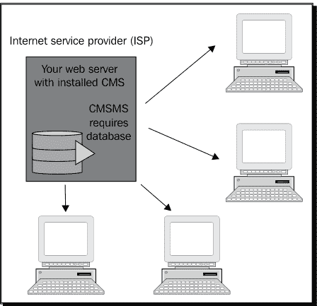
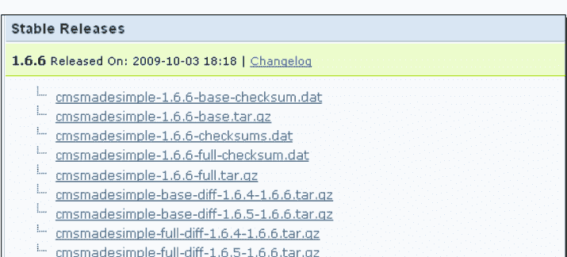
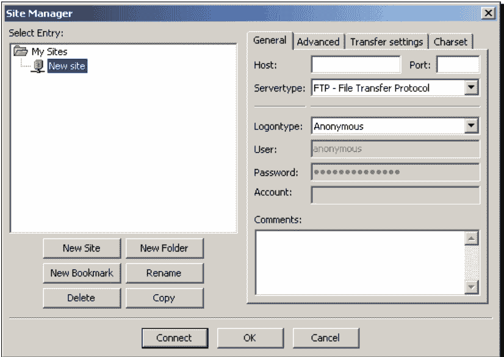
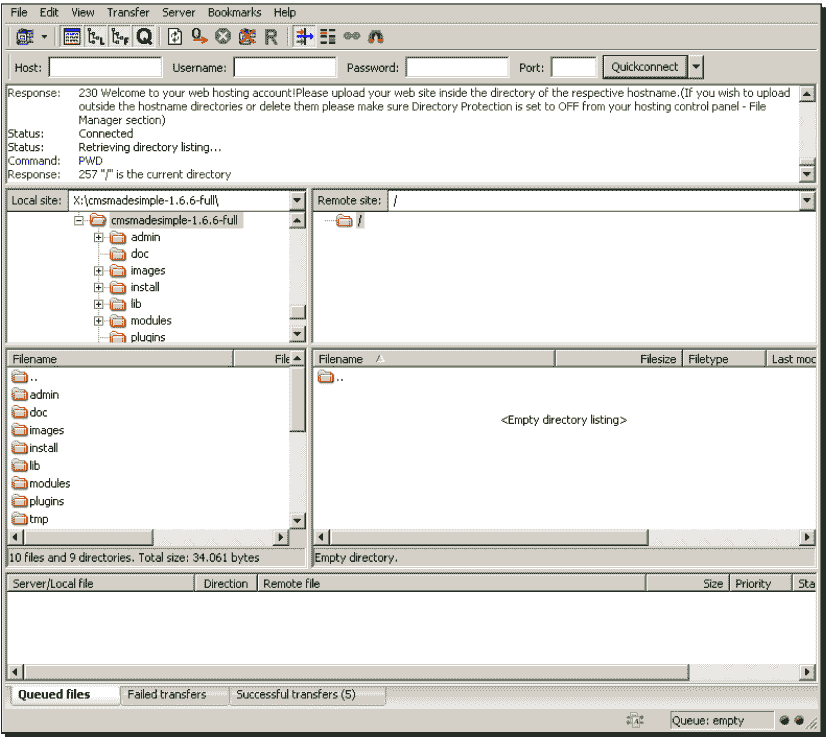
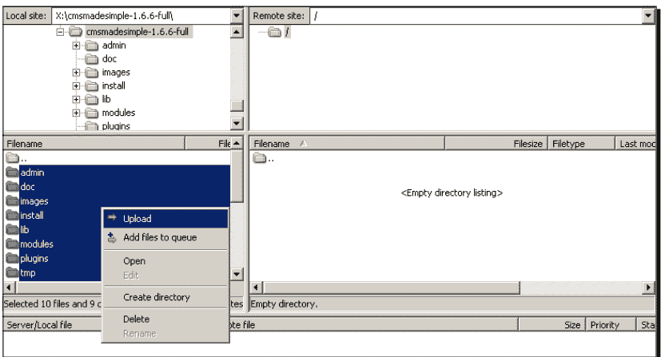
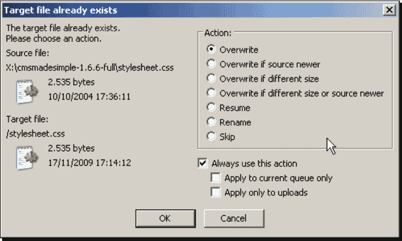

## 前言

CMS Made Simple 是一个开源内容管理系统，允许您在远少于常规的时间内快速开发网站，并通过提供模块和第三方插件避免数小时的编码工作。手握本书，您将能够轻松驾驭这个模块化、可扩展的内容管理系统的强大功能。

本指南基于实用且可行的解决方案，帮助您了解这个强大而简单的应用程序如何在日常工作中为您提供支持。工作坊帮助您为企业、社团和组织创建引人入胜、高效且易用的 CMS 网站。

这是一个循序渐进、案例驱动的教程，旨在帮助您使用 CMS Made Simple 构建一个完整的专业网站。您可以使用现成的模板，也可以实现自己的自定义设计；为网站丰富功能，例如相册、带 PayPal 结账的电子商务解决方案、任意复杂度的表单或流行的 jQuery 特效；最后通过搜索引擎优化进行收尾。书中提供的 HTML 和 CSS 代码片段均经过优化，可以轻松调整以适用于您自己的项目。随着一章一章地学习，您将分别扮演网页设计师、开发者、管理员和业务经理的角色，从而掌握构建易于管理的富网站所需的方方面面。

## 本书涵盖内容

- *第1章，使用 CMS Made Simple 构建网站*：介绍案例研究网站及其功能需求。
- *第2章，开始入门*：讲解如何安装 CMS Made Simple、其管理控制台的组织方式，以及如何配置 CMS Made Simple 以发送电子邮件。
- *第3章，创建页面与导航*：重点讲解创建、编辑和组织页面，介绍页面层级和搜索引擎友好的 URL。学完本章，您将获得案例研究网站的完整页面结构。
- *第4章，设计与布局*：讲解如何创建新模板，以及如何将现成的 HTML/CSS 设计移植到 CMS Made Simple。学完本章，您将能够为网站实现个性化设计。
- *第5章，使用核心模块*：涵盖 CMS Made Simple 的标准模块，如新闻、搜索、图像与文件管理器、打印（包括内置 PDF 输出），并向您展示如何安装额外模块（如 FAQ）。
- *第6章，用户与权限*：讲解如何在管理控制台中组织不同用户的权限。
- *第7章，使用第三方模块*：讲解如何实现具有个性化设计的相册、添加带自定义字段的联系表单、安装验证码功能、管理新闻通讯，以及在网站中嵌入 YouTube 视频。
- *第8章，创建自己的功能*：介绍创建自己功能的两种方法。第一部分，您将学习如何使用模块生成器创建产品目录。第二部分，您将学习如何使用模块创建服务台功能。
- *第9章，电子商务工作坊*：通过逐步工作坊，让您了解如何使用电子商务套件实现带 PayPal 结账的电子商务商店。
- *第10章，CMS Made Simple 高级使用*：讲解如何创建多语言网站、进行搜索引擎优化，以及在网站导航中使用 jQuery 插件。集成访问者统计和一些高级技术可丰富案例研究网站的功能。
- *第11章，管理与故障排查*：讲解如何保持网站更新和安全，以及如何进行性能调优。在本章末尾，您将得到“如何在论坛中快速获得帮助？”这一问题的答案。
- *附录，小测验答案*：包含本书中所有小测验的答案。

## 本书所需环境

CMS Made Simple 是一个使用 MySQL 数据库的 PHP 应用程序。这意味着您需要一个支持 PHP 和 MySQL 的网络托管服务来运行 CMS Made Simple。您可以在本地 PC 上安装 Web 服务器用于测试环境，和/或安装到远程主机上用于正式网站。CMS Made Simple 的要求如下：

- Linux/Unix 或 Windows 2000/XP/ME/2003 或 OS X 上的 Web 服务器
- PHP 5.2.x（不是 PHP 5.3）
  - `safe_mode` 应关闭
  - 至少 16 MB 的可用 PHP 内存


- PHP tokenizer support enabled
- At least one of ImageMagick or GD library enabled
- MySQL 4.1+ or PostgreSQL 7+
- Enough access to your server to upload files and change some permissions

## Who this book is for

This book is perfect for newcomers as well as webmasters who are looking for an introduction to building powerful and professional websites with a content management system. Basic knowledge of HTML and CSS is the only requirement. The workshop covers all aspects of web publishing and is aimed for web designers, web developers, editors, and web managers.

## Conventions

In this book, you will find several headings appearing frequently.

To give clear instructions of how to complete a procedure or task, we use:

### Time for action – heading

1. Action 1
2. Action 2
3. Action 3

Instructions often need some extra explanation so that they make sense, so they are followed with:

### What just happened?

This heading explains the working of tasks or instructions that you have just completed.

You will also find some other learning aids in the book, including:

### Pop quiz – heading

These are short multiple-choice questions intended to help you test your own understanding.

### Have a go hero – heading

These set practical challenges and give you ideas for experimenting with what you have learned.

You will also find a number of styles of text that distinguish between different kinds of information. Here are some examples of these styles, and an explanation of their meaning.

Code words in text are shown as follows: "Your root directory can be `public_html` (or `wwwroot` or `htdocs`), please ask your provider if you are not sure where to upload the files."

A block of code is set as follows:

```
#top-navi ul
{
    height: 22px;
    padding: 0px;
    margin: 10px 0;
    border-top: 1px solid #e5e4e2;
    border-bottom: 1px solid #e5e4e2;
}
```

When we wish to draw your attention to a particular part of a code block, the relevant lines or items are set in bold:

```
{foreach from=$nodelist item=node}
    <a href="{$node->url}">
        alias}.jpg" alt="{$node->menutext}" border="0" />
    </a>
{/foreach}
```

**New terms** and **important words** are shown in bold. Words that you see on the screen, in menus or dialog boxes for example, appear in the text like this: "Open **My First Style Sheet** from the list of stylesheets (**Layout | Stylesheets**) for edit."

Warnings or important notes appear in a box like this.

Tips and tricks appear like this.

## Reader feedback

Feedback from our readers is always welcome. Let us know what you think about this book—what you liked or may have disliked. Reader feedback is important for us to develop titles that you really get the most out of.

To send us general feedback, simply send an e-mail to feedback@packtpub.com, and mention the book title via the subject of your message.

If there is a book that you need and would like to see us publish, please send us a note in the SUGGEST A TITLE form on www.packtpub.com or e-mail suggest@packtpub.com. If there is a topic that you have expertise in and you are interested in either writing or contributing to a book on, see our author guide on www.packtpub.com/authors.

## Customer support

Now that you are the proud owner of a Packt book, we have a number of things to help you to get the most from your purchase.


### Downloading the example code for the book

Visit http://www.packtpub.com/files/code/8204_Code.zip to directly download the example code. The downloadable files contain instructions on how to use them.

In this book, you may occasionally come across a single line of code appearing on two different lines. Please note that this has been done only for the purpose of indentation due to space constraints. When using such code, make sure it's on one line in your script file.

## Errata

Although we have taken every care to ensure the accuracy of our content, mistakes do happen. If you find a mistake in one of our books—maybe a mistake in the text or the code—we would be grateful if you would report this to us. By doing so, you can save other readers from frustration and help us improve subsequent versions of this book. If you find any errata, please report them by visiting http://www.packtpub.com/support, selecting your book, clicking on the let us know link, and entering the details of your errata. Once your errata are verified, your submission will be accepted and the errata will be uploaded on our website, or added to any list of existing errata, under the Errata section of that title. Any existing errata can be viewed by selecting your title from http://www.packtpub.com/support.

## Piracy

Piracy of copyright material on the Internet is an ongoing problem across all media. At Packt, we take the protection of our copyright and licenses very seriously. If you come across any illegal copies of our works, in any form, on the Internet, please provide us with the location address or website name immediately so that we can pursue a remedy.

Please contact us at `copyright@packtpub.com` with a link to the suspected pirated material.

We appreciate your help in protecting our authors, and our ability to bring you valuable content.

## Questions

You can contact us at `questions@packtpub.com` if you are having a problem with any aspect of the book, and we will do our best to address it.

## What is a CMS?

**CMS** is an abbreviation for **content management system**. Generally, it is an application that helps to create a website structure and manage its content. By content, we mean any type of documents such as pages, images, structured data as products or users, and so on.

The most important goal of any CMS is the strict separation of content, design, and programming. You do not need to understand how a CMS is programmed when you write and publish the content. You do not need to be a web designer to create new pages and organize them into the navigation of the website. A programmer creates functionalities. A designer creates a layout without knowing how the program code is written and what exactly the content of every page will be. The editor uses the functions supplied by the programmer. The written content is automatically pasted into the layout created by the designer. That's it! Everyone does the job he/she can do best.

Typically, a CMS is used to offer the ability to manage the content of the website without any programming knowledge. The webmaster uses the CMS to create websites for customers who would like to manage their content by themselves. Once the design is made and the functionality is implemented, the customer can start entering his/her content. He/she does not care about anything else. He/she uses a graphical user interface to manage the content that is wrapped into the design.

A CMS consists of files and, in the case of CMS Made Simple, a database. Files provide functions that can retrieve any data from the database: content, design, features, and so on. The data retrieved is then wrapped as HTML and sent to the client (browser), because your visitors do not care how your website is made.



In the last image, you see a client-server structure. The server is your web space where the CMS is installed along with the database. Clients are visitors to your website. This means that to run a CMS, especially CMS Made Simple, you need some web space where you can create a new database and install CMS Made Simple. We will install CMS Made Simple step-by-step in the next chapter.

### A CMS versus a website builder

A CMS is not a website builder. A website builder is used by people who would like to build websites without learning the technical aspects of web page production. They use ready-made design templates and select from the limited function that the website builder offers. This kind of website production is inflexible and is often used to build private pages. A CMS caters to professional webmasters who create an individual website's layout and integrate any features that a customer needs.

### Why CMS Made Simple?

You have decided to build a website with CMS Made Simple. Good choice! CMS Made Simple has several advantages:

- It's free for personal and commercial use.
- It's simple. You won't need more than half an hour to introduce your customer to the usage of the CMS. It is mostly intuitive.
- It's flexible in design. Any design that is created in HTML and CSS can be ported to CMS Made Simple. There are no restrictions.
- It's modular. The basic functionality of CMS Made Simple can be extended by installing over 100 additional modules that are offered for free on the official website.
- It's popular. You are not alone. A large international community helps you to solve your individual issues. Thousands of websites are already built using CMS Made Simple, so you are not going to be alone.
- It's open source. You can create your own functionality the way you need.

You can avoid provider lock-in to a certain proprietary closed source CMS solution. If a provider of proprietary software decides to charge you more, goes out of business, or does not want to incorporate desired new functionalities, then there's nothing you can do. With an Open Source CMS, if you face a problem that you can't solve on your own, you can at least hire a programmer who will solve it for you.


## 案例研究网站

在本书中，我们将构建一个案例研究网站，该网站将在第8章*创建你自己的功能*结束时完成，届时可以填充内容并发布。想象一下，你需要从头开始为公司*businessWorld*创建一个商业网站。*businessWorld*是一家需要基于CMS构建网站的公司，因为网站内容将由公司员工管理。我们的任务是创建基本的网站结构，实现以HTML和CSS交付的自定义布局，并提供公司在功能规格说明中描述的功能。

## 功能规格说明

页面的总数没有提及。员工将随着时间的推移添加任何需要的页面。新页面应自动添加到网站的导航中。布局将以HTML或CSS模板的形式交付，并且必须移植到CMS Made Simple中。

除了普通内容页面外，网站还应包括以下内容：

- 一个新闻版块，可以在指定日期创建、分类和发布新闻文章到网站上
- 一个用于内容页面和新闻文章搜索的搜索功能
- 所有页面均可导出为PDF的打印功能
- 一个FAQ版块，可以随之扩展新的问题和答案
- 一个相册，可以将产品图片和团队成员照片组织到相册中
- 一个带有自定义字段和产品层级结构的产品目录
- 一个联系表单，以避免直接的电子邮件通信并减少垃圾邮件
- 一个由网站访客自行订阅的新闻通讯
- 一个面向注册客户的服务台

网站的每个部分都需要不同的编辑权限。有些员工只被允许管理新闻文章。其他人将负责产品目录，但无法访问新闻区域，等等。网站应针对搜索引擎进行优化。在网站的生命周期内，如果CMS Made Simple的模块或核心发布新版本，网站管理员需要定期更新网站。现在我们已经了解了规格说明，让我们继续准备系统进行安装。

## 安装准备

首先，收集安装CMS Made Simple所需的详细信息。你需要了解以下内容：

| 数据 | 你的值 |
|---|---|
| 域名（网站地址） | `http://` |
| FTP 主机 | |
| FTP 用户 | |
| FTP 密码 | |
| 数据库主机地址 | |
| 数据库端口（可选） | |
| 数据库名称* | |
| 数据库用户名 | |
| 数据库密码 | |

*在开始安装之前，你必须创建一个空数据库。如何创建新数据库取决于你的主机提供商。通常，可以在你的网站托管管理面板中创建数据库。如果遇到任何困难，请向你的提供商寻求帮助。

开始安装之前，表中列出的所有信息都应准备就绪。缺少任何这些信息都将导致CMS Made Simple无法安装。所需信息可以从你的托管服务商的支持处获得。现在就查明并记下所有必需的访问数据。在设置和配置过程中，你将需要这些数据。

要在你的网站托管上开始设置CMS Made Simple，你的域名应该已经注册并连接。现在测试一下。打开浏览器，在地址栏中输入你的域名。可以吗？如果没有，你的域名提供商将帮助你解决任何问题。

### 浏览器

你可以使用任何浏览器来管理CMS Made Simple，但Internet Explorer 6除外。这个浏览器相当老旧。它于2001年8月发布，不符合现代互联网的要求。尽管如此，使用Internet Explorer 6访问你网站的访客在浏览页面时不会遇到任何困难。此限制仅适用于作为网站管理员的你。

## FTP浏览器

你需要FTP访问权限才能访问你的网站。几乎所有网站托管都提供这种访问方式。使用FTP连接数据（见上表），你可以连接到托管服务器并上传安装和运行CMS Made Simple所需的全部文件。

有许多可以使用的免费FTP浏览器。如果你没有FTP浏览器，那么我推荐开源软件FileZilla，它可以在http://filezilla-project.org/上免费获取。现在就下载并安装FileZilla。

> 你只需要FileZilla客户端，而不是FileZilla服务器！

## 文件解压工具

文件解压工具是一种可以用来将CMS Made Simple的文件解压到本地磁盘的程序。由于CMS Made Simple的文件以压缩包形式分发，该程序应能够处理tar.gz文件。如果你没有文件解压工具，那么你可以使用开源应用程序7-Zip，它可以从http://www.7-zip.org免费下载。

现在我们已经拥有所有访问信息和所需软件，可以开始安装了。

## 上传CMS Made Simple的文件

CMS Made Simple的文件可以从CMS Made Simple的官方网站下载。打开http://cmsmadesimple.org，然后点击顶部主导航中的下载 | CMSMS发布版本。你会看到可供下载的文件列表，但你不需要所有文件。



此操作将在你的本地磁盘上创建一个名为`cmsmadesimple-1.6.6-full`的新文件夹（或与版本和发布号类似的名称）。此文件夹包含安装CMS Made Simple所需的全部文件。现在你必须将它们上传到你的网站空间。

打开FileZilla或你选择的FTP浏览器。你必须连接到你的网站托管才能上传文件。在FileZilla中，点击**文件 | 站点管理器**。在**站点管理器**中，点击**新建站点**按钮。你应该会看到一个对话框窗口，如下面的截图所示：



在右侧的**主机**字段中输入你的FTP主机。然后点击**登录类型**字段，并从列表中选择**正常**。现在，你可以在下方的相应字段中输入你的FTP**用户**和FTP**密码**。你的FTP登录详细信息应由你的托管公司提供。如果遇到任何问题，请联系你的托管公司的支持部门。点击**连接**。连接应该建立，你将看到类似于下面的屏幕：



在屏幕的左侧，你可以看到你的本地磁盘。导航到你解压CMS Made Simple安装文件的文件夹。在右侧，你看到的是你的网站托管的远程文件夹。

你必须将本地磁盘中的所有文件和文件夹以完全相同的文件夹结构上传到网站空间的根目录或子目录。你的根目录可以是`public_html`（或`wwwroot`或`htdocs`），如果你不确定将文件上传到哪里，请询问你的提供商。将文件放在根目录中，将使你的网站可以供用户通过http://www.yourdomain.com访问。如果你在根目录下创建子目录，例如public_html/somename，那么你的网站将只能通过http://www.yourdomain.com/somename在子目录中访问。我建议将文件上传到根目录，除非你已经在那里安装了其他应用程序。

要上传CMS Made Simple的所有文件夹和文件，请选择左侧（本地）的所有内容，右键单击，然后选择上传。



根据你的连接情况，上传文件可能需要超过十五分钟。由于FTP浏览器会创建到服务器的多个连接，可能会出现某些文件已经通过其他连接复制的情况。在这种情况下，你会看到一个类似于下面的窗口：



选择**覆盖**作为操作，并勾选**始终使用此操作**复选框。等待所有文件传输到网站空间，直到上传完成。

传输完成后，你可以开始运行CMS Made Simple的分步安装程序。在浏览器的地址栏中输入`http://www.yourdomain.com`（使用你自己的域名），即可启动CMS Made Simple的安装过程。如果你没有看到任何安装界面，那么说明你将文件上传到了网站空间中的错误文件夹。请向你的提供商询问文件应该放在哪里。


## 摘要

在本章中，对整本书做了简要介绍。

具体来说，我们涵盖了以下内容：

- 总体上的 CMS 以及 CMS Made Simple 的优势
- 本书通篇使用的案例研究网站的功能规范
- 为安装 CMSMS 准备我们的系统。

我们现在准备开始安装 CMS Made Simple。
