## 2 开始使用

> 在你开始使用 CMS Made Simple 创建网站之前，你必须在你的网络托管上安装该应用程序，并进行一些重要的配置，这些配置将影响你今后对网站所做的一切。要安装 CMS Made Simple，你应该了解什么是网络托管。你应该能够在你的网络托管账户中创建一个空数据库，并通过 FTP 上传 CMS Made Simple 的安装文件。

在本章中，我们将：

- 安装 CMS Made Simple
- 了解管理控制台及其组织方式
- 完成安装
- 配置电子邮件设置

CMS Made Simple 是一个使用 MySQL 数据库的 PHP 应用程序。这意味着你需要支持 PHP 和 MySQL 的网络托管才能运行 CMS Made Simple。你可以在本地 PC 上安装 Web 服务器用于测试环境，和/或在远程网络托管上用于实时网站。CMS Made Simple 的要求如下：

- Linux/Unix 或 Windows 2000/XP/ME/2003 或 OS X 上的 Web 服务器
- PHP 5.2.x（非 PHP 5.3）
  - `safe_mode` 应关闭
  - PHP 可用内存至少 16 MB
  - 已启用 PHP tokenizer 支持
  - 至少启用 ImageMagick 或 GDlib 其中之一
- MySQL 4.1+ 或 PostgreSQL 7+
- 足够的服务器访问权限以上传文件并更改某些权限

这些要求并不特殊，大多数托管提供商都已涵盖。如需免费无义务地测试 CMS Made Simple，你甚至可以在满足上述要求的免费网络托管上设置 CMS Made Simple。如有疑问，可在 CMS Made Simple 论坛（http://forum.cmsmadesimple.org）上询问托管建议。

### 分步安装 CMS Made Simple

当你在浏览器地址栏输入域名时，CMS Made Simple 安装程序会自动启动。安装程序将在整个安装过程中逐步协助你。

### 选择语言

首先选择安装语言。在下拉字段中，你可以看到安装包中所有可用的语言。在 CMS Made Simple 的基础版本中，你只能选择英语。完整版本包含更多语言。

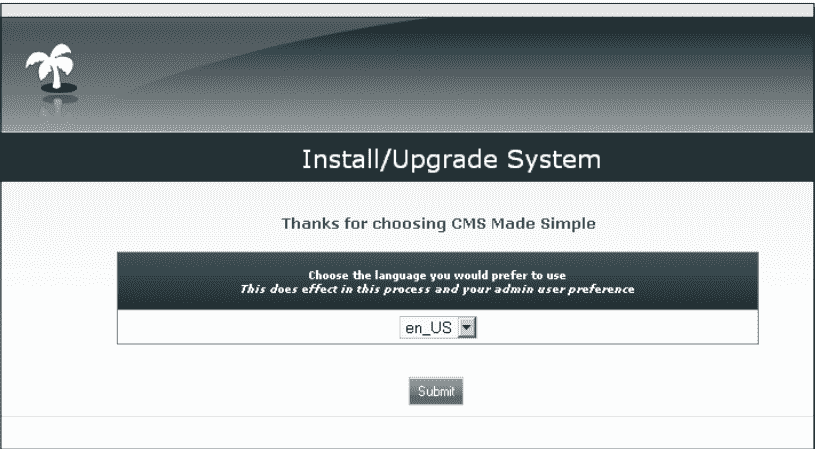

请注意，你在此处选择的语言仅用于安装。网站和管理员控制台的语言以后可以更改。点击 **Submit**。

### 第 1 步：验证文件完整性（可选）

在第一步中，你可以可选地验证安装文件的完整性。这将帮助你识别潜在问题，例如某些文件在 FTP 传输过程中损坏或因网络问题不完整。如果在将文件上传到网络托管时没有出现问题，则忽略此步骤并点击 **Continue**。验证也可以在安装完成后随时进行。

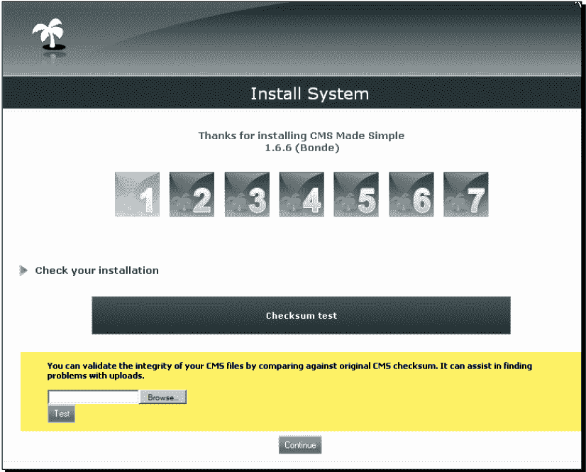

如果你想进行验证，则需要对应你版本的校验和文件：`cmsmadesimple-1.6.6-full-checksum.dat` 或 `cmsmadesimple-1.6.6-base-checksum.dat`。该文件可从官方网站下载。前往 http://cmsmadesimple.org，点击 Downloads | CMSMS Releases，并将校验和文件保存到本地磁盘。在上方字段中选择该文件，然后点击 **Test**。

此步骤为可选。点击 **Continue**。

### 第 2 步：设置文件权限

如果文件不存在，请在文本编辑器中（非文字处理器）创建一个名为 `config.php` 的空文件。在 Windows 中，打开记事本（随 Windows 提供），在文档中不输入任何内容后，点击 **File | Save As**。选择保存位置，并使用 "config.php"（包括引号）作为文件名，以确保使用正确的扩展名（.php）。通过 FTP 将该文件上传到 CMS Made Simple 安装文件已上传的文件夹。`config.php` 文件应与 `index.php` 文件在同一文件夹中，如以下屏幕截图所示：

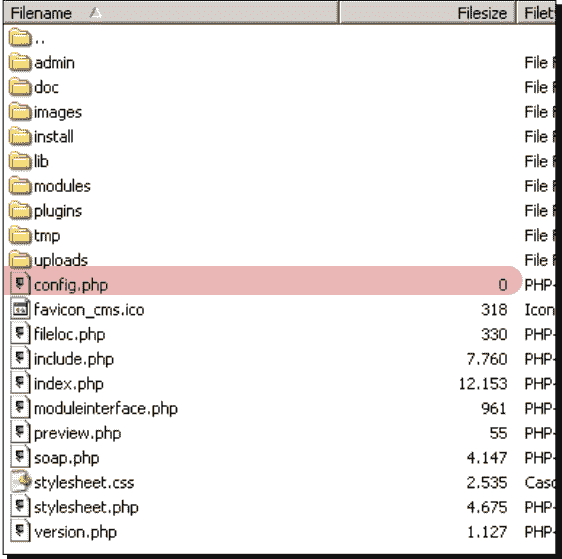

检查你创建并上传的文件是否具有 PHP 文件类型（某些编辑器可能会在文件名末尾添加 .txt 扩展名）。如有必要，将文件重命名为 `config.php`。

如果文件已存在，请打开 FileZilla 或你选择的任何浏览器并右键单击它。选择 **File permissions** 并在 **Numeric value** 字段中输入 777。点击 OK。

返回浏览器，点击设置检查末尾的 **Try again**；失败项应消失。

如果你在 **Required settings** 部分有其他失败或警告，并且不确定如何处理，请截取该页面的屏幕截图并发送给你的服务提供商。他/她将帮助你解决问题。

你可以忽略 **Recommended settings** 部分的警告。即使你不纠正它们，在运行网站时也最可能不会遇到任何问题。但是，如果你能按照给出的建议解决警告，请这样做。

| Test | Result |
|---|---|
| **Recommended settings** | |
| Checking PHP memory limit (minimum 16M, recommend 24M or greater) You have 32M | ✓ |
| Checking PHP time limit in seconds (minimum 30, recommend 60 or greater) You have 30<br><em>Number of seconds a script is allowed to run. If this is reached, the script returns a fatal error.</em> | ⚠ |
| Checking PHP register globals You have Off | ✓ |
| Checking output buffering You have On | ✓ |
| Checking PHP disable functions | ✓ |
| Checking for safe mode You have Off | ✓ |
| Check for PHP Open Basedir | ✓ |
| Test for remote URL<br>✓ fsockopen: Connection ok!<br>✓ fopen: Connection ok! | ✓ |
| Checking file uploads You have On | ✓ |
| Checking max post size (minimum 2M, recommend 10M or greater) You have 8M<br><em>You will probably not be able to submit (larger) data. Please be aware of this restriction.</em> | ⚠ |
| Checking max upload file size (minimum 2M, recommend 10M or greater) You have 8M<br><em>You will probably not be able to upload (larger) files using the included file management functions. Please be aware of this restriction.</em> | ⚠ |
| Checking if /var/www/web0/html/themes.icms.info/uploads is writable You have /var/www/web0/html/themes.icms.info/uploads | ✓ |
| Checking if /var/www/web0/html/themes.icms.info/uploads/images is writable You have /var/www/web0/html/themes.icms.info/uploads/images | ✓ |
| Checking if /var/www/web0/html/themes.icms.info/modules is writable You have /var/www/web0/html/themes.icms.info/modules | ✓ |
| Checking if session.save_path is writable You have /var/lib/php5 | ✓ |
| session.use_cookies You have On | ✓ |
| Checking for basic XML (expat) support You have On | ✓ |
| Checking for file_get_contents You have On | ✓ |
| Checking if ini_set works You have On | ✓ |

在某些 Web 服务器上，你必须更改已上传文件夹的权限。如果你使用 FileZilla，请右键单击远程文件夹并选择 **File permissions**。在对话框窗口 **Change file attributes** 中，在 **Numeric value** 字段中输入 **777**。你应对以下文件夹进行这些更改：

- `tmp/templates_c`
- `tmp/cache`
- `uploads`
- `uploads/images`
- `modules`

点击 **Continue**。

### 第 3 步：测试文件创建掩码（可选）

在此步骤中，你可以可选地测试 CMS Made Simple 是否允许在你的网络托管上创建文件。点击 **Test** 或直接忽略此步骤并点击 **Continue**。

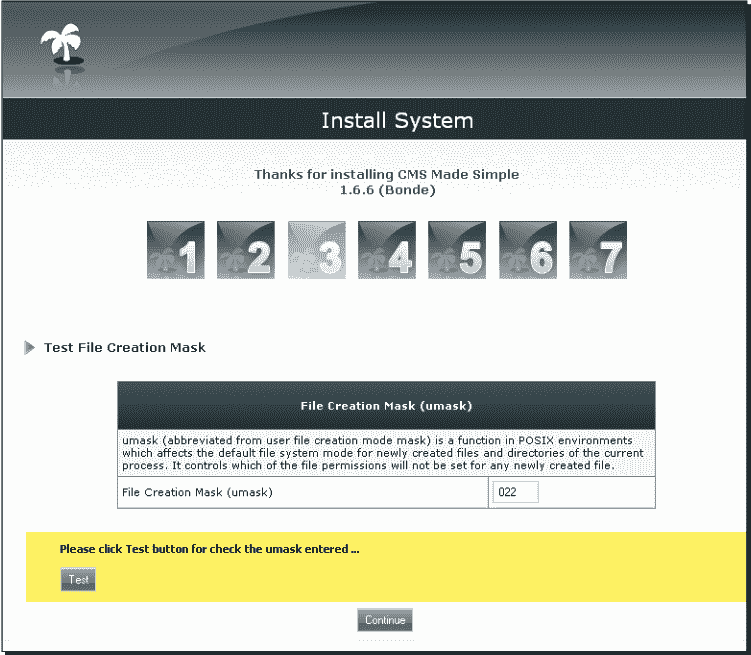


## 第 4 步：管理员账户信息

请特别注意此步骤。你将为自己的网站创建一个管理员账户。借助这些数据，你可以在网站安装完成后访问其管理控制台。请记住或记下你在此步骤中输入的管理员用户名和密码。请为你的账户提供一个有效的电子邮件地址。如果日后忘记了密码，重置提醒将发送至该邮箱。

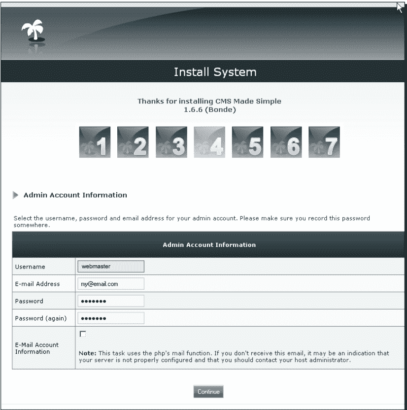

你可以勾选**通过电子邮件发送账户信息**选项。CMS Made Simple 会尝试向你的电子邮箱发送一封确认邮件。不过，由于各主机的设置不同，请不要完全依赖此功能。我们将在本章稍后部分配置 CMS Made Simple 的电子邮件设置。

点击**继续**。

## 第 5 步：数据库信息

在此步骤中，你可以修改网站名称，或保持默认不变。此信息在安装完成后可随时更改。

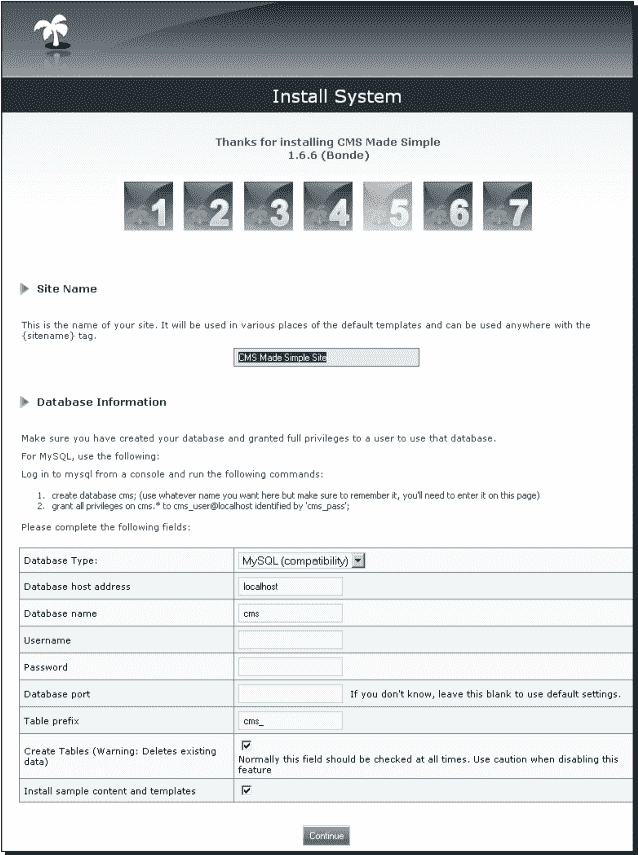

对于数据库信息，请使用你在安装准备阶段获取的数据库访问数据。

- 1. 将**数据库主机地址**替换为你自己的数据。
- 2. 将**数据库名称**替换为你的数据库名称。
- 3. 输入数据库**用户名**。
- 4. 输入数据库**密码**，并视需要填写**数据库端口**（如果有的话）。

这些是你的数据库访问凭据。如果不确定这些字段该如何填写，请咨询你的主机服务提供商。

### 示例内容和模板

在此安装步骤的最后一个字段中，你需要决定是否安装示例内容和模板。示例内容是首次了解 CMS Made Simple 时的有用资源，因为它包含二十多个页面，概述了 CMS Made Simple 是什么以及它的工作方式。然而，默认模板对初学者来说较难理解，因为它们结构复杂，看起来有些臃肿。

对于我们的网站，我们不会安装任何默认内容或模板。

点击**继续**。

## 第 6 步：创建数据表

如果数据库连接成功，并且数据库中的数据表已创建，那么在此步骤的末尾你会看到**成功！**消息，如下一张截图所示。保持消息下方各字段中的值不变，然后点击**继续**。

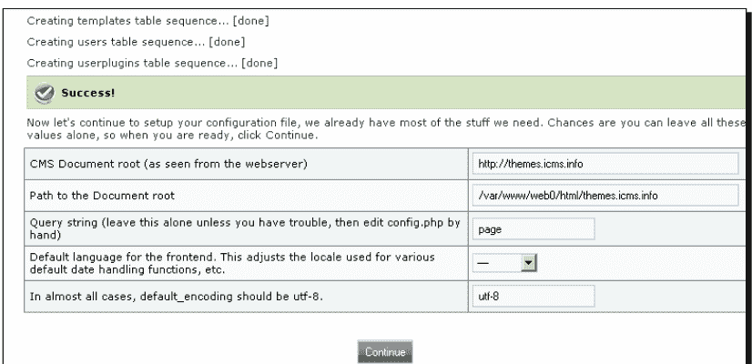

## 开始使用

使用安装过程第 4 步中的数据，通过地址 http://www.yourdomain.com/admin 登录管理控制台。网站管理员还可以添加其他用户（参见第 6 章“用户与权限”）。

管理控制台中的所有内容都通过主水平菜单访问。当你首次进入管理区域时，还会看到一个站点地图，显示每个菜单可访问的内容。

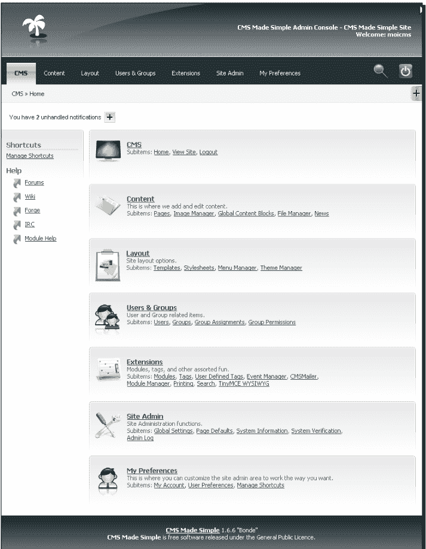

对于任何菜单项的站点地图，当你点击主水平菜单（CMS、内容、布局、用户与组等）时，该菜单项的所有子项都会显示出来。

让我们快速浏览一下管理控制台中有哪些内容。

- **CMS**：在 CMS 菜单中，你可以打开管理员站点地图（见下一张截图）、在新窗口中打开前端页面（查看站点），或退出登录。

  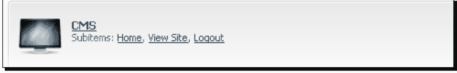

- **内容**：在这里你可以管理网站的内容。你可以添加和编辑页面，上传和管理图片与文件，还可以添加、编辑和删除新闻。如果你安装了额外的内容模块（如留言簿或 FAQ），它们也会出现在此部分。最后，在内容菜单中，你可以创建全局内容块，这些内容块将在整个网站的不同位置使用，并且可以统一编辑。

  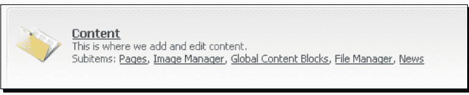

- **布局**：在这里你可以按照自己的意愿来设计页面外观和格式。对于整体布局，你需要使用模板。在布局菜单中，你还可以访问样式表。使用样式表（CSS），你可以为页面的不同元素设置样式。

  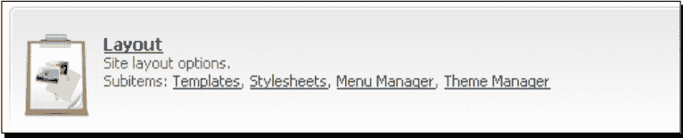

- **用户与组**：通过此菜单项，你可以添加应拥有网站管理控制台访问权限的用户，并选择他们将拥有哪些权限。你可以将用户分组，从而同时为整个组轻松选择权限。

  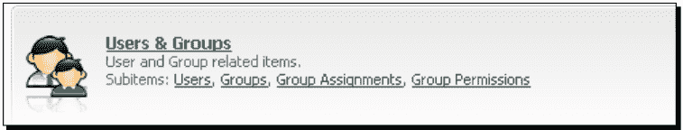

- **扩展**：这些是为 CMS Made Simple 提供额外功能的附加组件。CMS Made Simple 的标准安装仅包含一些基本功能。通过扩展，你可以为网站添加几乎所有功能。扩展可以是模块，也可以是标签（也称为插件）。

  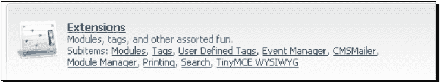

- **站点管理**：在这里你可以更改整个网站的设置和偏好，获取系统信息，并验证文件的完整性。你或其他用户对网站所做的任何更改都会记录在**管理员日志**中。

  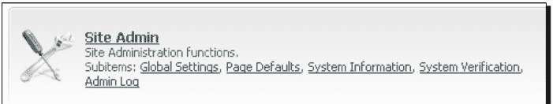

- **我的偏好**：在这里你可以更改个人设置。你也可以管理管理区域中最常用页面的快捷方式。如果你想更改管理员账户的用户名、密码或与该账户关联的电子邮件，请点击**我的账户**。

  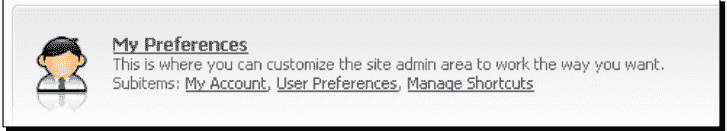

### 完成安装

安装完成后，你可能会立即在主菜单下方的仪表板区域看到两条未处理的通知。点击通知旁边的 + 号以展开仪表板区域。

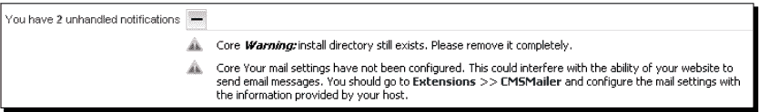

第一条通知提醒你，`install` 文件夹仍然存在于 Web 服务器上。该文件夹包含你用于安装 CMS Made Simple 的安装程序。一旦 CMS Made Simple 安装并运行，你就不需要这个文件夹了，因此你应该将其删除或至少重命名。如果不这样做，任何人都可以重新启动安装程序，从而用全新安装覆盖你的网站。这将是一个严重的安全问题，请立即删除该文件夹。

在删除（或重命名）该文件夹后，刷新管理控制台，可以看到第一条消息消失。

第二条消息涉及在运行 CMS Made Simple 之前应配置的电子邮件设置。

### 使用 CMS 发送电子邮件

CMS Made Simple 通过 **CMSMailer** 模块发送电子邮件。**CMSMailer** 模块的配置非常重要。如果不配置它，那么万一你忘记了管理员密码，你将无法收到包含新登录信息的电子邮件。该模块也被许多其他发送电子邮件的 CMS Made Simple 模块使用，如 **FrontEndUsers**、**Orders** 或 **FormBuilder**。

在配置该模块之前，你会一直在 CMS Made Simple 的仪表板中看到这条通知。

在管理控制台的主水平导航中，选择**扩展 | CMSMailer**。将**字符集**设置为 `utf-8`。然后，在**邮件发送方式**字段中选择 **sendmail**。在**发件人地址**字段中填写一个现有的电子邮件地址。当 CMS 发送电子邮件时，收件人会看到该地址作为发件人地址。你必须在此输入一个现有的电子邮件地址，因为由于 Web 主机上的垃圾邮件和安全设置，CMS Made Simple 很可能无法发送电子邮件。

填写“发件人用户名”字段。这里提供的名称将被分配给收件人邮件客户端中的邮件地址。

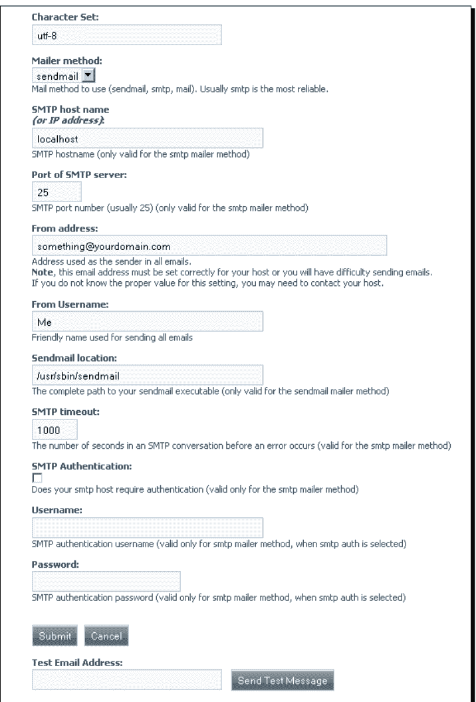

点击**提交**，并确认更改。

使用同一页面上的最后一个字段测试你的设置。在**测试电子邮件地址**字段中，输入一个你可以访问其邮箱的任意电子邮件地址（不要使用**发件人地址**字段中的地址）。CMS Made Simple 将向该字段中给出的电子邮件地址发送一条测试消息。点击**发送测试消息**按钮，并检查**测试电子邮件地址**字段中给出的邮箱的收件情况。你收到测试消息了吗？

如果没有收到，请稍等片刻，然后检查你的垃圾邮件文件夹。有时测试消息会被过滤并视为垃圾邮件。如果测试消息仍未发送，则说明 **CMSMailer** 模块的配置有问题。

### 已知问题

- 检查**发送邮件位置**字段（你的主机服务提供商必须确认该位置是否正确，或者他/她应提供你的个人位置）。
- 检查**发件人地址**字段中输入的电子邮件地址。它必须是现有的电子邮件地址，并且必须位于你的 Web 主机上。如果输入任何其他电子邮件地址，你的服务器将无法发送电子邮件。要使用 Gmail 或 GMX 等公共电子邮件服务的地址，你需要将模块配置为使用 SMTP 作为**邮件发送方式**。此方法要求你根据 SMTP 填写相应字段。SMTP 设置因电子邮件服务提供商而异。
- 检查**测试电子邮件地址**的垃圾邮件文件夹和过滤器，有时测试消息会被分类或立即删除。


# 开始入门

# 总结

在本章结束时，你应该已经完成了 CMS Made Simple 的全新安装。

具体来说，我们涵盖了：

- 程序安装：CMS Made Simple 附带一个简单的安装程序，引导你逐步完成设置过程。我们已执行了这些步骤，使 CMS Made Simple 运行起来。
- 管理控制台概述：管理控制台就像飞机的驾驶舱。它是一个你可以控制整个网站的地方。在本书中，你将更详细地了解每个部分。
- 发送电子邮件：你已配置 CMS Made Simple，使其能够从管理控制台发送邮件。如果你忘记了管理员密码，你将收到一封提醒邮件，其中包含如何找回密码的说明。CMS Made Simple 的所有核心模块和大多数第三方模块都依赖此功能。一旦配置完成，你就不需要为每个模块单独设置。

在下一章中，我们将了解如何创建网站结构并构建网站导航。

规划网站也将帮助我们为其选择合适的设计。如果你的网站计划与已创建的导航不匹配，再好的设计也会失败。在示例网站计划中，你可以轻松标明主导航（以粗体标记）、子导航（以灰色标记）以及网站的通用结构。有一个粗略的计划并且不频繁更改是很重要的。

在规划网站时，你很可能会有越来越多的想法——把它们写下来！这样规划的好处是你完全不受限制。你可以现在记下所有想法，选择可行的任务并专注于它们。之后，你可以添加对网站首次实现来说并非必需的新部分。区分“有则更好”的功能和“不可或缺”的功能非常重要。

如果你创建网站计划来记录所有想法，你就可以避免创建只包含一句“正在建设中”这样的页面。好的网站不会有任何未准备好的页面。如果有，就不应该展示给访客。想象一下，你在服装店橱窗里看到一则关于个人形象咨询的告示。你走进店里，店员却说：“抱歉！这项服务仍在建设中。” 这样引起人们注意又有什么意义呢？有些网站管理员把这样的页面添加到网站上只是为了“记住它们”。如果你在另一个地方写下网站的主要结构，就能更高效地记住它们。

> 询问你的朋友或家人他们计划向网站添加什么，并记住他们的想法。在规划时，考虑不同的年龄段和兴趣，以扩大访客的范围。

如果一切完美，那么就浏览网站计划中的主要部分，并标记可以立即完成的部分（前面提到的网站计划中的所有部分都将在本指南中讨论）。其他部分不应从计划中删除，而应标记为推迟。通常，一开始你有足够的事情可做。专注于这些可行点，并记住推迟的点。

当你准备好网站计划后，把它打印出来，放在电脑旁边，然后开始着手你的网站。

在本章中，我们将：

- 创建并编辑一些页面
- 了解页面层次结构
- 控制网站导航

## 创建页面

我们将从为网站创建一个粗略结构开始。网站由相互链接的页面组成。网站导航帮助访客找到包含所需信息的页面。一个网站必须至少有一个页面，因此安装后，第一个页面已在你的管理控制台中创建。它是你网站的起始页，名为“Home”。

### 动手操作——向网站添加新页面

你的网站需要一个展示公司信息的页面。这是网站计划中“我们的公司”部分的页面。让我们按如下步骤创建一个新页面：

- 1. 在网站的管理控制台中，点击“内容 | 页面”，然后点击“添加新内容”链接。
- 2. 填写“标题”和“内容类型”字段，如下面的截图所示：

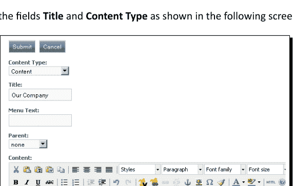

### 创建页面和导航

**3.** 点击**提交**。

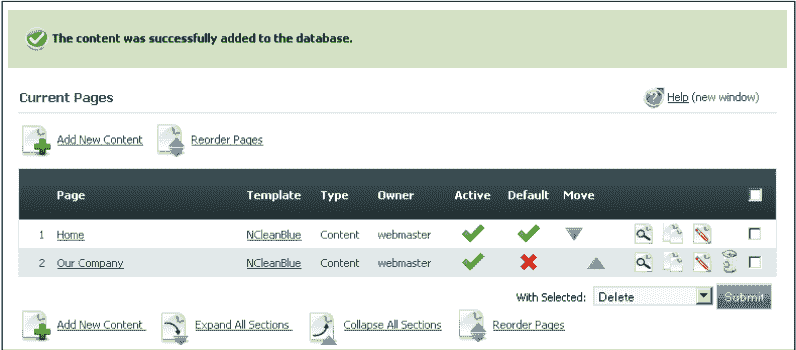

**4.** 点击管理控制台右上角的放大镜图标，查看你的网站，并找到已添加到网站主导航中的新页面。

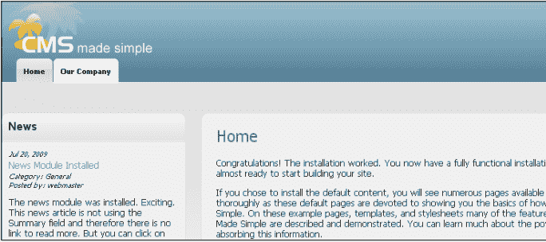

### 刚才发生了什么？

你刚刚向网站添加了一个新页面。该页面的标题为**我们的公司**，现在已列在管理控制台中网站的当前页面列表中。该页面也会自动添加到网站的主导航中。它的内容字段中有示例公司信息。当你导航到该页面时，这段文本会显示在网站的**我们的公司**页面上。

你只输入了很少的信息来创建一个新页面。然而，其他事情也发生了。

菜单文本已根据页面标题创建。页面地址（URL）也已根据页面标题创建。当你导航到该页面时，它是页面链接中位于浏览器地址栏 `index.php?page=` 之后的部分。在 CMS Made Simple 中，我们将这部分称为**页面别名**。页面别名在你的网站中是唯一的。你可以有很多具有相同标题和菜单文本的页面，但所有这些页面都会有不同的页面别名。由于页面别名用于创建指向特定页面的链接，因此你不能让两个不同的页面具有相同的链接，逻辑上你也不能让两个不同的页面使用相同的页面别名。

你无需操心将创建的页面集成到网站的导航中。如果你没有其他说明，所有已创建的页面都会显示在导航中。

现在，你可以创建网站第一层的所有页面，从而在网站顶部创建主导航。添加以下页面：

- 产品
- 客户中心
- 联系我们
- 隐私政策
- 站点地图

在管理控制台和你的网站上检查当前页面列表。

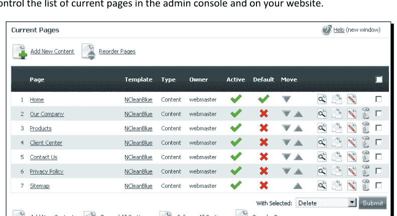


经常使用**应用**按钮，尤其是在处理大量文本时，请在单独的编辑器窗口中保留一份副本。如果连接断开或超时，页面将无法在浏览器中加载，修改也会丢失。

### 预览更改

如果你想在保存前预览更改，请在不应用更改的情况下切换到**预览**选项卡。你可以在预览窗口中看到更改，但这些更改此时不会显示给网站的访客。一旦你应用或提交了编辑后的页面，更改就会对网站访客可见。

### 更改页面别名

你也可以更改页面的页面别名。在编辑页面时切换到**选项**选项卡，并在**页面别名**字段中输入所需的别名。将页面别名视为页面的链接。此字段中不允许输入特殊字符，因此请使用空格或留空。请仔细选择在此处输入的名称，因为网站在线发布后，你将无法轻易更改它。一旦你的网站被搜索引擎收录，页面将以页面别名生成的链接显示在搜索结果中。如果你更改了页面别名，那么该页面将无法被找到，你的访客将看到错误消息，而不是所需的信息。

### 删除页面

你可以从管理控制台（**内容 | 页面**）的当前页面列表中删除页面。找到不再需要的页面，然后点击该页面的垃圾桶图标。小心！已删除的页面无法恢复。如果你只想将页面保留用于个人用途，则将其设为不活动（有关更多信息，请参阅*控制网站导航*一节）。

### 格式化页面内容

你已经创建并编辑了一些页面。请注意，你在**内容**字段中输入的文字会显示在网站的某个位置。这段文字只是整个页面的一小部分。你无法从这里更改导航、页眉或页脚部分的设计。


## 创建页面与导航

如果你只是网站的一名编辑（不是设计师，也不是管理员），那么你可以在这里创建或编辑文章，但无法更改网站上的任何其他内容。这是**内容管理系统（CMS）**最重要的原则。我们将设计与内容分离，以便不同的人可以完成不同的任务。这也有助于将布局与内容分开，从而可以在不经历重重困难的情况下全局更改网站的外观。

编辑需要能够通过将某些短语加粗、创建列表或链接到网站的其他页面来格式化自己的写作。通常，这需要 HTML 知识，除非你使用**所见即所得编辑器**。

**WYSIWYG** 的意思是**所见即所得**，它让你能够使用常见的文字处理功能来格式化页面文本。此外，文本在编辑器中的显示方式与它在网站上的最终显示效果一致。

> 使用所见即所得编辑器创建、编辑和格式化网站文本部分时，不需要任何 HTML 知识。


所见即所得编辑器是每个 CMS 的核心和最重要的功能。如果你使用 CMS 创建网站，那么你将不断向网站添加内容。这意味着，除了其他模块之外，所见即所得编辑器将成为你 CMS 中最常用的功能之一。因此，了解编辑器如何帮助你以及你可以做些什么来让它满足你的需求非常重要。市面上有一些所见即所得编辑器，对于 CMS Made Simple 来说，名为 **TinyMCE** 的编辑器是集成度最高的。

在管理控制台中，转到**内容 | 页面**并选择任意页面进行编辑。**内容**字段使用所见即所得编辑器（你可以在内容字段上方看到工具栏），如下面的截图所示：

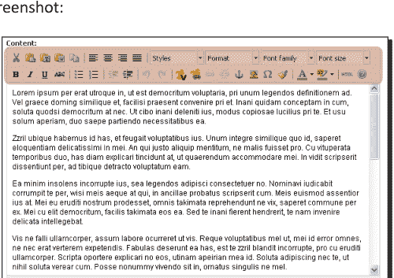

编辑器的工具栏不言自明，与大多数流行的文字处理程序类似。如果你去探索，还会发现更多可以简化工作的设置。

通常，大量文本是在 Microsoft Word 等文字处理程序中编写的。如果你将 Word 中的文本直接复制到内容字段中，则会产生很多问题，因为 Word 生成的 HTML 质量很差。在编辑器的工具栏中，有一个特殊按钮（第一行中的第四个）用于从 Word 粘贴文本。始终使用此按钮从 Word 复制文本，因为它会过滤掉文本中的杂乱代码。

## 配置 TinyMCE

在管理控制台中，点击**扩展 | TinyMCE WYSIWYG**。你可以在此处更改编辑器字段的宽度和高度。默认情况下，编辑器字段的大小会自动设置；根据你的屏幕偏好进行更改，以获得更多的书写和阅读空间。

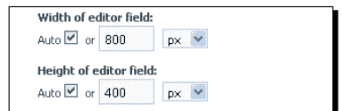

取消选中**自动**字段，输入所需的宽度和高度，然后点击**保存设置**。设置下方有一个测试字段，你可以立即看到更改效果。该字段允许你预览更改，因此无需编辑页面即可控制编辑器的外观。

在**配置文件**选项卡中，你可以添加更多功能。对于网站管理员，必须在**高级后端配置文件设置**部分中进行更改。选中**允许表格操作**字段，以便能够使用所见即所得编辑器创建和编辑表格。保存配置文件后，你会在编辑器工具栏中找到第三行，它有助于构建 HTML 表格。

如果你希望直接从编辑器上传图片，请勾选**显示文件管理选项**字段。点击**保存配置文件**，然后点击工具栏中的**插入/编辑图像**图标。此时会弹出一个窗口，你可以在其中更改图像 URL。点击它，你的图片文件夹内容就会显示出来，如下一张截图所示。通常，此窗口不允许上传。但是，由于你已激活文件管理选项，你会在图片列表上方找到**文件操作**部分，可以在其中上传图片。

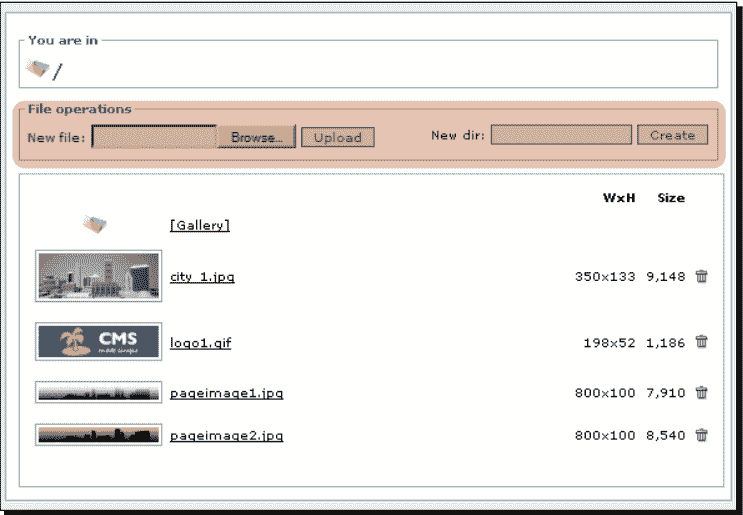

> 从一开始就使用文件夹来组织图片，否则你很快就会拥有数百张杂乱的图片，而重新整理它们将是一个大问题，因为它们已经链接到各个页面。一个文件夹中有大量图片会减慢文件选择器的加载速度，并且找到你要找的图片将变成一项艰巨的任务。

继续在**插件**选项卡中自定义编辑器。有一些有用的插件默认未激活，但可以根据需要激活。我建议激活以下插件：

- **print**：允许你从编辑器打印文本
- **fullscreen**：添加全屏编辑模式
- **searchreplace**：为文本添加搜索/替换对话框

点击“保存插件”。只有 fullscreen 的图标被添加到第二个工具栏中帮助图标之前。另外两个没有出现。为什么？让我们退一步，再次检查“配置文件”选项卡。在“高级后端配置文件设置”部分，你可以看到三行工具栏。这些行控制编辑器中第一行、第二行和第三行（目前为空）中图标的显示顺序。单个按钮在工具栏字段中以其名称表示，如下面的截图所示：

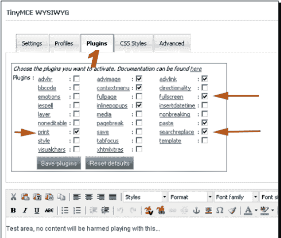

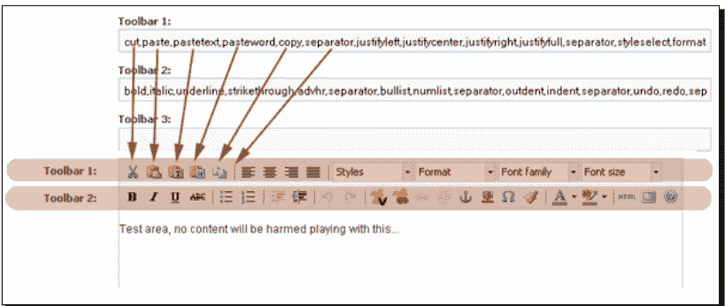

你可以删除其中一些、更改顺序或添加新的。这就是我们接下来要做的。

### 动手实践——激活搜索和替换功能

有一个有用的插件，可以搜索页面的全部内容，并将某个单词或短语的所有实例替换为其他内容。让我们看看如何在 TinyMCE 中激活这个插件。

1. 在管理控制台中，点击**扩展 | TinyMCE WYSIWYG**。
2. 点击**插件**选项卡。
3. 选中名为 **searchreplace** 的插件旁边的复选框，如下面的截图所示：

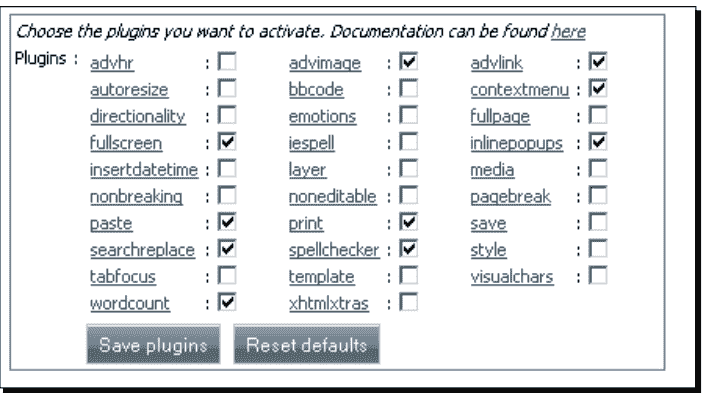

4. 点击**保存插件**按钮。
5. 切换到**配置文件**选项卡。
6. 在**高级后端配置文件设置**部分，将单词 **search, replace** 添加到**工具栏 3**字段中，如下面的截图所示：

| 工具栏 | 内容 |
|---|---|
| 工具栏 1 | cut,paste,pastetext,pasteword,copy,separators,justifyleft,justifycenter,justifyright,justifyfull,separators |
| 工具栏 2 | bold,italic,underline,strikethrough,advhr,separators,bullist,numlist,separators,outdent,indent,separators |
| 工具栏 3 | search,replace |

点击此处查看 TinyMCE 维基中的工具栏说明。

7. 点击“保存配置文件”按钮，可以看到添加到工具栏第三行的附加功能，如下面的截图所示：

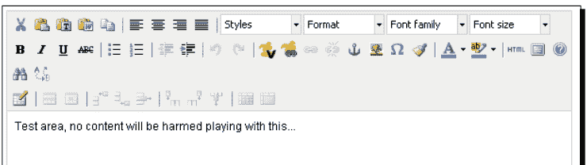

### 刚才发生了什么？

首先，你在“插件”选项卡中激活了插件。激活插件意味着该插件会随 TinyMCE 一起加载。但仅仅激活它还不够。在第二步中，你必须自定义 TinyMCE 的工具栏，以告知编辑器该插件的按钮应显示在何处。

你看到单个插件可以提供两个按钮。因此，你必须在“工具栏 3”字段中输入两个单词。第一个是 search，用于搜索按钮；第二个是 replace，用于替换功能。它们不能同时使用。如果你不需要某个特定功能，可以省略第一个或第二个。

> 在“工具栏 3”字段中添加插件 removeformat。这是一个无需先激活的插件，因为它属于标准插件。该插件允许在不查看 HTML 的情况下移除文本的任何格式。


## 创建页面和导航

WYSIWYG 编辑器中还有更高级的设置。要理解它们，你需要了解 CMS Made Simple 的整体工作原理。我建议在阅读本书的同时反复参考 WYSIWYG 编辑器的设置，以提高使用编辑器的效率。

### 添加 meta 标签

Meta 标签包含有关网站的附加信息。这些信息不会直接显示给网站访客；meta 标签的目的是向搜索引擎和网络浏览器提供有关网站的附加信息。我们必须区分网站每个页面都相同的 meta 标签和特定内容页面独有的标签。

Meta 元素是提供搜索引擎附加信息的 HTML 或 XHTML 元素。它们对网站访客不可见。此类元素必须作为标签放置在页面的 head 部分。Meta 元素可用于指定页面描述、关键词以及任何其他元数据。

Meta 元素指定名称和描述页面的相关内容。例如：

```html
<meta name="keywords" content="business company, services" />
```

在此示例中，meta 标签将页面标识为包含与短语 `business company` 和单词 `services` 相关的关键词。

### 动手时间 – 向页面添加 meta 标签

让我们为网站的起始页添加一些特定的 meta 标签。

1. 在管理控制台中，打开 **Content | Pages**。
2. 点击起始页 **Start** 以编辑它。
3. 切换到 **Options** 选项卡。
4. 在字段 **Page Specific Metadata** 中，添加特定于该页面的 meta 标签。

    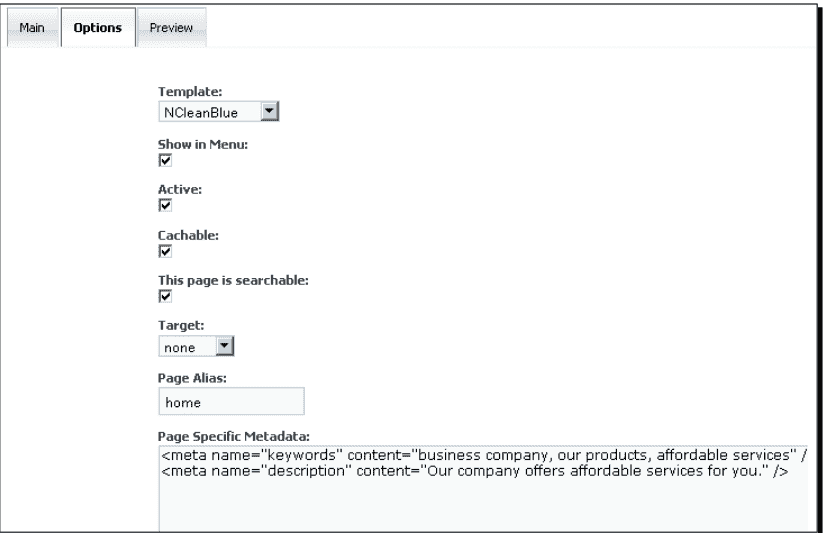

5. 点击页面底部的 **Apply**。
6. 点击 **Apply** 按钮旁边的放大镜图标。
7. 在页面源代码中查看网站的 head 部分。

### 发生了什么？

你已以纯 HTML 形式向网站的起始页添加了 meta 标签。这些 meta 标签仅出现在该特定页面上。一般来说，描述和关键词的 meta 标签在每个页面上都应不同。

> 也可以在此处添加用于生成的页面 head 部分的任何其他标签（不仅限于 meta 标签）。

### 添加全局 meta 标签

一些全局 meta 标签已添加到 CMS Made Simple 的标准安装中。你可以在 CMS Made Simple 生成的每个页面的源代码中看到这些 meta 标签：

```html
<meta name="Generator" content="CMS Made Simple - Copyright (C) 2004-2009 Ted Kulp. All rights reserved." />
<meta http-equiv="Content-Type" content="text/html; charset=utf-8" />
```

要更改或删除这些标签，请在管理控制台中点击 **Site Admin | Global Settings**。在字段 **Global Metadata** 中找到上面列出的 meta 标签。你可以在此字段中使用纯 HTML 添加自己的 meta 标签。

> 也可以在此处添加用于所有页面 head 部分的任何其他标签（不仅限于 meta 标签）。

### 理解页面层级

你在上一步中添加的所有页面现在都显示在网站的主导航中，并且可以在管理控制台的当前页面列表中找到。但在我们的网站计划中还有一些页面需要添加到层级中。

通过页面层级，你可以定义页面相对于另一个页面是位于上方、下方还是同一级别。如果页面未显示在主导航中，我们称其为 **子页面**。这也意味着子页面上方有一个父页面。

### 动手时间 – 向网站添加子页面

让我们根据网站计划在 **Our Company** 页面下方创建四个页面。

1. 在网站的管理控制台中，点击 **Content | Pages**，然后点击 **Add New Content** 链接。

2. 填写字段 **Title** 和 **Content**，如以下屏幕截图所示，并在下拉字段 **Parent** 中选择页面 **2. Our Company**。

    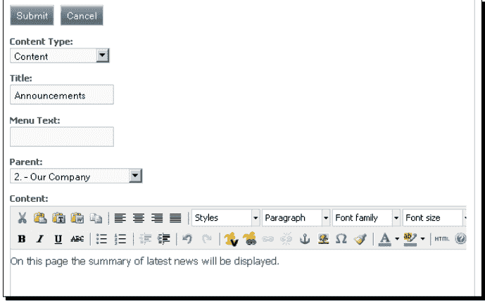

3. 点击 Submit。

4. 点击三角形以展开 Our Company 页面下方的页面列表并查看创建的子页面。

    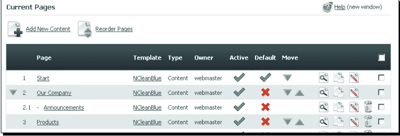

5. 点击刚创建页面旁边的放大镜图标以在网站上查看该页面。

### 发生了什么？

你已添加了一个新页面。这次你选择了一个父页面，将新页面置于父页面下方的层级中。在管理控制台中，你可以看到该页面现在缩进在父页面下方。它获得编号 2.1，表示该页面属于编号为 2 的页面，并且是其第一个子页面。你不会在网站的主导航中找到该页面，然而，当你在导航中将鼠标悬停在 Our Company 上时，你可以看到该页面已添加到子导航中。

我们需要页面层级来将页面组织为主部分，并自动构建子导航。

如果你想更改页面在层级中的位置，你必须通过在页面列表中点击它来编辑该页面。在字段 Parent 中选择另一个父页面并保存更改。如果你选择下拉列表中的 none，则页面将被移至第一级，从而显示在主导航中。

使用当前页面列表底部的 Expand All Sections 链接以显示所有层级级别。使用 Collapse All Sections，你可以隐藏所有子页面，仅显示第一级。

你可以使用 Move 列中的图标（向下和向上）重新排序同一级别的页面。但是，如果你必须将一个或多个页面从列表的底部移动到顶部，使用移动图标会很困难（尤其是在页面数量很多的情况下）。在这种情况下使用 Reorder pages 链接。此功能允许你通过点击页面并将其拖动到同一层级内的不同位置来重新排序页面。

在管理控制台中重新排序页面也会更改页面在网站导航中的显示顺序。

### 面包屑

你的层级也在所谓的面包屑中显示——显示在网站内容上方的导航辅助。它以 You are here 开始，显示页面的路径并提供返回当前页面父页面(们)的链接。

### 搜索引擎友好的 URL

在创建网站时，你可能考虑过如何在搜索引擎中推广它。在开始分享网站页面 URL 之前，建议设置搜索引擎友好的地址。

搜索引擎友好的 URL 不包含任何动态组件，对网站访客和搜索引擎来说更易读。比较以下两个 URL：

```text
http://yourdomain.com/index.php?page=products
```

```text
http://yourdomain.com/products
```

哪个页面地址更好？如果网站使用第二个版本，搜索引擎会更好地索引你的网站。一些地址中带有动态查询字符串的页面（如第一个示例）永远不会被索引，而有些页面进入搜索结果所需的时间会更长。

如果你不在乎搜索引擎，那么想想网站的访客。如果我们不使用第二个重写版本，输入或写下特定页面的地址有多容易？想象一下你的访客想推荐该页面。他使用搜索引擎友好的 URL 将会毫不费力地做到这一点，而使用第一个示例可能会失败。

然而，在使用 CMS Made Simple 安装网站后，你会发现页面的 URL 是按第一种方式构建的。你可以轻松更改它们以获得更好的网站效果。

### 动手时间 – 创建搜索引擎友好的 URL

要启用网站的搜索引擎友好 URL，请执行以下步骤：

1. 启动 FileZilla 或你选择的任何其他 FTP 浏览器。

2. 连接到你的托管服务并选择文件 `config.php` 进行编辑。（你也可以将文件复制到本地磁盘进行编辑，并在进行以下更改后上传）。

3. 在 `config.php` 中搜索 “URL Settings” 部分，并将 `$config['url_rewriting'] = 'none';` 替换为 `$config['url_rewriting'] = 'mod_rewrite';`

4. 关闭、保存并将文件重新上传到你的网络托管。

5. 进一步使用 FileZilla 或你选择的任何其他 FTP 浏览器，打开 `doc` 目录。

6. 将 `doc` 目录中找到的 `htaccess.txt` 文件移动到网站的根目录（即文件 `config.php` 所在的同一目录）。

7. 将移动的文件重命名为 `.htaccess`（开头的句点属于新文件名！）。

8. 在浏览器中查看你的网站，点击顶部导航区域以查看每个页面的新地址。


## 刚才发生了什么？

我不打算用技术细节来烦扰你（如果你想了解更多，请阅读`mod_rewrite`模块）。现在你的网站上已经有了一些漂亮、简洁的URL。

如果你收到了内部服务器错误，请考虑以下已知问题：

- 你的托管公司不支持`mod_rewrite`（如果不确定，请咨询你的托管服务提供商）。
- 你将CMS Made Simple安装到了子目录中；例如，`http://yourdomain.com/mycms`。在这种情况下，你需要编辑`.htaccess`文件并替换该行。

    `RewriteBase /`

    替换为

    `RewriteBase /mycms`

    将斜杠后的名称改为你的子目录名称。

## 从层级结构中获得更多成功

启用搜索引擎友好URL还有另一个有用的效果。现在页面的URL包含页面的完整路径，包括父页面，而不仅仅是页面别名。

假设你创建了页面Philips TV（页面别名为philips），并选择了页面Plasma TV（页面别名为plasma-tv）作为它的父页面。如果不重写该页面的URL，Philips TV将获得以下地址：

```
http://yourdomain.com/index.php?page=philips
```

重写URL后，我们得到：

```
http://yourdomain.com/plasma-tv/philips
```

第二个版本更简洁，对访客来说看起来更好，容易记下或记住，而且对搜索引擎更友好，因为你的URL中包含了更多关键词。

请记住，页面别名必须是唯一的。例如，你不能拥有这样的结构：

```
yourdomain.com/products/tv
```

```
yourdomain.com/news/products
```

别名*products*在整个网站上只能使用一次。

- 4. 滚动到页面底部，点击**提交**按钮。
- 5. 使用管理控制台右上角的放大镜图标查看你的网站。

对**站点地图**页面执行相同操作。

## 刚才发生了什么？

你已经取消了**在菜单中显示**的勾选，以将该页面从网站的主导航中隐藏。指向该页面的链接会从顶部菜单中消失。

然而，该页面并未被停用。如果你在浏览器的地址栏中输入该页面的完整地址，或者从网站的其他页面放置一个直接链接，你仍然可以查看它。通常，你会使用此功能来隐藏那些不够重要、无需显示在主导航中的页面。

另一个原因可能是某些页面只在特定情况下才需要显示。这种页面的一个例子可以是*感谢您！*页面，当访客通过网站上的联系表单向我们发送消息时，需要向访客显示该页面。这种情况下我们称之为服务页面，稍后我们将学习如何在你的网站上使用它们。

在**选项**选项卡中，你可能注意到了另一个可以取消勾选的字段：**启用**。停用页面会使其对网站访客不可用。即使提供了指向该页面的直接链接，访客也会看到一条错误消息，说明找不到该页面。

> 可以把未启用的页面看作是对访客来说不存在的页面。

你可以使用此功能来禁用一个不再需要的页面。你可以删除这些页面并丢失其内容，或者直接停用它们，同时在网站的管理控制台中仍然能够看到它们的内容。在这种情况下，你是唯一能看到它的人。有些网站管理员会创建未激活的页面，作为未来内容的占位符。

## 你的起始页是哪个？

当你的网站上线后，各个页面可以通过其链接访问。但如果只输入你网站的域名，会向访客显示哪个页面呢？

在CMS Made Simple中，我们称之为**默认页面**。你可以将任何页面定义为默认页面。在管理控制台中，打开**内容 | 页面**，并在当前页面列表中找到**默认**列。只有一页在该列中有绿色勾号，以这种方式标记的页面就是你网站的起始页。你可以通过点击该列中的红色叉号来选择另一个页面作为默认页面。在更改默认页面之前，你必须确认问题**您确定要将（页面名称）设置为站点默认页面吗？** 可以看到绿色勾号如何从先前的默认页面移到新页面。先前的页面会自动在该列中显示红色叉号。逻辑上，你的网站只能有一个起始页。

## 通过内容类型获得更多导航控制

通过不同的内容类型，你可以实现对导航的更多控制。你一定注意到了创建或编辑页面屏幕上的**内容类型**字段。该字段的标准选项是**内容**，用于创建普通的内容页面。在大多数情况下，你都会使用这种类型。

使用不同的内容类型（参考下表），你可以向导航中添加链接，并获得与普通页面不同的行为。

| 内容类型 | 描述 |
|---|---|
| **内部页面链接** | 使用此内容类型在导航中创建指向特定页面的链接，该页面实际上位于层次结构的另一层。此内容类型仅生成一个指向你在**目标页面**字段中选择的特定页面的链接。 |
| **分隔符** | 使用此内容类型在内部将不同的导航部分彼此分隔开来。此内容类型主要用于创建复杂的导航结构或复杂的导航设计。 |
| **外部链接** | 正如内容类型名称所示，使用此内容类型向导航添加外部链接。在内容类型的**URL**字段中输入以`http://`开头的完整URL。 |
| **错误页面** | 此内容类型与导航无关。它将在第5章*使用核心模块*中详细解释。 |
| **部分标题** | 使用此内容类型，你可以在导航中创建一个标题。此内容类型本身不是链接。它只是"承载"层次结构中位于其下方的其他页面。使用此内容类型可以清晰地将菜单结构划分为不同部分。 |
| **内容** | 此内容类型用作你网站普通内容页面的标准类型。 |

## 小测验 – 创建页面和导航

- 1. 如何在CMS Made Simple中创建新页面？
  a. **站点管理 | 页面默认设置 | 添加新页面。**
  b. **布局 | 菜单管理器 | 添加新页面。**
  c. **内容 | 页面 | 添加新内容。**
- 2. 创建新页面时填写的标题在网站上的哪里显示？
  a. 标题栏和菜单。
  b. 标题栏和网站标题。
  c. 菜单和子菜单。
  d. 菜单和网站头部。
- 3. 关于**应用**和**提交**按钮，哪些答案是正确的？
  a. **提交**按钮一步保存更改并关闭页面。
  b. **应用**按钮一步保存更改并关闭页面。
  c. **提交**按钮不关闭页面，但会保存你所做的更改。
  d. **提交**按钮不关闭页面，并在浏览器中预览更改。
- 4. 如果更改页面别名，什么会受到影响？
  a. 标题
  b. 关键词
  c. 菜单
  d. URL
- 5. 你将适用于项目中所有页面的元标签放在哪里？
  a. **内容 | 页面 | 页面标题 | 选项。**
  b. 在样式表的常规元标签部分。
  c. **站点管理 | 全局设置 | 常规设置 | 全局元数据。**
  d. **扩展 | 模块管理器 | GenMetaMod。**

## 创建页面和导航

- 6. 为什么你应该使用搜索引擎友好地址？
  a. 如果没有搜索引擎友好URL（它们太长），打开超过七个页面会使计算机的RAM内存过载。
  b. URL针对搜索引擎进行了优化。
  c. 你根本不应该使用它们，因为你必须为每个搜索引擎创建一个特殊的URL，并创建一些重复内容。
  d. 页面加载速度快得多。

- 7. 如果你想对访客隐藏一个页面，但又希望出于内部需求保留页面上的内容，你应该：
  a. 删除该页面。
  b. 停用该页面。
  c. 指定另一个父页面。
  d. 复制该页面并删除原始页面。

- 8. 你的所有页面都是用英文写的。你会把语言的元标签放在哪里？
  a. 在全局设置中。
  b. 在每个单独的页面中。

- 9. 你的一个页面已被另一个网站链接。如果更改页面别名会怎样？
  a. 旧链接将自动重定向到新的页面别名。
  b. 点击链接后会出现一条错误消息，提示找不到该页面。

# 大显身手 – 为公司网站创建所有页面

在进入下一章（讲解设计和布局）之前，请创建你的网站所需的所有页面。你不需要为每个页面编写完整文本。下一部分将只是关于准备网站的结构。


使用你自己的网站规划或示例规划：

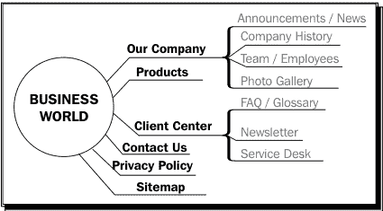

## 创建页面和导航

首先添加你在层级结构中第一层的页面（在上图中用粗体标记）。然后添加第二层的页面（用灰色标记）。你可以调整页面别名和菜单文本。

为页面添加一些示例文本，或写下每个页面将包含的内容。如果你有一些不错的想法，但不应该从一开始就发布在网站上，那么可以创建一些保存这些想法的非活动页面。

开始时不要创建超过两层。即使可以创建大量层级，你的访客如果不必点击 5 或 6 次才能到达所需信息，网站的导航会更友好。最好从两层导航开始，以便在下一章简化布局和设计的学习。

上面展示的网站结构的结果如下：

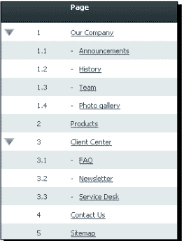

请注意，**Start** 页面已被重命名为 **Our Company**。

## 总结

在本章中，你学习了页面如何轻松创建和管理。你看到网站的导航是从现有页面自动构建的。

具体来说，我们涵盖了以下内容：

- **创建页面：** 你可以从头创建新页面，或作为现有页面的副本。
- **编辑页面：** 页面创建后，你可以更改页面上的所有内容，例如标题、内容、菜单文本或页面别名。
- **添加元标签：** 如果每个页面都相同，元标签可以全局定义。对于每个特定页面的单独元标签，你在 **Options** 选项卡中使用字段 **Page Specific Metadata**。
- **页面层级：** 页面可以按树形层级组织。它有助于保持页面结构化，并直观地控制网站的顶级和子导航。
- **搜索引擎友好的 URL：** 你修改了页面的 URL。它为你提供了干净美观的 URL，对访客也很明显。
- **导航控制：** 页面会自动显示在导航中。你可以通过将页面从导航中隐藏来控制此行为（它们仍可通过直接链接由访客访问）。你也可以将页面设为非活动状态，这样只有你作为网站管理员才能看到链接的内容。

我们还讨论了如何创建或更改网站的起始页面，通过使用不同的内容类型获得更多控制，或一次性更改多个页面以节省时间。

现在我们已经创建了网站结构，我们准备开始设计和布局我们的公司网站。
