## 4 设计和布局

在本章中，我们将学习模板是什么。CMS Made Simple 的设计优势在于其灵活性。一旦你理解了如何将静态 HTML 与网站的动态部分结合并用 CSS 格式化，你将永远不会在 CMS 中失去对设计或布局的控制。

在本章中，我们将：

- 使用现有模板
- 从头创建自己的模板
- 添加和组织样式表
- 创建和格式化导航
- 将 HTML 模板移植到 CMS Made Simple
- 学习 Smarty 的基础知识
- 学习导出模板

CMS Made Simple 使用各种模板来显示网站的内容。要理解模板，请将其视为预定义的布局。每次创建新页面时，你都会选择一个布局来定义此页面应如何显示。

你可以轻松地将模板想象为内容的包装器。包装器（布局）始终相同；内容从页面到页面发生变化。网站编辑只需向页面添加内容并选择模板。CMS Made Simple 会自动在所选布局内向访客显示页面内容。因此，在 CMS 中，设计和内容完全分离。

### 使用现有模板

你可以在 CMS 管理控制台中找到所有现有模板。点击 **Layout | Templates** 查看安装中所有可用的模板。如果你没有安装任何示例内容，则只有一个模板可用。

严格来说，我们必须区分模板和主题。模板只是主题的一部分。主题由一个或多个模板和一个或多个样式表组成。一些主题还可选地包含菜单模板。因此，如果你谈论网站的完整设计，你应该考虑主题。CMS Made Simple 中同一主题内的不同页面布局（1 列、2 列或其他）称为模板。

你可以通过使用主题资源在没有任何 HTML 或 CSS 知识的情况下轻松将即用型模板添加到网站：

- http://themes.cmsmadesimple.org
- http://www.icms.info/cmsms-templates

### 动手时间 – 导入现成模板

让我们看看如何将现成模板导入你的安装。

1. 从上面给出的地址之一下载模板的 XML 文件并将其保存到本地磁盘。
2. 在管理控制台中，点击 **Layout | Theme Manager**。
3. 切换到 **Import** 选项卡，并在字段 **Upload Theme** 中选择步骤 1 中的 XML 文件。
4. 点击 **Import**。
5. 转到 **Layout | Templates** 并在模板列表中找到新导入的模板。
6. 点击 **Active** 列中带红叉的图标（图标应变为绿色勾号）。

### 刚才发生了什么？

你已将新主题导入到你的 CMS Made Simple 安装中。主题包含一个或多个模板（**Layout | Templates**）、一个或多个样式表（**Layout | Stylesheets**）以及有时还有菜单模板（**Layout | Menu Manager**）。

要测试模板，打开你希望在新模板中查看的页面进行编辑（**Content | Pages**）。切换到 **Options** 选项卡，并在字段 **Template** 中选择新创建的模板。屏幕会自动重定向到 **Main** 选项卡。点击 **Apply**，然后点击 **Apply** 按钮旁边的放大镜图标以查看页面上的更改。将此页面与其他使用不同模板的页面进行比较。

CMS Made Simple 的这一奇妙原则允许你为每个页面提供自己的外观和感觉。你可以使用不同的模板来分隔网站的某些部分。例如，如果你喜欢，可以为公司网站使用一个模板，为商店使用完全不同的模板。设计师经常使用不同的模板来在不同页面上启用一列、两列或三列布局。

要查看哪个页面使用哪个模板，请在管理控制台中打开当前页面的列表（**Content | Pages**）并查看 **Template** 列。

如果你希望在网站的所有页面上使用一个模板，你可以一次将其分配给所有页面。此功能在你已有大量页面时尤其有用。在管理控制台中，打开现有模板列表（**Layout | Templates**）并点击模板名称旁边的 **Set All Pages** 链接。这样，模板只需一次点击即可分配给网站的所有页面。

在模板列表中，你还可以看到其中一个模板被设为默认。当你创建新页面时，CMS Made Simple 会自动为新页面采用默认模板。点击 **Default** 列中带红叉的图标，旁边是你要用作标准模板的模板名称。

### 创建新模板

当然，使用现成模板为网站更容易。然而，你通常需要网站自己的风格。在本节中，我们将学习如何从头创建新模板。

CMS Made Simple 中的模板包含纯 HTML。对于动态布局部分，例如导航或内容，使用特殊占位符。这些占位符通过 **Smarty** 网页模板系统实现。你在模板中使用简单的 **Smarty 标签** 来标记需要动态部分的位置。Smarty 标签是占位符，在网站在浏览器中显示时会被简单的文本甚至其他 HTML 模板替换。与 HTML 标签不同，Smarty 标签始终用花括号括起来。


## 设计与布局

## 动手实践 – 创建新模板

让我们来看看如何轻松地在 CMS Made Simple 中创建一个新的 HTML 模板：

- 1. 在网站的管理控制台中，选择**布局 | 模板**。
- 2. 单击列表底部的**添加新模板**。
- 3. 在下一页中，输入新模板的名称：**我的第一个模板**。
- 4. 将 HTML 源代码添加到**内容**字段中，如以下截图所示：

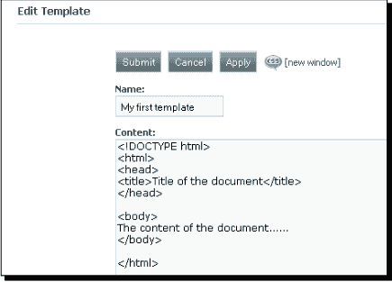

- 5. 单击**提交**。
- 6. 在模板列表中找到你的新模板**我的第一个模板**，在模板名称所在行单击**设为所有页面**，并确认该消息：

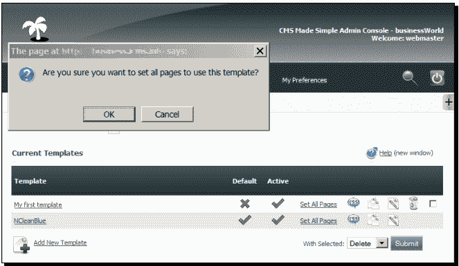

- 7. 模板列表上方会出现消息**所有页面已修改！**。
- 8. 单击管理控制台右上角的放大镜图标以查看结果（本示例使用 Google Chrome 作为 Web 浏览器）：

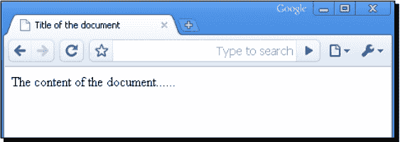

## 刚刚发生了什么？

你已经用一些简单的 HTML 标签创建了一个新模板。然后你指示 CMS 在你网站的所有页面中使用这个新模板。在浏览器中，你会看到你添加到模板**内容**字段中的 HTML 代码的准确输出。

你的模板现在是静态的。这意味着页面的任何单独部分（如页面标题或内容）都不会在网站上显示。要标记应显示动态内容的位置，你必须使用 **Smarty 标签**。当页面在浏览器中加载并显示时，这些标签将被实际的标题或内容替换。

## 向模板添加动态部分

让我们用页面的单独内容替换静态页面标题和内容。

## 动手实践 – 向模板添加 Smarty 标签

- 1. 在管理控制台中，单击“布局 | 模板”，然后点击“我的第一个模板”以打开它进行编辑。
- 2. 用 Smarty 标签替换标题和内容的静态文本，如以下截图所示：
- 3. 单击**应用**，然后点击管理控制台右上角的放大镜图标以查看更改结果。结果应如以下截图所示：

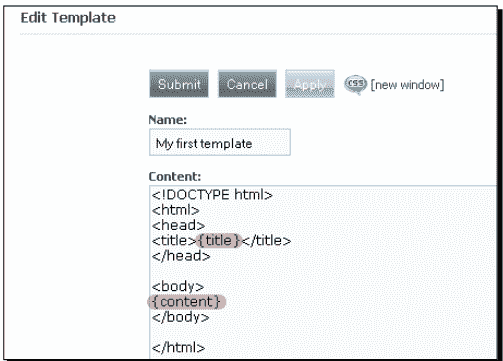

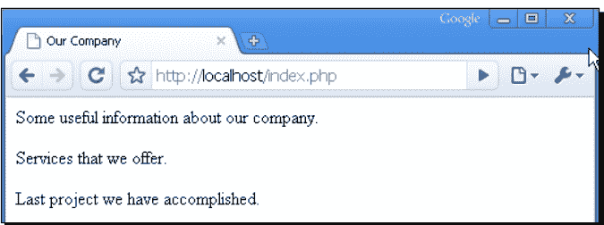

## 刚刚发生了什么？

你已经将模板中的静态文本替换为称为 Smarty 标签的占位符。这些特殊标签用花括号括起来。当你在浏览器中查看页面时，你在 HTML 代码中添加 Smarty 标签的位置现在会被实际内容和页面标题所替换。

要确认更改是对每个页面（而不仅仅是起始页面）生效的，请在管理控制台中打开当前页面列表（**内容 | 页面**），并单击某些页面旁边的放大镜图标以在浏览器中显示它们。你应该会看到每个页面都有一个独立的标题。页面内容显示在模板中添加 `{content}` 标签的位置。

`{title}` 和 `{content}` 只是你可以在模板中使用的自定义 CMS Smarty 插件的两个示例。请尝试使用下表中的一些插件，看看在添加这些 Smarty 标签的位置会显示什么。

| 标签 | 描述 |
|---|---|
| `{breadcrumbs}` | 打印面包屑导航。 |
| `{created_date}` | 打印页面创建的日期和时间。 |
| `{last_modified_by}` | 打印最后编辑该页面的用户的 ID。 |
| `{menu_text}` | 打印页面**菜单文本**字段中输入的内容。 |
| `{modified_date}` | 打印页面上次修改的日期和时间。 |

要尝试这些插件，只需将插件名称放在花括号中，添加到网站模板的任意位置即可。

上述标签保存了当前页面的不同信息。还有一些标签保存你网站的全局信息，例如网站名称或已安装的 CMS Made Simple 版本。它们不依赖于显示它们的页面，并且在每个页面上都相同。也请尝试这些标签，看看在添加标签的位置会显示什么信息。

| 标签 | 描述 |
|---|---|
| `{cms_version}` | 打印你的 CMS 的当前版本号。 |
| `{cms_versionname}` | 打印你的 CMS 的当前版本名称。 |
| `{current_date}` | 打印当前日期和时间。 |
| `{root_url}` | 打印你网站的 URL 位置。 |
| `{sitename}` | 打印网站名称。该信息可以在管理控制台（**站点管理 | 全局设置 | 站点名称**）中更改。 |

通过 Smarty 标签，你可以看到代码与设计分离的主要原理。作为设计者，你无需知道页面上次修改的日期是如何存储在数据库中的（`{modified_date}`），也无需知道网站的位置是如何从浏览器地址栏中获取的（`{root_url}`）。你只需使用上面声明的插件即可获取所需信息。

## 控制输出

如果你已经尝试过前面的一些标签，那么你可能会注意到有时输出并不完全符合你的需要。你可以使用 **Smarty 参数**（也称为属性）来控制标签的输出。

参数可以与 HTML 属性相类比。你可以使用参数来细化 Smarty 标签的输出。参数可用于：

- - 更改标签显示的日期格式
- - 向标签输出添加补充部分
- - 从输出中移除某些部分
- - 替换标签输出中的特定文本

## 动手实践 – 向模板添加 Smarty 参数

假设你已经在模板中添加了 `{last_modified_by}` 标签。但是，你不喜欢显示用户 ID，而希望显示用户名或他的全名，而不是用户 ID。

- 1. 在管理控制台中，选择要编辑的模板（**布局 | 模板 | 我的第一个模板**）。
- 2. 添加带 format 参数的 `{last_modified_by}` 标签，如以下截图所示：
- 3. 单击**应用**，然后点击管理控制台右上角的放大镜图标以查看模板更改的结果。

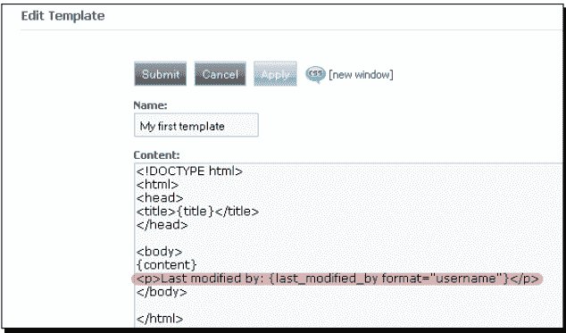

## 刚刚发生了什么？

你已在模板中添加了 `{last_modified_by}` 标签，以显示对页面上次修改的用户的名称。通常，如果不额外指定，添加该标签的位置会显示用户 ID。通过向标签添加 `format` 参数，你现在可以控制具体显示什么内容。

由于 CMS Made Simple 中的模板由 HTML 和 Smarty 混合组成，你需要理解标签、插件、参数和参数值的定义。我们在示例中使用的标签是 **Smarty 插件**。Smarty 插件是为方便你而定义的自定义函数。几乎每个插件都可以接受参数（有时也称为属性）。你将参数附加到插件名称后，用空格分隔。参数名后跟等号，参数值用双引号或单引号括起来。请参见下图了解 Smarty 标签的结构：

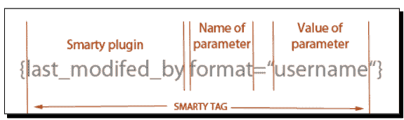

那么，你怎么知道哪些参数可以用于哪些插件，以及允许哪些参数值呢？你可以在网站的管理控制台中找到自定义 CMS 插件的完整列表。这些插件在 CMS Made Simple 中被称为标签。单击**扩展 | 标签**即可查看当前可以在模板中使用的插件的完整列表。

如果你单击标签的名称，将获得相关帮助。你会看到该标签一般做什么的简短描述，然后看到如何在模板中使用它的示例。你还会看到可用参数（如果有）的列表以及可以用于这些参数的值。

与 HTML 属性类似，你可以在一个标签中使用多个参数。参数的顺序并不重要。

对于 `{last_modified_by}` 标签，**帮助**部分只列出了一个参数。该参数接受三个值——`id`、`username` 和 `fullname`，因此你可以使用另一个参数值来显示最后编辑页面的人的全名：

```
{last_modified_by format="fullname"}
```


## 设计与布局

> 如果在用户账户中提供了全名，则会显示用户的全名。在管理控制台中，打开 **Users & Groups | Users** 并点击您想要修改的用户名。输入用户的 **First Name** 和 **Last Name**。

### 在内容中使用插件

在上一节中，您已将 Smarty 插件添加到模板中。然而，您也可以直接将它们添加到页面的内容中。您在内容中使用标签的方式与在模板中使用的方式相同。在特定页面的 **Content** 字段中，用花括号括起插件名称进行书写。现在就试试吧。打开任意页面进行编辑（**Content | Pages**）并在 **Content** 字段中添加一个或多个标签。您可以像在模板中那样在同一位置混合使用标签和静态文本。

网站首页的一个小示例可以是：

```
Welcome! Today is {current_date}.
```

上述代码将自动在网站首页显示当前日期。

> 您应该将需要在网站每个页面上显示的插件添加到模板中。如果您只需要在一个页面上使用特殊插件（例如首页），则应将该插件添加到该页面的 **Content** 字段中。

### 向模板添加样式表

如今，设计网站不仅需要纯 HTML，还需要 CSS。最专业的网站使用 HTML 来构建网站结构，使用 CSS 来美化它们。CSS 赋予您对布局的完全控制权。借助 CSS，您可以在不更改任何 HTML 的情况下轻松更改网站的外观和感觉。您可以在 `http://www.csszengarden.com` 看到基于相同 HTML 的一些优秀 CSS 布局示例。

CMS Made Simple 将用于页面布局的纯 CSS 代码保存在数据库中。在本节中，您将学习如何创建新的样式表，向其中添加样式并将其附加到模板。

### 创建新的样式表

要创建新的样式表，您需要完成三个简单的步骤：

- 1. 创建并保存包含 CSS 代码的新样式表。
- 2. 将样式表附加到模板。
- 3. 在模板中添加一个特殊标签，该标签将被替换为指向样式表的 HTML `<link>` 标签。

#### Time for action — creating the stylesheet

通常，在静态 HTML 页面中，您会创建一个 CSS 文件并使用 HTML `<link>` 标签将其附加到模板。在 CMS Made Simple 中，样式表保存在数据库中，因此无法直接链接。让我们看看样式表如何创建并附加到模板。

- 1. 在管理控制台中，点击 **Layout | Stylesheets**。
- 2. 点击列表底部的 **Add a Stylesheet** 链接。
- 3. 输入新样式表的名称，并在 **Content** 字段中输入 CSS 代码，如以下屏幕截图所示：

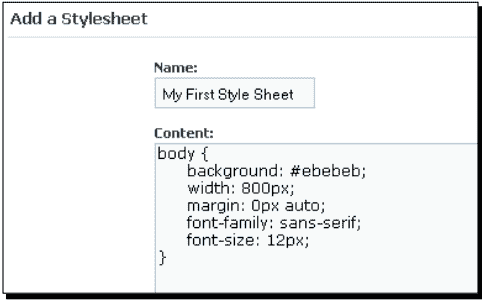

- 4. 点击 **Submit**。新样式表将被添加到样式表列表中。
- 5. 要将新样式表附加到模板，请在管理控制台中点击 **Layout | Templates**。
- 10. 点击 **Apply**，然后点击管理控制台右上角的放大镜图标以查看模板更改的结果。它应如下图所示：

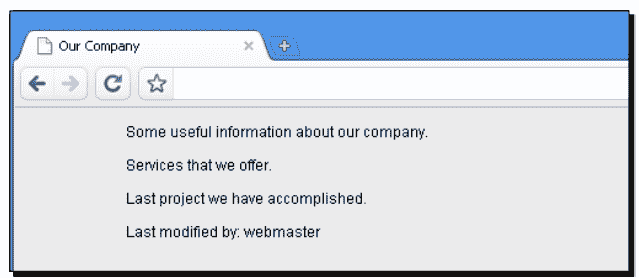

#### What just happened?

您已创建了一个包含纯 CSS 代码的新样式表。然后，您已将此样式表附加到模板。通过附加样式表，您已指定哪个样式表与您的模板相关。您添加到模板中的 `{stylesheet}` 标签在页面在浏览器中显示时会被 HTML `<link>` 标签替换。

在浏览器中打开页面源代码，查看 `{stylesheet}` 标签添加到模板的位置设置了什么。在我的示例中，它看起来像：

```
<link rel="stylesheet" type="text/css" href="http://www.yourdomain.com/stylesheet.php?cssid=51" />
```

在您的特定安装中，域名称会不同，样式表 URL 中的最后一个数字也可能不同。该标签是自动生成的，您无需关心其技术实现方式。

您可以为模板定义并附加多个样式表。例如，您可以定义一个包含通用样式的样式表，然后再添加一个包含打印样式的样式表。我们将在本书的后续部分创建并添加更多样式表，以便您稍后了解其工作原理。对于每个样式表，在 `{stylesheet}` 标签添加的位置都会添加一个单独的 HTML 链接标签。如果您附加了多个样式表，无需多次添加该标签，因为此插件会根据附加到模板的样式表数量创建相应数量的链接。

### 样式表的媒体类型

在创建样式表时，您可能已经看到页面底部样式表代码添加区域中的 **Media Type** 区域，其中包含一些复选框。您可以在管理控制台中打开样式表进行编辑（**Layout | Stylesheets**）并向下滚动时看到该区域。它如下图所示：

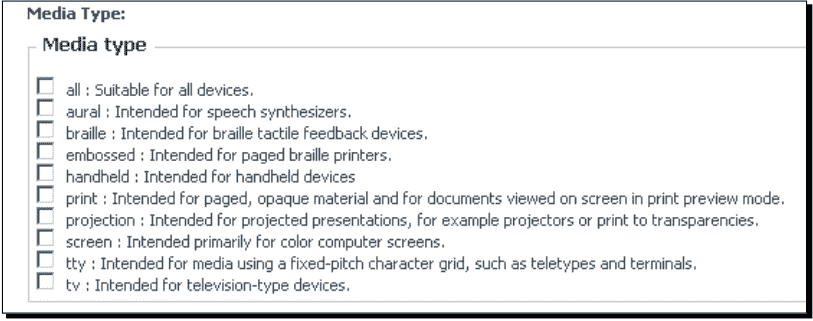

媒体类型对应于 HTML 属性 `media`，如果在此处选择任何类型，则会自动添加到 HTML `<link>` 标签中：

```
<link rel="stylesheet" type="text/css" media="screen" href="http://www.yourdomain.com/stylesheet.php?cssid=51" />
<link rel="stylesheet" type="text/css" media="print" href="http://www.yourdomain.com/stylesheet.php?cssid=52" />
```

第一个样式表的样式用于在浏览器中显示您的网站。然而，如果打印页面，浏览器将使用打印样式表：

> 如果您使用包含多个 CSS 文件的任何 CSS 框架，则可以将每个 CSS 文件的内容复制到 CMS Made Simple 中的单独样式表中，然后将它们全部附加到模板。您也可以在将样式表分配给模板时更改样式表的顺序。

### 为网站创建导航

每个网站的核心无疑是导航。导航由指向页面的链接组成，通常分为主导航和侧边栏导航。在 CMS Made Simple 中，导航是从活动页面列表自动构建的。由于以下各节中解释的非常强大的概念，您可以在 CMS Made Simple 中创建任何复杂程度的导航。

#### Time for action – adding navigation to the template

让我们向网站添加导航链接。

- 1. 在管理控制台中，点击 **Layout | Templates**，并选择 **My first template** 进行编辑。
- 2. 在 `{content}` 标签之前添加导航的特殊标签，如以下屏幕截图所示：

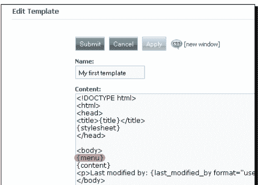

- 3. 点击 **Apply**，然后点击管理控制台右上角的放大镜图标以查看模板更改的结果。它应如下图所示：

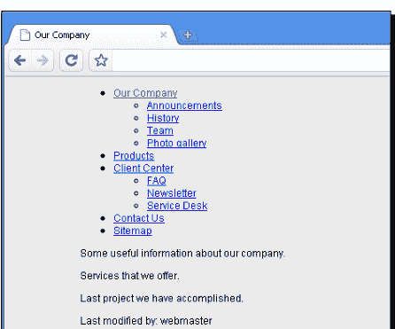

#### What just happened?

使用自定义 CMS 标签 `{menu}`，网站的完整结构将在模板中添加的位置显示。每个活动页面都根据其在层级中的位置和页面列表中的顺序显示。

`{menu}` 标签功能非常强大。您可以使用大量参数来创建任何复杂程度的导航。例如，您可以将导航限制为仅一级，以便仅显示第一层级层级的页面：

```
{menu number_of_levels="1"}
```

尝试上述代码以创建仅限于主页的导航。这是创建网站主导航的常见方式；通常放置在每个页面的顶部。使用此参数不会显示子页面，但我们稍后可以在侧边栏导航中显示它们。

我们将在后面学习 `{menu}` 标签的更多参数，并查看更多自定义示例。在本章中，我们的主要主题是设计和布局。因此，我们现在将学习如何自定义顶部导航的外观和感觉。

### 设计导航 — 纯 CSS 的方式

使用简单的插件 `{menu}`，网站的导航会在每个页面上显示。CMS Made Simple 为导航创建简单的无序 HTML 列表，如您在页面源代码中看到的那样。让我们看看如何使用纯 CSS 轻松设置顶部导航栏的样式。

#### Time for action – design navigation with pure CSS

我们现在将设置顶部导航的样式，使其看起来像并排显示的按钮，而不是上下显示。

- 1. 在管理控制台中，点击 **Layout | Templates**，并打开 **My first template** 进行编辑。
- 2. 在 `{menu number_of_levels="1"}` 标签周围添加 HTML `<div>` 标签，如以下屏幕截图所示：


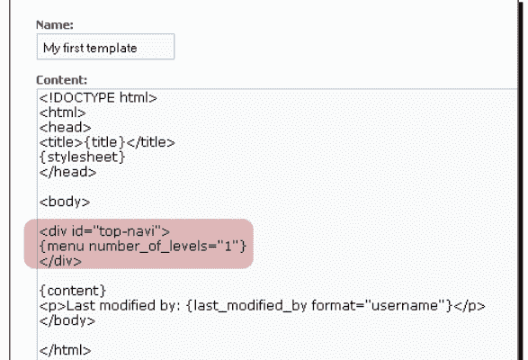

- 3. 点击**提交**。
- 4. 从样式表列表（**布局 | 样式表**）中打开**我的第一个样式表**进行编辑。
- 5. 在样式表末尾为容器`top-navi`添加样式格式，如下面的代码片段所示：

```
#top-navi ul
{
    height: 22px;
    padding: 0px;
    margin: 10px 0;
    border-top: 1px solid #e5e4e2;
    border-bottom: 1px solid #e5e4e2;
}
#top-navi li
{
    list-style: none;
    float:left;
}
#top-navi li a
{
    color: #a2a2a2;
    text-decoration: none;
    display: block;
    padding: 5px 15px;
}
```

```
#top-navi li a:hover
{
    color: #ffffff;
    background: #3d648a;
}
```

6. 点击**应用**，然后点击管理控制台右上角的放大镜图标，查看更改的结果。现在应该看起来如下面的截图所示：

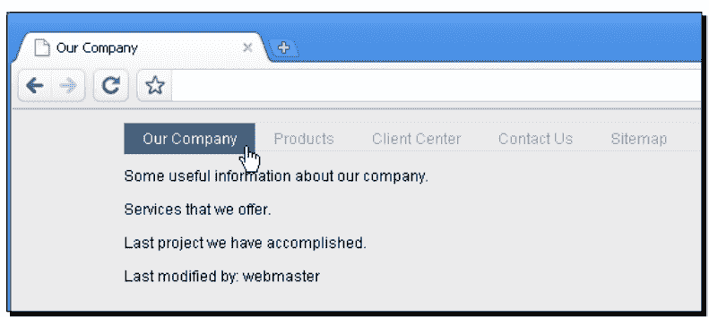

## 刚才发生了什么？

你通过向`{menu}`标签添加`number_of_levels`参数，将导航的输出范围限制为第一级。然后，你在Smarty插件`{menu}`周围放置了一个HTML `<div>`标签。在最后一步，你添加了一些CSS样式，使顶部导航具有所需的外观和感觉。请注意，为导航添加样式并不需要任何特殊的“CMS设计”知识，你使用的是纯的、通用的CSS来格式化导航。

如果你在浏览器中逐个点击页面，并查看其他页面上导航的显示方式，你会注意到CMS使用了一些额外的格式来显示活动页面。例如，`<h3>`用于在导航中显示活动页面的名称。在浏览器中打开页面源代码，即可查看活动页面的格式。你可以添加更多样式来更改`<h3>`标签的格式。另一方面，为了节省时间，你可以使用内置模板`minimal_menu.tpl`，将这些特殊格式全部缩减为纯列表。该模板随CMS Made Simple的标准安装自动提供。要使用它，只需向`{menu}`标签添加另一个参数，如下面的代码行所示：

```
{menu number_of_levels="1" template="minimal_menu.tpl"}
```

这样，所有额外的标签都会从导航中删除，每个页面都会显示一个清晰的无序列表。

如果你查看网站的页面源代码，会发现菜单中还添加了一些特殊的class属性。CMS知道当前实际显示的是哪个页面，并会为活动页面的HTML标签`<a>`添加一个特殊的类：

```
```html
<li><a href="http://www.yourdomain.com/" class="currentpage"> Our Company </a>
```
```

你可以利用这一信息，为当前显示页面的导航项设置另一种样式。最简单的方法是组合`a:hover`和`a.currentpage`类，使它们具有相同的样式。

```
```css
#top-navi li a:hover, #top-navi li a.currentpage
{
    color: #ffffff;
    background: #3d648a;
}
```
```

如果你能用CSS设计网站，那么现在你就可以在不需要任何特殊编码知识的情况下，设计网站的简单导航。

## 添加侧边栏导航

然而，这只是完成了一半。顶部导航中显示的页面仅限于第一级。我们需要一些侧边栏导航来显示属于父页面的子页面列表。

我们必须讨论插件`{menu}`的另一个重要参数。通过`number_of_levels`参数，你可以设置页面层次结构中显示多少层。对于侧边栏导航，你不需要限制层数，而是需要定义导航的起始层。由于第一层已经添加到顶部导航中，因此在侧边栏中，你应该从第二层开始：

```
```text
{menu start_level="2" template="minimal_menu.tpl" }
```
```

使用`start_level`参数，你可以指定菜单中从哪一层开始显示页面。第二层意味着显示层次结构中至少包含两个数字的页面，例如1.2、2.3或4.2。CMS Made Simple还知道顶部导航中选择了哪个页面，并只在侧边栏中显示该所选页面的子页面。这意味着，如果在顶部导航中选择了编号为3的页面，侧边栏将只包含该页面的子页面：3.1、3.2、3.3等。

使用`template`参数，你可以再次将导航输出简化为纯HTML无序列表，从而使此处的格式化更加容易。

一个有趣且常用的参数是`collapse`，例如`{menu collapse="1"}`。该参数允许折叠菜单中的子项，因此只显示当前菜单项的子项。页面层次结构中至少需要有三层，才能看到自动折叠如何隐藏不属于当前显示页面的菜单项。

我们已经学习了模板最重要的部分：标题、内容和菜单。有了这些信息，就足以将现成的HTML模板移植到CMS Made Simple中。

## 移植HTML模板

通常，你不会在CMS Made Simple中从头设计一个完整模板。你可以在CMS Made Simple之外使用任何HTML/CSS编辑器来创建设计。也有可能你下载或购买了现成的HTML模板，或者你与一位为你的网站创建设计的设计师合作。在上述所有情况下，你都会得到一个HTML文件、一个CSS文件和一个或多个图片。在本节中，我们将学习如何将HTML模板移植到CMS Made Simple中。

假设你得到了一个如下图所示的HTML模板。

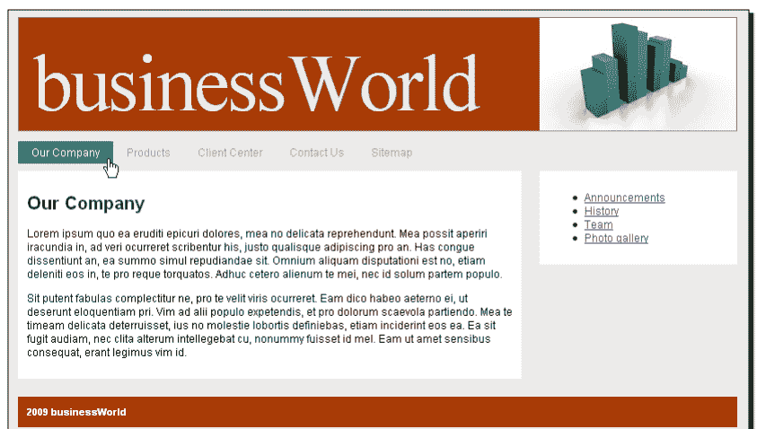

该模板由三个文件组成：HTML、CSS和位于右上角的Logo图片。请注意，此时除了纯HTML和CSS外什么都没有。让我们根据上述模板创建一个新的CMS Made Simple模板。

## 动手实践——将HTML模板移植到CMS Made Simple

- 1. 在管理控制台中，点击**布局 | 模板**，然后点击**添加新模板**。
- 2. 输入**Business World**作为模板的**名称**，并将建议的**内容**全部替换为前一张截图中的示例模板的HTML代码。该模板的HTML代码如下：

```
<!DOCTYPE html>
<html>
    <head>
        <title>Our Company</title>
        <link rel="stylesheet" type="text/css" media="screen" href="style.css" />
        <meta name="description" content="" />
    </head>
    <body>
        <div id="container">
            <div id="header">
                businessWorld
            </div>
            <div id="top-navi">
                <ul class="clearfix">
                    <li><a href="#"> Our Company </a></li>
                    <li><a href="#"> Products </a></li>
                    <li><a href="#"> Client Center </a></li>
                    <li><a href="#"> Contact Us </a></li>
                    <li><a href="#"> Sitemap </a></li>
                </ul>
            </div>
            <div id="content">
                <h1>Our Company</h1>
                <p>
                    Lorem ipsum quo ea eruditi epicuri dolores, mea no
                    delicata reprehendunt. Mea possit aperiri iracundia in, ad
                    veri ocurreret scribentur his, justo qualisque adipiscing
                    pro an. Has congue dissentiunt an, ea summo simul
                    repudiandae sit. Omnium aliquam disputationi est no, etiam
                    deleniti eos in, te pro reque torquatos. Adhuc cetero
                    alienum te mei, nec id solum partem populo.
                </p>
                <p>
                    Sit putent fabulas complectitur ne, pro te velit viris
                    ocurreret. Eam dico habeo aeterno ei, ut deserunt
                    eloquentiam pri. Vim ad alii populo expetendis, et pro
                    dolorum scaevola partiendo. Mea te timeam delicata
```


# 设计与布局

```
deterruisset, ius no molestie lobortis definiebas, etiam
inciderint eos ea. Ea sit fugit audiam, nec clita alterum
intellegebat cu, nonummy fuisset id mel. Eam ut amet
sensibus consequat, erant legimus vim id.
</p>
</div>
<div id="sidebar">
  <ul class="clearfix">
    <li><a href="#"> Announcements </a></li>
    <li><a href="#"> History </a></li>
    <li><a href="#"> Team </a></li>
    <li><a href="#"> Photo gallery </a></li>
  </ul>
</div>
<div id="footer">
  2009 businessWorld
</div>
</div>
</body>
</html>
```

+   3. 点击 **Submit**。

+   4. 在模板列表 (**Layout | Templates**) 中，点击 **Set All Pages** 并确认消息：**Are you sure you want to set all pages to use this template?**

+   5. 点击 **Default** 列中带有红色叉号的图标，将模板设为所有新页面的标准模板。

+   6. 现在，创建一个新的样式表。在管理控制台中打开 **Layout | Stylesheets**，并点击 **Add a Stylesheet**。

+   7. 输入 **Business World Style Sheet** 作为 **Name**，并将示例模板中的 CSS 代码粘贴到 **Content** 字段中。模板的 CSS 代码为：

```
body
{
    background:#ebebeb;
    font-family:sans-serif;
    font-size:12px;
}
#container
{
    width:800px;
    margin:15px auto;
}
```

```
```css
#top-navi ul
{
    height:22px;
    padding:0px;
    margin:10px 0;
    border-top:1px solid #e5e4e2;
    border-bottom:1px solid #e5e4e2;
}
#top-navi li
{
    list-style:none;
    float:left;
}
#top-navi li a
{
    color:#a2a2a2;
    text-decoration:none;
    display:block;
    padding:5px 15px;
}
#top-navi li a:hover
{
    color:#ffffff;
    background:#3d648a;
}
#header
{
    height:105px;
    background:#a83b06 url(logo.jpg) top right no-repeat;
    color:#f0e5d9;
    font-size:90px;
    padding-top:20px;
    font-family:serif;
    padding-left:15px;
    letter-spacing:-3px;
    border:1px solid #c48769;
}
#content
{
    width:540px;
    float:left;
    background:#ffffff;
    padding:10px;
    margin-bottom:20px;
}
```

# 设计与布局

```
}
#sidebar
{
    width:200px;
    float:right;
    background:#ffffff;
    padding:10px;
    margin-bottom:20px;
}
#footer
{
    clear:both;
    width:780px;
    background:#a83b06;
    padding:10px;
    font-size:11px;
    color:#ffffff;
    font-weight:bold;
}
#footer a
{
    color:#eeeeee;
    text-decoration:none;
    font-weight:normal;
}
h1
{
    color:#062d53;
    font-size:20px;
}
```

+   8. 点击 **Submit**。
+   
+   9. 在样式表列表 (**Layout | Stylesheets**) 中，点击新样式表所在行中的蓝色 CSS 图标。
+   
+   10. 从下拉字段中选择模板 **Business World**，并点击 **Attach to this Template**。
+   
+   11. 点击 **Business World** 打开模板进行编辑，并将样式表的静态链接替换为如下所示的 Smarty 占位符：

```
<!DOCTYPE html>
<html>
    <head>
```

现在，你可以开始用 Smarty 标签替换模板中的静态文本。查找并替换 HTML 中的标题、内容和菜单。在管理控制台中打开你的模板并进行以下更改：

```
<!DOCTYPE html>
<html>
<head>
<title>{title} - {sitename}</title>
{stylesheet}
{metadata}
<meta name="description" content="" />
</head>
<body>
<div id="container">
<div id="header">
businessWorld
</div>
<div id="top-navi">
{menu number_of_levels="1" template="minimal_menu.tpl"}
</div>
<div id="content">
<h1>{title}</h1>
{content}
</div>
<div id="sidebar">
{menu start_level="2" template="minimal_menu.tpl"}
</div>
<div id="footer">
2009 businessWorld
</div>
</div>
</body>
</html>
```

在 Smarty {stylesheet} 插件下方，你可以添加 {metadata} 插件。此插件将添加全局元数据（Site Admin | Global Settings）和来自页面选项标签的页面特定元数据。它还将设置 HTML <base> 标签，其 href 属性指向安装的根目录。这样，所有图像都可以相对于根文件夹定义。

恭喜！你的模板现在已移植到 CMS Made Simple。

# 设计与布局

**3.** 点击 **Apply**，然后点击管理控制台右上角的放大镜图标查看结果。它现在应该看起来像以下截图：

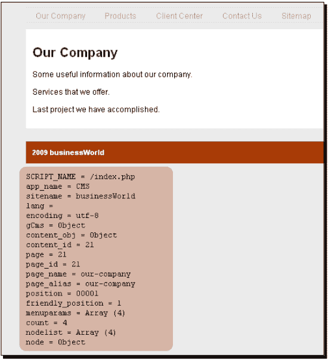

# 发生了什么？

使用 Smarty `{get_template_vars}` 插件，你显示了模板中可用的所有 **Smarty 变量**。在每行变量列表中，一个变量以其名称和值显示，两者由等号分隔。这些值会随页面而变化。例如，名为 `friendly_position` 的变量包含页面在页面层级中的位置。如果你导航到其他页面，你会看到此变量的值在每个页面上都不同。

如何在模板中添加变量？Smarty 变量也用花括号括起来，但与 Smarty 插件不同，它们开头有一个美元符号。要使用变量 `friendly_position`，你只需在模板中添加以下 Smarty 标签：

```
```smarty
{$friendly_position}
```
```

现在可以删除 `{get_template_vars}` 插件了。它有助于你查看存在哪些 Smarty 变量以及存储了什么值。当你需要查找另一个变量时，可以再次添加此插件。

让我们利用我们对 Smarty 插件和 Smarty 变量的了解，将它们结合起来创建页面的标题。打开模板 **Business World (Layout | Templates)** 进行编辑，并在 body 标签之间、{content} 标签之前更改页面的标题，如下所示：

```
<h1><span>{$friendly_position}</span> {title}</h1>
```

然后打开 **Business World Style Sheet** 进行编辑 (**Layout | Stylesheets**)，并添加 CSS 样式来格式化页面的标题：

```
h1 span
{
    color: #ffffff;
    background: #cccccc;
    padding: 0 5px;
}
```

上述格式化的结果应如下所示的截图：

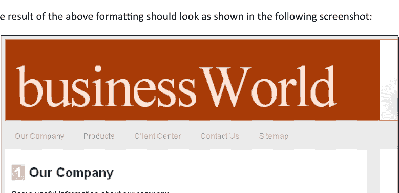

你可以使用模板中的任何 Smarty 变量，除了值为 `Array()` 的变量。我们将在下一节中查看这些特殊变量。

```
```html
{/if}
</div>
<div id="sidebar">
  {menu start_level="2" template="minimal_menu.tpl"}
</div>
<div id="footer">
  2009 businessWorld
</div>
</div>
</body>
</html>
```
```

> 在本书中，你偶尔会遇到一行代码出现在两行不同的位置。请注意，这只是出于缩进目的而为了解决空间限制而进行的。当使用此类代码时，请确保它在你的脚本文件中位于一行。

+   3. 点击 **Apply**，然后点击管理控制台右上角的放大镜图标查看结果。

# 发生了什么？

你已在包含最后修改的段落周围添加了 IF 代码，这会导致 CMS 检查所显示页面的页面别名。如果页面别名等于 "contact-us"，则 IF 结构之间的所有内容都不会显示，否则将显示有关最后修改的信息。

你已从上一节了解到 CMS 知道我们网站当前显示的是哪个页面。此信息存储在 Smarty 变量 `{$page_alias}` 中。使用内置的 IF 函数，你可以将实际页面的页面别名与 **Contact Us** 页面的页面别名进行比较。如果变量 `{$page_alias}` 的值 NOT 等于 `contact-us`，则 IF 标签之间的所有内容都会显示。如果页面别名等于 `contact-us`，则不会显示任何内容。这样，你可以根据页面别名控制模板的输出。

变量 `{$page_alias}` 与值 `contact-us` 之间的缩写 `neq`（意为 **不等于**）称为 **限定符**。限定符用于在 IF 代码中构建逻辑条件。逻辑条件的结果可以为真或假。如果 IF 条件的结果为真（当页面别名 NOT 等于 `contact-us` 时为真），则放置在 IF 标签之间的所有内容都会显示。如果 IF 条件的结果为假（仅当页面别名等于 `contact-us` 时为假），则 IF 标签之间的所有内容将被抑制。


# 设计与布局

在 Smarty 中还可以使用更多限定符来构建逻辑条件。其中一些列在下表中：

| 限定符 | 含义 | 示例 |
|---|---|---|
| `eq` | 等于 | `$page_alias eq "contact-us"` |
| `neq` | 不等于 | `$page_alias neq "contact-us"` |
| `gt` | 大于 | `$friendly_position gt 2` |
| `lt` | 小于 | `$friendly_position lt 3` |
| `gte` | 大于或等于 | `$friendly_position gte $count` |
| `lte` | 小于或等于 | `$friendly_position lte 5` |
| `not` | 否定 | `not $lang`<br><br>（否定可用于检查变量是否包含任何值或是否为空。如果未给出值，则条件的结果为 true，否则条件的结果为 false。） |
| `mod` | 取模 | `$count mod 2`<br><br>取模运算求一个数除以另一个数的余数。你可以使用上面的例子来判断第一层级页面的数量是偶数还是奇数。 |

IF 结构是处理模板中根据页面名称或层级位置的细微变化的有用工具。在前面的示例中，你已经看到可以使用模板中的每个变量来构建逻辑条件。

## 使用 Smarty 循环创建导航模板

你还可以更改导航的 HTML 标记。在本章中，解释了“模板中模板”的伟大原则，它赋予你完全控制设计的权力。在学习这一原则之前，你需要了解一些 Smarty 基础知识。

当我们将顶部导航添加到网站时，我们使用了导航的标准模板。它将导航显示为无序 HTML 列表。想象一下，你需要一种页脚导航，其中显示顶部导航中的所有链接。在这种情况下，你不需要无序 HTML 列表。你只想在一行中显示所有链接，用竖线 (|) 分隔，如下所示：

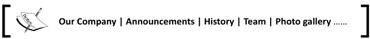

这意味着你需要为这种导航使用完全不同的 HTML 标记。CMS Made Simple 的一大优势是可以将模板显示在模板中。虽然你可以使用主模板定义页面的整体布局，但导航的 HTML 标记保存在其自己的模板中。该导航模板只是添加到主模板中的 HTML 代码片段，放置在标签 `{menu}` 的位置。

菜单模板包含导航的一些 HTML 标记。让我们看看如何为菜单创建一个全新的模板并添加你自己的 HTML 标记。

### 动手时间 – 创建菜单模板

我们需要一个简单的页脚导航，其中列出网站的所有页面，用竖线 (|) 符号分隔，如前所示。

- 1. 在页面的管理控制台中，点击 **Layout | Menu Manager**。
- 2. 点击 **Add Template**。
- 3. 填写 **New Template Name** 和 **Template Content** 的字段，如以下屏幕截图所示：

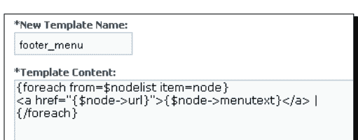

- 4. 点击 **Submit** 保存新的菜单模板。
- 5. 打开 **Business World** 模板进行编辑（**Layout | Templates**）。
- 6. 使用 `{menu}` 标签添加页脚导航，并提供菜单模板的名称，如以下代码片段所示：

```
<!DOCTYPE html>
<html>
    <head>
        <title>{title} - {sitename}</title>
        {stylesheet}
        {metadata}
        <meta name="description" content="" />
    </head>
    <body>
```

```
<div id="container">
<div id="header">
businessWorld
</div>
<div id="top-navi">
{menu number_of_levels="1" template="minimal_menu.tpl"}
</div>
<div id="content">
<h1>{title}</h1>
{content}
{if $page_alias neq "contact-us"}
<p>Last modified by {last_modified_by format="fullname"}</p>
{/if}
</div>
<div id="sidebar">
{menu start_level="2" template="minimal_menu.tpl"}
</div>
<div id="footer">
<p>{menu template="footer_menu"}</p>
2009 businessWorld
</div>
</div>
</body>
</html>
```

7. 点击 Apply 并查看网站上的页脚导航。它应如下图所示：

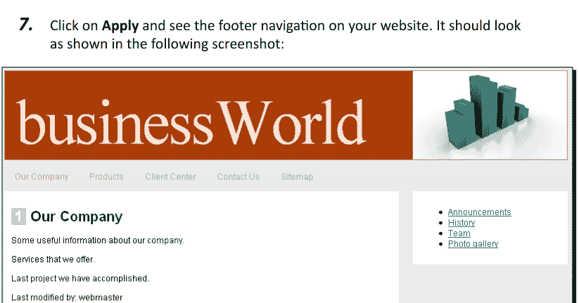

## 发生了什么？

你刚刚创建了一个新的菜单模板。在菜单模板中，你使用了需要解释的一些 Smarty 代码。代码中最重要的部分是 Smarty 变量 $nodelist。它不是我们已经学过的普通 Smarty 变量。这是一个数组。这意味着其中保存了多个值。该变量包含我们网站所有活动页面的所有信息，例如菜单文本或 URL。通过内置的 Smarty 函数 foreach，我们可以遍历该变量的所有值，并为每个页面显示相同的 HTML 代码片段。让我们具体看看循环是如何工作的。

foreach 遍历变量 {$nodelist} 中保存的每个页面，并将放置在 foreach 标签之间的 HTML 代码打印与变量中找到的页面数量一样多次。每次运行，单个页面的值都保存在变量 $node 中。我们通过 foreach 标签中的参数 item=node 来命名并创建此变量。循环从第一个菜单项——页面 Our Company 开始运行。此时，菜单文本和 URL 保存在变量 $node 中。我们可以通过 {$node->menutext} 和 {$node->url} 访问所需的信息并在 HTML 代码中使用标签。在下一次（第二次）运行中，下一个页面保存在变量 $node 中。因此，从第二次运行开始，另一个菜单文本和 URL 会粘贴到相同的 HTML 代码中。foreach 循环遍历每个页面，并在找不到更多页面时自动停止。

页脚导航显示所有页面，而不考虑其在层级中的位置。你也可以将页脚导航限制为仅第一层级。方法与顶部导航相同。在标签 {menu} 中使用参数 number_of_levels，如下所示：

```
{menu number_of_levels="1" template="footer_menu"}
```

foreach 循环是构建你能想象的任何形式导航的强大方法。这样，你就可以在导航中使用图像而不是文本。

另一个如何创建图形导航的例子如下所示：

```
{foreach from=$nodelist item=node}
<a href="{$node->url}">
    alias}.jpg"
         alt="{$node->menutext}" border="0" />
</a>
{/foreach}
```

要理解前面的 Smarty 代码会生成什么 HTML，请在脑海中将粗体 Smarty 标签替换为页面的实际值，例如 Contact Us：

```
<a href="contact-us">
    
</a>
```

由于前面的代码放置在 `foreach` 循环中，标记将为每个页面重复。你可以看到，要使图形示例正常工作，你需要为每个页面创建一个 JPG 文件。文件名称必须与页面别名对应。在我们的示例中，对于顶部导航，你需要五张图片：

- - `our-company.jpg`
- - `products.jpg`
- - `client-center.jpg`
- - `contact-us.jpg`
- - `sitemap.jpg`

在你选择的图形编辑程序中创建图像（按钮）并将它们上传到 Web 服务器上的 `uploads/design` 目录。创建一个名为 `graphical_menu` 的新菜单模板，并将 Smarty `foreach` 代码添加到其中，如前所示。然后用以下行替换主模板（**Layout | Templates**）中的顶部导航：

```
```smarty
{menu number_of_levels="1" template="graphical_menu"}
```
```

现在，导航由图形而不是文本组成。

菜单模板中关于每个页面的信息还有更多，列在下表中：

| 变量 | 说明 |
|---|---|
| `$node->pagetitle` | 页面的标题 |
| `$node->depth` | 页面层级中的层级数 |
| `$node->prevdepth` | 页面层级中前一个页面的层级数 |
| `$node->haschildren` | 如果页面有子页面则打印 1 |
| `$node->target` | 页面的目标可由编辑器从下拉菜单中设置。在模板中，你按如下方式使用它，如以下示例所示：<br><br>`<a href="{$node->url}" target="{$node->target}">` |
| `$node->alias` | 打印页面的别名 |
| `$node->current` | 如果页面当前正在显示则打印 1 |
| `$node->type` | 页面的类型。可能的值为：<br><br>`sectionheader`（节标题）<br>`separator`（分隔符）<br>`content`（内容）<br>`pagelink`（内部页面链接）<br>`link`（外部链接） |


3. 点击**导出**。

4. 在浏览器的下载窗口中，选择将此 XML 文件保存在硬盘上的哪个位置。

你可以打开该 XML 文件，也可以将其保存为设计的备份。

## 小测验——测试你学到的内容

- 1. 在管理控制台中，你可以在哪里找到项目中可用的所有模板？
  - a. **布局 | 模板**
  - b. **布局 | 样式表 | 模板**
  - c. **内容 | 页面 | 主页面 | 模板**
  - d. **扩展 | 模板**

- 2. 你如何用动态组件替换静态文本？
  - a. 在模板中集成类似 `{content}` 的 Smarty 标签。
  - b. 在模板中集成类似 `<content>` 的 Smarty 标签。
  - c. 在 CSS 样式表中集成类似 'DynTxt' 的模块。
  - d. 在页面的内容字段中集成类似 `<breadcrumbs>` 的 Smarty 标签。

- 3. 仔细观察 Smarty 标签 `{last_modified_by format="username"}`，其中哪一部分是参数的“名称”？
  - a. `last_modified_by`
  - b. `format`
  - c. `username`
  - d. `by format`

- 4. 如果你希望在每个页面上显示特殊且动态的信息，你应该怎么做？
  - a. 通过使用内容字段，将 Smarty 插件直接添加到页面内容中。
  - b. 通过使用样式表，将 Smarty 插件直接添加到页面内容中。
  - c. 将 Smarty 插件直接添加到非活动模板中，因为这样更容易使输出适应站点的布局。
  - d. 将 Smarty 插件直接添加到活动模板中，因为这是显示它的唯一方法。

- 5. 在模板中，你应该把 `{stylesheet}` 标签放在哪里？
  - a. 头部
  - b. 关键字或描述
  - c. 标题
  - d. 主体
  - e. 页脚

- 6. 一个模板可以定义多少样式表？
  - a. 每个模板只能定义一个样式表。
  - b. 这取决于模板中的主题数量，你可以定义与主题数量一样多的样式表。
  - c. 最多七个，因为程序限制。
  - d. 想要多少就可以定义多少。

- 7. 你如何生成导航？
  - a. 主菜单和侧边栏导航必须在管理控制台的内容 | 页面以及下拉菜单父项中进行连接。
  - b. 必须使用 Smarty 标签将站点一次性连接到整个导航。
  - c. 导航是自动生成的。
  - d. 主菜单是自动生成的，侧边栏菜单则必须使用 'SideNav3.1' 模块来集成。

- 8. 插件菜单与设置为 2 的 start_level 参数（`{menu start_level="2"}`）结合使用是什么意思？
  - a. 只有当你点击按钮两次时，菜单才会显示。
  - b. 值 2 取决于模板中代码所在的行数。
  - c. 当你设置为 2 时，只会显示 2 个导航链接；当你设置为 all 而不是 2 时，会显示整个导航结构。
  - d. 值 2 用于使导航中不显示第一级。

- 9. 像 `$nodelist` 这样的数组（即一个 Smarty 变量）有什么特殊之处？
  - a. 其中保存了多个值。
  - b. 其中恰好保存了一个值。
  - c. 数组只包含数字值。
  - d. 数组只包含文本值。
