## 5. 使用核心模块

*我们已经学习了如何建立网站、规划和创建完整的网站结构以及设计网站。这些是在编写内容和实现新闻文章或搜索功能等附加功能之前，我们必须完成的最初步骤。*

> **什么是核心模块？**
>
> 核心模块是一些基础模块，它们提供了重要功能，并随 CMS Made Simple 一起提供。这些模块默认安装，并得到 CMS Made Simple 官方开发团队的支持。这些模块并非必需，没有它们，你的 CMS 网站也能正常运行。当你需要新闻管理、搜索功能或自定义导航等功能时，可以使用它们。

在本章中，我们将：

- 创建全局内容块
- 实现新闻文章并对其进行分类
- 添加搜索功能
- 使用内置的**图片管理器**和**文件管理器**
- 使用**菜单管理器**创建站点地图
- 创建内容页面或新闻文章的打印版本
- 学习如何安装未包含在 CMS Made Simple 标准安装中的其他模块


在接下来的示例中，我假定你已经拥有一个类似上一章中创建的模板，并且你的网站结构是按照第3章 *创建页面和导航* 末尾所示的结构构建的。不过，即使你的结构或设计有所不同，你仍然可以继续学习本章。

### 了解全局内容块

你可以使用全局内容块在网站中添加一些包含文本和/或图像的重复部分。这些块包含相同的信息，可以在模板中的任何位置或任何页面的内容中使用。例如，你可以创建一个包含公司地址和电话号码的联系框作为全局内容块，然后将其添加到网站的多个位置。

当然，你可以在每次需要时设计联系框，并单独为每个页面添加联系信息。你甚至可以复制一个页面上的联系框，然后粘贴到另一个页面。在公司电话号码不变的情况下，这种方法可行。一旦公司电话号码发生变化，你就必须打开每个添加了联系框的页面并修改电话号码。根据页面数量的不同，你可能会花费数小时来修改每个页面。使用全局内容块，你可以在一处编辑所有信息，然后从网站的任何位置调用相同的内容。如果公司电话号码发生了变化，你只需在全局内容块中调整它，那么使用此全局内容块的每个页面都会自动更新。

让我们看看如何在你的网站上使用全局内容块。

### 动手实践——向网站添加全局内容块

假设我们需要在前面提到的某些页面中放置一个联系框，该联系框位于内容中的某个位置。

- 1. 在管理控制台中，点击**内容 | 全局内容块**。
- 2. 点击**添加全局内容块**。
- 3. 输入块的**名称**，然后在**内容**字段中输入联系信息，如下图所示：

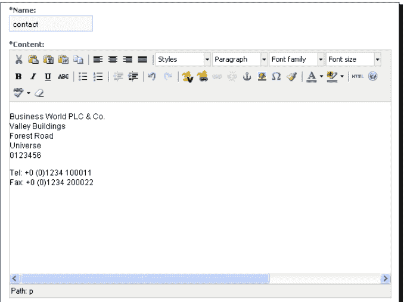

> 使用键盘上的 *Shift + Enter* 添加换行。

- 4. 点击**提交**。
- 5. 在全局内容块列表中，将 **用于此块的标签** 列中的 Smarty 标签复制到剪贴板。
- 6. 在管理控制台中，打开你选择的页面（内容 | 页面）进行编辑，并将标签粘贴到应显示联系框的位置。

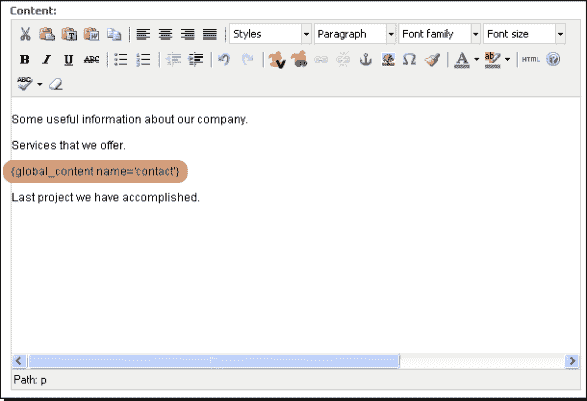

- 7. 点击**应用**，并在你的网站中查看结果。

### 刚才发生了什么？

针对联系信息，你已创建了一个新的全局内容块。每当你在网站上显示联系信息时（无论是在页面中还是在模板中），你只需添加 Smarty 标签，而无需输入完整信息。从现在起，你只需在全局内容块中进行修改，使用该块的每个页面和模板都会显示相同的信息。

试试看。将一个新的全局内容块添加到另一个页面，然后在两个页面上查看结果。接着在管理控制台中，打开 内容 | 全局内容块，选择包含你联系信息的内容块并修改其中的内容。保存后，在两个使用该块的页面上查看更改。

### 使用 News 模块管理新闻文章

到目前为止，我们已经添加了由 CMS Made Simple 的层级管理器控制的内容页面。对于公司内部的公告或活动，你可以使用核心模块 News。该模块允许你创建快速简短的通知，然后将其放置在网站、模板或页面的任何位置。你的新闻应该是真正新鲜的。没有什么比网站中充斥着一年前的新闻更令人失望的了。“过时”的新闻会让网站看起来像被遗弃了一样。


对于公司的网站，你可以发布公司最近完成的项目或任何客户活动。借助新闻版块，你还可以宣传公司提供的新产品或新服务。你可以介绍新客户或合作伙伴，并在节日向客户表达祝福。当网站访客看到几天前发布的新闻文章时，他们就会知道你的网站（以及你的公司）是活跃的。

如果你想不到网站上可以发布什么内容，那就跳过这个模块。不要仅仅因为它标准、易用且其他网站也有新闻就把它放上去。

## 在网站上显示新闻

**新闻**模块非常灵活，可以通过多种不同方式显示。我们来看看如何将新闻添加到**公告**页面。我假设你已经创建了这个页面。如果没有，你也可以把新闻放在网站的首页上。下一步在任何页面上都能生效。

### 操作实践——在页面上显示新闻

1. 打开**公告**页面进行编辑（**内容 | 页面**）。
2. 在需要显示新闻文章的位置添加 Smarty 标签 `{news}`，如下图所示：

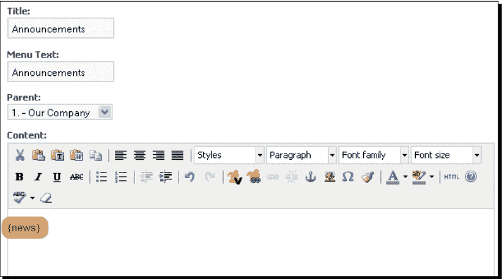

3. 点击**应用**，查看该 Smarty 标签在你网站上的显示效果。效果应如下所示：

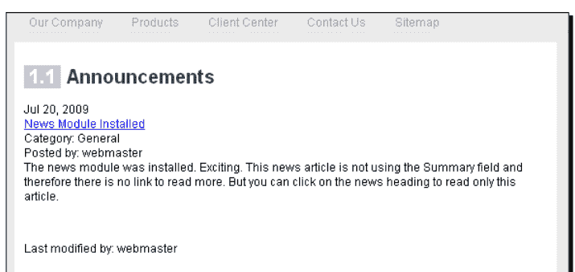

### 刚才发生了什么？

只需一个简短的 Smarty 标签，你就可以在网站上显示第一篇新闻文章。这篇文章在 CMS Made Simple 标准安装时就已经存在。但该文章在哪里编辑？又如何创建新文章呢？

## 添加新闻

所有创建过的新闻都可以在管理控制台中找到。打开**内容 | 新闻**。你会看到该模块的管理区域，其中包含许多设置。在第一个标签页**文章**中，如果新闻很多，你可以进行搜索。但此时，你只有一篇新闻文章，它显示在列表下方，名为**新闻模块已安装**。这篇新闻文章是在 CMS Made Simple 安装过程中自动创建的，也会显示在添加了 `{news}` 标签的页面上。

让我们向新闻列表中添加一篇新文章，看看哪些内容可以根据需求进行调整。

### 操作实践——添加新闻条目

1. 在管理控制台中，点击**内容 | 新闻**。
2. 点击**添加文章**。
3. 输入新闻文章的**标题**、**摘要**文本和文章**内容**。

---

# 游戏中的 PageRank 算法 —— EVE Online

作者：Ing. Tomáš Fabián

摘要——PageRank 算法最初由拉里·佩奇和谢尔盖·布林开发，用于搜索引擎中的网页排名，如今已在万维网之外的多个领域得到应用。本文探讨了 PageRank 算法在游戏领域的应用，特别聚焦于大型多人在线角色扮演游戏（MMORPG）EVE Online。其独特的玩家驱动经济和复杂的玩家互动，使 EVE Online 成为应用基于图的排名算法来分析游戏宇宙中玩家影响力、星系重要性和经济流动的理想对象。

EVE Online 呈现了一个持久世界，玩家在其中进行采矿、贸易、制造和战斗。游戏宇宙由相互连接的星系构成，形成一种天然的图结构。通过将 PageRank 应用于该图，我们可以识别在经济活动和战略重要性方面最具影响力的星系。这种分析有助于洞察玩家行为模式，并可辅助游戏平衡调整和内容开发。

研究方法包括构建 EVE Online 宇宙的有向图，其中节点代表星系，边代表它们之间的旅行航线。我们对标准 PageRank 算法进行了调整，以纳入玩家流量、贸易量和战斗频率等游戏专属指标。将所得排名与游戏中已知的重要星系进行比较，结果显示其与玩家人口分布和市场活动存在显著相关性。

总之，PageRank 算法为分析玩家驱动的虚拟世界提供了一个稳健的框架。在 EVE Online 中的应用展示了基于图的排名方法在游戏环境中的多用途性，为游戏开发者和研究虚拟经济的研究者提供了宝贵的见解。

---

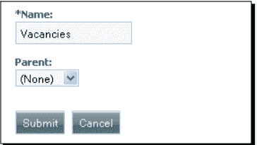

3. 点击提交。

4. 在文章标签页下，点击添加文章，并创建包含以下信息的新文章：

- a. 分类：职位空缺
- b. 标题：市场经理
- c. 内容：我们正在寻找一位优秀的人才，能够为公司开拓欧洲市场。请联系我们的人力资源部门。

5. 点击提交。

6. 打开网站的首页进行编辑，并在内容字段的某处添加 Smarty 标签，如下图所示：

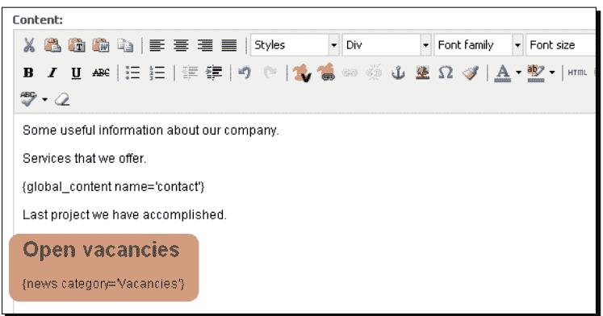

---

```smarty
<title>{title} - {sitename}</title>
{stylesheet}
{metadata}
<meta name="description" content="" />
</head>
<body>
<div id="container">
<div id="header">
businessWorld
</div>
<div id="top-navi">
{menu number_of_levels="1" template="minimal_menu.tpl"}
</div>
<div id="content">
<h1>{title}</h1>
{content}
{if $page_alias neq "contact-us"}
<p>Last modified by {last_modified_by format="fullname"}</p>
{/if}
</div>
<div id="sidebar">
{menu start_level="2" template="minimal_menu.tpl"}
<hr />
{news summarytemplate="NewsList"}
</div>
<div id="footer">
<p>{menu template="footer_menu"}</p>
2009 businessWorld
</div>
</div>
</body>
</html>
```

6. 点击提交，然后在页面上查看结果。你的侧边栏应与以下截图类似：

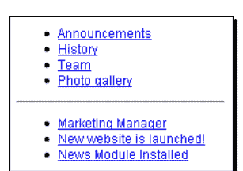

### 刚才发生了什么？

你为新闻文章创建了一个新的摘要模板。该摘要模板包含新闻文章的有序列表，每篇文章都链接到详细视图。然后，你在侧边栏菜单下方的模板中添加了一个 Smarty 标签。你使用了参数 `summarytemplate` 来指定在此处显示新闻文章摘要视图时具体使用哪个模板。如果不使用该参数，则使用默认模板。在 CMS Made Simple 的标准安装中，默认使用 **Sample** 模板。你可以通过点击模板列表（**内容 | 新闻 | 摘要模板**）中**默认**列里带红色叉号的图标来更改默认模板。

你可以编辑现有模板或创建新的自定义模板。如果你将该模块用于不同任务，例如职位机会、公告和公司博客，你可以根据需要创建任意数量的模板。你还可以指定在调用标签的位置使用哪个模板来显示该模块的输出。例如，在网站上显示职位机会的调用可以这样写：

```smarty
{news summarytemplate="Jobs" detailtemplate="Job"
     category="Vacancies"}
```

对于上述示例，你需要创建一个名为 **Jobs** 的摘要模板和一个名为 **Job** 的详细模板。你还需要一个 **Vacancies** 分类，并在其中添加至少一个职位机会。

## 为新闻模块添加自定义字段

有时候，你需要将自定义信息显示在公告中。例如，你可能想添加部门或特殊地点，或者希望将文件与发布新产品的新闻关联起来。在这种情况下，你需要在**新闻**模块中定义自定义字段。

让我们看看如何将新闻的位置添加到特殊字段中。


## Time for action – adding custom fields

+   1. 在管理字段中，打开 **Content | News** 并选择 **Field Definitions** 选项卡。
+   2. 点击 **Add Field Definition** 并输入字段，如以下截图所示：

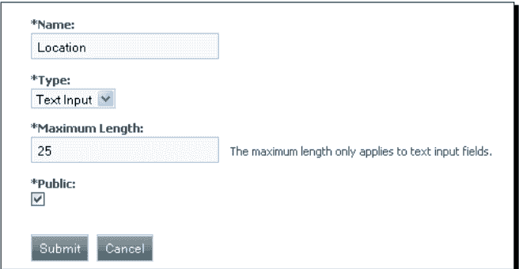

+   3. 点击 **Submit**。
+   4. 打开你最近添加的文章条目，例如 **Marketing Manager (Content | News)**，你会在页面底部找到新的字段 **Location**。
+   5. 在 **Location** 字段中输入 **Washington**，然后点击 **Submit**。
+   6. 打开你的页面，你可以在新闻文章下方找到添加的位置。 （注意：这仅适用于 *Sample* 模板或基于默认模板的模板！）。它应与以下截图类似：

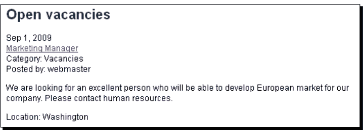

## What just happened?

你已为新闻文章添加了一个新的自定义字段。由于该字段标记为公开，它将在网站上显示。该字段会自动添加到新闻编辑窗口。如果你想更改字段的位置，应编辑模板。在默认模板 Sample 中，所有附加字段都添加到新闻文章底部。在你自己的模板中，可以使用以下代码行获取任何自定义字段值：

```
Location: {$entry->fieldsbyname.location->value}
```

上一行将显示保存在 Location 字段中的值。你可以在摘要和详细模板中使用此行。

还有更多参数可用于优化 Smarty 插件 {news} 的输出。对于每个模块，参数列表可以在模块的帮助部分找到。在管理控制台中，打开 Content | News，然后点击模块名称右侧的 Module Help 链接。

新闻模块有一些有用的参数，如下表所示：

| News parameter | Description |
|---|---|
| browsecat="1" | 显示可浏览的分类列表。 |
| showall="1" | 显示所有文章，不受结束日期限制。 |
| showarchive="0" | 仅显示已过期的新闻文章。 |
| sortasc="true" | 按升序日期顺序而非降序排序新闻项目。 |
| sortby="news_title" | 按字段排序。选项为：news_date, summary, news_data, news_category, news_title, news_extra, end_time, start_time, 和 random。默认值为 news_date。 |
| moretext="more..." | 如果 Summary 字段不为空，则在新闻项目末尾显示的文本。默认设置为 "more..." |
| start="0" | 从给定项目号开始列出文章。 |


如果你想在除主模板以外的其他页面模板中显示新闻文章的详细视图，请创建一个新的页面模板（Layout | Templates），创建一个新页面，并将新模板分配给该页面。使用 {news page="alias"} 调用 News 模块，其中 alias 是应显示每篇新闻项目详细视图的页面的名称。

你甚至可以允许网站访问者向你的模块添加新闻文章，如果你安装 **FrontEndUsers** 模块，该模块将在第 7 章 *Using Third-party Modules* 中描述。网站访问者提交的新闻文章将保存为草稿，你可以在管理内容页面中批准后发布它们。

## Using the news title as the page title

注意在显示完整文章的页面上浏览器标题栏的标题。你会发现标题标签对每个项目都相同，因为只有一个真实页面用于显示每篇新闻文章。然而，搜索引擎优化要求每个页面都有唯一的标题。你可以用一个小技巧自定义生成的页面的标题。打开管理控制台中的 **Content | News**，并选择 **Detail Templates** 选项卡。在模板的最顶部，添加以下行：

```
{assign var="pagetitle" value=$entry->title|escape}
```

此行将生成 Smarty 变量 {$pagetitle}，其中包含新闻文章的标题。要将变量添加到主模板，请打开它，并在模板的最顶部添加标签 {process_pagedata} 并用 IF 结构替换标题标签，如以下代码片段所示：

```
{process_pagedata}
<!DOCTYPE html>
<html>
<head>
{if isset($pagetitle) && !empty($pagetitle)}
<title>{title} - {sitename}</title>
{else}
<title>{sitename} - {title}</title>
{/if}
...
```

这段代码检查变量 {$pagetitle} 是否已定义且不为空。如果变量存在，则新闻标题用于标题标签并显示在浏览器标题栏中。如果不存在，则采用普通的页面标题。

## Using the search function with the module Search

接下来应解释的标准功能是 **Search** 模块。它默认安装，允许网站访问者搜索网站上的内容页面和新闻文章。通常，你将搜索字段添加到模板中而不是每个页面。

让我们将搜索功能添加到网站顶部的模板中。

## Time for action – adding a search form

+   1. 打开模板 **Business World (Layout | Templates)**
+   2. 将 Smarty 标签 `{search}` 添加到侧边栏，如下所示：

```
<!DOCTYPE html>
<html>
<head>
<title>{title} - {sitename}</title>
{stylesheet}
{metadata}
<meta name="description" content="" />
</head>
<body>
<div id="container">
<div id="header">
 businessWorld
</div>
<div id="top-navi">
 {menu number_of_levels="1" template="minimal_menu.tpl"}
</div>
<div id="content">
<h1>{title}</h1>
{content}
{if $page_alias neq "contact-us"}
<p>Last modified by {last_modified_by format="fullname"}</p>
{/if}
</div>
<div id="sidebar">
{search}
{menu start_level="2" template="minimal_menu.tpl"}
<hr />
{news summarytemplate="NewsList"}
</div>
<div id="footer">
<p>{menu template="footer_menu"}</p>
2009 businessWorld
</div>
</div>
</body>
</html>
```

3. 点击 Submit 并在浏览器中查看你的页面，它应如下图所示：

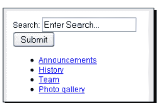

## What just happened?

你已将搜索功能添加到你的网站。如果你尝试在页面内容或新闻文章中搜索，它开箱即用。

你可以在管理控制台中定义停用词列表（Extensions | Search | Options）。这些词从搜索索引中排除，并且还为你提供了常用停用词的预定义列表。通常，你会添加公司名称或可以在每个页面或模板中找到的任何词。为了避免这种情况，搜索功能会显示搜索结果中的所有页面。你可以在列表末尾用逗号分隔添加自定义词或定义自己的列表。保存停用词列表后，不要忘记点击 Reindex All Content 按钮。它将为你的网站创建新的搜索索引。

如果你的网站是英文的，你可以使用词干搜索。这意味着搜索索引中的词被简化为其词干、词根或基本形式。例如，你有一个内容页面，其中找到并索引了词 steps。然而，网站访问者搜索 step。在未激活词干功能的情况下，找不到任何内容，因为字面上的 step 与 steps 不同。使用词干搜索，所有搜索词的形式都会被考虑，如 "step"、"steps" 甚至 "stepped"。

排除搜索中的页面
如果你想让某些页面，如 Policy 或 Disclaimer 从搜索中排除，请在管理控制台中打开你想排除的页面（Content | Pages）并选择 Options 选项卡。取消选择字段 This page is searchable，然后保存页面。现在即使搜索词出现在该页面上，该页面也不会被找到。

你可以在管理控制台中自定义搜索模板（搜索字段本身）和搜索结果模板（Extensions | Search）。与往常一样，你使用 HTML 和 Smarty 标签的混合来更改元素的顺序。使用 stylesheet 使其符合你的布局。

如果你想在与主模板不同的模板中输出搜索结果，你必须自己创建所需的模板（你已在上一章学习了如何创建模板）并将模板分配给应显示搜索结果的页面。此页面的别名应作为参数传递给 resultpage，如示例所示。修改 Smarty 标签 {search}，添加 resultpage 参数如下：

```
{search resultpage="search-result"}
```

你必须将之前创建的页面的别名分配给 resultpage 参数，以便搜索结果始终显示在此页面上。

搜索功能还会跟踪你网站上的搜索活动，并让你了解网站访问者需要或缺少什么。你可以跟踪单个搜索词或短语，以查看它们被访问者使用的频率。在 Search 模块的 Options 选项卡（Extensions | Search）中，你可以选择 Track Search Phrases, not Individual Words 以启用短语统计。

CMS Made Simple 的 Search 模块不如大型搜索引擎那么复杂。如果你想在网站上显示搜索词的文本并对英语以外的语言具有词干功能，可以使用自定义 Google 搜索。但如果你的网站未在 Google 上索引，那么你别无选择，只能使用 CMS Made Simple 的标准搜索功能。

## Browsing files with File Manager

你可以使用 File Manager 在 CMS Made Simple 中上传任何文件。File Manager 就像一个内置的 FTP 浏览器，你可以在其中上传、移动、删除和复制文件或目录。在管理控制台中，打开 Content | File Manager，找到保存在你网络托管的 uploads 文件夹中的所有文件列表。

在 Upload files 选项卡上，你可以上传多个文件，甚至是上传后在此文件夹中解压的归档文件。

在 Settings 选项卡上，你可以启用高级模式，这将让你访问 CMS Made Simple 网站的整个文件结构，以便 File Manager 不再限制在 uploads 文件夹。谨慎使用此设置，因为你可以轻松移动和删除 CMS Made Simple 的核心文件，从而损坏整个网站。

如果你想上传和编辑图像，则应使用 Image Manager。


## 使用图片管理器

你当然希望给自己的网站添加图片。无论这些图片是放在页面内容中，还是用于模板或相册，都必须先上传到你的网站主机上。在上传到网站展示之前，你应该对图片进行优化。不要上传大于 200KB 的图片。这个限制并非来自 CMS Made Simple。使用图片管理器，你甚至可以上传和显示更大的图片。此限制是考虑到你的访问者希望网站能够快速加载。如果使用大图片，你的网站会加载得非常缓慢，而且有一定比例的访问者会在看到你网站提供的内容之前就关闭浏览器。

> 经验法则
>
> 单张图片不应大于 20KB，并且一个页面上的所有图片总大小不应超过 200KB。

在网站上使用图片之前，请使用图形程序调整图片大小。或者，使用 CMS Made Simple 内置的图片编辑器来调整大小、裁剪、旋转和翻转图片。

让我们上传一些图片到 CMS Made Simple，进行编辑，然后在页面或模板中显示它们。有三种格式可以被任何浏览器显示——JPG（或 JPEG）、GIF 和 PNG。网站上不应使用其他图形格式，因为某些操作系统上的某些浏览器无法显示 BMP、TIFF、PSD 或其他文件。请使用任意图形应用程序在本地磁盘上准备一张图片，供下一步使用。

### 动手实践——使用图片编辑器

假设我们有一张对于页面来说过大的图片。理想情况下，你应该在上传到网站主机之前使用图形应用程序创建图片。但如果你没有图形应用程序，或者只想快速做一些修改，可以使用内置的图片管理器来完成这项任务。

1. 在管理控制台中，打开**内容 | 图片管理器**。
2. 在页面底部的**上传文件**字段中选择要上传的图片，然后点击**发送**。
3. 图片上传后，点击图片下方的编辑图标以启动图片编辑器。
4. 通过点击左侧控制面板中的**调整大小**，并在图片上方的字段中指定所需尺寸，将图片的物理尺寸调整为所需的像素宽度和高度。

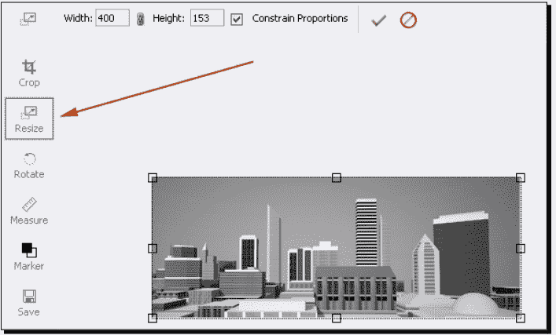

5. 点击图片上方带有绿色对勾标记的图标以应用更改。
6. 点击左侧控制面板中的**保存**图标，并为调整大小后的图片选择图片格式，如以下截图所示：

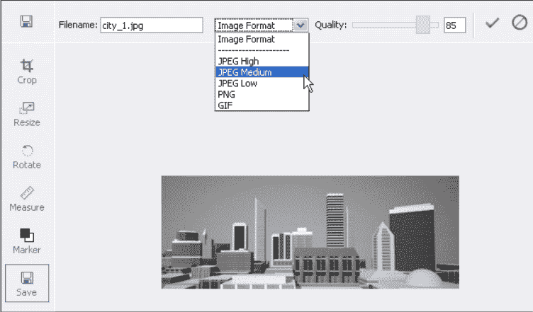

7. 再次点击绿色对勾标记以应用更改。图片保存后，可以关闭窗口。
8. 刷新显示图片缩略图的页面，或重新打开**图片管理器**（**内容 | 图片**）。此时，已应用更改的新版本图片会显示在可用图片列表中。

### 刚才发生了什么？

你已将一张新图片上传到 CMS Made Simple。上传后，CMS 会自动创建一个 96×96 像素的缩略图（用于预览的小尺寸图片版本）。你更改了图片的大小，然后以较低的质量保存，以减少其千字节大小。对于 JPEG 图片，选择 60% 到 85% 的质量不会造成任何可见的质量损失。你可以试一试。保存后原始图片不会被更改，而是会创建该图片的一个新版本。如果出现错误，你可以随时删除新版本，并再次从原始图片开始操作。

对于更高级的图形处理工作，你可以使用专门的图形应用程序，例如免费的 GIMP 或商业软件 Adobe Photoshop。

使用 FTP 浏览器，你可以在目录 `/uploads/images` 中找到你的图片文件和自动创建的缩略图。如果你有大量图片，也可以使用 FTP 浏览器将它们上传到这个目录。但是，如果这样做，缩略图不会自动创建。通过 FTP 上传后，你必须打开**内容 | 图片管理器**。**图片管理器**会发现新上传的文件，然后创建缺失的缩略图。

缩略图的文件名以 `thumb_` 为前缀。例如，图片文件 `city.jpg` 会在原始图片上传的同一文件夹中获得一个自动生成的缩略图，名称为 `thumb_city.jpg`。

## 在模板和内容中使用图片

上传的图片可以通过所见即所得（WYSIWYG）编辑器用于页面内容中（参见第 3 章，*创建页面和导航*）。通常情况下，内容编辑者无法更改网站模板。但还有一种功能可以帮助他/她为页面分配图片，并在模板中的任意位置显示该图片。

在 CMS Made Simple 中，设计（模板）和文本可以严格分离。为了让编辑者更多地承担网站外观的责任，你可以允许他们以受控的方式更改模板中的图片。

我们来创建一个可由页面编辑者选择并显示在导航上方的图片。首先，创建两张宽度为 800 像素、高度约为 100 像素的图片。将它们命名为 `pageimage1.jpg` 和 `pageimage2.jpg`。使用**图片管理器**将图片上传到 CMS Made Simple。不要将它们上传到子文件夹，而是直接上传到**图片管理器**的起始文件夹（`uploads/images`）。

在管理控制台中，打开任意页面（**内容 | 页面**）。选择**选项**选项卡，然后在**图片**字段中选择要与此页面关联的图片，如以下截图所示：

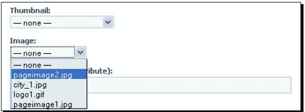

对其他页面执行相同操作，并为它们分配其他图片。

> 如果你在下拉字段中看不到该图片，说明它没有被上传到正确的文件夹。页面图片必须位于**内容 | 图片管理器**或 Web 服务器上的 `/uploads/images` 目录中（而不是子文件夹）。

然后将图片添加到模板中。打开 **Business World** 模板（**布局 | 模板**），并添加页面图片以显示它：

```html
<!DOCTYPE html>
<html>
<head>
<title>{title} - {sitename}</title>
{stylesheet}
{metadata}
<meta name="description" content="" />
</head>
<body>
<div id="container">
<div id="header">
businessWorld
</div>

<div id="top-navi">
{menu number_of_levels="1" template="minimal_menu.tpl"}
</div>
<div id="content">
<h1>{title}</h1>
{content}
</div>
...
```

现在，页面编辑者可以从预定义的图片中选择要在模板中显示的图片，而无需修改模板本身。

## 在内容中使用菜单管理器

你已经使用过**菜单管理器**为网站创建顶部导航、侧边栏导航和页脚导航。顶部导航显示位于页面层级第一级的页面。侧边栏导航自动只显示顶部导航中所选页面的子页面。页脚中的导航包含所有页面，无论它们在层级中的位置如何。

此外，你也可以在**内容**字段中显示完整的网站结构（或其一部分）。这样，你可以轻松输出一个站点地图，帮助访问者在你网站上找到所需信息。

### 动手实践——创建站点地图

让我们在**第 3 章*创建页面和导航***中创建的**站点地图**页面里创建一个站点地图。如果没有该页面，请现在就创建它。

1. 在管理控制台中，打开**站点地图**页面（**内容 | 页面**）。
2. 将 Smarty 标签 `{menu template="minimal_menu.tpl"}` 添加到页面内容中。


3. 点击 Apply，然后使用 Apply 按钮旁边的放大镜图标在网站上查看结果。效果应该如下图所示：

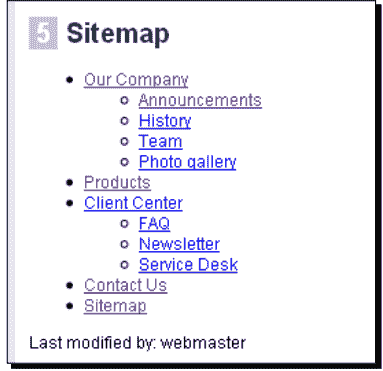

## 刚才发生了什么？

使用已知的 Smarty 标签 {menu}，你已经为网站添加了一个站点地图。它会显示网站的完整结构，包括所有标记为“在菜单中显示”（位于“选项”标签页）的页面。你可以通过以下参数来优化 {menu} 标签的输出：

- `show_all="1"`：此选项将显示所有页面，即使它们被设置为不在菜单中显示。但仍不会显示未激活的页面。
- `number_of_levels="1"`：此设置可帮助你将输出限制为特定的层级数。

你可以任意组合多个参数。例如，要显示所有激活页面并将层级限制为两层，你可以添加以下行：

```
{menu show_all="1" number_of_levels="2"}
```

在内容中使用额外导航选项的另一个示例是，在首页上显示页面（而非新闻文章）列表，这些页面与其在层级中的实际位置无关。假设你想在首页上创建某种快速导航，让访问者可以直接从首页访问某些页面。要创建子页面列表，请在首页内容中使用以下参数之一：

- `start_element="1.2"`：显示从给定 start_element（层级中的位置）开始的页面列表，并且只显示该元素及其子元素。
- `start_page="home"`：显示从给定 start_page（页面的别名）开始的页面列表，并且只显示该元素及其子元素。

使用哪个参数取决于你。当然，你也可以手动创建页面链接列表。但这样一来，列表就不是动态的。如果添加了新页面，你还必须手动将它们添加到链接列表中。如果你改用 Smarty 标签 `{menu}`，它会自动显示所有新页面。

另一个有用的参数是：

- `show_root_siblings="1"`：此选项仅在使用 start_element 或 start_page 参数（如前面所示）时才有用。它将显示与所选起始页面或元素同一层级的页面。

请参阅以下页面结构示例，了解如何在不同参数下在每个页面上输出该结构：

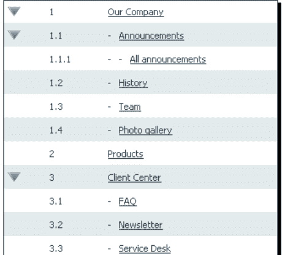

如果你的网站结构如上图所示，那么使用第一列中的标签，你将获得第二列所示的输出。

| Smarty 标签 | 输出 |
|---|---|
| {menu start_element="3"} | • 客户中心<br>  ○ 常见问题<br>  ○ 通讯简报<br>  ○ 服务台 |
| {menu start_element="1.1" show_root_siblings="1"} | • 公告<br>  ○ 所有公告<br>  • 历史<br>  • 团队<br>  • 照片画廊 |
| {menu start_element="1.1" show_root_siblings="1" number_of_levels="1"} | • 公告<br>  • 历史<br>  • 团队<br>  • 照片画廊 |

你可以看到 CMS Made Simple 中导航布局的灵活性。在每个页面上，你都可以精确定义导航结构，甚至可以通过先添加文章分类，然后将文章分配到分类中，并使用菜单管理器在网站的任何页面或模板中显示它们，从而创建一种文章目录。

## 打印页面

使用 CMS Made Simple，每个页面和新闻文章都可以通过内置的打印模块自动生成打印预览。

## 动手实践——添加打印链接

让我们看看如何为每个页面或新闻文章添加打印版本的链接。

- 1. 在管理控制台中，打开模板 Business World 进行编辑（布局 | 模板）。
- 2. 在模板中将 Smarty 插件 {print} 添加到 {content} 标签上方，如下所示：
- 3. 点击 Apply，然后在网站上查看更改。

```
...
<div id="content">
<h1><span>{$friendly_position}</span> {title}</h1>
{print}
{content}
...
```

## 刚才发生了什么？

通过自定义 Smarty 标签 {print}，你使用了核心模块 Printing。在你添加该标签的位置，会显示一个“打印此页”链接。当点击链接时，会打开一个新页面，其中包含该页面的打印友好版本。它没有任何特殊样式，也不显示主模板，只显示页面内容。

有一些有用的参数可帮助你自定义“打印此页”链接及其行为。

- text="Print this page"：覆盖打印链接的默认文本。
- popup="false"：将其设置为 true，则将在新窗口中打开用于打印的页面。请注意，某些浏览器会阻止弹出窗口！
- script="false"：将其设置为 true，则打印版本将自动打开浏览器的打印对话框。
- includetemplate="false"：如果将其设置为 true，则不仅显示页面内容，还显示整个页面模板，包括页面内容、页眉、导航和页脚区域。
- showbutton="false"：将其设置为 true 以显示图形按钮，而不是文本“打印此页”。

如果上述参数不足以让你自定义打印链接和打印视图的外观与体验，你可以自由地在管理控制台（扩展 | 打印）中自定义该模块。有以下四个标签页：

- **链接模板**：用于显示网站打印（或 PDF）版本链接的模板。
- **打印模板**：用于显示打印版本的模板。你可以在此处添加自己的 HTML 标记，如网站 URL、网站公司或联系方式，以便这些信息自动显示在网站的打印版本中。
- **覆盖打印样式表**：允许你将自己的自定义 CSS 插入到打印版本中。通常，你会用它来定义字体大小，并设置为打印作品中常用的磅值。
- **PDF 设置**：我们将在*生成页面的 PDF 版本*一节中讨论此标签页。

## 向样式表添加媒体类型

有时，页面的访问者不使用专门的打印按钮，而是使用浏览器的默认打印对话框。在这种情况下，整个页面会按屏幕显示的样子打印出来。你也可以使用样式表的媒体类型来定制这种打印版本。在纯 CSS 中，你可以在链接标签中将不同的媒体类型定义为 HTML 属性，如下所示：

```
<link rel="stylesheet" type="text/css" media="screen" href="sheet.css">
<link rel="stylesheet" type="text/css" media="print" href="print.css">
```

在 CMS Made Simple 中，你向模板添加 Smarty 标签 {stylesheet}，它会自动生成 HTML 链接标签，因此你无法向其添加 HTML 属性 media。不过，你可以为模板附加两个不同的样式表，并将它们标记为 screen、print 或任何其他允许的类型。

在管理控制台中，打开你的样式表（布局 | 样式表）进行编辑，然后向下滚动到“媒体类型”部分：

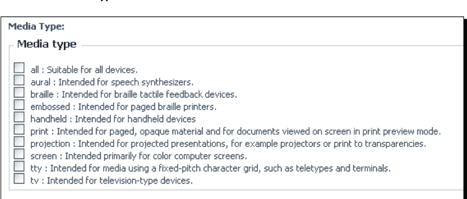

选择你希望此样式表服务的媒体类型，例如 screen。要添加一个包含页面打印视图格式的特殊样式表，请创建一个带有打印格式的新样式表。在“媒体类型”部分（见前一张截图）中选择 print 作为媒体类型，然后将此样式表附加到模板。CMS Made Simple 会自动将 HTML 属性 media 添加到模板中 {stylesheet} 所在位置生成的链接标签上。

**可用模块**标签页是你查找可用模块的研究中心。模块按名称字母顺序排序，并且大多都有很好的说明，可以通过单击模块名称旁边的**帮助**链接查看。

在**模块管理器**中无法通过关键词搜索模块功能。但是，你可以使用 **CMSMS Forge** 中的搜索功能。CMSMS Forge 是所有功能（如模块、插件或翻译）的中心。可以在 `http://dev.cmsmadesimple.org` 找到它。在 CMSMS Forge 的右上角输入搜索词或短语，即可找到与搜索条件匹配的模块、插件（也称为标签）或翻译列表。如果你对列表中的任何模块感兴趣，请记下其名称，返回管理控制台中的**扩展 | 模块管理器**，在字母列表中搜索该模块名称。阅读**帮助**部分，看看该模块是否满足你的需求。

## 安装附加模块

在安装模块之前，你应该在**模块管理器**的模块列表中检查其旁边的**依赖**链接。有些模块的运行依赖于其他模块，因此你必须先安装其他模块。

## 动手实践——模块安装

让我们安装一个额外模块，用于管理网站上的常见问题（FAQ）。

- 1. 在管理控制台中，点击**扩展 | 模块管理器**，然后选择**可用模块**标签页。
- 2. 在模块列表中，选择字母 **Q**，找到模块 **Questions**。
- 3. 点击**依赖**链接，查看必须先安装哪些模块。
- 4. 返回可用模块列表（**扩展 | 模块管理器**），选择字母 **C**。找到模块 **CGExtensions**，然后点击**下载并安装**链接。模块 **CGExtensions** 将被安装。
- 5. 返回可用模块列表（**扩展 | 模块管理器**），再次选择字母 **Q**。找到 **Questions** 模块。

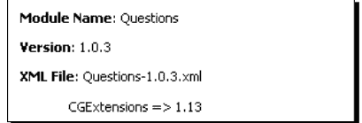


## 刚才发生了什么？

您已经安装了一个新模块。**Questions** 模块现在可用于您的 CMS Made Simple 网站的每个页面或模板。您也可以在管理控制台（**Extensions | Modules**）的已安装模块列表中找到 **Questions** 模块。

您安装的每个模块都可以通过使用 Smarty 标签 `{cms_module ...}` 在页面或模板的内容中使用。此标签有一个必需的参数 `module`，其值设置为模块的名称，如模块列表（**Extensions | Modules**）中所示。通常，所有模块都可以使用此标签：

```
```smarty
{cms_module module="MODULE_NAME"}
```
```

只需将 `MODULE_NAME` 替换为已安装模块的名称，即可查看该模块的默认行为。**Questions** 模块显示 FAQ，这些 FAQ 可以在管理控制台（**Content | Questions and Answers**）中创建、编辑、删除和分类。如何构建 FAQ 不言自明（使用 **Add New Question** 链接添加新的问答对）。请使用已安装模块列表（**Extensions | Modules**）中的 **Help** 链接查找一些用法示例和 **Questions** 模块的附加参数。

例如，如果您不喜欢问答列表中的筛选表单，可以使用如下所示的 `nofilter` 参数将其移除：

```
```smarty
{cms_module module="Questions" nofilter="yes"}
```
```

有些模块有简短形式，可以仅通过其名称调用。

| 简短形式 | 长形式 |
|---|---|
| `{news}` | `{cms_module module="News"}` |
| `{search}` | `{cms_module module="Search"}` |
| `{menu}` | `{cms_module module="MenuManager"}` |
| 不可用 | `{cms_module module="Questions"}` |

功能上没有区别。每个模块都可以使用长形式，但只有部分模块实现了简短形式。请参阅 **Help** 模块以确定简短形式是否可用。

## 使用 XML 文件安装模块

在某些网络托管环境中，无法连接到外部资源（如 CMSMS Forge）。在这种情况下，您将无法在可用模块列表中看到任何模块。不过，如果您下载模块的 XML 安装文件，也可以手动安装模块。

## 使用核心模块

要找到模块安装文件，请打开 CMSMS Forge（http://dev.cmsmadesimple.org）并搜索所需模块。点击模块名称，然后选择模块名称右侧的 **Files** 选项卡。在显示的文件列表中找到最新的 XML 文件，并将其保存到本地磁盘。在管理控制台中，点击 **Extensions | Modules**，然后在模块列表下方的 **Upload** 字段中选择保存的 XML 文件。点击 **Submit**，该模块将显示在模块列表中。但是，它尚未安装。点击模块旁边的 **Install** 链接以完成安装。现在您可以像通过 **Module Manager** 自动安装一样使用它。

## 可用升级

不时会发布具有新功能或错误修复的新版本。在 **Available Upgrades** 选项卡中，您可以查看哪些已安装模块有比系统上安装的版本更新的版本。

要升级模块，请在 **Available Modules** 选项卡的列表中搜索其名称，然后点击在 **Download & Install** 链接位置显示的 **Upgrade** 链接。升级之前，请备份您的网站，以便在出现问题时能够回滚。

## 如何找到最适合您需求的 CMS Made Simple 模块

CMS Made Simple 有很多模块，但并非所有模块都具有相同的质量。模块的版本通常表示其成熟程度。以 0 开头的模块版本（如 0.3 或 0.5）是 alpha 版本。这意味着这些模块处于测试的初始阶段，可能会表现出一些错误或意外行为。如果您不是技术人员，请谨慎使用这些模块。

在 **Available Modules（Extensions | Module Manager）** 列表中，模块名称旁边的 **About** 链接会告知您该模块最新版本的发布时间。如果最后发布日期是 2006 年或 2007 年，则可能表明该模块不再有开发空间，并且已被其开发人员放弃。在这种情况下，最好寻找另一个模块，或者自行承担风险使用这个模块。

**Help** 链接为您提供有关模块功能的扩展信息。请参阅 **parameter** 部分，以确定您的需求是否可以通过所讨论的模块解决。

## 卸载和移除模块

所有您不需要的模块都可以从模块列表（**Extensions | Modules**）中卸载。如果您不需要该模块并卸载它，则其中保存的所有数据都将丢失。模块本身将变为非活动状态，但仍会显示在模块列表中。从列表中移除模块时，您也会从网站中物理删除相关的模块文件。

您不能移除核心模块，因为它们是 CMS Made Simple 标准安装的一部分。

## 小测验 – 使用核心模块

+   1. 全局内容块的主要功能是什么？
+      a. 它可以将重复的文本和图片添加到您的网站。
+      b. 它可以在不同页面上放置不同的公司地址（总部和子公司）。
+      c. Smarty 标签必须添加到模板中。
+      d. 全局内容块必须通过 Module Manager 安装。
+   2. 如果新闻中的摘要文本未填写，会发生什么？
+      a. 您只能将其放在“通用”类别中。
+      b. 整个文本将显示在网站的新闻部分。
+      c. 新闻将不会显示在网站的新闻部分。
+      d. 没有摘要，您无法保存新闻。
+   3. File Manager 用于存储文件的标准文件夹是哪个？
+      a. uploads
+      b. downloads
+      c. images
+      d. 没有标准文件夹。
+   4. 哪种图像格式不应在网站中使用？
+      a. JPEG
+      b. GIF
+      c. TIFF
+      d. PNG
+   5. 为了打印 PDF 文档，您必须 ...
+      a. 使用 Smarty 标签 {pdf_onpage pdf="true"}。
+      b. 首先下载 Adobe Reader。
+      c. 确保您的访问者已安装 Acrobat。
+      d. 使用 Smarty 标签 {print pdf="true"}。

## 使用核心模块

+   6. 如何找到最佳的 CMSMS 模块？
+   
+      a. 确保它是 alpha 版本，因为 alpha 每次都是高质量的代名词。
+   
+      b. 确保最后发布日期不太久远，因为您可以确定开发人员仍在维护该模块。
+   
+      c. 确保最后发布日期至少在 18 个月前，因为您可以确定开发人员制作了一个稳定的模块。
+   
+      d. 确保模块的版本至少以 0.5 开头，因为 0.3 或更早的版本不稳定。

## 动手实践 – 应用自定义到核心模块

您可以根据个人需求在网站中集成新闻、搜索和打印功能。使用每个模块的 **Help** 部分来了解如何自定义它。使用模块模板来调整每个模块的布局以符合您的设计。完成后，结果将是一个使用 CMS Made Simple 构建的初级网站。如果您没有其他需求，可以到此为止。恭喜！您几乎已经准备好网站，现在可以填充内容并发布了。

## 总结

在本章中，您学习了如何使用和自定义随 CMS Made Simple 安装的标准模块（核心模块）。

具体来说，我们涵盖了：

+   - 如何在页面中使用全局内容块。全局内容块并不是真正的模块，而是一个额外的功能，可用于在网站的不同位置显示相同的内容。
+   - 使用新闻功能向网站添加新闻文章，将它们放入不同类别，并根据类别在网站的不同位置显示它们。
+   - 使用和自定义用于网站页面或新闻文章内容的搜索功能。
+   - 使用 **Image Manager** 将图像上传到网站、在线编辑图像，并在网站的内容或模板中使用它们。
+   - 使用 **Menu Manager** 在内容中显示网站结构的任何部分。您学习了如何创建站点地图或任何动态页面列表。


- 使用 **Printing** 模块即可在无需任何特殊知识的情况下创建网站页面的打印版本，甚至创建网站的 PDF 版本。
- 使用 **Module Manager** 安装第三方模块，从而为网站添加新功能，如 FAQ 功能。我们将在第 7 章 *Using Third-party Modules* 中学习更多模块。

对于每个模块，你都看到了强大的“模板中模板”概念如何让你完全自定义每个模块模板的外观和感觉。通过结合 Smarty 标签、HTML 和 CSS，你没有任何设计限制，可以在网站上使用任何复杂度的设计。

现在我们已经学习了模块，我们准备学习用户在网站管理控制台中可以拥有的角色和权限——这是下一章的主题。

## Chapter 4: Advanced Concepts in Modern Computing Systems

本章探讨了现代计算架构的基础原理，重点关注分布式系统、并发和容错。这里介绍的材料建立在前几章建立的基础知识之上，并为读者准备系统设计中的高级主题。

分布式系统中的一个关键挑战是在确保高可用的同时在多个节点之间保持一致性。已经提出了各种共识算法来解决这一矛盾，每种算法在部分故障条件下在安全性、活跃性和性能之间做出不同的权衡。

在本节中，我们考察复制在实现持久性和可用性方面的作用。主要方法包括同步复制，其中每次写入必须在完成前得到所有副本的确认，以及异步复制，它提供更高的吞吐量，但以在故障切换场景中可能丢失数据的代价为交换。

- 强一致性保证线性化语义
- 最终一致性提供更好的可用性
- 因果一致性保留相关事件的顺序
- 读已提交隔离用于宽松的事务语义

CAP 定理指出，分布式数据存储无法同时提供以下三个保证中的超过两个：一致性、可用性和分区容错。在实践中，网络分区是不可避免的，因此系统设计者在发生故障时必须在一致性和可用性之间做出选择。

实际系统通常采用混合方法，在分区内提供强一致性，在分区之间提供最终一致性。这允许应用程序在本地操作中保持正确性，同时在网络中断期间接受暂时性的分歧。

> 分布式系统的特征是没有全局时钟以及独立故障的可能性。—— Leslie Lamport

我们最后讨论了在生产环境中部署此类系统的操作考虑，包括监控、负载均衡和优雅降级策略。

### Understanding users and their roles

**角色** 是按用户需要能够在网站上执行的一般任务分组的权限集合。**编辑** 可能负责创建、重新组织和编辑页面。**设计师** 不需要任何页面操作的权限，但需要创建和编辑模板（包括模块模板）的权限。**管理员** 是拥有管理控制台中所有权限并可无限制访问整个管理控制台的人。

在 CMS Made Simple 中，默认建议三种角色——编辑、设计师和管理员。在安装 CMS Made Simple 期间创建的第一个用户默认获得管理员角色。此用户无法被删除、停用或从管理员组中移除，否则网站将完全没有管理员。你应该选择此用户的名称并注意密码强度。管理员组成员自动获得所有权限。

让我们看看如何创建新用户并了解每个用户无论其角色如何都拥有的最少功能。

### Time for action – creating a new user

1. 在管理控制台中，点击 **Users & Groups | Users.**
2. 点击 **Add New User**，并填写字段，如以下屏幕截图所示：

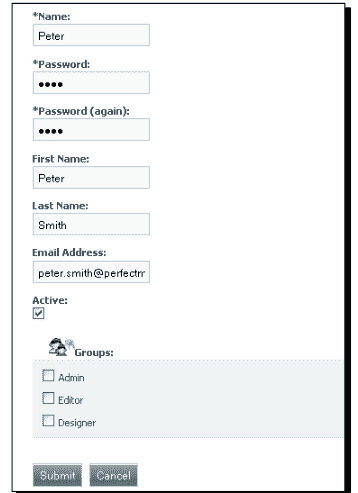

3. 点击 **Submit**。
4. 注销 (**CMS | Logout**) 并以 **Peter** 身份登录。管理控制台现在应如下屏幕截图所示：

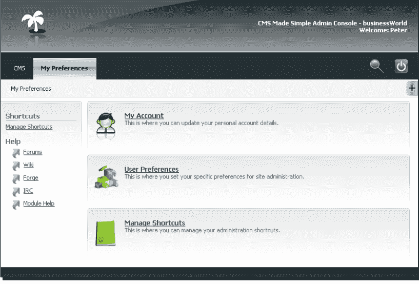

### What just happened?

你已创建了一个新用户且未将其分配到任何组。此用户可以登录管理控制台。用户只能访问两个主菜单项——**CMS** 和 **My Preferences**。用户可以在 **My Account** 部分更改其姓名、密码和电子邮件地址。他可以定义个人偏好，例如语言、管理模板、设置管理控制台的默认起始页等。他还可以管理个人快捷方式。

为每个用户定义电子邮件地址很重要，因为此电子邮件用于在用户忘记密码时恢复密码。在 CMS Made Simple 管理控制台的登录屏幕上（当你未登录时），你会找到 **Forgot your password** 链接。点击它，在 **Username** 字段中输入 **Peter**，然后点击 **Submit**。一封电子邮件将被发送到与此用户关联的电子邮件地址。如果未为此用户设置电子邮件地址，则无法自动恢复密码。在这种情况下，只有网站管理员可以重置用户的密码。

### Users and Permissions

网站管理员可以通过点击 **Active (Users & Groups | Users)** 列中的绿色勾号图标将任何用户设为非活动状态。用户账户不会被删除，但用户在账户重新激活之前无法登录管理控制台。如果你删除用户，所有权限和个人用户偏好将被不可逆地移除。

如果用户未分配到任何组，则他只能更改个人设置之外的任何操作。让我们将用户 **Peter** 分配到编辑组，看看他作为编辑将被允许执行哪些任务。

### Time for action – assigning a user to a group

1. 在管理控制台中，点击 **Users & Groups | Users**。
2. 通过点击其用户名选择用户 **Peter** 进行编辑。
3. 在屏幕底部选中 **Editor** 复选框，如以下屏幕截图所示：

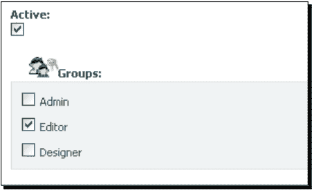

4. 点击 **Submit**。
5. 注销 (**CMS | Logout**) 并以 **Peter** 身份登录。管理控制台应如下屏幕截图所示：

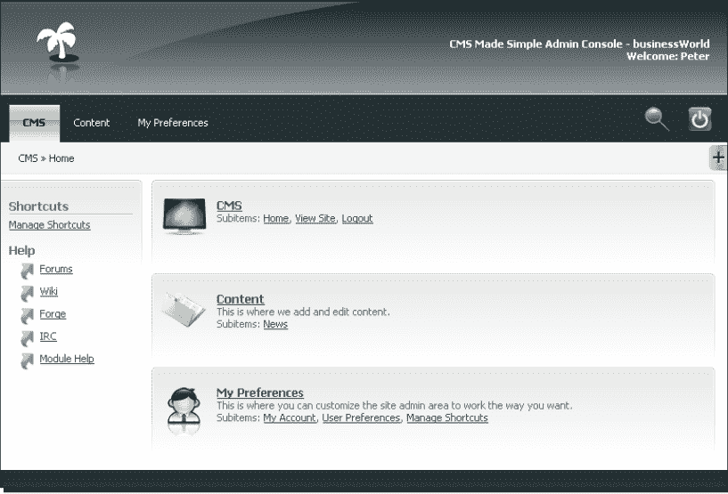

### What just happened?

你已为用户授予了额外权限。现在，他可以访问名为 Content 的新菜单项。没有内容页面，只有 Peter 可以提交的新闻。让我们看看 Peter 现在有哪些权限。在管理控制台中，点击 Users & Groups | Group Permissions。在第一列中列出了所有可用权限。在权限右侧，有三列，分别对应每个组——Admin、Editor 和 Designer。你可以通过从表格顶部的下拉列表中选择组来将视图限制为仅一个组。

查找 Editor 列中所有选中的复选框，以查看分配给此组的用户获得哪些权限。你可以看到，仅为该组选中了 Modify News 权限。这意味着用户可以创建新闻文章并编辑现有新闻。当用户创建新项目时，新闻会自动保存为草稿，因此只有页面管理员或拥有 Approve News For Frontend Display 权限的用户才能在网站上发布该文章。


Peter 不允许删除新闻文章（权限 **删除新闻文章**），并且无权访问内容页面（权限 **修改任何页面** 或 **管理所有内容**）。

## 内容权限

由于 CMS Made Simple 的目标是内容管理，因此内容编辑权限最为灵活。你可以随心所欲地创建和管理任意数量的网站编辑者。此外，你还可以创建具有不同访问级别的编辑者，从而彻底区分谁可以在你的网站上执行哪些操作。

例如，权限 **管理所有内容** 将赋予该组完整访问 **内容 | 页面** 中管理员帐户可用的所有功能的权限。被分配到该组的用户可以：

- 创建新页面
- 重新排序并在层级中移动页面
- 将页面设为不活跃或阻止其显示在导航中
- 更改网站的默认页面
- 删除页面
- 编辑页面，包括 **选项** 选项卡中的所有信息

要限制上述功能，你可以授予权限 **修改任何页面**。该权限只允许我们编辑内容。拥有此权限的用户不会看到 **选项** 选项卡，因此 **选项** 选项卡中的任何信息都无法更改。

除最后一个权限外，你可以允许从 **选项** 选项卡中开放某些字段，以使编辑者能够更改模板或将页面标记为不活跃。

## 动手实践——创建编辑者帐户

公司页面将由办公室助理 Mary 编辑。办公室助理必须能够编辑现有页面、编辑元标签、分配模板，并将页面设置为不活跃。

- 1. 在管理控制台中，创建一个新用户（**用户和组 | 用户**），并将该用户分配到 **编辑者** 组，如以下截图所示：

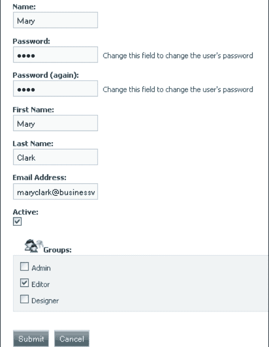

- 2. 点击 **提交**。
- 3. 修改 **编辑者** 组的权限（**用户和组 | 组权限**），并勾选 **修改任何页面** 复选框。
- 4. 点击 **提交**。
- 5. 在管理控制台中，点击 **站点管理 | 全局设置**，然后选择 **高级设置** 选项卡。

## 用户和权限

- 6. 在 **基本属性** 字段中，选择 **模板**、**活跃** 和 **页面特定元数据** 选项，如以下截图所示（按住 *Ctrl* 键同时标记三个选项）：

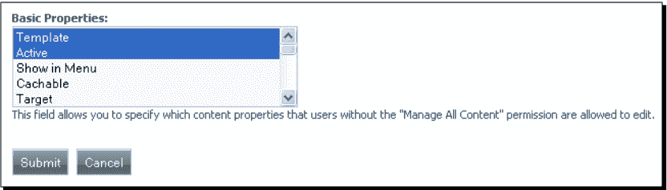

- 7. 点击 **提交**。
- 8. 注销（**CMS | 注销**），然后以 **Mary** 身份登录。检查打开页面进行编辑时，所有所需功能是否可用。

## 刚刚发生了什么？

你创建了一个新用户，并将该用户分配到 **编辑者** 组。该组被允许编辑网站的任何页面。此外，字段 **模板**、**活跃** 和 **页面特定元数据** 在 Mary 编辑内容时对她可用。

> 💡 你的模板应该在 head 部分包含一个 Smarty 插件 `{metadata}`，以便 **页面特定元数据** 能够被放入页面的源代码中。

请注意，权限 **修改任何页面** 并不赋予你限制访问特定页面的能力。如果 Mary 不被允许编辑网站上的每个页面，而只被允许编辑其中一些页面，那么你应该转向附加编辑者的概念，这将在下一节中描述。

## 附加编辑者

对于每个内容页面，都可以定义**附加编辑者**。你可以在 **选项** 选项卡的 **附加编辑者** 字段中为某个页面添加附加编辑者（必须以管理员身份登录才能执行此操作）。页面的附加编辑者将只能看到和编辑他被分配到的页面。

为了在我们的示例中解释这一点并使其更具实用性，假设 Mary 不被允许编辑所有页面，而只被允许编辑 **历史**、**团队** 和 **联系我们** 页面。将 Mary 从 **编辑者** 组（**用户和组 | 组分配**）中移除，方法是取消选中与 Mary 帐户对应的组。然后打开前面列出的三个页面，并在每个页面的 **选项** 选项卡中的 **附加编辑者** 字段中分配 Mary。现在，以 Mary 身份登录，并打开内容页面列表（**内容 | 页面**）。

附加编辑者会自动获得 **修改任何页面** 权限，但仅限于他们被设置为附加编辑者的页面。你不需要为此类用户设置任何特殊组或权限。和所有附加编辑者一样，Mary 不允许创建新页面。

## 创建新页面

**添加页面** 权限取决于用户拥有的其他权限。仅仅为编辑者添加 **添加页面** 权限是不够的。这是因为创建新页面会自动影响整个网站结构。请记住，导航完全由现有页面构建。

只有拥有 **管理所有内容** 权限的组才被允许在网站结构的每一级创建页面。请注意，这些用户不仅能够创建新页面，还能通过重新排序甚至删除页面来修改整个网站结构。

## 动手实践——添加页面权限

假设 Mary 不仅被允许编辑某些页面，还被允许在层级中的特定位置创建页面。但是，Mary 仍然不被允许在网站顶层创建页面。在上一个示例中，我们将 Mary 添加为某些页面的附加编辑者。现在让我们赋予她创建新页面的权利。

- 1. 在管理控制台中，点击 **用户和组 | 组**，并创建一个名为 **附加编辑者** 的新组。

> 如果你希望在编辑者创建的页面显示在网站菜单之前对其进行审批，请点击 **站点管理 | 页面默认值**，并取消选中 **在菜单中显示** 字段。这样，所有新创建的页面都不会显示在导航中。默认情况下，编辑者无法更改这些设置。他/她必须等待网站管理员或拥有 **管理所有内容** 权限的用户将该页面显示在菜单中。

以同样的方式，你可以授予 **删除页面** 权限。将该权限分配给 **附加编辑者** 组，以便他们只能删除那些他们被分配为编辑者的页面。

## 设计者权限

如果你有一个精通 HTML 和 CSS 的用户，能够对网站的整个布局或仅对模块模板进行合理的更改，那么你可以将该用户分配到 **设计者** 组。

设计者必须拥有以下一组权限：

- 添加样式表关联
- 添加样式表
- 添加模板
- 管理菜单
- 管理主题
- 修改文件
- 修改样式表关联
- 修改样式表
- 修改模板
- 删除样式表关联
- 删除样式表
- 删除模板
- 查看标签帮助

这组权限允许网站设计者执行与模板设计相关的任何任务。但是，设计者将无法编辑内容、提交新闻或设置任何站点偏好。

在管理控制台（站点管理 | 全局设置）中，在 **高级设置** 选项卡下，你可以为附加编辑者定义 **基本属性**，例如 图像。我们在上一章中使用过该字段。在这里，编辑者可以从下拉列表中选择一张图片，从而将图像分配到由设计者定义的模板中的某个位置。


有一个有用的第三方模块叫做 Template Externalizer。它允许你使用任何外部编辑器来编辑模板和样式表。安装并启用开发模式后，该模块会自动将所有样式表和模板提取到指定目录。
如果你在此外部目录中修改模板，更改会自动被检测到，导入数据库，并立即生效。当模块被安装后，会有一个权限 **Template Externalizer** 可以被授予 **设计者** 组。

## 查看管理员日志

管理员日志记录了所有用户对网站所做更改的详细信息。该日志可以在管理控制台（站点管理 | 管理员日志）中找到，并包含关于以下内容的创建、删除和更改记录：

- 页面和全局内容块
- 模板和样式表
- 用户、组和权限
- 站点偏好
- 模块

在日志的顶部，你会看到一个导航区域，提供指向日志首页、下一页、上一页和末页的链接。还有一个链接可以将完整日志下载为以制表符分隔的文本文件。底部是 **清除管理员日志** 链接。该操作将清除整个日志。


重要！执行 **清除管理员日志** 时不会要求你确认，并且此操作一旦完成便无法撤销。

一旦管理员日志被清除，就没有证据表明谁更改了网站上的任何内容以及更改了什么。因此，甚至还有一个单独的权限叫做 **清除管理员日志**，它独立于 **修改站点偏好** 权限被授予。


每个日志条目包含五列，分别是：

- **User**：显示执行该操作的用户用户名。即使用户后来被删除，用户名仍保存在日志中。
- **Item ID**：显示受影响项目的数据库 ID。请注意，项目 ID 仅对下一列中显示的 **Item Name** 唯一，而非在整个数据库中唯一，因此同一个项目 ID 可能会重复出现。
- **Item Name**：显示受影响项目的名称。
- **Action**：描述对项目所做的更改类型。
- **Date**：保存更改所做的日期和时间。

如果您有新手用户可以访问管理控制台，那么您可能希望保留所有版本的內容，以便在出现问题时可以恢复它们。CMS Made Simple 的标准安装中没有此功能，但有一个不错的第三方模块可以额外安装。

## 归档更改并恢复它们

一旦安装了 **Archiver** 模块，它就会保存每个被编辑或删除的内容页面、全局内容块、样式表或模板的副本。它还提供了将归档中的任何内容恢复到当前状态的可能性。这意味着您的用户可以编辑网站的各个方面，而您可以稍后撤销他们的更改。

要安装 **Archiver** 模块，请打开管理控制台，然后点击 **Extensions | Module Manager**。点击 **Available Modules** 选项卡，然后点击与模块名称同一行中的 **Download & Install** 链接。模块即已安装。

安装后，模块将自动开始将更改保存到归档中。例如，如果您想跟踪首页的更改，请打开该页面并在不做任何更改的情况下保存它，以便创建该页面的第一个版本。此版本将用作未来恢复的基础。

### 行动时间 – 恢复编辑者所做的更改

假设您已按上述说明安装了 Archiver 模块，您可以按如下方式恢复编辑者所做的更改：

1. 以编辑者身份登录并编辑您有权编辑的任何页面。
2. 注销然后再次使用管理员账户登录。
3. 点击 Content | Archive Manager Module。
4. 搜索步骤 1 中已编辑的页面的名称，然后点击它。
5. 在 Expanded Archive View 中，找到该页面的倒数第二个版本（修订版）并点击 Operation 列中的最后一个图标。
6. 查看该页面。

### 发生了什么？

您已将内容的旧版本恢复并使其成为当前版本。编辑者的版本并未被删除，只是被替换，因此您可以随时将其恢复。

您可以按每个项目的存储版本数量自动清理归档（即仅保留每个页面、全局内容块、样式表或模板的最后五个版本）或按日期清理（即仅保留最近七天的版本）。要设置自动清理，请在模块的管理区域中点击 Archive Preferences 链接（Content | Archive Manager Module）。

您不必清理归档，也可以一直累积所有更改。但是，如果您每天有大量更改，则必须清理归档以防止数据库溢出。

> 该模块不能替代常规的异地数据库备份。数据仍存储在同一数据库中，数据库崩溃可能会使归档变得无用。请阅读第 11 章《Administration and Troubleshooting》中的相应部分，了解如何创建数据库备份。

## 所有默认权限的概述

权限始终授予组，并由分配给该组的所有用户共享。在下表中，第一列是权限名称，第二列是对该权限可授予角色的建议，第三列建议该权限生效的一些前提条件。

| Permission | Suggestion for the role | Description |
|---|---|---|
| Add Global Content Blocks | Editor | 该组允许创建新的全局内容块（Content \| Global Content Blocks）。取决于权限 Modify Global Content Blocks。 |
| Add Groups | Admin | 该组允许创建用户组（Users & Groups \| Groups）。取决于权限 Modify Groups。 |
| Add Pages | Editor | 该组允许在用户是所有者或额外编辑的页面下创建子内容页面。用户必须被设为页面的所有者或额外编辑。 |
| Add Stylesheet Associations | Designer | 该组允许将样式表与模板关联。 |
| Add Stylesheets | Designer | 该组允许创建新的样式表。 |
| Add Templates | Designer | 该组允许创建新的模板。 |
| Add Users | Admin | 该组允许创建具有管理控制台访问权限的新用户。 |
| Allow usage of advanced profile in TinyMCE | Editor | 该组中的用户将自动获得为 TinyMCE 模块制作的高级配置文件设置。但是，他们无法更改配置文件本身。 |
| Approve News For Frontend Display | Editor | 允许将新闻项的状态字段从 Draft 更改为 Published。该组中的用户也可以编辑新闻文章。 |
| Clear Admin Log | Admin | 清除 Site Admin \| Admin Log 中的历史记录。取决于权限 Modify Site Preferences。 |
| Delete News Articles | Editor | 该组允许删除新闻文章。取决于权限 Modify News。 |
| Manage All Content | Editor | 该组允许创建、移动和删除页面。该组允许在编辑页面时访问 Options 选项卡并更改该选项卡上可以找到的任何内容，与权限 Modify Any Page 相比。 |
| Manage Menu | Designer | 该组可以修改菜单模板并创建新的菜单模板。 |
| **Manage Themes** | Designer | 该组允许导出主题。如果存在依赖权限，用户也可以导入主题。取决于权限 **Add Stylesheet Associations**、**Add Stylesheets** 和 **Add Templates**。 |
| **Modify Any Page** | Editor | 该组允许编辑内容页面。编辑内容时没有 **Options** 选项卡。但是，一些来自 **Options** 选项卡的字段可以从 **Site Admin \| Global Settings**（选项卡 **Advanced Setup**，字段 **Basic Properties**）中添加。 |
| **Modify Events** | Admin | 该组允许添加和重新排序事件（请参阅第 8 章）。 |
| **Modify Files** | Editor | 允许使用 **File and Image Manager**，从而完全访问安装的 `/uploads` 文件夹。 |
| **Modify Global Content Blocks** | Editor | 允许编辑和删除全局内容块。 |
| **Modify Group Assignments** | Admin | 允许将用户分配到不同的组。 |
| **Modify Groups** | Admin | 允许更改组名。 |
| **Modify Modules** | Admin | 允许管理 **Extensions \| Modules** 和 **Extensions \| Module Manager**，从而安装、升级、卸载和删除模块。 |
| **Modify News** | Editor | 允许编辑新闻并创建状态为 **Draft** 的新文章。 |
| **Modify Permissions for Groups** | Admin | 允许修改组的权限。 |
| **Modify Site Preferences** | Admin | 这是一组多个权限，包括不同模块中的 **Preferences**、**Settings** 或 **Options** 选项卡。例如，用户能够访问 **News** 模块的 **Options** 选项卡、**File Manager**、**CMSMailer** 中的 **Settings** 选项卡、**Search** 模块中的 **Options** 选项卡等。 |
| **Modify Stylesheet Associations** | Designer | 允许将样式表附加到模板并解决附加关系。 |
| **Modify Stylesheets** | Designer | 允许编辑现有样式表。 |
| **Modify Templates** | Designer | 允许编辑现有模板，包括 **News**、**Search** 和 **Printing** 模块中的模板。 |
| **Modify User-defined Tags** | Admin | 允许向网站添加用户定义标签（请参阅第 10 章）。 |


## 用户与权限

| 权限 | 角色建议 | 描述 |
|---|---|---|
| **修改用户** | 管理员 | 允许编辑用户，管理员用户账户除外。 |
| **移除全局内容块** | 管理员 | 允许编辑全局内容块。依赖**修改全局内容块**权限。 |
| **移除用户组** | 管理员 | 允许删除用户组。 |
| **移除页面** | 编辑者 | 允许删除用户是**所有者**或**附加编辑者**的内容页面。 |
| **移除样式表关联** | 设计者 | 允许移除样式表关联。 |
| **移除样式表** | 设计者 | 允许移除样式表。 |
| **移除模板** | 设计者 | 允许移除布局模板，但不包括模块模板。 |
| **移除用户** | 管理员 | 允许移除用户，自己的账户和管理员账户除外。 |
| **文件管理器模块的高级用法** | 管理员 | 允许查看网站的完整结构，而不仅仅是 `/uploads` 目录。要使用此权限，需要在**文件**中启用高级模式设置。 |
| **查看标签帮助** | 编辑者 | 允许阅读自定义 Smarty 插件的帮助。 |

## 模块权限

CMS Made Simple 的核心功能和核心模块不仅拥有权限，你页面上安装的每个第三方模块也可以将该模块的特定权限添加到列表中。如果你仍然安装了上一章所述的**问答**模块，你将在权限列表（**用户与群组 | 群组权限**）中找到 **管理问题**、**可以回答问题** 和 **可以批准问题** 权限。

**归档**模块拥有**管理归档**权限，该权限可以被授予能够访问管理控制台的高级用户，或拥有**管理所有内容**权限的主编辑。

## 用户通知

CMS Made Simple 的管理控制台中有一个通知区域，位于主菜单下方。

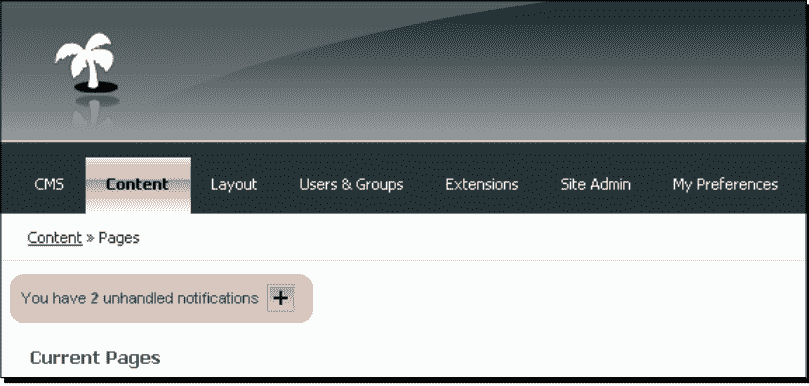

在安装 CMS Made Simple 之后，你会看到该消息，提示你保护和配置系统的后续步骤。之后，当 CMS Made Simple 发布新版本时，该区域会用于通知我们。**新闻**模块会使用该区域来通知是否有未发布的新闻文章需要批准和发布。

通常，每个登录到管理控制台的用户都能阅读这些通知，即使某些通知并不是专门针对他本人的。

你可以在管理控制台中禁用通知。点击**站点管理 | 全局设置**，选择**高级设置**选项卡。取消选中**允许用户查看通知**字段，消息就会消失。

### 小测验 – 用户与权限

- 1. 什么是角色？
  - a. 一组权限。
  - b. 仅针对编辑者的另一个术语。
  - c. 特殊访客组的术语。
  - d. 访客的一个术语，可以定义其读取特定内容的权限。

## 使用第三方模块

*CMS Made Simple 只有一些属于标准安装的基础功能。任何其他功能都可以通过安装其他模块来实现。将 CMS Made Simple 的模块看作是乐高积木。你可以选择任意组合来安装模块。有些模块可以与其他模块组合，甚至依赖其他模块。模块是任何人都可以添加到网站上的附加功能。*

要选择并安装新模块，请在管理控制台中点击**扩展 | 模块管理器**。请注意，这里列出的模块并非 CMS Made Simple 的标准模块，因此并非所有模块都与核心模块具有相同的质量。这就是为什么你会看到模块列表上方有“*自行承担风险使用*”的消息。尽管如此，仍有许多模块非常实用、精致，并且经过了开发者的全面测试。

**可用模块**选项卡便于安装你已经了解过的软件包。模块按名称字母顺序排序，点击模块名称旁边的**帮助**链接可以找到关于它们的详细说明。

在本章中，我们将安装并使用以下模块：

- - 相册（Gallery）
- - 表单构建器（Form Builder）
- - 新闻通讯（Newsletter）
- - YouTube 视频

那么，让我们开始吧……

## 创建相册

网站上最受欢迎的功能就是相册。相册是个人作品集、乐队网站或公司网站中常见的组成部分。在商业网站上，相册常用于展示办公楼或团队成员的照片。产品、样品或项目成果也经常以相册的形式呈现。

如果你不使用任何专门的相册模块，你可以将全部图片上传到虚拟主机上的一个文件夹中，然后手动将每张图片添加到内容页面中。这种静态相册难以维护和设计。它不够灵活，并且要求页面编辑者具备深厚的 HTML 知识。

更好的解决方案是使用一个专门的模块，它读取虚拟主机上的文件夹，并通过一些令人惊艳的过渡效果显示该文件夹中的所有图片。该模块会提供一个专门的管理区域，可以在其中输入每张图片的说明。

要安装 Gallery 模块，请登录管理控制台并点击“扩展 | 模块管理器”。在“可用模块”选项卡中，点击字母导航中的字母 G，找到名为 Gallery 的模块。点击模块名称对应的“下载并安装”链接。模块将被安装。

安装 Gallery 模块后，虚拟主机上会自动创建一个名为 uploads/images/Gallery 的新文件夹。该文件夹默认为空，因此你需要向其中上传一些图片。你可以使用图片管理器或文件管理器上传图片，如果有很多图片要上传，甚至可以使用 FTP 浏览器上传。

## 动手实践 – 创建第一个相册

让我们看看 uploads/images/Gallery 文件夹中的图片如何显示在“相册”页面上。请执行以下步骤：

- 1. 在管理控制台中，打开“相册”页面以进行编辑（内容 | 页面）。
- 2. 在“内容”字段中输入 Smarty 插件，如以下截图所示：

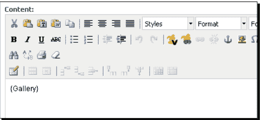

- 3. 点击**应用**，然后点击**应用**按钮旁边的放大镜图标，查看网站上的第一个相册。

## 刚才发生了什么？

你已将一些图片上传到 `/uploads/images/Gallery` 文件夹。该文件夹是在模块安装后自动创建的。你的第一个相册会显示在**相册**页面上。

你可以在管理控制台（**内容 | Gallery**）中找到 **Gallery** 模块的管理区域。打开管理区域，点击名为 `Gallery` 的文件夹，查看可以在模块输出中修改哪些内容。根据需要更改**相册标题**和**评论**。为相册选择另一种**模板**以获得不同的过渡效果。如果没有为相册指定模板，则使用默认模板（**内容 | Gallery**，**模板**选项卡）。

缩略图（图片的小预览版本）的尺寸设置为 96x96 像素（CMS Made Simple 中的标准缩略图尺寸）。在相册中，你可以输入自己的缩略图尺寸，然后选择以下任意一种调整大小的方法：

- - **裁剪**：将原始图像裁剪为缩略图尺寸，保留图像中较小的细节。忽略原始图像的比例。
- - **缩放**：将原始图像调整为自定义缩略图尺寸。保持原始图像的比例，因此调整大小时仅考虑宽度或高度。
- - **放大并裁剪**：与“裁剪”相同，但图像细节会稍微放大。将原始图像裁剪为缩略图尺寸，同时保留放大后的图像细节。忽略原始图像的比例。
- - **放大并缩放**：与“缩放裁剪”相同，但缩略图会稍微放大。将原始图像调整为自定义缩略图尺寸。保持原始图像的比例，因此调整大小时仅考虑宽度或高度。

当更改缩略图尺寸后，你必须点击**（重新）创建缩略图**链接，以创建新的缩略图。

屏幕底部会显示已上传到 `uploads/images/Gallery` 文件夹的图片列表。对于每张图片，你可以输入**标题**（图片说明）和**评论**（默认不在任何模板中显示）。你可以停用图片而不是删除它们。在这种情况下，图片不会显示在相册中，但标题和评论会被保留。

相册中的图片按其文件名按字母顺序排序。


## 将相册添加到画廊

新相册是从新文件夹创建的。在 File Manager 或 Image Manager 中，在 uploads/images/Gallery 文件夹下方创建一个新文件夹。将您的图片上传到新文件夹中。在画廊的管理区域（Content | Gallery）中，找到新文件夹，并像编辑主相册一样编辑它。

要显示一个或多个目录中的图片，请使用参数 dir。该参数指定图片上传的目录（或目录）。例如，如果您在 /uploads/images/Gallery 下创建了两个文件夹并分别命名为 buildings 和 projects，那么要仅显示 buildings 文件夹中的图片，请使用如下所示的 Smarty 标签：

```
{Gallery dir="buildings"}
```

您可以通过在 Smarty 标签中添加参数 template 来直接覆盖画廊的模板。如果未指定此参数，则将使用分配给该目录的模板，否则将使用默认模板。

## 在其他页面上使用画廊

在 Photo Gallery 页面之外，在其他页面上使用画廊中的图片。例如，在起始页面上显示画廊中最近添加的图片，并将它们链接到可以找到整个画廊的页面。

## 动手时间 – 将随机图片添加到模板

让我们将画廊中最近添加的两张图片添加到网站的起始页面。

- 1. 在管理控制台中，单击 Content | Gallery，并选择 Templates 选项卡。
- 2. 单击 Create a new template 链接。输入 Latest 作为模板名称，并在 Template Source 字段中添加以下 Smarty 代码：

```
{foreach from=$images item=image}
    <a href="{cms_selflink href="photo-gallery"}" title="{$image->title}">thumb}" alt="{$image->title}" />
    </a>
{/foreach}
```

您应该将示例中的 photo-gallery 替换为可以找到整个图片画廊的页面的别名。
- 3. 删除字段 Template CSS-stylesheet 和 Template JavaScript 中的所有内容。
- 4. 单击 Save。

5. 在管理控制台中，打开起始页进行编辑（Content | Pages）。

6. 添加 Smarty 标签以显示画廊中的最新图片，如以下屏幕截图所示：

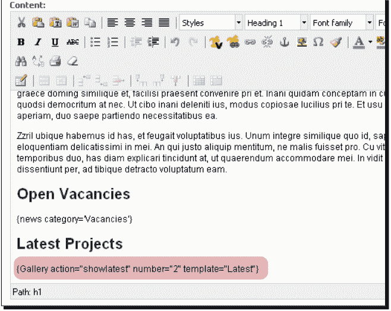

7. 单击 Apply 并在起始页面上查看结果。

## 发生了什么？

您为 Gallery 模块创建了一个新模板。此模板显示画廊中最近添加的两张图片。每张图片都链接到 Photo Gallery 页面（{cms_selflink href="photo-gallery"}）。然后，您已将 Smarty 标签 {Gallery action="showlatest" number="2" template="Latest"} 添加到起始页面。有三个参数，分别如下：

- action="showlatest"：显示最近添加的图片（默认情况下显示总共六张图片）。子目录会自动包含在内。
- number="2"：要显示的图片的最大数量。如果未指定此参数的值，则将显示所有图片。
- template="Latest"：使用单独的数据库模板来显示照片画廊。此模板必须存在。但是，它不必设为默认。如果未指定此参数，则将使用默认模板。

此代码取自文件 `example.html`，并已修改为使用 Smarty 标签 `foreach` 来获取画廊中的所有图片。

继续进行样式表。在本地磁盘上打开文件 `jquery.ad-gallery.css`。此文件需要稍作修改，以便图片可以在服务器上找到。查找任何出现的：

```
background: url(
```

并将其替换为：

```
background: url(../../images/
```

然后，在第一行，调整整个画廊的宽度：

```
ad-gallery {
  width: 500px;
}
```

复制修改后的样式表的全部内容，并用其替换字段 **Template CSS-stylesheet** 的内容。

在最后一步，复制以下代码，并替换字段 **Template JavaScript** 中的全部内容：

```
<script type="text/javascript"
  src="modules/Gallery/templates/jquery/jquery.js"></script>
<script type="text/javascript"
  src="modules/Gallery/templates/adgallery/jquery.ad-gallery.js">
</script>
<script type="text/javascript">
$(function() {
  var galleries = $('.ad-gallery').adGallery();
  $('#switch-effect').change(
    function() {
      galleries[0].settings.effect = $(this).val();
      return false;
    }
  );
  $('#toggle-slideshow').click(
    function() {
      galleries[0].slideshow.toggle();
      return false;
    }
  );
});
</script>
```

单击 **Save**，并在模板列表中找到新模板。将模板设为 **Default** 并在网站上查看您的照片画廊。您的画廊现在正在使用 AD Gallery 插件。
同样，您可以使用任何插件作为您的画廊。将 HTML、图片、CSS 和 JavaScript 分开，并将它们放置在适当的字段中，以便所有必需的部分按之前的顺序在网站上组合。

## 使用 Form Builder 模块添加表单

几乎每个业务页面都有联系、反馈或咨询表单。**Form Builder** 模块可帮助您在不编写任何 HTML 的情况下创建任何复杂程度的表单。您可以向其中添加不同的输入字段，设置验证规则，并定义表单数据的存储方式和/或通过电子邮件发送方式。

以与您在网站上安装其他第三方模块相同的方式安装 **Form Builder** 模块（例如，**Questions** 或 **Gallery**）。安装后，模块的管理区域可在 **Extensions | Form Builder** 中找到。

在开始配置模块之前，请确保模块 **CMSMailer** 已正确配置（请参阅第 2 章，*Getting Started*），并且您可以从您的 CMS Made Simple 网站发送电子邮件。

## 动手时间 – 向网站添加联系表单

让我们向 **Contact Us** 页面添加一个简单的联系表单，并将表单提交的内容发送到我们的电子邮件地址。

- 1. 在管理控制台中，单击 **Extensions | Form Builder**。
- 2. 单击 **Contact Form** 链接。
- 3. 滚动到 **Form Fields**，并单击 **Send To** 链接。
- 4. 将字段 "**From address**" for email 和 **Destination Email Address** 中的电子邮件地址替换为您自己的真实电子邮件地址，如以下屏幕截图所示：

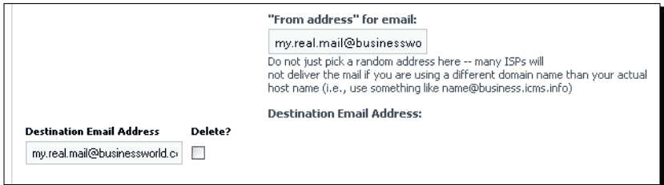

- 5. 单击 **Update** 以保存更改。
- 6. 单击表单字段下方的 **Save**。
- 7. 复制行 **Contact Form** 中列 **Form Alias** 的 Smarty 标签，如以下屏幕截图所示：

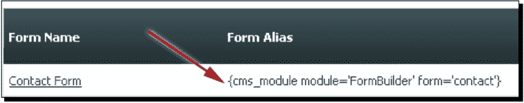

- 8. 打开页面 **Contact Us** 进行编辑（**Content | Pages**）并将复制的 Smarty 标签添加到其中。
- 9. 单击 **Apply** 并查看页面。它应如下所示：

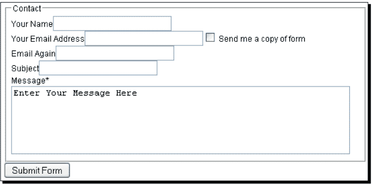

- 10. 填写表单并单击 **Submit Form**，您应该会收到一封从此联系表单发送到步骤 4 中给出的电子邮件地址的电子邮件。

## 发生了什么？

您已向页面添加了一个简单的联系表单。此联系表单由字段集（所有字段周围的边框）、五个可见字段和 **Submit Form** 按钮组成。您已更改电子邮件地址，以确保表单结果通过电子邮件发送到正确的地址。此联系表单可以根据您的需要完全自定义。

编辑字段 **Your Email Address**。将其设为 **Required**，并在 **Field Validation** 选项中选择 **Email Address**。这将确保访客必须提供有效的电子邮件地址，否则将显示错误消息。将字段 **Send User a Copy of Submission** 的值设为 **Never**。如果您向访客发送消息副本，您将泄露目标电子邮件地址，并且可能会收到绕过反馈表单的 undesired 通信。更新该字段并返回到表单中的字段列表。

**Email Again** 字段是可选的。如果您愿意，可以将其删除。

**Message** 字段被定义为 **Text Area**。这意味着网站访客可以在该字段中输入多行。可以通过设置 **Rows**（无滚动条时显示的行数）和 **Columns**（换行前一行显示的字符数）的数量来更改此字段的高度和宽度。字段的大小也可以使用 CSS 自定义。

对于每个表单，可以定义和配置不同类型的模板。您可以使用 HTML 和 Smarty 标签的组合，如您在第 4 章 *Design and Layout* 中所学。

| Template | Description |
|---|---|
| **Form Template** | 此模板定义表单应如何显示。打开 **Contact Form (Extensions | Form Builder)**，并单击 **Form Template** 选项卡。一些默认模板可以从 **Load Template** 下拉列表中选择。您也可以使用 **Form Template Variables** 部分中显示的说明和变量创建自己的模板。默认的 **Form Template** 非常复杂。原因在于它包含了您可以为单个字段自定义的所有内容。 |
| **Submission Template** | 此模板定义表单提交后响应消息应如何显示。打开 **Contact Form (Extensions | Form Builder)**，并单击 **Submission Template** 选项卡。自定义字段 **Response to display** 中的消息。您不需要在此字段中使用任何变量。我还建议删除部分 **Other information**，因为它对网站访客来说过于技术化。 |
| **Email Template** | 此模板定义电子邮件消息应如何显示。打开 **Contact Form (Extensions | Form Builder)**，并在字段列表中单击字段 **Send To**。选择 **Advanced Settings** 选项卡，向下滚动并单击按钮 **Create Sample HTML Template**。现在，您可以在字段 **Email Template** 中编辑电子邮件消息。 |

**Form Builder** 不仅提供默认模板，还提供默认样式表。样式表在安装后会自动添加到 **Layout | Stylesheets**。如果您想使用它，请通过单击样式表列表中的蓝色 CSS 图标，将 **FormBuilder Default Style** 附加到 **Business World** 模板。您可以自定义附加的样式表以使表单适合您个人的页面布局。


## 使用第三方模块

### 为表单添加新字段

联系表单可以通过添加更多字段来丰富。让我们看看如何向表单添加单选按钮组、下拉组和复选框组。新的字段在 **Form Builder（扩展 | 表单构建器）** 的管理区域中创建。打开 **Contact Form** 进行编辑，然后点击字段列表下方的 **Add New Field** 链接。然后你需要选择想要添加的 **Field Type**。

每次向表单添加新字段时，你必须调整 **Email Template** 和 **Submission Template**。新字段会自动添加到表单中，但不会添加到其他模板中。

要更新 **Email Template**，打开 **Send To** 字段进行编辑，选择 **Advanced Settings** 选项卡，向下滚动页面，然后点击 **Create Sample HTML Template** 按钮。在上方的 **Email Template** 字段中，你会看到用于发送消息的示例模板。按需编辑模板并点击 **Update** 保存。这将自动把新字段添加到电子邮件消息中。在 **Submission Template** 选项卡中，你可以编辑表单发送后访客看到的消息。你也可以在此创建示例 HTML 模板，然后根据需要对其进行修改。

在接下来的三个部分中，我们将向联系表单添加三个新字段，使其看起来像以下截图：

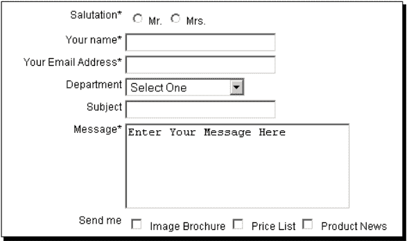

### 添加称呼作为单选按钮组

对于称呼字段，你创建一个带有单选按钮的新字段，这些按钮被分组，使得在任何时候只能选择该组中的一个单选按钮。在 **Field Type** 中选择 **Radio Button Group** 并按如下所示输入字段：

单选按钮标签是网站访客在填写表单时看到的内容。选中时的值是他们提交表单后发送给你的内容。你可以根据需要输入不同的值。最初你只会看到一个可以填写的选项，因此点击 Add More Options 按钮以向该组添加更多单选按钮。

准备就绪后点击 Add，字段将被添加到字段列表中。在字段列表下方，你会找到 Reorder Fields 链接，可以轻松拖放字段以调整其在页面上的显示顺序。将 Salutation 放在表单的最顶部，使其出现在 Your Name 字段之前。

> 添加字段到表单后，不要忘记更新电子邮件和提交模板。

## 使用第三方模块

### 添加部门作为下拉字段

你还可以轻松向表单添加另一种类型的字段，即下拉字段，在 CMS Made Simple 中称为 **pulldown**。点击 **Add New Field** 链接，并选择 **Pulldown** 作为 **Field Type**。按以下截图所示输入字段：

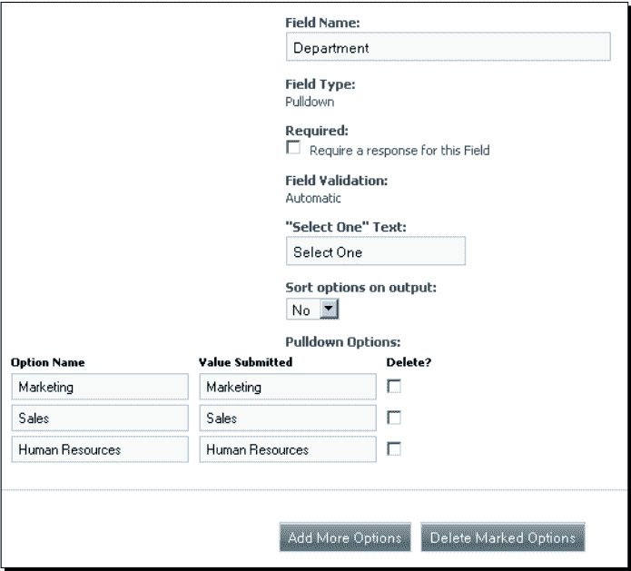

与单选按钮一样，这里你也可以区分访客在填写表单时看到的内容（**Option Name**）和发送给你的字段值（**Value Submitted**）。

> 💡 添加字段到表单后，不要忘记更新 **Email** 和 **Submission** 模板。

### 使用复选框组进行多选

与单选按钮不同，组中的复选框可以被选中而不改变其他复选框的状态，因此可以进行多项选择。对于称呼字段来说这没有任何意义，但对于访客可以请求不同类型信息的字段来说这很有用。点击 **Add New Field** 链接，并选择 **Check Box Group** 作为 **Field Type**。按以下截图所示输入字段：

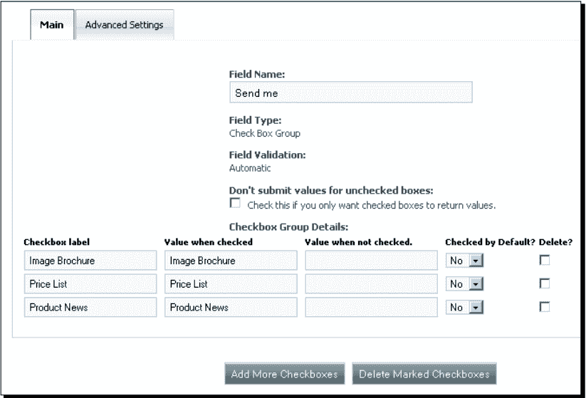

复选框可以有不同的状态——已选中和未选中。根据状态，提交表单后会发送不同的值。你可以留空 **Value when not checked** 字段。如果未选中复选框，则不会发送任何值。

> 如果你真的希望人们与你联系，请将必填项的数量保持在最低限度。最好的客户是忙碌的人，他们不会在第一次就花费数小时填写繁琐的表单，而更愿意选择能节省他们时间的提供商。

验证码的强度会随着你所做的更改数量而增长。一些垃圾邮件程序可以读取使用默认值生成的验证码图像。然而，如果你在此处放置任何个性化值，它们就会失败。请确保你在字段 **minsize**、**maxsize** 和 **maxrotation** 中只做轻微的更改，以便验证码仍然可供人类用户阅读。请注意，这些更改适用于 CMS Made Simple 中使用 **Captcha** 模块的所有表单和模块。

要为联系表单激活验证码，请在 **Extensions | Form Builder** 中打开表单。选择 **Captcha Settings** 选项卡，并选中 **Use Captcha to protect form submissions** 框。查看已添加到联系表单底部的验证码图像。

**reCAPTCHA** 有一些优势。该库由负责保持其最新状态的团队支持，它对残疾人士可访问，并且有助于识别扫描书籍的文本，从而使它们以电子格式可用。如果你想使用 reCAPTCHA，你应该在 `reCaptcha.com` 上注册并添加你的网站，以便为其获取公钥和私钥。你不能在其他域的网站上重复使用相同的密钥，因此你必须将每个新站点添加到你的账户以获取新的密钥集。

### 发送新闻通讯

使用 CMS Made Simple 和 **Newsletter Made Simple (NMS)** 模块，你可以向你的客户或订阅新闻通讯的网站任何访客发送新闻通讯。

你可以定义一个或多个用户列表，从而将客户与访客分开，并能够向每个用户列表发送不同的新闻通讯。一个用户可以分配给一个或多个列表。你创建一个包含电子邮件主题和文本的模板，这样你就不必从空白页面开始每条消息，可以使用已创建的模板。然而，你也可以不使用模板编写新闻通讯。

要发送新闻通讯，你将选择一条现有消息和将收到此消息的用户列表。这将被称为 **Job**。作业将在你激活它时手动处理。

从管理控制台的可用模块列表中安装 **NMS** 模块（**Extensions | Module Manager**）。在安装模块之前，请注意 **Dependencies** 链接上找到的模块。这些模块应该在你尝试安装 Newsletter Made Simple 之前安装。

### 行动时间 – 向注册客户发送邮件

让我们创建我们的第一份新闻通讯，将其发送给网站的访客。你必须创建一个或多个具有不同有效电子邮件地址的测试用户，以便能够控制消息的投递方式。除非你希望他们在此阶段收到测试消息，否则不要使用真实的电子邮件地址。

- 1. 在管理控制台中，点击 **Extensions | Newsletter Made Simple**。
- 2. 点击 **Create a List** 链接，并按以下截图所示输入字段：

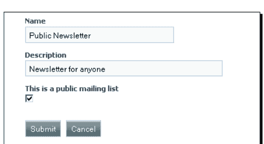

- 3. 点击 **Submit**。
- 4. 切换到 **Users** 选项卡。在页面底部，点击 **Add User** 链接，并添加两个或更多用户。将它们分配给组 **Public Newsletter**，如下所示：

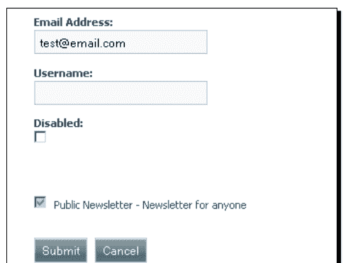

### 发生了什么？

你刚刚在 Newsletter Made Simple 模块中创建了一个新的用户列表。这是一个公开列表；这意味着网站管理员并不是唯一可以向此列表添加用户的人。使组公开意味着任何网站访客，无论他是否是客户，都可以自行订阅该列表，前提是订阅表单已添加到网站上。

然后你创建了一些测试账户。当你为新闻通讯撰写新消息时，你可以选择消息应作为 HTML 还是纯文本发送。如果需要任何特殊的 HTML 格式，例如超链接、列表、表格或图像，则必须撰写 HTML 邮件。在这种情况下，你还应撰写替代文本消息，该消息将显示给在其邮件客户端中无法查看 HTML 电子邮件的客户。不要在 Text Message 字段中使用任何 HTML 标签，只使用纯文本。

对于 HTML 电子邮件，你可以创建包含公司标志和联系信息的模板，这样你就不必在每条消息中单独添加。

在文本消息中，你可以使用以下链接到你网站的 Smarty 标签：

- `{$unsubscribe}`：可用于显示退订页面的 URL
- `{$preferences}`：可用于显示用户偏好页面的 URL
- `{$confirmurl}`：可用于确认订阅的 URL

要使这些链接正常工作，你必须在撰写消息时在页面列表中选择一个返回页面。此页面应包含 Smarty 标签 `{nms}`。

你还可以将已发送的消息作为新闻通讯存档显示在你的网站上。任何标记为公开的消息都将显示在此公共存档中，可供网站的每个访客阅读。请阅读下一节，了解如何将新闻通讯的公共订阅表单添加到页面或模板中。

创建作业意味着将一条消息和一个用户列表放在一起。你不会发送消息，而只是创建一个任务。当你处理作业时，此任务将被启动。

> 公共新闻通讯意味着你的网站的每个用户都可以订阅新闻通讯。


| 模板 | 描述 |
|---|---|
| **订阅** | 订阅表单、发送给订阅者以确认其电子邮件地址的激活邮件，以及订阅后页面上显示的消息。 |
| **确认订阅** | 在订阅者确认其电子邮件地址后发送给订阅者的确认邮件，以及电子邮件确认时页面上显示的消息。 |
| **退订** | 退订表单、主题以及用户退订后发送给用户的电子邮件文本。退订表单发送后页面上显示的文本，以及退订过程完成时发送给用户的确认邮件。 |
| **用户设置** | 如果有多个可供访客订阅的新闻通讯列表，还可以提供一个链接，让他/她管理自己的订阅列表。此选项卡上可以找到管理这些偏好设置所需的表单和消息。 |
| **存档模板** | 如果希望在网站上显示新闻通讯存档，可以在页面上使用 Smarty 标签 `{NMS action="archivelist"}`。有两种模板可用于显示存档：**列表视图**和**详情视图**。您可以在此选项卡上修改模板以符合您的设计。 |

打开 **新闻通讯** 页面，并将 Smarty 标签 `{NMS}` 放入页面内容中。在 **Newsletter Made Simple** 模块的管理区域中编辑表单的外观。

您可以调整每条消息发送之间的延迟。消息按批次分组（每批 50 条）。每批发送后，会有更长的延迟。延迟对于保持您的虚拟主机的性能非常重要。一次发送大量邮件会对您的 Web 服务器造成沉重负担。一次发送的邮件越多，服务器性能就越关键。您可以在 **偏好设置** 选项卡上更改延迟。请谨慎使用；询问您的服务提供商您每小时允许发送多少邮件，以及如何确保您的邮件不会被视为垃圾邮件。为了获得更好的性能，请在 **CMSMailer** 模块中使用 `sendmail` 方法。

## 显示视频

视频在网站上变得越来越流行。每个人都可以将视频上传到 YouTube，但只有一些人知道这些视频中的任何一个也可以无缝集成到网站中。打开 YouTube 网站上的任意视频，查看其右侧的面板。

有两个字段，分别名为 URL 和 Embed。第一个字段包含指向视频的纯链接。第二个字段包含用于显示视频的 HTML 代码。

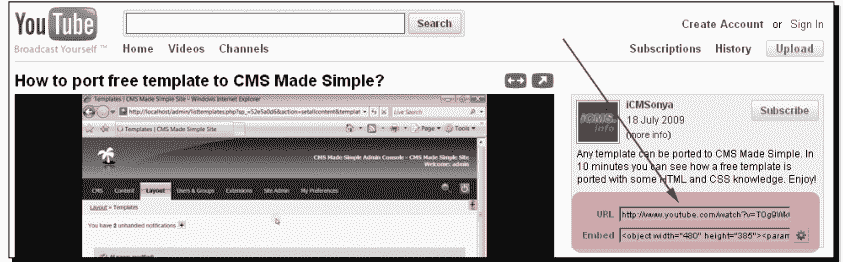

使用哪个字段取决于视频在您网站上的位置。如果视频应显示在您网站的每个页面上，您必须从 Embed 字段复制 HTML 代码，打开您的页面模板（布局 | 模板），并将代码添加到每个页面上应显示视频的位置。

如果视频应显示在单个页面的页面内容中，您必须打开管理控制台中的页面进行编辑，并点击 Content 字段下方的“打开/关闭 WYSIWYG”按钮。在页面的 HTML 源代码中找到应显示视频的位置，并将 Embed 字段中的代码添加到该位置。不是那么方便，对吧？如果您具备 HTML 知识，您可以这样做，但网站中没有 HTML 知识的编辑怎么办？

在 WYSIWYG 编辑器中，您可以激活一个简单的插件，无需查看 HTML 源代码即可嵌入任何视频。

在管理控制台中，点击 **扩展 | TinyMCE WYSIWYG**，选择 **插件** 选项卡。选择名为 **media** 的插件，然后点击 **保存插件**。然后切换到 **配置文件** 选项卡。有三个部分：

- **后端配置文件设置**：网站编辑者的设置
- **高级后端配置文件设置**：网站管理员的设置
- **前端配置文件设置**：前端使用 WYSIWYG 编辑器的设置，例如，如果您的访客可以向网站添加新闻文章。

用于插入嵌入媒体的按钮称为 **media**，可以根据您的个人需求添加到任何配置文件的任何 **工具栏** 中。例如，要使该按钮可供网站编辑者和管理员在工具栏的第一行使用，请在两个配置文件的 **工具栏 1** 字段的最末尾添加 **media** 一词，如下面的截图所示：

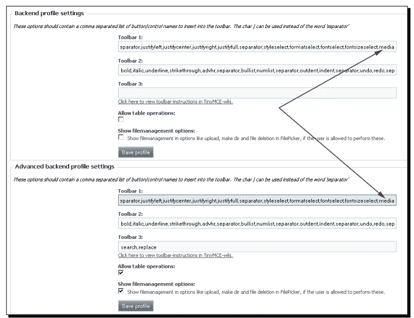

保存每个配置文件，然后会在 *TinyMCE* 编辑器第一行的末尾看到该按钮。现在您或编辑者只需点击按钮即可从 YouTube 添加任何视频。文件的 **类型** 应为 **Flash**；在 **文件/URL** 字段中，从 YouTube 复制链接，如 **URL** 字段所示：

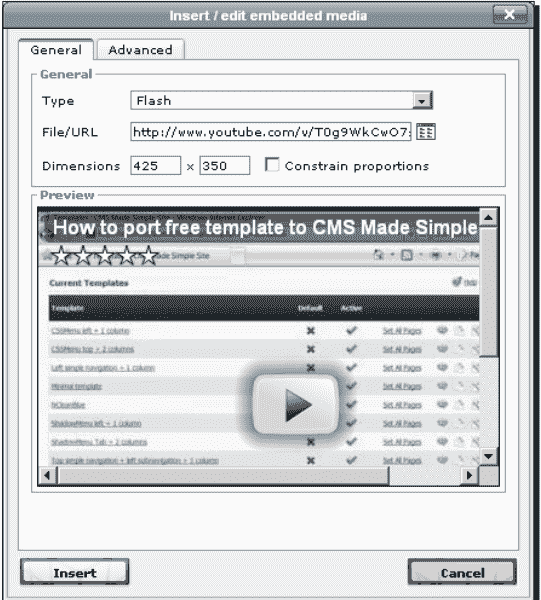

视频的尺寸将自动设置。此外，下方会显示视频的预览。点击 **插入**，视频将添加到页面中。现在，您的编辑者只需知道视频链接；其余工作将由 WYSIWYG 编辑器完成。

您无需任何额外的模块即可在页面上插入视频。CMS Made Simple 核心已涵盖大量功能。等待您去发现！

## 添加您自己的播放器

上一节描述的方法适用于您先将视频上传到 YouTube 的情况。但有时您可能希望将视频上传到自己的主机并显示它们，绕过 YouTube 或 Google Video 等服务。

## 小测验 – 使用第三方模块

- 1. 在哪里可以找到 **Photo Gallery** 的管理区域？
  - a. **内容 | 图像管理器**
  - b. **内容 | 画廊**
  - c. **扩展 | 模块 | 照片**
  - d. **扩展 | 模块 | 图片**
- 2. **Gallery** 模块中不允许使用哪种扩展名？
  - a. `.jpeg`
  - b. `.eps`
  - c. `.png`
  - d. `.jpg`
- 3. 为了使用 **Form Builder** 创建的表单发送电子邮件，应首先安装哪个模块？
  - a. **Newsletter Made Simple**
  - b. **CTLModuleMaker**
  - c. **CMSMailer**
  - d. **File Manager**
- 4. 在编辑联系表单时，为什么应该将 **向用户发送提交副本** 字段的值设置为“从不”？
  - a. 用户最清楚自己写了什么，因此他/她不需要关于这些内容的通知。
  - b. 因为电子邮件提交可能会使 Web 服务器满载运行。
  - c. 因为这会导致无限循环，并可能使您的 Web 服务器满载运行。
  - d. 因为用户会得到您的电子邮件地址，并可能绕过反馈表单开始与您联系。
- 5. **Form Builder** 中的 **提交模板** 定义了什么？
  - a. 表单发送后响应消息的外观。
  - b. 负责已发送电子邮件外观的 **电子邮件模板** 的外观。
  - c. 提交消息前表单的外观。
  - d. 用于创建模板的个人管理区域的外观。
- 6. 关于一组单选按钮和一组复选框，哪种说法是正确的？
  - a. 在复选框和单选按钮的组合组中，所有选项都可以被激活。
  - b. 在一组复选框中，所有选项都可以被激活；在一组单选按钮中，只能激活一个选项。
  - c. 在一组单选按钮中，所有选项都可以被激活；在一组复选框中，只能激活一个选项。
  - d. 在一组复选框中，必须集成一个下拉菜单，否则您无法通过操作单选按钮来听音乐。
- 7. 在 **Newsletter Made Simple** 模块中，什么是 **任务**？
  - a. 为了发送电子邮件而做的所有事情。
  - b. 将准备好的电子邮件发送到邮件列表。
  - c. 选择一个现有的消息和一个现有的将接收该消息的用户列表。
  - d. 思考可以组合邮件列表和计划消息的不同可能性。

## 动手实践 – 安装其他模块

现在，如果您需要为网站添加其他功能，应该查看可用的模块并尝试它们。使用每个模块的 **帮助** 来确定它是否能解决您的需求。不要忘记插件。在模块可能过于臃肿的情况下，它们会为您提供小而实用的功能。

一个好的网站通常永远不会真正完成，您会一次又一次地改进它；暂时隐藏未完成的部分，将网站的第一版发布上线，同时在开发环境中处理未完成的部分。


## 摘要

在本章中，我们学习了很多关于 CMS Made Simple 中不同模块如何扩展网站功能的知识。

在本章中，我们涵盖了：

- **图库**：如何创建照片图库，并从头开始为图库创建自定义模板。
- **表单构建器**：如何创建和自定义页面上的联系表单或反馈表单，无需深厚的编程知识。
- **新闻通讯**：如何将电子邮件地址导入 **Newsletter Made Simple** 模块的用户列表，并向现有的电子邮件列表发送消息。
- **YouTube 视频**：如何将 YouTube 视频嵌入网站。你不需要任何特殊模块即可在页面上显示单个视频。在寻找附加组件之前，先了解核心功能。

在本章中，只介绍了一些模块。还有许多模块具有非常复杂的功能，并为你的网站提供扩展功能。每周都有为 CMS Made Simple 开发的新模块，并且对现有模块进行更新。

在下一章中，你将学习如何从现有模块构建更多功能，甚至从零开始创建自己的功能。
