## 8 创建你自己的功能

CMS Made Simple 仅包含一些属于标准安装的基础功能。任何附加功能都可以通过其他模块安装，正如你在前一章中所学到的。然而，你常常需要自己的功能，而现有模块无法覆盖这些功能。

在本章中，我们将：

- 使用自定义字段和单独的层级结构创建产品目录
- 以一种并非模块开发初衷的方式使用模块的功能

那么让我们开始吧……

### 创建产品目录

在本节中，我们将学习如何创建新模块。以产品目录为例，但同样地，你可以创建任何类型的目录，例如服务、课程、房地产广告或自由职业者目录。

在创建你自己的目录模块之前，你应该非常仔细地规划其结构。首先，考虑层级的数量。写下你需要多少层级（产品类别、子类别等）。例如，我将创建一个简单的办公家具目录。我需要以下三个类别，产品在创建时可以分配到这些类别：

- 桌子
- 椅子
- 书柜

这意味着家具目录需要一个两级结构，例如类别和产品。每个产品将只属于前面列出的类别之一。

接下来，你必须确定需要为目录中的一个项目（产品）创建哪些字段。这就像为你的产品列表制作一张表格。你需要哪些列来区分不同信息？例如，我需要以下四个字段：

- 产品标题
- 描述
- 图片
- 价格

现在，你可以开始创建自己的模块了。你不会使用任何特殊的专用模块，而是学习如何创建完全适合你个人需求的独立模块。这可以通过 **CTLModuleMaker** 模块完成，该模块允许创建任何功能完整的类似目录的模块。

新产品目录的示例结构如下：

- 桌子
  - 电脑桌
  - 办公桌
- 椅子
  - 行政椅
  - 客椅
- 书柜
  - .....

从可用模块列表（**扩展 | 模块管理器**）中安装 **CTLModuleMaker** 模块。模块安装后，可以在管理控制台（**扩展 | CTLModuleMaker**）中找到其管理区域。

### 创建新的类似目录的模块

我们现在将开始创建一个新的独立模块。在管理控制台中，进入 **CTLModuleMaker** 的管理区域（**扩展 | CTLModuleMaker**），然后点击 **创建一个新模块** 链接。

### 第1步：模块的基本信息

模块向导将引导你完成创建新模块所需的所有步骤。在第1步中，你需要定义新模块的基本信息。

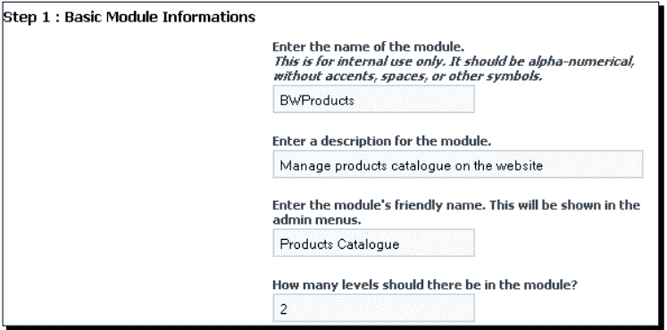

在第一个字段中，输入模块的名称。此名称将出现在模块列表（扩展 | 模块）中。它稍后也会用于 Smarty 标签 {cms_module module="NAME_OF_MODULE"}。最好为模块名称选择一个唯一的前缀，如前面的示例所示。不要只命名为 Products（有一个名为 Products 的第三方模块），而是命名为 BWProducts。在我的示例中，BW 代表 Business World（商业世界）（当然你可以使用自己的前缀）。

第一个字段也用于稍后为模块项目生成 URL。例如，产品的详细视图将显示 http://www.mydomain.com/nameofmodule/detail/nameofproduct/5/。

模块的描述将出现在模块帮助的“此模块的作用是什么？”部分。

模块的友好名称将在模块安装后显示在管理菜单中。在前面的示例中，模块将安装在“内容 | 产品目录”下。

我们已经确定需要两级结构：类别和产品。如果你需要更多层级，请在此处更改。但是，我建议一开始使用简单的两级结构，然后在原理清楚后，再创建一个或多个额外的层级。

点击 **下一步** 并继续第2步。

### 第2步：创建层级

模块中的产品将被分配到不同的类别。类别有助于将不同的产品分组，并使产品列表中的导航更加容易。

### 创建第一级类别

此步骤帮助你为新模块定义类别，以便以后可以将项目分配到这些类别。

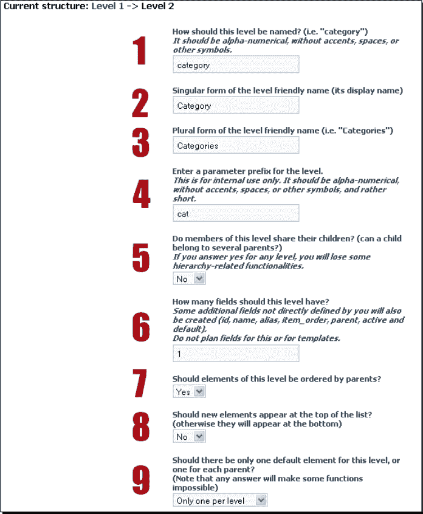

第一个和第四个字段需要类别的技术名称和前缀。技术名称不会显示给网站的访问者，并且不应包含任何特殊字符。相反，第二个和第三个字段是用户友好的，可以包含特殊字符。这些字段将在管理控制台中使用。例如，层级名称的复数形式将出现在模块管理区域的选项卡上，如以下截图所示：

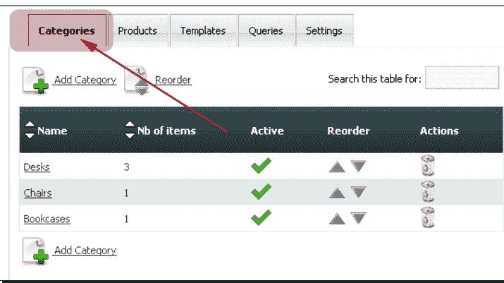

第五个字段涉及层级的灵活性。一个产品只能属于一个类别，还是可以属于多个类别？例如，想象一个图书目录，其中一本书可以属于多个类别。历史犯罪小说在逻辑上同时属于犯罪文学和历史文学。对于家具目录，我们不需要这样的灵活性。在我们的示例中，产品只能属于一个类别。

在第六个字段中，你输入除自动添加到每个层级的字段之外所需字段的数量。你可以从字段的注释中了解将创建哪些字段。这意味着我们不需要为类别标题添加额外的字段，因为我们将使用字段名称作为标题。此外，我们需要存储类别描述的字段。因此，你在此输入 1。

第七个字段对于目录结构中的第 1 级并不重要，因为类别没有父元素。

默认情况下，新类别应出现在类别列表（管理区域和网站上）的什么位置？请注意，你以后始终可以在模块的管理区域中手动重新排序类别的显示顺序。

最后一个字段对于第 1 级并不重要，可以保持原样。点击“下一步”。

在最后一个屏幕上，你定义了类别应具有的附加字段的数量（请参见第2步中第一张图片中的第六个字段）。现在，你必须在下一个屏幕上提供有关此字段的更多信息，如以下截图所示。

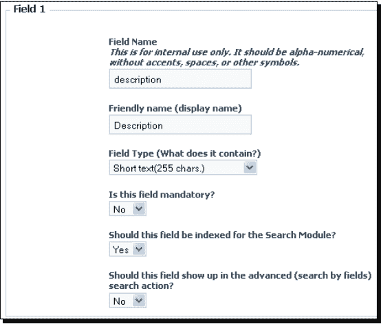

第一个字段包含字段的技术名称，仅供内部使用。第二个字段是友好名称，编辑人员将在管理控制台的目录中看到该名称。如果你认为 255 个字符足以描述类别，请为字段类型选择 **短文本（255 字符）**。将字段设置为必填意味着，如果不提供描述，你将无法创建新类别。

字段内容是否应被 CMS Made Simple 的 **Search** 模块索引？该模块是标准模块，已在第5章 *使用核心模块* 中说明。

每个使用 **CTLModuleMaker** 创建的模块都将获得一个额外的高级搜索功能，如以下截图所示：

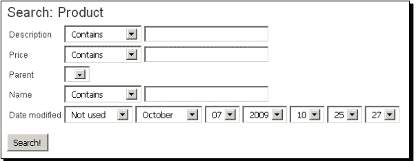


在字段定义的最后一个字段中，您可以定义是否希望在高级搜索中看到该字段。在之前的示例中，该字段是可搜索的，因此显示在搜索功能的顶部。点击**下一步**。

在下一步中，您将定义在将来模块的管理区域中，哪些字段将显示在类别列表中。**名称**字段是必填的，您不能将其从列表中删除，但您可以添加**可能字段**列表中的任何其他字段。将**子项数量**字段添加到列表中，如下图所示：

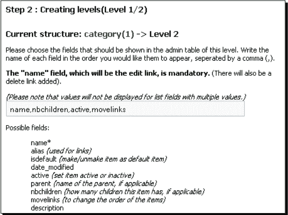

根据之前定义的字段，模块管理控制台中的类别列表将如下图所示：

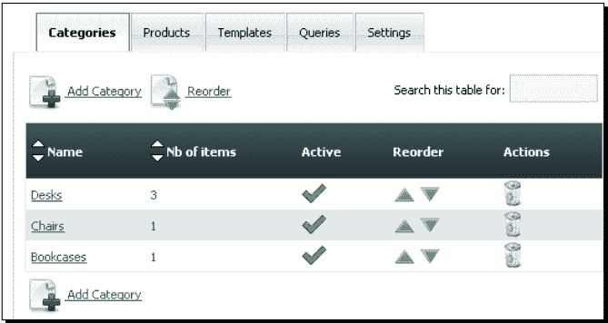

## 创建您自己的功能

点击**下一步**，继续定义产品（目录结构中的第2级）。

### 创建第二级（产品）

在接下来的步骤中，系统将询问有关您的产品的信息。您将看到每个级别的定义是相似的。与类别相同的字段，现在您需要为产品提供信息。

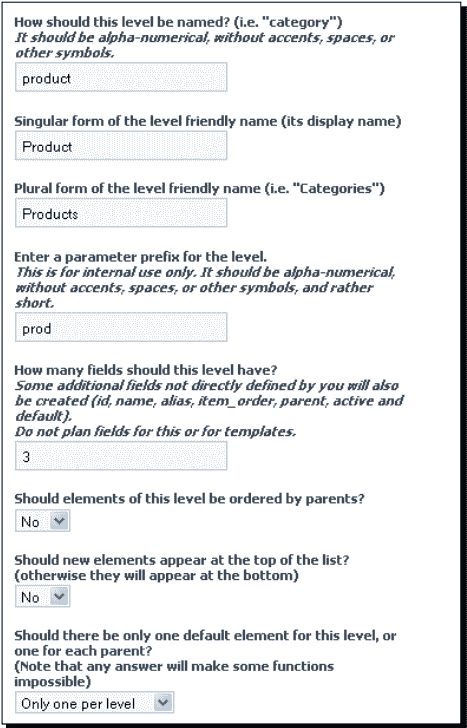

对于产品，我们需要三个额外的字段：

- 描述
- 价格
- 图片

产品标题将保存在必填的**名称**字段中，不应在此处规划。

第七个字段在类别级别可以忽略，但在第二级中具有一些意义。即产品应如何在产品列表中显示，是按类别还是按字母顺序排列，以及是否应独立于它们所属的类别显示。

| 按类别 | 按字母顺序 |
|---|---|
| 行政办公桌 | 电脑桌 |
| 电脑桌 | 行政椅 |
| 行政椅 | 行政办公桌 |
| 访客椅 | 访客椅 |

在最后一个字段中，您可以定义整个产品列表是否只能有一个默认产品，还是每个类别有一个默认产品。在我们的示例中，我们不需要任何默认产品，因此您可以保留该字段的默认设置。

点击**下一步**。

与定义类别的附加字段**描述**类似，您现在需要为产品定义三个额外的字段。

产品所需的第一个字段是**产品描述**。该字段的定义方式与类别描述相同。我选择将该字段设为**长文本**，以便产品描述的长度不受限制。该字段应可双向搜索，既可通过CMS Made Simple的标准搜索字段搜索，也可通过模块本身的高级搜索功能搜索。

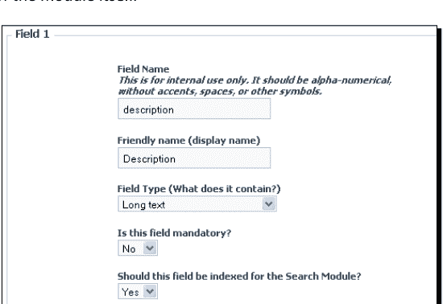

## 创建您自己的功能

在下一个字段中，应存储产品的价格。该字段必须定义为**短文本（10个字符）**。如果您选择**字段类型**为**数字**，则其中无法存储小数。

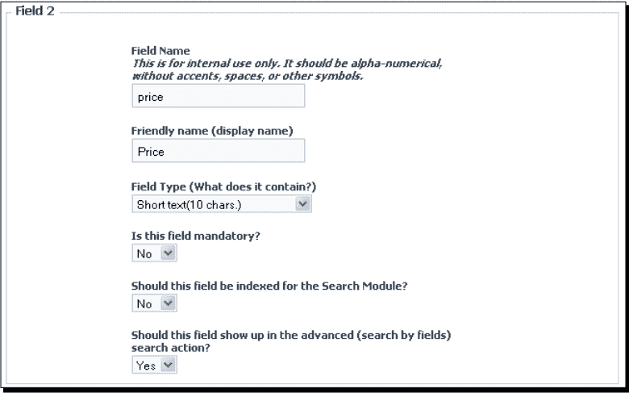

第三个字段将允许您上传产品图片。一旦您将**字段类型**更改为**图片**，将显示附加信息，如下一个截图所示：

### 字段 3

**字段名称**
*仅供内部使用。应为字母数字，不能包含重音符号、空格或其他符号。*
image

**友好名称（显示名称）**
产品图片

**字段类型（它包含什么？）**
图片

**此字段是否为必填？**
否

**是否应为此字段建立索引以供搜索模块使用？**
否

**此字段是否应显示在高级（按字段搜索）搜索操作中？**
否

**输入文件应上传到的文件夹路径。**
*此路径将添加到上传文件夹（空 = 上传文件夹的根目录）。* 
images/catalogue

**上传的图片是否应调整为最大尺寸？**
*输入像素尺寸，格式为“宽x高”（空 = 图片不调整大小）。* 

调整大小功能需要gd库，并且仅适用于.jpeg、.jpg、.png或.gif文件
500x700

**当图片不符合调整比例的尺寸时，是否应进行裁剪？**
否

**是否应创建缩略图，其最大尺寸应为多少？**
*输入像素尺寸，格式为“宽x高”（空 = 不创建缩略图）。* 
120x120

**当缩略图不符合调整比例的尺寸时，是否应进行裁剪？**
是

**允许的文件扩展名，以逗号分隔。（对于图片，空值允许gif/jpeg/jpg/png；对于其他文件类型，允许任何类型）**
gif,jpeg,jpg,png

最后六个字段中的信息仅对可以上传图片的字段是必需的。

您应该输入上传后图片将保存到的文件夹名称。此文件夹将在您网站托管的`uploads`文件夹下自动创建。您可以使用`images`文件夹，然后加上模块文件夹的自定义名称。这将确保图片自动保存到`images`文件夹中，从而可以通过**图片管理器**在线编辑。

在下一个字段中，输入产品图片的最大尺寸，如果图片大于此处给定的尺寸，则将其调整为该尺寸。但是，有时在不改变图片比例的情况下，无法将图片精确调整为字段中给定的尺寸。在这种情况下，将考虑宽度或高度。如果您希望保持精确尺寸，则模块必须裁剪图片。裁剪图片意味着图片的一部分将被切掉。您可以在下面的字段中选择调整大小的方法。

同样，您可以定义缩略图的尺寸。最佳的调整大小方法取决于您的源图片和设计，因此无法给出通用建议。

在最后一个字段中，您指定允许上传的扩展名。请注意，只有GIF、JPEG、JPG和PNG文件才能在所有浏览器中显示为图片。不要允许任何其他格式，这样产品编辑者将无法在此字段中上传其他文件。

点击**下一步**，定义在产品列表的管理控制台中应显示哪些字段：

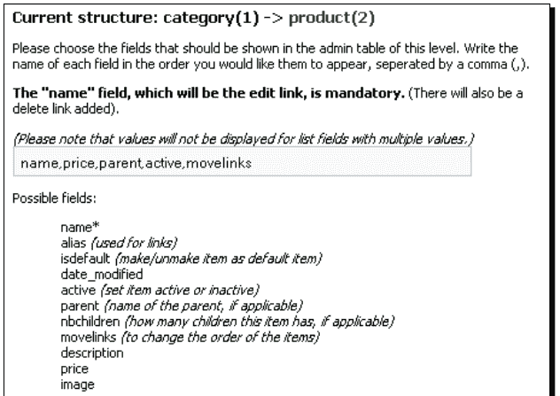

## 创建您自己的功能

点击**下一步**。您已到达最后一步，即将完成并安装新模块。

保留最后一步中的值不变。它们涉及文件字段（我们没有任何文件字段）、语言（我们将在第10章“CMS Made Simple高级使用”中了解更多关于翻译的内容）以及模块版本。模块版本用于修订控制，并用于管理之后对模块所做的更改。例如，模块的初始配置获得版本1.0。当对模块进行第一次更改时，生成的配置将标记为版本2.0，依此类推。我们不允许网站访客添加产品，因此请将**前端用户管理**也设置为**否**。

点击**下一步**。**CTLModuleMaker**模块开始创建所有必需的文件夹和文件。点击**安装模块**链接，新的自定义模块将被安装。您现在可以在管理控制台的**内容 | 产品目录**中找到它。

此外，该模块可以在**模块管理器（扩展 | 模块）**的模块列表中找到、移除和安装。

### 配置新的产品目录模块

在新模块的管理区域中添加一些类别和一些产品。

然后，打开页面**产品（内容 | 页面）**，并添加以下Smarty标签来调用您的模块：

```
{cms_module module="bwproducts"}
```

将参数module中的名称替换为您的模块名称。此名称可以在已安装模块列表（**扩展 | 模块**）中找到。打开页面，查看页面上的产品列表。

新模块还有一个**模块帮助**部分，其中列出了您可以与此模块一起使用的所有参数。可以通过位于模块管理区域页面右上角的**模块帮助**图标访问帮助部分。

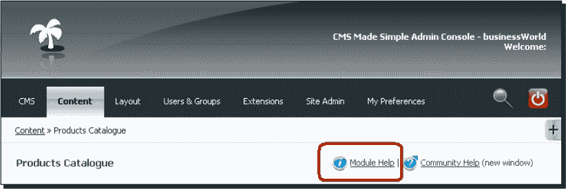


如需更多帮助，可以查看常见问题解答（FAQ）。在模块帮助中，“版权与许可”部分上方可以找到FAQ的链接。

## 创建产品列表模板

对于使用CTLModuleMaker创建的模块，系统会自动生成一些示例模板。不过，对于每一级，你都可以自行创建无限数量的模板。

### 动手操作——创建新的列表模板

让我们自定义产品列表的外观，并将产品图片以缩略图形式添加到该列表中。

1. 在管理控制台中，点击 **内容 | 产品目录**，然后选择“模板”选项卡。
2. 在“默认模板”部分下方，你会看到示例模板列表。点击“添加模板”链接。
3. 对于带缩略图的产品列表，请在“模板”字段中输入以下代码片段：

   ```
   {if $itemcount > 0}
       <ul>
           {foreach from=$itemlist item="item"}
               <li style="list-style-type:none; float:left; margin: 20px;"><a href="{$item->detailurl}">
               image->thumbnail}" alt="{$item->name}" /></a>
               <br/>
               {$item->detaillink}<br/>{$item->price} USD</li>
           {/foreach}
       </ul>
   {/if}
   ```

4. 点击“提交”。
5. 在**默认模板**部分，选择你刚创建的模板作为**级别为“product”的默认列表模板**。产品列表应如下方截图所示：

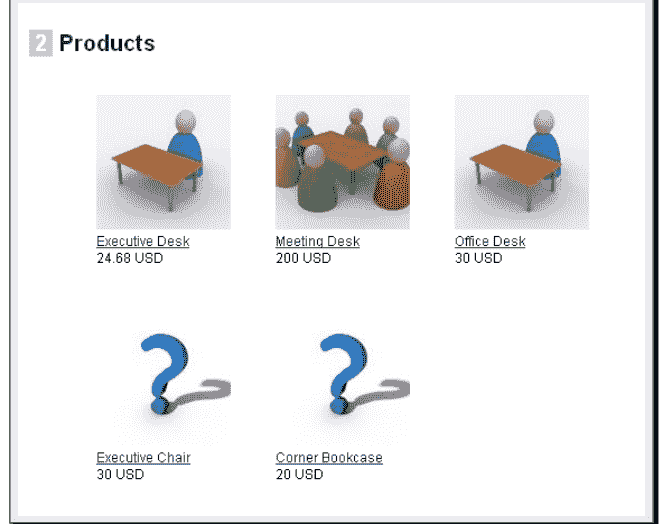

### 刚才发生了什么？

你已为产品列表创建了一个新模板。该模板不仅显示产品名称，还显示产品图片的小尺寸版本。图片的小版本在模板中以Smarty变量`{$item->image->thumbnail}`表示。当模板处于编辑状态时，你可以在 **模板变量（内容 | 产品目录 | 模板）** 选项卡中找到模板中可使用的所有Smarty变量。请注意，包含图片的字段还有更多变量。这些变量在模块FAQ中标题为 *如何在我的显示模板中获取图片？* 的部分有详细说明。

> 模板中添加的内联CSS并不是实现样式的正确方式。这样做只是为了简化示例。你应该创建一个新的CSS类，并将样式定义存放在主样式表中。

同样，你可以修改或创建一个新的**默认详情模板**，该模板用于显示单个产品的详细视图。

通过 **CTLModuleMaker** 模块，你可以创建任何类型的目录，如产品、服务、房地产广告、课程等。任何可以分类的内容都可以放入类似自定义目录的模块中。请记住，你创建的是一个普通模块，可以从模块列表中移除，导出为XML，并导入到另一个安装中。

## 实现服务台功能

CMS Made Simple中有超过300个第三方模块，而且这个数字每周都在增长。有些模块可能无法按预期工作，因为第三方模块没有质量保证。然而，有时你并不需要使用专门的模块来解决需求。凭借一些创造力，你可以将模块从其原本用途中转换出来，以创建自己的功能。

CMS Made Simple中没有专门的服务台模块。但是，如果你需要用其来处理支持工单，则可以使用 **CGFeedback** 模块；它最初是为处理页面或新闻文章的评论而创建的。尽管该模块并非为处理支持工单而开发，但通过一些高级定制，它可以用来解决所需功能。

## 管理访客登录

在网站上设置服务台功能之前，你必须安装 **FrontEndUsers** 模块。**FrontEndUsers** 模块是一种网站会员管理工具。在我们的场景中，会员是指那些可以使用其访问数据在网站上进行认证、访问受保护内容或通过个人会员区域与你沟通的客户。

通常，**FrontEndUsers** 可以与其他许多模块集成，例如：

- **新闻**（注册访客可以向网站添加新闻）
- **下载管理器**（注册访客可以从网站下载受保护的文件）
- **论坛**（注册用户可以在论坛上交流）
- **NMS**（向注册用户发送群发邮件）

> 网站会员不同于网站的管理员用户，后者在第6章 *用户与权限* 中已有描述。会员与管理控制台无关（希望如此！）。

**FrontEndUsers** 模块依赖于 **CMSMailer** 模块。这意味着，在网站上安装会员管理之前，你必须按照第2章 *开始使用* 中的说明配置电子邮件设置。否则，诸如发送忘记密码等功能将无法正常使用。

要在管理控制台中安装该模块，请点击 **扩展 | 模块管理器**，然后在字母模块列表上方的“可用模块”选项卡中选择字母 **F**。找到 **FrontEndUsers** 模块，点击 **下载并安装** 链接。该模块将完成安装，现在可以进行配置。

打开 **服务台** 页面（**内容 | 页面**），并将登录表单添加到页面的**内容**字段中，如下所示：

```
{cms_module module="FrontendUsers"}
```

现在，你可以在页面上看到登录表单。让我们创建第一个客户账户并登录该页面，以便测试模块功能。

### 动手操作——创建第一个用户账户

我们将向网站添加第一个客户账户。

1. 在管理控制台中，点击 **用户与群组 | 前端用户管理**。
2. 点击 **用户属性** 选项卡。
3. 点击 **添加属性** 链接并填写表单，如下方截图所示：

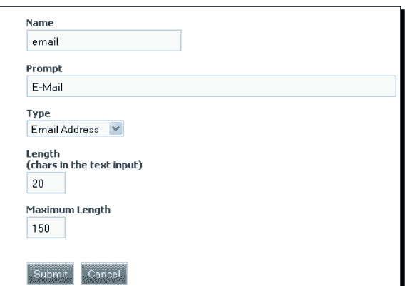

4. 点击 **提交**。
5. 打开 **群组** 选项卡，点击 **添加群组** 链接。
6. 填写字段，并将上面创建的电子邮件字段分配给该群组，如下方截图所示：

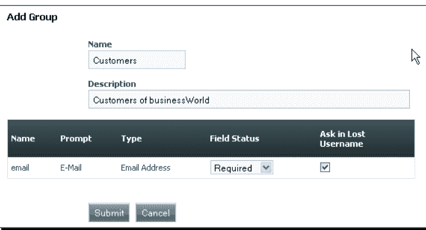

7. 点击 **提交**。
8. 点击 **用户** 选项卡，然后点击 **添加用户** 链接。
9. 填写字段，如下方截图所示（请提供有效的电子邮件地址！），并将用户分配给 **客户** 群组：

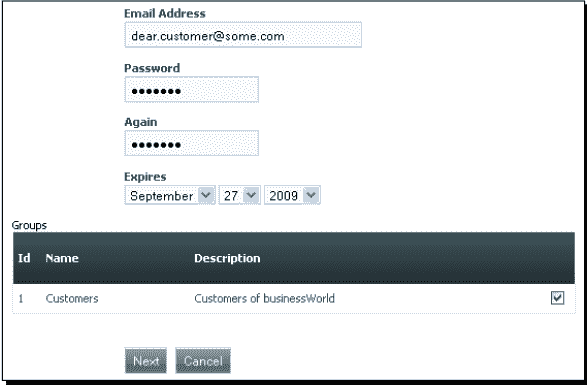

10. 点击 **下一步**，再次输入客户的电子邮件地址。
11. 点击 **提交**。
12. 在 **服务台** 页面上使用客户数据（**用户名 = 客户的电子邮件地址**）登录，查看其工作方式。如果登录成功，页面应如下方截图所示：

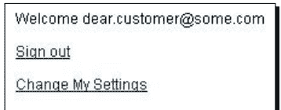

### 刚才发生了什么？

你已创建了第一个客户账户。你首先添加了用户属性（一个包含客户电子邮件地址的字段）。该字段将用于发送电子邮件，例如当客户忘记密码时。默认情况下，该字段也用作用户名（你以后可以更改）。字段的**类型**必须设置为**电子邮件地址**，因此在其中输入的内容必须是有效的电子邮件。你无需定义**用户名**或**密码**等用户属性。这两个属性已经为你提供，并且不能更改或删除。

> 添加用户属性时，千万不要在**名称**字段中使用短横线等特殊字符！

你已经创建了一个新的用户群组（本例中为**客户**）。电子邮件字段已被分配为**客户**群组的必填字段（**字段状态**），这意味着每个客户都必须有一个有效的电子邮件地址。

此时，你已经配置好模块，可以添加第一个客户了。所有客户账户都有过期日期，因此如果日期已过，账户将自动禁用。新用户已被分配到**客户**群组，现在会显示在 **用户** 选项卡（**用户与群组 | 前端用户管理**）的用户列表中。

### FrontEndUsers 模块的有用设置

作为网站管理员，你可以调整 **FrontEndUsers** 模块的设置。在网站的管理控制台中，点击 **用户与群组 | 前端用户管理**，然后选择 **偏好设置** 选项卡。应进行以下设置：


## 创建你自己的功能

您可以在管理控制台（**用户和组 | 前端用户管理**）的相应选项卡中找到表中列出的所有模板。**忘记密码模板** 和 **丢失用户名模板** 也包括验证表单。

要查看 **忘记密码** 的验证表单，请点击网站上登录表单下方的链接 **忘记密码？**，输入 **用户名**，然后点击 **提交**。检查收到的电子邮件中是否有从您的网站发送的主题为 **丢失密码** 的邮件。如果您没有收到电子邮件（您的客户是否输入了真实的电子邮件？），那么您必须检查 **CMSMailer** 模块的配置，如第 2 章，*入门* 所述。

**FrontEndUsers** 模块发送的电子邮件文本无法在模块的管理区域中更改。这些消息存储在语言文件中，可以使用 **Translation Manager** 进行编辑，这将在第 10 章，*CMS Made Simple 高级使用* 中解释。

### 创建受保护的页面

受保护的页面只能由注册成员查看，由于您已经安装了 **FrontEndUsers** 模块，您可以继续创建受保护的页面。

要保护内容页面，您必须安装名为 **CustomContent** 的模块。**CustomContent** 模块与 **FrontEndUsers** 模块一起，可以创建仅对登录用户可访问的受保护页面。打开 **扩展 | 模块管理器**，单击带有字母 **C** 的可用模块选项卡，搜索 **CustomContent** 模块，并单击 **下载并安装** 链接。模块即安装完成。该模块没有任何管理区域。不过，您可以从已安装模块列表（**扩展 | 模块**）中单击模块名称来访问模块帮助。

您将在 **如何使用它** 部分找到一个示例，我们将针对我们的目的对其进行修改。Smarty IF 条件检查用户是否已登录，并根据结果显示不同的内容。

```
{if $customcontent_loggedin > 0}
    Welcome <b>{$customcontent_loginname}</b><br/>
{else}
    <h1>You are not authorized to view this data</h1>
{/if}
```

如果 Smarty 变量 `$customcontent_loggedin` 大于 0，则用户有权查看内容，否则会显示一条用户未获授权的消息。我们将保护 **服务台** 页面。如果用户未登录，则页面上除了登录表单外不应显示任何内容。

### 操作实践——保护服务台

现在，让我们保护服务台页面，以便只有注册成员才能查看其主要内容。如果用户未登录，则只显示登录表单。

1. 在管理控制台中，打开服务台页面进行编辑（内容 | 页面）。
2. 单击“选项”选项卡，并将页面标记为不可缓存和不可搜索，如下面的截图所示：
3. 切换到“主”选项卡，并填写内容字段，如下面的截图所示：
4. 单击“应用”。
5. 分别以已登录用户和未登录用户身份查看页面。

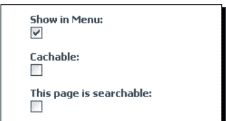

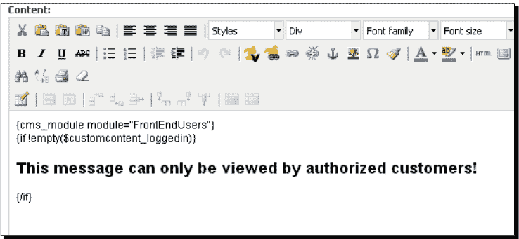

### 刚才发生了什么？

您已保护了部分页面内容，使其无法被未授权用户查看。您首先将页面设置为不可缓存。对于每个需要保护的页面或每个包含登录表单的页面，这样做都很重要。缓存的页面也会缓存用户的登录状态，即使他已退出，也会显示为已登录。

该页面不应被搜索到，因为向未授权用户显示在搜索结果中是没有意义的。

在“内容”字段中，显示登录表单（如果用户未登录）或注销表单（如果用户已登录）。该表单会根据用户状态自动更改。Smarty 标签 IF 之间的所有内容仅对已登录用户显示。

通过这种方式，您可以根据用户是否获得授权来保护每个页面或仅保护部分内容。

### 为支持请求创建用户区域

支持工单系统是一个区域，您的客户可以在其中提出关于您的产品或服务的问题。该区域是私密的，网站访问者或其他客户无法看到。当问题被提交到支持工单区域时，支持人员可以给客户回答。如果问题没有得到解决，客户可以对回答进行回复，工作人员会再次回答。这个对话（问题和答案）被组织为一个工单。如果客户还有另一个问题，他可以打开另一个工单。在私人服务台中，客户始终可以看到他的工单列表并阅读工作人员给出的答案。支持工单系统常用于专业的客户服务中。

要创建支持工单系统，您不需要专门的支持工单模块。让我们看看如何使用反馈模块来创建服务台功能。所讨论的模块名为 CGFeedback。该模块用于允许网站访问者对您的网站上的各个页面、新闻文章、产品或其他项目提供评论。我们将使用此模块的功能来创建一个基本的支持工单系统。

在管理控制台中，单击“扩展 | 模块管理器”，在“可用模块”选项卡中搜索 CGFeedback 模块。单击“依赖项”链接以确定应先安装哪些模块。您将看到以下模块：

- CGExtensions
- CGSimpleSmarty

首先安装这些模块，然后安装 CGFeedback 模块。使用该模块最简单的方法是在任何页面内容的底部包含以下 Smarty 标签：

```
{CGFeedback}
```

这将创建一个评论表单，允许访问者输入关于该特定页面的评论和评分。要显示这些评论，您可以在前一个标签下方添加另一个标签：

```
{CGFeedback action="summary"}
```

这些标签可以选择性地放置在页面模板或模块模板中。如果没有定义其他内容，则评论会自动附加到发表评论的页面上。如果您希望允许对新闻文章等模块项目发表评论，则应该使用两个附加参数：

```
{CGFeedback key1="News" key2=$entry->id}
```

有两个参数：key1 和 key2。每个参数可以填入不同的值。在前面的示例中，参数 key1 填入了值 News，以便将普通页面评论与新闻文章评论区分开来。第二个键保存了新闻文章的编号（$id），以确保评论仅显示在显示该特定新闻项目详细视图的页面上。

添加评论时，它们会与两个参数（key1 和 key2）中给定的值一起保存在数据库中，例如“针对特定 ID 的新闻文章的评论”。我们为什么不用这个功能来管理与某个特定登录用户关联的评论呢？第一个参数 key1 将页面评论与工单区分开。从第 4 章 设计与布局 中，我们知道每个页面中都存在一些 Smarty 变量。其中有一个由 FrontEndUsers 模块提供的变量，称为 $userid。该变量仅在用户登录时存在，并包含用户 ID。通过在页面内容中放置以下两行，您表示“保存并显示针对特定登录用户的评论”：

```
{CGFeedback key1="Ticket" key2=$userid}
{CGFeedback key1="Ticket" key2=$userid action="summary"}
```

这两行将显示评论表单和由同一个用户撰写的所有评论的摘要视图。当用户未登录时，他无法看到评论，因为对于未登录的用户，变量 $userid 不存在。其他用户也不会看到这些评论，因为他们有不同的用户 ID。通过将这两个 Smarty 标签放入服务台页面来测试。由于页面上有登录表单，完整内容应类似于以下截图：

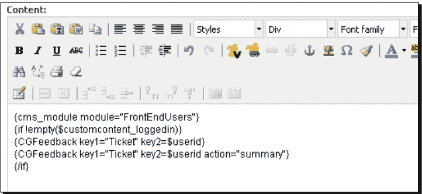

现在，已登录用户可以创建评论，或者说创建支持工单，这些评论只能由用户本人在页面上查看，或由 CMS Made Simple 管理控制台中的支持人员查看。您可以完全自定义带有评论表单的模板，如下面的截图所示：

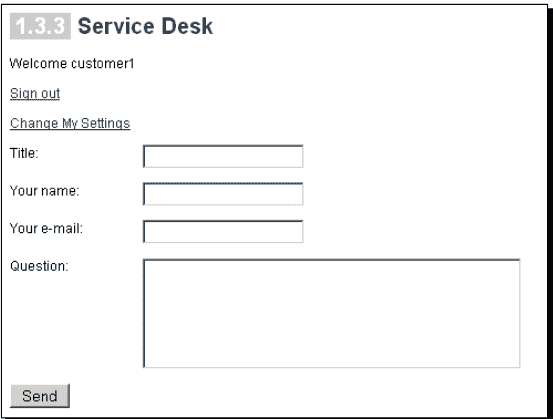


你可以删除或替换图例 **Add a Review**。移除 **Notify me of new comments to this page** 复选框，并将字段 **Additional Comments** 重命名为 **Your question** 或 **Your request**。

要在管理控制台中创建新的 **Comment Form Templates**，点击 **Content | Calguys Feedback Module**。选择 **Comment Form Templates** 选项卡，并点击 **New Template**。输入 **NewTicket** 作为 **Template Name**，并在 **Template Text** 字段中输入以下代码片段：

```
{if isset($message)}
    <p class="success">{$message}</p>
{else}
    {if isset($error)}
        <p class="error">{$error}</p>
    {/if}
{$formstart}

    <p><label>Title:</label>
    <input type="text" name="{$actionid}title" value="{$title}"/></p>

    <p><label>Your name:</label>
    <input type="text" name="{$actionid}author_name" value="{$author_name}"/></p>

    <p><label>Your e-mail:</label>
    <input type="text" name="{$actionid}author_email" value="{$author_email}"/></p>

    <p><label>Question:</label>
    <textarea name="{$actionid}comment" cols="40" rows="5">{$comment}</textarea></p>

    <p><input type="submit" name="{$actionid}submit" value="Send"/></p>

{$formend}
{/if}
```

点击 **Submit**。打开页面 **Service Desk (Content | Pages)**，并按以下代码片段所示修改评论表单的 Smarty 标签：

```
{cms_module module="FrontEndUsers"}
{if !empty($customcontent_loggedin)}
{CGFeedback key1="Ticket" key2=$userid commenttemplate="NewTicket" policy="session"}
{CGFeedback key1="Ticket" key2=$userid action="summary"}
{/if}
```

现在，评论表单将使用模板 **NewTicket** 显示。此外，由于参数 `policy`，问题提交后表单会重定向到同一页面。

要测试该模块，请使用两位不同的客户创建一些新工单，以查看它们是如何根据当前登录的客户进行分离的。我们稍后将为摘要和详细视图自定义模板。

现在，让我们看看如何通过管理控制台由支持人员实现回复工单的功能。

## 为工单添加回复字段

我们现在将在模块 **CGFeedback** 中创建两个自定义字段。第一个将包含回复工单的支持人员姓名。第二个字段将包含回复内容。

### 行动时间 – 创建新字段

支持人员应能够回复支持工单并将他们的姓名存储到每个回复中。让我们创建将包含此信息的新的字段。

- 1. 在管理控制台中，点击 **Content | Calguys Feedback Module**，并选择 **Fields** 选项卡。
- 2. 点击 **Add a new field**，其中包含支持人员的姓名，如以下屏幕截图所示：

  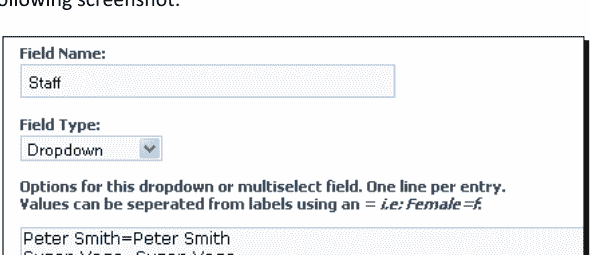

- 3. 点击 **Submit**。
- 4. 然后，添加另一个字段以包含来自支持人员的回复文本，如以下屏幕截图所示：

  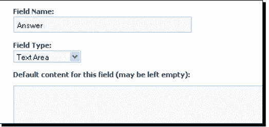

- 5. 点击 Submit。
- 6. 在管理控制台中，打开一个现有工单（Content | Calguys Feedback Module）进行编辑，并在编辑屏幕中找到这两个自定义字段。

### 发生了什么？

你已添加了两个自定义字段。从现在起，你可以在管理控制台中输入工单的回复，就像你是支持人员一样。回复将在网站上显示，前提是详细视图模板已正确自定义。这将在本章后面描述。

## 工单列表和工单详细视图的模板

在自定义详细视图之前，让我们先创建一个新的摘要模板。摘要视图用于在工单提交表单下方显示由一位客户在 Service Desk 页面上提交的所有工单列表。每个工单的标题链接到工单的详细视图，在那里显示来自员工的回复。

### 行动时间 – 自定义工单列表

应更改由客户创建并向其显示的工单列表的外观以满足我们的需求。

- 1. 在管理控制台中，点击 Content | Calguys Feedback Module，并选择 Summary Templates 选项卡。
- 2. 点击 New Template，并输入 TicketList 作为 Template Name。
- 3. 将以下代码添加到 Template text 字段中：

```
{if isset($comments)}
    {foreach from=$comments item="one"}
        <p><strong>Ticket No {$one.id}: <a href="{$one.detail_url}" title="{$one.title}">{$one.title}</a></strong><br/>
            <small>{$one.created|date_format:"%a %d %b %H:%M"} |
            <a href="mailto{$one.author_email}">{$one.author_name}</a>
            </small>
        </p>
        <div class="feedback_item_data">
            {$one.data}
        </div>
    {/foreach}
{/if}
```

- 4. 点击 Submit。
- 5. 要将此模板用于工单列表，请打开页面 Service Desk（Content | Pages），并按以下代码片段所示修改工单摘要视图的 Smarty 标签：

```
{cms_module module="FrontEndUsers"}
{if !empty($customcontent_loggedin)}
    {CGFeedback key1="Ticket" key2=$userid commenttemplate="NewTicket" policy="session"}
    {CGFeedback key1="Ticket" key2=$userid summarytemplate="TicketList" action="summary"}
{/if}
```

- 6. 点击 Submit。
- 7. 模板显示所有工单的列表，包括其编号、标题和内容，如以下屏幕截图所示：

  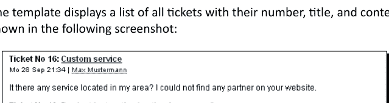

### 发生了什么？

你已为客户区域创建了一个新的工单列表模板。为了保持示例整洁，我已从摘要模板中移除了分页，但如果你愿意，可以从 Sample 模板中将其复制回来。

在下一步中，修改工单详细视图的详细模板。在管理控制台中，点击 Content | Calguys Feedback Module，并选择 Detail Templates 选项卡。点击 New Template，并在 Template Name 字段中输入 TicketDetail。在 Template Text 字段中，输入建议的代码如下：

```
<h3>Ticket No. {$onecomment.id}: {$onecomment.title}</h3>
<p>{$onecomment.created|date_format:"%a %d %b %H:%M"} |
<a href="mailto:{$onecomment.author_email}">
{$onecomment.author_name}
</a></p>
<div class="feedback_item_data">
{$onecomment.data}
</div>
{if isset($onecomment.fields)}
{foreach from=$onecomment.fields key="name" item="field"}
{assign var=$name value=$field.value}
{/foreach}
{if !empty($Answer)}
<p><strong>Staff Answer</strong><br/>
<small>{$onecomment.modified|date_format:"%a %d %b %H:%M"} |
{$Staff}</small></p>
<div>
{$Answer}
</div>
{/if}
{/if}
```

点击 Submit。要使用创建的模板显示带员工回复的工单，你必须将其设为默认。打开详细模板列表（Content | Calguys Feedback Module，Detail templates 选项卡）并点击 Default 列中带有红色叉号的图标，以使模板 TicketDetail 成为默认。

Platforma AI 是一个 AI 驱动的平台，旨在简化从概念到部署创建 AI 解决方案的过程。它简化了构建、测试和部署聊天机器人和其他 AI 模型，使其对开发人员和非开发人员都可访问。凭借其全面的工具包，企业可以快速高效地将 AI 集成到其运营中，专注于创新而非基础设施管理。

主要产品包括预训练模型和无代码构建器，可实现快速原型制作。该平台支持各种 AI 任务，例如自然语言处理（NLP）和计算机视觉，并通过 API 提供灵活的集成选项。其直观的界面使用户能够轻松管理其 AI 项目，确保从开始到结束的顺畅体验。

Platforma AI 还专注于可扩展性和安全性，确保解决方案随着业务增长而扩展，同时保持数据保护。无论你是经验丰富的 AI 专家还是初学者，该平台都提供必要的工具和支持，将你的 AI 想法变为现实。


## 创建自己的功能

为了锦上添花，创建一个对话框表单的模板和一个对话框摘要视图的模板。对话框表单不需要任何特殊标题，因为它会获取工单的标题并以 **Re:** 作为工单标题的前缀。它也将使用工单中的值进行预填充。创建一个新的评论表单模板，并将以下代码片段添加到其中：

```smarty
{if isset($message)}
    <p class="info">{$message}</p>
{else}
    {if isset($error)}
    <p class="error">{$error}</p>
    {/if}
    {$formstart}
    <p><input type="hidden" name="{$actionid}title" value="Re: {$onecomment.title}"/></p>
    <p><label>{$mod->Lang('prompt_your_name')}:</label>
        <input type="text" name="{$actionid}author_name"
            value="{$onecomment.author_name}"/>
    </p>
    <p><label>{$mod->Lang('prompt_your_email')}:</label>
        <input type="text" name="{$actionid}author_email"
            value="{$onecomment.author_email}"/>
    </p>
    <p><label>Question:</label>
        <textarea name="{$actionid}comment" cols="40"
                rows="5">{$comment}</textarea></p>
    <p><input type="submit" name="{$actionid}submit" value="{$mod->Lang('submit')}"/>
    </p>
    {$formend}
{/if}
```

将模板保存为名称 **TicketDialogue**。在工单的详细视图中（模板 **TicketDetail**），调整底部的 Smarty 标签以使用新的表单模板，如以下代码片段所示：

```smarty
{CGFeedback key1="Dialogue" key2=$userid key3=$onecomment.id
 action="summary" sortorder="ASC"}
<hr/>
{CGFeedback key1="Dialogue" key2=$userid key3=$onecomment.id
 policy="session" commenttemplate="TicketDialogue"}
```

通过最后一步，你可以向客户展示员工的回答，以便在工单内显示整个对话。创建一个新的摘要模板（**Content | Calguys Feedback Module**，选项卡 **Summary Templates**）并使用以下代码片段：

```smarty
{if isset($comments)}
    {foreach from=$comments item='one'}
        <p><strong>{$one.title}</strong><br/>
            <small>{$one.created|date_format:"%a %d %b %H:%M"} | <a
                href="mailto:{$one.author_email}">{$one.author_name}</a>
            </small>
        </p>
        <div class="feedback_item_data">
            {$one.data}
        </div>
        {if isset($one.fields)}
            {foreach from=$one.fields key='name' item='field'}
                {assign var=$name value=$field.value}
            {/foreach}
            {if !empty($Answer)}
                <p><strong>Staff Answer</strong><br/>
                    <small>{$one.modified|date_format:"%a %d %b %H:%M"} |
                        {$Staff}</small>
                </p>
                <div>
                    {$Answer}
                </div>
            {/if}
        {/if}
    {/foreach}
{/if}
```

将模板保存为名称 **DialogueList**。在工单的详细视图中（模板 **TicketDetail**），调整底部的 Smarty 标签以使用新的摘要模板，如以下代码片段所示：

```smarty
{CGFeedback key1="Dialogue" key2=$userid key3=$onecomment.id
action="summary" sortorder="ASC" summarytemplate="DialogueList"}
<hr/>
{CGFeedback key1="Dialogue" key2=$userid key3=$onecomment.id
policy="session" commenttemplate="TicketDialogue"}
```

现在，基本服务台功能已完成。客户可以在其个人区域提交问题，支持团队可以从 CMS Made Simple 的管理控制台回答问题，客户可以回复答案。

使用模块中已实现的管理员通知功能，以便在新工单打开或添加新回复时通知支持人员。

在模块 Calguys Feedback Module 的管理区域（选项卡 Fields）中，您可以创建一个新的自定义字段，允许以下其中一个值：Opened、Waiting for Response 或 Closed。使用字段类型 Dropdown 来定义它。支持人员在处理工单时可以设置此字段，并在工单的摘要视图中显示它，以便客户可以看到工单的当前状态。

您已经看到如何使用一个并非专门用于创建服务台的模块来设置所需的功能。保持开放的心态并尝试使用模块。即使其描述并非完全符合您的需求，您也可以按本节所示的方式使用它。

### 测验 – 创建自己的功能

1. 为什么在 FrontEndUsers 模块中设置首选项时，应选择 Allow users to login more than once 框？
    a. 当用户当前已登录并且会话在浏览器中过期而非服务器上时，用户将无法再次登录。
    b. 您应该给具有双重人格的用户一个机会同时至少登录两次。
    c. 许多用户在不同的电脑上工作（私人、办公室等），因此他们可以从多台电脑登录。
    d. 当此框未被选中时，不可能在用户一旦忘记时生成新密码（或重新生成用户名）。

2. 根据以下用于受保护页面的 Smarty 标签，正确的说法是什么？

    ```smarty
    {CGFeedback key1="Ticket" key2=$userid}
    {CGFeedback key1="Ticket" key2=$userid action="summary"}
    ```

    a. 这些标签显示所有注册用户编写的所有评论的摘要视图。
    b. 这些标签显示一个用户编写的所有评论的评论表单和摘要视图。
    c. 这些标签显示所有当前访问网站的用户编写的所有评论的摘要视图。
    d. 这些标签显示所有具有相同 ID 的用户编写的所有专业书籍摘要的评论表单和摘要视图。

3. 使用支持工单系统的优势是什么？
    a. 网站会因为工单系统现代而获得更多访客，用户会将这一事实投射到整个网站。
    b. 用户可以与服务人员就其需求和问题进行非公开讨论。
    c. 用户可以以特殊价格获得冠军联赛门票。
    d. 用户可以在论坛中就其需求和问题进行公开讨论。

### 试一试英雄 – 创建自己的功能

在您说没有模块可以满足我的需求并开始开发之前，请尝试弄清您的需求是否可以用现成手段解决。许多模块只是某种分类目录，因此可以用模块 CTLModuleMaker 来创建。而且，正如您所见，尝试更抽象地看待您的需求，并在从头开始开发之前反思使用其他模块来解决您的功能。

### 总结

我们在本章中学到了很多关于实现 CMS Made Simple 的任何现成模块都不涵盖的我们自己的功能的内容。

具体来说，我们涵盖了：

- **Module Maker：** 使用类似目录的内容创建全新的自定义模块。
- **Custom Area：** 在网站上启用登录功能并使用反馈模块创建基础服务台功能。

现在我们已经了解了如何创建自己的功能，您可以跟随一个关于如何使用 CMS Made Simple 实现基本电子商务解决方案的工作坊。如果您不需要任何电子商务功能，您现在就可以将网站上线，因为到此时，您的网站已完全可用。
