## 9 电子商务工作坊

CMS Made Simple 正如其名称所示，是一种内容管理系统。在 CMS 中，数据可以定义为几乎任何东西——文档、电影、图片、电话号码、科学数据等等。CMS 通常用于存储、控制、修订和发布内容。它们并非专门为电子商务或社区需求而设计。对于没有任何内容管理功能的复杂在线商店，最好获取一个专门的电子商务应用程序。同样适用于典型的社区功能，如论坛或聊天。

然而，如果您的网站是异构的，那么它不仅仅是一个内容管理系统，而是有各种功能的混合。您可以使用附加模块来实现其他应用程序的基本功能。在 CMS Made Simple 中，有一些社区模块，如 Forum Made Simple（FMS）和 Shoutbox Made Simple，以及涵盖基本电子商务功能的多个模块。

对于 CMS Made Simple 来说，多个附加电子商务模块在开始时可能会令人困惑。实际上，有不同的解决方案，如电子商务套件、Shop Made Simple（SMS）和 Cataloger。这些不同的解决方案在任何方面都不兼容，也不能在同一个网站上一起使用。

在本章中，您将了解一个由九个模块组成的解决方案，它提供了最广泛的功能。该套件可以通过多个附加模块来丰富以获得更多功能。CMS Made Simple 的用户经常想知道为什么需要这么多模块才能获得一个基本的在线商店。这是一种 CMS Made Simple 的理念，即像乐高系统一样运作，您可以构建所需的解决方案，而无需安装一个包含您永远不会使用的功能的大包。


这个解决方案由以下列出的九个模块组成：

- **CGExtensions**
- **CGSimpleSmarty**
- **Products**
- **Cart**
- **FrontEndUsers**
- **SelfRegistration**（可选）
- **CGPaymentGatewayBase**
- **Orders**
- **PaypalGateway**（可选）

其中两个是可选的。**SelfRegistration** 模块将允许你的买家在结账过程中注册网站。最后一个模块 **PaypalGateway**，如果使用 **PayPal** 服务即时从网站收取付款，则应安装该模块。对于本研讨会，我将使用来自官方 CMS Made Simple 商店的产品，该商店可在 http://www.cafepress.co.uk/cmsmadesimple 找到。我还假设你已经知道如何安装模块以及使用 HTML、CSS 和 Smarty 自定义模块模板。

## 模块 Products

**Products** 模块将是你的电子商务解决方案的核心。该模块是保存你希望在商店中销售的产品的地方。通常，可以使用任何其他模块作为解决方案，但这意味着你必须对模板进行大量修改，并且可能还要修改模块的 PHP 代码。

使用 **Products** 模块，你可以管理：

- 产品
- 会影响价格的产品属性（如尺寸或颜色）
- 分类
- 产品层级
- 自定义字段

该模块是稍后你将使用的所有其他模块的基础。毕竟，如果你没有地方存储产品，就无法开设商店。

使用 **Module Manager** 安装 **Products** 模块。在安装之前，请注意模块的 **Dependencies** 部分。**CGExtensions** 和 **CGSimpleSmarty** 这两个模块提供了便利的 API、可复用的表单以及供其他模块使用的 Smarty 标签。如果你不是程序员，你可能不需要对这些模块做任何事情，除了在需要时调整一些首选项。在这里描述的研讨会中，你只需要安装它们即可。

### Time for action – adding the first product

在安装 **Products** 模块后，我们将把它显示在页面 **Shop** 上并按如下方式添加第一个产品：

1. 创建一个新的内容页面 **Shop（Content | Pages | Add New Content）**。
2. 在页面的 **Content** 字段中添加 Smarty 标签 `{Products}`。如果你此时在浏览器中查看页面，它不会显示任何内容，因为你尚未向商店添加任何产品。
3. 在 CMS Made Simple 的管理控制台中，点击 **Content | Product Manager**。
4. 在 **Products** 选项卡下，点击 **Add A Product** 链接并按以下截图添加你的产品：

   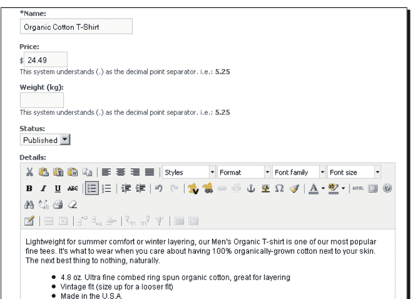

5. 点击 **Submit** 并查看网站上的 **Shop** 页面。

### What just happened?

你已向 **Products** 模块添加了第一个产品。该产品在页面上显示了 **Price** 和 **Weight**（我们稍后可以删除此字段）。点击产品链接以查看产品的详细视图。模板看起来很技术化，但有了一些 HTML、CSS 和 Smarty 知识，你稍后可以改变其外观和感觉。让我们先专注于模块的功能，而不是设计。

在 **Product Manager** 中添加更多产品，并在 **Shop** 页面上查看产品列表。请注意，每个产品的详细视图都以相同的方式显示。在 **Products** 模块中，已经定义了一些字段，如 **Price** 和 **Weight**。但你需要添加自己的字段。

### Creating custom fields

通常在线商店中可以找到一个或多个产品的图片。然而，并没有专门的图片字段可以上传产品图片。幸运的是，你可以添加任意数量的自定义字段。在下一步中，你将创建一个自定义字段，可以在此上传产品的图片。在 **Product Manager** 的管理区域中，选择选项卡 **Field Definitions** 并点击链接 **Add A Field**。

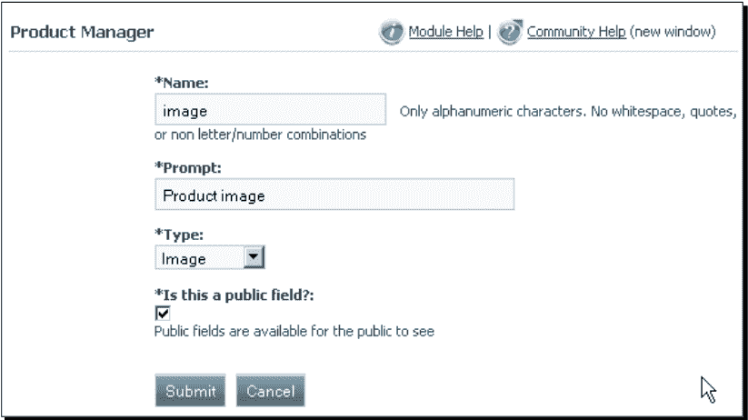

**Name** 是一种技术性字段，不会显示给你的访客。你不应在字段名称中使用任何特殊字符或空格。只使用字母和数字，不要使用连字符、斜杠或其他任何非字母数字字符。

**Prompt** 字段是你在 **Product Manager** 的管理区域中添加或编辑产品时看到的字段标签。你可以在此字段中使用任何字符。

字段的 **Type** 应为 **Image**。选择此类型可确保该字段在管理区域中显示为文件上传字段。此字段也将被验证，因此只有图片可以上传到这里。此外，上传后会自动为上传的图片创建缩略图（小预览版本）。

通过选中 **Is this a public field?** 的复选框让该字段公开。这意味着该字段的内容（图片本身）将显示给商店的访客。如果你将其设为私有，只有网站管理员可以在模块的管理区域中看到该字段。

保存该字段。该字段会自动添加到页面上的详细模板以及 **Product Manager** 管理区域中的产品编辑视图中。为了测试该字段，在管理区域中打开任意产品进行编辑，找到字段 **Product image (Prompt)**，并使用该字段为产品上传图片。

控制该字段在网站上产品详细视图中的显示方式。产品的小预览版本被添加到详细视图的 **Custom Fields** 部分。我们仍然不关心它看起来如何，而关心它如何工作。当我们准备好所有自定义字段和产品层级时，我们将更改产品的详细视图。

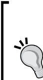

> **Image already exists**
>
> 当你尝试两次上传同一张图片时，你会收到一条错误信息，提示该图片已被上传。要控制为产品保存了哪些图片以及删除它们，请在管理控制台中打开 **Content | File Manager**。找到文件夹 Products，然后找到文件夹名称 `product_[ID]`。产品的 ID 显示在管理区域的产品列表中。点击此文件夹并删除已上传的图片。现在，你可以在 **Product Manager** 的管理区域中再次上传同一张图片。

### Define your own fields

创建尽可能多的自定义字段来显示和管理产品。通过字段的 **Type** 你决定该字段在管理区域中如何显示。字段在页面上的输出可以完全自定义，并且不依赖于类型。

如果你需要一个 **Product Number** 字段，创建一个新的自定义字段（**Text Input**），最大长度为 12 个字符，并使该字段公开。然后编辑你的每个产品并在此字段中输入一个号码。你可以在 **Field Definitions** 选项卡下调整字段的顺序。再次说明，此顺序仅适用于产品管理的管理区域的外观；页面上的输出可以完全不同。

### Creating a product hierarchy

接下来，让我们创建一个产品层级。在我试图在此处复现的官方商店中，有四个层级项：

- Shirts (short)
- Shirts (long)
- Home & Office
- Mugs

你应该理解 Product Manager 模块中产品分类和产品项之间的区别。产品分类有点像产品的标签。不可能将它们排列成层级结构。然而，如果你愿意，可以将一个产品分配给多个分类。与分类不同，一个产品只能属于一个层级项。这意味着上述结构应作为层级实现，而不是作为分类。一个产品不能同时是衬衫和马克杯。

我们稍后将使用分类来标记产品为：

- New
- Popular
- Discounted

分类将允许你使一个产品同时为新品和折扣品。层级则不会，因为不支持多重分配。

在 Product Manager 的管理区域中，点击 Product Hierarchy 选项卡并创建第一列表中显示的四个层级项。你可以选择是否向层级添加任何描述或图片，也可以将其留空。

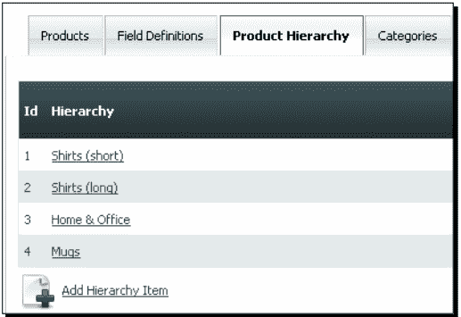


创建层次结构后，请检查已创建的产品，并将它们分配到相应的层次项目。现在，该层次结构可以显示在页面的侧边栏导航中。打开主页模板（布局 | 模板），找到带有侧边栏导航的部分。添加产品层次结构的 Smarty 标签，如下所示：

```
{Products action="hierarchy"}
```

## 自定义产品模板

产品层次结构模板的显示非常技术化。让我们自定义该模块的所有模板。共有三个：

- 摘要模板
- 详细模板
- 层次结构报表模板

让我们从层次结构报表模板开始。该模板定义了侧边栏中层次结构的显示方式。在产品管理器的管理区域中，单击“层次结构报表模板”选项卡，找到现有的层次结构模板列表。默认使用的是 Sample 模板。您可以自定义此模板，或通过单击“新建模板”链接创建自己的模板。我选择第二种方式。通常建议不要修改示例模板，而是创建自己的模板并将其设置为默认模板。这样，您可以从自定义模板中删除任何内容，如果需要从自定义模板中移除某些部分，可以参考 Sample 模板。对于模板名称，我选择了“My Shop”。当然，您可以使用任何想要的名称。

在“模板文本”字段中，已经提供了示例模板代码。请保留此代码并提交新模板。现在您会在列表中看到两个模板。通过单击“默认”列中的红色叉号，将模板“My Shop”设为默认模板。让我们看看模板中有什么，以及我们实际需要什么。打开新模板进行编辑：

| Smarty 变量 | 描述 |
|---|---|
| {$hierarchy_item.name} | 层次项目的名称。 |
| {$hierarchy_item.id} | 层次项目的 ID。 |
| {$upurl} | 指向父层次项目的 URL。仅当存在多个层次级别时适用。 |
| {$mod} | 包含有关 Products 模块所有信息的对象。在模板中，该对象用于获取翻译：{$mod->Lang('parent')} 从翻译文件返回键为 parent 的翻译。如果您的网站是单语言的，并且网站语言永远不会更改，则可以用自定义文本替换此变量。 |

```
    {$node.name}
    {/if}
    </h3>
    {if !empty($node.description)}
    <div>{$node.description}
    </div>
    {/if}
    {/foreach}
{/if}

<!-- This tag will be automatically added to the page content.
    It uses the default summary template for products. -->
{Products hierarchyid=$hierarchy_item.id}
```

该模板遍历每个层次结构，并将其名称显示为 HTML 标题 `<h3>`。它还会在标题下方显示层次项目的描述字段。模板中的最后一个 Smarty 标签显示产品摘要列表，该列表仅限于在侧边栏中选择的层次项目。此摘要列表的模板是默认的摘要模板。产品摘要列表将自动替换页面内容。

在自定义摘要模板之前，请打开它（内容 | 产品管理器，“摘要模板”选项卡，模板 Sample），并找出该模板的主要部分。它包括：

- 类别下拉列表
- 页面导航
- 产品列表，每个产品都带有加入购物车功能

目前，您只能看到产品列表，没有类别、页面导航和购物车功能。

在当前版本的模块中，按示例模板中添加的方式显示类别下拉列表并不起作用：

```
    {if isset($catformstart)}
        {$catformstart}
        {$catdropdown}{$catbutton}
        {$catformend}
    {/if}
```

该功能仍有可能在模块的后续版本中添加。目前，您可以完全删除此部分，或将其替换为如下所示的 Smarty 标签：

```
{Products action="categorylist"}
```

```
```css
{
    float: left;
    padding: 15px;
    text-align: center;
}
```
```

这只是一个示例；您可以根据自己的设计自由添加任何样式。

上传产品图片时创建的缩略图大小可以在 **偏好设置（内容 | 产品管理器）** 选项卡中更改。在此页面上，向下滚动到 **图像处理设置** 部分，然后根据您的喜好调整数值。

如果您已经使用了我的模板，那么您的摘要模板和层次结构应如下图所示：

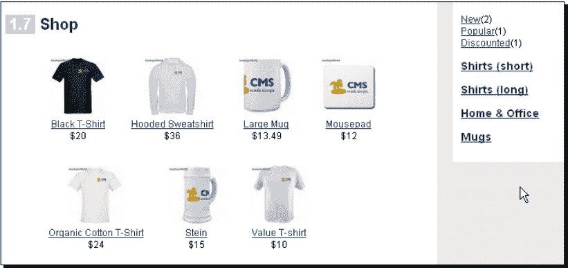

最后一步将是自定义产品的详细视图。在 **Products** 模块管理区域的 **详细模板** 选项卡下，创建一个名为 **My Shop** 的新模板。然后将该模板设置为默认模板。

在详细模板中，您会找到一个用于产品属性的部分。我们之前没有讨论过它。产品可以有不同的属性，例如 T 恤的尺寸或颜色。这些属性可能会或可能不会影响价格。对于每个产品，属性都是单独添加的。如果我们只有一种型号，那么为鼠标垫添加尺寸或颜色就没有意义。

让我们为长 T 恤创建颜色属性。假设我们有两种可用颜色：白色和灰色。颜色不会改变产品的价格。在 **Products** 模块的管理区域中，单击 **Products** 选项卡。在产品列表中，每行末尾都有一个 **编辑属性集** 图标。单击您要添加属性的产品所在行上的此图标。

在下一个屏幕上，单击 **添加属性**。输入属性的名称。此名称包含通用术语，如“颜色”。在 **标签** 字段中，输入属性名称，就像它应该出现在网站上一样。由于 T 恤的颜色不会改变产品价格，请在 **价格调整** 字段中输入 **0**，然后点击 **更新**。为颜色 **灰色** 添加另一个标签。它应如下图所示：

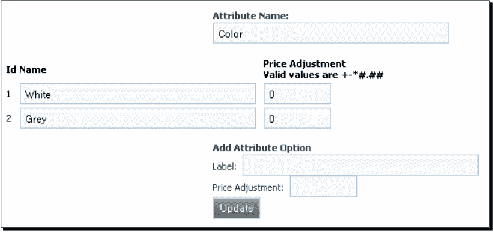

为该属性输入所有可能值后，单击 **提交**。查看带有已定义属性的产品的详细视图。所有可能值都列在模板中。当您以后安装 **购物车** 模块时，您不仅能够显示属性，还可以将它们添加到购物车。价格将在购物车视图中自动调整。

您现在应该能够自行自定义详细模板。

请按照以下步骤操作：

- 1. 创建一个新模板，不要覆盖示例模板。如果您从自定义模板中删除了任何部分，**示例模板**可用于将来参考。
- 2. 分析模板。尝试找出其主要部分以及其中其他模块的用法。
- 3. 将模板中使用的所有 Smarty 变量写入表格，如前面对 **层次结构报表模板** 所做的那样。
- 4. 弄清楚这些变量中保存了哪些值。如果变量包含数组，请使用 Smarty 修饰符 `print_r` 获取其所有数组值。例如，`{$entry|print_r}` 将输出此变量中包含的所有值。
- 5. 使用 HTML 和 Smarty 标记模板。
- 6. 添加样式表定义以更改外观。

## 创建产品的详细视图

按照上面的列表，为产品的详细视图创建您自己的模板。删除模板中不需要的所有内容；例如，“重量”字段。以与在摘要模板中相同的方式分配自定义字段（产品图片和产品编号）。如果不确定必须使用什么，请使用修饰符 `print_r` 检查变量的值。

我的详细模板如下图所示：

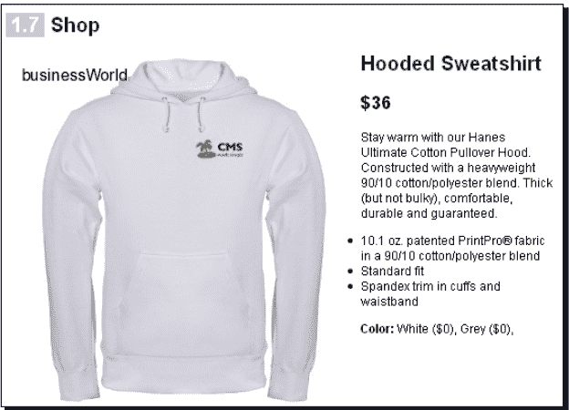

我用于详细模板的模板代码如下面的代码片段所示：

```
```html
<div class="products-detail">
  file_location}/{$entry->fields.image->value}" alt="{$entry->product_name}"/>
  <h1>{$entry->product_name}</h1>
  <h2>{$currency_symbol}{$entry->price}</h2>
  <div>{$entry->details}</div>
```
```


```
{* print out attributes *}
{if isset($entry->attributes)}
  {foreach from=$entry->attributes key='name' item='attribset'}
    <p><strong>{$name}:</strong>
      {foreach from=$attribset key='label' item='adjustment'}
        {$label} ({$currency_symbol}{$adjustment}),
      {/foreach}
    </p>
  {/foreach}
{/if}
  {* include the cart *}
  {if isset($cart_module_tag)}
  {eval var=$cart_module_tag}
  {/if}
</div>
```

现在，你已经准备好为你的解决方案添加购物车功能了。

## 购物车模块

该模块将为**产品**模块添加简单的购物车功能。安装后，**购物车**模块将自动显示在产品详情视图中。网站访客随后将能够将一件或多件产品及其所需数量放入购物篮。除了**购物车**模块，你还可以使用其他模块，例如**礼品篮**。对于我们的示例**商店**，使用**购物车**模块的简单功能就足够了。

在**模块管理器**中的可用模块列表中安装**购物车**模块。该模块的管理区域将被添加到 CMS Made Simple 管理控制台的**扩展 | 购物车**下。

## 动手实践——连接产品与购物车

如果你现在查看**商店**页面并打开任意产品的详情视图，你会发现其中仍然没有购物车功能。原因是**产品**模块并不知道**购物车**模块已经安装并可供使用。让我们来连接这两个模块。

- 1. 打开**产品**模块的管理区域（**内容 | 产品管理器**）。
- 2. 点击**偏好设置**选项卡。
- 3. 从**购物车模块**字段中选择**购物车**模块。
- 4. 点击提交，然后打开任意产品的详情视图。你应该会在产品详情视图中看到“添加到我的购物车”按钮。如果产品除数量字段外还有一些属性，那么这些属性会显示在其旁边的下拉字段中。

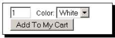

## 刚才发生了什么？

你已经告诉**产品**模块，需要使用哪个模块来实现购物车功能。现在测试一下，立即向购物车中添加一些产品。产品会被添加成功，但目前访客还无法看到购物车的内容。

创建一个名为“购物车”的新内容页面，并将以下 Smarty 标签添加为该页面的内容：

```
{Cart action="viewcart"}
```

保存页面，然后打开**购物车**模块的管理区域（**扩展 | 购物车**），切换到**偏好设置**选项卡。在页面列表中选择刚刚创建的页面，这样访客将产品添加到购物车后会自动重定向到该页面。

该模块有四个模板可供你自定义：

| 模板 | 描述 |
|---|---|
| AddToCart | 该模板控制数量字段、“添加到我的购物车”按钮（见前面的截图），以及可选的产品属性及其价格调整的显示样式。 |
| MyCart | 该模板用于显示购物车状态。它显示在放置 Smarty 标签 `{Cart action="mycart"}` 的位置。它显示当前保存在购物车中的商品数量，并提供指向购物车页面的链接。 |
| Viewcart | 该模板用于扩展显示购物车中保存的所有产品。它显示所有产品的数量、价格以及订单总价。此外，如果已安装订单模块，它还提供启动结账订单流程的可能性。 |
| Product Summary | 该模板用于格式化 Viewcart 模板中每个产品摘要的输出。它允许你根据属性、产品名称和价格自定义产品标签。 |

从这个依赖列表中，你可以了解到它基于 **FrontEndUsers** 模块的功能。这意味着你网站的客户必须先注册，然后才能在你的在线商店中开始支付流程。这个注册过程无法关闭，并且是结账步骤所必需的。

安装前面依赖列表中列出的所有模块，然后安装 **订单**模块。

## 动手实践——添加结账步骤

要启用**订单**模块提供的结账流程，请按照以下步骤操作：

- 1. 创建一个新的内容页面（**内容 | 页面 | 添加新内容**），并将其命名为**结账**。
- 2. 将以下 Smarty 标签添加到**结账**页面的**内容**字段中：

  ```
  {Orders}
  ```

- 3. 在浏览器中保存并查看该页面。如果用户已登录，此页面将显示账单表单；如果用户未登录或不属于特定用户组，则显示警告消息。
- 4. 要连接**购物车**模块与新的**结账**页面，请在管理控制台中点击**扩展 | 购物车**。
- 5. 选择**Viewcart 表单模板**选项卡，然后点击**Sample**模板（或你自己的模板，如果你已创建了一个）。
- 6. 在**模板文本**字段的模板末尾，添加以下代码行：

  ```
  {cms_selflink page="checkout"}
  ```

- 7. 打开你的商店，将一件或多件产品添加到购物车，然后在屏幕最底部找到指向**结账**页面的链接。

```
{Orders}
```

```
{cms_selflink page="checkout"}
```

> 参数 `page` 应包含已将 Smarty 标签 `{Orders}` 添加到内容中的页面的页面别名。

## 刚才发生了什么？

你通过从购物车视图放置指向结账流程的链接，将**购物车**模块与**订单**模块连接了起来。要测试该链接，请向购物车中添加一些产品，然后点击购物车视图底部的**结账**链接。如果未登录，你将看到以下消息：

## 用户未登录（或不是所需组的成员）

这条消息可以在**订单**模块的模板中找到。不过，首先让我们看看该模块附带的模板概览。在管理控制台中，点击**内容 | 订单管理器**，然后在订单列表上方找到**模板**链接：

| **账单表单** | 该模板控制订单处理的第一步。它显示一个表单，客户可以在其中输入账单地址以及一个或多个送货地址。 |
| **支付表单** | 该模板控制订单处理的第二步，用于显示基于手动电子邮件结账流程的支付表单。如果你不使用 PayPal、EMoney、eWay 或 Authorize.Net 等支付服务，你将需要此模板。 |
| **确认订单** | 该模板控制订单处理的第三步，用于显示客户在第一步（以及可选的第二步）中输入的任何信息，以便客户确认送货地址和发票地址，或返回修改。 |
| **发票** | 该模板在**订单**模块的管理区域中使用，用于打印发票或通过电子邮件将其发送给客户。 |
| **网关完成** | 该模板用于在使用 PayPal、EMoney、EWay 或 Authorize.net 等第三方服务完成支付后显示状态消息。 |
| **用户邮件** | 该模板用于自定义在新订单提交后发送给客户的订单确认电子邮件。 |
| **管理员邮件** | 该模板控制新订单提交后发送给商店授权管理员的电子邮件的布局和内容。 |
| **消息** | 消息没有示例模板。你可以在其中定义自定义电子邮件通知，并从模块的管理区域手动发送给客户。此类消息的一个示例是在订单发货时发送的电子邮件通知。 |

现在，我们知道了从哪里开始，以及如何根据我们的需求和支付配置进行模板定制。让我们为客户提供注册或登录网站的机会，以便他们能够完成结账流程。


## 集成登录屏幕

提示客户未登录的消息保存在模板 **Billing Form**（结账流程的第一步）中。

用户未登录（或不是所需组的成员）。

这并不太友好。无论用户是否已注册，我们都应在此页面为其提供登录或注册的可能性，如以下屏幕截图所示：

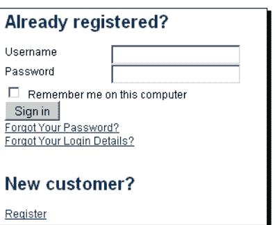

已注册客户的登录表单可通过模块 **FrontEndUsers** 显示。该模块在第 8 章 *Creating Your Own Functionality* 中 *Managing visitors' logins* 部分有讨论。如果您尚未安装该模块，请使用 **Module Manager** 进行安装并在网站上查看登录表单。客户可注册的页面链接将由后续讨论的 **SelfRegistration** 模块提供。

在 **Orders** 模块的管理区域中，单击 **Templates** 链接并在 **Billing Form** 选项卡上创建一个名为 **My Shop** 的新模板。将建议的模板文本滚动到最底部，找到最后一个 ELSE 条件：

```
...
{else}
  {* user is not logged in, gotta make him *}
  <h3 style="color: red;">{$Orders->Lang('error_notloggedin')}</h3><br/>
{/if}
```

这是显示用户未登录消息的位置。用模块 **FrontEndUsers** 的登录屏幕替换此部分，如以下代码片段所示：

```
...
{else}

<h1>Already registered?</h1>
{FrontEndUsers}

{/if}
```

保存模板并不要忘记将其设为 **Default** 以在网站上看到更改。已注册客户现在可以登录以开始结账流程。

但是，对于没有账户的客户怎么办？他们应该能够自行在我们的网站上注册。由于流程有点复杂，我制作了以下流程图：

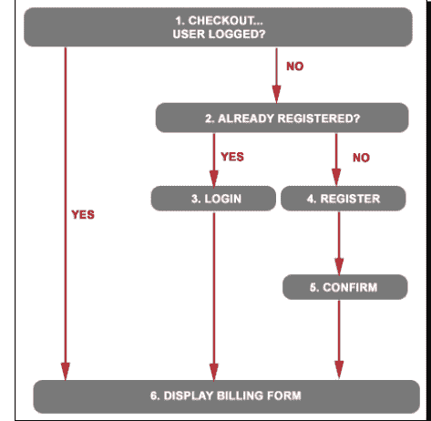

账单表单会检查访客是否已登录。如果已登录，他可以填写账单信息；如果未登录，则显示 **FrontEndUsers** 模块的登录表单（步骤 3）。工作流中的步骤 4 和 5 应通过允许他们注册来帮助新客户。这些步骤可通过 **SelfRegistration** 模块完成。请阅读下一节，了解如何配置该模块。

继续之前请确保：

- **CMSMailer** 模块已配置并且能够发送消息（请参阅第 2 章 *Getting Started*）。
- 在模块 **FrontEndUsers** 中存在类型为 **Email Address** 的用户属性（**Users & Groups | Frontend User Management**，选项卡 **User Properties**）。
- 存在一个具有上述用户属性关联为 **Required** 的用户组（**Users & Groups | Frontend User Management**，选项卡 **Groups**）。

您可以在第 8 章 *Creating Your Own Functionality* 中阅读如何配置 **FrontEndUsers** 模块。

## 集成客户注册

该模块旨在允许网站访客自行注册。它可选择发送一封包含激活链接的确认电子邮件，必须在注册完成前点击该链接。注册完成后，模块 **FrontEndUsers** 中会创建一个用户账户。

从 **Module Manager** 中可用模块列表安装 **SelfRegistration** 模块。对于注册页面，创建一个新的内容页面 **Register** 并将以下 Smarty 标签添加到页面的内容中：

```
{SelfRegistration group="Customers"}
```

请注意上面代码中加粗的部分。参数 group 的值应与模块 **FrontEndUsers** 中用户组的名称完全一致（**Users & Groups | Frontend User Management**，选项卡 **Groups**）。如果您目前还没有任何用户组，请阅读第 8 章 *Creating Your Own Functionality* 以了解应如何配置 **FrontEndUsers** 模块。

打开您网站的 **Register** 页面并使用 **SelfRegistration** 模块以新客户身份自行注册，以查看模块的默认工作方式。模块中存在一些首选项可使注册流程更友好。在 **Self Registration** 模块的管理区域（**Users & Groups | Self Registration Module**）中，单击 **Preferences** 选项卡。

**SelfRegistration** 模块提供带电子邮件验证步骤的注册，或可选的无需确认的单步注册。如果您不需要电子邮件验证，应在模块的 **Preferences** 选项卡上取消选择选项 **Require the user to confirm registration via email**。根据所选择的注册方法，关于最终消息的三个设置的工作方式不同。

| 设置 | 带验证 | 不带验证 |
|---|---|---|
| **Don't display the final message after registration** | 防止注册表单在提交后被确认消息替换。 | 防止注册表单在提交后被最终消息替换。 |
| **PageID/Alias to redirect to after registration is complete** | N/A | 重定向到给定页面，但用最终消息替换页面的全部内容。 |
| **PageID/Alias to redirect to after verification step is complete** | 重定向到给定页面，但用最终消息替换页面的全部内容。 | N/A |

根据工作流程，让我们为新客户添加一个指向注册页面的链接（步骤 4）。在 **Orders** 模块的账单模板中，再次打开 **Billing Form** 的模板，向下滚动并按以下代码片段所示为新客户添加指向注册页面的链接：

```
...
{else}

<h1>Already registered?</h1>
{FrontEndUsers}

<h1>New Customer?</h1>
{cms_selflink page="register"}
{/if}
```

## E-commerce Workshop

请注意参数 page。它应包含显示注册表单的页面的别名。自定义 **SelfRegistration** 模块中显示注册表单的 **Registration Template 1**。通常有两个模板。第一个用于注册表单，第二个（**Post Registration Template**）包含通知客户其注册应通过发送到其电子邮件地址的链接进行确认的消息。您可以自定义的其他模板如以下表格所示：

| 模板 | 描述 |
|---|---|
| **Registration Template 2** | 该模板包含用于添加用户名、验证码和密码以完成注册的表单。 |
| **Confirmation Email** | 包含验证电子邮件的主题、客户注册后发送的电子邮件的纯文本和 HTML 版本。 |
| **Final Message** | 注册流程完成后显示给客户的消息。为构建前面建议的工作流程（步骤 5），在此模板中添加指向账单表单的链接，以便用户可以继续结账流程。还建议勾选选项 **Login user after registration**，以便注册后可跳过登录步骤。 |
| **Lost Email** | 该模板包含一个表单，用于已注册但未收到验证电子邮件的客户。该模板显示在 Smarty 标签 `{SelfRegistration mode="sendmoremail"}` 显示的位置。 |

当用户在网站上注册并且需要电子邮件验证时，临时用户账户保存在 **SelfRegistration** 模块中（不是 **FrontEndUsers**！）。电子邮件验证完成后，新用户账户会自动移至 **FrontEndUsers** 模块。同时，临时账户会从 **SelfRegistration** 模块中删除。

**SelfRegistration** 模块中临时账户的上限为 250 个。当达到 250 个未验证账户的数量时，无法进行注册。因此您可通过 **Preferences** 选项卡上的选项从 **SelfRegistration** 模块中清除。

在配置完 **SelfRegistration** 模块并自定义所有必需模板后，您可以进行整个基于手动电子邮件的结账流程。

我建议您使用工作流程测试所有三种情况：

- 访客已注册并已登录
- 访客已注册，但未登录
- 访客未注册


从**模块管理器**中的可用模块列表中安装 **Paypal Gateway** 模块。该模块的管理区域位于 **扩展 | Paypal Gateway**。点击 **偏好设置** 选项卡。模块使用需要一些字段，如下面的截图所示：

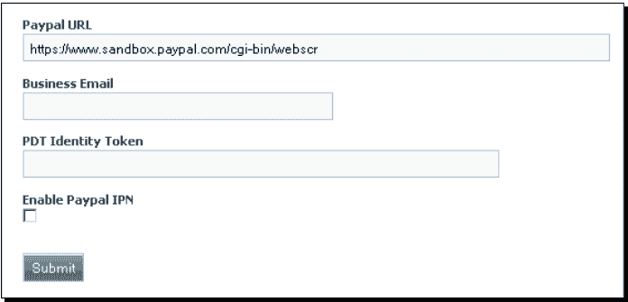

在测试电子商务解决方案时，您自然不会使用真实的 PayPal 账户。建议的 **Paypal URL** 指向 PayPal 服务的官方测试环境。该环境模拟支付过程，而不会进行真实的资金转账。

该环境可以在 `http://sandbox.paypal.com` 上找到。它的运作方式与真实 PayPal 网站相同。

## 行动时间——创建测试账户

在使用此环境之前，您必须在 `http://developer.paypal.com` 上注册一个开发者账户，并创建两个测试账户。

- 1. 在浏览器中打开 `http://developer.paypal.com`，点击 **立即注册**。
- 2. 填写字段，点击 **同意并提交**。
- 3. 使用您的电子邮件和密码登录您的开发者账户。
- 4. 点击 **创建预配置的买家或卖家账户**。
- 5. 选择 **买家（用于代表您客户的体验）**，并用任意测试数据填写该字段。点击 **创建账户**。
- 6. 创建另一个账户，但这次选择 **卖家（用于代表您自己作为商家）** 作为 **账户类型**。

**7.** 两个账户都创建后，点击左侧的 **测试账户**。您应该会看到测试账户的概览，如下面的截图所示：

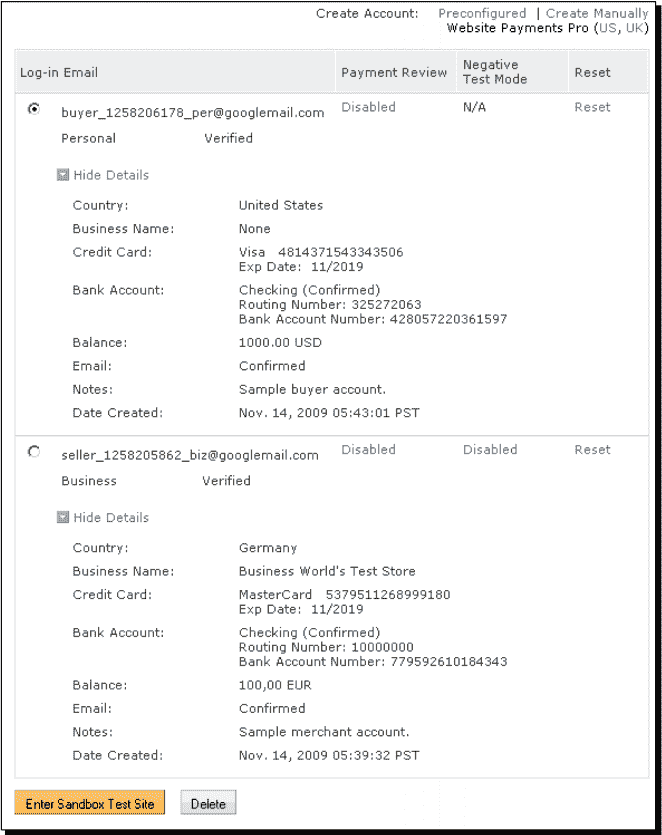

## 刚才发生了什么？

您已经创建了两个测试账户，一个用于买家，一个用于卖家。创建此类账户最简单的方法是选择预配置的账户。现在，您可以在 `http://sandbox.paypal.com` 上使用买家账户登录，并像您自己的客户一样操作。您可以购买任何物品而无需支付真实金钱。

您还可以使用卖家账户登录 http://sandbox.paypal.com 进行配置。您必须为该账户激活 PDT 和 IPN 功能，获取 PDT 身份令牌，并在您的 PayPal 账户上进行更多设置，以便即时支付与 Paypal Gateway 模块配合工作。

## 配置 PayPal 的卖家账户

点击卖家账户中的个人资料链接。您需要自定义四个部分，以便通过网站设置 PayPal 支付。

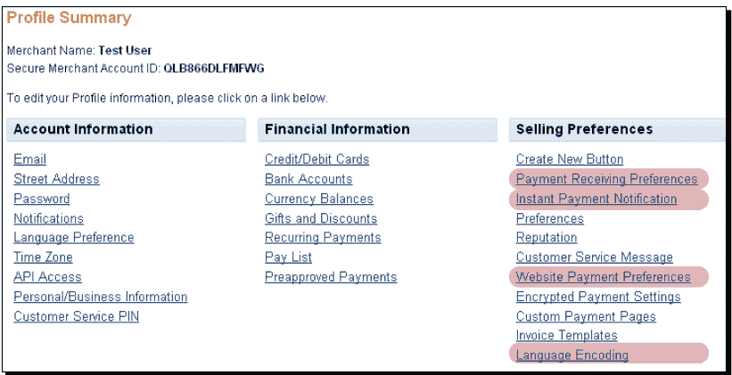

## 收款偏好

首先，决定您是否要手动接受以其他货币支付的款项。这仅适用于您的 PayPal 账户的默认货币与 Products 模块的偏好设置选项卡中设置的货币不同的情况。例如，如果您的 PayPal 货币是欧元，但在您的网页上产品以美元提供。通常，PayPal 不会自动转换任何货币。这意味着所有以其他货币支付的款项都将被保留，直到您在 PayPal 账户中手动接受它们。一旦接受付款，订单状态将设置为“已支付”。如果您希望自动转换货币并接受任何货币的付款，您必须取消选择“阻止我未持有的货币向我发送的付款”这一设置。

其次，您可以阻止所有状态为“待处理”的付款。这将拒绝所有在付款确认后未立即完成的付款。请注意，如果激活了 IPN，Paypal Gateway 模块能够处理待处理的付款。

这是您生成的 PDT 身份令牌，您需要将其保存在 **Paypal Gateway** 模块的 **偏好设置** 选项卡中。

## 语言编码

在此页面上，您应该调整语言编码。CMS Made Simple 默认使用 UTF-8 编码。点击 **更多选项** 按钮，并在 **编码** 字段中选择 UTF-8。为 IPN 保留相同的编码并保存。

现在，您已经拥有配置 **Paypal Gateway** 模块所需的全部信息。在 **Paypal Gateway** 模块的管理区域中，点击 **偏好设置** 选项卡，并输入您从 PayPal 沙箱环境中获得的自定义值。**Paypal Gateway** 模块中的 **Business Email** 字段包含卖家账户生成的电子邮件地址。下面的截图显示了我的自定义值：

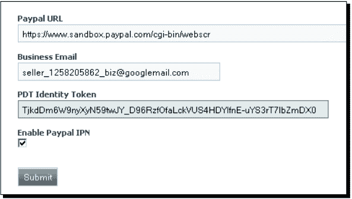

接下来，将 **Orders** 模块与 **Paypal Gateway** 模块连接。在 **Orders** 模块的管理区域中，点击 **偏好设置** 选项卡，向下滚动到 **支付网关设置** 部分。在支付模块列表中选择 **Paypal Gateway** 模块，然后点击 **提交**。

现在测试您的订单流程。注意账单表单中的 **Email** 字段，必须填写它才能进行 PayPal 支付。付款完成后，您必须检查卖家 PayPal 账户中的付款状态。它应该是“已完成”。在 CMS Made Simple 的管理控制台中，点击 **站点管理 | 管理日志**，查看与 PayPal 网站的通信协议。对于每个通过 PDT 和 IPN 完成的订单，您应该有五条消息，如下面的截图所示：

| 用户 | 项目 ID | 项目名称 | 操作 |
|---|---|---|---|
| webmaster | 0 | PaypalGateway | 收到交易 12Y48348G3951362M 的成功回复 |
| webmaster | 0 | Orders | 订单 16 的状态更改为“待处理” |
|  | 0 | PaypalGateway:ipn | IPN 交易 12Y48348G3951362M 成功。状态：已完成 |
|  | 0 | Orders:gateway_event | 已为订单 16 处理异步交易 12Y48348G3951362M |
|  | 0 | Orders | 已收到订单 16 的付款。 |

订单处于待处理状态的原因是 IPN 功能已激活。该模块将订单设置为待处理状态，直到从模块收到 IPN 消息为止。因此，上述五条消息的结果是在 CMS Made Simple 的管理控制台中生成一个已完成且已付款的订单。

一旦您测试了该模块，您应该按照前面的说明配置您的真实 PayPal 账户，从真实账户收集所有必需的信息（如 PDT 身份令牌），并将 PayPal URL 更改为 https://www.paypal.com/cgi-bin/webscr。

## 电子商务套件的可选模块

还有一些模块可以与这个电子商务套件一起使用，以丰富其功能：

- **统一税率税**：允许您对 **Products** 模块中的任意产品或所有产品应用统一税率税。
- **仓库税**：根据仓库所在的美国州和客户所在的美国州计算产品的税费。
- **FlatRateShipping**：提供一个界面来设置一些简单的重量运费规则，并根据其总重量计算运费成本。
- **基于目的地的配送**：允许根据目的地国家和物品数量计算固定运费。它在计算中不考虑重量。
- **PriceBasedShipping**：允许根据税前的订单总价计算运费成本。

- 4. 如果您想在网站上测试 PayPal 功能，您可以使用所谓的沙箱环境。关于 PayPal 沙箱，以下哪项是正确的？
  a. 它会向您的真实 PayPal 账户收费。
  b. 它可以用于创建用于测试目的的卖家账户。
  c. 它只能使用美元作为货币。
  d. 它不是免费的。

- 5. 本章描述的电子商务解决方案要求客户在购买前创建账户：
  a. 正确
  b. 错误

## 总结

在本章中，您学习了如何使用 CMS Made Simple 设置基本的电子商务功能。即使 CMS Made Simple 并不自称提供完全成熟的电子商务功能，它也通过自带的模块提供了最常被需要的功能。

请确保不要将 CMS Made Simple 用于纯粹的电子商务网站。对于在线商店，最好使用专门的电子商务解决方案，而不是 CMS Made Simple。但是，如果您的网站具有博客、商店、论坛等多种功能，那么您可以使用第三方模块来实现这些功能。

具体来说，我们涵盖了：

- **Products** 模块，允许您为在线商店创建和编辑产品。该模块是电子商务套件的基础。
- **Cart** 模块，为 **Products** 模块添加了简单的购物车功能。它将数据保存在浏览器会话中，并将 **Product** 模块与 **Orders** 模块连接起来。
- **Orders** 模块，为添加到购物车的商品启动结账流程。该模块将所有订单保存在管理区域，并允许网站管理员跟踪和更新订单状态。
- **SelfRegistration** 模块，允许网站访客在付款前向您的网站注册。我们还创建了一个小型工作流程，以了解该模块如何集成到结账流程中。
- **PayPal Gateway** 模块，接受来自 PayPal 网站的即时支付，并让您随时了解支付状态。


## 电子商务研讨会

现在我们已经学会了如何实现一个包含电子商务功能的完整网站，我们可以继续学习高级主题，这些主题需要基础的PHP知识，这将是下一章的内容。届时，你的网站已经完全可用并可以发布，因此你不需要下一章的扩展主题就能拥有一个完整的网站。
