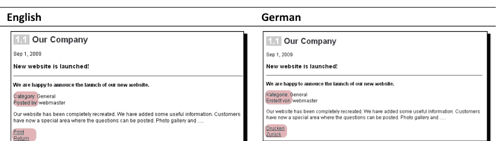
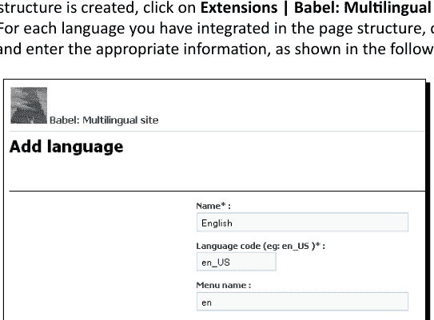
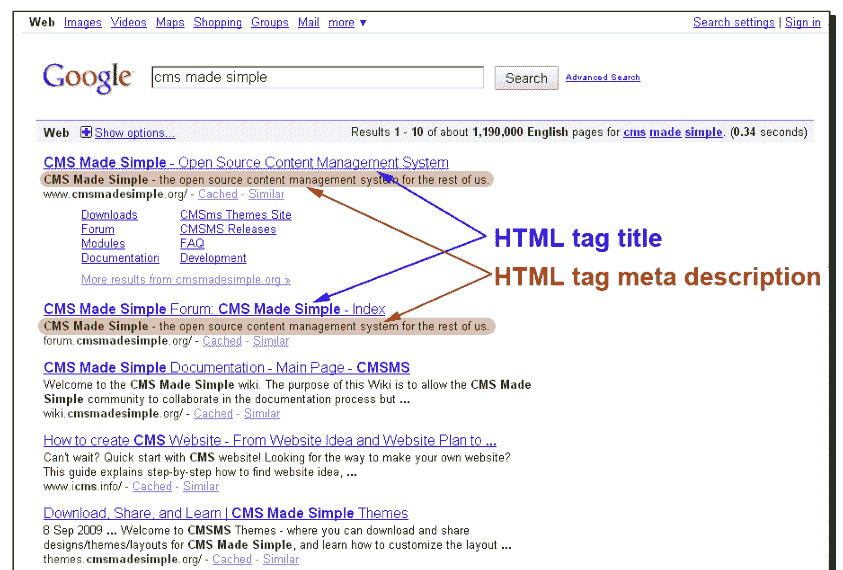
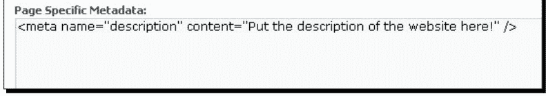
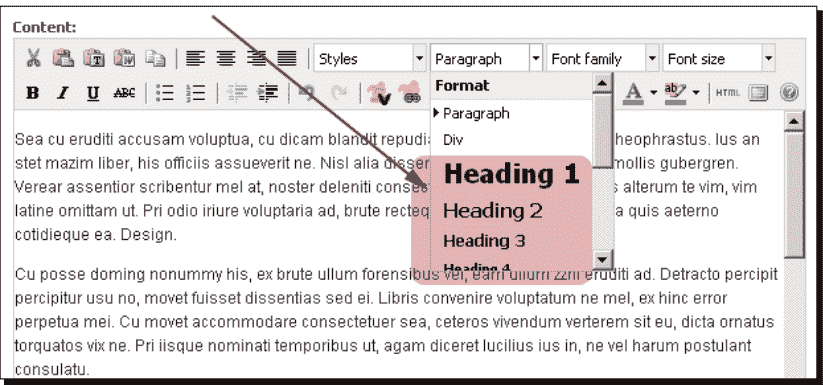
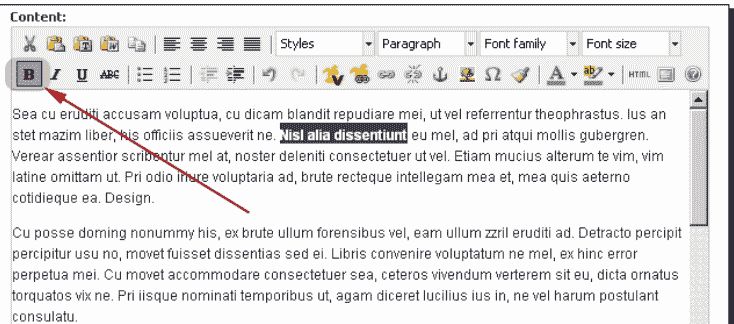
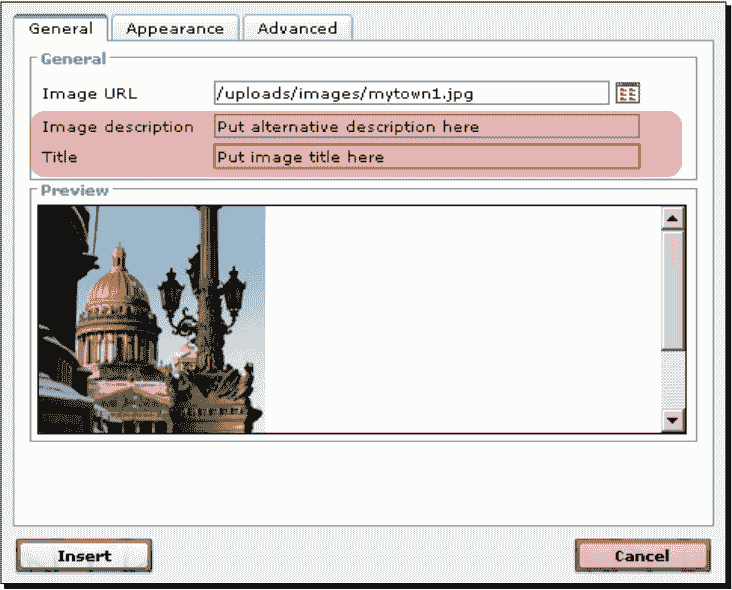

## CMS Made Simple 的高级使用

> 本章为使用CMS Made Simple创建网站的高级站长提供一些提示。你无需阅读整章，只需挑选对你最重要的部分。

在本章中，我们将：

- 学习如何使用CMS Made Simple开发多语言网站
- 为网站编辑器创建额外的布局控制选项
- 进行一些搜索引擎优化
- 使用用户定义标签和事件管理器来实现我们自己的功能或定义自定义工作流

你需要具备基础的PHP知识才能按照本章的说明操作。那么让我们开始吧。

### 本地化与翻译

CMS Made Simple 的管理控制台已被翻译成超过20种语言。正如你在第2章中已经了解到的，CMS Made Simple 分为两个版本发布。基础版本只包含英语语言文件，而完整版本包含所有语言文件。

如果你除了英语之外只需要一种语言（英语无法卸载），你可以下载基础包，然后下载所需的语言文件。语言文件可以在CMS Made Simple 官方网站（http://www.cmsmadesimple.org/）页面底部的 **Downloads | CMSMS Release** 部分找到（你只需要与你版本对应的文件）。要在基础安装中包含任何语言，请先下载并解压基础安装文件，然后下载与基础版本号对应的所需语言文件并同样解压。通过将语言文件夹复制到基础文件上来合并基础文件夹与语言文件文件夹的内容。然后像往常一样安装CMS Made Simple。

有权访问网站管理控制台的用户可以在其个人账户中选择首选语言（**My Preferences | User Preferences**）。对于基础安装，该字段中只显示 **English**。如果你安装了任何其他语言，它也会显示在 **Language** 下拉字段中。此设置不影响网站访问者所使用的网站语言。

要设置网站语言，请在管理控制台中点击 **Site Admin | Global Settings**，并更改 **Default language for the frontend**。如果此处未设置语言，则CMS Made Simple默认使用英语（**en_US**）。此设置将自动更改网站上某些模块的默认文本，例如 **Search** 模块中搜索按钮的标签，或 **News** 模块中的某些标签。



在上面的截图中，可以看到 **Category**（德语 *Kategorie*）、**Posted by**（德语 *Erstellt von*）等标签之间的区别。这将有助于定义大部分由模块显示的、已翻译成你所使用语言的标签。然而，仅当你的网站不是多语言且只使用一种语言时，这才有帮助。

### 配置日期

CMS Made Simple 时常需要输出日期和时间。尤其是对于新闻文章，正确的日期格式非常重要。

可以在管理控制台（**Site Admin | Global Settings**）的 **Date Format String** 字段中更改通用日期格式。日期格式应根据PHP格式函数 `strftime` (http://www.php.net/manual/en/function.strftime.php) 输入。下表显示了一些示例：

| 日期格式字符串 | 输出 |
|---|---|
| `%Y-%m-%d` | 2009-05-20 |
| `%a %d %b %Y` | Wed 20 May 2009 |
| `%a %d %b %H:%M:%S %Y` | Wed 20 May 15:53:40 2009 |

第一列根据允许的参数构建（请参阅最后一个链接以了解说明）。第二列显示页面上的结果。在 **Date Format String** 字段中输入第一列的参数，即可获得第二列所示的结果。

月份和星期名称取决于服务器的 `locale` 设置。在某些服务器上，你可以更改用于输出日期的语言。设置区域设置也会影响货币、小数分隔符以及其他依赖于语言的输出。在 CMS Made Simple 中，打开 `config.php` 文件，找到 `$config['locale']` 这一行。你在此处输入什么值取决于你的服务器。对于 Linux 服务器上的德语月份名称，请尝试更改该行，如下所示：

```php
$config['locale'] = 'de_DE.UTF8';
```

### 创建多语言网站

多语言网站使用不止一种语言创建。每种语言都有自己翻译后的导航、内容，可能还有翻译后的新闻文章。我们这里谈的不是由Google或任何其他工具进行的网站自动翻译。自动翻译很糟糕。它们往往让人无法阅读，而且毫无意义。在本节中，你将学习如何创建一个真正的多语言网站，其中所有内容都由人工翻译人员翻译。

你可以使用 **Babel** 模块来管理网站和导航的多种语言。安装该模块的方式与为网站安装其他模块相同（**Extensions | Module Manager**）。

安装模块后，为网站设置页面结构以匹配你需要的语言，例如：

- 1. 英语
  - 1.1. 我们的公司
  - 1.2. 公告
  - 1.3. 联系我们
- 2. 德语
  - 2.1. Unternehmen
  - 2.2. Aktuelles
  - 2.3. Kontakt

根语言页面（1. 和 2.）应定义为内容类型为“部分标题（Section Headers）”的页面。你可以为它们设置任何想要的标题。对于页面别名，我建议使用两个字母的ISO 639-1代码系统，例如en（英语）、de（德语）、fr（法语）。页面别名将用于网站URL，如 http://www.yourdomain/en/our-company 或 http://www.yourdomain/de/kontakt。

为了正确显示菜单（即不显示语言标题页面和属于其他语言的页面），你必须在主模板（Layout | Templates）的顶部菜单标签中添加参数 start_level="2"。打开模板，调整你的顶部导航，如以下代码片段所示：

```
{menu number_of_levels="1" start_level="2"}
```

这将确保在顶部导航中只显示属于所选语言的第二级页面。如果你使用侧边栏导航，也应通过减少起始级别数来更改这里的级别数：

```
{menu start_level="3"}
```

页面结构创建完成后，在管理控制台中点击 Extensions | Babel: Multilingual Site。对于你在页面结构中集成的每种语言，点击“添加语言”链接，并输入相应的信息，如以下截图所示：



**与该语言关联的根页面** 应为你在每种语言中创建的部分标题之一。**用于重定向到该语言的默认页面** 应为每种语言的起始页（而不是前一个字段中的部分标题）。对于 **语言代码**，你可以使用任意五个字符的代码，但为了与模块提供良好的兼容性，你应该使用与CMS Made Simple相同的语言代码。使用管理区域右上角的下拉列表，用默认值预填表单。

点击 **提交**，并确保你已在 **Active** 列中激活了该语言。以相同方式添加所有需要的语言。

要显示语言菜单，请在主模板中应显示不同语言链接的位置使用以下标签：

```
{babel action="menu"}
```

### 编辑语言条目

在 **Babel** 模块的管理区域，你会找到一个用于编辑每种语言的语言条目的链接。语言条目是每种语言都存在但包含不同文本（或HTML代码）的字符串。对于 **Search** 模块中的 *搜索* 按钮标签，你肯定希望有不同的描述，例如：

- 英语为 *Search*
- 德语为 *Suche*
- 法语为 *Recherche*，等等。

打开管理控制台中的 **Babel: Multilingual Site** 模块，点击 **编辑语言条目** 链接。点击模块管理区域右上角的 **添加新语言条目** 链接。在这里你可以为每种语言定义你自己的翻译。条目名称是一个通用键，用于获取正确的翻译。在我们的示例中，我们想要翻译搜索按钮的标签，因此翻译的键可以是 `search button`。在下面的字段中，为每种已定义的语言输入翻译，然后点击 **提交**。

在 **Search** 模块的模板（Extensions | Search，Search Template 选项卡）中自定义搜索按钮的标签，并将标签 `{$submittext}` 替换为 `{babel show="search button"}`，如以下代码片段所示：

```
{$startform}
<input type="text" class="search-input"
    id="{$search_actionid}searchinput"
    name="{$search_actionid}searchinput" size="18" maxlength="50"
    value="{$searchtext}" {$hogan}/>
<input class="search-button" name="submit" value="{babel show="search button"}" type="submit" />
{if isset($hidden)}{$hidden}{/if}
{$endform}
```


这将根据当前选择的语言显示搜索按钮上的正确标签翻译。你可以用同样的方式替换变量 `{$searchtext}`。在 **Babel** 模块中为搜索文本创建一个新的语言条目，对其进行翻译，然后在搜索模板中用对应的标签 `{babel show="[KEY]"}` 替换变量 `{$searchtext}`。

## 层级解决方案

**Babel** 模块使用页面层级来判断哪个页面在其他语言中是等价的。在我们的示例中，页面 *2.1. Aktuelles* 是英语页面 *1.1. Our company* 的德语等价物，因为它在德语分支的层级中处于相同位置。

换句话说，如果其他语言中的页面排序不同，一切都会乱套。

- 1. English
  - 1.1. Our company
  - 1.2. Announcements
  - 1.3. Contact Us
- 2. German
  - 2.1. Aktuelles
  - 2.2. Unternehmen
  - 2.3. Kontakt

在此示例中，*Aktuelles* 页面在德语分支中处于第一位置，因此它是英语中第一个页面的等价物，即使在逻辑上并非如此。

页面结构必须对每种语言都相同。这意味着所有页面必须在其他语言中都有等价物，否则在该特定页面上语言菜单中将不会显示指向其他语言的链接。如果你的结构不相同且某些页面未被翻译，则使用下面显示的方法。

## 将标志作为语言菜单添加

你可以在网站上为每种语言添加小的国旗图像。免费图像可以从 `http://www.famfamfam.com/lab/icons/flags/` 下载。将所需图像上传到文件夹 `/uploads/flags/`。在主页面模板（**Layout | Templates**）中，如以下代码片段所示，将指向每种语言起始页面的链接插入为小型国旗图标：

```
{cms_selflink page="our-company" image="uploads/flags/lang_en.gif" alt="English" imageonly=1}
{cms_selflink page="unternehmen" image="uploads/flags/lang_de.gif" alt="Deutsch" imageonly=1}
{cms_selflink page="entreprises" image="uploads/flags/lang_fr.gif" alt="Français" imageonly=1}
```

你可以用最后的代码片段替换标签 `{babel action="menu"}`。在这种情况下，你不需要为每种语言保持相同的结构。然而，以上标志始终指向另一种语言的起始页，而不指向另一种语言中该页面的等价物，无论其是否存在。

## 按语言分隔新闻文章

在我们的示例中，不仅标签需要翻译。在页面模板中，我们在每个页面上显示新闻文章。对德语网站访问者显示英语新闻文章，反之亦然是没有意义的。最好按语言自动分隔新闻。

最简单的方法是在 News 模块中创建新类别并根据语言更改它们。有了 Babel 模块，每个页面都会添加一个新的 Smarty 变量 `$page_lang`，因此你可以使用此变量创建 Smarty 条件，如下所示：

```
{if $page_lang == "en_US"}
{news category="General" number="5"}
{elseif $page_lang == "de_DE"}
{news category="Allgemein" number="5"}
{/if}
```

最后的代码片段假设创建了两个新闻类别，即 General 和 Allgemein。根据访问者选择的语言，模板中只显示其中一个类别的新闻文章。新闻编辑在管理控制台中添加新闻文章时只需选择正确的类别即可。

> 使用 Babel 模块的语言条目，根据当前显示的语言，在新闻模板中替换诸如 Category 和 Posted by 之类的语言字符串。

在左侧，你会看到需要翻译的英语单词和短语。翻译在窗口右侧进行。如果未进行翻译，则两列相同且都包含英语。你可以用自己的语言翻译替换右侧列中的英语文本并提交。就这样！用户参与翻译越多，翻译就越好。

> 如果你想参与并且你的语言在 Forge 中不存在，请创建一个项目并通知 CMS Made Simple Forge 管理员，然后该语言将被添加到翻译中心。

在此处进行的翻译将在 CMS Made Simple 的下一个版本或核心或第三方模块的下一个版本中对所有用户可用。如果你现在就需要翻译或只是想根据自己的需要自定义现有语言，则必须在服务器上手动添加或更改语言文件。

## 在你的安装中翻译模块

模块的语言文件始终保存在同一文件夹 `/modules/MODULE_NAME/lang/ext` 中。只有默认的英语翻译直接放在 `modules/MODULE_NAME/lang` 中的文件 `en_US.php` 中。打开文件即可查看其组织方式。

所有语言文件对每种语言都以相同的方式构建。它们由单个 PHP 数组 `$lang` 组成。

```
$lang['key'] = 'Custom language translation';
```

在 `/modules/MODULE_NAME/lang/ext` 中查找所需语言的文件并打开进行编辑。如果文件不存在，则意味着该模块尚未被翻译。在这种情况下，你只需将文件 `en_US.php` 复制到文件夹 `/modules/MODULE_NAME/lang/ext` 并将其重命名为你需要的语言。对于德语，你将文件命名为 `de_DE.php`，对于法语 `fr_FR.php`，依此类推。

文件可以用简单的文本编辑器如 Notepad 或 WordPad 编辑。然而，这种翻译方式需要一些基本的 PHP 知识。请注意，这些文件中所做的自定义更改可能会在模块或 CMS Made Simple 的下一个版本中被覆盖，因此请确保在安装之外的地方创建包含更改的备份文件。

让我们看看如何将你自己的模块 **BWProducts**（在第 8 章 *Creating Your Own Functionality* 中使用 **CTLMakerModule** 创建）翻译成其他语言。

### Time for action – custom translation of the module

你创建了一个新模块，需要为其提供德语翻译。

- 1. 使用你选择的 FTP 浏览器，例如 FileZilla，连接到你的网络托管。
- 2. 在 `modules` 文件夹中查找包含你的模块的文件夹；在我们的示例中，它是 `bwproducts`。
- 3. 将文件 `en_US.php` 从文件夹 `modules/bwproducts/lang` 下载到你的本地磁盘。
- 4. 将文件重命名为 `de_DE.php`，并用任何文本编辑器进行翻译。
- 5. 将翻译后的文件 `de_DE.php` 上传到文件夹 `modules/bwproducts/lang/ext`。

### What just happened?

模块的语言取自网站的全局设置（**Site Admin | Global Settings**，字段 **Default language for the frontend**）。如果找不到模块的语言文件，则 CMS Made Simple 将自动使用文件 `en_US.php`。

你为你的语言创建了一个新文件，根据 ISO 语言命名约定重命名它，将其翻译成你的语言，并上传到正确的文件夹。就这样。你不需要翻译文件中的所有内容。设置某些键的自定义翻译并查看翻译如何在模块中被采用。

同样，你也可以根据需要调整现有的语言文件。

## 编辑器的附加内容和控件

通常网站由不精通 HTML 的人员编辑。然而，你希望尽可能地给予他们控制权，即使他们没有任何特殊知识。CMS Made Simple 中有一些概念可以帮助你和你的编辑。

如果你布局需要在一页上对内容进行物理分离，你可以向网站添加多个内容块。你也可以使用页面属性为编辑提供更多对网站布局和样式的控制。


## 额外页面属性

另一种让编辑者在无需特殊知识的情况下对页面布局进行更多控制的方法是使用额外页面属性。当你打开任何页面进行编辑时，你会在“选项”选项卡上看到三个字段，如下所示：

1. 额外页面属性1
2. 额外页面属性2
3. 额外页面属性3

这些字段可以保存任意信息，并可在模板中进行求值和引用。例如，如果你想在某些页面上隐藏新闻摘要，可以使用这些字段之一，填入定义好的值，然后在模板中检查字段值。

### 动手实践 – 使用额外页面属性

让我们看看如何隐藏“联系我们”页面上的新闻摘要。

1. 打开“联系我们”页面（内容 | 页面）进行编辑。
2. 切换到“选项”选项卡，并在“额外页面属性1”字段中输入 nonews。
3. 保存页面。
4. 然后在管理控制台中，打开你的主模板（布局 | 模板）。
5. 找到 Smarty 标签 {news}，并添加一个 IF 函数，如下所示：

   ```
   {if $node->extra1 != "nonews"}
     {news ...}
   {/if}
   ```

6. 检查“联系我们”页面以查看更改。

```
{if $node->extra1 != "nonews"}
  {news ...}
{/if}
```

### 刚才发生了什么？

额外页面属性是一种简单的方式，可以让网站编辑者对网站布局进行额外控制。他只需要知道必须向“额外页面属性1”字段中输入什么。在模板中，你评估该字段是否保存了任何值，并控制此特定页面上应显示或不显示哪些内容。

在额外页面属性中输入的值可以通过 $node->extra1、$node->extra2 和 $node->extra3 在模板中获取。

这些字段还可以用于在网站上显示任何附加信息，如文章作者或任何你希望在模板中与主要内容分开处理的信息。在这种情况下，你可以使用以下 Smarty 标签：

```
{page_attr key="extra1"}
```

## 搜索引擎优化（SEO）

如今，仅仅拥有一个网站是不够的。即使是最精美、最实用的页面，如果无法在搜索引擎中找到，也是毫无意义的。而且，仅仅出现在搜索引擎中并不能达到获取新客户的目的。当人们输入代表你业务的最重要的关键词或短语时，你需要关注你的页面在搜索结果中的排名（位置）。

在本节中，你将找到一些重要信息，这些信息将帮助你提高搜索排名并最大限度地利用你的网站。

在开始优化你用 CMS Made Simple 构建的网站之前，你应该知道搜索引擎对你网站上的任何文本都如饥似渴。它们对 CSS、JavaScript 或任何其他漂亮的技术不感兴趣。最重要的一点是写好独特的原创内容。如果你复制其他页面的内容，你不可能成功。拥有独特的内容是搜索引擎优化的关键。独特的内容对于你网站的访问者也非常重要。内容越有趣，访问者转变为客户的可能性就越高，而且访问者还可能将你的网站推荐给其他人。

### 你网站的标题

在搜索引擎眼中，你网站最重要的部分是页面的标题。就是位于 HTML 的 title 标签之间的文本。在第4章“设计与布局”中，你创建了一个新模板并添加了标题，如下面的代码片段所示：

```
<head>
<title>{title}- {sitename}</title>
```

Smarty 标签 {title} 正是你在创建或编辑页面时在“标题”字段中输入的内容。标题必须足够简短（不超过 70 个字符），并且应包含与该特定页面（而非整个网站）匹配的搜索关键词和短语。你网站中创建的每个页面的标题都应该是唯一的。

最后这一要求对内容页面来说很容易做到，但对于新闻文章或产品等生成的页面呢？如果你检查新闻详细视图的 URL，你会看到标题与新闻文章不匹配，而是保持了显示该文章的页面的标题。

你可以用一个简单的技巧自定义生成页面的标题。在管理控制台中，点击**内容 | 新闻**，然后选择**详细模板**选项卡。打开模板进行编辑，并在模板的最顶部添加以下代码行：

```
{assign var="pagetitle" value=$entry->title|escape:'html':'utf-8'}
```

这一行将生成包含新闻文章标题的 Smarty 变量 $pagetitle。要将自定义标题添加到主模板中，请打开它（**布局 | 模板**），并将整个 HTML 标题标签替换为以下代码片段：

```
{if isset($pagetitle) && !empty($pagetitle)}
<title>{$sitename} - {$pagetitle}</title>
{else}
<title>{$sitename} - {$title}</title>
{/if}
```

这段代码检查 Smarty 变量 $pagetitle 是否已定义且非空。如果是，则在 HTML title 标签中使用新闻标题；如果不是，则使用正常的页面标题。你应该确保主模板的第一行包含以下代码：

```
{process_pagedata}
```

没有这一行，这个技巧将无法生效。通过这种方式，每个生成页面的标题都可以更改。从现在开始，你应该自定义每个模块的详细模板，并在模块详细模板的最顶部添加以下代码行：

```
{assign var="pagetitle" value=PAGE_TITLE}
```

将 PAGE_TITLE 替换为包含所需页面标题的 Smarty 变量。在**新闻**模块中，这是 $entry->title。在使用 **CTLModuleMaker** 创建的模块中，这一行将如下所示：

```
{assign var="pagetitle" value=$item->name}
```

你网站每个页面上的不同标题对于搜索引擎优化非常重要。它们对你网站的访问者也很重要，因为页面标题会显示在浏览器选项卡上，并且在访问者将页面添加到收藏夹或书签时作为网站的描述。

### 元标签

元标签曾经是搜索引擎优化中非常重要的一部分。如今，唯一重要的标签是用于描述的元标签：

```
<meta name="description" content="Find the best tips on this website" />
```

**描述元标签**必须包含实际页面（而非整个网站）可读的描述。它可以包含任何词语或句子，在搜索引擎结果中会显示在页面标题下方。



描述必须对访问者具有吸引力，鼓励他们访问你的网站，而不是搜索结果中排在你上面或下面的网站。

你可以通过两个地方向你的网站添加元标签。在管理控制台（**站点管理 | 全局设置**，字段**全局元数据**）中，你可以添加将出现在每个页面上的元标签。要小心！不要在这里添加描述元标签。如果你想达到最佳的搜索引擎排名，这个标签必须是每个页面唯一的。

要向某个页面添加特定的描述，请在管理控制台（内容 | 页面）中打开该页面进行编辑，并切换到“选项”选项卡。将描述元标签添加到“页面特定元数据”字段中，方式与在纯 HTML 中相同。



不要将相同的元标签复制到每个页面，这对搜索引擎优化毫无意义。每个页面的描述元标签都应该不同。

刚才描述的方法适用于具备一些基本 HTML 知识的编辑者。然而，如果你网站的编辑者没有任何 HTML 知识，你最好给他一个特殊字段，用于添加页面描述，然后自动粘贴到模板中的正确位置。

打开你的主模板（布局 | 模板）。将以下代码行添加到模板的 head 部分，紧挨在 Smarty 标签 {metadata} 下方：

```
<meta name="description" content="{description}" />
```

然后，打开任何页面进行编辑，切换到“选项”选项卡，在“描述（标题属性）”字段中填入网站的描述，元标签将被正确生成。

如果你有很多页面，并且希望自动生成描述，你还可以使用名为 autometa (<http://dev.cmsmadesimple.org/projects/autometa>) 的特殊第三方标签。如果页面元数据字段中未找到关键词和描述，此标签会即时为它们创建元标签。关键词来自应安装的“搜索”模块。元标签描述包含页面内容的前几个字符。

### 元标签关键词

关于元标签关键词是否仍然重要，存在一些讨论。我不再向我的网站添加任何关键词，因为我看不出有或没有关键词对网站排名有什么差别。然而，它们不会造成任何伤害，如果你想使用元关键词，那么请在主模板（布局 | 模板）的 head 部分，Smarty 标签 {metadata} 下方添加以下代码行：

```
<meta name="keywords" content="{content block='Keywords' oneline='true' wysiwyg='false'}" />
```


这段代码使用了上一节中描述的其他内容块，并在管理后台的页面编辑窗口中新增了一个名为 **Keywords** 的字段。网站编辑人员可以填写该字段，内容将被自动放置在模板中的正确位置。

## 在模板中使用 SEO 标记

这其实并不是 CMS Made Simple 的专属技巧。不过，这个建议对搜索引擎优化非常重要。在模板中使用 HTML 标签 `<h1>`，并注意标题中使用的词语。最好的做法是将每个页面的标题放在主模板的 `<h1>` 标签中，如下面的代码片段所示：

```
<h1>{title}</h1>
{content}
```

不要使用其他 HTML 标签作为标题，否则搜索引擎不会对这样的标题格式给予足够的重视：

```
<div class="title">{title}</div>
{content}
```

在 `<h1>` 标签中使用与你的业务、产品或服务相关且重要的词语和搜索短语，尤其是在首页上。如果你在首页使用类似 *欢迎！* 的标题，那等于告诉搜索引擎，“欢迎”这个词对你的业务极其重要。你看，这毫无意义，因为你并不希望用户在搜索 *欢迎* 时找到你，而是希望用户能搜索到你所提供的产品或服务。

在模块模板中也应使用标题，例如新闻文章详情视图的标题。最好的做法是将新闻标题也放在 `<h1>` 或 `<h2>` 标签中：

```
<h1>{entry->title}</h1>
```

建议每个页面至少有一个 `<h1>` 标签和一些 `<h2>`-`<h6>` 标签。在所见即所得编辑器中，你可以使用格式下拉菜单自动选择 1 到 6 级标题，如下图所示：



## 在页面中使用 SEO 标记

在编写网站内容时，使用 HTML strong 标签来强调与你的业务、产品或服务相关的词语或短语。文字内容越多，对搜索引擎越有利。然而，搜索引擎并不具备逻辑判断能力，也不是人类。如果页面上有 800 个单词，它无法区分哪些是重要的，哪些是不重要的。为了帮助它识别，请将重要的词语放在 strong 标签中。但不要滥用。每段一个就足够了；不要过度使用，否则会损害而不是帮助你的搜索引擎排名。在所见即所得编辑器中，可以使用 B 按钮将内容格式化为 strong 标签：



在文本中使用指向其他页面的内部链接。也就是说，在合理的情况下链接你自己的页面。你应该链接搜索关键词和短语，而不是像 *点击这里* 这样的表述。

在向网站添加图片时，千万不要忘记填写 HTML 属性 `alt` 和 `title`。搜索引擎会使用这些属性在专门的图片搜索中查找和匹配图片。在所见即所得编辑器中，这两个字段会显示在 **Image URL** 标签的正下方：



## 在页面别名和图片文件名中使用关键词

在用于生成网站唯一 URL 的页面别名中使用关键词，是提升网站搜索排名的一种简单方法。页面别名默认由页面标题生成，但你可以在之后修改它。在管理后台中，打开任意页面进行编辑，切换到 **Options** 选项卡。找到 **Page Alias** 字段，将其修改为符合你期望的搜索关键词或短语。

> 不要频繁更改别名，尤其是当页面已被其他网站链接时。如果更改别名，页面将无法被找到。如果你确实需要更改一个被良好链接的页面的别名，同时又不希望丢失引用，可以这样操作：先修改别名，然后创建一个内容类型为“内部页面链接（Internal Page Link）”的新页面，将旧别名赋予该新页面，并将目标指向使用新别名的页面。不要将此页面显示在菜单中。这样，旧链接仍然有效，并且会将用户重定向到新的页面别名。

图片文件的名称也最好使用搜索关键词。

## 搜索引擎友好 URL

搜索引擎友好 URL 是指不包含任何动态组件的网址，因而对人类和搜索引擎都更易于阅读。比较以下两个 URL：

```
http://yourdomain.com/index.php?page=products
```

```
http://yourdomain.com/products
```

哪个更好？搜索引擎会觉得第二个版本更具吸引力，并且能更好地索引你的网站。地址中带有查询字符串的某些页面（如第一个示例）可能永远不会被索引，而另一些则需要更长时间才能被索引。使用 CMS Made Simple 搭建网站后，你会发现页面 URL 是以第一种方式构建的。为了在网站上取得更好的效果，我们应该对它们进行重写。

搜索引擎友好 URL 对人类来说也更容易阅读。如果你不在乎搜索引擎，那么请考虑网站访问者。如果我们不使用第二种重写后的版本，他们输入或写下特定页面地址会有多困难？想象一下，你的访问者想要推荐这个页面。他/她使用搜索引擎友好 URL 时可以毫无困难地做到这一点，而使用第一个示例则可能会失败。

### 动手实践 – 开启搜索引擎友好 URL

让我们看看如何在 CMS Made Simple 中启用搜索引擎友好 URL。

- 1. 打开你选择的 FTP 浏览器（例如 FileZilla），在安装目录中找到 `doc` 文件夹。
- 2. 将 `doc` 文件夹中的 `htaccess.txt` 文件复制到你的 CMSMS 网站的根目录下（与 `config.php` 文件位于同一层级）。
- 3. 将文件 `htaccess.txt` 重命名为 `.htaccess`（注意文件名前面的点）。
- 4. 下一步，打开 `config.php` 文件进行编辑，找到 *URL Settings* 部分。
- 5. 修改 URL 重写的相关行，如下所示：
  `$config['url_rewriting'] = 'mod_rewrite';`
- 6. 打开你的网站，查看导航中的链接显示效果。现在它们应该已经是搜索引擎友好的了。

### 刚才发生了什么？

要在你的网站上启用搜索引擎友好 URL，你需要完成两个步骤。第一步，你将文件 `htaccess.txt` 移动到了网站的根目录。然后你将移动后的文件重命名为 `.htaccess`（开头的句点属于文件名）。`.htaccess` 是一个配置文件的名称，它允许你控制 Web 服务器。该文件放置在根目录中，并会覆盖服务器的一些默认设置。

默认的 `htaccess.txt` 适用于大多数服务器。不过，有时你可能会遇到问题。例如，并非所有虚拟主机提供商都接受以下设置：

```
Options +FollowSymLinks
```

在这种情况下，开启搜索引擎友好 URL 后你会收到错误 500（内部服务器错误）。要解决此问题，请按如下所示注释掉该选项：

```
# Options +FollowSymLinks
```

如果你的网站位于子文件夹中，例如 `http://www.yourdomain.com/folder`，那么你必须调整 `.htaccess` 文件。找到 `RewriteBase /` 这一行，将其改为你的网站所在文件夹的名称。在我们的示例中，应该是：

```
RewriteBase /folder
```

第二步，你修改了 `config.php` 文件。通过这些更改，你告诉 CMS Made Simple，`.htaccess` 位于根目录中，并且你将使用这些新设置来重写 URL。

使用 CMS Made Simple，你甚至可以模拟静态地址，例如 `http://www.yourdomain.com/products.html`。在这种情况下，页面的地址看起来会像是静态 HTML 文件。打开 `config.php`，找到 `$config['page_extension'] = '';` 这一行。如果你将其改为 `$config['page_extension'] = 'html';`，那么你网站的所有 URL 看起来都会像是静态 HTML 页面。

如果你仍然收到内部服务器错误（错误 500），请检查以下已知问题：

- 你的主机服务商不支持 `mod_rewrite`。请向你的服务商咨询你的虚拟主机上是否可以使用 `mod_rewrite` 模块。
- 你将 CMS 安装到了一个子目录中，例如 `http://yourdomain.com/mycms`。这种情况下，你必须编辑 `.htaccess` 文件，将 `RewriteBase /` 这一行替换为 `RewriteBase /mycms`（将斜杠后面的名称改为你的子目录）。

## 避免重复内容

重复内容是指与其他页面内容完全匹配的页面。通常情况下，你不会有意创建此类页面。不过，有一些无恶意的重复内容示例：

- 页面的纯打印版本
- 通过多个 URL 链接的页面
- 网站的移动版本，等等。

使用动态生成页面的 CMS 网站极易因重复内容而受到搜索引擎的惩罚。

> > Google 表示：因此，网站的排名可能会受到影响，或者网站可能会被完全从 Google 索引中移除，在这种情况下，它将不再出现在搜索结果中。

你可以采取一些措施来避免重复内容问题，具体将在以下各节中介绍。

### 统一使用带 www 或不带 www 的域名

通常，你的网站可以通过 `http://yourdomain.com` 或 `http://www.yourdomain.com` 访问。即使两个地址显示相同的内容，从技术上讲，这两个地址也可以提供不同的内容。搜索引擎知道这一点，如果两个版本都可以访问并且提供相同的内容，它们可能会将你的网站从索引中跳过。

首先，决定你优先选择的域名版本。然后检查在网站安装期间设置的是什么地址。在你的 FTP 浏览器中打开 `config.php` 文件，并搜索以下行：

```php
$config['root_url'] = 'http://yourdomain.com';
```


如果与您偏好的域名版本不匹配，请调整该行，并将文件保存到您的网站托管空间中。下一步，打开 `.htaccess` 文件，如果您的首选域名包含 `www`，则添加标记的行，如下面的代码片段所示：

```
RewriteEngine on
RewriteBase /

# Redirect to canonical domain name with www
RewriteCond %{HTTP_HOST} ^yourdomain\.com$ [NC]
RewriteRule ^(.*) http://www.yourdomain.com/$1 [L,R=301]
```

另一种情况下（您的首选域名不带 `www`），请添加如下代码片段所示的行：

```
RewriteEngine on
RewriteBase /

# Redirect to canonical domain name without www
RewriteCond %{HTTP_HOST} ^www\.yourdomain\.com$ [NC]
RewriteRule ^(.*) http://yourdomain.com/$1 [L,R=301]
```

现在，您网站导航中的所有链接都应指向正确的版本。如果您在网站地址栏中输入了错误的版本，它将立即重定向到正确的版本。

## 避免发布页面的打印版本

如果您在网站上使用**打印**模块来提供内容的打印友好版本，那么您应该阻止搜索引擎对其进行索引。

在管理控制台中，点击**扩展 | 打印**，然后点击**打印模板**选项卡。将以下 meta 标签添加到模板的 head 部分：

```
<meta name="robots" content="noindex,nofollow" />
```

此 meta 标签可以控制搜索引擎抓取和索引的行为，适用于所有搜索引擎。**noindex** 阻止页面被索引，**nofollow** 阻止搜索引擎跟踪此页面上的链接。

## 使用标签指定规范 URL

如果您使用搜索引擎友好的 URL，那么您网站的页面可以通过不同的 URL 访问。假设您有一个名为 FAQ 的页面，位于“客户中心”页面下。此页面可以通过三个不同的 URL 访问：

- http://www.yourdomain.com/client-center/faq
- http://www.yourdomain.com/index.php?page=faq
- http://www.yourdomain.com/faq

所有这些 URL 实际上调用的是同一个页面。我们如何告知搜索引擎应该只考虑一个“主要”URL？有一个 link 标签，可以放置在 HTML 的 head 部分：

```
<link rel="canonical" href="http://www.yourdomain.com/client-center/faq">
```

此标签告诉搜索引擎页面的主要（或规范）URL 是什么。页面的所有其他版本都将被视为非规范版本，因此不会被搜索引擎考虑。在 CMS Made Simple 中，您可以在主页模板（布局 | 模板）中生成规范 URL，如下面的代码片段所示：

```
{if isset($canonical)}
<link rel="canonical" href="{$canonical}" />
{elseif isset($content_obj)}
<link rel="canonical" href="{$content_obj->GetURL()}" />
{/if}
```

将代码放在 HTML 模板的 head 部分并保存。从现在开始，CMS Made Simple 将自动生成每个页面的规范 URL。

## 为搜索引擎创建 XML 站点地图

站点地图是一种让搜索引擎了解您网站上那些可能无法被发现页面的方式。简单来说，XML 站点地图（通常称为 sitemap）是您网站页面的列表。创建并提交站点地图可以确保搜索引擎了解您网站上的所有页面，包括那些可能无法通过正常抓取过程发现的 URL。

可以使用 SiteMapMadeSimple 模块创建 XML 站点地图。安装后，该模块会在您网站的根目录中创建一个名为 sitemap.xml 的文件，并告知搜索引擎网站上可以找到哪些页面以及页面最后更改的时间。每次您对页面或页面结构进行更改时，XML 站点地图都会自动更新。

您可以将站点地图提交到主要的搜索引擎，如 Google、Yahoo!、Bing 或 Ask。对于次要的搜索引擎，您可以扩展位于网站根目录中的 robots.txt 文件。在文件的最底部添加以下行：

```
Sitemap: http://www.yourdomain.com/sitemap.xml
```

在示例中调整您的域名。

## 访问者统计

现在，当网站发布后，您可能想知道每天、每周和每月有多少访问者。这样，您可以控制自己在搜索引擎优化方面的投入，并获得关于您网站访问者寻找什么内容或哪些内容对他们最感兴趣的其他信息。该模块提供有关访问者如何找到您的网站以及他们来自何处的信息。您还可以看到访问者使用的浏览器和屏幕分辨率。

有很多网站分析工具可供您在网站上使用。甚至还有一个特殊的第三方模块，您可以安装它来直接在管理控制台中查看网站的统计信息。该模块称为 Statistics。此模块不仅使访问者统计信息在管理控制台中可用，还会在网站上显示一个可见的计数器。

您也可以使用外部网站分析工具，如 Google Analytics，甚至两者同时使用（Statistics 模块和 Google Analytics），如果您想比较结果的话。Google Analytics 会为您提供特殊的 JavaScript 代码，您必须将其添加到网站的主模板（布局 | 模板）中。了解这一点很重要：只有包含此代码的页面才会被统计。通过将其放置在主模板中，该代码会随每个页面自动调用，从而覆盖整个网站。

始终将 JavaScript 代码包含在 Smarty 标签 `{literal}` 中，以避免代码被解释为 Smarty 代码。例如：

```
{literal}
    alien JS code
{/literal}
```

## 用户自定义标签

用户自定义标签是一种将 PHP 代码插入到您网站中的简单方法。在 CMS Made Simple 的默认安装中，已经创建了两个示例标签，如下所示：

- {custom_copyright}
- {user_agent}

您可以在管理控制台中找到它们。点击**扩展 | 用户自定义标签**，然后点击显示在那里的其中一个标签，以查看已实现的简单 PHP 代码。

要在页面中使用用户自定义标签，只需将用花括号括起来的标签名称放入页面内容或模板中。例如，您可以将 `{custom_copyright}` 标签添加到模板的页脚部分，如下面的代码片段所示：

```
{custom_copyright} businessWorld
```

该标签将自动显示 2004 年、一个破折号，然后显示实际年份，这样您以后就不需要更改模板来调整年份。

要创建新的用户自定义标签，您需要一些基本的 PHP 知识。在任何 PHP 编辑器中编写代码，创建一个新的用户自定义标签，然后将您的 PHP 代码粘贴到其中（省略 `<?php` 和 `?>`）。然后在您的页面或模板中使用 Smarty 标签调用用户自定义标签。

## 如何创建用户自定义标签

与 CMS Made Simple 中的大多数操作一样，如果您有一些 PHP 知识，添加新的用户自定义标签很简单。让我们创建一个简单的 PHP 倒计时脚本。

### 动手实践 – 创建您自己的用户自定义标签

假设您想在起始页上倒计时距离新年的天数。天数应自动计算，并显示在内容中添加了用户自定义标签的位置。

1. 在管理控制台中，点击**扩展 | 用户自定义标签**。
2. 在页面底部，点击**添加用户自定义标签**。
3. 输入 **countdown** 作为新用户自定义标签的名称，并将以下代码片段输入到 Code 字段中：

   ```
   $target = mktime(0, 0, 0, 1, 1, 2011);
   $diff = $target - time();
   $days = floor($diff/86400);
   echo $days;
   ```

4. 点击**提交**。
5. 打开您网站的任何页面，并添加用户自定义标签，如下所示：

   `It is {countdown} days until 1. January 2011`

6. 点击**应用**，然后在页面上查看结果。


## 发生了什么？

你已经在 CMS Made Simple 中创建了自己的用户自定义标签（UDT）。该标签会自动显示 PHP 脚本第一行中给出的日期（2011 年 1 月 1 日）之前的天数。

然后，你在页面上的句子中使用了该标签。不是显示标签 {countdown}，而是在你添加标签的位置显示天数。

标签的名称是技术信息，只能包含字母、数字和下划线，就像 PHP 变量的名称一样。名称是你必须在花括号中输入以将其添加到页面中的内容。因此请描述性地命名，但不要太长。

将代码粘贴到 UDT 中时不需要任何 <? 或 <?php 标签，只需跳过它们即可。如果你在 PHP 代码中犯了语法错误，则无法保存代码。但是，会显示以下错误，以便你知道需要更正 PHP 代码。

> Invalid code entered.
> Parse error: syntax error, unexpected ']' in /var/www/ html/businessworld /admin/edituserplugin.php(103) : eval()'d code on line 5

## 标签的参数

当你开始为其添加参数时，用户自定义标签变得非常有用。你可以通过以下方式将参数传递给 PHP 代码：

```
{countdown date='05-01-2011'}
```

这样，你可以直接在 UDT 中指定倒计时日期，而无需在代码中编写它，因此无需一遍又一遍地自定义 PHP 代码。

在 PHP 代码中，你可以借助特殊数组 $params 获取参数，该数组始终已定义并包含所有传递的参数。在下一个示例中，传递的参数 date 在倒计时脚本中使用：

```
$date = explode('-', $params['date']);
$target = mktime(0, 0, 0, $date[0], $date[1] , $date[2]);
$diff = $target - time();
$days = floor($diff/86400);
echo $days;
```

以与之前相同的方式测试此标签，但不要使用 {countdown}，而是使用 {countdown date='05-01-2011'} 或格式为 MM-DD-YYYY 的任何其他日期。

这些是编写用户自定义标签的基本原则。你可以用一点想象力做一些有用的事情，所以只要想想如果你懂一点 PHP 可以做什么。

## 如何在 UDT 中获取页面信息

你可以将任何变量传递给 UDT，包括由 CMS Made Simple 创建的对象。你可以使用以下代码显示页面中存在的变量和对象：

```
{get_template_vars}
```

如果你将上述标签添加到模板中，那么你会发现页面有一个名为 $content_obj 的对象。此对象包含有关实际页面的所有信息，也可以传递给 UDT。

假设我们需要一些额外的导航，看起来像访问者在网站上的追踪路径。这意味着我们希望显示访问者最后看到的三个页面。此导航必须自动构建并保存在访问者会话中。

创建一个新的用户自定义标签并将其命名为 trace。添加以下代码片段中显示的 PHP 代码：

```
$pagetitle = $params['page']->Name();
$pageurl = $params['page']->GetURL();

$_SESSION['trace'][$pagetitle] = $pageurl;

if (sizeof($_SESSION['trace']) > 3) {
    array_shift($_SESSION['trace']);
}

$trace = array_reverse($_SESSION['trace']);

foreach ($trace as $title => $url) {
    echo '<a href="'. $url .'">'. $title .'</a><br />';
}
```

此代码假定参数 page 已传递给它（$params['page']），并且此参数包含页面对象。我们可以按以下代码片段所示调用用户自定义标签：

```
<h4>Last 3 pages you have visited</h4>
{trace page=$content_obj}
```

我建议你将标签添加到页面模板中，位于站点导航下方。每次用户打开新页面时，其信息都会传递给 UDT。page 参数包含页面对象，可以使用页面内容方法（Name() 和 GetURL()）。请参阅 CMS Made Simple API 了解更多信息。

访问者最后看到的三个页面保存在会话变量中，现在临时显示在侧边栏菜单下方。

## 理解事件

在上一节中，你学习了如何创建用户自定义标签。要执行标签中的 PHP 代码，你必须将其放在页面或模板中。使用事件管理器，你可以在某些事件发生时执行代码。事件可以是创建新页面，甚至在管理控制台中删除用户。CMS Made Simple 中已定义了 50 多个事件，每个模块都可以有额外的事件。

执行用户自定义标签以响应事件的示例如下：

- 如果任何页面更新，则向网站管理员发送电子邮件
- 在网站上显示页面之前替换页面某些部分
- 如果模板被删除，则删除关联的样式表

当指定的操作发生时，CMS Made Simple 会触发诸如 ContentEditPost 或 DeleteTemplatePre 之类的事件。你创建一个或多个具有自定义功能的用户自定义标签并将其分配给事件。这意味着当事件被触发时，将执行分配的功能。事件将实际数据发送到用户自定义标签（如果有），并且此数据现在可以在你的 PHP 代码中以任何方式使用。

在管理控制台中查看已添加到 CMS Made Simple 的事件列表（Extensions | Event Manager）。对于每个事件，都有简要说明何时执行附加到它的用户自定义标签。

此功能允许任何具有一点 PHP 知识的人扩展核心或模块功能。例如，现在应该很容易在编辑器修改页面时向管理员发送电子邮件。对于下一个示例，应正确配置 CMSMailer 模块，如第 2 章《入门》中所述。

## 动手时间 – 页面更新后发送邮件

要使 CMS Made simple 在内容页面更新时向管理员发送电子邮件，请执行以下步骤：

- 1. 在管理控制台中，单击 Extensions | User Defined Tags。
- 2. 单击 Add User Defined Tag 链接。
- 3. 将新标签命名为 buzzer，代码如下：
```
global $gCms;
$cmsmailer = $gCms->modules['CMSMailer']['object'];
$cmsmailer->AddAddress($cmsmailer->GetFrom(),$cmsmailer->GetFromName());
$cmsmailer->SetSubject('Admin buzzer');
$cmsmailer->SetBody('The page <i> '.$params['content']->mName.' </i> has been changed.');
$cmsmailer->IsHTML(true);
$cmsmailer->Send();
```
- 4. 单击 Submit。
- 5. 在管理控制台中，单击 Extensions | Event Manager。
- 6. 找到名为 ContentEditPost 的事件，并单击同一行上的编辑按钮。
- 7. 从下拉字段中选择 buzzer 标签，然后单击 Add。
- 8. 现在，更改任意页面以测试管理员蜂鸣器功能。你应该会收到一封包含更改页面名称的电子邮件通知。

## 发生了什么？

我们使用了 CMS Made Simple 的 CMSMailer 模块来发送电子邮件通知。这样，我们考虑了在模块中进行的所有单独设置，并确保电子邮件正确发送。

添加到标签的 PHP 代码是对添加到 CMSMailer 模块帮助部分中的示例代码的轻微修改。它向模块中 From address 字段配置的电子邮件地址发送邮件。我们还在电子邮件通知中使用了更改页面的名称。这是因为事件为我们提供了对象 $params['content']，它包含对受影响页面的引用以及有关页面的所有信息。

然后，你将用户自定义标签分配给事件 ContentEditPost。此事件在页面编辑并提交后发送（仅应用更改是不够的，你必须提交它们）。

## 在导航中集成 jQuery

CMS Made Simple 在所有模板中使用纯 HTML、CSS 和 Smarty。这意味着你也可以在模板中使用任何 jQuery 效果。jQuery 是一个 JavaScript 框架，拥有大量插件。


要使用插件，你必须将 HTML、CSS 和 JavaScript 分开，并将它们放在 CMS Made Simple 中的适当位置。HTML 标记保存在模板中，而 CSS 则保存在样式表中，然后分配给模板。JavaScript 可以全局放置（**站点管理 | 全局元数据**），这样它就可以在整个页面上使用。或者，它可以放在页面模板中。在这种情况下，它将在使用此模板的所有页面中可用。如果您只需要在一个页面中使用 JavaScript，那么您可以在 **选项** 选项卡中的 **页面特定元数据** 字段中添加它。

让我们看看如何在你的网站上集成 jQuery 下拉菜单。有关此效果的示例和说明可以在 `http://www.dynamicdrive.com/style/csslibrary/item/jquery_multi_level_css_menu_horizontal_blue/` 找到。

## 动手时间 – 在导航中集成 jQuery

上面的链接上的说明解释了如何在纯 HTML 网站中使用此 jQuery 插件。让我们看看如何在 CMS Made Simple 中集成该插件。

- 1. 从上面给出的地址将文件 `jquerycssmenu.css` 和 `jquerycssmenu.js` 保存到你的本地磁盘。
- 2. 将文件 `jquerycssmenu.js` 上传到你的网络托管上的 `uploads` 文件夹。
- 3. 在管理控制台中 **添加样式表（布局 | 样式表）**，将其命名为 **JQueryCSSMenu**，并将文件 `jquerycssmenu.css` 的全部内容复制到 **内容** 字段中。
- 4. 点击 **提交**。
- 5. 在样式表列表中，点击新创建样式表旁边的蓝色 CSS 按钮。
- 6. 从下拉字段中选择你的主模板，然后点击 **附加到此模板**。
- 7. 打开你网站的主模板，并在 head 部分添加以下代码片段：

```
{literal}
<!--[if lte IE 7]>
<style type="text/css">
html .jquerycssmenu{height: 1%; /*Holly Hack for IE7 and below*/
</style>
<![endif]-->
{/literal}
<script type="text/javascript" src="http://ajax.googleapis.com/ajax/libs/jquery/1.2.6/jquery.min.js"></script>
<script type="text/javascript" src="uploads/jquerycssmenu.js"></script>
```

- 8. 在主模板中创建或替换顶部导航为：

```
<div id="myjquerymenu" class="jquerycssmenu">
{menu template="minimal_menu.tpl"}
<br style="clear: left" />
</div>
```

- 9. 点击应用，然后查看你网站的下拉菜单。

## 发生了什么？

这是一个非常基本的示例，说明如何将 jQuery 集成到你的网站中。首先，你必须弄清楚插件需要哪些 JavaScript 文件并将它们上传到你的网络托管。然后创建一个新的样式表，将所有样式复制到其中，并将新样式表附加到模板。如果样式表中使用了图像，则还应将它们上传到网络托管并调整样式表中的图像路径。

然后打开你的模板并将 JavaScript 添加到模板的 head 部分。任何脚本都应包含在 Smarty 标签 {literal}{/literal} 中。此标签允许将数据块原样获取。这通常用于 JavaScript 或样式表块周围，其中大括号会干扰 Smarty 标签的大括号。{literal}{/literal} 标签内的任何内容都不会被解释，而是按原样显示。

最后一步，你将所需的 CSS 类和 ID 添加到模板的 HTML 标记中。此方法适用于你想要集成的任何 jQuery 插件。有关将 jQuery 集成到图库模块的另一个示例已在第 7 章《使用第三方模块》中解释。

## 测验 – CMS Made Simple 的高级使用

- 1. 如果你更改管理控制台的语言，会对以下哪项产生影响：
  - a. CMS Made Simple 中的所有用户账户。
  - b. 网站访问者看到的语言。
  - c. 仅此用户账户。
  - d. 什么都没有。你必须在安装期间选择一次语言，并且以后无法更改。

- 2. 如果你想参与为 CMS Made Simple 制作翻译，你必须：
  - a. 加入 CMS Made Simple 的官方开发团队。
  - b. 加入 Forge 中你所在语言的翻译项目。
  - c. 在本地安装上翻译并将翻译上传到 CMS Made Simple 论坛。
  - d. 付费给社区以获得所需的翻译。

- 3. 元标签对搜索引擎很重要。像 Google、Yahoo 和 Bing 这样的主要搜索引擎使用哪些元标签？
  - a. `descr<meta name="iption" content="" />`
  - b. `<meta name="refresh" content="" />`
  - c. `<meta name="robots" content="" />`
  - d. `<meta name="author" content="" />`

- 4. 假设你在模板的 `<title>` 标签中使用了 `{title}` 标签。如果页面的标题被更改，会影响什么？
  - a. 页面的别名
  - b. 页面的菜单文本
  - c. 页面的标题
  - d. 浏览器标题栏中的名称

- 5. 如何防止同一页面的不同 URL 被视为重复内容？
  - a. 一贯使用带或不带 www 的域名。
  - b. 避免发布网站的打印版本。
  - c. 对规范 URL 使用规范标签。
  - d. 在所有页面中使用 `<meta name="robots" content="noindex" />`。

- 6. 为什么应该使用对搜索引擎友好的地址？
  - a. 计算机的 RAM 内存因打开超过七个页面而过载（URL 太长，URL 不友好）。
  - b. URL 已针对搜索引擎进行了优化。
  - c. 你根本不应该使用它们，因为你必须为每个搜索引擎创建一个特殊的地址，从而创建重复内容。
  - d. 页面加载速度更快

- 7. 用户定义的标签是用以下哪种语言编写的：
  - a. 纯 HTML
  - b. 纯 HTML 和 CSS
  - c. JavaScript
  - d. PHP

- 8. 某些 jQuery 插件无法集成到 CMS Made Simple 中：
  - a. true
  - b. false

## 试一试 – 进行搜索引擎优化

在发布网站之前为你的网站进行搜索引擎优化。最好从一开始就有一个清晰且经过优化的网站。仔细检查页面标题、菜单文本以及页面内容中作为内部链接表示的词语。检查一个页面是否可以通过不同的 URL 访问，并使用规范标签帮助搜索引擎了解哪个 URL 是主要 URL。为搜索引擎创建 XML 网站地图并监控访客统计数据，以了解哪些页面最受欢迎，从而了解可以扩展哪些页面内容。

请记住，你的网站主要是为访客制作的，而不是为搜索引擎制作的。搜索引擎只是将访客带到你网站的载体。而访客是否喜欢你的网站则在你的责任范围内。

## 总结

在本章中，我们学习了一些不一定是每个网站都包含的高级主题。

具体来说，我们涵盖了以下主题：

- **本地化和翻译：** 如果网站的主要语言不是英语或你将要创建一个多语言网站，则需要此部分。
- **编辑的附加内容和控件：** 本部分有助于理解如果你有复杂的布局或想给网站“编辑”更多控制权时可以做什么。
- **搜索引擎优化：** 你学习了如何为搜索引擎优化网站。
- **用户定义标签和事件管理器：** 如果你有一些基本的 PHP 知识，你甚至可以将自己的 PHP 脚本实现到 CMS Made Simple 中，同时仍保持可升级性。
- **实现 jQuery 效果：** 你学习了如何将简单的 jQuery 功能实现到网站的顶部导航中。

现在我们已经学习了如何实现这些复杂功能，请阅读下一章，了解你在网站生命周期中作为网站管理员需要承担哪些任务。
