## 管理和故障排除

一旦你创建的网站准备就绪并运行，你必须更仔细地查看你在网站生命周期中作为网站管理员的任务。根据网站的性质，如果你或你的客户不断添加和编辑内容或更改设计，你必须定期备份。还建议关注 CMS Made Simple 的发展并进行更新，以保持网站安全并能够使用最新功能。

本章帮助你在网站运行后管理你的 CMS Made Simple 网站。在本章中，我们将了解如何：

- 备份你的网站
- 将其移至另一个网络主机
- 升级你的安装或模块
- 优化性能
- 以最有效的方式保护和保护你的网站
- 从社区获得帮助

你不必阅读整章。你可以从任何部分开始阅读，因为它们彼此不依赖。*升级 CMS Made Simple* 是你将在发布 CMS Made Simple 新版本时可能需要的部分。

我强烈建议你阅读 *故障排除* 部分并花 10 分钟时间阅读问题 *如何在免费支持论坛中快速获得答案？* 有一些有用的提示，说明如何在最短时间内获得最佳答案。


## 获取系统信息

作为网站管理员，您应该知道如何获取自己网站或客户安装的系统信息。这些信息有助于您了解 CMS Made Simple 安装和配置所在的服务器环境，并在运行 CMS Made Simple 或其任何模块遇到问题时，为您提供初步的排查线索。

在管理后台中，点击“站点管理 | 系统信息”。信息页面分为三个部分：

- CMS 安装信息
- PHP 信息
- 服务器信息

在第一个部分中，您可以看到已安装的 CMS Made Simple 版本以及所有已启用模块及其版本。

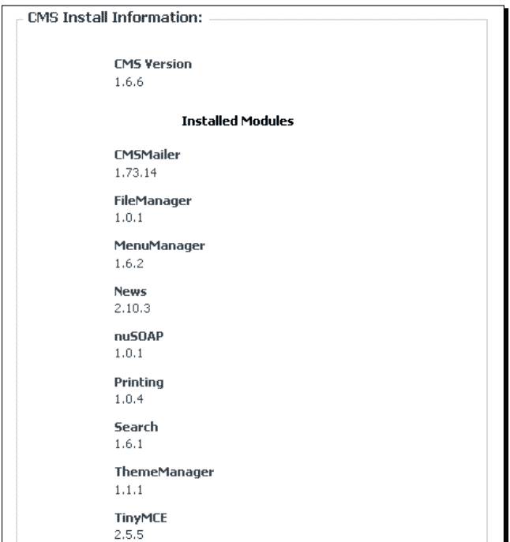

故障应尽快修复。如果您在运行 CMS Made Simple 时没有遇到任何问题，警告可以忽略；但如果某些功能未按预期工作，则应予以修正。在下表中，您将看到 CMS Made Simple 的一些必需和推荐设置。必需设置为强制要求，推荐设置则能让您的系统运行得更顺畅，并解决某些问题。

| 设置 | 最低值和推荐值 |
|---|---|
| **当前 PHP 版本（phpversion）** | 5.0.4 或更高 |
| **GD 版本（gd_version）** | 版本 2 |
| **运行时魔术引号（magic_quotes_runtime）** | 开启（True） |
| **PHP 有效内存限制（memory_limit）** | 最低 16 MB<br>推荐 24 MB 或更高 |
| **最大执行时间（max_execution_time）** | 最低 30<br>推荐 60 或更高 |
| **PHP 安全模式（safe_mode）** | 关闭（False） |
| **会话保存路径（session_save_path）** | 该路径应可写（绿色勾选） |
| **PHP register_globals（register_globals）** | 关闭（False） |
| **最大 POST 大小（post_max_size）** | 最低 2M<br>推荐 10M 或更高 |
| **最大上传大小（upload_max_filesize）** | 最低 2M<br>推荐 10M 或更高 |

**系统信息**页面的第三个部分为您提供了服务器配置的概览。如果您是网站管理员，您至少应当能够回答关于系统的三个问题：

- 您的服务器上运行的是什么操作系统？
- 您的服务器上安装了哪种服务器软件（以及哪个版本）？
- CMS Made Simple 安装使用的是哪种数据库（以及哪个版本）？

只要仔细查看此处提供的信息，所有这些问题都可以得到解答。

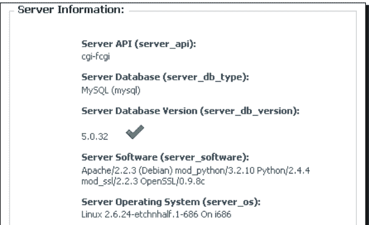

从上面的截图中，我可以说明这次安装的 CMS Made Simple 运行在 Linux（服务器操作系统）上，安装了 Apache 服务器版本 2（服务器软件），并且该服务器使用 MySQL 5.0.32 数据库（服务器数据库 + 服务器数据库版本）。

了解您的服务器配置方式对于在遇到问题时获得帮助非常重要。应用程序的版本和配置种类繁多，因此没有人能准确猜测您的具体托管环境是如何配置的。在从社区获取免费帮助时，请牢记这一点。

## 备份您的网站

备份是指复制您的文件和数据库。您需要定期备份，以防网络托管出现问题时造成数据丢失。您的数据可能因某些托管问题或站长的失误而丢失。因此，保留备份文件以便恢复您的网站至关重要。

要备份使用 CMS Made Simple 构建的网站，仅通过 FTP 复制服务器上的所有文件是不够的。这些文件只是您网站的一小部分。最重要的部分是数据库，其中存储了您的所有文本和设计（图片文件除外）。

在 CMS Made Simple 中，您有两个模块（一个用于文件备份，一个用于数据库备份）。在免费虚拟主机或受严格限制的托管环境中，您可能无法使用这些模块。要检查是否可以使用以下所述模块轻松备份网站，请先尝试安装第一个用于备份文件的模块。

## 备份网站文件

**网站文件**是您上传到 FTP 目录的文件。其中大部分由开发团队提供，并在安装前已复制到您的网站空间。在`uploads`目录中，您会找到编辑器上传的文件，例如 `images` 图片。如果您安装了额外的模块，那么您会在`modules`文件夹中找到这些模块的文件。

要备份文件，您可以将 FTP 中的所有内容下载到本地磁盘。但是，根据您的连接速度和文件总数，这可能会花费大量时间。

### 操作时间 – 使用模块创建备份

如果您希望在下载前将文件归档，可以使用 **FileBackup** 模块。

1. 在管理后台中，选择 **扩展 | 模块管理器**。
2. 点击 **可用模块** 选项卡，在按字母顺序排列的模块列表上方查找字母 **F**。
3. 找到 **FileBackup** 模块，并点击同一行中的 **下载并安装** 链接。如果您的网络托管有相关限制，您将看到以下错误：

   > 您无法使用此模块，因为您的服务器上未安装 tar 命令。

   在这种情况下，您将不得不手动备份网站。如果 **FileBackup** 模块安装成功，那么您可以开始配置它。

4. 在管理后台中，前往 **站点管理 | 文件备份**。
5. 点击 **首选项** 选项卡。在管理区域中，您会看到以下消息：

   > 使用 FileBackup 之前，请检查并保存 tar 二进制文件的路径。

6. 点击 **保存**。（该模块会尝试自动识别所需路径）。如果消息没有消失，您必须向托管服务商询问您的网络托管上 `tar` 二进制文件的路径，并将该路径输入到 **Path to tar binaries**（tar 二进制文件路径）字段中。
7. 切换到 **备份文件** 选项卡。
8. 点击 **备份文件**。
9. 等待完整文件夹列表显示，并在列表末尾看到 **任务完成** 消息。在此消息下方，您将看到包含所有网站文件的备份文件。
10. 点击备份文件，并将其保存到您的本地磁盘。

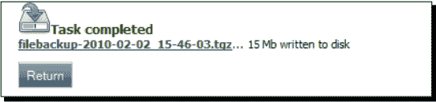

### 刚才发生了什么？

您已创建了所有网站文件的归档备份，并将该归档保存到本地磁盘。您应该创建新的备份文件，并将其与当前安装分开保存。例如，保存在本地磁盘上，每当您安装新模块、升级整个系统或某个模块，或上传新图片时都进行备份。要定期这样做。在紧急情况下，您将节省大量时间。

所有备份文件也会保存在您的安装中。您可以使用任何 FTP 浏览器（例如 **FileZilla**）在您的网络托管上的 `/admin/backups` 文件夹中找到它们。

> 请确保在下载到本地磁盘后删除备份文件。否则，任何人都可以访问 `http://www.yourdomain.com/admin/backups/` 并下载您的备份，其中包含带有数据库设置和密码的 `config.php` 文件。

建议在创建文件备份之前清除缓存文件夹，因为 CMS Made Simple 会创建大量临时文件来加速网站运行。这些文件不应包含在备份中，因为一旦 CMS Made Simple 安装并运行，它们会自动重新生成。要在管理后台中清除缓存文件夹，请点击 **站点管理 | 全局设置**，选择 **高级设置** 选项卡，然后点击 **清除缓存** 标签下方的 **清除** 按钮。

实际上，如果文件经常更改，最好的解决方案是设置某种自动化备份。您应该联系您的互联网服务提供商，以确定是否可以自动备份文件。


## 备份数据库

接下来，你要备份你的数据库。换句话说，你要创建数据库的转储。转储包含了安装的所有实际数据：页面结构、页面内容、完整设计，以及保存在模块（如 News）中的任何数据。

数据库备份的重要性与文件备份相同。如果你只备份文件，那么你就不会备份网站上的任何更改，例如新页面或新模块。

### 操作时间 – 创建数据库备份

让我们看看如何与文件备份一起创建数据库备份。你需要 MysqlDump 模块才能从 CMS Made Simple 的管理控制台内创建数据库转储。

1. 在管理控制台中，点击 Extensions | Module Manager
2. 点击 Available Modules 选项卡，然后在字母模块列表上方点击字母 M。
3. 找到模块 MysqlDump，并点击同一行中的 Download & Install 链接。如果你的网络托管有限制，则会看到以下错误。
4. 在管理控制台中，点击 Site Admin | MySQL Dump
5. 切换到 Preferences 选项卡。
6. 点击 Save。 （通常 mysql 二进制文件的路径会自动识别。）如果仍然看到消息 Invalid path to MySQL utilities，那么你需要向你的托管服务提供商询问你在网络托管上 mysql 二进制文件的正确路径，并在字段 Path to mysql binaries 中输入该路径。
7. 切换到 Backup Database 选项卡。

> 如果你的服务器上未安装 MySQL，则无法使用此模块。

此错误意味着你无法以这种方式使用该模块来创建数据库转储，应该手动执行（请参阅下一节）。如果模块安装成功，那么你现在就可以创建数据库转储了。

8. 点击 **Backup database** 按钮。等待表格列表出现，并在列表末尾找到创建数据库转储的链接。

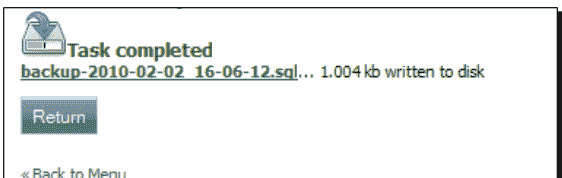

9. 将文件保存到你的本地磁盘。

### 发生了什么？

你已创建了数据库的备份。此备份包含你所有的数据库表，应定期进行，最好在对网站页面或模块进行更改时每次都进行。

与文件备份类似，你可以使用任何 FTP 客户端（例如 FileZilla）在你的网络托管上的 `/admin/backups` 文件夹中找到所有数据库备份。

### 手动备份

如果由于某些限制（通常在免费网络托管上设置）不允许你在网络托管上安装模块，那么你应该手动备份你的文件。

对于文件备份，打开任何 FTP 浏览器（例如 FileZilla），导航到你的安装文件夹，并将所有文件从网络托管复制到你的本地磁盘。请记住，文件只包含你网站的一小部分。你应该创建数据库转储以保存所有内容、设计和模块数据。

### 使用 phpMyAdmin 备份数据库

**phpMyAdmin** 是一款免费的开源工具，旨在处理 MySQL 数据库的管理。它通常安装在每个网络托管上。联系你的服务提供商以确定 phpMyAdmin 在你的网络托管上的链接，如果不确定，还需要你的登录凭据。此工具可帮助你创建数据库备份。

### 操作时间 – 使用 phpMyAdmin 创建备份

这里描述的步骤仅在你无法使用前面描述的模块备份数据库时才需要。

1. 登录到你服务器上的 phpMyAdmin（联系你的服务提供商以确定详细信息，因为它们在不同网络主机之间可能有所不同）。

2. 登录后，在主屏幕上选择 **Databases**：

3. 选择用于 CMS Made Simple 安装的数据库。如果不确定，请打开 `config.php` 文件并找到包含数据库名称的行 `$config['db_name']`。

4. 在列表中点击数据库名称。

5. 在下一个屏幕上，你将看到此数据库中所有表的列表。点击列表顶部的 **Export** 选项卡，如以下屏幕截图所示：

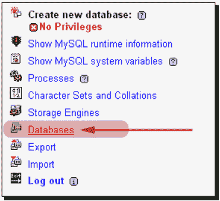

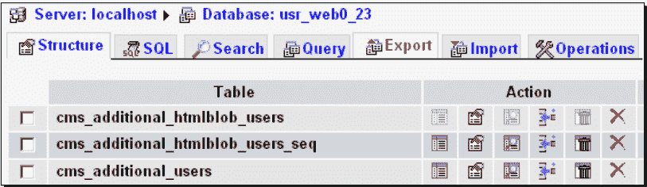

### 步骤 1

对于接受访客数据的繁忙网站考虑此步骤，例如 **Comments** 或 **FrontEndUsers**。启用 **Site Down Message** 以防止有人在你将网站迁移到另一个托管服务时使用网站。在管理控制台中，点击 **Site Admin | Global Settings**，并选择 **Sitedown Settings** 选项卡。写下访客在传输期间尝试使用你的网站时将看到的消息，然后勾选 **Enable Site Down Message** 复选框，并点击 **Submit**。从现在开始，访客将看到 **Site Down Message** 而不是网站。

### 步骤 2

清除 `cache` 文件夹。CMS Made Simple 创建了大量临时文件以加快网站速度。这些文件不应与备份一起保存，因为一旦 CMS Made Simple 安装并运行，它们将自动生成。要在管理控制台中清除 `cache` 文件夹，请点击 **Site Admin | Global Settings**，选择 **Advanced Setup** 选项卡，然后点击 **Clear Cache** 标签下方的 **Clear** 按钮。

### 步骤 3

创建数据库备份，如前一节所述。使用 phpMyAdmin 在新主机上导入数据库。登录到新主机上的 phpMyAdmin，并选择用于 CMS Made Simple 的数据库。点击 **Import** 选项卡，并在字段 **Location of the text file** 中选择包含数据库备份的文件。点击 **Go**。数据库将被导入到新主机。

### 步骤 4

使用 FTP 客户端（例如 FileZilla）将所有文件从旧站点复制到新站点。文件传输完成后，请记住检查新站点上文件夹的权限，以确保它们设置正确。检查以下文件夹的权限：

- `/tmp/templates_c`
- `/tmp/cache`
- `/uploads`
- `/uploads/images`
- `/modules`

它们应该是可写的。如果不确定如何操作，请联系你的服务提供商。

### 步骤 5

在最后一步中，你必须打开并修改文件 `config.php` 和 `.htaccess`。

在文件 `config.php` 中，检查并调整以下部分：

- Database Settings
- Path Settings
- Image Settings

使用适用于新服务器的数据库访问凭据和路径对其进行更新。

> 路径设置并不总是那么明显。在你的 FTP 浏览器中，它可能显示为 `/csmmadesimple`。然而，服务器上的真实路径可能类似于 `/home/user/html/cmsmadesimple`。如果路径错误，请在传输后尝试访问你的网站时查看错误消息。此消息将提示你真实的路径设置。如果仍然不清楚，请联系你的服务提供商寻求帮助。

`.htaccess` 文件只有在你更改域名时才应修改。但是，如果你由于搜索引擎优化而未对文件进行任何更改，请保持原样。

尝试登录到新托管上的 CMS Made Simple 管理控制台。如果一切看起来良好，请禁用 **Site Down Message** 并查看页面运行情况。

## 升级 CMS Made Simple

CMS Made Simple 开发团队不断改进应用程序；因此新版本会定期发布。你应该确保相应地升级你的系统。升级很重要，原因有几个。

- **免费社区支持：** 你可能得不到旧版本的帮助，因为只有少数用户仍在使用旧版本。开发团队不会修复旧版本中的任何问题，因为许多问题已在更新版本中解决，并且你始终被鼓励安装最新版本。
- **功能：** 在新版本中实现了新功能。如果你使用旧版本，那么如果你需要已经开发并存在的东西，就必须重新发明轮子。


- **第三方模块：** 附加模块的开发者会发布包含新功能和 bug 修复的新版本。新版本的模块通常假定已安装最新版本的 CMS Made Simple。有时，你需要的功能已经在该模块的最新版本中实现，但由于 CMS Made Simple 版本过旧，你无法安装它。

- **安全更新：** 新版本不仅修复错误、增加新功能，而且时不时会发现安全漏洞。在这种情况下，漏洞利用程序会迅速在互联网上传播。漏洞利用程序通常是利用 bug 来控制系统的命令序列。如果你不升级，你的系统将变得极其脆弱，数据可能被破坏或丢失，除了你自己，没有人会为此承担责任。

- **稳定性与性能：** 新版本通常包含性能改进。即使你对新版本中的新功能不感兴趣，仅通过升级也能提升网站速度。

如果新版本已发布，你会在管理控制台主菜单下方看到一条消息，提示“**您有 1 条未处理的通知**”。该消息每天只出现一次！点击消息旁边的加号，如下面的截图所示：

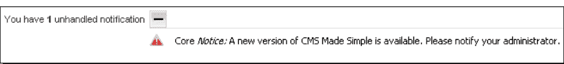

下面我们来看看如何将你的安装升级到新版本。

在每次升级之前，务必备份你的数据库和虚拟主机上的所有文件（请参阅*备份你的网站*一节）。如果出现问题，你随时可以恢复到以前的版本并重新开始升级。没有备份意味着在紧急情况下无法回退。

在浏览器中打开链接 `http://cmsmadesimple.org`，然后选择页面顶部主菜单中的**下载 | 文件发布**。会显示版本列表。如果你不确定虚拟主机上当前安装的 CMS Made Simple 版本，请打开管理控制台；你可以在页面最底部的页脚区域看到你的网站使用的版本。

在下载部分，找到最新版本，并选择名为 `cmsmadesimple-full-diff-[YOUR.CURRENT.VERSION]-[NEW.VERSION].tar.gz` 的文件。例如，要从 1.6 版本升级到 1.6.5，你必须选择文件 `cmsmadesimple-full-diff-1.6-1.6.5.tar.gz`。将文件保存到本地磁盘并解压。

如果找不到从你的确切版本到当前版本的升级文件，那么你需要下载高于已安装版本的最近一个完整版本（例如 1.6），并先使用该版本按照这些说明进行操作。

在将文件复制到 Web 服务器之前，你可能应该设置一条**网站关闭消息（站点管理 | 站点关闭设置）**。现在打开一个 FTP 浏览器，将解压文件夹中的所有文件上传到你的虚拟主机。覆盖现有的文件和目录。你必须用这些新版本覆盖现有文件。

上传新文件后，检查在安装 CMS Made Simple 的文件夹中是否创建了一个名为 `/install` 的文件夹。如果是，则在浏览器中输入 `http://www.yourdomain.com/install/upgrade.php`（将域名替换为你自己的域名）。这将自动将数据库更新到最新版本。升级后不要忘记删除 install 文件夹。如果没有创建名为 install 的文件夹，那么此时你已经完成了升级。

检查管理控制台页脚区域的版本信息。现在应该显示新版本了。

然后你必须升级模块。在管理控制台中，点击**扩展 | 模块管理器**，并在**可用升级**选项卡中查看是否有模块需要升级。

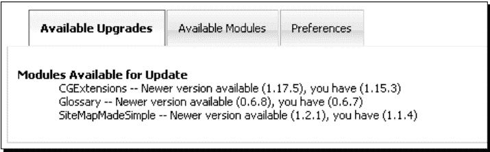

如果显示了一些升级，请在**可用模块**选项卡中查找这些模块，并点击模块名称旁边的**升级**链接。

> 有时，新版本的提示不会显示在管理控制台中。这是由于你的虚拟主机的安全设置所致。在这种情况下，另一种可能获知新版本的方式是订阅 CMS Made Simple 博客的官方 RSS 源，或者（如果你是 CMS Made Simple 论坛的注册会员）订阅**公告**版区。

请记住，如果你定期升级，升级系统并不困难。跟上开发步伐，以获得最佳的免费支持，并确保你的系统安全稳定。

## 优化（性能调优）

与每个系统一样，CMS Made Simple 也可以进行优化和调整，以获得最佳性能。本节中描述的技巧可以显著加速你的系统。但是，我建议仅在你遇到性能问题时才应用这些说明。

在开始优化系统之前，你应该了解系统在未进行任何优化时的性能表现。CMS Made Simple 内置了性能测量功能。如果你在浏览器中打开 CMS Made Simple 生成的任何页面，然后查看页面源代码，你会发现每个页面末尾都有 HTML 注释，如下所示：

```
<!-- 0.267839 / 38 / 5834456 / 6113588 -->
```

该注释可以分解为四个部分：

1. 页面由 CMS Made Simple 在 0.267839 秒内生成。
2. 生成页面需要 38 次 SQL 查询。
3. 使用了 5834456 字节的内存。
4. 峰值内存使用量为 6113588 字节。

你应该保存此注释，以便掌握通过以下各节中的优化技巧可以节省多少资源。每次进行优化时，将同一页面上的新数字与之前的数字进行比较。

### 压缩

此选项允许服务器在将输出发送到浏览器之前对其进行压缩。简而言之，页面被压缩，服务器发送的不是 HTML，而是一个小得多的 ZIP 文件。文件越小，网站加载速度越快。浏览器能够自动解压缩压缩后的页面，因此你和访问者都无需关心这一点。

可以在 `config.php` 文件中启用压缩。打开该文件并找到以下行：

```
$config['output_compression'] = false;
```

将其设置为 true 以开启压缩：

```
$config['output_compression'] = true;
```

在某些网站上，这可能会带来显著的性能提升。但是，对于已启用 mod_deflate 的 Apache 服务器，则不需要此功能。如果你不确定，请与你的服务商联系。请注意，启用此功能会显著增加服务器端的 CPU 和内存使用量，如果服务器非常繁忙，这甚至可能导致网站变慢。

### 持久连接

CMS Made Simple 基于数据库。因此，对于浏览器中加载的每个页面，都需要一个数据库连接。CMS Made Simple 连接数据库的方式有两种。通常，每个页面都必须建立新的数据库连接。持久连接是一种为某些应用提高性能而设计的概念。它不是为每个页面建立连接，而是打开一次连接，然后在应用程序生存期内保持该连接。

在 `config.php` 文件中，你可以定义 CMS Made Simple 应如何连接到数据库。打开该文件并搜索以下行：

```
$config['persistent_db_conn'] = false;
```

将该行改为：

```
$config['persistent_db_conn'] = true;
```

这将确保数据库连接在页面加载后不会关闭，而是保持打开状态。下次请求页面时，服务器会检查是否存在已打开的连接，并将其用于新页面。这样，就节省了建立新数据库连接所需的时间。

> 并非所有服务商都允许此设置。请联系你的服务商，以确认你可以在虚拟主机上使用持久连接。

### 全局设置中的 CSS 和静态 CSS

另一个可以节省时间的地方是页面样式表的生成。如果你在浏览器中打开页面并查看页面源代码，你会看到样式表的链接实际上是对 PHP 文件 `stylesheet.php` 的引用：

```
<link rel="stylesheet" type="text/css" href="http://yourdomain.com/stylesheet.php?cssid=59" />
```

然而，没有必要在每次生成页面时都重复生成样式表。当你完成网站设计并且不打算更改时，你可以缓存它们。


在管理控制台中，点击“站点管理 | 全局设置”，然后切换到“高级设置”选项卡。找到“样式表可在浏览器中缓存的最长时间（秒）”字段，输入一个不为 0 的值，如下图所示：

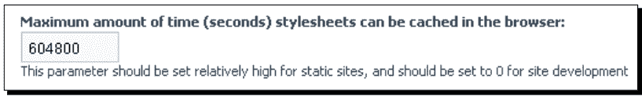

这取决于你将来更新样式表的频率。如果你将来不打算更改它，那么可以设置一个较高的值，例如 2592000 秒。这表示样式表将缓存一个月。

- 1 小时 = 3600 秒
- 1 天 = 86400 秒
- 1 周 = 604800 秒

如果你更改样式表，请务必将该值改回 0，因为使用旧的缓存版本时，你将在页面上看不到任何更改。

这些性能优化技巧可以加速 CMS Made Simple。然而，如果你对安装 CMS Made Simple 的服务器进行调优，而不仅仅是针对 CMS Made Simple 本身，你会获得更显著的效果。服务器调优需要你拥有服务器的完全访问权限，并具备基本的 Linux 管理员知识。

## 如何保护你的安装

在本节中，你将学习如何保护你的 CMS Made Simple 安装。我们不会讨论如何保护 Web 托管服务器，因为这是 Web 托管提供商的任务。如果你自己托管网站，那么你应该了解如何保护服务器的一般方法。如果你使用的是共享托管或受管服务器，那么你的提供商会为你完成这项工作，你无需担心。让我们看看提供商不会为你做哪些事情。

确保网站安全的第一条规则是定期升级 CMS Made Simple 及其模块。每当 CMS Made Simple 发布新版本时，要尽快进行升级。对于修复安全漏洞的安全更新版本来说，这一点尤其重要。升级非常简单。请参阅“升级 CMS Made Simple”一节，了解如何执行升级。

### 系统验证

一个 CMS Made Simple 安装由文件和数据库组成。数据库保存着页面结构、页面内容、设计以及任何模块数据，在繁忙的网站上可能每天都会发生变化。与数据库相比，文件是网站的一种静态部分。它们只会在以下情况下发生更改：

- 升级 CMS Made Simple
- 升级任何模块
- 安装新模块
- 从安装中移除模块
- 自己有意或无意地更改文件

有时，如果你的系统保护不够充分，文件可能会被恶意程序或黑客更改。那么，你如何确保系统文件没有被更改，一切仍然正常呢？

CMS Made Simple 使用校验和验证来证明你的 Web 托管上的文件没有被更改。校验和是根据文件计算出的文本字符串，用于检测文件在传输或存储过程中可能发生的意外更改。这些校验和字符串是为每个源自 CMS Made Simple 核心的文件生成的，可从 http://dev.cmsmadesimple.org/project/files/6 下载。每个 CMS Made Simple 版本都会生成一个校验和文件。

根据你的版本（基础版或完整版，以及发行版本），选择正确的 checksum.dat 文件，并将其保存到本地磁盘。用文本编辑器打开它，查看其中的内容。

```
3ad39cc13942818630935b56dc8af619  */index.php
6f8ae75cfde0c5a81dc09f35ea40f7a6  */preview.php
d53ee56d1c123a1ed04326ca3406e744  */favicon_cms.ico
...
```

你会看到一长串校验和字符串，后面跟着文件名及其路径。在 CMS Made Simple 中，你可以在管理控制台（**站点管理 | 系统验证**）中自动验证所有文件。该功能会将原始文件的校验和字符串与你安装中的文件进行比较。通常情况下，如果你到目前为止没有对系统进行任何升级，你的文件不应该有任何更改。

唯一可以接受的错误是 install 文件夹中的文件缺失，因为出于安全原因，你必须删除该目录。你还可能被告知 tmp 文件夹中的多个 index.html 文件缺失或无效。这并不严重。缺少 SITEDOWN 文件也不严重。

每次运行 CMS Made Simple 或其任何模块的升级时，你都应该创建一个新的校验和文件。在管理控制台中，打开“站点管理 | 系统验证”，然后点击“下载校验和文件”部分中的“提交”按钮。此功能允许你为当前安装生成校验和文件，并将其保存到本地计算机上，以便日后验证。这应在网站发布之前，和/或在进行任何升级或重大修改之后进行。日后，你可以通过将校验和文件与存储的文件进行比较来检查数据的完整性。

使用此功能有助于发现上传问题，或者在系统被黑客入侵时，准确找出哪些文件被修改了。如果你突然遇到奇怪的问题并怀疑系统受到了攻击，那么你应该首先进行系统验证，看看是否有任何文件被更改。如果校验和不匹配，那么数据肯定被更改过（无论是有意还是无意的）。

> 来自 http://dev.cmsmadesimple.org 的原始校验和文件仅验证 CMS Made Simple 核心及其随附的核心模块。你添加的任何其他模块都不会被验证。

你可以看到错误，如下图所示：

```
1 Files Not found
Files Not found:
./tmp/cache/SITEDOWN

2 Files failed md5sum check:
./tmp/templates_c/index.html
./tmp/cache/index.html
```

根据前面的说明，这些错误并不严重。如果你遇到其他失败，则需要由你来解释发生了什么。如果你确信自己没有更改任何文件，那么就是其他人为了破坏你的网站而更改了文件。在这种情况下，请从 CMS Made Simple 下载原始版本，将其解压，然后用原始文件替换被更改的文件。

替换文件只是第一步。如果你的系统已被黑客入侵，这意味着仍然存在一个可被反复利用来破坏你系统的安全漏洞。请阅读并实施以下各节，了解如何保护你的系统。

### 用户名和密码

检查你安装中管理员用户名和密码的组合强度。不要使用 admin、administrator 或类似的其他简单词语作为用户名，因为它们很容易被猜到。其次，为管理员账户使用强密码。密码强度评估的是攻击者平均需要尝试多少次才能猜出你的密码。

以下是一些选择安全可靠密码的技巧：

- 密码中应包含数字、特殊字符、大小写字母和标点符号
- 密码长度应在 12 到 14 个字符左右
- 避免使用字典中可查到的单词作为密码
- 避免使用亲属或宠物的名字，或诸如自己的出生日期、结婚日期等个人信息

同样也要注意编辑者的用户名和密码。帮助他们选择强密码，并建议他们记住密码，切勿将其写下来。你和你的用户不应在其他网站上使用相同的密码。

如果你在网站上使用管理员账户发布新闻文章，那么用户名就会在默认新闻模板中显示在网站上。最好不要显示用户名，或者用用户的名和姓来代替。

要用真实姓名替换用户名，请创建一个新的用户自定义标签（**扩展 | 用户自定义标签**），将其命名为 *realname*，并添加以下代码片段：

```
global $gCms;
$db = $gCms->db;
$query = "select first_name, last_name from ". $gCms->config['db_prefix'] . "users where user_id = ?";
$row = $db->GetRow($query, array($params['user']));
echo $row['first_name'] . ' ' . $row['last_name'];
```

此代码将从用户账户中返回用户的名和姓。它假定提供了带有用户 ID 的 user 参数。要在模板中使用该用户自定义标签，请在管理控制台中点击**内容 | 新闻**，然后切换到**摘要模板**选项卡。打开模板进行编辑，并搜索 Smarty 变量 {$entry->author}。将该变量替换为 Smarty 标签 {realname user=$entry->author_id}。保存模板，然后在网站上查看更改。对**详细模板**应用相同的更改。


## 隐藏 admin 目录

每个 CMS 都有一个管理后台 URL。在 CMS Made Simple 中，该 URL 是 `http://www.yourdomain.com/admin`。这个 URL 是默认定义的，因此任何有经验的 CMS Made Simple 用户都能进入你管理控制台的登录页面。你向黑客透露的信息越多，你的系统就越脆弱。在 CMS Made Simple 中，你可以轻松更改管理控制台的 URL，使攻击者无法猜测“入口”在哪里。

打开你的 FTP 浏览器，将文件夹 `admin` 重命名为一个难以猜测的名称（例如 `private4me` 或 `hide2safe`）。然后，用你选择的任何 FTP 浏览器打开文件 `config.php`，找到以下行：

```
```php
$config['admin_dir'] = "admin";
```
```

将这一行改为你给文件夹 `admin` 起的名称。如果你的管理目录现在命名为 `private4me`，则将下面显示的行更改如下：

```
```php
$config['admin_dir'] = "private4me";
```
```

从现在起，你的管理控制台 URL 将是 `http://www.yourdomain.com/private4me`。如果你现在在浏览器中输入标准的管理 URL，你将得到错误 404（页面未找到），而不是登录页面。结合强用户名和密码，这将为你的管理区域提供额外保护。攻击者必须先猜测管理 URL，然后才能尝试篡改用户名或密码信息。

当你将 `admin` 文件夹重命名为其他名称时，默认的验证校验文件将无法工作。该文件仍会查找 `admin` 文件夹，但找不到它，然后对每个涉及这个已不存在文件夹的文件都会给你一个错误。因此，在重命名 `admin` 文件夹后，立即创建一个新的自定义验证文件（**站点管理 | 系统验证**），并将其保存到本地磁盘。这样，考虑到重命名的管理目录，你就能保持系统的当前状态。

在升级 CMS Made Simple 时，在将升级文件复制到当前安装之前，请将你的文件夹重命名回 `admin`，执行升级，然后再次恢复文件夹的自定义名称。

## 文件权限

如果你的安装位于 Linux 服务器上（如果不确定，请检查 **站点管理 | 系统信息、服务器操作系统**），那么你应该知道如何配置文件权限以保护你的系统。Linux 服务器需要知道关于文件的两件事：

- 可以对文件执行什么操作？
- 谁可以对文件执行该操作？

第一个问题可以分为三个操作：**读取**、**写入**和**执行**。读取文件意味着打开文件并查看其内容。写入意味着更改、替换或删除文件。最后一个选项检查是否允许程序或脚本被执行。

第二个问题可以分为三类用户：**所有者**、**组**和**公共用户**。文件的所有者是最初创建它的用户。组对我们的需求并不重要，将按与公共用户相同的方式处理。公共用户是服务器上不属于文件所有者的任何其他用户。

通过 Linux 权限，我们将上述信息结合起来，说明谁可以对每个文件做什么。你可以想象一个如下所示的权限矩阵：

| 权限 | 所有者 | 组 | 公共 |
|------------|-------|-------|--------|
| **读取**   | 4     | 4     | 4      |
| **写入**  | 2     | 2     | 2      |
| **执行**| 1     | 1     | 1      |

你会看到，理论上只对一个文件来说就有 27 种可能的权限组合。任何组合都可以用前面表中数字的总和来表示，并通过 Linux 命令 **chmod**（更改模式）进行更改。但是，你不需要确切知道该命令如何执行，因为每个 FTP 浏览器都允许你直观地定义权限。

让我们看看并理解一些权限集合的例子：

- **777**（每列 1+2+4）意味着每个人（所有三个组）都被允许读取、写入和执行该文件。
- **755** 意味着所有者被允许对该文件进行所有操作，但组和公共用户只被允许读取和执行该文件，不允许更改它。
- **644** 意味着所有者被允许读取和执行该文件，其他人只被允许读取它。

你的安装中有一个非常重要的文件，值得用 Linux 权限额外保护。该文件包含数据库的连接数据，称为 `config.php`。它就像你安装的心脏。

在安装或升级期间，该文件必须至少可由文件所有者写入，因此其权限必须至少设置为 **644**。一旦安装或升级完成，你应该将该文件的权限降低到 **444**（每个人都可以读取该文件，但没有人可以执行或更改它）。

在类似 FileZilla 的 FTP 浏览器中，你可以右键单击该文件并选择 **文件权限** 选项。下一个对话框类似于以下截图：

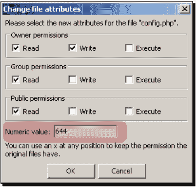

通常，除非绝对需要，否则避免将任何文件设置为 **777**。此权限允许服务器上的每个用户读取、更改和删除该文件。

## CMS Made Simple 与服务器版本

在 CMS Made Simple 的默认模板中，版本信息显示在页脚区域，如下所示：

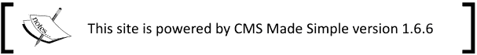

此信息通过 Smarty 插件 `{cms_version}` 在模板中提供。请将其删除，并完全不要在模板中使用它。你应该避免透露你使用的确切 CMS Made Simple 版本。提出此建议的原因如下。

你使用的是 CMS Made Simple 的某个版本。有一天，该版本中发现了一个安全问题。CMS Made Simple 的开发团队做出响应并发布了一个安全更新。如果你不立即升级系统，你的网站将极其脆弱，因为每个人都知道你在网站上使用的确切版本。

出于同样的原因，请从你的安装中删除 doc 文件夹。此文件夹包含文件 `changelog.txt`，它同样会透露 CMS Made Simple 的实际版本。恶意用户只需在浏览器的地址栏中输入以下行：

```
http://www.yourdomain.com/doc/changelog.txt
```

> 反复备份你的所有文件和数据库。如果某些东西损坏或丢失，你可以用最新的备份替换损坏的版本，从而节省时间和精力。

## 故障排除

在设计和配置网站时，你肯定会遇到一些问题。如果你知道如何以及在哪里寻求帮助，那么每个问题都有解决办法。

如果你使用示例内容和模板安装 CMS Made Simple，那么在全新的 CMS Made Simple 安装中，你将获得包含完整文档的内容页面、模板和样式表。它们是让你熟悉该应用程序并了解其工作方式的宝贵途径。通读所有这些页面，并保存它们以供将来参考。

## CMS Made Simple 维基

这个维基的目的不仅是让 CMS Made Simple 社区能够协作完成文档编写过程，还为你提供一种合适且简便的信息查找方式。该文档由 CMS Made Simple 用户编写，部分覆盖的语言不仅仅是英语。不过，维基的主要部分仍然是英文。你可以在 http://wiki.cmsmadesimple.org 上找到该文档。

你可以搜索此文档以找到问题的答案。为了方便，每页右上角都有一个搜索按钮。你可以逐页阅读本手册，也可以选择你喜欢的页面。在右侧的目录中，你可以看到自己当前所在的位置（你正在阅读的页面标题为黑色）。

在 CMS Made Simple 的管理控制台中，你会在每个页面的右上角（主导航下方）看到社区帮助链接。此链接将直接带你到与你当前在管理控制台中打开的功能或模块相关的维基页面。不过，有些页面还没有编写。

参与编写文档的用户越多，你能在其中找到的答案就越多。CMS Made Simple 确实需要每个人的帮助，以使文档准确、用户友好且易于理解。如果你想提供帮助，请先在维基站点上注册为编辑者，然后开始帮助改进和增强文档，同时也供你自己参考。


## 管理与故障排除

### 模块帮助

在尝试解决模块问题时，你应该区分 CMS Made Simple 的核心模块和第三方模块。核心模块随 CMS Made Simple 一起安装，例如 **News**、**Menu Manager**、**Printing**、**Search** 等。第三方模块是手动安装的。第三方模块的帮助不是由 CMS Made Simple 开发团队提供，而是由模块的开发者提供。因此，第三方模块帮助的质量取决于模块的开发者，官方开发团队无法管理。

### 内置帮助

安装在 CMS Made Simple 网站中的每个模块都包含基本帮助和示例，以帮助你使用其功能。使用 CMS Made Simple 时，你可以在管理控制台中获得内置帮助。打开任意模块，并在主导航下方右上角找到链接 **Module help**。所有模块的帮助部分看起来大多相似，并包含以下部分。

#### 它做什么？

本节解释模块的用途并描述可用功能。在开始使用模块之前请仔细阅读本节。所需的所有功能是否都已涵盖？模块是否能满足你所有的需求？有些第三方模块具有非常相似的功能。请为每个相关模块阅读本节，进行比较并决定使用哪个。另请参阅 *Parameters* 部分（如下所述）以了解高级功能。

#### 如何使用它？

本节旨在介绍模块的使用方法。通过遵循一些简单说明，你可以快速获得模块工作原理的第一印象。根据模块的不同，本节的完整程度各不相同，有时还包含复杂的用法示例或有用的提示。

#### Parameters

本节包含你可以用模块使用的所有 Smarty 参数。其中有必须使用的必需参数和一些可选参数。对每个参数都有说明，包括默认值（未指定时使用值）和允许值。参数列表还将为你提供模块功能的完整概览。

### Forge（错误和功能请求）

如果你使用某些第三方模块并遇到问题，也可以查看该模块的错误跟踪器。错误跟踪器是每个模块已知问题的列表，由 CMS Made Simple 在开发者部分提供（http://dev.cmsmadesimple.org/）。它不仅包括已知问题的列表，有时还提供解决方案。模块开发者应定期检查错误列表并用新版本更新其模块。

如果你遇到第三方模块的错误，请创建错误报告以通知模块开发者该问题，并使用支持板块向模块用户寻求帮助。错误跟踪器是开发者跟踪错误列表的地方。然而，它不是提出模块支持请求的场所。

### 如何在论坛中快速获得答案

使用支持论坛是你可能每天都在做的事情。因此，你可能会想知道为什么本节这么长。好吧，在论坛中寻求免费支持时，你应该遵循一些规则。如果你曾经在任何论坛中遇到问题未得到解答，那么你应该阅读下面的规则，了解开发者需要你提供什么才能帮助你。

如果你不遵循这些规则，就不会得到快速的答案。此外，你的问题可能会被完全忽略。请记住，论坛提供的支持是免费的。开发团队和论坛上的许多其他志愿者都非常希望提供帮助并使事情为你工作。但请记住，他们都有工作、家庭、朋友和其他责任。没有人会为他们在论坛上做的工作付费。你可以用商业支持购买他们的时间，或者通过提供他们所需的一切来帮助他们帮助你。

#### 使用搜索

在提问前先在论坛中搜索你的问题。请记住，很多问题已经得到解答，你会更快得到答案。使用论坛中的搜索按钮并尝试不同的拼写、同义词和缩写。例如，如果你搜索与模块 FrontEndUsers 和登录功能相关的任何问题，请尝试：

- Front End Users login
- FrontEndUsers login
- FEU login
- Front End Users sign-in, and so on

- **Layout and Design (CSS & HTML)**: 旨在讨论与 CMS Made Simple 模板、样式表（CSS）和主题或布局问题相关的问题。
- **Modules / Add-ons**: 旨在帮助你在使用未包含在 CMS Made Simple 标准包中的任何第三方模块或插件时遇到问题或疑问。
- **Developers discussion**: 用于讨论使用和为 CMS Made Simple 编程。
- **International Discussions**: 包括其他语言的板块。如果你的问题与英语以外的任何语言相关，你可以在这里讨论。

从一开始选择正确的板块将确保你覆盖最广泛能够帮助你的用户群体。

#### 主题标题

在确定了请求的正确板块后，考虑合适的主题标题或主题。让我们看一些不好的例子：

- Urgent help needed!
- Big issue
- Something goes wrong

将问题的良好摘要作为主题标题。如果你遇到模块 **FrontEndUsers** 中的登录功能问题，那么你的主题应命名为 **Login issues in Front End Users**。虽然很多人都知道你的问题的答案，但他们没有时间查看每个 *urgent* 或有 *big issue* 的主题。他们只会挑选他们认为知道答案的主题。

#### 提供尽可能多的信息

确保你提供所有能想到的版本信息。包含无关数据总比遗漏有用数据好。获取所需信息的最简单方法是使用 CMS Made Simple 管理控制台中的页面 **Site Admin | System Information**。此页面包含你和将帮助你的人所需了解的一切。但不要直接将整个页面复制到论坛中。它有一个特殊的文本版本。在页面右上角（主导航下方），你会找到链接 **View Text Report (suitable for copying into forum posts)**。点击它，复制它，并将其包含在你的论坛帖子中。

#### 逐步描述问题

描述问题，包括尽可能多的细节（尤其是错误信息要完全按呈现的方式）。仅说“如果我使用模块 FrontEndUsers 登录，我会得到一些奇怪的错误”是不够的。

如果没人知道错误是什么，就没人会帮助你。论坛里没有先知，只有开发者。想象一下你的汽车有问题。你打电话给修理厂说“我的车开不动。帮忙！”。如果你不提供有关汽车确切行为的更多信息，修理厂将无法帮助你。支持论坛也会发生同样的情况。

如果错误可以重现，请详细说明可以遵循的步骤以在自己的安装上重复该问题。这是一种非常好的方法；有时在逐步写下你正在做的事情时，你自己就能找出问题。

要有礼貌。不要要求任何东西，因为免费产品没有保证。不要威胁如果你的问题不能立即解决就使用另一个 CMS。如果你不喜欢 CMS Made Simple，你可以自由使用任何其他系统并在那里索取免费即时支持。然而，我认为你不会在任何地方以这种方式获得免费支持。不要通过说 CMS Made Simple 的代码很差或效率低下来侮辱开发者。你不会以这种方式得到任何答案，因为在这种情况下开发团队会认为你能够编写自己的漂亮高效的代码并且不需要任何帮助。

要有耐心。如果你的问题有解决方案，你会得到它。每小时“顶帖”使主题出现在板块顶部并不会使过程更快。相反，这可能是被忽略的另一个原因。

#### 如果你得到帮助，请帮助他人

一旦你的问题得到解答并获得解决方案，请打开你的首帖进行编辑，并在主题标题前加上 [SOLVED]。这样开发者就可以集中精力解决未解决的主题，而不是一遍又一遍地查看你的主题。如果你认为这是一个错误而不是操作问题，请在开发 Forge（http://dev.cmsmadesimple.org）中为其提交错误报告，除在论坛中发布外。这将帮助开发者管理跟踪和修复的过程。

如果问题在论坛中无法得到解答，但你自己找到了解决方案，或有人以其他方式给了你解决方案，请在论坛中发布，以便其他人也能受益。有一天，当有人发布你安装中问题的解决方案时，你也会很高兴。


如果你遵循这些步骤，你将为自己和开发人员节省大量时间。快速获得答案很简单。

## 商业支持

那么，你已经让 CMS Made Simple 正常运行，并且喜欢你所看到的功能。然而，你的项目需要一些 CMS 尚不可用的功能，或者某些功能不能完全按你想要的方式工作。为此，CMS Made Simple 开发团队提供独立承包服务。他们对工具的深入了解以及构建软件包和附加模块的经验，可以确保你获得一个可用、贴合需求且质量上乘的工具。

付费支持适用于那些拥有重要项目、担心解决问题所需周转时间的人。此外，如果你希望有专人可以联系，以解决你无法自行修复的问题、升级问题、备份或任何其他顾虑，那么商业支持可能是一个选择。

CMS Made Simple 开发团队为需要更多支持或需要一些不同功能的 Web 开发人员提供各种专业服务。

## 支持合同

那么，你正在为一位非常重要的客户创建一个新的 CMS Made Simple 网站，并且你担心“如果出了问题怎么办”。例如，如果主机商更改了某些设置，或者网站被黑客入侵，或者发生了一些意外情况。你需要快速、妥善地修复它，但你不确定如何做到这一点。

正是为了这些目的，开发团队的多个成员提供支持合同。支持合同向你的客户保证，如果出现意外情况，一位精通 CMS Made Simple 的专业且有经验的程序员将在合理的时间内提供服务，要么亲自处理问题，要么通过电话、视频聊天等方式协助你解决问题。

支持合同名义上定价，通常按每个网站计算，包含固定数量的“工单”，并限定有效期（例如一年）。可以把它想象成一份保险单。如果出现了你不知道如何修复的问题，会有人为你提供帮助。

你的客户可能会因为知道他们业务关键的网站有持续的技术支持而感到更安心。

## 软件开发

那么，你已经运行着多个 CMS Made Simple 网站，而且它们都运行良好。然而，你正在开发的这个新网站有点不同，你需要一些 CMS Made Simple 尚不具备的功能。你可能需要对某些现有功能的行为进行一些细微的更改。你可以去哪里寻求帮助？

CMS Made Simple 开发团队可以与你合作，通过修改一些现有代码或编写新代码来确定问题的解决方案。

开发团队在 CMS Made Simple 以及 CMS Made Simple 框架的开发方面拥有丰富的经验（毕竟，框架就是他们编写的）。

大多数开发团队成员按时间计费。只需支付一笔象征性的费用，你或许就能让一位开发团队成员调整他们的日程来帮助你。

## 更大的项目怎么办？

开发团队也能处理这些。CMS Made Simple 可用的许多模块都是由社区成员赞助的，他们热爱 CMS Made Simple 及其灵活性，但需要一些尚不可用的功能。也许你可以成为另一位重要的赞助者。

你可以联系一位开发团队成员，与他们合作，以合同形式赞助一个项目。通常，这些合同的费用基于常规咨询费率。

## 开发团队是公司吗？

实际上，不是；他们是一组松散耦合的独立承包商，共同协作。他们合作并为 CMS Made Simple、各种附加组件做出贡献，并处理诸如支持合同之类的问题。

他们独立工作，因为他们分布在世界各地，这样合作起来更方便。然而，他们总是愿意互相帮助，并因各种原因互相顶班，例如，如果其中一人要去度假，其他成员愿意为其处理支持合同问题。同样，如果有人因其他项目太忙，他们会非常乐意推荐另一位合适的开发团队成员来帮助你。

## 我该如何联系你们？

嗯，你可以在 http://www.cmsmadesimple.org/about-link/about-us/ 上阅读有关开发团队的更多信息，并决定你想联系哪位成员。如果你有进一步的问题想问，但还不想直接联系任何人，你可以随时在“寻求帮助（商业）”版块提问。

## 小测验 – 管理与故障排除

- 1. 数据库备份中包含什么？
  - a. 整个网站，包括页面结构、语言、模块和模板。
  - b. 仅页面结构、设置和模板。
  - c. 仅页面结构和设计保存在文件中。
  - d. 数据库不包含任何对备份网站重要的内容。
- 2. 你应该多久备份一次网站？
  - a. 每天。
  - b. 取决于网站内容更改的频率。
  - c. 取决于你希望多久恢复一次网站。
  - d. 你不需要关心备份。这会自动完成。
- 3. 为什么你应该定期升级使用 CMS Made Simple 运行的网站？
  - a. 以保留页面整个生命周期中所做的更改。
  - b. 告知网站访问者你使用的是最新版本的 CMS Made Simple。
  - c. 保持安装安全并避免漏洞。
  - d. 了解所提供的新功能，并能选择你需要的内容。
- 4. 哪个名称最适合作为管理员账户？
  - a. admin
  - b. ro0t6i2go
  - c. webmaster
  - d. test
- 5. 遇到问题时，你在哪里可以找到免费帮助？
  - a. 任何 HTML 或 CSS 参考。
  - b. CMS Made Simple 官方帮助论坛。
  - c. 给某位 CMS Made Simple 开发人员发送私人消息。
  - d. 安装文件和数据库中的注释。
- 6. 你如何及时了解 CMS Made Simple 的任何更新？
  - a. 如果有更新可用，你会自动收到电子邮件。
  - b. 你必须每天查看官方论坛。
  - c. 你会在 CMS Made Simple 的管理控制台中看到相应的消息。
  - d. CMS Made Simple 不提供任何免费更新。

## 动手实践 – 配置备份并保持最新

立即为你的网站配置备份。如果出现问题，没有备份你将无法恢复网站。仔细检查你的备份文件是否包含文件和数据库，因为两者都很重要。演练一个紧急情况下的恢复场景，以确保备份没有损坏或不完整。

保持最新状态。登录 CMS Made Simple 官方论坛，并在 **公告** 版块订阅新主题（为了方便，也提供 RSS 源）。

## 总结

在本章中，你学习了许多关于 CMS Made Simple 管理的知识。正如本章开头提到的，你不需要阅读本章的所有部分。但我强烈建议你阅读 *如何保护你的安装* 和 *故障排除* 部分。

具体来说，我们涵盖了：

- 如何在紧急情况下备份 CMS Made Simple 网站。你了解到网站由两部分组成：文件和数据库。为这两部分创建备份非常重要。讨论了两种创建备份的方法，即第三方模块和适用于受托管限制用户的手动备份。
- 如何将网站从一个主机迁移到另一个主机。如果你更换主机提供商，则必须迁移网站。
- 如何升级 CMS Made Simple 及其模块。我们了解了定期升级系统为何如此重要。你不仅能获得新功能，还能获得改进的性能和安全性。升级系统并跟上 CMS Made Simple 的发展是你的责任。
- 如何保护安装安全。有一些有用的提示，教你如何快速保护系统免受黑客攻击、攻击和破坏。请记住，如果你从一开始就花时间学习如何保护网站，那么在网站受到攻击时，它可以为你节省数天甚至数周的恢复时间。
- 如何在支持论坛中快速获得答案。你获得了一些关于如何从 CMS Made Simple 免费支持论坛获得最佳答案的提示。阅读本节将帮助你在解决安装问题时节省大量时间。


