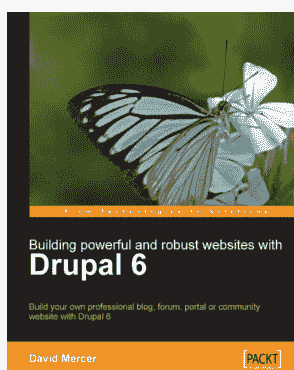
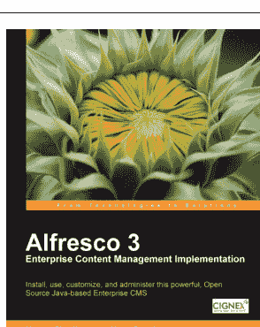

## 索引

### C

- **核心模块**
  - 关于 107
  - 自定义，应用 142
  - 文件管理器 125
  - 菜单管理器 130
  - 新闻模块 110
  - 打印模块 133
  - 搜索模块 122
  - 使用 141
- **自定义字段**
  - 添加到新闻模块 119
- **自定义字段，产品模块**
  - 创建 234
  - 定义 235
  - 这是公共字段吗 235
  - 名称 234
  - 提示 235
  - 类型 235

### D

- **数据库，备份**
  - 使用模块进行备份 306
- **日期**
  - 配置 266
  - 日期格式字符串 267
  - 示例 267
  - 格式 267
- **默认权限**
  - 添加全局内容块 160
  - 添加群组 160
  - 添加页面 160
  - 添加样式表关联 160
  - 添加样式表 160
  - 添加模板 160
  - 添加用户 160
  - 文件管理器模块的高级用法 162
  - 允许在 TinyMCE 中使用高级配置文件 160
  - 批准新闻在前端显示 160
  - 清除管理日志 160
  - 删除新闻文章 160
  - 管理所有内容 160
  - 管理菜单 160
  - 管理主题 161
  - 修改任何页面 161
  - 修改事件 161
  - 修改文件 161
  - 修改全局内容块 161
  - 修改群组分配 161
  - 修改群组 161
  - 修改模块 161
  - 修改新闻 161
  - 修改群组权限 161
  - 修改站点偏好设置 161
  - 修改样式表关联 161
  - 修改样式表 161
  - 修改模板 161
  - 修改用户自定义标签 161
  - 修改用户 162
  - 概述 160
  - 移除全局内容块 162
  - 移除群组 162
  - 移除页面 162
  - 移除样式表关联 162
  - 移除样式表 162
  - 移除模板 162
  - 移除用户 162
  - 查看标签帮助 162
- **描述元标签** 279
- **设计者** 146
- **设计者权限**
  - 关于 155
  - 权限集 155
  - 创建测试区域 156, 157
- **详细模板**
  - 关于 242
  - 自定义 242-244
- **重复内容**
  - 避免 286
  - 防止步骤 286-288

### E

- **电子商务套件**
  - 可选模块 261
- **电子商务工作坊** 262
- **电子邮件，CMS**
  - 发送 33
- **编辑器** 146
- **电子邮件模板** 177
- **错误页面** 59
  - 外部链接 59
  - 内部页面链接 59
  - 分区标题 59
  - 分隔符 59
- **事件**
  - 关于 293
  - 邮件，页面更新后发送 293, 294
  - 触发 293
- **现有模板**
  - 导入现成模板 66, 67
  - 使用现有模板 66
- **额外页面属性**
  - 关于 276
  - 使用 276

### F

- **FFmpeg** 191
- **字段**
  - 添加到表单 178
- **文件管理器** 125
- **文件**
  - 使用文件管理器浏览 125
- **最终消息模板** 254
- **Forge，故障排除** 325
- **FormBuilder**
  - 关于 174
  - 将验证码添加到表单 182, 183
  - 将联系表单添加到网站 174, 175
  - 自定义联系表单 176, 177
  - 将字段添加到表单 178
  - 安装 174
- **表单模板** 177

### G

- **图库**
  - 创建 168
  - 上传图片 168, 169
- **图库模块**
  - 安装 168
- **网关完成模板** 249
- **全局内容块**
  - 关于 108
  - 添加到网站 108-110
- **全局元标签**
  - 添加 52

### H

- **层级报告模板**
  - 关于 237
  - 自定义 237, 239
- **HTML 模板**
  - 移植 84
  - 移植到 CMS Made Simple 85-90

### I

- **IF 代码** 94
- **IF 结构** 96
- **图像管理器** 126
- **图像**
  - 使用图像编辑器上传 126, 128
  - 在内容中使用 128, 129
  - 在模板中使用 128, 129
- **includetemplate 参数** 134
- **安装安全性，CMS Made Simple**
  - 隐藏管理目录 320
  - 文件权限 320, 321
  - 检查密码 319
  - 确保安全 316
  - 服务器版本 322
  - 简化版本 322
  - 系统验证 317, 318
  - 检查用户名 319
- **即时付款通知。参见 IPN**
- **发票模板** 249
- **IPN** 225

### J

- **任务** 183
- **jQuery**
  - 集成到导航中 294-296

### K

- **关键词**
  - 在图像文件中使用 283
  - 在页面别名中使用 283

### L

- **链接模板** 134
- **本地化** 265, 266
- **丢失邮件模板** 254

### M

- **手动备份，网站**
  - 关于 307
  - 使用 phpMyAdmin 备份数据库 307-309
- **Mary** 153, 154
- **菜单管理器** 130
- **菜单模板**
  - 创建 97-99
- **消息模板** 249
- **元元素** 50
- **元标签**
  - 关于 50, 279
  - 添加到页面 50, 51, 279, 280
  - 描述元标签 279
  - 关键词 280
- **mod_deflate** 315
- **FrontEndUsers 模块设置**
  - 关于 214
  - 调整 215
  - 偏好设置 215
- **模块管理器**
  - 关于 136
  - 使用 136
- **模块权限** 162
- **模块**
  - 自定义翻译 274
  - 使用 XML 文件安装 139, 140
  - 移除 140
  - 翻译 273
  - 卸载 140
- **多语言网站**
  - 关于 267
  - 将标志添加为语言菜单 270
  - 层级解决方案 270
  - 编辑语言条目 269
  - 创建 267, 269
  - 按语言分隔新闻文章 271
- **多项选择字段**
  - 添加到表单 181
- **MySQL 二进制文件** 306
- **我的购物车模板** 246

### N

- **导航**
  - 添加到模板 79, 80
  - 创建 63, 78
  - 设计 80
  - 使用纯 CSS 设计 80-82
  - 添加侧边栏导航 83
- **导航控制，网站**
  - 关于 57
  - 使用的内容类型 59
  - 默认页面 58
  - 隐藏页面 57, 58
- **导航模板**
  - 使用 Smarty 循环创建 96, 97
  - 创建菜单模板 97-99
- **neolao** 191
- **新产品目录模块**
  - 基本信息 197
  - 创建 196
  - 最后一步 207, 208
  - 创建第一级（分类）198-201
  - 创建第二级（产品）202-207
- **新产品目录模块配置**
  - 关于 208
  - 创建产品列表模板 209, 210
- **新闻**
  - 在网站上显示 111, 112
- **新闻分类**
  - 关于 114
  - 创建 114, 116
- **Newsletter Made Simple。参见 NMS**
- **新闻模块**
  - 关于 110, 111
  - 添加自定义字段 119
  - 添加新闻 112
  - 将新闻条目添加到页面 112, 113
  - 管理新闻文章 110
  - 新闻分类 114
  - 自定义新闻模板 116
  - 将新闻标题用作页面标题 122
- **新闻模板**
  - 浏览分类 116
  - 自定义 116
  - 详情 116
  - 表单 116
  - 创建新的摘要模板 117-119
  - 摘要 116
- **NMS**
  - 关于 183
  - 安装 183
  - 向注册客户发送邮件 184-186
  - 模板 187

### O

- **优化，CMS Made Simple**
  - 关于 314
  - 压缩 314
  - 全局设置中的 CSS 315, 316
  - 持久连接 315
- **订单模块**
  - 关于 247
  - 管理员电子邮件模板 249
  - 账单表单模板 249
  - 添加结账步骤 248
  - 确认订单模板 249
  - 集成客户注册 252, 254
  - 网关完成模板 249
  - 发票模板 249
  - 集成登录界面 250-252
  - 消息模板 249
  - 付款表单模板 249
  - 用户电子邮件模板 249
- **输出，Smarty 基础**
  - 使用 IF 函数控制 94
  - 隐藏标签 94
- **覆盖打印样式表选项卡** 134

### P

- **页面别名** 41
  - 更改 43
- **页面内容**
  - 格式化 43, 45
  - 使用所见即所得编辑器格式化 44
- **页面层级**
  - 关于 52
  - 面包屑导航 54
  - 搜索引擎友好 URL 54
  - 在网站上启用搜索引擎友好 URL 55
  - 向网站添加子页面 52-54
- **页面**
  - 添加到网站 39, 40
  - 预览更改 43
  - 创建 39, 63
  - 删除 43
  - 编辑 42
  - 编辑现有页面 42
  - 更改多个页面 60
  - 创建现有页面的副本作为新页面 60
- **参数，新闻模块**
  - browsecat 121
  - showall 121
- **付款数据传输。参见 PDT**
- **付款表单模板** 249
- **PayPal 网关模块**
  - 关于 255
  - 安装 256
  - PayPal 返回付款数据的方法 255
  - 创建测试账户 256, 257
- **PayPal 返回付款数据的方法**
  - 关于 255
  - IPN 255
  - PDT 255
- **PayPal 卖家账户**
  - 配置 258
  - 即时付款通知 259
  - 语言编码 260, 261
  - 接收付款偏好设置 258
  - 网站付款偏好设置 259
- **PDF 设置选项卡** 134
- **PDT** 255
- **图片库**
  - 添加相册 170
  - 创建 168
  - 创建自定义图库模板 172-174
  - 上传图片 168, 169
  - 在其他页面上使用图片 170
  - 将随机图片添加到模板 170, 171
  - 调整大小方法 169
- **PHP 代码**
  - 在标签中执行 293
- **phpMyAdmin** 307
- **弹出参数** 134
- **打印版本，网页**
  - 自定义 135
- **打印** 133
- **打印模块** 133
- **打印链接**
  - 添加 133
  - 自定义 135
  - 将媒体类型添加到样式表 135

PDF 版本的页面，生成 136
打印模板 134
打印版本，页面
避免 287
产品目录
关于 195
创建 195, 196
示例 196
新目录类模块，配置 208
新目录类模块，创建 196
产品层级，产品模块
分类 236
创建 236
产品模块
关于 232
优势 232
自定义字段，创建 234
第一个产品，添加 233, 234
产品层级，创建 236
产品摘要模板 246
产品模板，产品模块
自定义 237
详情模板 242
层级报表模板 237
摘要模板 239
受保护页面
创建 216
服务台，保护 217
下拉字段
添加，到表单 180
## Q
限定符 95
限定符，Smarty
eq 96
gt 96
gte 96
lt 96
lte 96
mod 96
neq 96
not 96
问题模块
安装 137, 139
## R
reCaptcha
关于 183
优势 183
注册模板 1 254
注册模板 2 254
调整方法，图片画廊
裁剪 169
缩放 169
缩放 & 裁剪 169
缩放 & 缩放 169
角色
关于 146
管理员 146
设计师 146
编辑 146
俄罗斯翻译中心示例 272
## S
称呼字段
添加，到表单 178, 179
示例网站 62
脚本参数 134
搜索引擎友好 URL 284
搜索引擎友好 URL
关于 54, 284
在网站上启用 55
示例 56
搜索引擎优化。参见 SEO
搜索模块
关于 122
搜索表单，添加 123-125
自注册模块
关于 252
确认邮件模板 254
最终消息模板 254
安装 252
丢失邮件模板 254
方法 253
注册模板 1 254
注册模板 2 254
SEO
关于 277
重复内容，避免 286
关键词，使用在图片文件 283
关键词，使用在页面别名 283
元标签 279
页面标题 277, 278
搜索引擎友好 URL 284
SEO 标记，使用在页面 282, 283
SEO 标记，使用在模板 281
访客统计 289
XML 网站地图创建 288
SEO 标记
使用，在页面 282, 283
使用，在模板 281
服务台功能
自定义功能 229
实现 211
模块前端用户，设置 214, 215
受保护页面，创建 216
支持票据系统，创建 218
模板，FrontendUsers 模块 215
访客登录，管理 211
Shop Made Simple (SMS) 231
showall 参数 121
showbutton 参数 134
侧边栏导航
添加 83
网站地图
创建 130-132
网站地图 288
Smarty 基础
学习 91
导航模板，使用 smarty 循环创建 96, 97
输出，使用 IF 函数控制 94
Smarty 变量，操作 91
Smarty 参数 72
Smarty 插件
关于 73
使用，在内容 74
Smarty 标签
关于 67
添加，到模板 70
Smarty 变量
关于 91
获取 91-93
操作 91
Smarty 网页模板系统 67
Smarty 插件 73
Smarty 标签
{breadcrumbs} 71
{created_date} 71
{last_modified_by} 71
{menu_text} 71
{modified_date} 71
添加，到模板 71
样式表
添加，到模板 74
创建 75-77
媒体类型 78
提交模板 177
子页面
添加，到网站 52
摘要模板
关于 239
创建 117, 118
自定义 239-241
支持论坛，故障排除
帮助他人 328, 329
问题，描述 328
找到正确的板块 326, 327
搜索，使用 325, 326
主题标题 327
版本信息，提供 327, 328
支持票据系统
关于 218
答案字段，添加 222, 223
创建 218
创建，使用 CGFeedback 模块 218-221
对话，启用 226-229
摘要模板 223
票据列表，自定义 223-225
系统信息
CMS 安装信息 300
PHP 信息 300, 301
服务器信息 300-303
## T
标签输出
控制 72
Smarty 标签，添加至模板 72
模板
创建 67-69
动态部分，添加 69
导出 101
输出，控制 72
Smarty 标签，添加 70
Smarty 标签，添加 71
样式表，添加 74
模板外部化器 157
模板，FrontendUsers 模块
更改设置模板 215
忘记密码模板 215
登录模板 215
注销模板 215
丢失用户名模板 215
查看用户模板 215
模板，NMS
归档模板，187
确认订阅，187
订阅，187
取消订阅，187
用户设置，187
文本参数 134
第三方模块 192, 193
TinyMCE
配置 45, 46, 47
替换函数，激活 48, 49
搜索函数，激活 48, 49
翻译 272
翻译中心
关于 272
俄罗斯翻译中心示例 272, 273
故障排除，CMS Made Simple
关于 323
内置帮助 324
CMS Made Simple Wiki 323
商业支持 329
forge 325
支持论坛，使用 325
## U
升级，CMS Made Simple
关于 311-313
优势 311
用户
分配，到组 148, 149
创建 146, 147
用户定义标签
关于 289
创建 290
自定义用户定义标签，创建 290, 291
页面信息，在 UDT 中获取 292
参数，添加 291
用户邮件模板 249
用户通知 163
## V
视频
显示 188
自有视频播放器，添加 190, 191
查看购物车模板 246
访客登录
管理 211, 212
用户账户，创建 212-214
访客统计 289
## W
网站，备份
数据库，备份 306
手动备份 307
网站文件，备份 304
网站，CMS Made Simple
备份 303, 304
文件，备份 304
网站文件，备份
使用模块制作，304, 305
所见即所得编辑器 44
## X
XML 网站地图
创建 288
## Y
YouTube 视频
嵌入 188-190

感谢您购买
CMS Made Simple 1.6: 初学者指南

## Packt 开源项目版税

当我们销售基于开源项目的书籍时，我们会直接向该项目支付版税。因此，通过购买《CMS Made Simple 1.6: 初学者指南》，Packt 已将收到的部分款项给予了 CMS Made Simple 项目。

从长远来看，我们将自己和您——我们的客户和读者——视为开源生态系统的一部分，为我们出版的项目提供可持续的收入。我们在 Packt 的目标是建立出版版税作为服务和支持的重要组成部分，并支持一个可持续开源业务的商业模式。

如果您正在与一个开源项目合作，希望我们对其出版并随后支付版税，请与我们联系。

## 为 Packt 撰写

我们欢迎所有有兴趣撰稿的人的咨询。书稿提案应发送至 author@packtpub.com。如果您的书的想法仍处于早期阶段，您希望在撰写正式书稿提案之前先讨论一下，请联系我们；我们的其中一位约稿编辑会与您联系。

我们不仅寻找已出版的作者；如果您拥有强大的技术技能但没有写作经验，我们经验丰富的编辑可以帮助您建立写作生涯，或仅仅为您提供专业知识的额外回报。

## 关于 Packt 出版

Packt，读作 'packed'，于 2004 年 4 月出版了第一本书《Mastering phpMyAdmin for Effective MySQL Management》，随后继续专注于出版关于特定技术和解决方案的高度聚焦的书籍。

我们的书籍和出版物分享了您同行 IT 专业人士在适应和定制当今系统、应用程序和框架方面的经验。我们的解决方案型书籍为您提供定制您正在使用的软件和技术以完成工作的知识和能力。Packt 的书籍比您过去看到的 IT 书籍更具体、更少泛泛而谈。我们独特的商业模式使我们能够为您提供更聚焦的信息，让您获得更多所需知识，减少不必要的内容。

Packt 是一家现代而独特的出版公司，专注于为开发者、管理员和新手社区生产高质量、尖端书籍。有关更多信息，请访问我们的网站：www.PacktPub.com。

## 使用 Drupal 6 构建功能强大且健壮的网站

ISBN: 978-1-847192-97-4          平装: 380 页

使用 Drupal 6 构建您自己的专业博客、论坛、门户或社区网站

- 1. 设置、配置和部署 Drupal 6
- 2. 利用 Drupal 世界级的 content management system
- 3. 设计并实现您网站的外观和风格
- 4. 轻松添加令人兴奋且功能强大的特性
- 5. 推广、管理并维护您的在线网站

## Alfresco 3 企业内容管理实施

ISBN: 978-1-847197-36-8          平装: 600 页

如何定制、使用和[content]

## 使用 Drupal 6 构建功能强大且健壮的网站

ISBN: 978-1-847192-97-4          Paperback: 380 pages

使用 Drupal 6 构建您自己的专业博客、论坛、门户或社区网站

- 1. 设置、配置和部署 Drupal 6
- 2. 利用 Drupal 世界级的 Content Management System
- 3. 设计并实现您网站的外观和风格
- 4. 轻松添加令人兴奋且功能强大的特性
- 5. 推广、管理并维护您的在线网站

## Alfresco 3 企业内容管理实施

ISBN: 978-1-847197-36-8          Paperback: 600 pages

如何定制、使用和管理这个功能强大的、基于 Java 的开源企业 CMS

- 1. 使用版本控制、库服务、内容组织和高级搜索管理您的业务文档
- 2. 使用文档库、维基、博客、论坛、日历、讨论和社交标签创建协作网站
- 3. 与外部应用程序集成，如 Liferay Portal、Adobe Flex、iPhone、iGoogle 和 Facebook
- 4. 利用 Alfresco 3 的高级工作流概念自动化您的业务流程

请访问 www.PacktPub.com 查看我们图书的详细信息

