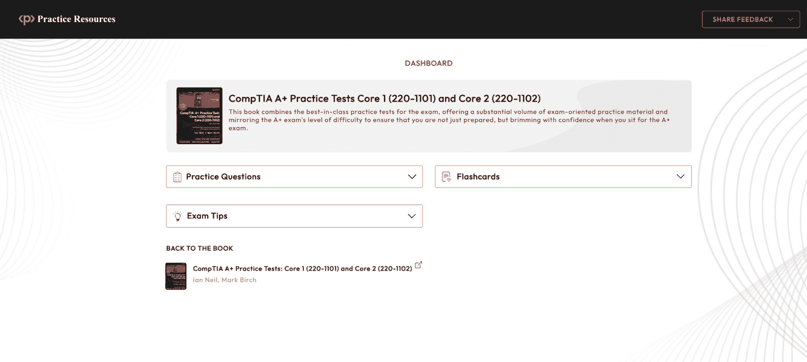
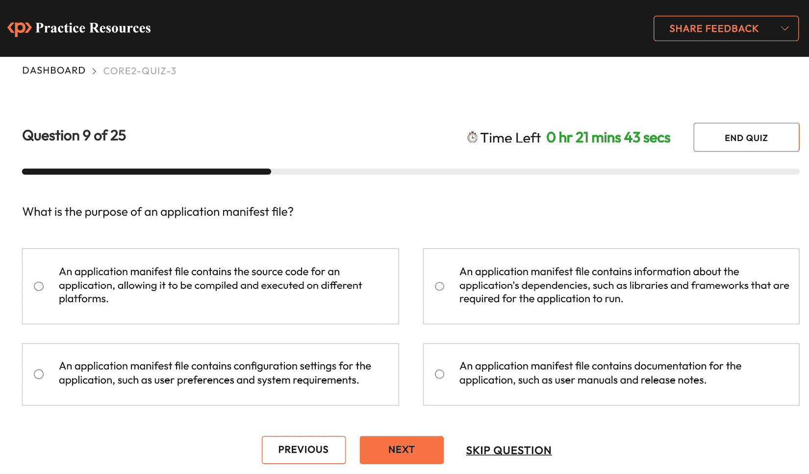
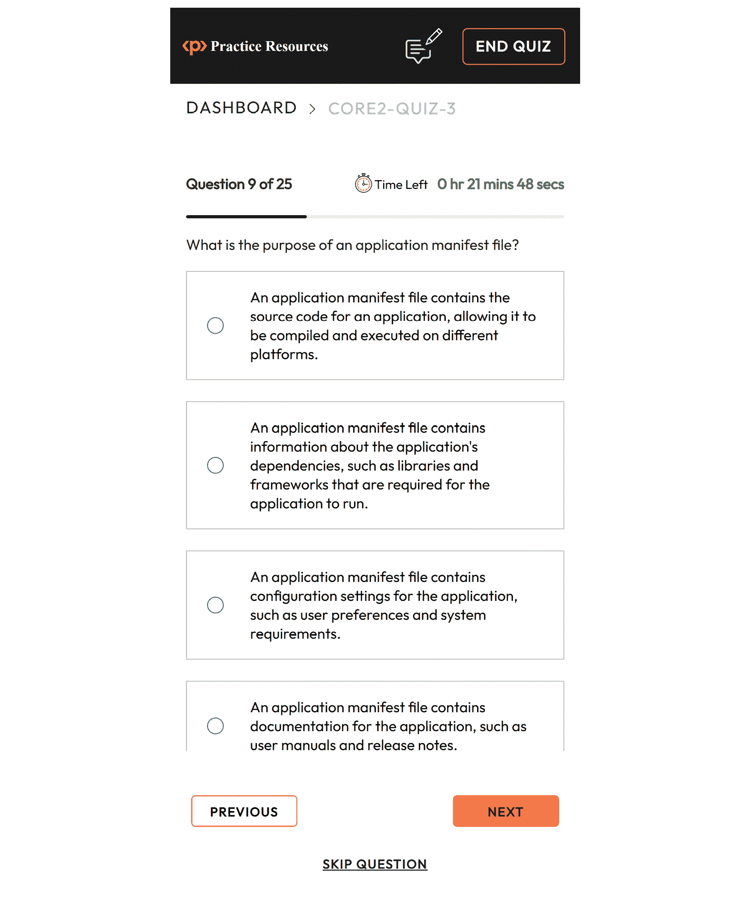
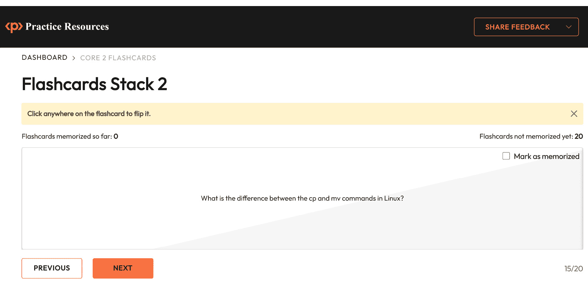
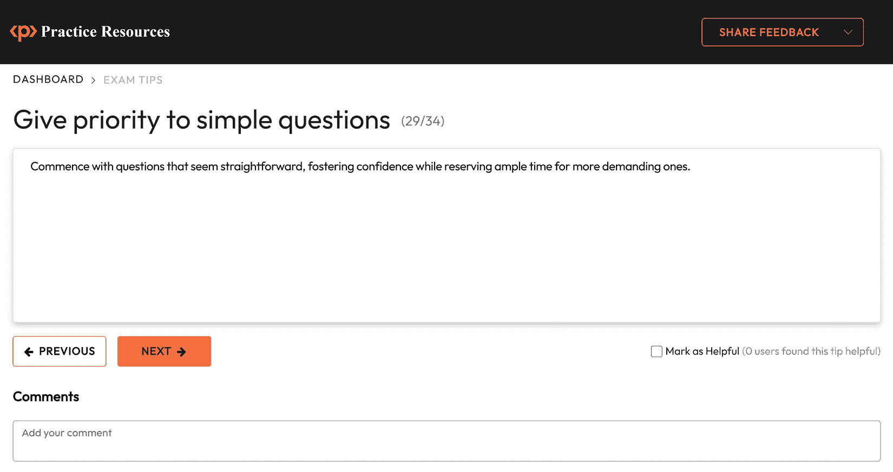
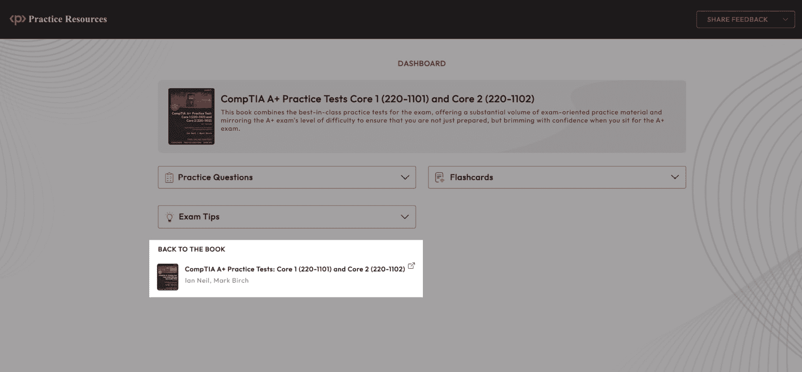

# CompTIA A+ 核心 1 (220-1101) 和核心 2 (220-1102) 实践指南

# 贡献者

# 作者简介

**Ian Neil** 是全球顶尖的 Security+ 培训师之一。他善于将信息分解为易于消化的片段，使零基础人员也能获得认证所需的技能。他最近曾在欧洲为美国陆军工作，并设计了一门面向各行各业人士（不仅限于 IT 专业人士）的 Security+ 课程，通过率极高。他是一名 MCT、MCSE、A+、Network+、Security+、CASP 和 RESILIA 从业者，拥有 23 年与高端培训机构合作的经验，并于 2006 年微软布加勒斯特办事处开设时，成为首批培训微软内部员工的技术培训师之一。

**Mark Birch** 是一位经验丰富的课件开发者和教师，专长于信息系统和网络安全领域。Mark 拥有 20 多年开发内容和教授 CompTIA A+ 课程的经验，对该学科有深入理解。Mark 的职业生涯始于航空航天行业（为一家主要国防承包商工作），拥有 30 多年咨询、工程设计和部署安全信息系统的经验。他花费 20 多年时间与美国军方和英国武装部队合作，帮助众多学生实现学习目标。Mark 确保士兵、军官和平民都有最佳机会获得网络安全认证。

# 审阅者简介

**Sahil Kumar** 是一名软件工程师，凭借对创新的坚定热情和敏锐的问题解决能力驱动前行。凭借长达八年的卓越职业生涯，Sahil 在 IT 系统、网络安全、端点管理和全球客户支持等多个领域磨练了专业技能。

他在科技行业的经历以对持续学习和职业成长的承诺为标志，这从他获得的众多认证中可见一斑。Sahil 持有 CompTIA A+、CompTIA Security+、ITIL V4、OCI 2023 Foundations Associate、Microsoft SC-200、AZ-900 和网络安全证书 (ISC2) 等备受推崇的认证。这一广泛的认证组合反映了他致力于紧跟技术和安全趋势前沿的决心。

Sahil 的专长不仅限于网络安全领域；他还精通 DevSecOps，展示了他在应对 IT 领域多方面挑战时的多面性。目前，Sahil 正在纽约大学攻读网络安全硕士学位，这证明了他对学术卓越和保持领域领先地位的承诺。他拥有库鲁克谢特拉大学电气与电子工程学士学位。

**Sylvio Musto** 是一位拥有 13 年以上信息技术、信息安全、网络风险和审计经验的技术培训师。他拥有信息安全管理以及领导力与战略人员管理两个方向的 MBA 学位。

Sylvio 目前在 MercadoLivre 担任内部审计主管，MercadoLivre 是拉丁美洲电子商务和技术市场的领军企业之一。

在整个职业生涯中，Sylvio 为信息技术领域做出了重大贡献，曾与软件开发、医疗保健、保险和金融市场的知名公司合作。

除了专业成就外，Sylvio 还是一位敬业的教育工作者。他目前在 Fundação Vanzolini 和 CompTIA 担任教授，与新一代 IT 专业人士分享他的知识和经验。

Sylvio Musto 凭借扎实的资历获得认可，持有 ITIL v3、Cobit v5 Foundation、CompTIA Security+、CompTIA CySA+ 和 ISO 27001 Foundation 等认证。他对提升信息安全和战略性领导团队的承诺使他成为信息技术领域的权威专家。

工作之余，Sylvio 对汽车有浓厚兴趣，最近致力于修复他在巴西拥有一辆收藏级车辆。

**Amir Shetaia** 是一位敬业的专业人士，对嵌入式系统、机器人技术和自动驾驶汽车有着深厚的热情。他的职业生涯以实质性成就和对该领域的贡献为标志。

Amir 的实践经验包括在全球汽车技术领导者 Valeo 担任嵌入式系统实习生，以及在 Upwork 上作为成功的自由职业者。他精通 C 和 Python 等编程语言，并拥有各种微控制器的专业知识，包括 ARM Cortex、PIC 和 AVR。

Amir 的领导才能通过他创立并担任领队的 Mansoura 机器人俱乐部得以展现，该俱乐部已赋能 1000 多名学生，培养了他们对机器人基础的深入理解。他还担任 CIS Team MU 的嵌入式系统导师和 UCCD Mansoura Engineering 的嵌入式系统讲师，向有志工程师传授知识和专长。

Amir 的影响力超越了其所在社区，其团队在华为 ICT 大赛全球总决赛的云实战考试中获得第三名的显著成绩便是明证。这一成就凸显了他在国际舞台上坚定不移的奉献精神和技术实力。

Amir 是一位体现不懈追求卓越和渴望知识的专业人士。他对个人和职业成长的承诺体现在他在西门子数字化工业软件、信息技术学院 (ITI) 和 Bright Network 等知名机构的实习经历中。这些经历磨练了他在嵌入式软件工程、RTOS、汽车协议、人工智能等领域的技能。Amir 的历程证明了他对嵌入式系统和人工智能的卓越掌握，以及他分享知识和促进创新的热情。

# 前言

欢迎阅读这本 CompTIA A+ 实战测试书，本书专为希望通过考试并清晰、简洁地理解现代计算机系统基础概念、技术和实践的人士精心编写。

# 适读人群

本书 A+ 练习测试指南旨在为准备参加 CompTIA A+ 认证考试的个人而编写。该认证通常受到旨在 IT 和技术支持领域开始或提升职业生涯的个人追捧。本书面向广泛的读者群体，包括以下人员：

- **有志成为 IT 专业人士者**：刚进入 IT 行业，希望获取进入该领域所需知识和技能的人员
- **初级技术人员**：已在 IT 支持岗位工作，希望通过获得 A+ 认证来验证其技能和知识的个人
- **转行者**：来自其他行业、有意向 IT 行业转型，并需要计算机硬件、软件和故障排除基础知识的人员
- **学生**：正在学习计算机科学、信息技术或相关专业，希望增强学习并提高就业竞争力的学生
- **自学者**：偏好自主学习节奏，希望利用业余时间提升技术技能，潜在目标可能是转行或在当前职位上晋升的个人
- **IT 爱好者**：希望深化计算机系统和硬件知识与技能的爱好者和技术发烧友
- **求职者**：正在积极寻找 IT 支持或技术人员职位的人员，因为 A+ 认证通常是求职申请的先决条件或优势
- **军事人员**：向民用 IT 部门转型的军事人员，因为 A+ 认证有助于他们重返职场
- **职业发展人员**：已在 IT 岗位工作，寻求提升技能、紧跟行业趋势，并未来可能追求更高级别认证的个人

总体而言，CompTIA A+ 练习测试指南是为任何希望准备 CompTIA A+ 认证考试，并在 IT 硬件、软件、故障排除和客户服务技能方面建立坚实基础的人员提供的宝贵资源。

# 本书涵盖的内容

- *第 1 章*，*移动设备* – 准备测试您对移动设备、笔记本电脑、平板电脑和智能手机各方面的知识，从安装和连接到设备管理。
- *第 2 章*，*网络* – 帮助您测试网络各方面的知识，包括协议和端口、不同网络设备以及连接类型。
- *第 3 章*，*硬件* – 测试您对硬件、线缆类型、设备及适当内存各方面的知识。
- *第 4 章*，*虚拟化和云计算* – 测试您对虚拟化各方面的知识，包括客户端虚拟化、资源使用和安全。此外，帮助您准备使用云模型和服务。
- *第 5 章*，*硬件和网络故障排除* – 测试您对故障排除最佳实践的知识，然后探讨如何排除网络和硬件不同方面的故障。
- *第 6 章*，*模拟考试：核心 1 (220-1101)* – 全面评估您对 A+ 核心 1 (220-1101) 考试目标的理解。通过一套真实的 CompTIA A+ 考试题目，挑战您的解决问题能力和考试准备度。
- *第 7 章*，*操作系统* – 测试您安装和支持 Windows 操作系统的技能，包括命令行和客户端支持。我们还将测试您在 macOS、Chrome OS、Android 和 Linux OS 上进行系统配置镜像和故障排除所需的技能。
- *第 8 章*，*安全* – 通过专注于识别和选择用于缓解设备及其网络连接安全漏洞的控制措施，评估您的考试准备度。无线安全、威胁和漏洞（包括常见的社会工程学方法）也在本章中涵盖。
- *第 9 章*，*软件故障排除* – 评估您在排除 PC 和移动设备问题时的知识，这可能包括常见操作系统、恶意软件和安全问题。
- *第 10 章*，*运维流程* – 评估您遵守与安全、环境影响、沟通和专业素养相关的最佳实践的能力。变更管理、备份与恢复以及隐私概念等重要要素也在本章中涵盖。
- *第 11 章*，*模拟考试：核心 2 (220-1102)* – 为您提供对 A+ 核心 2 (220-1102) 考试目标掌握程度的全面评估。您可以针对一套真实的 CompTIA A+ 考试题目，测试您的解决问题技能和考试准备度。

# 约定用法

新术语和重要单词显示如下：“云计算是指无需资本支出即可提供资源，其中**云服务提供商**（**CSP**）提供所有硬件和客户租赁访问权限。”

# 联系我们

我们始终欢迎读者的反馈。

**一般反馈**：如果您对本书有任何疑问，请在邮件主题中注明书名，并发送邮件至 *customercare@packt.com*。

**勘误**：尽管我们已尽一切努力确保内容准确，但错误难免发生。如果您在本书中发现错误，我们将不胜感激如果您能向我们报告。请访问 [www.packtpub.com/support/errata](http://www.packtpub.com/support/errata) 并填写表格。

**盗版**：如果您在互联网上以任何形式发现我们作品的非法副本，我们将不胜感激如果您能向我们提供位置地址或网站名称。请通过 *copyright@packt.com* 联系我们，并附上相关材料链接。

**如果您有兴趣成为作者**：如果您在某个主题上有专长，并有兴趣撰写或参与编写书籍，请访问 [authors.packtpub.com](http://authors.packtpub.com)。

# 练习资源——快速浏览

**重要：**

**在开始使用免费在线资源之前，您需要先解锁它们。** 解锁**耗时不到 10 分钟，可在任何设备上完成**，且**只需进行一次。请前往** *第 10 章，运维流程* **的开头部分查看解锁说明。**

本书将为您提供通过考试所需的所有知识。学习关键概念固然重要，但如果您能应用和练习书中所学，通过考试的几率将大大增加。这就是在线练习资源的作用。通过互动题目、闪存卡和考试技巧，您可以随时随地练习书中学到的所有内容。以下是您将获得内容的快速演示。

## 简洁明了的认证练习体验

您将获得一个简洁明了的用户界面，可在所有现代设备上运行，包括手机和平板电脑。只要有可用的互联网连接，所有功能均可在所有设备上运行。从**仪表板**（*图 0.1*）出发，您只需点击一下即可访问随书附带的所有练习资源。如果您想返回书本，也可以从这里跳转。

图 0.1：桌面设备上的仪表板界面

## 练习题

# 平台概览

## 测验界面

**测验界面**（*图 0.2*）旨在帮助您专注于题目，不受任何干扰。您可以在多道题目之间快速导航，如果不知道答案也可以跳过题目。界面还包含一个实时计时器，如果时间用完会自动提交您的测验。如果您想直接跳转到结果页面查看所有解答，请点击**结束测验**。

> **专业提示**
>
> 完善考试技巧的一种方法是多次尝试同一测验，但每次侧重于应试过程的不同方面。首先，尝试在不担心时间限制的情况下正确回答所有问题。复习您答错题目的解答，然后重新尝试测验。这一次，尝试在最短时间内正确回答所有问题。复习您答错题目的解答。现在，以正确性为重点重新尝试。重复此过程多次，直到您感到准备就绪。

图 0.2：桌面设备上的练习题界面

无论是仅带手机的漫长通勤火车之旅，还是慵懒的周日午后躺在沙发上使用平板电脑，只要设备连接互联网，测验界面在所有设备上都能同样良好地工作。*图 0.3* 展示了界面在移动设备上的截图：

图 0.3：移动设备上的测验界面

## 闪存卡

闪存卡旨在帮助您记忆关键概念。以下是充分利用它们的方法：

1.  我们将所有闪存卡整理成了卡堆。可以把它们想象成您手中的一叠实体卡片。
2.  您从一整叠卡片开始。
3.  打开一张卡片时，花几分钟时间回忆答案。
4.  点击卡片任意位置以显示答案（*图 0.4*）。
5.  多次正反翻转卡片，彻底记住该卡片。
6.  一旦您感觉已记住，点击卡片右上角的**标记为已记忆**按钮。
7.  随着您移动到卡堆中的其他卡片，重复此过程。
8.  您可能无法一次记住所有卡片。因此，下次打开卡堆时，您将只看到尚未记忆的卡片。
9.  您的目标是清空卡堆，确保您已记住堆中的每一张闪存卡。

图 0.4：闪存卡界面

## 考试技巧

考试技巧（*图 0.5*）旨在帮助您做好考试准备。从备考旅程开始到考试当天，这些技巧经过组织，以便您一次性复习所有内容。如果某条考试技巧在您的备考中派上用场，请务必将其标记为有用，以便其他读者参考。

图 0.5：考试技巧界面

## 分享反馈

如果您发现平台、书籍或任何练习材料存在问题，可以从任意页面点击**分享反馈**按钮与我们联系。如果您有任何改进建议，也可以分享给我们。

## 返回书籍

为了方便在书籍和练习资源之间切换，我们添加了一个返回书籍的链接（见*图 0.6*）。点击它即可在 Packt 的在线阅读器中打开您的书籍。您的阅读位置已同步，因此您可以直接跳回到上次打开书籍时离开的位置。

图 0.6：从仪表板跳回书籍。

> **注意**
>
> 本书出版后，网站的某些元素可能会随时间变化，因此最终外观可能与截图中的呈现有所不同。

# 分享您的想法

读完 *CompTIA A+ Practice Tests Core 1 (220-1101) and Core 2 (220-1102)* 后，我们非常期待听到您的想法！请[点击此处直接前往该书的亚马逊评论页面](https://packt.link/r/1837633185)并分享您的反馈。

您的评论对我们和技术社区都很重要，将帮助我们确保提供高质量的内容。

# 如何使用本书

练习测试书的目的是促进您对 CompTIA A+ 考试的备考。在尝试练习测试之前，建议准备一份电子文档或一张空白纸。在测试过程中，记下任何不熟悉的主题或答错的问题是有益的。这种做法将有助于找出您理解薄弱的领域。测试结束后，建议您重温学习指南，以弥补发现的差距。

# 应对多项选择题的方法

采用此策略以有效应对多项选择题：

*   **仔细阅读**：沉浸于题目中，领会其细微差别
*   **排除法**：剔除错误选项，系统性地缩小选择范围
*   **优化过程**：通过细致复查，从五五开的局面演变为六四开的优势
*   **揭示最优解**：当存在多个正确答案时，选择最佳或最合理的选项
*   **精准选择**：使您的选择与具体问题相匹配

# 考试中的谨慎事项

在考试过程中避免以下适得其反的行为：

*   **过度思考陷阱**：避免过度分析；保持平衡的心态
*   **匆忙困境**：避免草率浏览或匆忙完成测试；保持沉稳的节奏
*   **怀疑的害处**：避免自我怀疑或反复纠结；信任您的第一直觉
*   **选择一致性**：抵制更改答案的冲动；最初的选择往往是可靠的
*   **全面一致性**：避免重读整份试卷；专注于手头的任务

# 关于额外资源的建议——实践练习

一个可能证明有价值的额外备考资源是 CompTIA 官方实验室。这些基于云的实验室通过直接涵盖考试主题，为考试准备提供了一种实用方法。对于几乎没有或完全没有 IT 经验的个人，这些实验室是获得实操熟悉度的绝佳工具。

在 CompTIA A+ 的背景下，扎实掌握硬件概念至关重要，而实验室能有效促进这种理解。值得注意的是提供 12 个月的访问权限，留出充足的时间进行探索和学习。特别值得一提的是，Packt Publishing 争取到了 CompTIA 官方实验室和考试券的大幅折扣，详情请见书后内容。

## 您将在 CompTIA 官方实验室中学到什么

一旦您付费并注册了 CompTIA CertMaster Labs（涵盖 A+ Core 1 (220-1101) 和 Core 2 (220-1102)），您将能够通过远程、基于浏览器的实验室环境，使用真实设备和软件进行实践操作和技能开发。实验室内容与官方 CompTIA 教材和 CompTIA A+ 考试目标保持一致，CertMaster Labs 使学习者能够轻松练习并应用技能于真实职场场景，为认证考试做准备。所有实验室活动均包含可评分的评估，提供反馈和提示，并根据学习者输入提供评分，最终引导您以最高效、最正确的路径完成工作任务。

课程中有两种类型的实验室：

# CompTIA CertMaster Labs 概览

## 虚拟工作台实验

**虚拟工作台实验**为学习者提供了宝贵的实践机会，在沉浸式 3D 环境中安装、配置和排查计算机硬件故障。每个场景都包含教程模式，通过分步说明引导学习者，帮助其理解和练习 3D 控制；探索模式允许学习者在沙箱环境中识别和操作硬件组件；以及辅助模式，分步引导学习者完成流程，在需要时提供帮助。这种实践环境使学习者能够学习 IT 的有形方面并获得真实经验。学习者可以探索台式机、笔记本电脑和外设的不同组件如何协同工作，并获得安装和配置计算机组件的不同流程的经验。

## 虚拟机实验

**虚拟机实验**利用虚拟机模拟服务器网络，使学习者能够获得在工作环境中会使用到的工具、应用程序和操作系统（如 `Microsoft Windows` 或 `Kali Linux`）的真实实践经验。学习者可以使用 `GNS3` 网络模拟器比较网络硬件，并使用 `OpenWRT` 配置家用路由器。

虚拟机实验也提供不同的模式：

### 辅助实验

**辅助实验**分步引导学习者完成任务，在 10-15 分钟的体验过程中提供评估和反馈，使学习者能够在活动进行过程中纠正任何误解。

### 应用实验

**应用实验**在 20-30 分钟的体验中呈现一系列目标导向的场景，涵盖多个主题，根据学习者成功完成每个场景的能力在活动结束时对其工作进行评分。因此，学习者被迫在没有既定步骤的情况下批判性地思考如何解决问题。目前，应用实验仅适用于虚拟机实验活动。

## A+ Core 1 (`220-1101`) 可用实验

*   辅助实验：探索实验环境
*   辅助实验：安装主板
*   辅助实验：安装电源
*   辅助实验：安装和配置系统内存
*   辅助实验：安装内存条
*   辅助实验：安装 CPU 和散热器
*   辅助实验：升级和安装 GPU 及菊花链显示器
*   辅助实验：探索虚拟机实验环境
*   辅助实验：比较网络硬件
*   辅助实验：比较无线网络技术
*   辅助实验：配置 SOHO 路由器
*   辅助实验：比较协议和端口
*   辅助实验：排查网络故障 #1
*   辅助实验：排查网络故障 #2
*   应用实验：排查网络故障 #1
*   应用实验：排查网络故障 #2
*   辅助实验：在笔记本电脑中添加扩展 SSD
*   辅助实验：升级笔记本电脑内存
*   辅助实验：更换笔记本电脑非用户可拆卸电池
*   辅助实验：配置笔记本电脑扩展坞和外部外设
*   辅助实验：部署打印机

## A+ Core 2 (`220-1102`) 可用实验

*   辅助实验：在 Windows 中管理用户设置
*   辅助实验：支持 Windows 11
*   辅助实验：配置 Windows 系统设置
*   辅助实验：使用管理控制台
*   辅助实验：使用任务管理器
*   辅助实验：监控性能和事件日志
*   辅助实验：使用命令行工具
*   应用实验：支持 Windows 10
*   辅助实验：执行 Windows 10 操作系统安装
*   辅助实验：执行 Ubuntu Linux 操作系统安装
*   辅助实验：安装和配置应用程序
*   辅助实验：排查 Windows 操作系统问题
*   辅助实验：配置 Windows 网络
*   辅助实验：在工作组中配置文件夹共享
*   辅助实验：使用命令行工具管理 Linux
*   辅助实验：使用 Linux 命令行工具管理文件
*   应用实验：支持和排查网络主机故障
*   辅助实验：配置 SOHO 路由器安全
*   辅助实验：配置工作站安全
*   辅助实验：配置浏览器安全
*   辅助实验：排查安全问题场景 #1
*   应用实验：排查安全问题场景 #2
*   辅助实验：使用远程访问技术
*   辅助实验：实施备份和恢复
*   辅助实验：实施 PowerShell 脚本
*   辅助实验：实施 Bash 脚本
*   辅助实验：管理支持工单

# 访问课程材料

付费并注册 CompTIA CertMaster Labs for A+ Core 1 (`220-1101`) 和 Core 2 (`220-1102`) 后，您将通过电子邮件收到访问密钥和注册说明。
