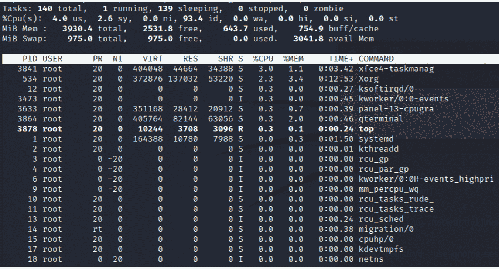

# 第 7 章：操作系统

## 简介

考生必须了解不同主流操作系统和专用移动操作系统的典型使用场景。在企业环境中，支持技术人员必须能够支持和排查多种不同设备的故障。现代企业网络需要针对许多不同的最终用户场景量身定制方法，从本地支持到远程和移动用户。设备可能使用各种网络介质连接到应用程序和服务，包括 `蓝牙`、蜂窝网络、有线连接和 `Wi-Fi`。

技术人员必须能够配置和排查所有类型的网络连接。随着时间的推移，需要升级硬件和软件解决方案，在规划升级时了解任何限制或要求非常重要。为了快速响应客户支持请求，技术人员应能够选择正确的工具或技术，因此深入了解不同的配置设置和菜单选项非常重要。

为了在 CompTIA A+ Core 2 (`220-1102`) 认证考试中取得成功，考生必须确保熟悉以下目标：

## 考试目标

*   **7.1** 识别 Microsoft `Windows` 版本的基本功能
*   **7.2** 给定场景，使用适当的 Microsoft 命令行工具
*   **7.3** 给定场景，使用 Microsoft `Windows 10` 操作系统 (`OS`) 的功能和工具
*   **7.4** 给定场景，使用适当的 Microsoft `Windows 10` 控制面板实用程序
*   **7.5** 给定场景，使用适当的 `Windows` 设置
*   **7.6** 给定场景，在客户端/桌面上配置 Microsoft `Windows` 网络功能
*   **7.7** 给定场景，应用应用程序安装和配置概念
*   **7.8** 解释常见 `OS` 类型及其用途
*   **7.9** 给定场景，在多样化的 `OS` 环境中执行 `OS` 安装和升级
*   **7.10** 识别 `macOS`/桌面 `OS` 的常见功能和工具
*   **7.11** 识别 `Linux` 客户端/桌面 `OS` 的常见功能和工具

本章其余部分专注于实践。针对上述定义的每个概念，您将获得一系列问题，旨在测试您对官方认证考试指南中定义的每个 Core 2 考试目标的掌握程度。这些问题将测试考生对如何排查和配置常见操作系统的知识。

## 练习考试题

## 7.1 识别 Microsoft Windows 版本的基本功能

**1. 用户收到一台运行 `Windows 10` 的新笔记本电脑。首次使用时，在常规登录提示之前，系统提示他们提供密码。哪个功能最有可能导致此提示？**

1.  受密码保护的 `BIOS`
2.  `Windows` 隐私和安全
3.  `Windows` 辅助功能
4.  `BitLocker 驱动器加密`

**2. 一位高级经理坚持要将其个人笔记本电脑加入公司域，以便使用其首选的操作系统和硬件。哪些操作系统不支持此角色？（选择两项。）**

1.  `Windows 10 Home`
2.  `Windows 8.1 Pro`
3.  `Windows 10 Pro`
4.  `ChromeOS`

**3. 技术人员尝试在公司笔记本电脑上启用 `BitLocker 驱动器加密`，但该选项仅在部分笔记本电脑上可用。哪些版本的 `Windows` 操作系统支持 `BitLocker 驱动器加密`？（选择两项。）**

1.  `Windows 10 Pro`
2.  `Windows 10 Home`
3.  `Windows 7 Pro`
4.  `Windows 10 Enterprise`
5.  `macOS`

**4. 一家小公司希望将所有公司工作站从 `Windows 8.1 Pro` 升级到同等的 `Windows 10` 版本。这些系统受管并均符合公司的基准镜像。公司希望以最少的管理工作量完成此过渡，同时迁移所有应用程序和用户数据。以下哪项是最佳解决方案？**

1.  `就地升级`
2.  从中央服务器全新安装
3.  从光学介质全新安装
4.  从 `USB` 介质全新安装

**5. 技术人员响应一位经理的支持工单，该经理在家办公时无法在其个人电脑上启用 `BitLocker`。导致此问题的最可能原因是什么？**

1.  系统仅安装了 `2GB` `RAM`
2.  系统运行 `Windows Home` 版本
3.  系统运行 `32-bit` 版本的 `Windows`
4.  系统有一个 `128GB` 硬盘

**6. 服务台技术人员的任务是远程连接到一台 `Windows` 桌面计算机。技术人员需要使用安全连接更改配置设置。在此过程中，用户必须注销。技术人员最可能使用以下哪种工具？**

1.  `RDP`
2.  虚拟网络计算
3.  Microsoft 远程协助
4.  `SFTP`

**7. 一家公司提议对所有运行在 `32-bit OS` 上的当前 `Windows` 平台执行就地升级。如果执行这些升级，`32-bit OS` 的内存限制将是多少？**

1.  `16MB`
2.  `2048GB`
3.  `4GB`
4.  `128GB`

**8. 驻场支持技术人员向市场经理演示了如何使用 `BitLocker To Go`。技术人员最可能加密了以下哪项？**

1.  `DVD-RW` 光盘
2.  网络驱动器
3.  内部磁盘驱动器
4.  `USB` 驱动器

**9. 技术人员计划在用户设备上安装最新版本的 `Windows OS`。用户坚持在该过程中保留其所有数据文件和配置设置。技术人员应使用以下哪种安装类型？**

1.  网络安装
2.  全新安装
3.  `就地升级`
4.  镜像部署


# 练习题

## 10. 远程协助连接错误

一位家庭用户提交了支持工单，请求远程协助以解决其在本地安装的应用程序上遇到的问题。当技术人员尝试使用 `RDP` 连接到远程系统时，出现了连接错误。导致该错误的**最可能**原因是什么？

1.  系统仅安装了 2GB 内存
2.  系统正在运行 **Windows 家庭版**
3.  系统正在运行 32 位版本的 Windows
4.  系统正在运行 **Windows 专业版**

---

## 7.2 给定场景，使用适当的 Microsoft 命令行工具

### 问题 1：工作站配置故障排除

网络工程师必须排查企业网络的某个部分，市场部用户无法访问打印机、电子邮件或网站。网络基础设施设备似乎工作正常，因此工程师希望排除用户工作站配置错误作为导致问题的可能原因。哪个命令行工具能提供关于工作站配置的最佳信息？

1.  `ping localhost`
2.  `ipconfig /all`
3.  `netstat -a`
4.  `hostname`

### 问题 2：操作系统迁移数据复制

管理员负责 300 名 Windows 用户的操作系统迁移。作为迁移的一部分，管理员必须将最终用户的数据保存到临时共享驱动器。数据必须保留所有安全权限并支持隐藏文件。以下哪个命令默认能实现此结果？

1.  `robocopy`
2.  `copy`
3.  `xcopy`
4.  `cp`

### 问题 3：识别网络工具

技术人员正在排查网络连接问题，并收到以下输出：

```
Server:  UnKnown
Address:  10.10.0.1

Non-authoritative answer:
Name:    www.google.com
Addresses:  2a00:1450:4009:81e::2004
            142.250.187.196

  1     <1 ms     *       <1 ms  WIN2022-DC [10.10.0.1]
  2     *         *         *     Request timed out.
  3     3 ms      1 ms      1 ms  172.17.48.1
  4     3 ms      3 ms      3 ms  192.168.0.1
  5     6 ms      6 ms      6 ms  151.231.252.44
  6     16 ms     72 ms     16 ms  2.120.11.144
  7     15 ms     14 ms     109 ms  72.14.219.96
  8     17 ms     *         *     216.239.40.71
  9     16 ms     16 ms     16 ms  142.251.54.35
  10    17 ms     18 ms     17 ms  lhr25s33-in-f4.1e100.net [142.250.187.196]
```

技术人员**最可能**正在使用以下哪些工具？（选择两项。）

1.  `ping`
2.  `ipconfig`
3.  `netstat`
4.  `nslookup`
5.  `tracert`
6.  `nbstat`

### 问题 4：组策略编辑器可用性

一位高级经理在家使用个人 Windows 10 电脑办公时遇到电脑问题，提交了支持工单。他们试图在参加重要商务活动前访问电子邮件。支持技术人员无法使用远程桌面访问该系统，因此作为变通方法，他们使用了第三方桌面共享应用程序。技术人员确定了解决经理问题的方法，并提议使用组策略编辑器 (`gpedit.msc`) 进行配置更改。然而，当他们尝试运行该工具时，发现经理的电脑上没有该工具。这些工具不存在于经理电脑上的最可能原因是什么？

1.  电脑运行的是 Linux
2.  电脑运行的是 **Windows 10 企业版**
3.  电脑运行的是 **Windows 10 家庭版**
4.  电脑注册表损坏

### 问题 5：网络资源访问故障排除

客户打开笔记本电脑，发现虽然设备显示正常的 Windows 桌面，但无法访问任何基于网络的资源。应在命令行使用以下哪种工具来排查此场景？

1.  `ping`
2.  `msconfig`
3.  `nbtstat`
4.  `nslookup`

### 问题 6：通过 IP 解析计算机名

网络技术人员正在调查一起正在进行的事件，其中一台台式机跨网络连接到一个 IP 地址。技术人员需要解析与该 IP 地址关联的计算机名称。网络技术人员应使用以下哪个命令？

1.  `gpresult`
2.  `ipconfig`
3.  `nslookup`
4.  `net user`

### 问题 7：通过策略防止 USB 存储设备使用

恶意软件感染通过多个 USB 存储设备在公司网络中传播。支持团队必须确定一种方法，防止用户使用连接到 USB 端口的存储设备。团队已获悉必须快速完成此项工作，且将对用户的干扰降至最低。支持团队解决此需求的**最佳**方法是？

1.  向所有用户推送组策略
2.  分配本地安全策略
3.  创建网络登录脚本
4.  更新公司 AUP（可接受使用策略）

### 问题 8：验证已应用的组策略

支持技术人员已将一台 Windows 10 工作站加入域 `companydomain.com`。技术人员需要验证该工作站是否已从域接收安全策略。哪个命令将确认策略是否已生效？

1.  `ipconfig /all`
2.  `netstat -e`
3.  `gpresult /Z`
4.  `nslookup -query=a server1.companydomain.com`

### 问题 9：查看活动的 TCP 连接

技术人员正在使用命令行界面在 Windows 10 计算机上执行任务。技术人员需要确定哪些端口与本地或远程主机建立了活动的 TCP 连接。技术人员应使用以下哪个命令？

1.  `netstat -p TCP`
2.  `net use -p TCP`
3.  `nslookup -p TCP`
4.  `netstat -p UDP`

### 问题 10：验证 GPO 部署至财务用户

管理员已测试新的组策略对象 (GPO)，现欲将其部署到生产环境。部署后，财务用户似乎未接收到新的 GPO。管理员认为问题可能与同时部署的其他 GPO 有关。以下哪个命令行工具对管理员验证正在向会计部门部署哪些 GPO **最有用**？

1.  `nbtstat`
2.  `gpresult`
3.  `nslookup`
4.  `gpupdate`
5.  `tasklist`

### 问题 11：通过登录脚本映射网络驱动器

技术人员正在创建一个登录脚本，需要自动将共享在 `server1` 上的公共文件夹映射为驱动器。用户工作站上的新驱动器号将分配为 P 盘。以下哪个命令将实现预期结果？

1.  `net use P: \\server1\public`
2.  `tracert \\server1\public local drive P:`
3.  `net use \\P = Server\public`
4.  `tracert P: \\server1\public`

### 问题 12：恶意软件事件后验证操作系统文件完整性

发生恶意软件事件后，Windows 系统显示操作系统文件已被修改的证据。已更新反恶意软件定义并执行了全盘扫描。接下来需要执行什么操作以验证 Windows 操作系统文件的完整性？

1.  `chkdsk /scan`
2.  `SFC /SCANNOW`
3.  `diskpart> RESCAN`
4.  `netstat -s`

### 问题 13：验证组策略强制执行

管理员创建了一个新的组策略并将其部署到生产环境。管理员现在想验证新的组策略设置是否已下载并在用户工作站上强制执行。以下哪个命令将允许管理员验证组策略是否生效？

1.  `shutdown -r`
2.  `dcdiag`
3.  `gpresult`
4.  `gpmc.msc`
5.  `gpupdate`

---

## 7.3 给定场景，使用 Microsoft Windows 10 操作系统 (OS) 的功能和工具

### 问题 1：结束阻塞的后台应用程序

在开始在线认证考试前，用户必须运行代理程序以管理在线考试。代理报告名为“Dell Diagnostics”的应用程序正在阻止在线考试启动。用户如何快速识别该后台应用程序并结束任务？

1.  转到 **任务管理器** | **进程** 并 **结束任务**
2.  转到 **任务管理器** | **启动** 并禁用启动项
3.  转到 **任务管理器** | **性能** 并 **结束任务**
4.  运行 **注册表编辑器** 并修改 `Computer\HKEY_CURRENT_USER`


## 7.3 给定场景，使用适当的 Microsoft Windows 10 操作系统工具

### 2. 蓝屏故障排除
技术人员正在维修一台计算机，突然电脑出现 Windows 蓝屏并重新启动，表面上看似正常。为了解决该问题，技术人员需要确定蓝屏事件期间显示的错误消息。技术人员应使用以下哪项来帮助排查问题？

1.  `sfc`
2.  `msconfig`
3.  `regedit32`
4.  `eventvwr`
5.  `msinfo32`

### 3. 修复未记录的更改
一名最近离职的员工对经理的笔记本电脑进行了多项未记录的更改。这些更改导致 Office 365 应用程序无法及时接收更新，并停止了自动磁盘碎片整理服务。为确保这些服务自动运行，哪个工具能**最好地**修复这些问题？

1.  任务计划程序 (`taskschd.msc`)
2.  设备管理器 (`devmgmt.msc`)
3.  性能监视器 (`perfmon.msc`)
4.  证书管理器 (`certmgr.msc`)

### 4. 监控系统性能
薪资经理 Ann 抱怨其公司笔记本电脑的系统性能不佳。应用程序在一天中的特定时段运行缓慢，偶尔在她加班完成任务的晚上也会变慢。受理工单的支持技术人员希望监控 Ann 的电脑以识别问题。技术人员应使用以下哪种工具来**最好地**分析计算机的行为？

1.  计算机管理
2.  事件查看器
3.  性能监视器
4.  任务管理器

### 5. 检查 BIOS 更新
一名员工从为期六个月的外派业务合作伙伴任务中返回。计算机技术人员想检查在六个月期间，硬件供应商的 BIOS 更新是否已安装在该员工的笔记本电脑上。哪个工具能**最好地**显示此信息？

1.  系统信息 (`msinfo32.exe`)
2.  资源监视器 (`resmon.exe`)
3.  系统配置 (`msconfig.exe`)
4.  注册表编辑器 (`regedit.exe`)

### 6. 释放磁盘空间并优化访问
服务台技术人员接到工单，用户的 Windows 工作站运行缓慢。计算机启动缓慢，执行大文件时有长时间的延迟。检查本地硬盘后，发现其接近容量上限。技术人员需要释放空间并优化大文件的访问时间。哪两条命令能**最好地**满足此要求？（选择两项。）

1.  进入安全模式启动
2.  重启计算机
3.  对硬盘进行碎片整理
4.  安装设备驱动程序
5.  运行磁盘清理

### 7. 管理磁盘分区
由于工作站构建模板配置错误，销售团队使用的工作站可用存储空间非常少。技术人员希望查看主操作系统驱动器当前分配的空间，并尽可能扩大驱动器大小。哪种基于图形界面的工具**最适合**此任务？

1.  `Diskpart`
2.  磁盘管理
3.  设备管理器
4.  磁盘清理

### 8. 减少启动等待时间
支持技术人员正在排查销售主管提交的服务台工单。Windows 启动时加载的应用程序导致用户在近五分钟内无法使用计算机。可以采取什么措施帮助用户避免这种漫长的等待时间？

1.  使用系统配置 | 启动选项来禁用启动应用程序
2.  删除注册表项 `HKEY_LOCAL_MACHINE\SOFTWARE\Microsoft\Windows\CurrentVersion\Run` 下列出的条目
3.  使用任务管理器禁用所有当前设置为已启用的启动任务，然后重新启动计算机以确保问题已解决
4.  打开任务管理器 | 启动，识别具有**高**启动影响的应用程序。禁用这些导致启动时过度引导时间的应用程序。

### 9. 诊断运行缓慢
人力资源部的一名用户提交了支持工单。原因是他们的台式机运行缓慢。用户报告称未对电脑进行任何更改。支持技术人员应使用以下哪种工具来确定速度下降的原因？

1.  任务计划程序
2.  Windows 内存诊断
3.  任务管理器中的**性能**选项卡
4.  磁盘碎片整理程序

### 10. 管理受信任的根证书
一位部门经理被意外分配了权限，允许其对公司笔记本电脑进行多项未经授权的更改。其中一项更改是向笔记本电脑的“受信任的根证书颁发机构”存储区添加了额外的证书。该公司是政府承包商，这些新证书不受信任，因为它们不符合政府合规法规。支持技术人员如何确保这些证书颁发机构不会被经理笔记本电脑上运行的应用程序所信任？

1.  在笔记本电脑上使用 `certmgr.msc` 从“受信任的根证书颁发机构”存储区中删除证书
2.  在笔记本电脑上使用 `regedit.msc` 从“受信任的根证书颁发机构”存储区中删除证书
3.  在笔记本电脑上使用 `devmgmt.msc` 从“受信任的根证书颁发机构”存储区中删除证书
4.  要求外部证书颁发机构将其所有证书放入证书吊销列表 (CRL)

## 7.4 给定场景，使用适当的 Microsoft Windows 10 控制面板实用程序

### 1. 禁用打印机
支持技术人员正在帮助用户解决其台式机上的打印问题。为测试可能的修复方法，技术人员有必要禁用打印机。技术人员应使用以下哪种工具来执行此操作？

1.  设备和打印机
2.  同步中心
3.  设备管理器
4.  电源选项

### 2. 修复文件关联
用户致电服务台，发现无法打开图片文件夹中的 JPEG 文件。当用户双击该文件时，命令提示符窗口闪现几秒钟然后消失，无法查看图片。技术人员查看文件，看到如下信息：

```
名称        修改日期        类型            大小
Sunshine.jpg    22/10/2020    应用程序     78KB
```

技术人员应使用以下哪种 Windows 控制面板实用程序来解决此问题？

1.  默认程序
2.  显示设置
3.  设备管理器
4.  Internet 选项

### 3. 配置代理设置
技术人员必须确保所有用户的 Web 浏览器流量都转发到新的代理服务器。选择允许配置相关设置的控制面板实用程序。

1.  网络和共享中心 | 更改适配器设置
2.  Internet 选项 | 连接
3.  设备管理器
4.  Windows Defender 防火墙 | 高级设置

### 4. 辅助功能设置
支持技术人员正在为一位视力受损的用户解决支持问题，该用户在默认颜色和屏幕分辨率方面遇到困难。技术人员应使用以下哪种实用程序？

1.  设备管理器
2.  系统
3.  轻松使用中心
4.  程序和功能

### 5. 故障排除硬件驱动程序
支持技术人员安装了一个新网络摄像头并从制造商网站下载了驱动程序，但网络摄像头无法按预期工作。以下哪个选项将**最好地**允许技术人员排查新安装硬件相关的问题？

1.  服务
2.  设备管理器
3.  事件查看器
4.  程序和功能

### 6. 重置浏览器设置
一位项目经理允许同事使用他们的电脑。事后，他们发现网页在 Web 浏览器中无法按预期显示。技术人员排查问题后发现，许多设置已从默认值更改。技术人员必须找到一种方法将 Web 浏览器重置为默认设置。技术人员应使用哪个控制面板实用程序？

1.  系统
2.  程序和功能
3.  网络和共享中心
4.  Internet 选项


## 问题 5-8

### 问题 5
由于 DHCP 服务器故障，技术人员需要为分支机构的五台工作站手动设置临时 IP 地址。技术人员将在何处找到管理手动 IP 地址分配的控件？

1. `网络和共享中心`
2. `同步中心`
3. `用户账户控制`
4. `凭据管理器`

### 问题 6
某服务提供商支持一个不足十名用户的小型组织。该组织被其互联网服务提供商 (ISP) 告知电子邮件服务器已更改为不同的 DNS 名称。技术人员需要前往该小型组织，为所有本地用户更新配置。哪个控制面板实用程序将允许技术人员进行更改？

1. `Internet 选项`
2. `Windows Defender 防火墙`
3. `用户账户`
4. `邮件`

### 问题 7
一位研究科学家用户希望将一台 Windows 10 笔记本电脑连接到外部台式显示器、键盘和鼠标。当科学家合上盖子时，系统会关机。如何配置系统以便在合上盖子时保持通电状态？

1. `控制面板 | 电源选项 | 无操作`
2. `控制面板 | 电源选项 | 睡眠`
3. `控制面板 | 电源选项 | 休眠`
4. `控制面板 | 电源选项 | 关机`

### 问题 8
一位负责创建丰富数字媒体的用户在其塔式计算机系统中安装了一块额外的声卡。然而，音频输出仍使用默认的内置硬件。用户如何确保默认播放设备配置为新声卡？

1. `设备管理器 | 音频输入和输出`
2. `控制面板 | 声音`
3. `设备和打印机`
4. `语音识别`

## 7.5 给定场景，使用适当的 Windows 设置

### 问题 1
一家律师事务所最近在所有用户桌面上安装了一款新的文字处理应用程序。一些用户提交了支持工单，抱怨在尝试输入特殊字符时得不到预期结果。支持技术人员应前往何处解决此问题？

1. `设置 | 时间和语言`
2. `设置 | 辅助功能`
3. `设置 | 个性化`
4. `设置 | 应用`

### 问题 2
支持技术人员受命为市场部的几名成员配置多显示器设置。连接好所有适当的电源和显示线缆后，技术人员应前往何处配置显示器？

1. `设置 | 时间和语言`
2. `设置 | 个性化`
3. `设置 | 系统`
4. `设置 | 蓝牙和设备`

### 问题 3
一位销售经理从公司活动返回，抱怨其笔记本电脑显示关于磁盘空间不足的警告消息。该经理在本地存储上保存了大量新数据，并在活动期间被要求安装一些软件。技术人员现在必须尝试修复该问题。他们接下来应前往何处以支持该用户？

1. `设置 | 时间和语言`
2. `设置 | 个性化`
3. `设置 | 系统`
4. `控制面板 | 文件历史记录`

### 问题 4
正在实施一项新的公司政策，在该政策全公司推广之前，必须配置并测试安全设置。其中一项政策要求是：当屏幕保护程序锁定屏幕时，必须使用密码来解锁屏幕。可在何处访问此设置？

1. `设置 | 个性化 | 锁屏界面`
2. `设置 | 屏幕超时设置`
3. `控制面板 | 用户账户`
4. `设置 | 隐私和安全性 | 锁屏界面`

### 问题 5
一家公司希望使用 BitLocker 保护所有 Windows 移动设备，并通过组策略进行集中管理。在试点阶段，少量笔记本电脑将手动配置此安全功能。为此，需要通过以下哪个路径访问设备加密设置？

1. `设置 | 系统`
2. `设置 | 应用`
3. `设置 | 隐私和安全性`
4. `设置 | 网络和 Internet`

### 问题 6
一家小型出版公司希望配置所有设备，在访问 Internet 资源前通过新购买的代理服务器连接。哪个设置菜单选项将允许技术人员访问代理服务器设置？

1. `设置 | 系统`
2. `设置 | 应用`
3. `设置 | 隐私和安全性`
4. `设置 | 网络和 Internet`

### 问题 7
一家研发公司实施了企业拥有个人启用 (COPE) 政策。可接受使用政策 (AUP) 允许用户访问个人电子邮件账户以及其商务电子邮件。可在何处访问这些设置？

1. `控制面板 | Internet 选项`
2. `设置 | 应用`
3. `设置 | 隐私和安全性`
4. `设置 | 账户`

### 问题 8
一家公司正在测试一款新的游戏应用程序，并希望通过记录客户在游戏过程中的体验来衡量客户反馈。哪些 Windows 设置将允许他们在游戏期间记录客户的反应和反馈？

1. `设置 | 游戏 | 捕获`
2. `控制面板 | 自动播放`
3. `设置 | 应用 | 视频播放`
4. `控制面板 | 同步中心`

## 7.6 给定场景，在客户端/桌面上配置 Microsoft Windows 网络功能

### 问题 1
网络技术人员必须将一台新工作站添加到 Windows 域。将使用哪些 Windows 设置从工作组配置切换到加入域的配置？

1. `设置 | 账户 | 登录选项`
2. `控制面板 | 区域设置`
3. `设置 | 系统 | 关于 | 域或工作组`
4. `控制面板 | 凭据管理器 | 域或工作组`

### 问题 2
用户联系服务台，报告无法访问任何网络资源。支持技术人员要求用户打开命令提示符并输入 `ipconfig /all`。生成的输出包含 `169.254.23.66` IP 地址。这是什么地址类型，网络上最可能存在什么问题？

1. `专用 IPv4 地址`
2. `自动专用 IP 寻址 (APIPA)`
3. `IPv6 链路本地地址`
4. `DHCP 服务故障`
5. `Active Directory 服务故障`
6. `DNS 服务故障`

### 问题 3
一名用户提交支持工单，称无法共享新安装的部门打印机。该用户已被分配共享文件夹和打印机的权限。该用户属于一个工作组，**而非** Windows 域。用户报告电子邮件和 Internet 浏览工作正常。什么设置可能导致共享错误？

1. 用户没有共享打印机的权限
2. `网络配置文件设置为公用`
3. 网络接口已禁用
4. `网络配置文件设置为专用`

### 问题 4
可以配置哪项 Windows 功能以防止销售部门成员使用 P2P 文件共享应用程序？

1. `Windows Defender 防火墙`
2. `Windows 病毒和威胁防护`
3. `Windows 安全启动`
4. `Windows BitLocker 驱动器加密`

### 问题 5
一名用户提交支持工单，称被阻止向 Windows Defender 防火墙添加例外。该用户有一个应用程序启动器，正尝试从其“下载”文件夹运行它。哪种类型的用户账户允许修改防火墙规则？

1. `来宾账户`
2. `高级用户`
3. `管理员`
4. `标准用户`

### 问题 6
技术人员正在排查一台没有网络连接的用户工作站。在确认当前 IP 地址设置为 `169.254.44.89` 后，技术人员下一步应采取什么行动？

1. 尝试使用 `ipconfig /flushdns` 获取 IP 地址
2. 尝试使用 `ipconfig /all` 获取 IP 地址
3. 尝试使用 `ipconfig /renew` 获取 IP 地址
4. 尝试使用 `ipconfig /flushdhcp` 获取 IP 地址


## 练习题

### 7. 远程办公数据限制
一家公司最近切换到远程办公模式。该公司通过昂贵的蜂窝和卫星连接支持许多位于偏远地区的用户。为了最小化这些链路的成本，公司希望限制每月数据使用量。哪**两个**配置选项能**最好地**允许组织限制数据使用？

1.  `设置 | 系统 | 存储设置`
2.  `高级网络设置 | 数据使用情况`
3.  `高级网络设置 | 网络接口 | 计量连接 – 开启`
4.  `高级网络设置 | 高级共享`
5.  `高级网络设置 | 网络接口 | 飞行模式 – 开启`

### 8. 网络打印机配置
某业务单元新安装了一台网络打印机，并直接连接到局域网（`LAN`）交换机，技术人员现在必须配置多台工作站以直接连接到该网络打印机。在客户端工作站上添加打印机时，以下哪个选项允许技术人员连接网络打印机？

1.  按名称选择共享打印机
2.  使用 `IP` 地址或主机名添加打印机
3.  添加蓝牙、无线或可发现的打印机
4.  使用 `USB` 线缆直接连接

## 7.7 给定场景，应用应用程序安装和配置概念

### 1. 内存升级建议
一名技术人员正在支持一位使用 `Windows 10` `x86` 计算机（`4GB` `RAM`）的客户。客户需要将可用内存增加到 `16GB RAM` 以安装一款工程应用程序。技术人员应向客户推荐什么以满足此要求？

1.  安装 `Ubuntu Linux`
2.  安装更大容量的 `SSD`
3.  使用 `64 位架构`
4.  安装 `16GB DDR4 RAM`

### 2. CAD 应用性能优化
工程设计团队的几名成员因使用计算机辅助设计（`CAD`）应用程序时出现延迟问题和性能不佳而提交了服务工单。对工作站的硬件扫描显示如下：

*   `64GB DDR4 内存`
*   `2GB 集成显卡`
*   `1TB SSD HDD`
*   `Intel XEON 3.4GHZ 16 核 CPU`

工程师们可以做出什么改变，在使用 `CAD` 应用程序时获益最大？

1.  增加内存
2.  安装独立显卡
3.  安装更快的 `CPU`
4.  安装更快的 `HDD`

### 3. 32 位应用在 64 位系统上的限制
市场团队在其 `32 位` `Windows 8.1` 工作站上使用客户关系管理（`CRM`）系统。将工作站升级到 `Windows 11` `64 位` 版本后，团队希望继续使用相同的 `CRM` 应用程序。在 `64 位` 操作系统上使用 `32 位` 应用程序时，他们将遇到以下哪种限制？

1.  `32 位` 应用程序将被限制为 `32GB` `RAM`
2.  `32 位` 应用程序不支持多线程
3.  `32 位` 应用程序将被限制为 `4GB` `RAM`
4.  `32 位` 应用程序不支持多任务

### 4. 应用兼容性快速修复
在将客户的 `Windows 8` 操作系统升级到 `Windows 10` 后，某应用程序无法启动。系统显示一条错误消息，指出该应用程序是为 `Windows 8` 编写的，与当前操作系统不兼容。支持技术人员可以提供什么作为该问题的快速修复？

1.  联系应用程序供应商，调查是否可以购买更新版本
2.  将应用程序兼容性设置为 `Windows 8`
3.  将 `Windows` 启动进入安全模式以运行该应用程序
4.  将应用程序兼容性设置为 `Windows 7`

### 5. 保护 CAD 应用免遭盗版
一家软件开发公司花费巨资设计了一款计算机辅助设计（`CAD`）应用程序。他们需要一种控制措施，以确保应用程序的每个副本仅在获得许可的工作站上运行。保护应用程序免遭盗版的**最有效**方法是什么？

1.  要求每位客户在安装期间同意严格的许可要求
2.  为应用程序的每个副本部署外部硬件令牌
3.  要求每位客户签署可接受使用策略（`AUP`）
4.  仅向值得信赖的客户销售应用程序

## 7.8 解释常见操作系统类型及其用途

### 1. 跨平台 U 盘文件系统选择
一名工程师需要格式化一个 `USB` 存储设备，以准备将 `20GB` 数据从 `Ubuntu Linux` 服务器复制到 `Windows` 系统。工程师**最可能**使用以下哪种文件系统？

1.  `FAT32`
2.  `ext4`
3.  `NTFS`
4.  `exFAT`

### 2. 终止生命周期操作系统
最近的风险评估凸显了一个安全问题：旧设备嵌入了 `32 位` 版 `Windows XP` 作为其操作系统。公司不再为此操作系统接收任何质量或安全更新。哪个术语**最能**描述此操作系统？

1.  生命周期结束（`EOL`）
2.  不兼容的操作系统
3.  `32 位` 操作系统
4.  供商支持的操作系统

### 3. 学生工作站操作系统选择
一所学校希望投资易于支持的学生工作站技术。选定的设备将运行基于浏览器界面的轻量级操作系统。满足这些要求的**最佳**选择是什么？

1.  `Linux`
2.  `macOS`
3.  `ChromeOS`
4.  `Windows`

### 4. 统一操作系统平台
一家公司希望在最近的库存评估报告称服务器、工作站和移动设备使用了四种不同的操作系统后，简化其客户支持。更复杂的是，还有五种不同版本的 `Android OS` 和三种不同版本的 `iOS` 在使用。公司希望选择单一操作系统来支持服务器、工作站和手持设备。以下哪项是**最佳**选择？

1.  `Linux`
2.  `iOS`
3.  `Windows`
4.  `ChromeOS`

### 5. 大容量存储文件系统选择
在数据中心服务器上安装最新版 `Red Hat Linux` 后，添加了额外存储。新硬盘必须使用支持 `40TB` 存储的文件系统进行格式化，并且预计需要定期进行碎片整理。以下哪项是**最佳**文件系统选择？

1.  `FAT32`
2.  `ext3`
3.  `NTFS`
4.  `ext4`

### 6. 基于 Linux 的智能手机操作系统
一家营销公司希望为其员工部署智能手机。智能手机必须支持基于 `Linux` 的操作系统，因为开发人员将为公司创建应用程序，并具有 `Linux` 操作系统经验。以下哪种操作系统是**最佳**选择？

1.  `iOS`
2.  `SUSE Linux`
3.  `Android OS`
4.  `Windows Mobile`

## 7.9 给定场景，在多样化操作系统环境中执行操作系统安装和升级

### 1. 网络启动升级方式
一名支持工程师的任务是将多台台式机升级到 `Windows 10`。然而，他们只能获得一份安装介质副本，因此提议通过网络执行升级。以下哪种启动方法允许这种升级？

1.  `SSD`
2.  光驱
3.  U 盘
4.  `PXE`

### 2. 大规模自动化部署
一家制药公司需要以最高效的方式部署 `500` 台新的 `Windows 11` 台式机。该过程需要自动化，以最大程度减少技术人员在此安装上花费的时间。哪种安装方式是**最佳**选择？

1.  远程网络安装
2.  修复安装
3.  全新安装
4.  无人值守安装

### 3. 大容量硬盘分区方案
在全新台式机上手动安装 `Windows 11` `x64` 时，技术人员必须为 `12TB` 硬盘驱动器选择分区方案。哪种分区格式能最好地利用可用存储空间？

1.  `ext4`
2.  `MBR`
3.  `GPT`
4.  `APFS`

### 4. 保留应用和设置的升级方式
一名技术人员正在帮助远程客户将其 `Windows` 工作站升级到最新版本。客户希望保留其所有应用程序和设置。哪个选项将升级系统并满足客户要求？

1.  全新安装
2.  修复安装
3.  无人值守安装
4.  就地升级


## Windows 部署与升级问题

### 问题 5
哪个是第一个强制要求功能升级的 Microsoft Windows 操作系统？

1.  `Windows 11`
2.  `Windows 8.1`
3.  `Windows 10`
4.  `Windows 7`

### 问题 6
一家大型跨国制造商拥有 6,000 台 Windows 桌面的用户群，希望创建基线配置，使所有桌面具有相同的功能和应用程序。对该组织而言，最佳解决方案是什么？

1.  升级
2.  全新安装
3.  镜像部署
4.  修复安装

### 问题 7
安装团队正在使用 `PXE 启动` 部署新镜像。为了最大限度地减少部署服务器的负载，他们一次只向 30 台工作站部署镜像。此过程可能会导致瓶颈。团队应重点监控什么？

1.  对用户的影响
2.  对网络段的影响
3.  对 `DHCP` 作用域的影响
4.  对工作站的影响

### 问题 8
技术人员正在协助公司将笔记本电脑和台式机混合升级为运行 `Windows 11`。为了支持更大的卷大小和多个分区，决定使用 `GPT` 分区配置硬盘。为了支持 `Windows 11` 和 `GPT` 磁盘，必须具备哪些**最低**硬件规格？（选择两项。）

1.  32GB 内存
2.  `UEFI`
3.  `TPM 2.0`
4.  `LEGACY BIOS`
5.  8 核 CPU

### 问题 9
一台 Windows 桌面计算机在断电和意外系统关机后无法启动。技术人员应**首先**尝试什么来查看系统是否可以恢复？

1.  无人值守安装
2.  修复安装
3.  镜像部署安装
4.  远程安装

### 问题 10
技术人员正准备将部门工作站升级到最新的 Windows 操作系统。为了避免升级期间出现问题，他们希望查看一份报告，列出可能阻止升级的潜在缺失硬件功能。

1.  Microsoft Windows `HCL`（硬件兼容性列表）
2.  Microsoft Windows `PC Health Check App`（电脑健康检查应用）
3.  Microsoft Windows `System Information`（系统信息）
4.  Microsoft Windows `Task Manager`（任务管理器）

## 7.10 识别 macOS/桌面操作系统的常见功能和工具

### 问题 1
出版部门的几位用户希望能访问 `Skype`，因为这是组织内进行会议和与同事通话的标准工具。出版部门的用户都使用 `macOS`，但在 `Apple App Store` 中找不到 `Skype` 应用程序，不过可以从微软官方网站下载。用户应选择哪种文件格式，以确保 `Skype` 应用程序可以安装在他们的 `macOS` 计算机上？

1.  `MSI`
2.  `EXE`
3.  `DMG`
4.  `APK`

### 问题 2
支持技术人员正在帮助用户从最近的备份中恢复已删除的文件。用户的工作站运行 `macOS`，用户需要在恢复部分文件之前查看备份上的文件。哪个 `macOS` 实用程序对此任务**最**有用？

1.  `Keychain`（钥匙串）
2.  `Finder`（访达）
3.  `Mission Control`（调度中心）
4.  `Explorer`（资源管理器）

### 问题 3
用户提交支持工单，因为他们不确定如何创建自动备份到购买的外部硬盘。客户端工作站运行最新版本的 `macOS`。哪个工具或应用程序是安排自动备份到该驱动器的**最佳**选择？

1.  `File History`（文件历史记录）
2.  `Time Machine`（时间机器）
3.  `Windows Backup`（Windows 备份）
4.  `Mission Control`（调度中心）

### 问题 4
技术人员正在为一台电子邮件应用程序无响应的 `macOS` 计算机用户提供支持。什么功能允许技术人员查看当前活动应用程序的列表并关闭无响应的应用程序？

1.  `Force Quit`（强制退出）菜单
2.  `Task Manager`（任务管理器）
3.  `Task List`（任务列表）
4.  `Control Panel`（控制面板）

### 问题 5
研究部门最近为部门用户购买了 `MacBook` 计算机。由于这些计算机上存储着高度敏感的数据，管理层要求对本地存储的内容提供额外的安全保护。哪个功能是保护本地数据驱动器的好选择？

1.  `iCloud`
2.  `Keychain`（钥匙串）
3.  `FileVault`
4.  `BitLocker`

### 问题 6
`macOS` 基于什么源代码？

1.  `Linux`
2.  `Android`
3.  `Unix`
4.  `ChromeOS`

### 问题 7
用户访问多个不同的互联网站点，这些站点需要输入用户账户和密码才能访问。用户希望自动化此过程，以便当他们登录 `macOS` 计算机时，无需输入额外密码即可访问这些站点。哪个 `macOS` 功能允许使用和管理多个凭据？

1.  `Mission Control`（调度中心）
2.  `Spotlight`（聚焦搜索）
3.  `Keychain`（钥匙串）
4.  `Dock`（程序坞）

### 问题 8
技术人员被要求卸载管理人员 `MacBook Pro` 上不再使用的大型应用程序。他们如何卸载该应用程序？

1.  使用 `Finder`（访达）定位应用程序并删除应用程序文件夹
2.  使用 `Mission Control`（调度中心）定位应用程序并删除应用程序窗口
3.  使用 `App Store`（应用商店）移除不需要的应用程序
4.  使用 `Finder`（访达）定位应用程序并将其移至 `Trash`（废纸篓）

### 问题 9
市场经理提出支持请求，其 `macOS` 笔记本电脑无法启动，显示以下错误消息：

```
No bootable device – insert boot disk and press any key
（无可启动设备 – 请插入启动磁盘并按任意键）
```

技术人员应**首先**做什么？

1.  在启动时按住 `Command + R` 访问 `Recovery`（恢复）菜单并选择 `Disk Utility`（磁盘工具）
2.  在启动时按住 `Command + R` 访问 `Recovery`（恢复）菜单并选择 `Reinstall macOS`（重新安装 macOS）
3.  从 `DVD` 安装介质启动以访问 `Recovery`（恢复）菜单并选择 `Disk Utility`（磁盘工具）
4.  在启动时使用 `Command + R` 进入安全模式并选择 `Restore from the Time Machine Backup`（从时间机器备份恢复）

### 问题 10
在用户的 `MacBook Pro` 上安装多个应用程序后，技术人员从下载文件夹中删除了许多 `DMG` 和 `PKG` 文件。运行 `Activity Monitor`（活动监视器）后，似乎没有太多可用磁盘空间。技术人员可以做什么来释放磁盘空间？

1.  使用 `Trash`（废纸篓）应用程序永久删除文件
2.  使用 `Recycle Bin`（回收站）应用程序永久删除文件
3.  使用 `Disk Cleaner`（磁盘清理）应用程序识别不需要的文件
4.  使用 `Disk Utility`（磁盘工具）将硬盘分割成单独的分区

### 问题 11
用户希望自定义成功登录 `MacBook Pro` 后看到的可用实用程序和应用程序列表。他们应该自定义什么功能？

1.  `Mission Control`（调度中心）
2.  `Dock`（程序坞）
3.  `Start menu`（开始菜单）
4.  `Toolbar`（工具栏）

### 问题 12
技术人员在将 `macOS` 工作站分配给用户之前，必须执行许多任务对其进行配置。他们需要配置网络设置、设置打印机和配置备份。哪个文件夹将托管这些配置实用程序？

1.  `Mission Control`（调度中心）
2.  `System Preferences`（系统偏好设置/系统设置）
3.  `Dock`（程序坞）
4.  `Disk Utilities`（磁盘工具）

### 问题 13
用户想要在其 `macOS` 工作站上使用多个桌面。以下哪种方法允许用户在桌面之间切换？（选择两项。）

1.  `Control + Right Arrow`（右箭头）或 `Control + Left Arrow`（左箭头）键
2.  使用鼠标或触控板从 `Dock`（程序坞）中选择桌面
3.  进入 `Mission Control`（调度中心）并使用鼠标或触控板选择所需的桌面
4.  `Command + Spacebar`（空格键）

## 7.11 识别 Linux 客户端/桌面操作系统的常见功能和工具

### 问题 1
技术人员正在协助人力资源经理保护保存在人力资源文档文件夹中的许多敏感文件。技术人员能够看到以下输出：

```
-rw-r----- 1 mark HumanResources 0 Jan 9 14:37 Employee-Conduct
```

```
-rw-r----- 1 mark HumanResources 0 Jan 9 14:37 Employee-Details
```

```
-rw-r----- 1 mark HumanResources 0 Jan 9 14:36 Employee-Health
```


## Linux 和网络练习题

### 问题 1
```
-rw-r----- 1 mark Sales        0 Jan 9 14:37 Employee-Reports
```

1. 技术人员使用了哪个命令来查看输出，以及哪个命令能**最好地**保护敏感文件？（有两个答案。）

2. `dir /L`

3. `sudo chown :HumanResources Employee-Reports`

4. `ls -l`

5. `sudo chmod 664 Employee-Reports`

6. `pwd`

7. `sudo mv Employee-Reports ../Sales`

### 问题 2
技术人员必须登录到 Linux 打印服务器并重启打印服务。如果他们想在会话期间使用 root 权限，将使用什么命令行语法？

1. `pwd`
2. `grep`
3. `samba`
4. `sudo`

### 问题 3
技术人员正在调查用户在访问 Ubuntu Linux 服务器上的应用程序时遇到延迟的投诉。技术人员查看以下输出，试图找出导致此延迟的原因：



图 7.1：Linux 性能数据示例

技术人员使用了什么命令来查看这些性能数据？

1. `nano`
2. `dig`
3. `top`
4. `ps`

### 问题 4
在 Linux 操作系统上，可以使用什么命令来删除文件或文件夹？

1. `chmod`
2. `man`
3. `df`
4. `rm`

### 问题 5
开发人员担心其本地系统上的可用磁盘空间可能不足。他们在提示符下运行一个命令，产生以下输出：

```
Filesystem     1K-blocks      Used  Available Use% Mounted on
/dev/sda1      263174212 230887666  32286546  87%  /
```

他们使用了什么 Linux 命令？

1. `ps`
2. `top`
3. `df`
4. `ip`

### 问题 6
技术人员为一名远程用户提供支持，该用户正在操作一台没有图形界面的 Ubuntu Linux 工作站。技术人员需要安全地访问终端会话，因为系统包含敏感的知识产权。他们在会话期间将需要使用多个命令行工具。什么将允许技术人员执行此任务？

1. `RDP (Remote Desktop Protocol)`
2. `SSH (secure shell)`
3. `telnet (teletype network)`
4. `cp (copy command)`

### 问题 7
在 Linux 中，当 `man` 命令位于命令行界面 (CLI) 命令之前时，其目的是什么？

1. 它提升用户的权限，以便他们可以执行管理任务
2. 它自动将管理器权限分配给该命令
3. 它以手册的形式显示帮助
4. 它为该命令进入维护模式

### 问题 8
某部门希望其基于 Windows 10 的工作站能够通过映射驱动器访问 Ubuntu Linux 服务器上的共享文件。什么服务将允许此功能？

1. 在 Ubuntu 服务器上安装 `telnet` 服务
2. 在 Windows 10 工作站上安装 `samba` 服务
3. 在 Ubuntu 服务器上安装 Windows 文件和打印共享
4. 在 Ubuntu 服务器上安装 `samba` 服务

### 问题 9
哪个命令允许管理员在 Red Hat Linux 工作站上下载并安装新的应用程序包？

1. `grep`
2. `ps`
3. `yum`
4. `dig`

### 问题 10
人力资源经理正在 HR 文件夹中搜索一个名为 `Employee-Details` 的文件。找到后，他们需要在该文件中搜索关于 Joe Smith 的信息。生成以下输出使用了哪两个命令？

```
-rw-r--r-- 1 mark HumanResources 263 Jan  9 18:24 Employee-Details
```

```
Joe Smith    6 Beacon Drive, Edinburgh EH1 4DL    0131 789765
```

1. `ls -l Employee-Details`
2. `dir /L Employee-Details`
3. `cat "Joe Smith" Employee-Details`
4. `grep "Joe Smith" Employee-Details`

### 问题 11
技术人员正在 Ubuntu Linux 工作站上排查网络问题。技术人员在终端窗口中发出命令，产生以下输出：

```
eth0: <BROADCAST,MULTICAST,UP,LOWER_UP> mtu 1500 qdisc mq state UP group default qlen 1000
link/ether 00:15:5d:30:49:57 brd ff:ff:ff:ff:ff:ff
inet 172.22.64.215/20 brd 172.22.79.255 scope global eth0
inet6 fe80::215:5dff:fe30:4957/64 scope link
```

```
ANSWER SECTION:
www.google.com.     0     IN     A     142.250.114.104
www.google.com.     0     IN     A     142.250.114.106
www.google.com.     0     IN     A     142.250.114.99
www.google.com.     0     IN     A     142.250.114.147
www.google.com.     0     IN     A     142.250.114.103
www.google.com.     0     IN     A     142.250.114.105
;; Query time: 130 msec
```

生成该输出使用了哪两个 Linux 网络命令？

1. `ip address`
2. `ipconfig`
3. `nslookup`
4. `dig`
5. `tracert`
6. `ping`

### 问题 12
开发人员提交支持工单，因为他们无法访问从同事的 Red Hat Linux 工作站共享的文件。哪个命令**最适合**用于分配该文件的权限？

1. `grep`
2. `chmod`
3. `ip address`
4. `pwd`
