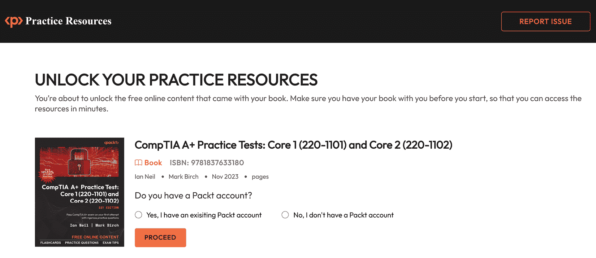
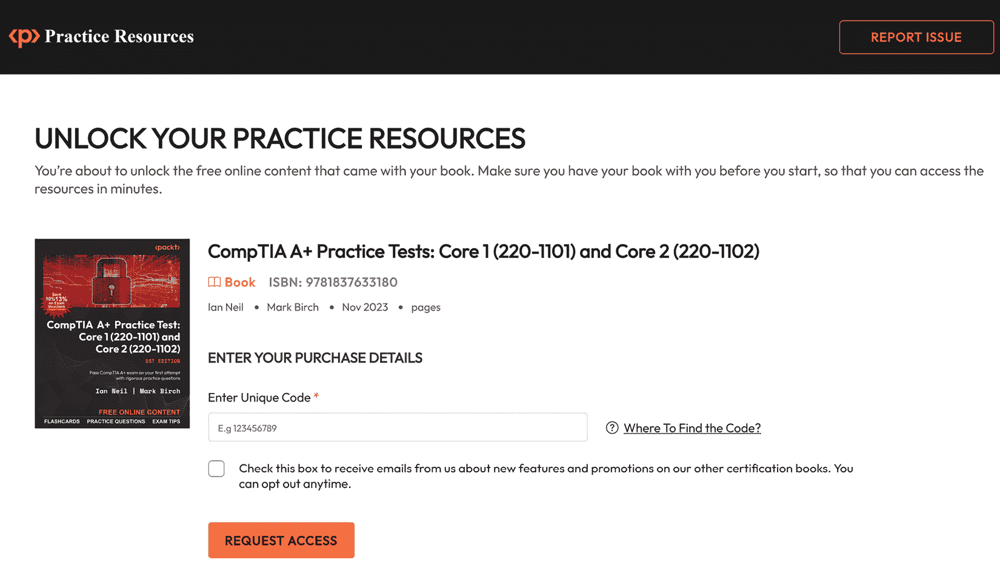
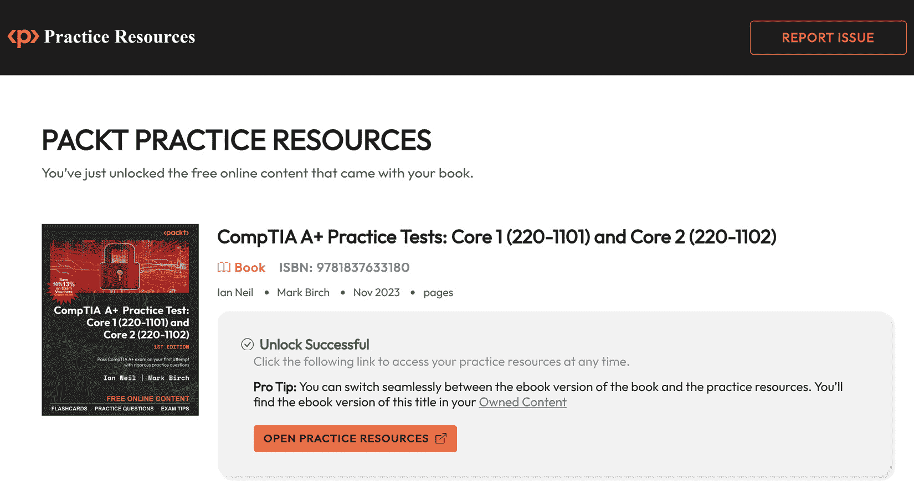
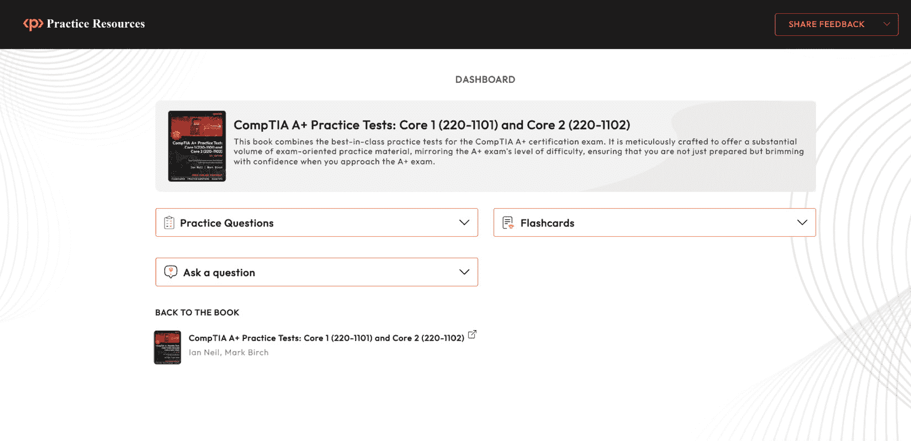

# 10. 操作程序

## 解锁免费练习资源的说明
要访问随书附赠的免费在线内容，您首先需要解锁它。解锁**耗时不到 10 分钟**，**可在任何设备上完成**，且**只需执行一次**。请遵循以下 5 个简单步骤完成该过程：

### 步骤 1
打开链接 <https://packt.link/core12unlock> 或扫描以下二维码：

*图 10.1：用于解锁本书免费在线内容页面的二维码*

这两个链接中的任意一个都将引导至以下页面：

*图 10.2：Core 1 和 2 在线练习资源的解锁页面*

### 步骤 2
如果您已有 Packt 账户，请选择“**是的，我有现有的 Packt 账户**”选项。

如果没有，请选择“**不，我没有 Packt 账户**”选项。

如果您没有 Packt 账户，系统将提示您在下一页创建一个新的 Packt 账户。这是免费的，只需一分钟即可创建。

选择其中一个选项后，单击**继续**。

**忘记密码？**

如果您有 Packt 账户但忘记了密码，可以在继续下一步之前通过此链接重置密码。您可以在此重置密码：

<https://www.packtpub.com/forget-password>

### 步骤 3
创建账户或登录现有账户后，您将被引导至以下页面：

*图 10.3：输入您的唯一注册代码以解锁资源*

### 步骤 4
输入以下唯一代码：

#### ECZ1532

**可选**：您可以选择加入关于其他认证书籍的促销信息。我们不发送垃圾邮件，只发送最优惠的信息，并且您可以随时轻松退订。

单击**请求访问权限**。

### 步骤 5
如果您输入的代码正确，您将看到一个显示“**打开练习资源**”的按钮。

## 解锁在线内容

*图 10.4：成功解锁免费在线内容时显示的页面。*

单击 **OPEN PRACTICE RESOURCES** 链接以开始使用您的免费在线内容。您将被重定向到 **Dashboard**，其外观类似于以下屏幕截图。

*图 10.5：成功解锁练习资源后的 Dashboard 页面。*

请参阅《前言》中的 *Practice Resources – A Quick Tour* 部分，快速了解这些练习资源。

**将此链接加入书签**

现在您已解锁资源，可以随时通过访问此链接返回：[`packt.link/comptiacore12practice`](https://packt.link/comptiacore12practice)。

或扫描以下二维码：

*图 10.6：免费练习资源的二维码*

## 故障排除提示

如果您在解锁时遇到问题，可以尝试以下 3 种方法：

1.  仔细核对您的唯一代码。我们书籍中的所有唯一代码均区分大小写，您的代码必须与 *STEP 5* 中显示的完全一致。
2.  如果不行，请使用页面右上角的 “**Report Issue**” 按钮。
3.  如果您完全无法打开解锁页面，请发送邮件至 customercare@packt.com 并注明书籍名称。

# 简介

作为支持技术人员，您在确保计算机系统平稳运行和为最终用户提供高效技术支持方面发挥着至关重要的作用。本章重点介绍操作程序。您职责的一个关键方面是遵循既定协议和最佳实践，以维护高效且安全的计算环境。

在本章中，您将面对 CompTIA A+ Core 2 (220-1102) 领域 4：操作程序中概述的关键目标相关问题。这些目标旨在为您提供必要的知识和技能，以有效履行职责并为组织的整体成功做出贡献。

通过掌握这些操作程序，您将提高作为服务台技术人员的效率并提升用户满意度。

为了在 CompTIA A+ Core 2 (220-1102) 认证考试中取得成功，考生必须确保熟悉以下目标：

*   10.1 给定场景，实施与文档和支持系统信息管理相关的最佳实践
*   10.2 解释基本的变更管理最佳实践
*   10.3 给定场景，实施工作站备份和恢复方法
*   10.4 给定场景，使用常见安全程序
*   10.5 总结环境影响和局部环境控制
*   10.6 解释禁止内容/活动以及隐私、许可和策略概念的重要性
*   10.7 给定场景，使用适当的沟通技巧和职业素养
*   10.8 识别脚本编写的基础知识
*   10.9 给定场景，使用远程访问技术

本章其余部分专门用于练习。您将针对上述定义的每个概念获得一系列问题，旨在测试您对该领域官方认证考试指南定义的每个核心目标的掌握程度。这些问题将评估考生关于如何实施操作程序的知识。

# 模拟考试题

## 10.1 给定场景，实施与文档和支持系统信息管理相关的最佳实践

1.  一家公司正在为其文档和支持系统实施法规合规性要求。它希望确保用户在访问系统前了解组织的政策和程序。应实施以下哪项最佳实践？
    1.  密码复杂性规则
    2.  网络分段
    3.  启动画面
    4.  事件报告

2.  服务台团队负责记录和报告支持活动期间发生的任何事件。他们应使用以下哪份文档记录每个事件的详细信息？
    1.  知识库文章
    2.  启动画面
    3.  事件报告
    4.  服务级别协议

3.  以下哪项是遵守与事件报告相关的法规要求的最佳实践示例？
    1.  在所有公司设备上实施启动画面
    2.  进行定期漏洞评估
    3.  在传输过程中加密敏感客户数据
    4.  对员工进行数据处理和隐私政策培训

4.  以下哪项是应包含在支持系统信息管理计划中的文档示例？
    1.  网络图
    2.  软件许可证
    3.  客户联系信息
    4.  用户密码

5.  在支持系统信息管理的背景下，以下哪项是知识库的目的？
    1.  存储客户反馈
    2.  跟踪硬件库存
    3.  集中管理故障排除指南
    4.  安排技术人员预约

6.  记录支持请求时，应包含以下哪项详细信息？
    1.  客户最喜欢的颜色
    2.  请求的日期和时间
    3.  技术人员的午餐偏好
    4.  该地区的天气状况

7.  以下哪项是管理支持系统文档的最佳实践？
    1.  将文档存储在多个物理位置
    2.  通过电子邮件共享敏感信息
    3.  定期更新和审查文档
    4.  仅在必要时打印文档

8.  以下哪项是支持系统中使用的工单系统示例？
    1.  Microsoft Office 套件
    2.  ServiceNow
    3.  Adobe Photoshop
    4.  Google Chrome

9.  服务级别协议 (SLA) 在支持系统文档中的主要目的是什么？
    1.  概述技术人员的工作时间表
    2.  确定支持服务的定价
    3.  定义响应和解决时间
    4.  确定客户的首选联系方式

10. 以下哪项应包含在支持系统知识库文章中？
    1.  销售宣传材料
    2.  支持技术人员的个人意见
    3.  已知问题的经测试解决方案
    4.  公司财务报告

11. 以下哪项是组织和分类支持系统文档的常用方法？
    1.  字母顺序
    2.  逆时间顺序
    3.  颜色编码标签
    4.  随机排列

12. 以下哪项是支持系统中使用的客户关系管理 (CRM) 系统示例？
    1.  Salesforce
    2.  Dropbox
    3.  Microsoft Word
    4.  Spotify

13. 在支持系统文档中，创建清单的目的是什么？
    1.  跟踪技术人员考勤记录
    2.  监控客户满意度评分
    3.  保存备件和设备的清单
    4.  安排例行维护任务

14. 以下哪项陈述最能描述可接受使用政策 (AUP) 在文档和支持系统信息管理方面的内容？
    1.  AUP 概述了创建关键数据备份的程序
    2.  AUP 制定了计算机系统和网络适当使用的准则
    3.  AUP 指定了排查和解决硬件相关问题的步骤
    4.  AUP 定义了记录软件许可协议的流程

## 10.2 解释基本的变更管理最佳实践

1. 一家公司正在更新操作程序并将采用变更管理。以下哪项最能描述基本的变更管理最佳实践？

    1. 在没有适当规划的情况下实施变更
    2. 仅在变更实施后才进行沟通
    3. 详细记录变更
    4. 忽略用户反馈

2. 以下哪项是变更管理的关键要素？

    1. 将用户参与度降至最低
    2. 避免与利益相关者沟通
    3. 评估和管理风险
    4. 仓促进行实施过程

3. 以下哪项是在变更实施期间管理用户抵触情绪的推荐做法？

    1. 忽视用户顾虑
    2. 提供清晰的沟通和培训
    3. 限制用户访问系统文档
    4. 在没有事先通知的情况下突然实施变更

4. 以下哪项最能描述变更咨询委员会 (CAB) 的目的？

    1. 不经审查即批准所有变更
    2. 监控变更实施的进度
    3. 评估并确定建议变更的优先级
    4. 限制用户参与变更过程

5. 以下哪项是与变更管理相关的常见风险？

    1. 系统性能提升
    2. 用户满意度增加
    3. 临时服务中断
    4. 安全措施增强

6. 以下哪项是软件部署变更管理最佳实践的示例？

    1. 跳过测试阶段
    2. 执行定期备份
    3. 在高峰时段实施变更
    4. 避免用户沟通

7. 以下哪项是硬件更换变更管理最佳实践的示例？

    1. 忽略用户反馈
    2. 进行彻底的资产清查评估
    3. 在未测试的情况下实施变更
    4. 将利益相关者排除在流程之外

8. 以下哪项最能描述变更管理中回滚计划的目的？

    1. 防止实施任何变更
    2. 记录实施变更的原因
    3. 识别潜在问题及其解决方案
    4. 在变更过程中排除用户反馈

9. 以下哪项是管理变更相关风险的推荐做法？

    1. 完全避免风险评估
    2. 在没有备选计划的情况下实施变更
    3. 进行定期风险评估
    4. 忽略风险缓解策略

10. 在变更管理期间向用户传达变更时，以下哪项是关键考量因素？

     1. 提供模糊和笼统的信息
     2. 过分强调变更的负面影响
     3. 根据目标受众定制信息
     4. 推迟沟通直到变更实施后

## 10.3 给定场景，实施工作站备份和恢复方法

1. 哪种工作站备份方法涉及在特定时间点创建所有用户数据和设置的副本？

    1. 完全备份
    2. 差异备份
    3. 增量备份
    4. 选择性备份

2. 哪种工作站恢复方法涉及使用整个工作站硬盘驱动器的备份将系统恢复到其之前的状态？

    1. 裸机恢复
    2. 基于云的恢复
    3. 文件级恢复
    4. 增量恢复

3. 哪种备份存储介质提供最快的传输速率，但也是工作站备份成本最高的选项？

    1. 磁带驱动器
    2. 外置硬盘驱动器
    3. 网络附属存储 (NAS)
    4. 云存储

4. 哪种工作站备份方法仅备份自上次备份以来发生变化的数据，无论上次是完全备份还是增量备份？

    1. 差异备份
    2. 增量备份
    3. 综合备份
    4. 持续备份

5. 哪种备份轮换方案涉及使用一组备份介质并按日循环使用它们，当介质集满时覆盖最旧的备份？

    1. 祖父-父亲-儿子
    2. 汉诺塔
    3. 备份到磁盘
    4. 备份到磁带

6. 与其他备份方法相比，哪种工作站备份方法提供最快的恢复时间？

    1. 增量备份
    2. 差异备份
    3. 快照备份
    4. 完全备份

7. 哪种备份方法通过在不同备份介质上创建多个备份副本来确保数据冗余？

    1. 镜像
    2. 复制
    3. 归档
    4. 版本控制

8. 哪种备份方法通过在不同地理位置存储多个备份副本提供最高级别的数据保护？

    1. 基于云的备份
    2. 磁带备份
    3. 磁盘到磁盘备份
    4. 异地备份

9. 哪种工作站备份方法捕获工作站操作系统、应用程序和数据的精确副本，允许快速恢复到功能状态？

    1. 映像备份
    2. 文件级备份
    3. 增量备份
    4. 差异备份

10. 哪种工作站备份方法涉及在数据发生变化时实时自动备份，确保在发生故障时数据丢失最小？

     1. 持续备份
     2. 同步备份
     3. 手动备份
     4. 快照备份

## 10.4 给定场景，使用常见安全程序

1. 以下哪项是在计算机硬件上工作时的常见安全程序？

    1. 佩戴 ESD 防静电腕带
    2. 在不关闭电源的情况下断开电源
    3. 用裸手触摸电路板
    4. 站在潮湿的表面上

2. 在操作计算机设备时，应采取以下哪项安全预防措施？

    1. 使用压缩空气清理风扇和散热器上的碎屑
    2. 使用磁性螺丝刀固定组件
    3. 将液体存放在计算机附近以便随时取用
    4. 将计算机放置在不稳定的表面上

3. 处理计算机线缆时应遵循以下哪项安全措施？

    1. 从远处拉扯线缆以断开连接
    2. 尖锐地弯曲线缆以适应狭窄空间
    3. 使用扎带或夹子固定线缆
    4. 让线缆松散且纠缠在一起

4. 打开计算机机箱前应采取什么安全预防措施？

    1. 确保计算机已关闭并拔掉电源插头
    2. 戴手套以防止静电
    3. 使用金属工具打开机箱
    4. 将机箱放在柔软、有缓冲的表面上

5. 在操作计算机硬件时应做些什么以防止受伤？

    1. 遵循人体工程学实践
    2. 佩戴厚重的首饰和配饰
    3. 如果没有其他工具可用，则使用损坏的工具
    4. 跳过休息，长时间连续工作不休息

6. 清洁计算机内部时应采取哪项安全措施？

    1. 使用防静电吸尘器
    2. 将清洁溶液直接喷洒在组件上
    3. 在计算机通电时进行清洁
    4. 使用干布擦拭主板

7. 处置旧计算机设备时应采取哪项安全预防措施？

    1. 根据当地法规回收设备
    2. 在没有防护装备的情况下拆卸设备
    3. 将设备扔进普通生活垃圾
    4. 将设备存放在潮湿环境中

8. 使用高压设备时应遵循以下哪项安全预防措施？

    1. 佩戴绝缘手套和安全眼镜
    2. 独自工作以减少干扰
    3. 在高处作业时使用金属梯子

# 安全与环境实践题

## 通用安全问题

### 4. 使用带有损坏电线的设备

### 9. 如果计算机设备附近发生化学品泄漏，应该怎么做？

1.  立即关闭设备
2.  使用吸尘器清理泄漏物
3.  遵循正确的化学品清理程序
4.  忽略泄漏并继续工作

### 10. 安装或更换计算机硬件组件时应采取哪些安全措施？

1.  对重型组件使用正确的搬运技巧
2.  插入连接器时使用过大的力量
3.  在无通风区域安装组件
4.  在未给自己接地的情况下安装组件

## 10.5 总结环境影响和当地环境控制

### 1. 以下哪项描述了材料安全数据表（`MSDSs`）在危险材料处理和处置方面的目的？

1.  为危险材料的安全运输提供指南
2.  记录使用特定材料的潜在危害和预防措施
3.  概述电子废物回收的正确程序
4.  认证防护设备的质量和耐用性

### 2. 在处理或处置危险材料之前查阅材料安全数据表（`MSDSs`）的主要目的是什么？

1.  评估与材料相关的财务成本
2.  确定材料的过期日期
3.  了解潜在的健康和安全风险
4.  确定材料的潜在来源

### 3. 正确处置电池对于保护环境和防止危险材料污染垃圾填埋场至关重要。以下哪项陈述准确描述了处置废旧电池的正确方法？

1.  将废旧电池放入普通垃圾桶
2.  将电池带到附近的电子产品商店进行处置
3.  在指定的回收中心或设施回收废旧电池
4.  将电池埋在后院让其自然分解

### 4. 处置打印机和复印机的碳粉盒时，推荐采用哪种方法以确保正确处置？

1.  将碳粉盒放入任何附近的回收箱进行常规垃圾收集
2.  将碳粉盒扔进垃圾桶，因为它们不被视为危险废物
3.  将用过的碳粉盒退还给制造商或指定的回收计划
4.  焚烧碳粉盒以减少废物体积，然后再处置

### 5. 处置其他电子设备和资产时，为确保数据安全并防止环境损害，应避免以下哪些方法？（选择所有适用项。）

1.  将设备出售给不知名的个人或实体
2.  将设备捐赠给当地慈善机构或非营利组织
3.  在回收或处置前擦除设备上的所有数据
4.  拆解设备并分别处置其部件

### 6. 为维持设备的最佳性能和使用寿命，应考虑哪些环境因素？

1.  温度、湿度和适当的通风
2.  噪音水平、线缆管理和电源供应
3.  照明条件、防火墙设置和杀毒软件
4.  备份系统、网络安全和数据加密

### 7. 哪种设备旨在保护电子设备免受电压浪涌、欠压事件和停电的影响？

1.  不间断电源（`UPS`）
2.  以太网供电（`PoE`）
3.  网络附属存储（`NAS`）
4.  无线接入点（`WAP`）

### 8. 哪种设备用于抑制电压浪涌和电压尖峰？

1.  浪涌保护器
2.  不间断电源（`UPS`）
3.  电源逆变器
4.  电源插座

### 9. 使用电池备份系统的目的是什么？

1.  在停电期间提供备用电源
2.  增加网络带宽
3.  防止电磁干扰
4.  防止电压浪涌

### 10. 为确保计算机最佳性能，关于位置/设备放置有哪些推荐做法？

1.  将计算机放置在不平坦的表面上
2.  将计算机放置在阳光直射处
3.  将计算机放置在远离电气干扰的位置
4.  将多台计算机堆叠在一起

### 11. 技术人员必须选择最适合计算机系统除尘的方法。以下哪项是推荐的解决方案？

1.  直接向组件吹压缩空气
2.  使用干布擦拭组件
3.  在组件上使用水或液体清洁剂
4.  使用专为电子产品设计的吸尘器

## 10.6 解释禁止内容/活动以及隐私、许可和策略概念的重要性

### 1. 在涉及禁止内容/活动的事件响应中，哪个概念确保数据的完整性和保存？

1.  保管链
2.  事件升级
3.  密码恢复
4.  数据压缩

### 2. 在事件响应过程中遇到禁止内容/活动时，应采取什么行动？

1.  必要时通知管理层或执法部门
2.  在不涉及其他人的情况下继续调查
3.  立即删除禁止内容/活动
4.  执行系统重启

### 3. 在事件响应期间制作驱动器副本的目的是什么？

1.  保护数据完整性和证据
2.  加快事件解决过程
3.  将对系统性能的影响降至最低
4.  降低未来事件的风险

### 4. 哪个概念涉及在事件响应期间记录证据的处理和移交？

1.  保管链
2.  事件遏制
3.  数据分类
4.  系统加固

### 5. 在事件响应期间记录事件的目的是什么？

1.  为未来的事件提供参考
2.  通知管理层正在进行的活动
3.  促进与其他团队的协作
4.  创建详细记录以供分析和问责

### 6. 哪个概念定义了个人或组织使用软件的条款和条件？

1.  隐私政策
2.  开源许可证
3.  最终用户许可协议（`EULA`）
4.  数字版权管理（`DRM`）

### 7. 个人使用许可证与企业使用许可证有何区别？

1.  个人使用许可证要求个人注册，而企业使用许可证允许多用户
2.  与企业使用许可证相比，个人使用许可证的有效期较短
3.  与企业使用许可证相比，个人使用许可证的使用限制较少
4.  个人使用许可证免费，而企业使用许可证需要收费

### 8. 哪个许可概念确保用户遵守软件许可条款并防止未经授权的复制或分发？

1.  开源许可证
2.  有效许可证
3.  未过期许可证
4.  数字版权管理（`DRM`）

### 9. 许可/数字版权管理（`DRM`）/最终用户许可协议（`EULA`）在禁止内容/活动方面的目的是什么？

1.  它们促进禁止内容/活动的共享
2.  它们防止禁止内容/活动的使用
3.  它们监控并报告禁止内容/活动的使用
4.  它们规定了使用禁止内容/活动的处罚

### 10. 哪种类型的许可证允许用户查看、修改和分发软件的源代码？

1.  隐私政策
2.  开源许可证
3.  最终用户许可协议（`EULA`）

## 4. 数字版权管理 (DRM)

### 11. 在隐私和政策概念的背景下，以下哪项最能描述受监管数据？

1.  受政府法规和限制约束的数据
2.  公众可自由访问的数据
3.  未采用任何加密或安全措施存储的数据
4.  在组织内部员工间共享的数据

### 12. 哪类数据被视为个人身份信息 (PII)？

1.  社交媒体帖子和评论
2.  个人的姓名和地址
3.  公开可用的公司信息
4.  非敏感的电子邮件通信

### 13. 以下哪项描述了处理信用卡交易时的一个关键关注点？

1.  确保数据可用性
2.  保抁持卡人数据安全
3.  维护准确的财务记录
4.  最大化交易速度

### 14. 以下哪项是个人政府颁发信息的示例？

1.  社交媒体账户用户名
2.  驾驶执照号码
3.  Wi-Fi 网络密码
4.  家庭住址

### 15. 以下哪项最能描述数据保留要求？

1.  处理数据所需的时间量
2.  存储和管理数据的策略和程序
3.  数据备份的频率
4.  数据在网络上的传输速度

## 10.7 给定场景，使用恰当的沟通技巧和专业素养

### 1. 当服务台人员与客户沟通时，哪种沟通技巧体现了专业性和同理心？

1.  打断客户以提供快速解决方案
2.  使用专业术语以确立专业性
3.  积极倾听并复述客户的顾虑
4.  提供折扣或赠品以解决问题

### 2. 以下哪项是反映专业性的非语言沟通示例？

1.  保持眼神接触并点头表示赞同
2.  在移动设备上查看个人邮件
3.  压低声音以避免打扰他人
4.  使用俚语和非正式语言

### 3. 在商务邮件中，以下哪项是称呼收件人最恰当的方式？

1.  `Hey [收件人名字]，`
2.  `Dear [收件人名字]，`
3.  `To whom it may concern，`
4.  `Hi there，`

### 4. 以下哪种沟通方式最适合向非技术受众传达复杂的技术信息？

1.  大量使用技术术语和首字母缩略词
2.  仅提供详细的书面文档
3.  利用视觉辅助、图表和插图
4.  语速飞快以确保涵盖所有信息

### 5. 以下哪项是在客户沟通中恰当使用专业语言的示例？

1.  “你的电脑完全搞砸了”
2.  “你的设备遇到了一些技术困难”
3.  “你的机器表现怪异”
4.  “你的电脑坏了”

### 6. 与客户交谈时，以下哪项是处理分歧或冲突的专业方式？

1.  提高音量以显示主导地位
2.  责怪客户导致问题
3.  提供替代解决方案和妥协方案
4.  忽视客户的顾虑

### 7. 以下哪项是在与同事互动时恰当专业行为的示例？

1.  议论其他团队成员
2.  窃取他人工作成果
3.  积极倾听并尊重他人意见
4.  在公开论坛批评同事

### 8. 以下哪种沟通方式最适合传递敏感或机密信息？

1.  在团队会议上公开宣布
2.  向全体员工发送群发邮件
3.  举行一对一的面对面会议
4.  在公共布告栏张贴信息

### 9. 以下哪项是在虚拟会议中保持专业性的示例？

1.  在镜头前进食
2.  不发言时保持麦克风静音
3.  在聊天消息中使用非正式语言和缩写
4.  分享无关的个人轶事

### 10. 与客户沟通时，以下哪项是管理其预期的专业方法？

1.  过度承诺以确保客户满意
2.  设定切合实际的预期并提供进度更新
3.  忽略客户请求以避免冲突
4.  将客户转介至不同的支持渠道

### 11. 技术人员应采取以下哪项行动，以妥善处理存储在台式计算机上的客户机密和私人资料？

1.  定期与同事共享客户数据以供协作
2.  使用强加密算法加密客户的敏感文件和文件夹
3.  将客户的机密数据上传至云存储服务以进行备份
4.  在未安全擦除硬盘的情况下处置客户的计算机

### 12. 在处理打印机上的客户机密材料时，技术人员应采取以下哪项措施以维护安全？

1.  与其他技术人员共享打印机的访问凭据以便于故障排除
2.  禁用打印机的日志记录功能以防止潜在的隐私泄露
3.  在打印机上实施访问控制以限制未经授权的使用
4.  在公共区域打印客户的机密文件以便快速获取

### 13. 技术人员正在帮助客户保护其台式计算机安全。技术人员必须实施最佳实践来保护客户的机密材料。哪项提供了最佳解决方案？

1.  为客户及其同事创建一个具有无限制访问权限的共享用户账户
2.  定期执行数据备份，但不验证备份介质的完整性和机密性
3.  为客户的台式机实施强密码策略并启用全盘加密
4.  将客户的机密文件存储在公开可访问的文件夹中以便于协作

## 10.8 识别脚本编写基础

### 1. 开发人员必须确定 Web 开发社区使用的脚本语言。哪种脚本语言将是最佳选择？

1.  `Python`
2.  `Bash`
3.  `JavaScript`
4.  `PowerShell`

### 2. 哪种脚本语言常用于 Windows 环境中的任务自动化？

1.  `Python`
2.  `Bash`
3.  `JavaScript`
4.  `PowerShell`

### 3. 哪种脚本语言常用于类 Unix 操作系统中的系统管理任务？

1.  `Python`
2.  `Bash`
3.  `JavaScript`
4.  `PowerShell`

### 4. 哪种脚本语言以其通用性著称，可用于包括 Web 开发、自动化和数据分析在内的广泛任务？

1.  `Python`
2.  `Bash`
3.  `JavaScript`
4.  `PowerShell`

### 5. 哪种脚本语言常用于 Web 浏览器中的客户端脚本编写？

1.  `Python`
2.  `Bash`
3.  `JavaScript`
4.  `PowerShell`

### 6. 使用脚本有哪些潜在风险，需要予以考虑以避免无意中引入恶意软件、无意中更改系统设置，以及因资源处理不当导致浏览器或系统崩溃？

1.  错误处理不当
2.  调试工具不足
3.  缺乏版本控制
4.  脚本语言不兼容

### 7. 使用脚本时，应采取以下哪项预防措施以防止无意中引入恶意软件？

1.  定期更新防病毒软件

