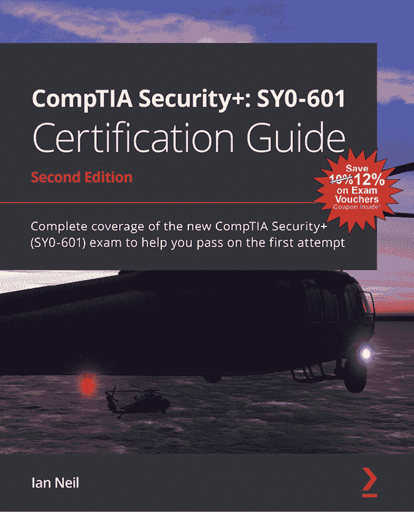

# 第 11 章：模拟考试：Core 2 (220-1102)

## 1. 恶意软件清除的第一步

正确答案是 **B**。这是解决疑似恶意软件感染的合理第一步。`Antivirus` 应用可以扫描设备中的恶意软件并可能将其清除。但重要的是要使用信誉良好的 `antivirus` 应用，并在扫描完成前保持设备与互联网断开连接，以防止进一步感染。**选项 A**：这是一种极端措施，只应作为最后的手段考虑。它将清除手机上的所有数据，包括应用、设置和个人数据。这不是恶意软件清除最合适的第一步。**选项 C**：虽然将智能手机与互联网断开连接可以防止进一步的恶意软件下载或与命令控制服务器通信，但它无法解决现有的恶意软件感染。此步骤应与其他操作结合，例如运行恶意软件扫描。**选项 D**：保持操作系统和应用更新对于安全至关重要。然而，仅此一步可能无法清除现有的恶意软件。这是一个好习惯，但应结合恶意软件扫描和清除工作。

## 2. 变更管理流程

正确答案是 **D**。一旦变更请求获得 `change advisory board` 批准，变更流程中的下一个合乎逻辑的步骤是 `sandbox testing`。这在测试阶段执行，旨在将变更隔离在受控环境中，并评估其对系统功能和性能的影响。目的是将已批准变更的细节传达给相关利益相关者。`Sandbox testing` 允许组织复制生产环境。**选项 A**：`End user acceptance` 通常发生在变更实施之后，此时要求最终用户接受并适应新的或修改后的系统。**选项 B**：`Risk analysis` 通常在变更流程的规划阶段进行，以识别潜在风险并制定缓解策略。**选项 C**：`Stakeholder communication` 确保所有相关方了解即将发生的变更、其潜在影响，以及他们可能需要采取的任何必要行动或调整。有效的 `stakeholder communication` 对于保持透明度、最大限度减少中断以及确保已批准变更的顺利实施至关重要。

## 3. 操作中心中的浏览器通知

正确答案是 **A**。技术人员在此场景下实施的最有效解决方案是禁用浏览器向 `Windows 10 Action Center` 发送通知的功能。这样，源自浏览器的不需要的广告通知将不再出现在 `Action Center` 中，从而解决用户的困扰。此解决方案直接针对通知的来源，确保了针对性的解决。**选项 B**：对计算机执行全面的 `antivirus` 扫描并非本案例的最佳解决方案，因为报告的通知并不表明存在恶意内容。问题似乎与浏览器通知有关，而非潜在的病毒或恶意软件感染。**选项 C**：关闭 `Action Center` 内的所有通知是一种广泛的做法，可能会对用户体验产生负面影响。最好专门解决来自 Web 浏览器的广告通知问题，而不是禁用所有通知。**选项 D**：将特定网站通知从 `Allowed` 类别移至 `Block` 可能有助于管理特定网站的通知，但无法解决源自浏览器的广告通知这一更广泛的问题。在这种情况下，禁用浏览器发送通知的能力是一个更全面的解决方案。

## 4. 密码管理解决方案

正确答案是 **D**。为了解决员工频繁忘记密码的问题，实施带有 `biometrics` 的 `single sign-on (SSO)` 系统可以是一个有效的解决方案。这种方法允许用户使用独特的生理特征（如指纹或面部识别）进行身份验证，减少了对记忆密码的依赖，并最大限度地降低了忘记密码的可能性。**选项 A** 不正确，因为启用 `multifactor authentication (MFA)` 增加了一层额外的安全性，但并不能直接解决员工忘记密码的问题。**选项 B** 不正确，因为增加失败登录阈值可能会导致在寻求帮助前出现更多不成功的登录尝试，但无法解决忘记密码这一根本问题。**选项 C** 不正确，因为移除复杂密码要求可能会让员工更容易记住密码，但也会通过削弱密码强度和增加未经授权访问的脆弱性来损害系统安全性。

## 5. Rootkit 修复

正确答案是 **B**。处理疑似 `rootkit` 的最有效解决方案是使用 `anti-malware` 软件。`Rootkits` 是能够深度嵌入操作系统的复杂恶意软件类型，使其难以检测和清除。`Anti-malware` 软件专门设计用于识别和消除此类威胁，为从系统中成功清除 `rootkit` 提供了最大的机会。**选项 A**，更新应用程序，可能通过修补漏洞来增强安全性，但可能无法直接解决 `rootkit` 问题。**选项 C**，重新安装操作系统，是一种极端措施，只有在其他方法失败或 `rootkit` 极其顽固时才应考虑。**选项 D**，文件恢复，可能有助于恢复受损文件，但无法直接针对 `rootkit` 本身。

## 6. 无线安全协议选择

正确答案是 **B**。考虑到编写时（2013 年）可用的技术，无线网络最安全的选项将是带有 `AES` 加密的 `WPA2`。`WPA2` 提供强大的安全措施，而 `Advanced Encryption Standard (AES)` 是一种广泛接受且安全的无线通信加密算法。尽管 `WPA3` 和 `AES-256` 或 `AES-128` 是更新的进步，但它们可能不被 10 年前的无线路由器支持。因此，在此场景中选择带有 `AES` 的 `WPA2` 将提供最佳的可用安全配置。`WPA2` 发布于 2004 年。**选项 A**，带有 `AES-128` 的 `WPA3`，提供比带有 `AES` 的 `WPA2` 更高级别的安全性。然而，选择带有 `AES-256` 的 `WPA3` 提供了更强的加密，使其成为最大安全性的首选。它发布于 2018 年。**选项 C**：`WPA3` 是最新且最先进的 Wi-Fi 安全协议，提供强大的保护以防止未经授权的访问和攻击。`AES-256` 加密确保通过网络传输的数据使用强大的加密算法进行安全加密。它发布于 2018 年。**选项 D**，带有 `TKIP` 的 `WPA2`，不如其他选项安全。虽然 `WPA2` 仍被认为是安全的，但 `TKIP` 是一种旧的加密方法，存在已知漏洞。

### 问题 7

正确答案是 **C**。当协助用户更新 Windows 时，呼叫中心技术人员的推荐做法是指导用户完成该过程。在这种情况下，技术人员应指示用户点击 `搜索字段`，输入 `检查更新`，然后按 `Enter` 键。此操作将启动 Windows 更新进程，允许用户检查可用更新并手动安装它们。选项 A 不正确，因为建议使用不同的系统并不能解决在用户当前设备上更新 Windows 的问题。选项 B 不正确且极不恰当，因为它涉及与技术人员共享敏感信息（密码），这违反了安全协议。选项 D 不正确，因为建议用户等待即将到来的自动补丁无法满足立即更新 Windows 的需求。

### 问题 8

正确答案是 **A**。为确保报告的问题与用户之间准确关联，技术人员应分配一个唯一的工单标识号。此标识符使得在整个支持过程中跟踪和管理报告的问题变得更加容易。选项 B：这不是将服务工单与用户关联的最佳实践。虽然保护客户隐私很重要，但在未验证用户身份的情况下分配随机工单号可能会导致混淆，并增加解决问题的难度。将工单关联到正确的客户至关重要。选项 C：使用技术人员的个人标识不是将服务工单与用户关联的标准做法。这可能导致混淆，且不是跟踪和解决客户问题的可靠方式。选项 D：创建一个不与任何用户关联的通用工单不是有效的做法。这使得提供个性化支持和跟踪特定客户的问题变得困难。服务工单应始终与相应的用户或客户关联，以确保顺利的解决流程。

### 问题 9

正确答案是 **D**。用户在长期离岗后无法登录网络，该网络对有线网络使用 `802.1X` 和 `EAP-TLS` 进行身份验证，这可能归因于多种因素。然而，在此场景下最可能的原因是证书过期。由于用户离开数月，用于身份验证的证书可能在此期间已过期，从而导致登录问题。选项 A 与涉及网络身份验证和长期休假的给定情况没有直接关系。选项 B：通常指与操作系统或应用程序相关的服务，但它不是导致该特定情境下登录问题的主要原因。选项 C 与由过期证书引起的网络登录问题无关。

### 问题 10

正确答案是 **B**。要从 Windows 搜索中排除特定文件夹，用户应在 Windows 搜索设置中将这些文件夹添加到 `排除的文件夹` 列表中。这允许他们在保持搜索功能运行的同时自定义搜索偏好。选项 A：禁用 `Windows Search 服务` 将关闭整个 Windows 搜索功能，这不是用户想要的。他们希望在保持搜索功能激活的同时排除特定文件夹。选项 C：删除文件夹将彻底从硬盘中移除它们，这可能不是用户想要的。他们可能希望保留文件夹但将其从搜索结果中排除。选项 D：重装整个操作系统以从 Windows 搜索中排除文件夹是一种激进且不必要的步骤。它会擦除所有数据和设置，这并非用户的本意。

### 问题 11

正确答案是 **B**。当在 Linux 终端中使用 `cat comptia.txt` 命令时，它会在终端上显示该文件的内容。它不会修改文件或创建新文件。因此，选项 B 是正确答案。选项 A 不正确，因为执行 `cat` 命令不会用新的空白文档替换文件内容。选项 C 不正确，因为 `cat` 命令不会对文件内容执行任何排序操作。选项 D 不正确，因为 `cat` 命令不会将文件内容复制到另一个文件。

### 问题 12

正确答案是 **B**。此过程称为硬盘克隆，涉及制作受影响驱动器的精确副本。通过这样做，原始证据保持完好并可被安全存储，确保其可采性并维护证据保管链。选项 A：加密可用于数据保护，但不直接解决证据保全问题。选项 C：联系网络保险公司可能是报告事件所必需的，但并不专门侧重于证据保全。选项 D：在某些情况下通知执法部门可能是合适的，但创建硬盘副本是在为潜在诉讼做准备时保全证据的主要行动。

### 问题 13

正确答案是 **B**。为了解决定期仅修改少数文件和存储空间有限的顾虑，同时满足合规要求，最有效的备份方法是 `增量备份`。`增量备份` 仅存储自上次完全备份或增量备份以来所做的更改，从而产生较小的备份体积和更快的备份操作。此方法优化了存储空间利用率，并减少了备份和恢复过程所需的时间。`增量备份` 允许轻松识别和恢复特定的修改文件，最大限度地减少潜在的数据丢失和停机时间。选项 A：`完全备份` 不是最佳选择，因为它涉及备份所有文件和文件夹，无论它们是否已被修改。这种方法会消耗大量存储空间，并需要更多时间进行备份操作。选项 C：`异地备份` 侧重于将备份副本存储在远程位置以用于灾难恢复。虽然它是一项有价值的策略，但它并不直接解决定期仅修改少数文件和存储空间有限的顾虑。选项 D：`磁带轮换` 与备份所需的存储空间无关。

### 问题 14

正确答案是 **A**。拜访客户时，将移动设备设置为 `静音或振动模式` 是一种礼貌的做法，因为它可以防止来电或通知在拜访期间造成干扰或分心。这表示对客户环境的尊重，并确保专业的互动。选项 B：将手机设置为 `静音或振动模式` 主要不是为了省电。虽然它可能对电池消耗有轻微影响，但主要原因是在客户拜访期间保持安静和专业的氛围。选项 C：将手机设置为静音模式并不能防止来电被录音。通话录音设置通常独立于手机的音频设置，并通过特定应用或手机设置单独控制。选项 D：将手机设置为静音模式与为服务记录启用位置跟踪无关。位置跟踪通常是一项单独的功能，不受手机音频设置的影响。

### 15.

正确答案是 **D**。为了处理在不可靠连接上传输大量文件的任务，同时允许在连接中断时恢复进程，推荐的工具是 `Robocopy`。`Robocopy` 是“Robust File Copy”（可靠文件复制）的缩写，是一个专为高效文件复制和镜像设计的命令行实用程序。它包含在连接中断时从断点重启文件传输的功能，使其成为涉及不可靠连接场景的理想选择。选项 A：系统文件检查器 (`sfc`) 主要用于扫描和修复系统文件错误，而非在不可靠连接上进行文件传输。选项 B：检查磁盘 (`chkdsk`) 用于检查和修复磁盘上的文件系统错误，而非文件传输。选项 C：Git Clone (`git clone`) 是用于从 Git（一种版本控制系统）克隆仓库的命令。它不用于在不可靠连接上进行大文件传输，且不支持中断后恢复进程。

### 16.

正确答案是 **D**。在实施新备份系统时，应执行的初始备份是完整备份。完整备份将所有数据和文件从源系统复制到备份存储介质。这种全面的备份捕获整个系统，并为未来的备份建立基线。从完整备份开始，可确保所有关键数据和系统配置安全存储，从而在发生数据丢失或系统故障时实现高效有效的恢复。完整备份会清除所有文件上的存档位，表明它们已备份。选项 A：复制备份可随时进行；它旨在备份所有文件但不设置存档位。选项 B：镜像备份不存在作为一种公认的备份类型。此选项不正确，不适用于备份和恢复的语境。选项 C：差异备份捕获自上次完整备份以来的更改。虽然差异备份在后续备份周期中很有用，但它们不是安装新备份和恢复系统时要完成的初始备份类型。

### 17.

正确答案是 **A, B**。选项 A 是有效的建议。安装信誉良好的广告拦截器扩展可以有效阻止不需要的弹出广告，并通过防止侵入式广告出现来增强用户的浏览体验。选项 B 也是有效的建议。过时的浏览器可能存在允许弹窗和其他不需要内容出现的漏洞。将浏览器更新到最新版本通常包含安全修复，有助于防止此类问题。选项 C：禁用防火墙不是处理弹窗的推荐解决方案。防火墙在保护计算机免受各种在线威胁（包括恶意软件）方面发挥着关键作用。禁用防火墙会使计算机处于脆弱状态。选项 D：忽略弹窗不是推荐解决方案。虽然某些弹窗可能无害，但其他弹窗可能与恶意活动或潜在的不需要程序 (PUP) 有关。调查并解决问题至关重要，而非忽略它。选项 E：下载并运行注册表清理工具不是处理弹窗的推荐解决方案。注册表清理工具有时弊大于利，且不太可能解决弹出问题的根本原因。选项 F：将计算机重置为出厂设置应作为最后手段，且通常对于处理弹窗是不必要的。这会导致所有用户数据和设置丢失，是一种只有在所有其他解决方案都失败时才应考虑的极端措施。

### 18.

正确答案是 **D**。在使用 macOS 时，“.dmg”文件扩展名常用于软件安装。`DMG`（磁盘映像）文件包含在 macOS 系统上安装应用程序所需的文件和文件夹。技术人员在 Apple 设备上安装软件或应用程序时经常会遇到 `DMG` 文件。`DMG` 文件充当可挂载的虚拟磁盘，允许访问其中包含的安装程序包。挂载后，技术人员可以启动安装过程，将软件安装到 macOS 计算机上。挂载磁盘映像时可能会有一个选项让应用程序（可能是安装程序）自动运行，但这并非常态。`.app` 文件类似于 Windows 中的 `.exe` 文件，主要用于小型程序和工具。选项 A：“.pkg”不正确，因为它通常用于 macOS 上的包安装程序，而非实际的软件安装文件。选项 B：“.bat”不正确，因为它是主要用于 Windows 环境的批处理文件扩展名，而非 macOS。选项 C：“.msi”不正确，因为它是用于 Windows Installer 包的文件扩展名，不常用于 macOS 上的软件安装。

### 19.

正确答案是 **A, F**。技术人员可以采取以下措施来解决这些问题。选项 A：清除应用缓存和数据有助于解决应用程序崩溃问题。更新应用可确保您拥有最新的错误修复和优化。确保良好的通风可防止过热。选项 F：通过关闭不需要的应用程序，内存将被释放，后台处理可能会占用额外的系统资源，从而导致过热。选项 B：这不是最佳解决方案。执行出厂重置应作为最后手段，因为它会擦除设备上的所有数据。安装第三方降温应用并不总是有效，有时反而会造成更多问题。选项 C：禁用自动更新不推荐，因为这会使设备面临安全风险。限制后台进程可能有助于性能，但可能无法解决过热或媒体播放问题。选项 D：这是一种极端解决方案，在大多数情况下并非必要。只有在设备严重过时或损坏时才应考虑。选项 E：忽略问题不是推荐解决方案。过热和应用崩溃可能表明存在潜在问题，如果置之不理可能会恶化。

### 20.

正确答案是 **A**. 这是推荐的操作。执行系统还原允许用户将计算机状态恢复到之前正常工作的时间点。这通常可以解决由系统更改或更新引起的问题。选项 B：重装整个 Windows 操作系统是一个极端步骤，应视为最后手段。它涉及大量时间和精力，并可能导致数据丢失。系统还原是一种侵入性较小的解决方案，应首先尝试。选项 C：虽然重装受影响的应用程序可能会在问题仅限于这些特定应用程序时解决问题，但它无法解决潜在的系统问题。系统还原是一种更全面的解决方案，可以解决系统范围的问题。

## 21. 正确答案：C

为了确保对数据中心的物理访问安全，可以采用邻近卡读卡器。邻近卡读卡器利用射频识别（RFID）技术授权人员进入受限区域。这些读卡器检测并验证邻近卡（也称为门禁卡或钥匙卡），允许授权人员进入数据中心，同时限制未授权人员进入。

选项 A，周界屏障，指围绕数据中心场地的物理屏障，如围栏或墙壁，但并不专门解决安全访问控制问题。选项 B，入侵检测系统，旨在检测并针对设施内的未授权进入或活动发出警报，但不直接解决访问控制问题。选项 D，监控摄像头，在监控和记录数据中心内的活动方面发挥着关键作用，但不直接控制对设施的物理访问。

## 22. 正确答案：B

在排查电脑运行缓慢的问题时，性能监视器工具是技术人员的宝贵资产。性能监视器允许技术人员监控各种系统资源，如 CPU 使用率、内存利用率、磁盘活动和网络性能。通过分析性能监视器收集的数据，技术人员可以识别可能导致性能缓慢的资源瓶颈或异常行为。这使他们能够确定需要关注的具体领域，并采取适当措施解决问题。

选项 A，系统优化器，专注于优化系统性能，但可能无法提供导致电脑变慢的具体原因的详细见解。选项 C，注册表编辑器，是用于修改 Windows 注册表的工具，与识别性能问题没有直接关系。选项 D，任务计划程序，主要用于自动执行任务和调度进程，不提供系统性能的实时监控。

## 23. 正确答案：A

该字符串极有可能是校验和或哈希值。它用于验证下载的软件镜像的完整性。通过将下载文件的计算校验和与此值进行比较，技术人员可以确保文件在下载过程中未被篡改。

选项 B：该字符串不太可能是加密密钥。加密密钥通常更长、更复杂，用于加密和解密数据，而非验证下载文件的完整性。选项 C：该字符串不是产品许可证密钥。产品许可证密钥通常是字母数字组合，用于合法激活或授权软件。它们不用于验证软件下载的完整性。选项 D：该字符串不是网络端口号。网络端口号用于在网络协议（如 TCP 或 UDP）中指定特定的通信端点。它们与验证软件下载的完整性无关。

## 24. 正确答案：A, B

**选项 A：** 应用白名单是一种移动设备管理（MDM）策略，允许管理员指定允许在移动设备上安装哪些应用程序。通过创建经批准的应用程序白名单，可以防止用户旁路加载未经批准的应用程序，因为只能安装白名单上的应用。

**选项 B：** 可以通过强制执行仅允许从官方应用商店（如 Google Play 或 Apple App Store）安装应用的策略，来限制用户旁路加载应用。这可以防止用户从非官方或第三方来源下载和安装应用。

**选项 C：** 启用或禁用 USB 调试控制更多地与开发者选项相关，并不能直接防止未经批准的应用程序被旁路加载。这不是为此目的而设的典型 MDM 策略。

**选项 D：** 全设备加密对于数据安全至关重要，但不能直接防止用户旁路加载应用程序。它是一项安全功能，旨在在设备丢失或被盗时保护数据。

**选项 E：** 启用远程擦除是一项安全措施，用于在设备丢失或被盗时保护数据。它不能直接防止应用程序被旁路加载。

**选项 F：** 地理围栏用于定义地理边界，并在设备进出这些边界时触发操作。它与防止应用程序被旁路加载没有直接关系。

## 25. 正确答案：B

技术人员无法将 Windows 10 笔记本电脑加入域的最可能原因是该笔记本电脑运行的是 Windows 10 家庭版。Windows 10 家庭版不具备加入域的功能；此功能仅在 Windows 10 专业版或企业版中可用。

选项 A：此选项不正确，因为处理器兼容性通常不是决定能否加入域的因素。选项 C：此选项不正确，因为缺少触摸屏适配器不会成为笔记本电脑无法加入域的原因。选项 D：笔记本电脑连接到扩展坞与其加入域的能力没有直接关系。

## 26. 正确答案：C

IT 经理很可能会担心，由于备份到软件云服务器的 CAD 文件体积变大，导致网络利用率显著增加。这种数据传输的增加会给网络带宽带来压力，并可能影响整体网络性能。

选项 A 不是 IT 经理在此场景下最可能关心的问题。虽然兼容性测试很重要，但它与在云服务器上存储 CAD 文件备份没有直接关系。选项 B 不是主要关注点。虽然安装期间增加技术人员工时的预算分配很重要，但它不是该特定场景下的主要关注点。选项 D 不是 IT 经理最可能关心的问题。虽然大型更新和安装文件可能给本地硬盘带来挑战，但这并非问题中提到的主要关注点。

## 27. 正确答案：C

问题中描述的事件是冒充攻击的一个例子。冒充是指某人欺诈性地假装成另一个人或实体，以欺骗他人。在本案中，来电者冒充知名银行的代表，试图获取公司员工的信任，并可能诱骗其泄露敏感信息或执行未经授权的操作。由于该攻击涉及拨打电话，这也可称为语音钓鱼（Vishing）攻击。

选项 A：社会工程学是指操纵个人以获取未经授权的访问权限或信息。虽然冒充可以是社会工程学的一种形式，但它具体涉及假装成他人。选项 B：网络钓鱼通常涉及旨在欺骗个人泄露敏感信息的欺诈性电子邮件或网站。虽然该事件涉及欺骗，但它具体描述的是电话，而非电子邮件或网站。选项 D：身份盗窃涉及窃取他人的个人信息以用于欺诈目的。虽然冒充可以是身份盗窃的一个组成部分，但问题中描述的事件并不具体涉及窃取员工的身份。

## 28. 正确答案是 **E**

账户锁定是计算机系统通常实施的一项安全措施，旨在防止未经授权或恶意访问用户账户。如果用户多次输入错误的登录凭据，其账户可能会被锁定一段时间，或直到由管理员手动解锁。这有助于防范字典攻击或暴力破解攻击，攻击者会反复尝试猜测登录凭据以获取账户访问权限。

选项 A（双因素认证）并非专门缓解字典攻击的最佳选择。虽然双因素认证能整体增强安全性，但它并不直接解决字典攻击问题。

选项 B：IDS 监控网络流量并检测任何可疑活动或未经授权的访问尝试。通过分析与字典攻击相关的模式和特征，IDS 可以及时提醒网络管理员，使其能够立即采取行动并防止进一步的未经授权访问。由于这是在夜间发生，很可能没有员工响应威胁。

选项 C 可以提高密码强度，但仅靠它无法防止字典攻击。如果复杂密码存在于字典中，攻击者仍可猜测出来。

选项 D（网络分段）是一种隔离网络不同部分的安全措施，但它可能无法直接缓解针对特定用户账户的字典攻击。

## 29. 正确答案是 **C**

为了协助经理隐藏文件并防止他人意外删除，技术人员应建议使用文件资源管理器。通过修改文件属性，用户可将其标记为隐藏，使访问共享驱动器的其他用户难以看到。这提供了额外的保护层，有助于维护文件的隐私性和完整性。

选项 A：磁盘清理用于通过删除不必要的文件来释放磁盘空间，但不提供隐藏特定文件的功能。

选项 B：任务计划程序是一种在特定时间或事件自动执行任务的工具，不提供隐藏文件的功能。

选项 D：控制面板提供各种系统设置和配置选项，但不提供在共享驱动器上隐藏文件的直接解决方案。

## 30. 正确答案是 **D**

考虑到时间限制以及为 CEO 及时解决问题的重要性，技术人员应将支持工单升级给高级技术人员。通过升级工单，技术人员确保问题能立即获得具有更多专业知识或资源的人员关注，从而加快解决进程。

选项 A 不正确，因为继续研究可能会消耗额外时间，这与 CEO 急需取回设备的紧迫需求相冲突。

选项 B 不正确，因为重新开始诊断过程会导致重复工作，进一步延误解决，且无法应对这种时间敏感的情况。

选项 C 不正确，因为告知 CEO 维修需要几周时间，在设备急需归还的情况下并非合适的做法。

## 31. 正确答案是 **A**

为了在遵守公司禁止使用静态 IP 地址策略的前提下，为服务器保持一致的 IP 地址，技术人员应利用 DHCP 进行 IP 地址预留。通过在 DHCP 服务器配置中将特定 IP 地址分配给服务器的 MAC 地址，服务器在请求 IP 地址租约时将始终获得相同的 IP 地址。这种方法确保服务器在网络上易于识别和访问，而无需依赖静态 IP 配置。

选项 B：网络地址转换 (NAT) 涉及私有网络和公共网络之间的 IP 地址转换，无法为服务器维护一致的 IP 地址提供解决方案。

选项 C：动态域名系统 (DNS) 记录将域名与 IP 地址关联，与确保服务器保持相同 IP 地址没有直接关系。

选项 D：虚拟专用网络 (VPN) 配置在公共网络上建立安全连接，与为服务器维护一致的 IP 地址没有特定关联。

## 32. 正确答案是 **D**

在此场景下，最高效的解决方案是在 Windows 操作系统内设置虚拟机来运行 Linux 和所需应用程序。这允许同时运行 Windows 和 Linux 应用程序。

选项 A 建议利用云环境。这将需要连接到云提供商的网络连接。

选项 B：适用于 Linux 的 Windows 子系统是可安装在 Windows 桌面计算机上的功能。它允许支持基本的命令行应用程序。然而，它并不支持所有应用程序，因为它是一个模拟器，相比之下，完整安装的 Linux 可以访问图形应用程序。

选项 C：这种方法允许用户根据需要在 Linux 和 Windows 之间切换，但会产生额外成本。

## 33. 正确答案是 **A**

在处理处理器和内存模块等内部计算机组件时，防止静电放电 (ESD) 至关重要，因为静电可能损坏敏感的电子部件。使用防静电腕带有助于释放人体上的静电，从而保护组件。

选项 B：只要遵循正确的程序，升级顺序并不一定是关键。然而，该陈述未涉及 ESD 问题，而这在升级过程中防止损坏方面至关重要。

选项 C：升级期间保持计算机通电是不推荐的。在进行任何硬件更改前，应关闭并拔掉计算机电源，以避免电气危险并确保安全的升级过程。

选项 D：这是错误的。桌面升级期间的 ESD 预防措施至关重要，就像笔记本电脑或任何其他电子设备一样。未采取防静电预防措施可能导致组件损坏，从而导致昂贵的维修或更换。

## 34. 正确答案是 **B**

要在 PC 上启用语音识别，用户应导航到“辅助功能”设置。在“辅助功能”设置中，有一个启用语音识别的选项，允许用户使用语音命令与计算机交互。

选项 A 不正确，因为它主要处理语言、日期、时间和位置设置。

选项 C 不正确，因为它侧重于个性化显示、主题和操作系统的视觉方面。

选项 D 不正确，因为它涉及各种应用程序和系统功能的隐私设置和权限。

### 35. 正确答案是 **D**。

应更新可接受使用策略（`AUP`），以纳入禁止在工作台式机上进行加密货币挖掘的新要求。`AUP` 概述了可接受行为和公司资源使用的规则与指南。通过在 `AUP` 中明确包含此限制，公司可以解决违规行为并防止未来再次发生。

**选项 A：** 企业移动性管理（`EMM`）与更新关于工作台式机加密货币挖掘的指南和政策无直接关系。`EMM` 主要侧重于管理移动设备及其相关的安全性和策略。

**选项 B：** 服务级别协议（`SLA`）是服务提供商与客户之间的合同协议，通常规定所提供的服务和支持水平。它并不专门涉及更新指南和政策。

**选项 C：** 数据丢失防护（`DLP`）是一套旨在防止敏感数据未经授权泄露或丢失的技术和实践。虽然它对数据保护很重要，但与更新工作台式机加密货币挖掘指南无直接关系。

### 36. 正确答案是 **A**。

这是正确答案，因为迁移到 64 位 `OS` 的主要优势之一是能够访问和利用比 32 位 `OS` 更大量的随机存取存储器（`RAM`）。这对于视频编辑、3D 渲染和其他内存密集型应用程序等任务尤为重要。

**选项 B：** 这不是迁移到 64 位 `OS` 的主要优势。虽然 64 位 `OS` 可以为某些任务提供性能提升，但其主要优势在于能够寻址更多 `RAM`。

**选项 C：** 迁移到 64 位 `OS` 主要影响内存访问，虽然它可以通过允许更大的纹理和更流畅的多任务处理间接提升图形性能，但这并非主要优势。

**选项 D：** 迁移到 64 位 `OS` 不会直接影响网络连接或数据传输速率。这些方面更多地取决于网络硬件和基础设施。

### 37. 正确答案是 **A**。

导致该问题最可能的原因是网络连接问题。由于笔记本电脑 `PC` 在同一网络上运行正常，这表明网络连接本身并非根本原因。然而，台式机 `PC` 无法登录域，且技术人员无法访问安全内部网站点，表明台式机 `PC` 可能存在特定的网络连接问题。这可能是由于网线断开、网络适配器故障或配置错误等因素造成的。

**选项 B：** 域凭据错误会导致笔记本电脑 `PC` 和技术人员均无法访问域，而不仅仅是台式机 `PC`。

**选项 C：** 浏览器兼容性问题通常会影响用户访问网站的总体能力，而非特定于安全内部网站点。

**选项 D：** 防火墙限制虽有可能，但可能会同时影响笔记本电脑 `PC` 和技术人员访问安全内部网站点的能力，而不太可能仅限于台式机 `PC`。

### 38. 正确答案是 **A**。

将网络配置设置为专用，可允许通过 Windows 防火墙访问共享文件。公用配置文件不允许文件和打印机共享。

**选项 B：** 建立代理服务器连接对于访问网络上的共享驱动器并非必要。代理服务器通常用于通过中间服务器访问互联网，而非用于内部网络文件访问。

**选项 C：** 授予用户网络管理员权限并非访问共享驱动器所必需。网络管理员权限通常保留用于管理网络资源和执行管理任务。

**选项 D：** 创建指向共享驱动器公共文档的快捷方式并非访问共享驱动器文件的适当配置。该快捷方式仅提供对公共文档文件夹的访问，限制了用户访问共享驱动器上其他文件的能力。

### 39. 正确答案是 **B**。

要调整运行 `macOS` 的计算机内部存储驱动器上的分区大小，技术人员应使用 `Disk Utility`（磁盘工具）。`Disk Utility` 是 `macOS` 中的内置实用工具，允许用户管理、格式化和调整存储驱动器及分区的大小。使用 `Disk Utility`，技术人员可以轻松修改现有分区的大小，以根据特定要求分配空间。

**选项 A：** `Activity Monitor`（活动监视器）是一款用于监控系统进程和资源使用情况的实用工具，而非用于调整分区大小。

**选项 C：** `Time Machine`（时间机器）是一款备份实用工具，允许用户创建系统的定期备份，但其设计目的并非用于分区调整。

**选项 D：** `Terminal`（终端）是 `macOS` 中的命令行界面工具，主要用于执行命令和脚本，但并非专门用于调整分区大小。

### 40. 正确答案是 **B**。

`Windows 10` 中的“`Reset This PC`”（重置此电脑）功能允许你在保留所有先前用户文件和设置的前提下重新安装 Windows。这是一种快速高效的方式，可在保留基础操作系统的同时为新用户准备笔记本电脑。

**选项 A：** 这是一种有效方法，但对于人员流动率高的情况并非最高效。从安装介质手动重新安装 Windows 比使用“`Reset This PC`”等内置功能需要更多时间和精力。

**选项 C：** 克隆硬盘并非将笔记本电脑重新用于新员工的最佳解决方案。它会创建现有系统的副本，包括软件和设置，这可能不适合新用户。这也很耗时。

**选项 D：** `Windows 10 System Restore`（系统还原）旨在将系统恢复到之前的状态，而非重新安装操作系统。它不是重新部署笔记本电脑的高效方法。

### 41. 正确答案是 **A**。

为解决收到意外图片的问题，该高管应将 `AirDrop` 设置为仅接受已知联系人的传输。此操作可限制接收未经请求的文件，并确保飞行期间只有受信任的来源能向高管的 `iPhone` 发送内容。

**选项 B** 不正确，因为禁用所有无线系统会妨碍高管使用机上 `Wi-Fi` 进行合法用途。

**选项 C** 不正确，因为停止使用 `iMessage` 并不能直接解决通过机上 `Wi-Fi` 接收意外图片的问题。

**选项 D** 不正确，因为将消息和通话限制为仅限已保存联系人，并不能专门解决飞行期间接收未经请求图片的问题。

### 42. 正确答案是 **B**。

在允许客户轻松进出的同时加强建筑安保的最佳解决方案是安装防护栏杆（如防撞柱）。防撞柱是坚固的柱子或屏障，战略性地放置在建筑物周边，以物理方式防止车辆冲入该区域。它们提供了有效的物理威慑，最大限度地降低了未经授权车辆进入的风险，确保了场所安全。

**选项 A：** 安保人员可能有助于监控和巡查，但可能无法提供足以抵御车辆的物理屏障。

**选项 C：** 运动检测系统可用于检测移动，但无法直接解决防止车辆冲入建筑物的问题。

**选项 D：** 受控入口或门禁前室主要侧重于管控人员进出，可能无法提供同等级别的车辆入侵防护。

## 43

正确答案是 **A**。解决附近 SSID 造成干扰的最佳方案是调整无线网络的信道设置。通过更改信道，可以避免与邻近网络的频率重叠，从而减少干扰。这使得无线网络能在一个清晰且不拥挤的信道上运行，从而提高性能并减少干扰问题。选项 B 肯定会中断运营，考虑到商店可能需要支持无线设备，这不是一个现实的选项。选项 C，关闭设备再重新打开，无法解决该问题。选项 D，重命名接入点，无法直接解决附近 SSID 造成的干扰问题。更改接入点名称可能有助于识别，但无法减轻干扰对无线网络的影响。

## 44

正确答案是 **C**。考虑到对敏感的、遗留的、未维护的 PII（个人身份信息）的担忧以及长期数据保留的法规要求，最佳方法是对数据执行完整备份。将此备份存储在离线的加密磁带存储中，可确保数据保持安全并受到保护，免受勒索软件攻击。将数据传输到离线存储可为防止潜在数据丢失提供额外的保护层。选项 A 建议每日增量备份到公司文件服务器，一旦发生勒索软件爆发，这可能无法提供足够的保护。增量备份仅存储自上次完整备份以来的更改，一旦发生爆发，数据可能会被破坏。选项 B 提议使用存储在网络附属存储 (NAS) 设备上的快照。虽然快照提供一定级别的数据保护，但如果 NAS 设备本身被攻破，它们仍然容易受到勒索软件攻击。选项 D 建议每周差异备份并存储在云托管提供商处。虽然异地备份是良好的做法，但差异备份仅存储自上次完整备份以来的更改，如果发生勒索软件爆发，可能无法为敏感数据提供足够的保护。

## 45

正确答案是 **A**。离开工作站时使用组合键锁定计算机，是警察快速保护工作站安全的最佳方式。此操作会立即限制对计算机的访问，确保在警官不在期间，任何敏感或机密信息免受未经授权的访问。`Windows Key + L` 可锁定工作站。选项 B：虽然确保无未经授权的人员在场对安全很重要，但它不能提供保护工作站的直接方法。选项 C：配置屏幕保护程序，在设定的不活动期后自动锁定，是一种良好的安全实践，但当警官需要快速保护工作站时，可能不是最高效的解决方案。选项 D：关闭显示器仅解决了信息被未经授权查看的问题，但无法为保护整个工作站及其数据提供全面的解决方案。

## 46

正确答案是 **B**、**E**。要在登录会议室计算机时实现应用程序自动启动，技术人员会采用两个特定选项。首先，利用 `Task Scheduler`（任务计划程序）功能，可安排应用程序在用户登录时自动启动。其次，`Startup Folder`（启动文件夹）选项允许技术人员将应用程序的快捷方式添加到系统指定的启动文件夹中，确保其在登录过程中启动。选项 A：Windows Explorer（资源管理器）是文件管理工具，与登录时应用程序的自动启动无关。选项 C：System Overview（系统概览）或 System Information（系统信息）不提供在登录时启用应用程序自动启动的功能。选项 D：Programs and Features（程序和功能）与登录期间启动应用程序的任务无关。选项 F：Device Manager（设备管理器）用于管理和配置硬件设备，不适用于登录时应用程序的自动启动。

## 47

正确答案是 **A**。重置用户密码后，启用“下次登录时要求更改密码”要求会增加一层额外的安全性。这确保用户创建一个专属于他们的新密码，并有助于防止未经授权访问该账户。选项 B 不正确，因为禁止用户更改密码限制了他们通过定期更新密码来增强账户安全性的能力。选项 C 不正确，因为禁用用户账户会阻止他们访问任何资源或执行任务。这是一种极端措施，应仅在有特定理由禁用账户时保留。选项 D 不正确，因为设置永不过期的密码存在安全风险。定期更改密码可降低账户被攻破的可能性，并增强整体安全性。

## 48

正确答案是 **C**。在此场景中，最可能使用的协议是最终用户许可协议 (EULA)。EULA 通常在安装软件时遇到，通常要求用户浏览协议文本并点击“接受”按钮，以表示同意软件供应商规定的条款和条件。选项 A，服务级别协议 (SLA)，不正确，因为 SLA 通常与各方之间的服务交付和性能指标相关，而非软件安装协议。选项 B，保密协议 (NDA)，不正确，因为 NDA 用于保护机密信息，通常不在软件安装过程中遇到。选项 D，谅解备忘录 (MOU)，不正确，因为 MOU 通常用于概述组织间的协议或合作，而非用于软件安装目的。

## 49

正确答案是 **C**。多因素认证 (MFA) 涉及使用多个认证因素来验证用户身份。在本例中，一次性密码 (OTP) 和指纹扫描的组合即为 MFA 的示例。OTP 为每次认证尝试提供唯一的临时代码，增加了一层额外的安全性。同时，指纹扫描验证用户的生物特征数据（如其独特的指纹模式），增加了另一层认证。选项 A，语音识别和面部识别，均属于生物识别认证的组成部分，但不专门代表 MFA。选项 B，用户名和密码，均属于“你知道的东西”。选项 D，密码和 PIN，代表单因素认证方法，而非 MFA。

## 50

正确答案是 **C**。在给定场景中，启用硬盘加密将是最佳安全实践。硬盘加密通过使用强加密算法对笔记本电脑硬盘上存储的数据进行加密，确保数据受到保护。即使笔记本电脑丢失、被盗或被未经授权的人员访问，这也有助于保护敏感信息。通过加密硬盘，如果没有适当的加密密钥或密码，数据将保持不可读和不可访问状态。选项 A，基于 PIN 的登录，可能提供额外的安全层，但在数据机密性方面，无法提供与硬盘加密同等级别的保护。选项 B，每季度更改密码，总体上是一种良好的实践，但对于可能丢失或被盗的笔记本电脑上的数据保护，可能不是最有效的安全措施。选项 D，物理笔记本电脑锁，是一种物理安全措施，有助于防止笔记本电脑被盗，但无法解决存储在笔记本电脑硬盘上的数据保护问题。

### 51

正确答案是 **D**。周围办公室正在进行施工活动，且桌面对 `ping` 没有响应，这表明问题最可能的原因是网线断开。施工活动可能导致网络基础设施遭到物理破坏，从而导致网线脱落。选项 A 不正确，因为该问题仅针对用户的桌面，而非 `DHCP` 服务器。选项 B 不正确，因为如果防火墙阻止了网络访问，`ping` 请求根本无法到达桌面。选项 C 不正确，因为如果用户账户被锁定，他们仍能连接网络，但可能面临身份验证问题。

### 52

正确答案是 **A**。如果已验证网站在线，则问题最可能出在用户的浏览器上。通过删除浏览历史记录，可以清除可能导致冲突或阻止访问该网站的任何缓存数据或 Cookie，从而可能解决该问题。选项 B 不正确，因为清除 `DNS` 缓存更多用于解决域名解析相关的问题。选项 C 不正确，因为刷新 `ARP` 缓存更多用于解决网络连接问题。选项 D 不正确，因为在浏览器中启用 JavaScript 与访问特定网站没有直接关系。

### 53

正确答案是 **C**。为确保在一次迁移一台工作站时本地保留文件和用户首选项，最高效的方法是就地升级。就地升级允许从 Windows 7 Pro 无缝过渡到 Windows 10 Pro，同时保留用户数据和设置。选项 A 不正确，因为母版镜像是预配置的系统镜像，通常用于同时部署多台相同的机器。选项 B 不正确，因为全新安装会擦除现有操作系统和用户数据，这违背了保留文件和首选项的要求。选项 D，基于服务器的远程网络安装 (`WDS`)，涉及从网络位置部署新操作系统。这可能无法满足在本地执行操作的要求。

### 54

正确答案是 **A**。当存在因笔记本电脑丢失或被盗而导致数据丢失的风险时，最佳建议是启用全盘加密。全盘加密可确保即使笔记本电脑落入未经授权的人手中，硬盘上存储的数据在没有加密密钥的情况下仍然无法访问。选项 B 不正确，因为虽然定期备份笔记本电脑对数据保护很重要，但它并不能直接解决因笔记本电脑丢失或被盗而导致的数据丢失风险。选项 C 不正确，因为虽然生物识别认证可以增强安全性，但它可能不适用于所有笔记本电脑用户，并可能影响用户便利性。选项 D 不正确，因为虽然强制性的笔记本电脑追踪软件有助于定位丢失或被盗的笔记本电脑，但它无法直接保护存储在笔记本电脑上的数据。

### 55

正确答案是 **C**。为实现最高级别的无线网络安全，技术人员应实施 `WPA3`。`WPA3` 是最新的安全协议，它提供强大的加密算法和增强的防未授权访问保护。与其前身（如 `WPA2` 和 `WEP`）相比，它提供了改进的安全功能。选项 A，`WPS`（Wi-Fi Protected Setup，Wi-Fi 保护设置），不正确，因为它引入了潜在的安全漏洞，应将其禁用以确保更好的安全性。选项 B，`TKIP`（Temporal Key Integrity Protocol，临时密钥完整性协议），不正确，因为它是一种旧的安全协议，不如 `WPA3` 安全。选项 D，`WEP`（Wired Equivalent Privacy，有线等效保密），不正确，因为它是一种过时且容易被破解的安全协议。选项 E，`MAC` 地址过滤，不正确，因为仅靠它不足以提供全面的安全性，且攻击者可以绕过它。

### 56

正确答案是 **B**。为解决报告的运行缓慢和硬盘活动灯持续常亮的问题，第一步应该是使用 `Performance Monitor`（性能监视器）来分析资源利用率。该工具提供实时监控和对计算机性能的洞察，允许你识别可能导致卡顿的特定进程或应用程序。选项 A 不正确，因为在 `Control Panel`（控制面板）中检查 `Services`（服务）主要侧重于管理和配置系统服务，而非监控资源利用率。选项 C 不正确，因为运行 `System File Checker`（系统文件检查器）用于扫描并恢复 Windows 系统文件的完整性，这与报告的性能问题没有直接关系。选项 D 不正确，因为 `Event Viewer`（事件查看器）主要用于查看系统事件、日志和错误，但它可能无法提供导致运行缓慢的资源利用率的即时洞察。

### 57

正确答案是 **C**。根据用户描述的症状，问题最可能的原因是病毒。病毒是能够复制和传播的恶意软件程序，会对计算机系统的正常运行造成各种干扰。在本例中，应用程序未经授权自动打开和浏览器重定向是病毒感染的常见迹象。选项 A，键盘记录器，不正确，因为键盘记录器是一种记录计算机按键的软件，常用于窃取敏感信息等恶意目的。虽然它可能是一个潜在的安全隐患，但它不能直接解释用户提到的症状。选项 B，加密货币挖矿程序，不正确，因为挖矿程序旨在利用设备的算力挖掘加密货币。虽然它们会导致性能问题，但通常不会表现为未经授权的应用程序打开或浏览器重定向。选项 D，恶意软件，不正确，因为恶意软件是一个统称，包含各类恶意软件，包括病毒。虽然恶意软件确实会导致报告的症状，但在这种特定场景下，“病毒”一词是更准确、更合适的答案。

### 58

正确答案是 **E**。为缓解频繁的微小停电问题，技术人员应使用 `UPS`（不间断电源）。与仅防止电压尖峰的浪涌抑制器不同，`UPS` 在短暂停电期间提供临时电力，确保关键电子设备持续运行。`UPS` 由一块电池组成，当停电发生时自动启动，供电直到市电恢复或允许受控关机。这可保护连接的设备免受潜在数据丢失、硬件损坏和生产力中断的影响。选项 A，浪涌抑制器，主要防止电压尖峰和浪涌，但在停电期间不提供备用电源。选项 B，电池备份，是不间断电源 (`UPS`) 的另一个称呼，使其成为本场景下的正确答案。选项 C，`CMOS` 电池，为计算机主板供电以保留 BIOS 设置，但不解决停电问题。选项 D，发电机备用，是通常用于长时间停电的大规模解决方案，对于短暂的微小停电并非必要。

## 59.

正确答案是 **B**。在 `macOS` 中，用于组织、搜索和访问文件及文件夹的默认 `GUI` 和文件管理器是 `Finder`。它提供了用户友好的界面和各种功能，以便浏览文件系统、执行文件操作和管理整体文件层级。选项 A `Disk Utility`（磁盘工具）是 `macOS` 中用于磁盘管理的实用工具，可执行格式化、分区和修复磁盘等任务。它不是默认的 `GUI` 和文件管理器。选项 C `Dock`（程序坞）是一项 `macOS` 功能，可快速访问常用应用程序和文件。虽然它是 `macOS` 界面的重要组成部分，但它不是默认的 `GUI` 和文件管理器。选项 D `FileVault` 是 `macOS` 中内置的加密功能，用于保护系统磁盘上的数据。然而，它不是 `macOS` 中的默认 `GUI` 和文件管理器。

## 60.

正确答案是 **D**。`FAT32` 文件系统格式将是确保 `USB` 闪存驱动器跨多代 `Microsoft` 操作系统实现读写兼容性的最佳选择。`FAT32` 是一种广泛支持的文件系统，可被各种操作系统访问，包括旧版 `Windows`、`macOS` 和 `Linux`。它提供了极佳的兼容性，并允许在不同平台之间轻松共享文件。选项 A `APFS`（Apple 文件系统）是运行 `macOS` 的 `Apple` 设备使用的默认文件系统。虽然它为 `macOS` 系统提供了先进功能和改进的性能，但可能无法提供跨不同版本 `Microsoft` 操作系统的同等兼容性。选项 B `ext4` 是主要用于 `Linux` 操作系统的流行文件系统。虽然它为 `Linux` 系统提供了强大的功能和性能，但可能与旧版 `Microsoft` 操作系统的兼容性不高。选项 C `CDFS`（光盘文件系统）是一种常用于光盘的只读文件系统格式。它不适用于 `USB` 闪存驱动器，也不支持写入操作，因此不符合题目要求。

## 61.

正确答案是 **C**。即使执行了 `System Restore`（系统还原），恶意软件仍然存在于系统上的原因是恶意软件已破坏了 `System Restore` 进程本身。恶意软件有时会渗透并感染关键系统文件，导致 `System Restore` 难以彻底清除恶意软件。在这种情况下，尽管恢复了之前的系统设置，恶意软件仍可能持续存在。选项 A：声称系统补丁禁用了防病毒保护和主机防火墙是不正确的，因为禁用这些安全措施无法解释为何在 `System Restore` 后恶意软件仍然存在。选项 B：提到系统更新未包含最新的反恶意软件定义是不正确的，因为这无法解释为何恶意软件在 `System Restore` 过程中幸存。选项 D：该选项暗示恶意软件是在创建 `System Restore` 点之前安装的是不正确的，因为 `System Restore` 旨在将系统还原到之前的时间点，无论恶意软件最初何时安装。

## 62.

正确答案是 **A**。在此场景中，最可能的违规行为是最终用户许可协议 (`EULA`)。`EULA` 通常规定了使用软件的条款和条件，包括安装数量限制或可使用的版本类型。如果技术人员发现多台计算机上安装了多份家庭版软件副本，则表明违反了 `EULA`，超出了允许的安装数量或不当使用了该软件。选项 B，个人身份信息 (`PII`)，是指可识别个人身份的敏感信息，如姓名、地址或社会安全号码。`PII` 与题目描述的违规行为无关。选项 C，数字版权管理 (`DRM`)，涉及用于保护受版权保护的内容免遭未经授权分发或使用的技术或措施。它与安装多份家庭版软件副本的违规行为无直接关系。选项 D，开源协议，是指使用开源软件的条款和条件，通常允许用户自由安装和分发软件。它不适用于此场景，因为该违规行为与专有家庭版软件有关。

## 63.

正确答案是 **B, D**。为取证分析保留硬盘数据需要一丝不苟的细节关注和遵循正确的程序。在此背景下，应给予**最多**考虑的两个选项是 `chain of custody`（证据保管链）和 `data integrity`（数据完整性）。`Chain of custody` 对于维护数字证据的完整性和可信度至关重要。它涉及从获取证据时起直到在法庭上出示证据止，对证据的保管、控制和移交进行记录。通过确保清晰且不间断的 `chain of custody`，可以维护保留数据的真实性和可采性。`Data integrity` 是指保证保留的数据在整个取证分析过程中保持未被篡改和未损坏。使用 `write-blockers`（写保护器）、制作硬盘的逐位副本以及采用 `hash algorithms`（哈希算法）等措施有助于验证数据的完整性。这对于确保取证结果的准确性和可靠性至关重要。选项 A：许可协议是管软件或知识产权授权使用的法律协议。虽然在软件使用的更广泛背景下很重要，但它们与为取证分析保留数据无直接关系。选项 C：事件管理文档涉及记录和管理关于安全事件或违规的信息。虽然事件管理对于处理安全事件很重要，但它与为取证分析从硬盘保留数据无直接关系。选项 E：材料安全数据表 (`MSDS`) 包含有关特定化学品或物质的危害和处理信息。虽然在特定背景下相关，但 `MSDS` 与为取证分析从硬盘保留数据无直接关系。选项 F：保留要求是指管数据保留和存储的指南或法规。虽然对于数据管理和合规目的很重要，但保留要求与专门为取证分析保留数据无直接关系。

## 64.

正确答案是 **A**。技术人员用于远程连接到 `Linux` 桌面的最可能工具是 Secure Shell (`SSH`)。`SSH` 是一种广泛使用的协议，可为 `Linux` 系统提供安全的远程访问和控制。它允许技术人员建立到远程 `Linux` 桌面的安全 `command-line`（命令行）连接，从而能够执行故障排除任务、运行命令并远程管理系统。选项 B `VNC` 不正确，因为虽然 `VNC` 可用于远程桌面访问，但它并非原生为 `Linux` 设计，可能需要额外的设置或兼容性措施。选项 C，远程桌面协议 (`RDP`) 不正确，因为 `RDP` 主要用于远程访问基于 `Windows` 的系统，并非原生为 `Linux` 设计。选项 D `TeamViewer` 不正确，因为虽然 `TeamViewer` 是一款流行的远程支持工具，但它并非专门为 `Linux` 设计，可能需要额外的安装步骤或兼容性考量。

## 65. 正确答案：**A**

本场景中尝试的社会工程学攻击被称为“邪恶双生子”攻击。在邪恶双生子攻击中，攻击者设置一个伪造的 Wi-Fi 接入点来模仿合法网络，通常使用相同或相似的 `SSID`。其意图是诱骗用户连接到恶意网络，从而使攻击者能够拦截敏感信息或执行其他恶意活动。用户在连接公共 Wi-Fi 网络时保持警惕，并在加入前验证网络的合法性，这一点至关重要。

**选项分析：**

- **选项 B：** 冒充涉及假装成其他人或受信任实体以欺骗个人。虽然它可以是一种社会工程学形式，但它与所描述的 Wi-Fi 网络情况没有特定关联。
- **选项 C：** 内部威胁是指由组织内部拥有授权访问权限的人员造成的攻击或安全漏洞。它与所描述的 Wi-Fi 网络情况没有直接关系。
- **选项 D：** 鲸钓攻击是一种专门针对高知名度个人（如高管或高级管理人员）的网络钓鱼攻击，旨在诱骗他们泄露敏感信息。它与所描述的 Wi-Fi 网络场景没有直接关系。

## 66. 正确答案：**B**

系统未利用所有可用内存的最可能原因是它正在运行 `32-bit` 操作系统。`32-bit` 操作系统的最大内存容量约为 4 GB，超出该限制安装的任何内存将无法被识别或利用。在本例中，尽管技术人员安装了 8 GB 内存，但系统的 `32-bit` 操作系统只能寻址和利用高达 4 GB 的内存。要充分利用安装的 8 GB 内存，系统需要升级到 `64-bit` 操作系统。

**选项分析：**

- **选项 A：** 缺失更新可能会影响系统性能，但与内存利用率问题没有直接关系。
- **选项 C：** 故障内存模块可能导致问题，但在这种情况下，差异更可能是由于 `32-bit` 操作系统的限制造成的。
- **选项 D：** `BIOS` 更新通常不影响内存的识别或利用。问题在于操作系统的容量限制。

## 67. 正确答案：**D**

恶意软件感染后使计算机恢复服务的最佳方法是首先重装 `OS`，以确保进行干净、全新的安装，从而清除任何恶意软件的痕迹。此步骤可消除可能残留的受感染文件和配置。接下来，建议刷新 `BIOS` 以将固件恢复到原始状态，清除可能已感染 `BIOS` 的恶意软件。最后，使用本地防病毒软件扫描计算机将有助于识别并清除任何剩余的恶意软件威胁，提供额外的保护层。

**选项分析：**

- **选项 A：** 不正确，因为使用 `Linux live disk` 扫描系统可能不是从企业网络计算机清除恶意软件的最合适方法，因为它可能不具备必要的安全性和兼容性功能。
- **选项 B：** 不正确，因为仅刷新 `BIOS` 和重新格式化驱动器无法解决恶意软件感染问题。如果不重装 `OS`，受感染的文件和配置可能会持续存在。
- **选项 C：** 不正确，因为消磁硬盘不是清除恶意软件的适当方法。消磁是擦除磁性介质的过程，通常用于数据销毁目的，而非恶意软件清除。

## 68. 正确答案：**A**

解决软件补丁部署后桌面图标异常变大问题的最适当方案是回滚显卡驱动程序。显卡驱动程序负责渲染屏幕上的图形，包括桌面图标。如果最近安装的显卡驱动程序不兼容或导致显示问题，回滚到之前的版本可以恢复图标的正常功能和大小。

**选项分析：**

- **选项 B：** 将电脑恢复到出厂设置是一种极端措施，会擦除所有用户数据和设置，将系统恢复到原始状态。只有在其他故障排除方法无法解决问题时才应考虑此操作。
- **选项 C：** 修复 Windows 配置文件可能解决特定于用户的设置或配置，但不太可能解决桌面图标的问题。该问题更可能与显卡驱动程序有关，而非用户配置文件。
- **选项 D：** 重装 Windows `OS` 是一种极端解决方案，只应作为最后手段考虑。它涉及重装整个 `OS`, 这可能耗时且可能导致数据丢失。对于解决桌面图标问题而言，此操作是不必要的，除非所有其他选项都已用尽，否则应避免。

## 69. 正确答案：**D**

定义变更范围或边界的术语是 `scope`（范围）。`scope` 概述了变更项目或计划的具体目标、交付成果和限制。它有助于定义变更 `scope` 内包含和排除的内容，确保对项目目标和边界有清晰的理解和有效的管理。

**选项分析：**

- **选项 A：** `impact`（影响）不正确，因为它指变更的后果或效果，而不是指定变更的范围或边界。
- **选项 B：** `purpose`（目的）不正确，因为它指变更背后的原因或目标，而不是其范围或边界。
- **选项 C：** `analysis`（分析）不正确，因为它涉及对数据或信息的检查和评估，而不是定义变更的范围。

## 70. 正确答案：**C**

为了排查第三方 USB 适配器的连接问题，技术人员应使用 `devmgmt.msc` 工具。`devmgmt.msc` 也称为设备管理器，允许技术人员查看和管理连接到计算机的硬件设备。通过打开设备管理器，技术人员可以验证 USB 适配器是否被系统识别，并检查是否存在任何相关的驱动程序问题。然后他们可以继续更新或重装适当的驱动程序，确保兼容性并解决任何连接问题。

**选项分析：**

- **选项 A：** `taskschd.msc` 指任务计划程序，用于管理计算机上的计划任务和自动化流程。它与解决 USB 适配器连接问题没有直接关系。
- **选项 B：** `eventvwr.msc` 代表事件查看器，一种用于查看系统日志和监控系统事件的工具。虽然它对故障排除很有价值，但它并非专门设计用于解决 USB 适配器连接问题。
- **选项 D：** `diskmgmt.msc` 与磁盘管理有关，这是一种用于管理计算机磁盘驱动器和分区的实用程序。它不直接解决 USB 适配器连接问题。

## 71. 正确答案：**D**

在该场景中，最可能使用的恶意软件类型是键盘记录器。键盘记录器旨在秘密记录用户的击键操作，捕获密码、信用卡详细信息和其他机密数据等敏感信息。通过隐秘地记录用户输入，键盘记录器使恶意行为者能够未经授权地访问有价值的信息。

选项 A，加密货币挖掘程序，是利用计算机资源挖掘加密货币的恶意软件。虽然它们会影响系统性能，但不直接涉及捕获用户输入。选项 B，Rootkit，是一种隐秘的恶意软件，允许未经授权地访问和控制系统，同时隐藏其存在。虽然它们可以提供未经授权的访问，但并不专门专注于捕获用户输入。选项 C，鱼叉式网络钓鱼，是指一种有针对性的网络钓鱼形式，攻击者通过欺骗性电子邮件或消息诱导个人泄露敏感信息。虽然它涉及社会工程学策略，但不直接涉及捕获用户输入。

## 72. 正确答案：**C**

物理销毁包含敏感信息的 SSD 的最佳方法是粉碎。粉碎涉及使用专用设备将 SSD 物理粉碎成微小碎片，使数据完全无法恢复。这种方法确保了最高级别的数据销毁，并降低了未经授权访问或数据恢复尝试的风险。这是处理敏感信息并需要遵守数据隐私法规的组织的推荐做法。

选项 A，覆写，是通过用随机或预定义模式覆写存储设备上的数据来安全擦除数据的方法。虽然覆写对传统硬盘可能有效，但对 SSD 并不那么可靠，因为 SSD 采用磨损均衡和其他技术，使得难以确保彻底清除数据。选项 B，低级格式化，是通过配置文件系统结构为存储设备的初始使用做准备的过程。然而，它不能保证数据销毁，不应将其作为处理包含敏感信息的 SSD 的安全处置方法。选项 D，删除，指从存储设备中移除数据的行为。然而，与擦除类似，标准删除方法可能不足以安全销毁 SSD 上的数据。SSD 利用磨损均衡和其他技术，使得仅通过删除难以保证完全移除数据。

## 73. 正确答案：**C**

要将 Linux 服务器和桌面集成到 Windows Active Directory 环境中，正确的选项是 C，Samba。Samba 是一个开源软件套件，提供 Linux/Unix 系统与 Windows 系统之间的互操作性。它允许 Linux 服务器和桌面加入 Windows Active Directory 域，实现文件和打印服务等资源的无缝集成和共享。

选项 A，`yum`，不正确。`yum` 是 Linux 发行版中用于安装、升级或删除软件包的包管理命令。它与将 Linux 系统与 Windows Active Directory 集成无关。选项 B，CIFS，不正确。通用互联网文件系统 (CIFS) 是 Windows 操作系统使用的网络文件共享协议。虽然它可用于 Windows 和 Linux 系统之间的文件共享，但它主要不用于将 Linux 系统集成到 Windows Active Directory 中。选项 D，`chmod`，不正确。`chmod` 是 Linux 和 Unix 系统中用于设置文件访问权限的命令行实用程序。它在将 Linux 系统与 Windows Active Directory 环境集成中没有直接作用。

## 74. 正确答案：**D**

在授予新员工网络登录访问权限之前，必须签署可接受使用策略 (AUP)。AUP 概述了使用组织网络和技术资源的规则和指南。通过签署 AUP，员工确认其理解并同意遵守规定的政策，确保负责任且安全地使用网络。

选项 A：这是一份提供化学物质属性、处理和潜在危害信息的文档。它与网络访问无关。选项 B：EULA 是软件提供商和最终用户之间的法律合同，概述了软件使用的条款和条件。虽然重要，但它与网络访问没有直接关系。选项 C：UAC 是操作系统中的一项安全功能，有助于防止对计算机系统进行未经授权的更改。它不是为了网络访问而需要签署的文档。

## 75. 正确答案：**C**

为了解决应用程序无法启动并显示指示需要修复的错误消息的问题，技术人员应在 Windows 10 中使用“程序和功能”实用程序。该实用程序允许用户管理已安装的程序，包括修复或卸载有问题的应用程序。通过访问“程序和功能”，技术人员可以启动相关应用程序的修复过程，从而解决启动问题。

选项 A：Windows 10 中的设备管理器实用程序用于管理硬件设备及其驱动程序，而不是用于修复应用程序。选项 B：管理工具通常包含各种系统管理实用程序，但不专门解决应用程序修复问题。选项 D：虽然 Windows 10 中的恢复实用程序允许系统还原和疑难解答，但它不直接参与修复特定应用程序。

## 76. 正确答案：**C**

在创建隐藏 IP 地址并为网络流量提供增强安全性的安全隧道方面，首选协议是虚拟专用网络 (VPN)。VPN 在用户设备和远程服务器之间建立加密连接，确保它们之间传输的所有数据保持机密和安全。通过将网络流量路由通过此加密隧道，VPN 有效地保护数据的隐私和完整性，同时隐藏用户的 IP 地址。

选项 A，DNS，负责将域名转换为 IP 地址。然而，它不提供建立网络流量安全隧道或隐藏 IP 地址所需的加密和安全措施。选项 B，IPS，是一种检测和防止网络内恶意活动的网络安全技术。虽然 IPS 在网络安全中起着关键作用，但它不专门创建隧道或隐藏 IP 地址以保护网络流量。选项 D，SSH，是一种提供对系统的安全远程访问和安全文件传输的加密网络协议。虽然 SSH 为远程访问提供加密和安全性，但它不像 VPN 那样专门建立用于隐藏 IP 地址和保护所有网络流量的隧道。

## 77. 正确答案：`B`

在该场景中，技术人员必须查阅企业关于敏感信息处理和异地维修的政策。企业政策提供了指导方针和程序，以确保在此类情况下敏感数据的保护。通过检查政策，技术人员可以在维护敏感信息安全性和完整性的前提下，就如何推进维修流程做出明智决策。

- **选项 A**：移除硬盘驱动器（HDD）再送修，可能导致必要数据丢失，或使问题难以有效诊断和修复。遵循既定程序以保护数据非常重要。
- **选项 C**：在计算机离开大楼前删除敏感信息，在某些情况下可行，但必须参考企业政策以确定应采取的适当行动。
- **选项 D**：虽然在某些情况下获得经理授权很重要，但必须先检查企业政策，以确保遵守处理敏感信息的既定程序和指南。

## 78. 正确答案：`C`

为在创建公司 IT 硬件完整清单时有效管理文档，技术人员应使用资产标签和 ID。资产标签和 ID 提供唯一标识系统，有助于准确跟踪和分类每件硬件。通过粘贴资产标签并分配 ID，技术人员可轻松将特定硬件与相应文档（如采购详情、维护记录、保修信息）关联。这确保了高效的库存管理，并便于未来的硬件跟踪和故障排查。

- **选项 A**：新用户设置清单，与 IT 硬件库存的文档管理无直接关系，它涉及新用户入职流程及其所需设置程序。
- **选项 B**：用户信息，主要指个人用户的个人数据和档案。虽然用户信息对 IT 管理某些方面有用，但与硬件库存的文档管理无直接关系。
- **选项 D**：采购生命周期，侧重于获取新硬件的整体流程（从初始请求到最终部署）。虽然文档涉及采购生命周期，但不专门解决硬件库存的文档管理问题。

## 79. 正确答案：`D`

该场景中的用户正遭受一种称为 **vishing**（语音钓鱼）的社会工程学攻击。Vishing 是攻击者通过电话欺骗个人，冒充银行代表等可信实体，旨在从不知情受害者处窃取账户详情或个人数据等敏感信息。用户应保持警惕，除非能验证来电者合法性，切勿通过电话提供个人信息。

- **选项 A**：Phishing（网络钓鱼），通常通过电子邮件或欺诈网站进行，旨在诱使用户泄露敏感信息。
- **选项 B**：Smishing（短信钓鱼），通过短信（SMS）进行，攻击者诱骗用户泄露个人信息或点击恶意链接。
- **选项 C**：Whaling（鲸钓），是针对组织内高知名度个人或高管的特定网络钓鱼攻击，旨在获取敏感信息或访问宝贵资源。

## 80. 正确答案：`B`

要在运行 macOS 的计算机上手动设置 IP 地址，技术人员应使用 `ifconfig` 命令。`ifconfig` 命令允许配置和管理网络接口，包括分配 IP 地址。

- **选项 A**：`ipconfig` 是 Windows 操作系统中用于查看和管理 IP 配置的命令，不适用于 macOS。
- **选项 C**：`arpa` 是地址和路由参数区域（ARPA），用于域名系统（DNS）上下文，不用于手动设置 IP 地址。
- **选项 D**：`ping` 用于通过发送 ICMP 回显请求数据包检查网络连通性和延迟，不配置 IP 地址。

## 81. 正确答案：`C`

表示供应商不再支持某产品（包括停止补丁和更新）的正确术语是 **end of life (EOL)**。产品达到 EOL 时，供应商停止提供进一步支持，用户将无法获得补丁、更新或技术援助，表明该产品不再被积极维护或开发。

- **选项 A**：AUP 代表可接受使用政策，指使用特定服务或资源时可接受行为的规则或准则集，不表示产品供应商支持的结束。
- **选项 B**：EULA 代表最终用户许可协议，是软件供应商与最终用户之间的法律合同，规定软件使用条款和条件，不表示产品供应商支持的结束。
- **选项 D**：UAC 代表用户账户控制，是 Windows 操作系统中的安全功能，在执行某些系统级更改时提示用户权限，不表示产品供应商支持的结束。

## 82. 正确答案：`B`

WPA2 在向后兼容性方面优于 WPA3。WPA2 已被广泛采用并应用于大量设备（包括旧设备）。升级到 WPA3 时，某些旧设备可能不支持新协议，导致连接问题。因此选择 WPA2 可确保更广泛的设备仍能安全连接网络。

- **选项 A**：不准确。与 WPA2 相比，WPA3 因其增强的加密方法和针对某些漏洞的防护，提供更高安全级别。
- **选项 C**：WPA3 通过 Simultaneous Authentication of Equals (SAE) 等功能提高了对暴力攻击的抵抗力，比 WPA2 更安全。
- **选项 D**：这不是 WPA2 相对于 WPA3 的主要优势。支持更大设备网络不是比较这两种协议安全优势时的决定性特征。

## 83. 正确答案：`A`

无特定应用程序的高磁盘使用率可能表明存在恶意软件或病毒。运行完整的防病毒扫描是解决此问题的第一步。

- **选项 B**：更新显卡驱动程序可能改善图形相关性能问题，但不太可能解决高磁盘使用率。
- **选项 C**：增加虚拟内存大小不是排查高磁盘使用率的第一步。
- **选项 D**：清除浏览器缓存可能改善网页浏览性能，但不太可能解决系统范围的高磁盘使用率。

## 84. 正确答案：`C`

WPA2 是此处列出的最安全选项。它提供强加密，推荐用于保护无线网络。

- **选项 A**：WEP 已过时且被认为不安全。
- **选项 B**：WPA 是对 WEP 的改进，但不如 WPA2 安全。
- **选项 D**：WPS 是便利功能，非加密方法，且可能存在安全漏洞。

# 练习题与解析

## 第 85-93 题

**85.** 正确答案是 **A**。“未找到可启动设备”错误表明计算机无法找到可启动的操作系统。在 BIOS 中检查启动顺序以确保选择了正确的启动设备，是解决此问题的第一步。选项 B：内存问题可能导致启动问题，但不太可能导致此特定错误消息。选项 C：显卡驱动程序通常不影响启动过程。选项 D：互联网连接与启动错误无关。

**86.** 正确答案是 **B**。当设备无法连接到 Wi-Fi 网络时，首先要检查的是网络密码。用户可能输入了错误的密码。选项 A：蓝牙设置通常不影响 Wi-Fi 连接。选项 C：蜂窝数据使用与 Wi-Fi 连接无关。选项 D：应用更新不影响 Wi-Fi 网络连接。

**87.** 正确答案是 **C**。IMAP 旨在从多台设备访问电子邮件并保持同步。它是此场景的首选。选项 A：POP3 将电子邮件下载到单台设备且不同步。选项 B：SMTP 用于发送而非接收电子邮件。选项 D：HTTP 用于网页浏览，而非电子邮件访问。

**88.** 正确答案是 **B**。响应迟缓和大量广告等症状表明 Android 设备上存在盗版/恶意应用程序。此类应用程序通常包含广告软件或恶意软件，会降低设备速度并显示不需要的广告。识别并移除此类应用程序对于解决这些问题至关重要。选项 A，启用开发者模式，通常不会导致迟缓或过多广告。它更多与应用开发和调试相关。选项 C，有限的互联网连接，可能会导致某些问题，但不会直接导致迟缓和过多广告。选项 D，意外的应用程序行为，可能是恶意应用程序的结果，但无法直接解释大量广告和迟缓的响应时间。

**89.** 正确答案是 **A**。Android 设备上出现虚假安全警告可能是由于从不受信任的来源安装应用程序，或从不可靠的网站下载 APK 文件所致。此类来源可能包含触发虚假安全警报的恶意软件或广告软件。仅从 Google Play 商店等可信来源安装应用以防止此问题至关重要。选项 B，数据使用限制通知，与虚假安全警告无关。选项 C，Root 权限/越狱，可能引入安全风险，但与虚假安全警告无直接关系。选项 D，应用欺骗，指与应用身份相关的欺骗行为，而非虚假安全警告。

**90.** 正确答案是 **B**。有限的互联网连接可能由多种原因导致，例如网络问题或不正确的 Wi-Fi 设置。虽然安全顾虑可能相关，但此处的主要问题是连接性，而非特定的安全威胁。选项 A，启用开发者模式，不太可能直接导致有限的互联网连接。选项 C，高网络流量，可能会降低连接速度，但不是有限连接的主要原因。选项 D，个人文件/数据泄露，与有限的互联网连接无关。

**91.** 正确答案是 **C**。意外的应用程序行为可能由与 Android 安装包 (APK) 来源相关的安全顾虑引起。如果用户从不受信任的来源下载并安装 APK，他们就有安装恶意或开发不善的应用程序的风险，这可能导致崩溃和其他问题。选项 A，高网络流量，可能影响应用性能，但不是意外行为的主要原因。选项 B，无互联网连接，与意外的应用程序行为无关。选项 D，Root 权限/越狱，可能引入安全风险，但不是意外应用行为的主要原因。

**92.** 正确答案是 **D**。即使在未使用任何应用程序时，虚假安全警告和大量广告持续出现，表明设备上存在盗版或恶意应用程序。此类应用程序通常会显示广告并触发虚假安全警报，作为其恶意活动的一部分。选项 A，有限的互联网连接，不会直接导致虚假安全警告和过多广告。选项 B，意外的应用程序行为，可能是恶意应用程序的结果，但无法直接解释大量广告和虚假安全警告。选项 C，启用开发者模式，不太可能在未使用应用程序时直接导致虚假安全警告和广告。

**93.** 正确答案是 **D**。在未使用数据密集型应用时超出数据使用限制，可能表明存在应用欺骗。恶意应用或恶意软件可能在后台消耗数据，模拟合法应用使用。识别并移除此类欺骗性应用对于解决此问题至关重要。选项 A，高网络流量，可能会增加数据使用量，但不是超出数据限制的主要原因。选项 B，数据使用限制通知，是一项通知功能，而非过度数据使用的原因。选项 C，Root 权限/越狱，可能引入安全风险，但在此背景下不是数据过度使用的主要原因。

## Packt Publishing

1.png)

[Packt 官网](http://www.packtpub.com)

订阅我们的在线数字图书馆，即可完全访问 7,000 多本书籍和视频，以及行业领先的工具，帮助您规划个人发展并提升职业生涯。欲了解更多信息，请访问我们的网站。

## 为什么要订阅？

* 通过来自 4,000 多位行业专业人士的实用电子书和视频，减少学习时间，增加编码时间
* 通过专为您打造的技能计划改善学习
* 每月免费获取一本电子书或一个视频
* 全文搜索，轻松访问关键信息
* 复制粘贴、打印和书签内容

在 [Packt 官网](http://www.packtpub.com)，您还可以阅读免费技术文章合集，订阅各类免费新闻通讯，并获得 Packt 书籍和电子书的独家折扣和优惠。

## 您可能喜欢的其他书籍

如果您喜欢这本书，可能会对 Packt 的这些其他书籍感兴趣：

**CompTIA Security+: SY0-601 认证指南 - 第 2 版**

Ian Neil

ISBN: 978-1-80056-424-4

* 掌握网络安全基础知识，从 CIA 三要素到 IAM
* 探索云安全和渗透测试中使用的技术
* 使用不同的身份验证方法并排查安全问题
* 保护公司使用的设备和应用程序
* 识别并防范各类恶意软件和病毒
* 防范社会工程学攻击和高级攻击
* 理解并实施 PKI 概念
* 深入了解安全应用开发、部署和自动化

.jpg)

**官方 Google Cloud 认证专业云安全工程师考试指南**

Ankush Chowdhary 和 Prashant Kulkarni

ISBN: 978-1-83546-886-9

* 了解 Google 如何通过共担责任模型保护基础设施
* 使用资源层级进行访问隔离和实施策略
* 利用 Google Cloud Identity 进行身份验证和授权
* 利用高级网络功能构建安全网络
* 使用 Cloud KMS 加密/解密数据并保护敏感数据
* 利用 Google 的日志记录和监控功能获得可见性并扩展安全性

## 分享您的想法

现在您已完成《CompTIA A+ Practice Tests Core 1 (220-1101) and Core 2 (220-1102)》（CompTIA A+ 模拟测试 Core 1 (220-1101) 和 Core 2 (220-1102)），我们非常期待听到您的想法！如果您是在亚马逊购买的本书，请[点击此处直接前往该书的亚马逊评论页面](https://packt.link/r/1837633185)分享您的反馈，或在您购买的网站上留下评价。

您的评价对我们和技术社区都很重要，将帮助我们确保提供优质的内容。

# CompTIA A+ 考试优惠券和实验室的优惠码

## CompTIA A+ 考试优惠券 87 折优惠码

请按照以下说明享受**13% 折扣**：

1. 访问 [`www.testforless.store/comptia-a`](https://www.testforless.store/comptia-a)。
2. 点击**立即购买**按钮。
3. 将**考试优惠券**加入购物车。
4. 在购物车中，核实您的凭据和产品详情。然后，继续**结账**。
5. **13% 折扣**已自动应用。无需促销代码。

> **考试优惠券的折扣仅以美元计价。如果您从其他地区购买，交易仍将以美元进行。优惠券仅可在与购买货币关联的国家/地区使用。请查看 CompTIA 的货币限制 ([`wsr.pearsonvue.com/vouchers/pricelist/comptia.asp`](https://wsr.pearsonvue.com/vouchers/pricelist/comptia.asp)) 以获取进一步说明。**

## CompTIA A+ 实验室优惠码

以 **$135** **$90** 的价格获取 CompTIA A+ 实验室，通过练习提升您的技能。从购买之日起可访问实验室 12 个月，并在各种考试任务和场景中获得实操经验。

请按照以下说明享受实验室折扣：

1. 以下是 A+ Core 1 和 Core 2 实验室的链接：
   * Core 1：[`www.testforless.store/acore1`](https://www.testforless.store/acore1)
   * Core 2：[`www.testforless.store/acore2`](https://www.testforless.store/acore2)
2. 点击**立即获取**按钮。
3. 将**实验室**加入购物车。
4. 在购物车中，核实您的凭据和产品详情。然后，继续**结账**。
5. 折扣已自动应用。无需促销代码。

