# 第 1 部分：Tableau CRM 入门

本节将帮助您清晰了解 TCRM 是什么、它的用途，以及如何识别适合的业务使用场景。您将成功实施和配置 TCRM，为后续的学习与开发做好准备。

本节包含以下章节：

- 第 1 章，什么是 Tableau CRM，以及可以在哪里使用它？
- 第 2 章，在 TCRM 中开发您的第一个 OOTB Analytics 应用

完成本章后，无论您目前对 TCRM 的了解程度如何，都应该能够初步掌握该平台。无论您是业务分析师、Salesforce 管理员，还是高级业务用户，本章都将帮助您简明扼要地向同事传达 TCRM 的核心内容。

本章将介绍以下主题：

- 数据分析的重要性
- 什么是 TCRM？
- TCRM 用于什么？
- 如何借助 TCRM 在数据分析方面取得卓越表现？

## 数据分析的重要性

本书的出版时机再合适不过了——请思考 Gartner 最近对于 COVID-19 对我们周遭世界所造成影响的看法：

> “从危机走向机遇，数据与分析的作用正在不断扩大，并变得更加具有战略意义，也更加关乎任务成败……大规模的混乱、危机以及随之而来的经济衰退，正迫使企业应对以往难以想象的需求：优化资源配置、重塑流程、重新思考产品、商业模式，甚至重新审视自身存在的意义。只有具备韧性、敏捷性和创造力的组织才能生存并蓬勃发展。”

(https://www.gartner.com/en/doc/718161-top-10-trends-in-data-and-analytics-2020)

再读一遍：

> “……数据与分析的作用正在不断扩大，并变得更加具有战略意义，也更加关乎任务成败……”

企业和组织必须在数据分析方面做到卓越。他们必须擅长收集、理解、共享数据，并据此采取行动。当前的全球疫情造成了广泛的不确定性与动荡，使许多组织陷入岌岌可危的状态。人们对全球经济的疑虑、对持续性疾病的恐惧，以及国际和国内边境的关闭，共同促成了脆弱的心态和焦虑的组织文化。经济衰退、数字化颠覆和日益激烈的竞争，创造了这样一种环境：企业和组织不能忽视或低估数据与洞察的价值。数据分析已经成为当务之急。

然而，根据我的经验，真正擅长收集、理解、共享数据并据此采取行动的组织寥寥无几。即使在那些能够创建并维护有效数据分析体系的组织中，据估计，也有多达 75% 的用户并不经常使用这些体系。正如我们的一位客户曾经说过的那样，领导者和团队成员都在“盲目飞行”。当然，我们今天并不缺少信息。不过我想大多数人都会同意，我们正遭受着*信息过载*——我们正*淹没在数据中*！数据既可以是福音，也可以是诅咒；既可以提供帮助，也可能造成阻碍。多年来，我一直在数据分析行业工作，并与许多企业和组织交流。对我而言，数据洞察显然是许多人感到挫败的主题。对于组织来说，本应是一项巨大助益的事物，事实上却成了负担。

TCRM 有能力改变这一切——前提是人们充分理解它、正确实施它，并恰当地使用它。

我们的一个客户就是这样的例子。18 个月前，他们被数据淹没，却极度缺乏洞察。联合国儿童基金会（UNICEF）拥有分散在多个系统和云平台中的数 TB 信息，而获取可执行的洞察非常困难。对于像 UNICEF 这样以数据为驱动的组织而言，这令人十分沮丧。然而，在其内部团队的专业能力、TCRM 的强大功能，以及我们的分析专家和 Visioneer360 的帮助下，情况发生了彻底转变。这是可以做到的！

从数据到洞察，再到行动的关键，就是数据分析。

数据以原始、未经处理的形式存在时，包含着一个故事的各种要素——如果不将这些要素组合成一个数据“配方”来构成故事，它们的用处并不大。

我所说的**数据故事**是什么意思？数据故事是指对信息进行处理和呈现，使其能够讲述某种情境，并为读者得出有意义的结论。呈现数据故事的媒介和工具多种多样，但故事最终产生的结果是可执行的洞察。我经常用三个词的座右铭来表达这一点：

图 1.1——三个词的座右铭

组织并不缺少数据——它们缺少对这些数据的洞察，而且在很大程度上无法获得数据的真正价值。

每个组织都有数据。有些组织能够洞察其数据。能够将数据洞察付诸行动的组织却非常少。

因此，挑战在于数据分析。这正是 TCRM 发挥作用的地方——它有潜力*转化数据、可视化洞察*并*促成行动*。

也许我的经历能够为此提供一些背景和启发。作为一名自学成才的 Salesforce 业务分析师，我负责在一家财务规划企业中实施和定制 Financial Services Cloud。幸运的是，我能够与一支以数据为驱动的团队及其领导层合作。实施 Salesforce 的主要驱动因素之一，就是实现可执行业务洞察的愿景。这一过程涉及数据修复、文化变革以及分析构建等工作。当 Salesforce Reports 和 Dashboards 正常运行，并被团队成员和领导层使用后，人们开始认识到数据洞察的力量。然而，CEO 希望将其提升到新的层次：每周的管理会议完全通过 Salesforce 报告进行——不再使用幻灯片和电子表格！

这一雄心勃勃的目标要求我将技能拓展到更高级的报告工具，因此我们决定购买 TCRM 许可证。学习该工具并构建有用的仪表板花费了一些时间，但最终成果令人印象深刻。每周管理会议期间都会分享 TCRM 仪表板，与会者能够深入查看数据，并根据实时信息作出业务决策。这彻底改变了游戏规则，我个人也深深着迷于 TCRM 的强大功能、灵活性和可执行性。

那么，要从数据中获得价值、获取可执行的业务洞察，需要什么？概括来说，需要满足五项要求：

- 质量足够高的正确数据
- 明确定义的业务目标
- 功能强大的数据分析工具
- 能够创建数据故事的专业人员
- 组织对使用、执行并改进洞察的承诺

顺便说明，当然没有人拥有完美的数据，而数据分析的优势之一，就是能够评估数据质量并规划修复工作。不过，当数据质量和完整性过差，以至于分析仪表板的实用性受到严重影响时，与其进行分析，不如将时间投入数据修复。

现在，我们已经了解了数据分析的重要性，接下来将深入探讨本书的主题——TCRM。那么，TCRM 过去为什么被称为 Einstein Analytics？

## 什么是 TCRM，它有什么用途？

读完本节后，你应该能够很好地理解我们所说的 TCRM 是什么，以及它在现实世界中的应用方式。

以下子章节将回答“*什么是 TCRM？*”和“*TCRM 有什么用途？*”这两个问题。

### 什么是 TCRM？

TCRM 不是 Salesforce 应用——TCRM 是一个数据分析和业务洞察平台，集成了 Einstein Discovery 提供的机器学习洞察。

为了进一步说明图 1.1 中的高层次概述，TCRM 是一个结合了以下功能的平台：

- 与 Salesforce CRM 平台进行原生双向集成。
- 在数据管理器中进行平台内数据提取、组合和转换。
- 与各种其他平台和云存储提供商进行外部连接。
- 数据可视化、分析和探索。
- 用于支持基于洞察进行决策的数据操作框架。
- 来自 Salesforce Einstein 平台的嵌入式智能功能，例如 Einstein 情感分析。
- 洞察可以通过多种方式共享，例如 Salesforce Chatter、生成 URL 和下载。
- 当满足特定条件时，通过仪表板内通知提醒用户。
- 移动版 TCRM Analytics 应用。
- TCRM/Einstein Analytics API 和 SDK。
- 各种数据安全工具，可根据需要屏蔽传入数据，并限制或筛选传出的洞察。

从技术层面和架构角度来看，具体包括以下内容：

- 在 TCRM 中，数据通过倒排索引进行搜索，从而实现快速查询结果——包含最多 10 亿行的数据集可以在几秒内完成查询。
- TCRM 数据通过动态、水平可扩展的键值对方式加载到非关系型存储中。
- TCRM 工作流引擎是一款软件应用，旨在帮助用户执行一系列重复性任务，这些任务共同构成一个“业务流程”或“工作流”。它在数据摄取时执行有限的转换，但主要以原始形式存储信息。
- 数据以键值对的形式，在非关系型倒排索引中被使用和存储。这些键值对只存储非空数据值，从而提高效率和速度。
- TCRM 的查询引擎采用向量编码、差分编码和增量编码等技术来压缩数据，并在压缩数据上执行高效且更快速的查询。
- 定量数据以列式存储的形式，跨 Salesforce 云存储在 RAM 中，并可进行查询。
- TCRM 提供 Einstein Analytics Actions，使你无需登录单独的解决方案，就能无缝地从问题转到答案，再转到操作——例如创建任务、更新记录、创建案例、发布到 Chatter 等！
- 高度压缩、优化算法和并行处理使得在超大型数据集上执行快速而高效的查询成为可能。
- 移动优先设计——TCRM 支持直接从移动设备创建、分析和操作数据。
- Einstein Analytics 是一个开放、可扩展且易于扩展的平台。TCRM 构建于全球顶级 CRM Salesforce 的安全基础设施之上，提供易于使用的 API，使其能够与其他工具和平台建立深层连接。
- Salesforce 与 Informatica、MuleSoft、Snowflake 及其他供应商合作，开箱即用地构建了与 BI 和数据解决方案的接口。
- TCRM 通过在浏览器中绘制 SVG 图形，并使用动画引擎实现分面和筛选，提供快速渲染的图形，从而连接不同数据视图之间的关系。这对用户设备或服务器的资源需求更少。
- TCRM 平台构建于 Salesforce 值得信赖的多层数据可用性、隐私和安全方案之上。

以下是 Salesforce 和 TCRM 架构的可视化表示：

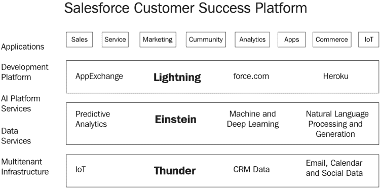

图 1.2 – Salesforce 和 TCRM 架构

下面是一幅简单的图示，用于说明 TCRM 和 Einstein Discovery（称为 **Einstein Analytics Plus**）如何融入包含 Salesforce 的典型数据架构：

Einstein Analytics Plus

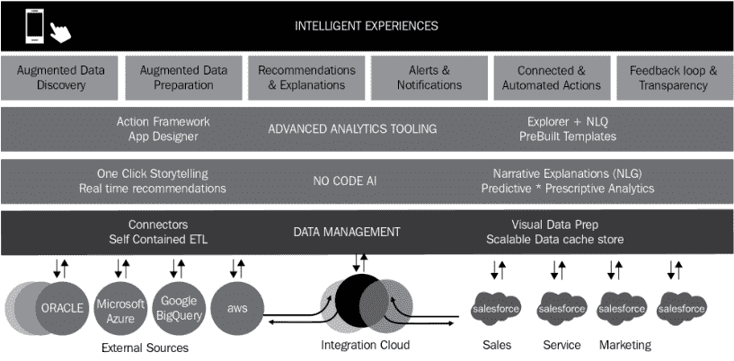

图 1.3 – TCRM 和 Salesforce 技术栈

如你所见，TCRM 的业务成果是在全球排名第一的 CRM Salesforce 的稳定、安全平台之上构建智能体验。

### TCRM 有什么用途？

TCRM 用于提取、聚合、转换和可视化数据。也就是说，它用于获取原始数据，借助业务知识对其进行处理，并讲述一个故事。

例如，我使用虚拟数据为一家房地产开发企业创建了以下 TCRM 仪表板：

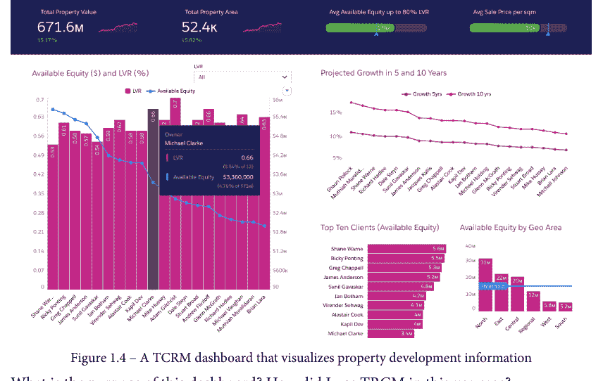

图 1.4 – 可视化房地产开发信息的 TCRM 仪表板

这个仪表板的用途是什么？在这个使用场景中，我是如何使用 TCRM 的？

1. 我将原始数据表加载到 TCRM 中。
2. 我使用 TCRM 将这些表组合成一个数据集。
3. 我转换数据，使其能够在 TCRM 中进行可视化。
4. 我使用 TCRM 设计、构建并共享分析仪表板。
5. 我能够使用 TCRM 对数据进行“切片和切块”，深入分析信息，理解其含义并讲述一个故事。

现在，TCRM 只是 Salesforce 生态系统中的多个数据分析工具之一。其他工具包括：

- Salesforce 报表和仪表板
- Einstein Analytics
- Tableau
- Datorama
- Pardot 分析
- Marketing Analytics

在本书的语境中，我们主要关注以下三个工具：Salesforce 报表和仪表板、TCRM 以及 Tableau。这些分析工具如何协同工作？以下是一个简单的概览：

| Salesforce 报表和仪表板 | Tableau CRM | Tableau |
|---|---|---|
| Salesforce 报表和仪表板是你利用实时数据快速取得成果的默认工具。 | 你的大多数用户已经在使用 Salesforce。 | 你的洞察将与 Salesforce 用户和非 Salesforce 用户共享，或者与不使用 Salesforce 的业务用户共享。 |
| 它们是基于实时数据快速取得成果的首选方案。 | 你希望在 Salesforce 中快速嵌入分析并执行操作。 | 你希望选择本地部署架构。 |
| 配置简单快速。 | 你希望使用易于嵌入的 AI 和监督式机器学习。 | 你需要远程联合查询。 |
|  | 你需要与 Salesforce 进行原生双向集成。 | 你需要更灵活地决定 BI 平台如何融入业务技术栈。 |

图 1.5 – Salesforce 的三个主要分析工具如何协同工作？

## 针对不同业务使用场景，应使用哪种分析工具？

以下是一些需要考虑的问题（如需更多详细信息，请参阅 https://marktossell.com/2020/06/20/tableau-or-einstein-analytics-which-is-best-for-you/ 和 https://marktossell.com/2020/10/31/are-you-confused-about-einstein-tableau-and-tableaucrm-read-this/）：

- 谁将使用这些业务洞察？
- 他们将在何处查看并执行基于洞察的操作？
- 他们将如何与其他人共享这些洞察？
- 仪表板所使用的数据有多少存储在 Salesforce 中？
- 外部数据存储在哪里？
- 外部数据将如何连接到 BI 工具？
- 公司内部哪些资源将负责使用分析工具？
- 用户习惯使用哪些平台？
- 数据使用者中有多少是 Salesforce CRM 用户？
- 哪种 BI 平台许可结构最适合该企业？

下图以一种非常简单的方式展示了 TCRM 与 Tableau 之间的比较：

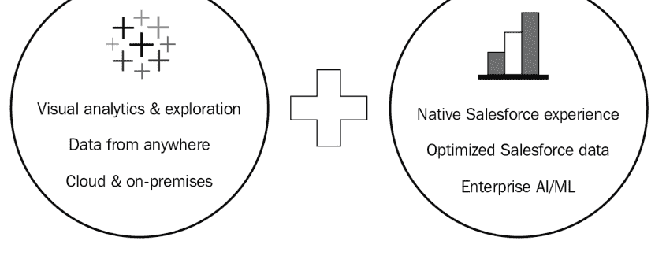

图 1.6 – Tableau 与 TCRM 的简单比较

现在，你可能会想知道，TCRM 和 Tableau 有何不同？下面的表格将帮助你理解这两个平台之间的差异：

### 架构上的差异与协同效应

| 架构 | Einstein Analytics | Tableau |
|---|---|---|
| 云端 | ✓ | ✓ |
| 本地部署 | ✗ | ✓ |
| 提供持久、专用的数据存储 | ✓ | ✓ |
| 连接器 | ✓ | ✓ |
| 远程联合查询 | ✗ | ✓ |
| 操作框架 | ✓ | ✗ |
| 模板化应用/模板 | ✓ | ✗ |
| 数据发现和预测 | ✓ | ✗ |
| 营销智能 | ✗ | ✗ |

图 1.7 – Tableau 与 TCRM/Einstein Analytics 在架构上的差异与协同效应

对于 Salesforce 报表和仪表板，如何判断何时需要升级到 TCRM？以下几点可以为你提供指导：

- 你需要引入外部数据。
- 你希望通过上下文记录操作，在 CRM 中执行基于洞察的操作。
- 你希望使用嵌入式分析。
- 你需要更高的可定制性。
- 你希望使用 Analytics 移动应用。
- 你需要预测性洞察和增强型分析。
- 你希望利用 TCRM 页面。
- 你需要高级趋势图和瀑布图。
- 你需要在数据流编辑器和数据配方中使用灵活而强大的数据建模功能。
- 你希望在最多 100 亿行数据上获得更高的性能。

## TCRM 的实际应用示例

了解 TCRM 如何在企业中使用的最佳方式是通过四个真实案例研究。以下是我们将要介绍的四个案例研究：

- 开箱即用的销售分析
- 高等教育的学生成功洞察
- 房地产开发洞察
- 营销归因分析

## 开箱即用的销售分析

TCRM 一个非常常见且高效的用例是作为标准模板提供的销售分析标准套件。通过简单的配置，您可以在几分钟内获得对 Sales Cloud 数据的强大洞察。这些洞察包括以下仪表板：

- **Sales Analytics Home**：提供高层级**关键绩效指标 (KPI)** 的概览。
- **Leaderboard**：为领导者提供团队和个人绩效的摘要，包括配额达成率、管道覆盖率、预订量、管道生成、成交业务、平均销售周期时间以及销售活动。
- **Trending**：分析管道随时间的变化，包括管道的开始和结束值，以及进出情况。
- **Sales Stage Analysis**：可视化交易在销售流程各阶段的移动情况，揭示瓶颈和有风险的机会。
- **Whitespace Analysis**：识别再销售和追加销售机会。
- **Executive Overview**：销售高管可以查看管道状态、预计结案情况以及按线索来源划分的顶级交易，并对销售和服务绩效进行高层级查看。

您将在 *第 3 章，连接您的数据源* 中更详细地了解此应用。

## 高等教育的学生成功洞察

我和我的团队与美国超过 20 所高等教育机构合作，包括哈佛大学和康奈尔大学，共同运用 Einstein 和 TCRM 的力量来解决他们最紧迫的挑战令人兴奋。虽然高等教育领域有许多令人兴奋的机会需要考虑，但我们最初将重点放在学生成功和坚持方面：

- 如果学校能在学生未能满足坚持标准之前识别出预警信号，学校就可以主动采取行动帮助学生。
- 如果学校能够根据学生的某些关键特征预测性地识别出坚持风险高的学生，那么这些学生就可以从一开始就获得额外的支持。
- 如果智能系统能够建议可能有助于学生坚持的行动，学校在促进学生成功方面将更有效率。

尽管许多人尝试过，但没有人能够解决这个问题。然而，凭借 Einstein 和 TCRM 的力量，我们为学生成功开发了一个成功的 MVP 原型，并正在与几所学院合作，为他们构建这一智能解决方案。以下是学生成功坚持标签的一些截图：

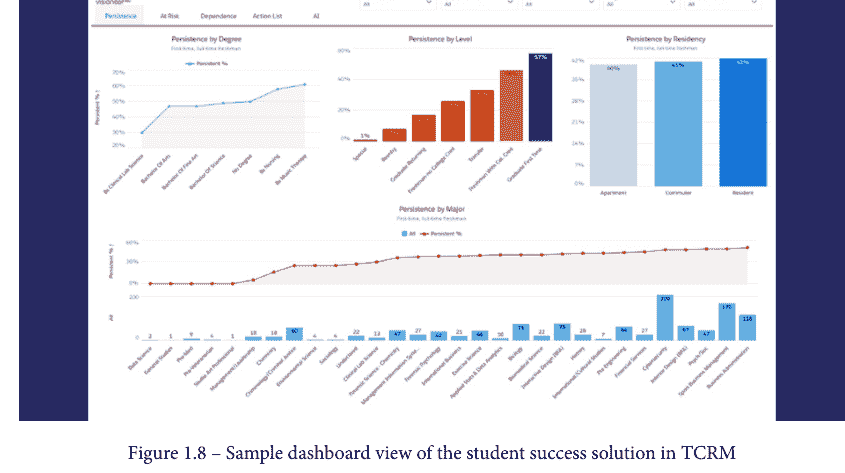

图 1.8 – TCRM 中学生成功解决方案的示例仪表板视图

以下是学生成功风险标签：

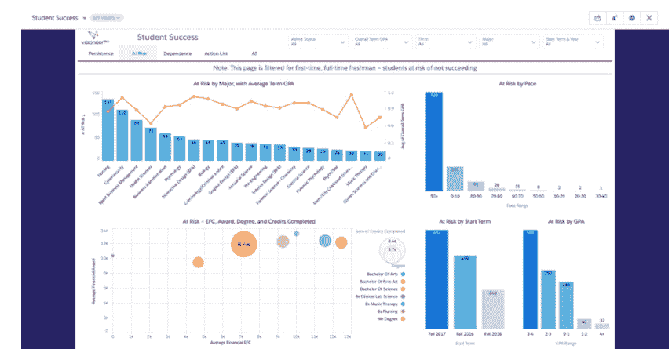

图 1.9 – TCRM 中学生成功解决方案的示例仪表板视图

以下是学生成功行动清单标签：

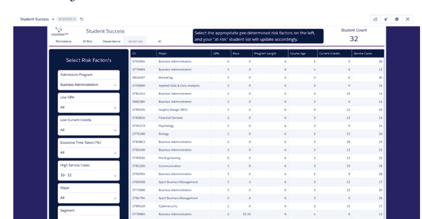

图 1.10 – TCRM 中学生成功解决方案的示例仪表板视图

有关此解决方案的视频，请参阅 https://vimeo.com/329929308。

## 房地产开发洞察

在此用例中，客户是一家悉尼公寓开发商。他们拥有蓬勃发展的业务，广泛使用 Salesforce，并且拥有大量数据，但他们无法做到以下几点：

- 使用各种变量快速深入销售数据。
- 从分析仪表板执行操作。
- 根据可用权益和**贷款价值比 (LVR)** 优先排序客户。
- 查看购买的总面积和 $ 价值与目标的对比。
- 查看购买的总面积和 $ 价值的趋势。
- 预测再投资金额在 5 到 10 年内的增长。
- 在平板电脑上向客户展示分析，显示当前和预测状态。

TCRM 平台结合他们的愿景和我们的专业知识，使我们能够构建一个解决方案，为客户提供他们从未见过的洞察。他们终于能够从数据到洞察再到行动。

以下是我们房地产洞察解决方案的一些截图。

以下是房地产开发洞察仪表板的首页：

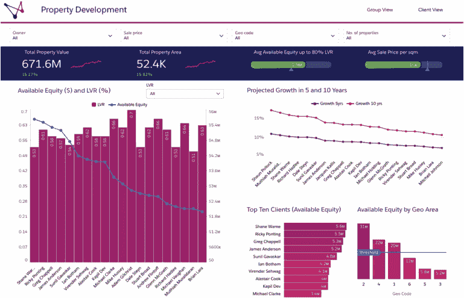

图 1.11 – TCRM 中房地产开发解决方案的示例仪表板视图

这是用户在现场的视图：

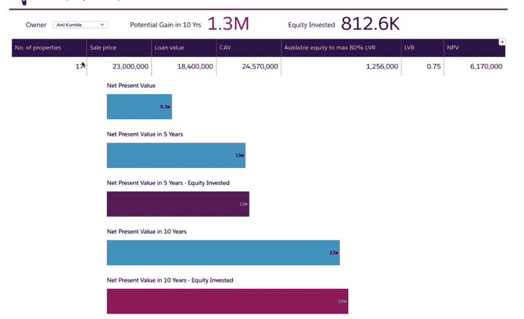

图 1.12 – TCRM 中房地产开发解决方案的示例仪表板视图

## 营销归因分析

一家医疗保健领域的营销企业要求我们围绕营销归因构建高级分析，最终目标是提供闭环归因分析解决方案。这是一个相当大的挑战！

- 1. 我们的客户无法展示其客户的营销投资实际回报和预测回报。策略非常碰运气。
- 2. 客户的客户拥有大量数据，但无法利用这些数据就营销渠道做出明智决策。
- 3. 客户代表客户手动提取的分析数据有限。这些分析并未推动智能业务决策。
- 4. 分析是诊断性和描述性的，但不是预测性和规范性的。

使用 TCRM 和 Einstein，我们构建了一个创新的 Analytics App，提供以下功能：

- 集成 AI 洞察和预测的前沿数据分析
- 来自 Einstein Discovery AI 的智能推荐

结果使客户能够推动渠道效率和营销优化。收益包括营销投资的投资回报率提升以及患者忠诚度提升和患者体验增强。让我们查看一下此解决方案的一些截图。

以下是首页视图：

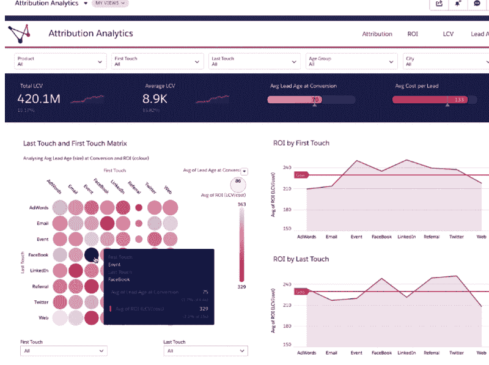

图 1.13 – 归因分析解决方案的首页

以下是投资回报率洞察页面视图：

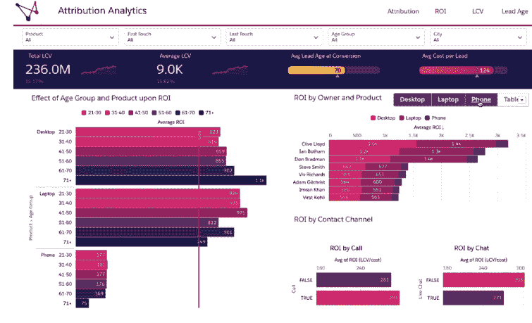

图 1.14 – 归因分析解决方案中的投资回报率分析

以下是客户终身价值 (LCV) 页面视图：

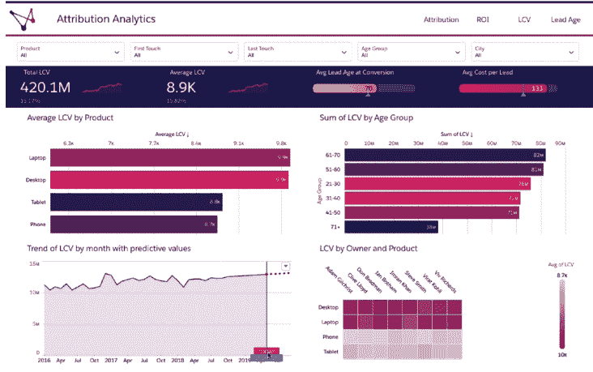

图 1.15 – 归因分析解决方案中的 LCV 分析

TCRM 的其他用例还包括对以下方面的洞察：

- 销售绩效，例如实际值和预测值与目标的对比。
- 按线索来源、地区和团队成员划分的线索转化率。
- 营销活动的投资回报率。
- 案例管理和服务团队绩效。
- 按地区、销售区域和国家划分的全球销售分解。
- 按地区和团队预测销售。
- 客户流失。
- 客户获取。
- 客户满意度。
- 供应链绩效，识别瓶颈和机会。
- 金融服务合规性，利用前瞻性分析识别可能违规的客户。
- 高等教育绩效和学生成功。
- 教育机构的交叉销售和追加销售机会。
- 销售组织的空白空间分析。
- **非营利组织 (NFP)** 的筹款绩效。
- NFP 募捐的捐赠者细分。
- 项目管理风险和问题。
- 专业服务企业的资源分配和优化。
- 地理空间数据。
- 收入、支出、利润等！

希望本节能帮助您了解我们如何使用 TCRM 解决问题并把握机会。记住，一切都关乎 **数据 -> 洞察 -> 行动**，如 *图 1.1* 所示。

在下一节中，我们将审视您的组织并评估您如何利用数据和分析。

### 如何借助 TCRM 在数据分析方面表现出色？

当你思考本章目前所学的内容时，是时候反思一下你的组织中数据和分析的现状了。你的数据是一种极其宝贵的资源，它应当赋能明智的决策并引导组织战略。你的公司数据能提供什么价值？

问问自己这些问题，并评估你的组织是否有改进空间：

-   你的领导者是否能够随时掌握准确、最新的信息，以便做出明智的决策？
-   你是否拥有一个你和同事都能访问和依赖的可靠信息来源？还是说信息分散在多个系统和平台中，并使用各种工具进行分析？
-   你的团队是否被简单、可操作的数据分析赋能和武装？
-   你和同事是否经常需要从不同地方收集信息——例如云存储、CRM、电子表格、电子邮件、ERP 等——然后将它们汇总到一个电子表格中，才能创建完成工作所需的报告？
-   你如何分享有价值的见解，然后如何将这些见解付诸行动？这个过程是简单容易的，还是复杂困难的？
-   你们目前在数据和数据分析领域有哪些优势？
-   你们目前在数据和数据分析领域有哪些劣势？
-   你们目前在数据和数据分析领域有哪些机遇？
-   你们目前在数据和数据分析领域面临哪些挑战？
-   如果平台、人员和流程都不是障碍，那么在利用信息创造可操作商业洞察方面，你认为你的组织在 12 个月后会处于什么位置？你实现这一理想状态的可能性有多大？

我想我可以用一个简单的问题来概括以上所有内容：

*你的组织在数据分析方面表现出色吗？*

说实话，根据我在多个行业和细分领域的经验，大多数组织并没有表现出色。许多组织甚至都不及格！数据分析是典型企业的严重痛点，无论其规模或行业如何，而且这个问题从来都不是靠砸钱就能解决的。

好消息是，TCRM 是一个强大而全面的工具，可以帮助你的组织从信息中获取巨大价值。具体如何实现？以下是 TCRM 能够做到的一些示例；请仔细思考这些功能，看看哪些最符合你的目标和需求：

-   将 Salesforce 和外部数据结合起来，创建唯一可信的数据源。
-   将洞察嵌入 Salesforce 的业务流程中，让用户能够更快、更好地做出决策。
-   用统一且动态的仪表盘取代多个互不关联的 Salesforce 报表。
-   最大限度减少或完全消除将 Salesforce 中的报表导出到 Excel 等工具中进行汇总、转换和可视化的需求。
-   极大地简化跨对象报表的创建。
-   通过 Einstein 平台将为分析注入真正的智能。
-   通过适用于 iOS 和 Android 的 TCRM 移动应用提供出色的移动端分析。
-   在处理大型数据集时，性能超越 Salesforce 报表和仪表盘。
-   让用户在 TCRM 仪表盘上仅需几次点击即可从洞察转向行动，全程无需离开平台。
-   对复杂流程进行建模，组合多个数据集，并融入复杂逻辑，创建出一个驱动真实洞察的综合数据源。

现在，我们将进入本书的主要内容。请与我一起学习 TCRM 如何借助可操作商业洞察的力量，帮助你的组织实现转型！

### 总结

至此，你应该已经清楚地理解了在受疫情影响的当今社会中，数据分析和商业洞察的重要性。你已经了解了 TCRM 这个强大的数据分析平台如何与 Salesforce 集成，从而在任何组织中都促进可操作的洞察。你也有机会评估了自己组织中的数据分析现状，并看到 TCRM 能够在哪些方面带来改变。

在下一章中，我们将亲手实践 TCRM，并构建我们的第一个 TCRM Analytics 应用。

### 问题

以下是一些测试你对本章内容掌握程度的问题：

-   定义数据分析及其提供的价值。
-   我们的目标是从数据到洞察，再到 ______________。
-   列举 TCRM 的五个特性。
-   TCRM 与 Tableau 有何不同？
-   列举 TCRM 的五个实际使用场景。
-   TCRM 如何为你的组织或客户提供价值？
-   你的组织在数据分析方面表现出色吗？如果没有，是什么阻碍了它？
