## 在 TCRM 中开发你的第一个 OOTB Analytics 应用

什么是 **Tableau 客户关系管理（TCRM）** Analytics 应用？TCRM 提供了多种**开箱即用（OOTB）** 的分析应用程序，可帮助你快速开始针对各种通用和行业特定用例（如销售分析或财富管理分析）进行数据分析。这些应用提供了预构建的数据流和仪表盘，可以配置以适合特定用例和可用数据。OOTB 应用是开始使用和自定义 TCRM 分析并熟悉 TCRM **用户界面（UI）**、资产和工具的绝佳起点。

你必须先学会走，然后才能跑。我们将从最初始的步骤开始——设置一个试用版 TCRM **组织（org）**，了解 TCRM 环境，并学习基本的资产定义。然后，我们将深入实践，创建并定制我们的第一个 TCRM Analytics 应用，以初步积累经验。

在本章结束时，你应该详细了解 TCRM 中 OOTB Analytics 应用是什么，并且能够在**开发（dev）** 组织中创建和定制一个此类应用。你还应该能够浏览 TCRM UI 并使用基本的 TCRM 工具。此外，目标是理解并欣赏各种 TCRM 资产，例如**透镜（lens）和故事（story）**。我们还将在此过程中解答一些常见问题和挑战。

在本章中，我们将涵盖以下主题：

-   亲身体验你自己的 TCRM 环境
-   什么是 TCRM Analytics 应用？
-   安装和配置 TCRM Analytics 应用
-   定制 TCRM Analytics 应用
-   常见问题解答
-   故障排除

### 技术要求

你需要满足以下条件才能成功执行本章中的操作：

-   一台可以访问互联网的笔记本电脑或台式电脑（平板电脑或手机不够用）
-   最新版本的 Google Chrome 浏览器（Chrome 是使用 TCRM 时的首选浏览器）
-   一个可用的电子邮件地址
-   TCRM 开发组织链接：

```
https://developer.salesforce.com/promotions/orgs/analytics-de
```

## 亲身体验你自己的 TCRM 环境

让我们首先逐步完成 TCRM 开发试验环境的初始设置流程，这样你就可以在安装 TCRM 的过程中与我一起操作。

为了让你能够亲身体验 TCRM 平台，你首先需要一个可以自由编辑的沙盒环境——一个已经启用了 TCRM 并填充了示例数据的环境。这个试验环境被称为启用 Einstein Analytics 的 Developer Edition 组织。那么，让我们开始设置它吧。

## 设置你的开发组织

要注册并设置你的开发组织，请按照以下步骤操作：

1.  在此处注册你自己的启用 Einstein Analytics 的 Developer Edition 组织：https://developer.salesforce.com/promotions/orgs/analytics-de。注册界面应该如下所示：
2.  继续填写表单，然后选择 **Sign me up**。请注意，你的用户名将采用电子邮件地址的形式，但你将创建一个唯一的用户名，该用户名不应是你的电子邮件地址。编一个你容易记住的用户名即可。

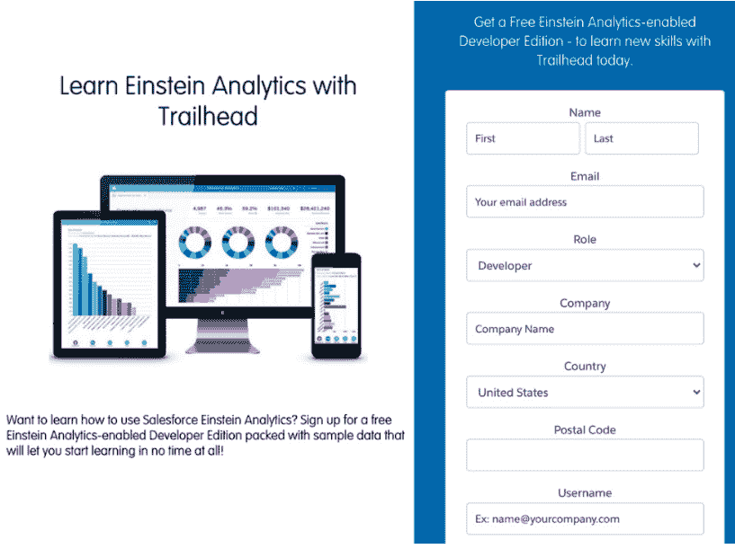

图 2.1 – 开发组织注册界面

前往你的电子邮件应用，你应该会看到一封主题为 **Welcome to Salesforce: Verify your account** 的电子邮件。


3. 将 **Uniform Resource Locator (URL)** 和用户名保存在安全的地方，然后点击标有 **Verify Account** 的按钮。这会带你进入一个页面，在那里你将为该组织创建密码并选择一个安全问题。填写完毕后点击 **Change Password。**

你现在将到达你的开发组织的 **Salesforce** 主页。它应该看起来像这样：

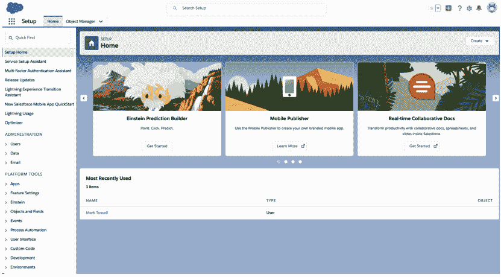

图 2.2 – TCRM 练习环境的 Salesforce 主页

**重要说明**
请注意，此开发组织已启用 TCRM/Einstein Analytics，并填充了足够的人工数据以便你学习操作。如果你使用自己的环境，则需要确保拥有必要的许可证、权限和设置。详细内容在本章末尾的 *常见问题解答* 部分中介绍。

让我们现在进入 TCRM 平台，以便我们熟悉主页，了解各种资产和菜单选项，并稍后启动开箱即用的分析应用创建器。

+   4. 转到左上角的 **App Launcher** 并点击 **Analytics Studio**，如下图所示：

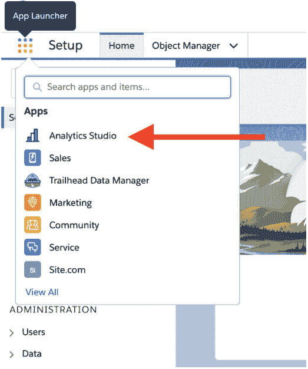

图 2.3 – 突出显示 Analytics Studio 的 Salesforce App Launcher

5. 你现在应该可以看到你的新快乐之地——**Einstein Analytics Studio** 的主页，如下图所示：

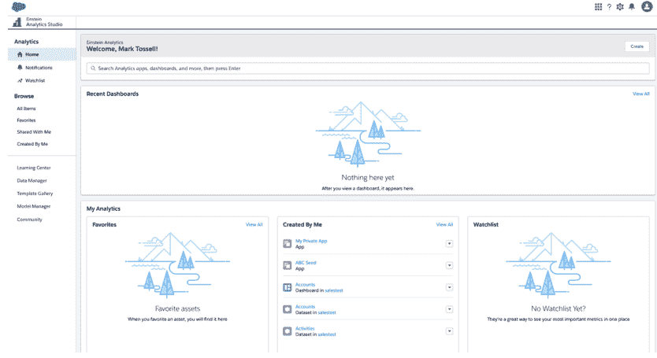

图 2.4 – Einstein Analytics Studio 主页

现在你已经为工作创建了一个 TCRM 沙盒练习环境，是时候熟悉你今后将使用的 UI 和资产了。

## 在 Analytics Studio 主页上找到方向

现在我们已经成功注册了我们的快乐之地 **Analytics Studio**，花点时间探索 **Analytics Studio** 主页以更好地了解其中存在的不同功能是值得的。那就让我们继续吧。

左侧菜单中有什么？正如你在图 2.4 中看到的，屏幕左侧提供了多种选项。让我们接下来探索它们。

## 主页菜单项摘要

以下是主页上将提供的项目列表：

- **Home**—TCRM 着陆页，可让你访问你的 **Analytics Studio** 资产。
- **Notifications**—TCRM 通知在此列出。当仪表板中创建通知时，你可以在此部分管理它们。
- **Watchlist**—TCRM 监视列表项在此列出。当仪表板中创建监视列表项时，你可以在此部分管理它们
- **All Items**—将在下一节详细介绍。
- **Favorites**—你可以将任何 TCRM 资产设为收藏，例如数据集或透镜，并将其添加到此列表以便轻松访问。
- **Shared With Me**—他人与你共享的所有项目都可在此访问。
- **Created By Me**—你创建的所有项目都可在此访问。
- **Learning Center**—TCRM 用户的各种学习资源链接在此列出以便使用。
- **Data Manager**—数据来源、数据集和数据工具可在此访问。
- **Template Gallery**—你可以在此从模板启动新的分析应用。这在本章中会详细介绍。
- **Model Manager**—在此查看和管理你的 **Einstein Discovery 机器学习 (ML)** 模型。请注意，本书不涵盖 **Einstein Discovery** ML。
- **Community**—链接到 Trailblazer 社区，在那里你可以与其他 TCRM 探路者协作。

我们现在将详细查看其中一个菜单选项：**All Items**。

## All Items

点击 **Browse** 下的 **All Items** 时，你会看到多个选项和资产。

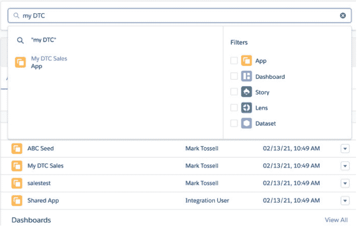

图 2.6 – TCRM 搜索界面

例如，如 *图 2.6* 所示，你可以在主页上搜索资产，例如包含与 **Direct to Consumer (DTC)** 业务数据相关的、数据集、透镜和仪表板的 **My DTC** 应用。如果结果列表中出现多个资产，你可以使用右侧的筛选器缩小搜索范围。

## 分析设置

你目前不需要对 TRCM 设置做任何更改，但如果需要时，你可以通过点击主页右上角的设置齿轮图标找到设置，如下所示：

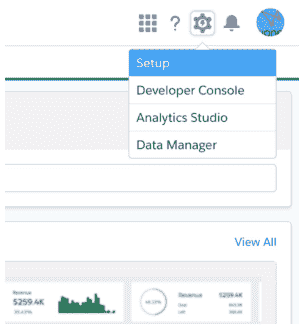

图 2.7 – 如何到达设置选项卡

这是 **Analytics** 的 **Settings** 选项卡的样子：

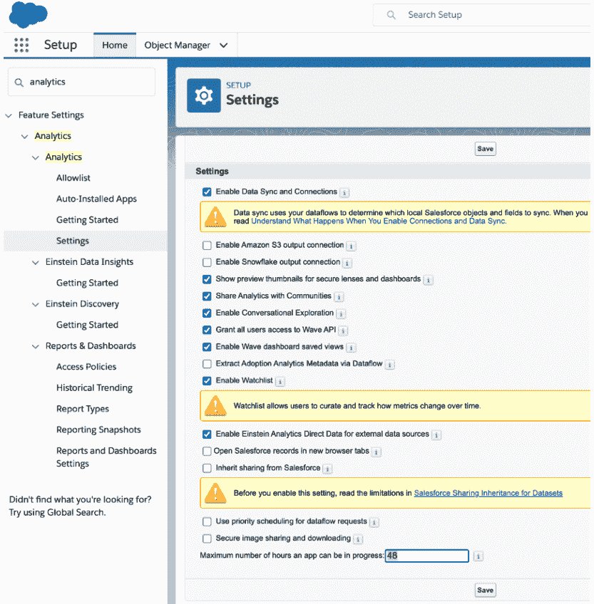

图 2.8 – TCRM 的 Analytics 设置选项卡

例如，你在图 2.8 中看到，你可以启用 Amazon **Simple Storage Service (S3)** 输出连接器。这允许你将 TCRM 数据准备中的 **comma-separated values (CSV)** 数据导出到 **Amazon S3** 存储桶。

## 什么是 TCRM 分析应用？

在深入 TCRM 分析应用的部署和定制之前，我们首先需要了解它到底是什么。TCRM 应用本质上是四个 TCRM 资产的容器：**dashboards**、**stories**、**lenses** 和 **datasets**。以下是 TCRM 应用的简单视觉概览：

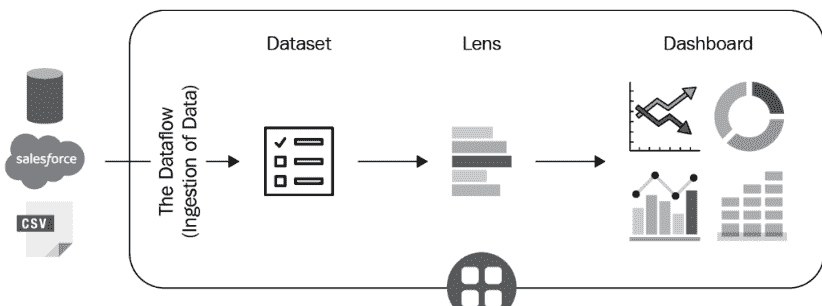

图 2.9 – TCRM 应用概览

打开现有的应用 My DTC Sales，你将看到前面列出的资产，以及一个显示系统信息的 **Details** 选项卡。

当你探索 **My DTC Sales** 应用并准备构建我们自己的应用时，有一些基础知识你首先需要掌握。关于 TCRM 分析应用，有三点需要注意，概述如下：

- **应用是安全的。** 即，它可以限制为创建者，也可以开放给其他用户。应用级安全是 TCRM 安全的一种形式。
- **应用可以共享。** 有三种方式可以与他人共享应用内容以便协作，列出如下：
  A. 通过 TCRM 授予访问权限
  B. 发布到 Chatter 动态
  C. 通过应用 URL 共享
- **应用可以模板化。** 这是一个强大的工具，可将 **Analytics** 仪表板、数据流等打包并部署到其他地方。

> **Note**
> 有关应用模板的更多信息，请参阅：https://developer.salesforce.com/docs/atlas.en-us.bi_dev_guide_wave_templates.meta/bi_dev_guide_wave_templates/bi_templatesdev_intro_wave_templates.htm。

## 安装和配置 TCRM 分析应用

让我们现在创建我们的第一个分析应用。我们将遵循 TCRM 提供的简单直观的开箱即用流程，从 **Create** 按钮开始。步骤如下：

1. 应用创建
2. 基础应用配置
3. 应用探索

让我们在下一节中探索这些步骤。

## 应用创建

让我们开始创建我们的应用。为此，请遵循以下说明：

1. 首先，前往页面右上角，点击 **Create**，然后选择 **App**，如下图所示：

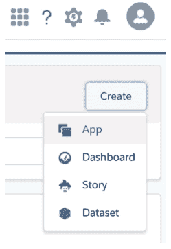

图 2.10 – 如何通过使用 Create 按钮开始应用创建流程

你现在应该会看到一个屏幕，可以在其中选择应用模板。模板是为特定用例构建的预配置、可定制的应用。

2. 让我们在搜索窗口中输入 `sales` 并选择 **Sales Analytics app**，如下图所示：

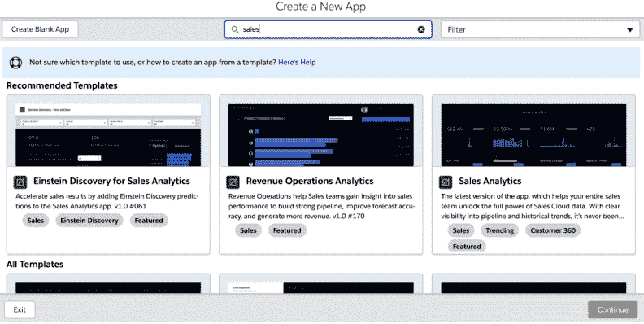

图 2.11 – 创建新应用

3. 接下来会显示应用的简要概述，以及技术细节和示例仪表板截图。随意探索它们，然后点击 **Continue**，这会带你到此对话框：

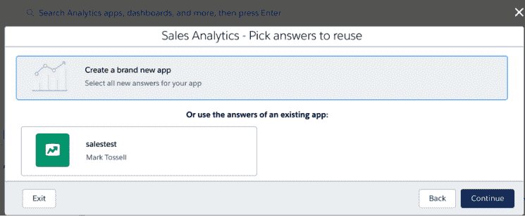

图 2.12 – 创建全新的分析应用

4. 选择 **Create a brand new app** 并点击 **Continue**。Einstein 然后会运行快速检查以确保你已准备好创建应用；点击 **Looks good, next。**

应用模板已加载，并可根据你的独特需求进行配置。


## 基本应用配置

让我们从一个基本设置开始；我们很快就会对其进行配置。请按以下步骤操作：

- 1. 在 **Sales Analytics - Personalize** 屏幕中选择 **Basic**，如下所示：

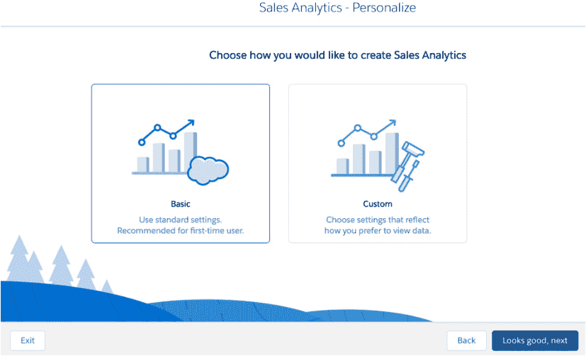

图 2.13 – Sales Analytics - Personalize 屏幕

- 2. 为新的分析应用命名，然后点击 **Create**。

现在你需要等待几分钟，让 Einstein 施展其魔力。你应该会在浏览器中看到以下屏幕：

## 应用探索

现在花点时间探索这个新应用——你的新应用！不要更改任何内容，但点击应用各处，探索资产，并感受环境。例如，试着深入 PERFORMANCE 仪表板，其外观如下：

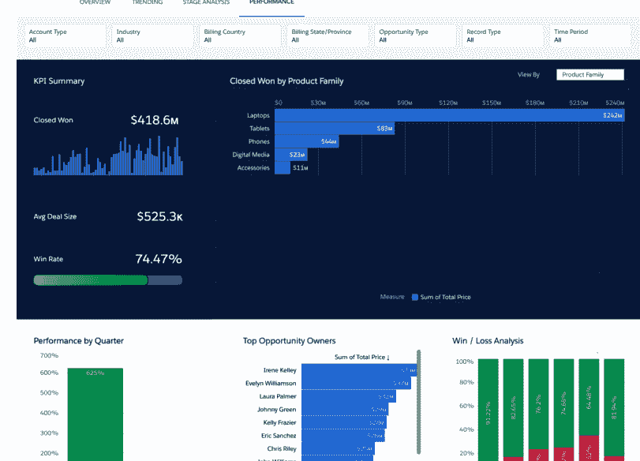

| Account Name | Opportunity Name | Opportunity.Owner.UniqueUserName | Product Family | Product Name | Forecast Category | Stage | Close Date |
|---|---|---|---|---|---|---|---|
| Mann156 Inc | Opportunity for Wolfe807 | Eric Sanchez | Laptops | Mega laptop | Closed | Closed Won | 2024-09-11 |
| Herrera937 Inc | Opportunity for Ferguson1365 | Johnny Green | Laptops | Mega laptop | Pipeline | Needs Analysis | 2025-10-05 |
| Harris13 Inc | Opportunity for Figueroa377 | Bruce Kennedy | Laptops | Mega laptop | Best Case | Perception Analysis | 2025-08-25 |
| Barber878 Inc | Opportunity for Bryan543 | Evelyn Williamson | Laptops | Mega laptop | Closed | Closed Won | 2024-08-10 |
| Stephens391 Inc | Opportunity for Barnett1092 | Nicolas Weaver | Laptops | Mega laptop | Pipeline | Needs Analysis | 2025-08-17 |
| Watts605 Inc | Opportunity for Rogers1242 | John Williams | Laptops | Mega laptop | Closed | Closed Won | 2025-04-01 |
| Underwood142 Inc | Opportunity for Miles1826 | Harold Campbell | Laptops | Mega laptop | Closed | Closed Won | 2024-09-19 |
| Schmidt289 Inc | Opportunity for Gross1521 | Catherine Brown | Laptops | Pro laptop | Closed | Closed Won | 2025-03-03 |
| Harris13 Inc | Opportunity for Edwards346 | Johnny Green | Laptops | Mega laptop | Best Case | Perception Analysis | 2025-09-07 |
| Crawford701 Inc | Opportunity for Ramos435 | Nicolas Weaver | Laptops | Pro laptop | Closed | Closed Won | 2025-07-28 |

图 2.15 – OOTB PERFORMANCE 仪表板

尝试使用顶部的全局筛选器，点击图表以查看和筛选信息，观察底部表格视图如何变化，并大胆尝试。你也可以尝试创建你的第一个 lens——稍后会详细介绍——只需点击一个数据集并进行实验，就会创建出类似这样的内容：

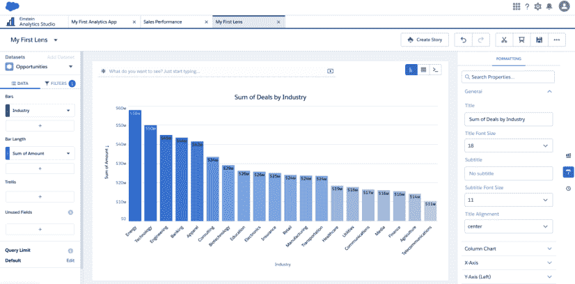

图 2.16 – 从 Opportunities 数据集创建的 lens

现在你已经创建了第一个 TCRM 应用，如果你想更改其配置方式怎么办？如果想调整设置？甚至进行大规模更改？请继续阅读！

## 自定义 TCRM 分析应用

在本节结束时，你应该能够编辑应用的配置，从而在一定程度上对其进行自定义。要自定义应用，需要执行以下两个步骤：

- 1. 将应用设置更改为自定义设置。
- 2. 自定义详细的应用设置。

让我们在以下各节中探索这些步骤。

### 将应用设置更改为自定义设置

让我们进入我们创建的应用并编辑设置，如下所示：

- 1. 在应用中点击 **Reconfigure app**，如下截图所示：

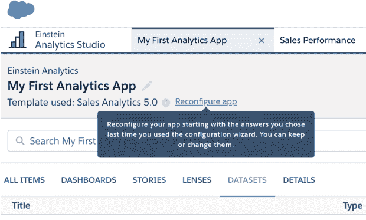

图 2.17 – 开始应用重新配置过程

- 2. 接下来，通过勾选复选框并点击 **Continue** 确认覆盖现有设置和自定义是可以的。然后你将再次看到 **Sales Analytics - Personalize** 屏幕，继续操作，这次在被问及 **Choose how you would like to create Sales Analytics** 时选择自定义设置。

如以下截图所示，你可以根据需要添加其他对象：

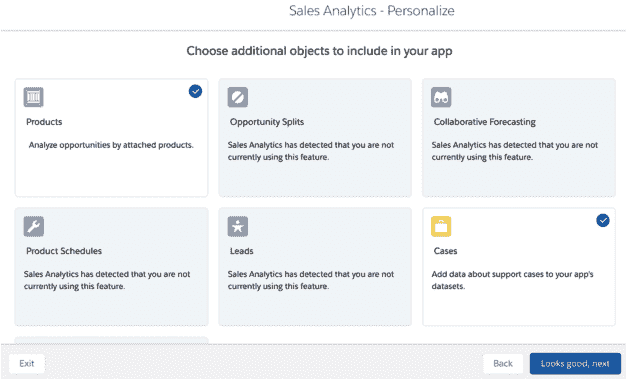

图 2.18 – 为分析应用选择其他对象

例如，如果你的组织在 Salesforce 中使用产品计划，你可以通过在此处添加该对象将其包含在你的分析应用中。

### 自定义详细应用设置

现在我们可以开始自定义影响用户在分析中看到的内容的详细设置。让我们一起浏览这些对话框并进行一些更改。

第一个框涉及客户细分；请继续编辑这些字段以更改应用配置，如下所示：

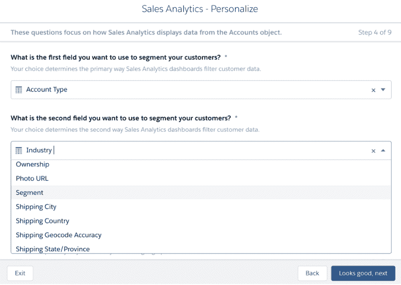

图 2.19 – 对客户细分设置进行更改

接下来会有一系列对话框，你可以根据需要进行更改，例如：

- 自定义用于细分地理区域的字段
- 自定义用于细分产品的字段
- 控制数据可见性
- 向数据集和仪表板添加其他字段

请注意，每个 OOTB 分析应用都有其自己的配置选项集。当你能够从头创建自己的应用并构建自定义模板时，你将创建一个新的配置向导以满足需求。

一旦个性化过程完成，你将被问到 **Are you sure you want to reconfigure your app?** 当然！点击 **OK**，然后等待你的应用重新配置。

一旦应用根据你的自定义规范重建，你就可以深入查看，你将看到资产中反映了你的修订设置。

做得好——你已经创建并自定义了你的第一个 TCRM 应用！

但是，如果标准 OOTB 应用无法满足你的需求怎么办？如果需要更量身定制的分析资产，例如完全自定义的仪表板或从 **data warehouse** 引入数据的仪表板怎么办？不用担心——TCRM 具有极强的灵活性，你的问题将在以下章节中得到解答。

## 常见问题解答

在你跟随本章并构建自己的应用时，你可能会遇到一些挑战或有疑问；接下来概述了四个最常见的问题。

### 我需要哪些许可证来构建和使用 TCRM？

TCRM 需要 **Einstein Analytics Growth**（不含 Discovery）或 **Einstein Analytics Plus**（含 Discovery）许可证。有关用户许可证和 **permission set licenses (PSLs)** 的信息可在 **Setup** 中找到，如以下截图所示：

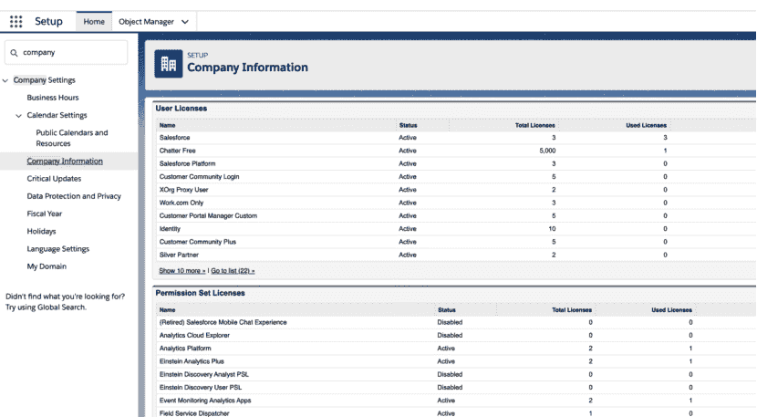

图 2.20 – 在 Setup 中查找用户许可证信息

Salesforce 会自动为你在组织中分配任何 TCRM 权限的用户分配 **Einstein Analytics Growth** 权限集许可证。PSL 也可以手动分配给用户。创建和分配权限集的过程详细说明如下：

- 1. 在 **Setup** 菜单中，在 **Administration** 下，点击 **Users**，然后点击 **Permission Sets**，然后点击 **New**。
- 2. 将新权限集与 PSL 关联。在你购买 TCRM 许可证之前，你无法为 TCRM 选择任何 PSL。
- 3. 从 PSL 中可用的权限中向权限集添加权限。
- 4. 将该权限集分配给用户。

### 我需要哪些权限来访问、构建和编辑分析应用？

**Einstein Analytics Growth license** 中包含两个预建权限集，详情如下：

- **Einstein Analytics Platform Admin**：在此处启用了管理 TCRM 平台所需的所有权限。这包括允许用户创建 TCRM 模板化和自定义应用的权限。
- **Einstein Analytics Platform User**：在此处启用了使用 TCRM 平台和 TCRM 模板化应用所需的所有权限。

基本设置涉及通过 **Setup** 选择和分配预建权限集。**Einstein Analytics Plus license** 中包含两个预建权限集，详情如下：

- **Einstein Analytics Platform Admin**：此集合实现了管理 TCRM 平台所需的所有权限。这包括允许用户创建 TCRM 模板化和自定义应用的权限。
- **Einstein Analytics Platform User**：此集合实现了使用 TCRM 平台和 TCRM 模板化应用所需的所有权限。

通过 **Setup** 选择和分配预建权限集是基本设置的一部分，如以下截图所示：

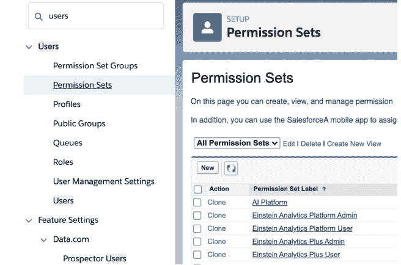

图 2.21 – 通过 Setup/Users/Permission Sets 访问的各种 TCRM 权限集


在适当的权限集中，根据需要添加或删除分配。

要创建自己的自定义 TCRM 权限集，请使用以下链接采用高级设置：

```
https://help.salesforce.com/articleView?id=sf.bi_help_setup_advanced.htm&type=5
```

可以在此处找到高度详细的设置和配置信息：

```
https://help.salesforce.com/articleView?id=sf.bi_help_setup.htm&type=5
```

## 如何在我的组织中启用 TCRM？

如果尚未启用 TCRM，您可以通过转到 设置 | 分析 | 入门，然后将其打开来启用它。

## AI 和 ML 是否随 TCRM 提供？

以监督式 ML 形式存在的 Einstein 人工智能（AI）被称为 Einstein Discovery。这随 Einstein Analytics Plus 许可证提供。然而，Einstein Discovery 是一款复杂的工具，经常被误解且容易被误用，本书不涵盖它。敬请期待！

## 故障排除

在本节中，我们将快速介绍在使用 TCRM 时开始使用时可能遇到的一些问题。这些问题听起来可能很简单，但对于刚熟悉该工具的人来说很常见。

### 我找不到我的 TCRM 应用或资产

如果您在 TCRM Analytics Studio 主页上看不到您的应用，请点击左侧浏览下的全部项目选项，您应该会看到您的应用。

### 我无法从 Salesforce 主页到达 TCRM 主页

如果您在 Salesforce 中的 **应用启动器** 中看不到 **Analytics Studio**，请执行以下操作：

- 1. 点击 **查看全部**。
- 2. 搜索 **Analytics**。
- 3. 点击 **Analytics Studio**。

然后您将到达 TCRM 主页。

### 重新配置我的 TCRM 应用的链接在哪里？

由于字体非常小，该链接很容易被遗漏。在浏览器页面的左上角，TCRM 标志下方，您会看到应用标题。标题下方您会看到 **模板使用：Sales Analytics 5.0**——在此短语右侧，蓝色的是 **重新配置应用** 链接。

您也可以参考图 2.17 来了解 **重新配置应用** 链接的确切位置。

### 应用创建期间新的应用数据流失败

如果数据流失败，应用创建过程将无法成功完成。此失败可能会导致仪表板错误或其他意外行为。在数据流至少成功运行一次之前，请勿编辑数据流定义，否则应用创建将被放弃。

在此上下文中，数据流失败有三种可能原因，如下所述：

- 1. **字段可用性** 或 **组织配置**——使用以下步骤解决：
    - A. 修复组织配置。
    - B. 通过 **数据管理器** 手动启动数据流。
    - C. 数据流完成后在应用中点击 **重置**。
    - D. 在向导中不更改任何选项的情况下完成重置过程。

- 2. **数据同步**：如果启用了 **数据同步**，在数据流执行期间创建新的模板化应用可能会失败，因为应用中使用的字段或对象尚未复制。这也可能发生在 TCRM 应用的新版本包含额外的默认字段时。使用以下步骤解决：
    - A. 打开 **数据管理器**。
    - B. 转到 **连接** 选项卡。
    - C. 在 **同步调度程序** 下点击 **立即运行**。
    - D. 数据流完成后在应用中点击 **重置**。
    - E. 在向导中不更改任何选项的情况下完成重置过程。

- 3. **应用配置**：如果应用配置不正确，数据流可能会失败——例如，可能存在错误的字段引用或选择了错误的选项。使用以下步骤之一解决：
    - A. 删除应用并创建全新版本的应用。
    - B. 重置应用并根据需要选择不同的答案。

### 总结

现在我们已经完成了创建和个性化 OOTB TCRM 分析应用的旅程，您应该对分析应用是什么以及它如何工作有了很好的把握。您应该已经了解到 TCRM 应用模板提供了可根据使用情况配置的预建数据流和仪表板，并且您现在应该能够构建和个性化应用。此外，您应该对 TCRM UI、资产和工具有了实践感受，并且应该能够自信地浏览 **Analytics Studio** 主页。最后，您可以将 *故障排除* 部分作为便捷的参考工具，以防您遇到困难。

您应该获得的一些关键要点是：首先，TCRM 应用是 TCRM 资产的容器，以数据集、透镜、故事和仪表板的形式存在。其次，TCRM 应用可以被保护。第三，TCRM 应用可以通过多种方式与他人共享。然后，TCRM 应用可以被模板化并在另一个环境中重现。最后，您可以使用标准设置部署 OOTB TCRM 应用，或将其配置以满足您的个性化需求。

在下一章中，您将学习如何提取、连接、组合、转换和注册业务数据，以便在 TCRM 中创建有用的数据集。

### 问题

现在尝试回答以下问题来测试您的知识：

- 什么是 TCRM 资产？举一个例子。
- 如何共享 TCRM 应用？
- 什么是 TCRM 透镜？
- 真或假：TCRM 应用仅限于标准、OOTB 设置。
- TCRM 主页侧边菜单上的 **收藏夹** 链接的用途是什么？
- 如果 OOTB TCRM 应用即使在您对其进行自定义后仍不符合您的要求，您该怎么办？
- 如何在 Salesforce 环境中启用 TCRM？
