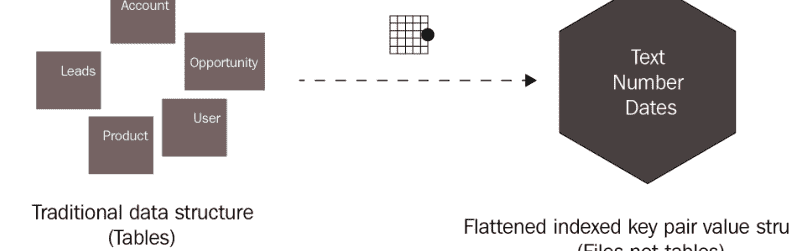
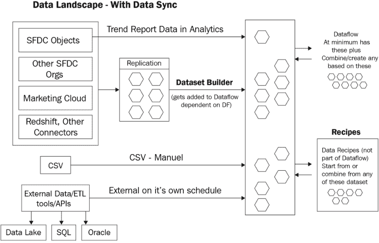
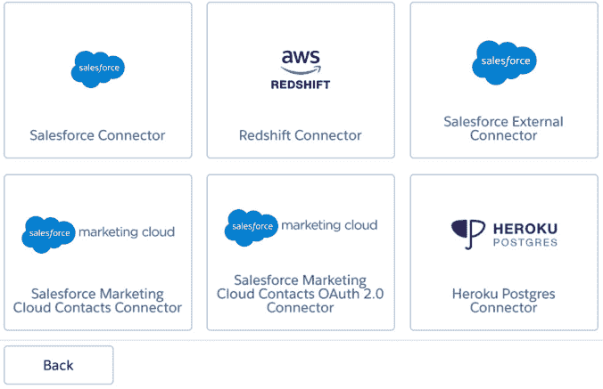
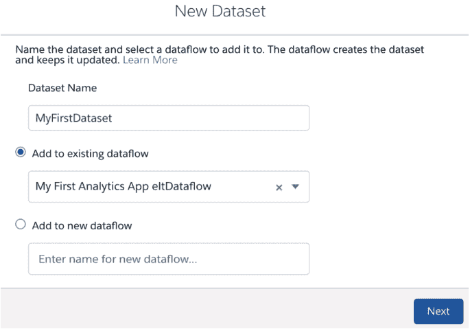
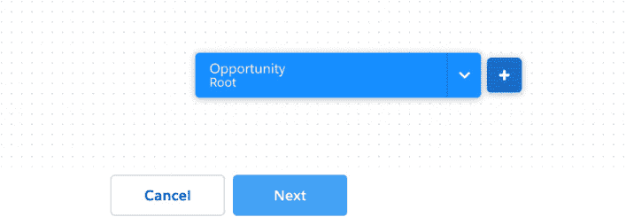
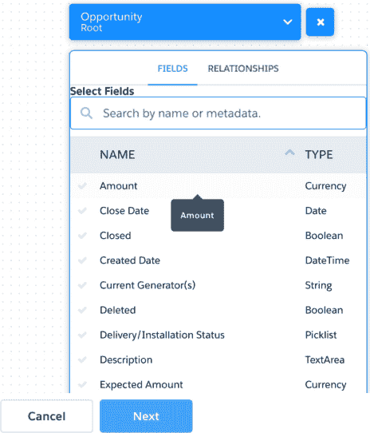
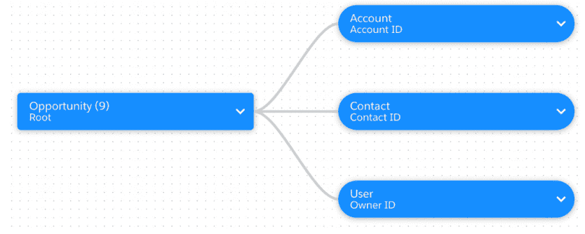
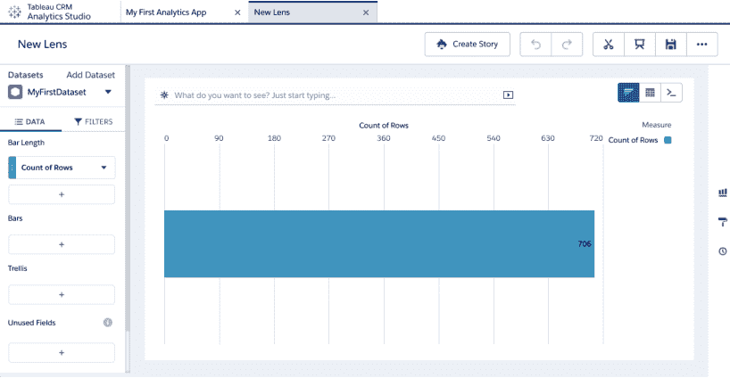

## 3 连接您的数据源

现在您已经熟悉 Tableau CRM（TCRM）用户界面，并且已经构建了您的第一个 TCRM 分析应用，您已准备好深入探索这一功能强大的商业智能平台。在本章中，您将学习如何从各种数据源将数据摄取到 TCRM。TCRM 从 Salesforce、平面文件、数据仓库和其他来源引入数据的多样化功能和限制将被检查和解释，以及使这一过程成为可能的框架和工具。您将学习如何将 **Salesforce** 数据对象与 TCRM 连接并创建数据集。您还将学习如何将平面文件带入 TCRM。

那么，到本章结束时您将能够做什么呢？首先，您将清楚地了解如何将数据带入 TCRM。其次，您将认识到 TCRM 在数据连接方面的限制。第三，您将了解如何将 Salesforce 数据带入 TCRM。最后，您将能够将平面文件数据导入 TCRM 并用其增强您的 Salesforce 数据。

在本章中，我们将涵盖以下主题：

- TCRM 的数据连接功能
- TCRM 的数据连接限制
- 将 Salesforce 数据带入 TCRM
- 使用平面文件（CSV）增强您的 Salesforce 数据
- 常见问题和挑战

### 技术要求

成功执行本章中的说明需要以下条件：

- 具有互联网访问权限的笔记本电脑或台式机（平板电脑或手机是不够的）。
- Google Chrome 浏览器的最新版本（在使用 TCRM 时，Chrome 是首选浏览器）。
- 一个有效的电子邮件地址。
- 确保您已登录到您的 TCRM 开发组织，如 *第 2 章，在 TCRM 中开发您的第一个 OOTB 分析应用* 中所示。

### TCRM 的数据连接功能

TCRM 为您可以 **提取**、**加载**、**转换** 和 **分析** 的数据提供了许多选择。本节将介绍 Tableau CRM 为数据摄取和转换提供的基础框架和工具。 resulting 数据集将驱动为用户提供所需业务洞察的透镜和仪表板。

在 Tableau CRM 中，数据连接和集成涉及摄取和准备您想要可视化和调查的 Salesforce 数据和外部数据。外部数据是指存在于连接到您的 TCRM 环境的 Salesforce 组织之外的数据。这包括来自另一个 Salesforce 组织、外部应用程序、平面文件和其他数据库的数据。在摄取、连接和转换数据后，分析用户可以使用 TCRM 透镜和仪表板对其进行分析和探索。

数据准备是将您的数据转换为对使用者有用且有帮助的形式的过程。为了让您了解 TCRM 如何执行这些操作，首先，您必须了解数据集是什么、它们是如何设计的以及它们是如何构建的。这将在下一节中进行解释。

### 数据集的定义、设计和构建

首先，什么是数据集？下图给出了一个简明的定义：

### 什么是数据集？

一种数据存储库（存储），类似于文件系统存储，但采用专有格式，并通过算法使用倒排索引来展平数据（以提高容量和速度）。

图 3.1 – 什么是数据集？

数据集是分析透镜和仪表板的构建基块，也是洞察的源泉。俗话说，垃圾进，垃圾出；在数据分析领域，这句话再贴切不过。因此，在设计和构建 TCRM 仪表板时，你需要投入大量思考和精力来打造驱动指标和可视化效果的数据集。

那么，TCRM 如何以及从哪里提取、存储、转换数据，并将其加载到数据集中？下图概述了 TCRM 的数据版图，以及在平台中摄取数据的各种方式：

图 3.2 – Tableau CRM 数据版图

那么，你能从*图 3.2*中了解到什么？请看以下几点：

- 多种数据源会被复制/同步（请参阅*数据同步*部分），并通过数据流和配方导入 TCRM。这些数据包括来自主要连接的 Salesforce 组织、其他 Salesforce 组织、Marketing Cloud 以及其他 TCRM 连接器的数据。
- Salesforce 趋势报告数据可以直接导入 TCRM。
- **平面文件**可以通过手动将 CSV 文件加载到 TCRM，并在数据流或配方中与其他数据合并和转换，从而补充到数据集中。
- **外部数据、ETL 工具和 API**（例如数据湖、SQL 和 Oracle）会按照各自的手动计划，为 TCRM 中的数据集补充数据。
- TCRM 数据流可以接收各种数据源，并将这些数据与其他来源及 TCRM 数据集中的数据合并和转换。相关内容将在*第 4 章，构建数据配方*和*第 5 章，使用 TCRM Data Prep 进行高级 ETL*中详细介绍。
- 默认情况下，Tableau CRM 执行增量同步。你可以指定同步是提取每个 Salesforce 对象的增量变更，还是提取所有记录。如前所述，增量同步运行速度更快。
- 如果你的 TCRM 管理员在 Winter '20 版本发布之前启用了 TCRM，则必须启用数据同步和连接选项，以优化数据流并连接到外部数据。请注意，如果你在 Winter '20 版本发布之后启用 TCRM，则默认会启用数据同步。
- 你可以通过 Tableau CRM 的 Snowflake 输出连接器，将原始的本地 Salesforce 数据导出到 Snowflake。

在下一节中，你将学习如何在 TCRM 中提取和使用外部数据。

### 将外部数据与 Salesforce 数据摄取并合并

部署和构建 Tableau CRM 仪表板的一个主要原因，是将 Salesforce 数据与外部数据合并到统一可信的数据源中。那么，具体该怎么做？下面通过一个示例来说明。

登录你的 TCRM 开发组织，导航至 **Analytics Studio**，然后执行以下步骤：

1. 点击 **Create** 按钮并选择 **Dataset**。
2. 选择 **External Data** 选项，随后将进入 **Data Manager**。
3. 点击左侧的 **Connect** 链接。
4. 点击 **Connect to Data** 按钮。
5. 在 **Input Connections** 选项卡下，点击 **Add Connection** 按钮，随后会出现以下窗口：

**为新的远程连接选择连接类型**

图 3.3 – 远程连接示例

6. 浏览可用选项，你会看到这里提供了多种数据源。选择 Redshift Connector 选项，随后会出现一个对话框，需要填写连接器相关信息，例如：

- (a) **连接名称**
- (b) **开发者名称**
- (c) **描述**
- (d) **AWS Secret Access Key**
- (e) **用户名**
- (f) **AWS Access Key ID**

需要填写的详细信息因连接器而异。填写完必要信息后，需要保存并测试连接器。正确配置并成功测试后，即可在 TCRM 中使用这些数据进行合并和转换。可以在 **Data Manager** 的 **Connect** 部分对连接器进行计划安排、编辑或删除。

### TCRM 可用的远程数据连接

截至 2021 年 4 月，TCRM 提供以下远程数据连接器：

| Salesforce | 应用程序 | 数据库 | Analytics Mulesoft | 对象存储和 No SQL | 实时连接 |
|---|---|---|---|---|---|
| 外部 Salesforce 组织 | Google Analytics | Amazon RDS (Amazon 关系数据库服务) | Microsoft SQL Server | Amazon S3 | Snowflake Direct |
| Marketing Cloud Contacts OAuth 2.0 | Microsoft Dynamics | Amazon Redshift | MySQL |  |  |
| Marketing Cloud Contacts | NetSuite | Google BigQuery - Legacy SQL and Standard SQL | Oracle |  |  |
| Customer 360 Global Profile Data | Oracle Eloqua | Google Cloud Spanner |  |  |  |
|  | Marketo | Heroku Postgres |  |  |  |
|  |  | Microsoft Azure SQL Data Warehouse |  |  |  |
|  |  | Microsoft Azure SQL Database |  |  |  |
|  |  | SAP HANA |  |  |  |
|  |  | Snowflake |  |  |  |
|  |  | Amazon RDS PostgreSQL |  |  |  |
|  |  | Amazon RDS SQL Server |  |  |  |
|  |  | Amazon RDS SQL MySQL |  |  |  |
|  |  | Amazon RDS SQL MariaDB |  |  |  |
|  |  | Amazon RDS SQL Aurora |  |  |  |
|  |  | Amazon RDS SQL Aurora PostgreSQL |  |  |  |

图 3.4 – 截至 2021 年 4 月 TCRM 可用的远程数据连接

Tableau CRM 平台持续扩展和发展。最新的连接器列表，请参阅 Salesforce 支持文档：

`https://help.salesforce.com/articleView?id=sf.bi_integrate_connectors_remote.htm&type=5`

TCRM 数据连接框架和工具并非没有局限性，下一节将对此进行讨论。

### TCRM 数据连接的局限性

你已经了解了 TCRM 在数据集成方面能够实现的功能。现在，我们来看看数据集成的一些局限性，如下所示：

- Salesforce 公式字段中存储的结果，只有在对相关对象执行完整复制后，才会在 TCRM 数据集中更新。
- 根据 Spring '21 版本，数据同步的当前上限为 100 个对象。
- 每个对象只能执行一次数据同步。如果你需要从同一个对象执行多次数据同步，这一点就很重要。

> 重要提示
> 在 TCRM 不具备所需 ETL 功能的情况下，可以使用 Tableau Prep Builder。更多信息请参阅 https://www.tableau.com/products/prep。

现在是时候使用 Salesforce 数据创建你的第一个自定义数据集了。

### 将 Salesforce 数据导入 TCRM

本节将详细介绍如何摄取 Salesforce 数据，并创建适用于分析和探索的数据集。在构建第一个数据集之前，你需要先考虑数据集的设计。

#### 设计数据集

TCRM 数据以倒排索引结构存储。理想情况下，你应从最低、最细粒度的层级（即子表）开始，沿着层级路径向上连接到父表，构建一个能够回答相关业务问题的数据集。你可以使用多个数据集并将其补充为一个大型数据集，也可以在仪表板编辑器中使用 SAQL 即时计算和汇总数据。

你必须理解数据集，并根据业务问题的需要来使用它。也就是说，设计数据集时，请考虑以下事项：

- 避免试图在一个数据集中构建数据仓库。
- 同时，数据集也不是单个表的替代品；它应包含与分析用例和相关业务问题有关的对象字段（例如数据表中的字段）。
- 始终考虑通过多个数据集互相补充来获得所需结果，或在仪表板中利用不同数据集之间相互作用的图表（每个图表都在最低粒度级别回答相应的业务问题）。可以根据需要将数据集连接到仪表板，以启用切面筛选。
- **SAQL（Salesforce Analytics Query Language）**也是解决某些用例的不错选择。

例如，假设企业想要分析产品对商机赢单率的影响。可用于分析的相关对象包括：

- Account
- Contact
- Opportunity
- User
- Product
- Product family

现在，哪个对象能为你的数据流左侧提供所需的粒度？例如，是机会对象还是产品对象？在本例中，因为你想要检查产品对机会的影响，而单个机会是感兴趣的关键记录，你会选择机会对象作为基础粒度，然后从那里构建数据流，以创建一个包含分析所需相关信息的数据集。你在稍后本章完成动手练习后会更好地理解这一点。

一个有争议的话题是数据应该在数据层还是设计师层（查询运行时）进行转换。下面的表格比较了这两种方法：

| 数据层 | 仪表板查询运行时 |
|---|---|
| 一次性 | 仪表板特定/重复 |
| 实现开始时花费更多时间 | 多次 |
| 思考/规划更多但对仪表板设计师层更友好 | 独立于数据层 |
| 重度自定义数据流 | 注重性能调优 |
| 准备数据并弄清正确的粒度及预转换 | 规划较少/快速启动 |
|  | 在仪表板 Json 中直接自定义 Saql |
|  | 可以利用步骤编辑来创建/测试查询 |

图 3.5 – 数据层与设计师层

你必须选择哪种方法最适合你的使用案例和数据。

使用 Salesforce 数据构建数据集的最简单方法是使用 TCRM 数据集构建器，如以下部分所示。

### 数据集构建器

登录你的 TCRM 开发组织并打开 Tableau CRM Analytics Studio。按以下步骤顺序创建来自 Salesforce 数据的数据集：

- 1. 导航到页面的右上角并点击 **Create**。然后，点击 **Dataset**。
- 2. 选择 **Salesforce data** 选项。
- 3. 当你到达以下对话框时，按以下截图所示填写它，**Dataset Name** 输入为 `MyFirstDataset`：

图 3.6 – 为本次练习填写好的新建数据集对话框

- 4. 点击 **Next**。一个新的浏览器标签页将自动打开，显示 TCRM 数据集构建器。

现在你要构建一个简单的数据集来分析机会所有者和线索来源对机会获胜率的影响。你将用于此分析的相关对象如下：

- (a) **Account**
- (b) **Contact**
- (c) **Opportunity**
- (d) **User**

- 5. 因为你的最低粒度或最精细细节是机会对象，你将从那里开始。所以，在搜索窗口中输入 `Opportunity` 来选择第一个对象，这将带你到此对话框：

图 3.7 – 从数据集构建器开始

- 6. 接下来，将鼠标悬停在对象上并点击 + 按钮 – 这将为你提供向 **Opportunity** 对象添加字段或相关对象的选项，如以下截图所示：

图 3.8 – 向根对象添加字段和关系

7. 继续选择以下字段：

- (a) **Amount**
- (b) **Close Date**
- (c) **Lead Source**
- (d) **Name**
- (e) **Opportunity ID**
- (f) **Stage**
- (g) **Won**

> **Note**
> 重要的是要确保你选择了将用于向数据集添加对象关系所需的任何 ID 字段；否则，相关对象将没有用于链接的键。当我向基础对象添加新对象时，我总是添加对象 ID，以防以后构建关系时需要。

8. 接下来，点击 **RELATIONSHIPS** 选项卡并连接以下对象：

- (a) **Account (Account ID)**
- (b) **Contact (Contact ID)**
- (c) **User (Owner ID)**

你现在应该有一个看起来像这样的对象关系图：

图 3.9 – 对象关系图

9. 对 **Account**、**Contact** 和 **User** 对象执行类似的过程，并添加提及的字段。对于 **Account**，添加以下字段：

- (a) **Account ID**
- (b) **Account Name**
- (c) **Industry**
- (d) **Billing Country**
- (e) **Billing City**
- (f) **Billing State/Province**

10. 对于 **Contact**，添加以下字段：

- (a) **Contact ID**
- (b) **Full Name**
- (c) **Mailing Country**
- (d) **Mailing City**
- (e) **Mailing State/Province**

11. 对于 **User**，添加以下字段：

- (a) **User ID**
- (b) **Full Name**

12. 现在，如果你想添加有关账户所有者的信息，该怎么做？让我们考虑以下选项：

- (a) 在数据集构建器中完成数据集的创建，然后在数据准备工具中进行所需的更改。
- (b) 在数据集构建器中向账户对象添加关系。
- (c) 在数据集构建器中完成数据集的创建，然后使用数据集配方添加有关账户所有者的信息。

如果你选择了 (b) – *在数据集构建器中向账户对象添加关系* – 那么你是正确的。更复杂的更改可能需要你使用配方或 TCRM 数据准备工具，但添加有关账户所有者的信息可以在数据集构建器中轻松完成。

13. 按照迄今为止所做的方式进行类似的过程，并添加账户所有者信息（**User** 对象）。

17. 点击刷新按钮 – 在 **Figure 3.12** 中由红色箭头突出显示 – 直到 **My First Analytics App eltDataflow** 数据流完成运行。忽略关于 **augment_Contact** 节点的任何错误消息，因为这与开发组织中配额所有者相关的缺失数据有关且无关紧要。你的新数据集现在已准备好检查，因此返回 Analytics Studio。

> **Note**
> 
> 通常，你需要在浏览器标签页之间导航以在 Analytics Studio 和数据管理器之间切换。

18. 导航到 **My First Analytics App** 并打开你的新数据集 **MyFirstDataset**。这将打开一个未命名的镜头，你可以在其中探索新数据集。初始镜头视图如下所示：

现在你已经从头创建了第一个数据集，如果你想通过增强平面文件（CSV 文件）为此数据集添加更多上下文怎么办？在下一节中，我们将解释如何做到这一点，你可以在 TCRM 开发组织中跟随操作。

> **Note**
> 编辑数据集字段属性时常见的错误是将维度错误分类为度量。例如，邮政编码/邮编通常默认设置为度量，但该字段用于分组，而不是数学计算，因此需要更改为维度。

将 CSV 数据集与 Salesforce 和外部数据结合的过程在以下其中一个位置执行，所有这些都将在本书后面介绍：

- 在数据配方中 – 请参阅 *Chapter 4, Building Data Recipes (the Cooking up data recipes in TCRM section)* 和 *Chapter 5, Advanced ETL Using TCRM Data Prep*。
- 在镜头内 – 请参阅 *Chapter 6, TCRM Lenses – Diving Into Your Data One Click At A Time (the Creating, editing, and cloning lenses section)*。
- 在仪表板编辑器中的查询内 – 请参阅 *Chapter 9, Advanced Dashboard Design and Build (SAQL)*。

### 常见问题和挑战

以下是你在从 Salesforce 或 CSV 数据创建数据集时可能遇到的一些常见问题和挑战：

- *如果我在数据集构建器中犯了错误，我可以重新打开它并进行更正吗？* 不可以，一旦你选择创建数据集，就无法重新打开数据集构建器。更改然后需要在数据准备工具中进行。
- *我在上传 CSV 文件时编辑字段属性时出错，现在我想进行更改 – 该怎么做？* 你必须在 TCRM 数据准备工具中进行此类更改；你无法返回字段属性编辑对话框。
- *在数据集构建器中增强 Salesforce 对象时，如果我需要进行内部或外部连接，而不是简单的查找或左连接怎么办？* 这无法在数据集构建器中执行；必须在数据配方或数据流构建器中完成。
- *我已将 CSV 数据增强到数据集，但现在需要更新该 CSV 数据。我可以做什么？* 例如，CSV 文件包含销售目标，而这些已发生变化。此处的解决方案是编辑数据集，点击 **Replace Data**，并上传更新后的 CSV。注意保持相同的字段映射和设置。
- *我使用数据集构建器从 Salesforce 数据创建了数据集，但现在 Salesforce 中的数据模型和结构已发生变化。我该怎么办？* 在这种情况下，你有两个选择：要么使用数据集构建器从头重新创建数据集，要么在 TCRM 数据准备工具中编辑现有数据集。

### 摘要

在本节中，你学习了如何从各种来源提取数据并将其导入 TCRM。现在，你应该已经很好地了解了 TCRM 从 Salesforce、平面文件和其他数据源导入数据时的功能与限制，以及实现这些功能的框架和工具。你已经学会了如何根据 Salesforce 数据和 CSV 文件创建数据集，并通过实践练习亲自完成了这些操作。这些课程为你在 TCRM 中转换数据和构建仪表板方面的专业能力奠定了基础。

在下一章中，将定义并讲解如何在 TCRM 中创建数据配方。然后，以本章中创建的数据集为基础，你将能够对数据应用筛选器、计算和转换，从而创建符合业务用例要求的新数据集。

### 问题

以下问题可用于检验你对本章内容的掌握程度：

- 什么是数据同步？
- 列出 TCRM 提供的五种远程数据连接。
- 数据集生成器的用途是什么——根据 Salesforce 数据、外部数据，还是两者创建数据集？
- 使用数据集生成器时，为什么必须确保选择添加对象关系所需的 ID 字段？
- 编辑数据集字段属性时通常会出现什么错误？
