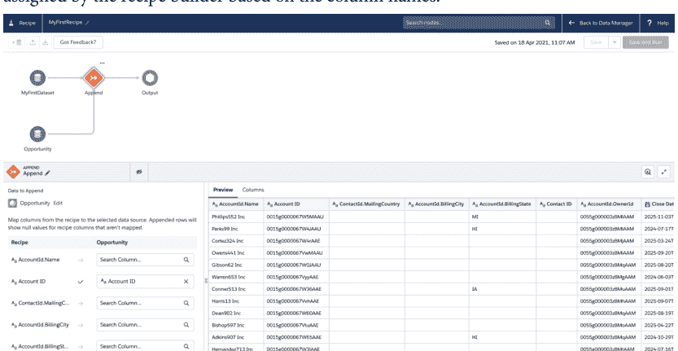
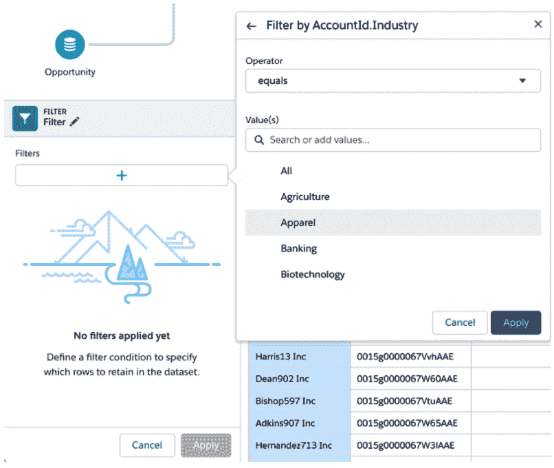
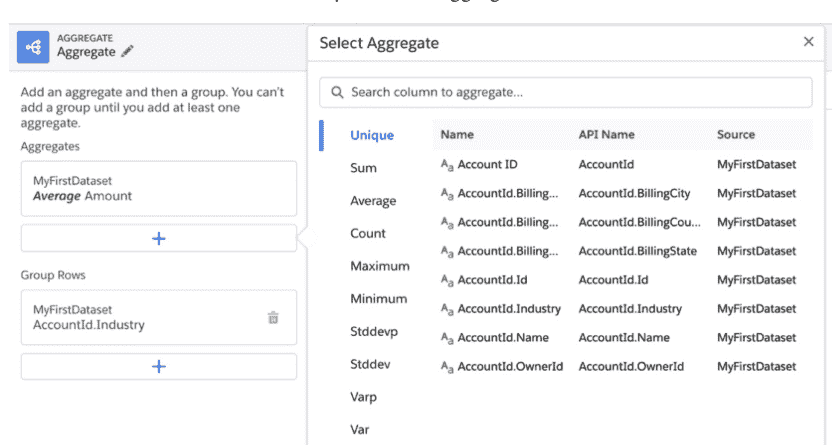
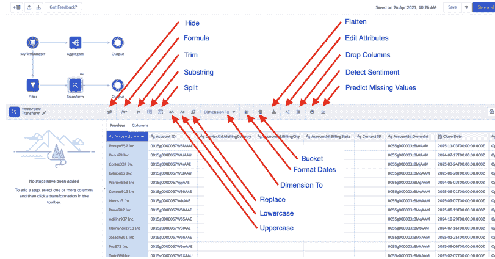
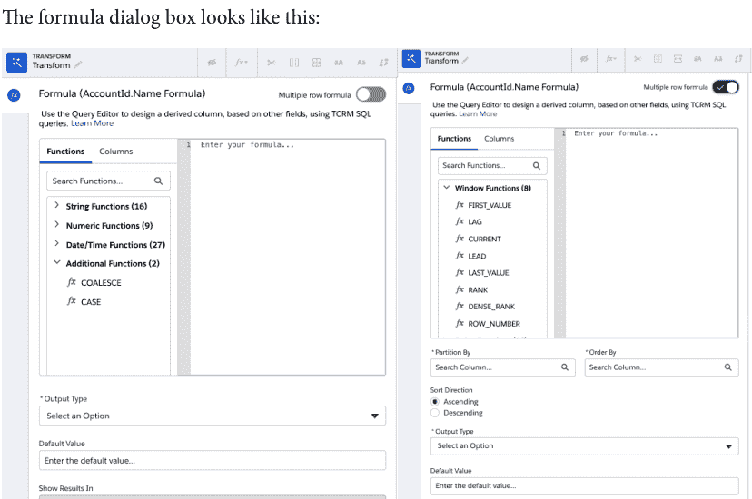
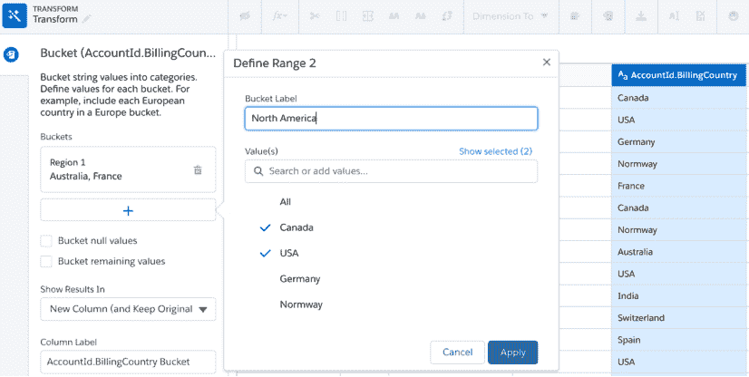
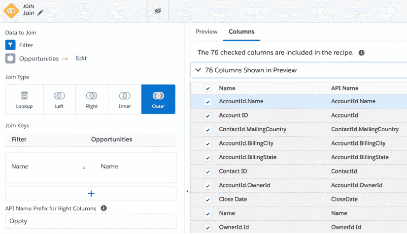
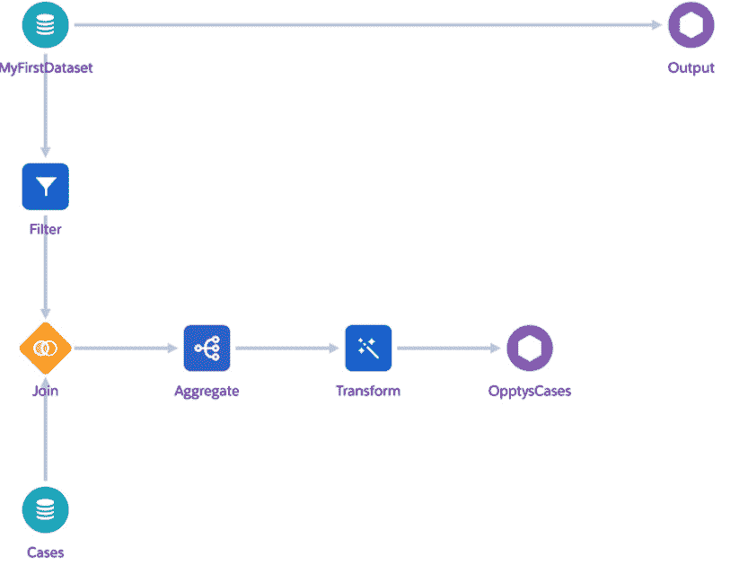
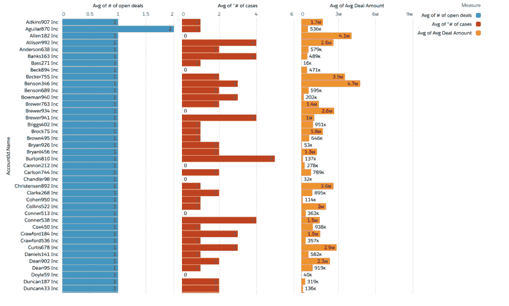

## 4 在 TCRM 中构建数据配方
构建数据配方

现在，你已经确信自己能够创建**开箱即用的分析应用**模板，是时候开始学习如何构建**自定义分析应用**了，首先从**数据转换**开始。本章将定义并讲解如何在 **TCRM** 中创建数据配方。以*第 3 章，连接数据源*中创建的数据集为基础，你将学习如何对数据应用**筛选器**、**连接**、**计算**、**转换**等操作。

那么，到本章结束时，你将能够做些什么？首先，你将清楚地了解如何在 TCRM 中创建数据配方。其次，你将熟悉数据配方用户界面，并能够熟练使用它。第三，你将学会使用**分箱**、**聚合**和**计算**等功能在配方中转换数据。第四，你将学会连接和追加数据集，包括如何使用各种连接类型，例如**查找连接**和**内连接**。最后，你将能够自信地从配方中输出 *CSV* 或 *TCRM* 数据集。

本章将介绍以下主题：

- 在 TCRM 中构建数据配方
- 在配方中转换数据
- 在配方中连接数据
- 数据转换实践练习

### 技术要求

要成功执行本章中的说明，需要满足以下要求：

- 一台可访问互联网的笔记本电脑或台式机（平板电脑或手机不满足要求）。
- 最新版本的 Google Chrome 浏览器（使用 TCRM 时，Chrome 是首选浏览器）。
- 一个可正常使用的电子邮箱地址。
- 确保已登录 TCRM 开发组织。

## 在 TCRM 中构建数据配方

本节将解释什么是数据配方、何时以及为什么应使用数据配方，以及如何创建第一个简单的配方。

### 什么是数据配方？

TCRM 数据配方用于将多个数据集合并为一个数据集，并借助*智能建议*、*列配置文件*和*强大的转换功能*准备、清理和转换数据。

对于几乎没有数据集成经验、希望获得数据清理指导的 Salesforce 管理员和分析师而言，配方非常合适，同时还能够预览转换结果。此外，对于希望通过无代码可视化界面创建数据集的资深数据专家来说，配方也是一种强大的工具。

数据配方可以帮助你完成以下操作：

- 预览数据，并查看应用转换后数据如何变化。
- 轻松快速地删除列或更改列标签。
- 使用列配置文件分析数据的质量和组成。
- 通过智能建议改进和转换数据。
- 无需编写代码即可对值进行分箱（**SAQL**，即 **Salesforce Analytics Query Language**）。
- 使用可视化公式生成器，通过计算列快速转换数据。
- 使用点击式界面快速、轻松地转换值，确保数据一致性。例如，你可以在不使用公式的情况下替换、拆分和修剪值。
- 查看所有更改的历史记录，并通过后退或前进来重新执行这些更改。
- 使用直观的可视化界面轻松应用各种连接，例如内连接和外连接。

本章将介绍数据配方生成器。*第 5 章，使用 TCRM Data Prep 进行高级 ETL*将指导你如何使用 TCRM 平台执行更高级的数据准备操作。

> **重要说明**
> TCRM 中相对较新的可视化数据准备工具，俗称 **Data Prep 3.0**，与数据配方生成器完全相同。本章提供的详细解释和说明同样适用于这一新工具，该工具简称为数据准备。

### 如何创建数据配方？

现在，我将向你展示如何创建一个简单的配方。让我们从之前创建的数据集 **MyFirstDataset** 开始。执行以下步骤即可开始：

1. 在 Analytics Studio 中导航到 **Data Manager**，然后从左侧菜单中选择 **Dataflows & Recipes**。
2. 点击 **Recipes** 选项卡。
3. 点击 **Create Recipe**。此时将打开一个新的浏览器选项卡。
4. 点击 **Select Data** 按钮。此时将打开一个名为 **Select Input Data** 的对话框。

这是一个非常简单的示例，目的只是展示如何创建配方。在接下来的详细说明中，你将完成一个全面的实践练习，以提升相关技能。

现在，让我们来看看如何使用配方转换数据集中的数据。

### 在配方中转换数据

数据配方是一种快速、直观且功能强大的数据组合、聚合和转换工具。以下各节将带你了解这些配方中可用的各种工具：

- 添加数据
- 追加数据
- 筛选数据
- 聚合数据
- 转换数据

完成这些说明性章节后，你将进行实践练习，以提升使用数据配方的技能。

### 添加数据

虽然你通常会在创建配方时选择输入数据，但也可以根据需要向现有配方中添加更多数据。配方生成器画布会为你添加的每组数据显示一个单独的输入节点。

要向现有配方中添加更多数据，只需点击配方生成器画布左上角的 **Select Data**，该按钮由标准数据集图标和旁边的 + 按钮组成。按照创建配方时添加源数据集所使用的类似步骤进行操作。默认情况下会包含所有列。

添加 Append 节点后，你应该会看到类似以下屏幕截图的内容。在此处，你可以查看配方生成器根据列名分配的默认列（字段）映射：



图 4.5 – 追加数据前匹配字段

要追加数据，必须执行以下步骤：

1. 调整映射关系，手动映射所有未映射的列，或者让这些列保持未映射状态。
2. 要映射两列，只需在对应配方列旁输入追加行中的列名。
3. 如果希望添加追加行中存在、但配方中不存在的列，请点击已映射列下方的 + 按钮——Add Mapping——然后选择相应列。之后，将配方列留空。
4. 点击 Apply，将追加节点添加到配方中。
5. 保存配方。

> **重要说明**
> 如果某列在一个源中进行了映射、而在另一个源中没有映射，Append 节点会针对不适用该列的所有源行插入 null 值。
> 
> 如果配方列包含用于标识每一行的唯一 ID，则必须确保追加的数据不会重复这些行 ID。Append 节点不会识别和删除重复记录，也不会验证列值的唯一性。


## 过滤数据

数据配方中的过滤节点使您能够快速过滤数据以适应使用场景。也就是说，您可以删除希望从输出数据集(s)中排除的数据行。

要过滤您的数据，请按照以下步骤操作：

1. 添加一个新节点（如 *Figure 4.3* 所示）到您的配方中并选择 **Filter**。
2. 添加过滤条件，如 *Figure 4.6* 所示。如果您选择在维度列上定义过滤条件，您可以从列表中选择过滤值。
3. 点击 **Apply**。
4. 保存配方。

以下屏幕截图显示了添加过滤条件时用户界面（UI）的外观：



Figure 4.6 – Adding filter conditions

4. 您可以通过在 **Group Columns** 字段中添加最多两个维度列、为每个列选择值并点击 **Apply** 来将维度透视为列。
5. 配置完聚合后，点击 **Apply**。
6. 保存配方。

这是添加聚合节点时 UI 的外观：



Figure 4.7 – Applying an aggregate node to a recipe

> **Note Regarding Aggregation And Data Granularity**
> 当您使用聚合节点时，较低（源）数据的粒度会在该数据配方的流中丢失。然而，最新的版本使您能够在聚合后通过连接将粒度带回来。

接下来，您将学习如何在 TCRM 中使用强大的转换工具。

## 转换数据

转换节点提供了大量的灵活性和功能 – UI 看起来像这样：



Figure 4.8 – Adding a transformation node

在本节中，将涵盖以下转换：

- Apply formulae
- Trim
- Substring
- Split
- Uppercase and lowercase
- Replace
- Dimension to measure
- Dimension to date
- Format dates
- Bucket
- Flatten
- Edit attributes
- Drop columns
- **Detect sentiment**
- **Predict missing values**
- **Discovery predict**

那么，让我们从第一个开始！

### Apply formulae

这会在配方中创建一个列，该列根据公式计算显示值。此计算将从同一行中的其他字段或跨行提取数据。您需要在 **EA-SQL format** 中输入公式 – 用于 *numeric*、*string* 和 *date* 数据的标准和自定义函数集合。

公式对话框看起来像这样：



Figure 4.9 – Custom formula dialog box without (left-hand side) and with (right-hand side) the multiple row formula option enabled

要向您的配方添加公式，请按照以下步骤操作：

1. 在 **Preview** 选项卡中选择一列。
2. 要为计算列添加公式，请在 **Transform** 工具栏中选择 **Formula** 按钮并选择 **Custom Formula**。然后公式编辑器会出现。
3. 在公式编辑器中，输入公式并使用正确的语法添加必要的参数。
4. 对于具有窗口函数的公式，请选择 **Multiple row formula** 选项。选择用于划分行的列 **Partition By**，用于对数据进行排序的列 **Order By**，以及 **Sort Direction** 中的排序方向。
5. 通过输入 API 名称或从 **Columns** 选项卡中选择列，按其 API 名称标识公式中的每个列。
6. 在 **Output Type** 中，在文本、数字、日期或日期时间之间进行选择。
7. 根据输出类型，您可以分配这些属性：**Precision**（数字列中的最大位数）、**Scale**（数字列中小数点右侧的位数）、**Length**（文本列中的最大字符数）以及 **Date Format**。
8. 在 **Default Value** 中，设置在表达式未返回结果时显示的值。
9. 您可以根据需要更改计算列的标签。
10. 要将公式作为 **Transform node** 中的步骤添加，请点击 **Apply**。计算列随后将出现在配方预览中。
11. **Save** 配方。

> **Tip**
> 常见计算在 **Transform** 工具栏中拥有自己的函数按钮 – 这些按钮会为您用正确的列和语法填充公式。工具栏会根据所选列的数量和类型显示适当的函数。要使用函数，只需点击 **Transform** 工具栏中的 **Function** 按钮即可。

有五种类型的函数可用：

- **Date and time functions**：这些用于调整或从配方中的日期计算值。
- **Numeric operators and functions**：这些用于从配方中的度量计算值。
- **String functions**：这些用于基于其他字符串创建值。
- **Window functions**：这些用于跨行执行计算。必须选择 **Multiple Row Formula** 选项才能使用窗口函数。
- **Additional functions**：这些与 `text`、`number`、`date_only` 和 `datetime` 数据类型一起使用，以向公式添加逻辑。

### Trim

此转换会从字符串中删除前导和尾随空格。您可以选择在以下三个位置之一显示结果：

- 原始列（覆盖）。
- 新列 – 保留原始列（新列需要给定标签）。
- 新列 – 删除原始列（新列需要给定标签）。

### Substring

这从值中的字符位置开始并提取指定长度的字符数到新字段。公式编辑器会出现，并且以下文本会被预填充：

```
substr([target column], position, length)
```

substring 函数所需的输入可以在对话框中找到，如下所示：

- **Output Type**
- **Length**
- **Default Value**
- **Show Results In**
- **Column Label**

### Split

此转换在指定的分隔符处将列值分为两个新值。所需的输入如下：

- **Delimiter**
- **Show Results In**
- **Column 1 Label**
- **Column 2 Label**

> **Note**
> Split transformation always creates two new columns.

### Uppercase and lowercase

此选项将所选字段中的值转换为大写或小写。

### Replace

此转换在字段中查找特定值并将其替换为新值。请注意，会创建一个新字段，其中包含已替换的值和未更改的值。您也可以使用 replace 转换将空值替换为值。

所需的输入如下：

- **Find** 或 **Search** for null（在搜索窗口中）
- **Replace**（在搜索窗口中）
- **Show Results In**
- **Column Label**

### Dimension to measure

此转换将 `Dimension` 列类型转换为 `Measure`，这允许对其值进行数学计算。您可以选择将结果显示在原始列中、在新列中并保留原始列，或在新列中并删除原始列。

### Dimension to date

此转换将 `Dimension` 列类型转换为 `Date`，这允许您按日期组件（如年份和月份）进行分组和过滤。您可以选择将结果显示在原始列中、在新列中并保留原始列，或在新列中并删除原始列。

### Format dates

此转换将所选 `Dimension` 列中的日期转换为指定格式。可选地，您可以将列类型转换为 `Date`。一致的格式允许您正确地按日期过滤和分组记录，包括按日期组件（如日）过滤。一致的日期格式还确保您可以将列类型从维度转换为日期。


所需输入如下：

- **Original Formats**（例如 `yyyy-MM-dd'T'HH:mm:ss.SSS'Z'`）
- **Change To**（选择目标格式）
- **Convert column type to Date**（复选框）
- **Show Results In**
- **Column Label**

> **Warning**
> 
> 格式无法识别的值将被替换为 null 值。

## Bucket

Bucket 转换是一种快速简便的方式，可通过对度量、维度以及日期字段进行分桶来对数据进行分组和组织。Buckets 是通过在 bucket 窗口中点击 + 按钮并定义范围来添加的。以下是其可能外观的示例：



图 4.10 – 将国家分桶为区域的 bucket 转换示例

当你想从两个度量创建热力图时，或者为更深入的分析和机器学习创建派生维度时，Buckets 是一个有用的工具。

## Flatten

此选项会将层级结构的排名数据展平成两列。Hierarchy nodes 列列出了每个节点的全部祖先。Hierarchy path 列包含详细说明层级路径的字符串。请参阅图 4.11 以了解示例。

为了配置 flatten 转换，你必须指定包含基于层级对应的父级的字段，以及包含层级中每个节点的字段。这将为每个层级节点生成一条记录，称为子节点。每条记录都包含两列生成的列，用于存储每个子节点的层级。一列包含层级中每个节点的祖先，另一列包含层级路径。

展平数据的所需步骤如下：

1. 选择包含层级中所有子节点的维度列。
2. 点击 **Flatten** 按钮。
3. 输入 **Parent Column** 属性详情。
4. 选择是否在生成的 hierarchy nodes 和 path 列中 **Include child node**。
5. 输入 **Hierarchy Nodes Column Label** 属性 – 这是多值输出列的名称，其中包含层级中所有祖先的列表，按从最低级别到最高级别的顺序排列。
6. 输入 **Hierarchy Path Column Label** 属性 – 这是层级中所有祖先的层级路径，按从最低级别到最高级别的顺序排列，其中节点由正斜杠分隔。
7. 预览结果以确保展平的层级正确。
8. 点击 **Apply** 将 flatten 转换添加到配方中。

以下是展平数据集的示例，展示了祖先是如何存储的：

| ROLE ID (CHILD NODE) | ROLE NAME | PARENT ROLE ID | ROLES | ROLE PATH |
|---|---|---|---|---|
| 1 | Salesperson 1 | 10 | 10, 20, 30 | / 10/20/30 |
| 2 | Salesperson 2 | 10 | 10, 20, 30 | / 10/20/30 |
| 3 | Salesperson 3 | 11 | 11, 20, 30 | / 11/20/30 |
| 10 | Regional Manager 1 | 20 | 20, 30 | / 20/30 |
| 11 | Regional Manager 2 | 20 | 20, 30 | / 20/30 |
| 20 | Vice President 1 | 30 | 30 | / 30 |
| 21 | Vice President 2 | 30 | 30 | / 30 |
| 30 | CEO | Not applicable | Not applicable | Not applicable |

图 4.11 – 展示祖先如何存储的展平数据集示例

关于 flatten 转换如何使用的更多细节将在第 5 章《使用 TCRM Data Prep 进行高级 ETL》中介绍。

## Edit attributes

使用此转换更改列名和值格式。例如，你可以编辑以下内容：

- **Label**
- **API Name**
- **Length**
- **Precision**
- **Scale**

## Drop columns

从配方中删除不需要的输入列。这将使你拥有用于转换和包含在最终数据集中的列子集。例如，你可以删除用于计算列的输入列。

## Detect sentiment

此转换用于确定文本的情感是积极、消极还是中性，并将这些值添加到指定的列中。

如果 Einstein 无法确定某个字段的情感，则情感将被设为 null。

## Predict missing values

Tableau CRM 会智能地用基于数据中其他强相关列的值的预测值替换所选列中的任何缺失值。

## Discovery prediction

此操作会使用预测和规范性智能填充你的数据集，因为 Einstein 会逐行计算并保存预测结果。此外，你还可以存储主要预测因子和改进措施的描述。Discovery prediction 节点使你能够在数据中评估预测，在部署到生产环境之前评估多个模型，并在仪表板中可视化聚合的预测信息。

由于本书不涉及 Einstein Discovery 的机器学习模型和预测，因此此处未详细介绍 discovery prediction 转换。

## Joining data in recipes

使用 **Join** 节点将来自相关对象的列数据添加到配方中现有数据中。你可能会根据想要如何组合数据的方式使用以下其中一种连接方法：*lookup*、*left join*、*right join*、*inner join* 或 *full outer join*。

以下屏幕截图显示了如何创建外部连接的示例：



图 4.12 – 数据配方中外部连接的示例

执行以下步骤以在配方中连接数据：

1. 在两个节点之间或在至少有一个输入节点的配方末尾点击 **Add Node** 按钮（+）。
2. 选择 **Join**。
3. 选择要连接的数据并选择要包含的列。
4. 点击 **Next**。
5. 选择所需的 **Join Type**。
6. 根据需要更改 **Join Keys** 设置。请注意，配方会从两组输入数据中添加建议的键。你可以使用多个键（最多五个）来匹配记录（如果需要）。
7. 为来自右侧数据源的列输入前缀（**API Name Prefix for Right Columns**）。这将防止左右数据源之间列的 API 名称冲突。
8. 在右侧面板的 **Columns** 选项卡中选择要包含在配方中的列。
9. 点击 **Preview** 预览所有包含的列及其数据。
10. 如果需要从预览中隐藏列，请点击 **Hide** 按钮（E）。
11. 点击 **Apply** 将节点添加到配方中。
12. **Save** 配方。

> **Types of data joins**
> 我假设你已经了解各种数据类型连接。注意，该主题已在 *第 5 章《使用 TCRM Data Prep 进行高级 ETL》* 中详细解释。

## Outputting data from recipes

输出节点将配方结果写入 TCRM 数据集或外部系统。所需输入如下：

- **Write To**：写入数据集或 CSV 文件。
- **Dataset Display Label**。
- **Dataset API Name**。
- **App Location**。
- **Sharing Source:** 如果打开了共享继承，则需要此选项。
- **Security Predicate:** 此选项使用谓词过滤器添加行级安全性。

> **Warning**
> 
> 将 **Dataset API Name** 选项设置为与现有 TCRM 数据集相同将覆盖该数据集。

不久后，你将有更多输出选项可供选择，因为以下选项目前正在开发中：

- Amazon S3 output connection
- Salesforce output connection
- Snowflake output connection
- Tableau Online output connection

## A hands-on exercise in data transformation

在本动手练习中，我们希望创建一个新的数据集来分析属于具有开放商机的账户的服务案例。

执行以下步骤，使用各种转换修改现有的 `MyFirstRecipe` 配方；必须仔细按顺序执行这些步骤：

1. 从 **Data Manager** 打开 `MyFirstRecipe` 配方。
2. 在数据流中直接在输入节点之后创建第二个分支。
3. 在此新分支中添加 **Filter** 节点，以便包含所有商机阶段，除了 **Closed Lost** 和 **Closed Won**。
4. 在 **Filter** 节点的右侧添加 **Join** 节点，以用案例信息增强商机数据。仅选择这些 **Case** 字段：**Account ID, Case Number, Status, Subject,** 和 **Case Type**。使用 **Left join** 节点，按 **Account ID** 匹配，并添加 API 名称前缀 **Case**。


你的成品配方应如下所示：



图 4.13 – 练习中配方的结果

探索生成的数据集以测试你的工作，并判断结果是否正确。最终你应该得到类似下图的内容：



图 4.14 – 练习中生成的数据集

现在，你已经完成了动手实践的数据转换练习，是时候回顾本章所学的内容了。

### 总结

在本章中，你学习了如何在 TCRM 中创建和修改数据配方，从而深入了解并熟练掌握数据配方的可视化界面。现在，你应该能够使用桶、聚合和计算等多种函数来转换配方中的数据。此外，你学习了如何使用查找连接和外连接等各种连接类型来连接和追加数据集。最后，你现在应该有信心将配方中的数据输出为 CSV 或 TCRM 数据集。

在下一章中，你将了解 Tableau CRM 数据流编辑器的全部功能。传统上，功能更强大的 ETL（提取、传输和加载）工作就在此完成。你将学习如何组合多个数据源、执行复杂的转换和计算，以及创建多个数据集。

### 问题

以下是一些测试你对本章掌握程度的问题：

- 什么是数据配方，何时应该使用它？
- 在配方中，何时需要追加数据？
- 配方编辑器中有哪些类型的数据集连接？
- 在哪里可以找到常用计算？
- 桶转换的一个真实用例是什么？
- 解释**情感检测**转换。
- 填空：
  要构建扁平化转换，你必须指明数据层次结构中包含每个______的字段，以及根据该层次结构包含类似__________的字段。这将为每个层次结构节点创建一条记录，该记录被称为______节点。
- **拆分**转换总是创建______个新列。
