## 深入了解数据连接

在*第4章，构建数据配方。*中，我们简要了解了如何连接和扩充数据。在本节中，我们将更深入地探讨数据转换的这一重要领域。首先，让我们从理解各种类型的数据连接开始。

### 理解各种类型的连接

有四种常见的数据连接方式，如下图所示：


图 5.1 – 四种结构化查询语言（SQL）数据连接类型

这四种连接类型可以理解如下：

- **左连接：** 左连接包含左侧（配方）数据流中的所有行，并且只添加右侧数据流中匹配的行。
- **右连接：** 右连接包含右侧数据流中的所有行，并且只添加左侧（配方）数据流中匹配的行。
- **内连接：** 内连接只包含左侧（配方）数据流和右侧数据流中匹配的行。
- **全（外）连接：** 全外连接包含左侧（配方）数据流和右侧数据流中的所有行，无论它们是否匹配。

> **注意**
> 
> 当目标表中有多行匹配时，这些连接会包含所有匹配的行。

在 TCRM 中，Join 节点有五种连接类型，如以下截图所示：

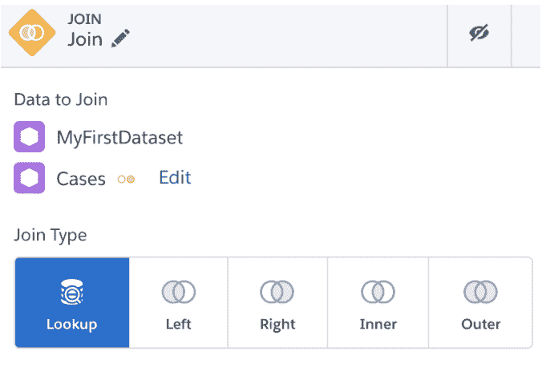

图 5.2 – Join 节点中的五种连接类型

TCRM 中新增的第五种连接类型是查找连接。查找连接返回左侧数据流（配方数据）中的所有行，并且只包含右侧数据流（查找源）中匹配的行。如果在查找源中找到多个匹配项，查找连接将根据你的配置返回单行或所有匹配的行。查找连接只为左侧数据流中的每一行输出一行，以确保结果的粒度不变。

> 使用连接时的注意事项
> 与查找不同，当多行匹配时，连接会为目标数据集中的每个匹配创建一条单独记录。在使用连接之前，请确保你理解重复行的影响。

所使用的连接类型将取决于具体的用例。下面我们为每种连接类型考虑一个实际示例。

### 查找连接

查找连接可能是 TCRM 所有连接中最常用的一种。例如，当数据集包含机会所有者的**标识符（ID）**，并且该数据集需要包含这些人员的相关详细信息（如 Salesforce **User** 对象中所包含的）时，就会使用它。右侧的查找源是 **User** 对象，左侧数据流是配方数据集。任何与配方数据集中的用户 ID 匹配的用户记录都将返回有关该用户的信息，并将其扩充到配方数据集中，而不会添加任何行。

### 左连接

左连接的一个示例是：在 Salesforce 中，一个账户关联了多个机会，目标是按每个机会添加一行，将数据集的粒度从每个账户一行改为每个机会一行。在这种情况下，左侧数据流是 Salesforce **Account** 对象，目标数据流是 **Opportunity** 对象。

### 右连接

例如，右连接可用于创建一个从 Salesforce 产品对象开始的数据集，该数据集包含所有产品系列记录，并排除没有父产品系列的产品。左数据流是产品对象，目标（右）数据流是产品系列对象。这是一个“没有子女的父母”用例，其中“孤儿”记录被排除在外。

### 内连接

内连接用于创建两个数据源的交集或重叠部分，其中只包含两个数据流都匹配的行。例如，在前面的“没有子女的父母”示例中，内连接将创建一个只包含具有父产品系列的产品记录和具有子产品的产品系列记录的数据集。没有子女的父母和没有父母的子女都被排除在外。左数据流是产品对象，目标（右）数据流是产品系列对象。

### 全外连接

全外连接的一个使用示例是：当你想要组合产品和产品系列，并为每种可能的组合都包含一条记录时。你将拥有以下各项的记录：

- 没有父产品系列的产品记录
- 没有子产品的产品系列记录
- 有父产品系列的产品记录
- 有子产品的产品系列记录

你可能已经猜到，左数据流是产品对象，目标（右）数据流是产品系列对象。

现在，我们将更详细地了解如何连接 Salesforce 对象。

### 连接 Salesforce 对象 – 深入探讨与实际示例

请在演示 TCRM 环境中构建一个全新的配方，操作如下：

- a. 首先，我们将账户数据连接到机会数据，如下所示：
  1. 使用 `SFDC_LOCAL` 从 **Opportunity** 对象创建一个配方，并选择所有列。
  2. 创建一个 **Join** 节点。
  3. 在 **Select Input Data to Join** 下，使用 `SFDC_LOCAL` 选择 **Account** 对象，并选择所有列。
  4. 在 **Join Type** 下，选择 **Lookup**。
  5. 在 **Join Keys** 下，为两个键选择 **Account ID** 值。
  6. 在 **API Name Prefix for Right Columns** 下，保留默认的 **Account**。
  7. 对于目标查找字段（带有 **Account** 前缀），只选择以下五个字段：
     - **Account ID**
     - **Account Name**
     - **Industry**
     - **Owner ID**
     - **Segment**
  8. 点击 **Apply**。
  9. 将配方保存为 **Joining Exercise**。


你的配方/数据准备流程应该如下所示：

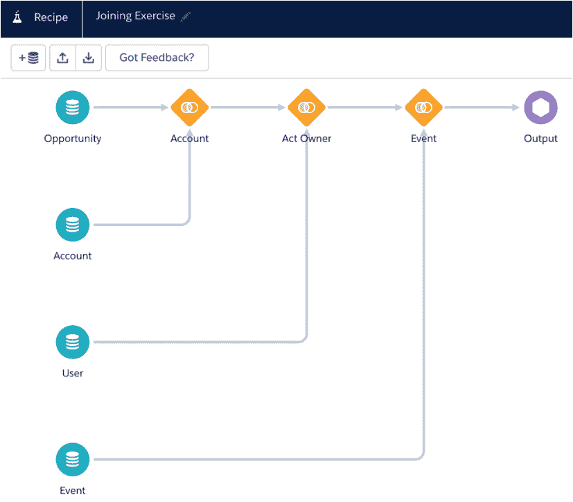

图5.3 – 连接练习的数据准备流程

使用一个简单的透镜查看TCRM中生成的数据集（透镜将在*第6章“TCRM透镜——一键深入数据”*中详细说明）。你看到连接是如何在数据中体现的吗？数据应该如下所示：

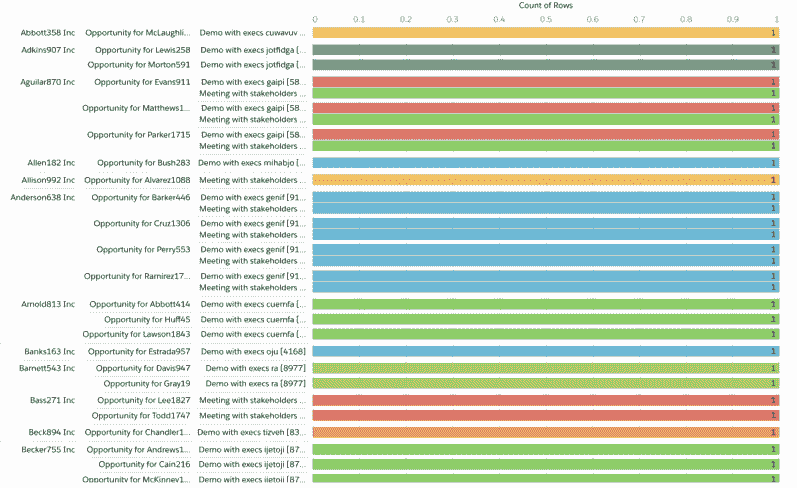

图5.4 – 连接练习数据集

### 通过连接将关联数据整合在一起

对于外部数据，TCRM通过多种数据连接器提供了极大的灵活性，这些连接器可用于将外部数据与Salesforce数据连接起来。现实世界中的例子包括：

- 连接来自外部**企业资源规划（ERP）**系统的订单数据，并将其与Salesforce中的销售数据连接起来，从而可以比较管道、已赢单和实际数据。
- 连接存储在**亚马逊云服务（AWS）简单存储服务（S3）**存储桶中的**逗号分隔值（CSV）**文件中的目标数据，以便使用最新的销售目标在销售图表中创建目标线进行比较。
- 连接来自其他Salesforce组织的数据，以便来自所有Salesforce环境（数据库）的数据可以合并并显示在TCRM的页面上。
- 通过MuleSoft连接器连接来自业务遗留平台的服务数据，并将其与Salesforce案例数据结合，以获得客户服务的全面视图。
- 通过Snowflake Direct Connector连接从ERP平台导出并存储在Snowflake中的近实时库存数据。
- 通过AWS S3连接来自外部电子表格的销售机会数据，并将这些数据附加到Salesforce管道数据中，以获得完整的机会列表。

以下演练展示了如何执行最后一个示例，我们将使用AWS S3和TCRM连接器，将外部销售数据附加到Salesforce管道数据中，以获得完整的机会列表。如果你愿意，可以使用免费的AWS账户创建自己的AWS S3存储桶，添加包含机会数据的CSV文件，并在你的TCRM开发组织中跟随操作。必须按顺序执行以下步骤：

- 1. 转到**Data Manager**，然后选择左侧的**Connect**菜单项。
- 2. 单击**Connect to Data**。
- 3. 从三种连接类型（输入连接、MuleSoft连接和实时连接）中选择**Input Connections**。
- 4. 选择**Amazon S3 Connector**。
- 5. 在**Set up your connection**对话框中，根据你的AWS S3存储桶详细信息按需输入数据，注意名称不能有空格。
- 6. 单击**Save and Test**。
- 7. 当提示**Select an object**时，选择**Opportunity**对象，然后点击**Continue**。
- 8. 当提示**Select fields**时，选择**All**，然后点击**Continue**。
- 9. 查看**Preview Source Data**对话框，然后按**Save**。
- 10. 然后你将在活动连接列表中看到新的连接器。
- 11. 单击AWS S3连接器右侧的下拉菜单，然后点击**Run Data Sync**。这将从S3存储桶中引入数据，并在数据准备窗口中启用数据预览。
- 12. 使用Data Prep创建新的数据集，并从**Opportunities**数据集开始。
- 13. 单击**Add Input Data**按钮（屏幕左上角），然后添加S3机会数据。
- 14. 将S3数据节点旁边的+图标拖到**Salesforce Opportunity data**节点上，创建一个**Join**节点，并选择**Append**。
- 15. 在**Append**节点下的**Data to Append**对话框中，根据需要映射列（字段），以连接来自S3存储桶的新数据行。
- 16. 添加一个**Output**节点，以设置包含Salesforce和外部机会数据的新混合数据集。
- 17. 点击**Save and Run**创建数据集。

以下截图显示连接器在成功设置后、数据同步前应该是什么样子：

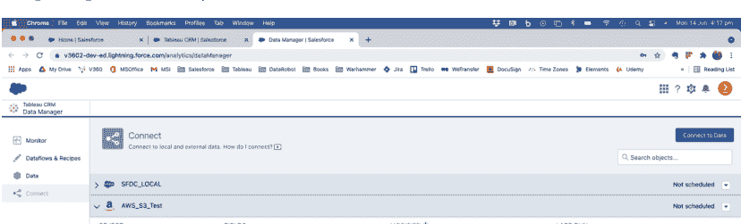

图5.5 – 在Data Manager中成功设置、同步前的AWS S3连接器

在以下截图中，你可以看到将S3数据集添加到数据准备流程后，一切应该是什么样子：

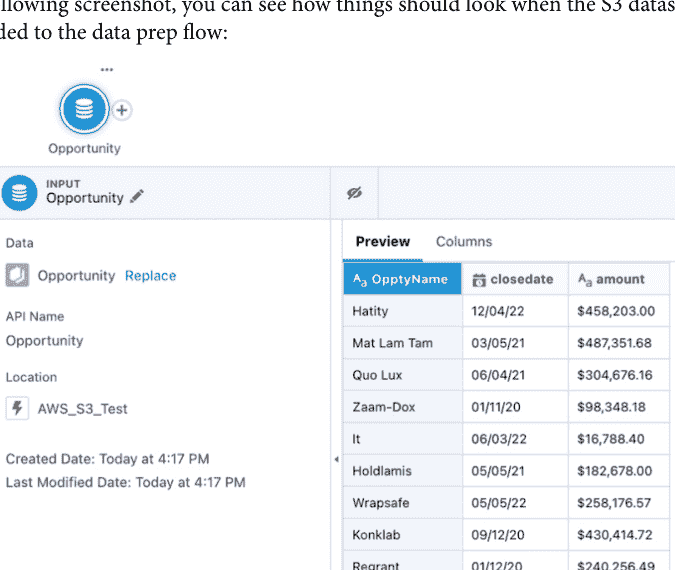

图5.6 – 已添加到数据准备流程中的S3数据集

以下截图显示了使用Join节点将机会数据附加到Salesforce数据时的情形：

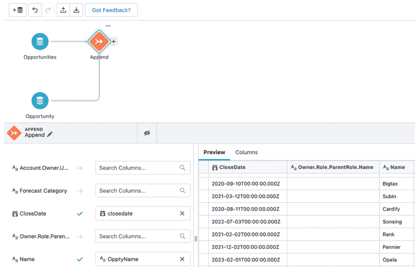

图5.7 – 使用Join节点将S3机会数据附加到Salesforce数据

通过连接将关联数据整合在一起的方法还有很多；也许唯一的限制就是你的想象力，以及不断增长的TCRM连接器列表！

### 聚合节点的高级使用

你已经学习了聚合节点的基本用法，但这个节点还有多种方式可以将其提升到全新水平。以下是三个示例：

- 你可以在数据准备流程中创建多个数据流，根据需要分别在每个流中执行聚合和汇总，然后使用Join节点重新连接这些流，并扩展粒度数据。
- 基于同一份数据创建两个数据集，它们具有不同的基础粒度级别，用于两个不同的用例：数据可视化与分析，以及机器学习（ML）模型构建。
- 连接多个Salesforce对象（例如**Account、Opportunity和Product**），将生成的数据集拆分为多个数据流，然后使用**Aggregate**节点按要求创建汇总摘要数据集。

你可以在以下截图中看到使用聚合节点创建多个数据流的示例；这个例子只使用了一个Salesforce对象，但排列组合和选项是无穷无尽的：

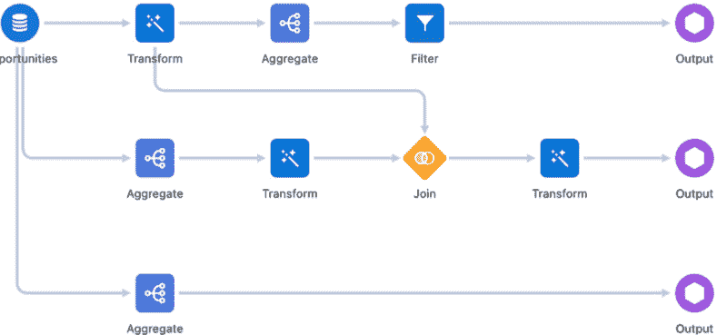

图5.8 – 使用聚合节点的多个数据流的简单示例

### 使用唯一和基本算术函数

如*第4章“构建数据配方”*所述，在聚合数据时有许多选项可用。让我们更详细地了解这些选项。

### 使用Unique聚合

**Unique**聚合在你不想生成行总数，但确实想要计算某个值的唯一出现次数时非常有用。

例如，如果你有一个粒度是产品线项目的数据集，你可以按记录ID计算机会唯一值的出现次数，并创建一个数据集，显示与某个产品关联的机会数量。

### 使用基本算术函数

基本算术函数为分组和聚合数据提供了极大的灵活性。**Aggregate**节点的**Select Aggregate**对话框见以下截图：

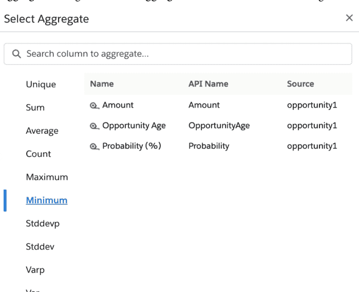

图5.9 – Aggregate节点中的基本算术运算

以下是在**Aggregate**节点中使用基本算术运算的一些用例示例：

- 使用**Average**计算已关闭/已赢机会的平均存续期，以确定完成交易需要多长时间，并按行业分组进行比较和基准测试。
- 使用**Maximum**确定解决服务案例所需的最长时间，将其与业务**服务级别协议（SLA）**指标进行比较，并按案例类型分组，以了解业务“最糟糕”的情况。
- 使用**Minimum**来理解和识别某个分组的值下限，例如最小交易规模或最短的服务案例关闭时间。
- 使用**Stddevp**计算数据分布的离散程度，例如财务分析师使用Stddevp函数计算收入偏差。


以下截图展示了在商机数据集上使用基本算术运算的示例；请注意数值如何因潜在客户来源而异：

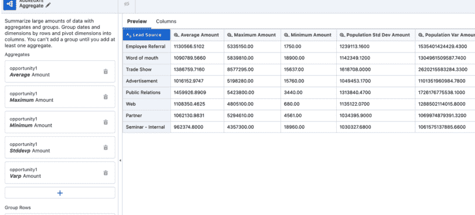

图 5.10 – 在商机数据集上使用基本算术运算的示例

以下视图以可视化形式展示了这些数据的外观：

### 算术示例

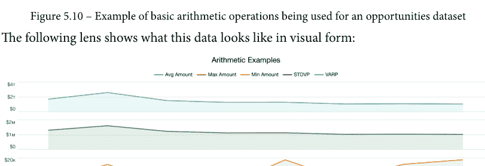

图 5.11 – 图 5.10 中数据的可视化形式

### 聚合与分组

聚合节点是一个强大的工具，可用于计算聚合结果，并将其增强到您的细粒度数据集中、生成数据透视表等。

例如，假设您想比较销售团队成员按行业划分的平均交易规模与整个团队按行业划分的平均值。您会怎么做？方法如下：

- 1. 首先，您需要使用聚合节点，为各行业的平均交易规模和最大交易规模创建基准值，如下面的截图所示：

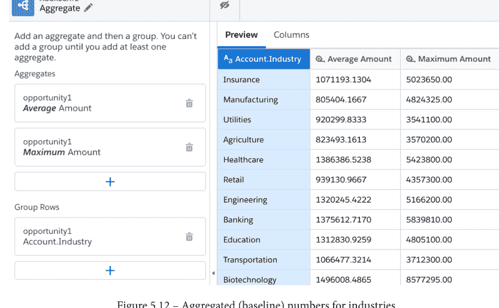

图 5.12 – 各行业的聚合（基准）数值

- 2. 现在，既然您已经计算出了按行业划分的基准值，就需要将聚合数据流与细粒度数据流连接起来，如此处所示的方法：

图 5.13 – 增强细粒度数据和聚合数据

请注意，在图 5.13 中，您摄入的原始数据集 Opportunities 被拆分为两个数据流，一个用于聚合，一个用于细粒度数据，随后它们被合并到驱动行业研究洞察的数据集中。

在合并后的数据流中添加了一个转换节点（见图 5.13 右上角），用于计算每个销售团队成员按行业划分的平均交易规模与整个团队按行业划分的平均交易规模之间的差异。

这种聚合和增强的示例结果可参见下幅截图所示的视图，其中结果经过筛选，将范围缩小到某一个销售团队成员：

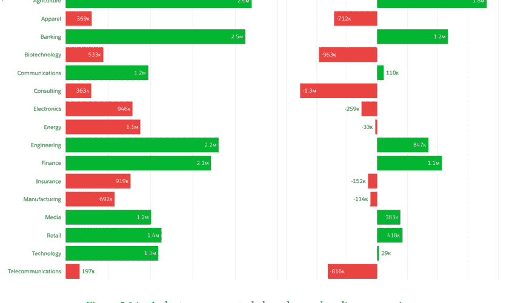

图 5.14 – 基于基准比较的行业平均值研究

### 为何、何时以及如何使用复杂公式转换

在准备数据集以进行分析、可视化或建模时，您需要融入反映业务规则和需求的逻辑与计算，而这往往变得复杂。在这种情况下，分桶（buckets）和其他简单函数已无法胜任，您需要采用复杂的公式转换。

接下来，您将看到这些复杂转换的说明及用例的逐步讲解。

### 自定义公式

自定义公式使您能够在 Data Prep 配方中创建派生值或派生列，该值或列基于某种计算显示数值，计算公式可包含来自同一行或跨行字段的输入——例如，您可以根据 **收入** 和 **成本** 列的输入创建 **利润** 列。公式必须以 **Enterprise Architect (EA)**-SQL 格式输入，这是一种针对数值、字符串和日期数据的标准函数与自定义函数的集合。

当您在公式窗口中添加函数时，系统会自动为您添加必要参数。您可以在此处看到示例：

```
months_between(timestamp2, timestamp1, roundOff(optional))
```

### 日期函数

您可能已经猜到，在配方中使用日期函数可以根据日期计算值。可用的日期函数如下：

- `add_months` — 返回起始日期之后指定月份数的日期
- `current_date` — 返回当前日期
- `current_timestamp` — 返回当前日期和时间
- `datediff` — 返回起始日期与结束日期之间的天数
- `date_add` — 返回起始日期之后指定天数后的日期
- `date_format` — 将时间戳转换为指定的日期格式
- `date_sub` — 从起始日期中减去指定的天数
- `day` — 返回日期/时间戳中的日部分
- `dayofmonth` — 返回日期/时间戳中的月内日分量
- `dayofweek` — 返回日期/时间戳中的周内日分量，其中 1 = 星期日，2 = 星期一，依此类推
- `dayofyear` — 返回日期/时间戳中的年内日分量
- `months_between` — 返回两个时间戳之间的月份数
- `now` — 以指定格式返回当前日期和时间
- `to_date` — 将日期字符串转换为指定的日期格式
- `to_timestamp` — 将时间戳字符串转换为指定的时间戳格式
- `to_unix_timestamp` — 返回指定时间的 Unix 时间戳
- `trunc` — 将时间戳的指定部分及其后的所有部分替换为零

以下转换节点示例展示了如何计算商机结束日期的年中周数：

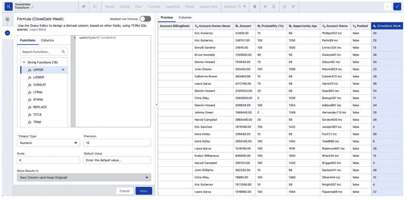

图 5.15 – 使用日期函数计算商机结束日期的年中周数

### 数值运算符与函数

数值函数根据配方中的度量计算值。在输入公式时，请务必在表达式中使用列的应用编程接口（API）名称，而不是标签。

可以使用以下数学运算符：

- `+` 用于计算两个值之和
- `-` 用于计算两个值之差
- `*` 用于计算两个值之积
- `/` 用于将第一个值除以第二个值
- `()` 用于优先计算括号内的表达式

以下数值函数可在表达式中使用：

- `abs` — 计算数字的绝对值
- `ceil` — 将数字向上舍入到最接近的整数
- `exp` — 返回 e 的指定次幂的值
- `floor` — 返回向下舍入到最接近整数的数字
- `format_number` — 通过舍入到指定小数位数或应用某种格式来格式化数字
- `log` — 返回指定基数的数字对数
- `power` — 将数字提升到另一个数字的幂
- `round` — 返回与您指定数字最接近的数字，并按指定位数限制（舍入）新数字
- `sqrt` — 返回给定数字的平方根
- `truncNumber` — 从数字中截断指定数量的小数位，或转换为整数

以下示例展示了如何将数值函数和运算符组合起来创建自定义公式：

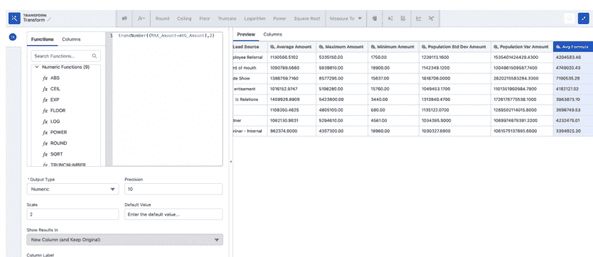

图 5.16 – 使用数值函数和运算符的示例公式

### 字符串函数

字符串函数用于基于其他字符串（如文本字符串或维度字段）创建值。

您可以在公式表达式中使用以下字符串函数：

- `char_length` — 返回指定字符串中的字符数
- `concat` — 通过合并指定列的值和输入字符串来返回一个字符串
- `endsWith` — 如果在列值的末尾找到指定字符串，则返回 true
- `instr` — 返回指定字段列中 `searchString` 值的首次出现位置
- `lower` — 返回所有字符均为小写的字符串
- `ltrim` — 从字符串开头移除指定的子字符串
- `replace` — 用另一个字符串替换子字符串
- `rtrim` — 从字符串末尾移除指定的子字符串
- `startsWith` — 如果在列值的开头找到指定字符串，则返回 true
- `string` — 将日期或数值转换为字符串数据类型
- `substr` — 返回字符串中从指定位置开始、指定长度的字符
- `title` — 返回一个字符串，其中每个单词的首字符大写，其余字符小写
- `trim` — 从字符串的开头和结尾移除指定的子字符串
- `upper` — 返回所有字符均为大写的字符串

以下是一个使用 `concat` 函数将账户和账户所有者信息合并到新列中的示例：


- rank—返回窗口中各记录基于顺序的排名，当值相同时重复排名，并在下一个不匹配时跳过相应数量
- row_number—返回窗口中的行号，对窗口中的每一行递增 1
- sum—返回值组的累积和

窗口函数的示例是按交易金额对每个销售人员的交易进行排名，如以下屏幕截图所示：

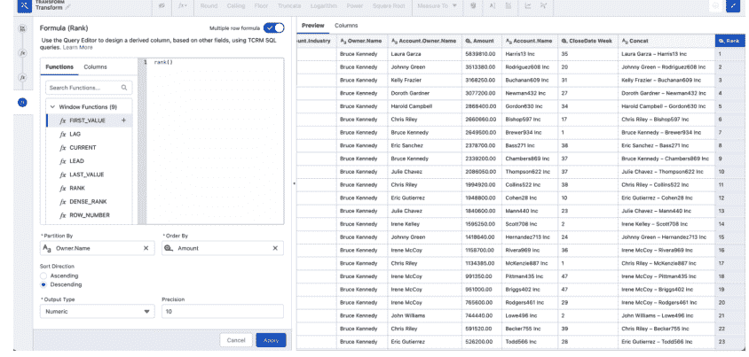

### Additional functions

两个额外的函数可用——case 函数和 coalesce 函数。

### The case function

case 函数处理公式的 if/then/else 逻辑。此函数可与 TEXT、NUMBER、DATE_ONLY 和 DATETIME 数据一起使用。case 函数的语法如下所示：

```
case primary_expr(optional)
when condition
then result_expr
...
```
```
```text
else
default_expr
end
```
```

例如，您可以使用 case 函数处理空值，其中缺失值被替换为单词 Null。case 函数也可以用于对数据进行分桶，尽管这通常最好使用标准 bucket 函数来处理。

### The coalesce function

coalesce 函数可以执行以下操作：

- 将两个或多个事物或组或维度连接起来形成更大的实体。
- 用表达式中第一个非空值替换空值。

此函数可与 TEXT、NUMBER、DATE_ONLY 和 DATETIME 数据一起使用。语法如下所示：

```
```text
coalesce(expr1,expr2)
```
```

例如，您可以使用 coalesce 函数获取两个数据集或同一数据集的两个流（通常通过过滤），并将它们合并为一个。

> **Common Functions**
> 
> 通用函数在 **Transform** 工具栏中拥有自己的按钮——使用时，这些按钮会自动用列名和预定义语法填充公式以节省时间。

### Working with dates in the Data Prep tool

在 TCRM 中，数据准备和转换中更具挑战性的领域之一历来是处理日期。随着 Salesforce 工程团队不断开发 TCRM 的新 Data Prep ETL 工具，这现在比以往任何时候都更容易。

日期字段是理解随时间推移趋势的关键。日期对于让团队了解即将到来的里程碑和截止日期至关重要。您现在可以在 TCRM Data Prep 中使用 **Date and Time** 转换，根据日期执行计算，全部在 GUI 中进行，*无需代码*。

在 TCRM 中您可能需要处理日期的两种常见方式是添加或减去天数或月份以及计算日期差。

### A deeper understanding of how and why to flatten your data

将数据展平的最常见用例之一是为安全谓词准备数据——即，关于角色层级的数据用于根据与登录用户相关的层级数据决定谁可以在数据集或仪表板中查看什么。

有关安全谓词的更多信息，请参阅 *第 7 章，Tableau CRM 中的安全*。

您现在将了解层级数据类型以及如何将其与展平转换一起使用，以为 TCRM 安全目的准备数据。

### Role hierarchy data type in Salesforce

角色层级数据类型与标准 Salesforce **User** 对象相关联。它以不同于标准经理用户字段的层级方式将用户相互关联。

角色层级数据类型的特征概述如下：

- 它仅允许在 **User** 对象上使用。
- 它是查找关系的专用版本，因为它会自动自引用回 **User** 对象，并且与标准查找类似，您最多只能创建 40 个。
- 在用户 **界面 (UI)** 中，层级字段包含用户类型下拉菜单（例如，**User**、**Partner User**、**Customer Portal User**），该下拉菜单将查找字段限制为这些用户。
- 层级字段支持筛选器。
- 在层级中选择的用户不能是该层级中该用户下方的任何用户或当前记录上的同一用户。
- 它在审批流程中受支持。Salesforce 允许我们在配置审批流程并确定下一个审批人时，从标准用户经理字段或任何层级字段中进行选择。此外，在配置审批流程时，您可以在不提前构建的情况下即时创建一个新的层级字段。

角色层级是通过 Salesforce Setup 创建和配置的，如以下示例所示：

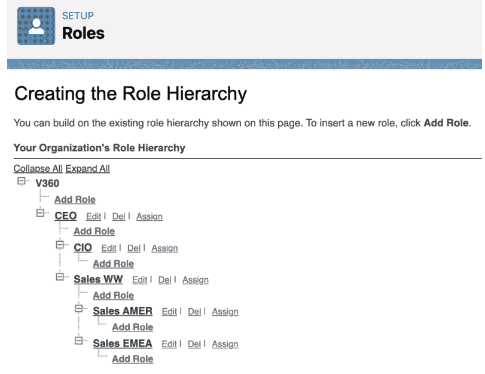

图 5.22 – 在 Setup 中创建角色层级

### Flatten transformation

有关如何使用展平转换的详细说明已在第 4 章《构建数据配方》中给出。在本节中，我们将研究如何展平数据以便在安全谓词中使用。这将使您能够借助角色层级数据为仪表板和数据集添加行级安全性。

Salesforce 在 Flatten Transformation 中提供了一个非常强大的功能，用于在客户关系管理 (CRM) 系统中配置数据安全，以便纳入原生 TCRM。

考虑使用其 Salesforce CRM 中的角色层级配置的销售组织对机会记录的访问权限的用例场景。让我们逐步介绍此示例。组织的角色层级如下所示：

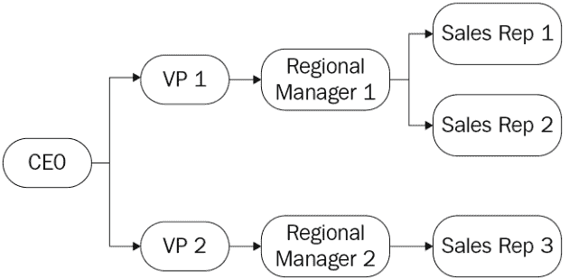

图 5.23 – 此示例中组织的角色层级

在前面的图表中，我们有三名销售代表，其中 **Sales Rep 1** 和 **Sales Rep 2** 报告给 **Regional Manager 1** 角色，而 **Sales Rep 3** 报告给 **Regional Manager 2** 角色。此场景中的访问权限如下：

- 由 **Sales Rep 1** 和 **Sales Rep 2** 拥有的机会记录可由 **Regional Manager 1** 以及前一图表中显示的角色访问。
- 由 **Sales Rep 3** 拥有的机会记录可由 **Regional Manager 2** 以及前一图表中显示的角色访问。
- **Regional Manager 2** 不应能够访问 **Sales Rep 1** 和 **Sales Rep 2** 的机会，除非手动共享或通过共享规则共享。
- **Regional Manager 1** 不应能够访问 **Sales Rep 3** 的机会，除非手动共享或通过共享规则共享。

展平转换构建了以下屏幕截图中看到的表，以在 TCRM 中启用这些访问级别的配置：

| ROLE ID (SELF ID) | ROLE NAME | PARENT ROLE ID | ROLES | ROLEPATH |
|---|---|---|---|---|
| 1 | Salesperson 1 | 10 | 10, 20, 30 | \\10\20\30 |
| 2 | Salesperson 2 | 10 | 10, 20, 30 | \\10\20\30 |
| 3 | Salesperson 3 | 11 | 11, 20, 30 | \\11\20\30 |
| 10 | Regional Manager 1 | 20 | 20, 30 | \\20\30 |
| 11 | Regional Manager 2 | 20 | 20, 30 | \\20\30 |
| 20 | Vice President 1 | 30 | 30 | \\30 |
| 21 | Vice President 2 | 30 | 30 | \\30 |
| 30 | CEO | Not applicable | Not applicable | Not applicable |

图 5.24 – 展平转换表

**Flatten Transformation** 节点如何实现这一点？Salesforce 中的 `UserRole` 对象保存有关角色层级的所有信息，并且该对象在 **Flatten Transformation** 中使用如下：

1. 在 **Recipe** 中选择 **Add Input Data**。
2. 选择 `UserRole` 对象。
3. 添加 **Transformation** 节点。
4. 选择 **Role ID** 列。
5. 选择 **Flatten**。

**Transformation** 节点如下所示：

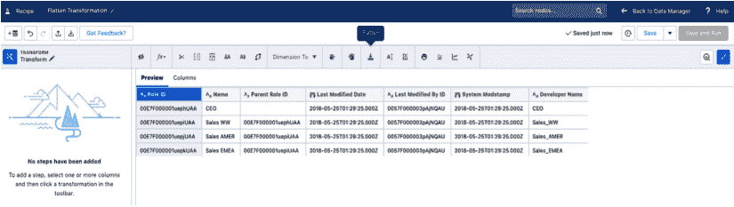

图 5.25 – TCRM 中的 Transformation 节点，配置前

现在，让我们查看配置 **Flatten Transformation** 的选项，如下所示：

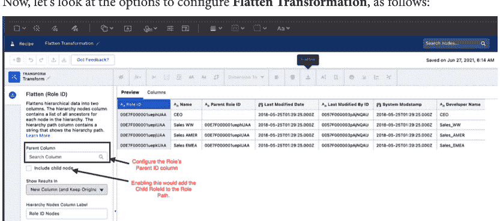

图 5.26 – 配置 Flatten Transformation 的选项

包含子节点选项将使行的角色 ID 成为角色 ID 路径的一部分。以下屏幕截图展示了启用 **Include child node** 选项的 **Flatten** 表：

| ROLE ID (SELF ID) | ROLE NAME | PARENT ROLE ID | ROLES | ROLEPATH |
|---|---|---|---|---|
| 1 | Salesperson 1 | 10 | 1, 10, 20, 30 | \1\10\20\30 |
| 2 | Salesperson 2 | 10 | 2,10, 20, 30 | \2\10\20\30 |
| 3 | Salesperson 3 | 11 | 3,11, 20, 30 | \3\11\20\30 |
| 10 | Regional Manager 1 | 20 | 10,20, 30 | \10\20\30 |
| 11 | Regional Manager 2 | 20 | 11,20, 30 | \11\20\30 |
| 20 | Vice President 1 | 30 | 20,30 | \20\30 |
| 21 | Vice President 2 | 30 | 21,30 | \21\30 |
| 30 | CEO | Not applicable | 30 | 30 |

图 5.27 – 启用 Include child node 选项的 Flatten 表

**Flatten Transformation** 配置后，会向数据集中添加以下两个字段：

- **Role ID Nodes**
- **Role ID Path**


这些字段也可以在 **Transform** 节点中重命名，如以下屏幕截图所示：

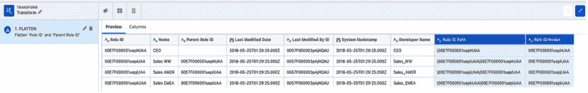

图 5.28 – 在 Transform 节点中重命名字段

关于两个高亮列，适用以下说明：

- **Role ID Path**：该列列出了在该行之上所有角色 ID，以反斜杠分隔。如果启用了 **Include child node**，它也会在路径中列出该行的角色 ID（self）。
- **Role ID Nodes**：该列将该行角色 ID 的层级中的所有角色 ID 列为多值。

然后 **Transform** 节点可以在连接中使用，以映射机会记录的所有者 ID 和来自用户角色的用户 ID，从而确定每条记录的可访问性，如下所示：

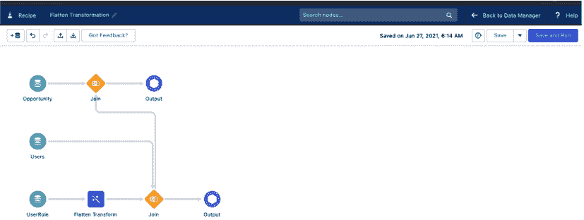

图 5.29 – 在连接中使用 Transform 节点映射机会记录的所有者 ID 和来自用户角色的用户 ID

然后该 **Role ID Path** 字段或 **Role ID Nodes** 字段在安全谓词中使用，以确定数据集中某一行的可访问性。有关安全谓词的更多信息，请参阅 *第 7 章，Tableau CRM 中的安全*。

### 预测缺失值 – 如何以及何时使用

何时可以使用 **Predict Missing Values** 转换来填充维度列中的缺失值？首先，为了做出准确的预测，每个列必须少于 200 个唯一值。此外，您必须验证这些预测列包含干净、高质量的数据，否则预测值会具有误导性。

如何使用 **Predict Missing Values** 转换？请注意以下事项：

- 当您单击 **Apply** 将转换添加到 **Transform** 节点时，预览窗格将显示原始列，其中包含缺失值，以及新列，其标题末尾带有 **Predict**。
- 您将在新列中看到预测值的 **Prediction TBD**。
- 预测值在运行配方后才会出现。
- 运行配方以生成预测——然后您可以将数据集作为值表查看以查看预测结果。
- 在 **Predict Missing Values** 转换之后添加 **Drop Columns** 转换，以根据需要从数据集中删除原始列。

> **需要牢记的限制**
> 
> 首先，如果没有足够的行来做出准确的预测，TCRM 不会插入任何预测值。其次，您不能对预测列应用任何转换。最后，预测值的配方有时运行时间会更长。

### 情感检测说明

使用 **自然语言处理 (NLP)** 和 ML，情感检测可以从文本字段中提取有价值的信息，例如评论、案例评论和社交媒体帖子。在 Data Prep 配方中使用 **Detect Sentiment** 转换，将该信息分类为以下三种情感之一：

- **Positive**
- **Negative**
- **Neutral**

换句话说，您不需要新的 ML 项目、ML 系统、新基础设施或单独的数据管道来检测非结构化数据的情感。TCRM Data Prep 中的 **Detect Sentiment** 转换即可完成所有操作！

**Detect Sentiment** 转换的一些潜在用例包括以下内容：

- 基于调查响应的客户服务/**客户满意度 (CSAT)**
- 销售辅导和趋势识别
- 社交媒体品牌管理

**Detect Sentiment** 转换仅支持英文文本，并且在单个维度列上工作。它将非英文文本作为英文处理并忽略所有图像。当输入值为 `null` 时，转换返回 `null`，当输入值为空字符串 (`''`) 时返回 `neutral`。

### 高级动手练习

本练习的目的是创建一个单一数据集，其中包含满足以下所有条件的每个账户的汇总：有开放的机会、至少一项活动，以及附加到账户的开放案例。

 resulting 数据集应允许用户通过基于该数据集的透镜的直接探索来确定以下内容：

- 账户名称
- 账户年龄
- 所有者姓名
- 开放机会数量
- 开放案例数量
- 平均案例持续时间
- 活动数量
- 总金额
- 总预期金额
- 总金额（带行项目的机会）
- 总金额（不带行项目的机会）

### 所需资源

将在您的 TCRM 环境中可用的数据源用于本练习。请使用 My First Analytics App 应用下找到的数据集，以便结果与以下步骤保持一致：

- Opportunities
- Cases
- Activities
- Accounts
- Users

### 需遵循的步骤

在您的演示 TCRM 环境中构建一个新的配方并遵循以下步骤：

1. 选择 Opportunities、Accounts、Activities、Cases 和 Users 作为您的配方输入数据。右侧面板允许选择列，虽然您可以选择所有列后继续，但理想情况下您只想使用所需的列。
2. 添加根据练习目标所需的过滤器。
3. 添加一些聚合节点，因为您知道 Opportunities、Cases 和 Activities 的粒度低于 Accounts。因此，您需要将它们全部聚合到相同的粒度（Accounts），以便在后面的步骤中能够执行连接以满足目标。
4. 您对 Opportunities 数据输入的聚合会将机会和预期金额拆分为两列——带行项目和不带行项目，因为这是要求。然而，这也意味着您没有包含总金额和总预期金额的字段。创建一个 Transform 节点，帮助您将总计带回数据集构建中。
5. 进行必要的连接，以便您能够朝着最终数据集努力。

当您以透镜形式打开完成的数据集时，它看起来像这样：

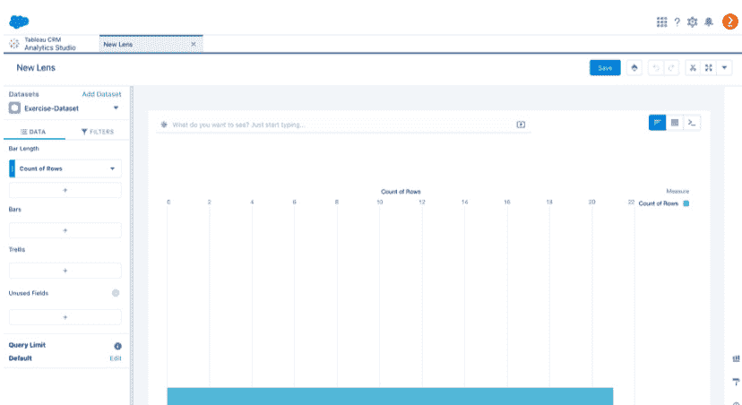

图 5.31 – 动手练习的完成数据集：条形图视图

以值表形式查看数据集时，它看起来像这样：

### 总结

在本章中，您学习了如何在 Data Prep 和 TCRM 配方中使用更高级的 ETL 工具。现在您应该能够使用 TCRM 数据准备 GUI 自信地连接、聚合、展平和转换您的数据。这包括使用公式进行复杂和自定义转换。

在下一章中，您将学习如何使用名为 TCRM lens 的数据探索工具，并了解透镜是如何 TCRM 仪表板的构建块。

### 问题

以下是测试您知识的问题列表：

- 查找连接、内部连接和完全连接之间有什么区别？
- 给出一个使用完全连接的现实世界示例。
- 为什么需要将来自外部源的数据与 Salesforce 对象连接？给出一个实际示例。
- 解释如何使用一个配方中的两个数据流组合聚合和分组。
- 必须选择 Multiple Row Formula 选项才能执行窗口函数。什么是窗口函数，以及您可能在何时使用它们？
- 什么是展平转换，以及此转换的用例是什么？

在本章中，我们将涵盖以下主题：

- Lenses – TCRM 的调查记者
- 创建、编辑和克隆透镜
- 使用透镜创建 TCRM 分析仪表板
- 提示和技巧

### 技术要求

要成功执行本章中的说明，您需要以下内容：

- 一台具有互联网访问权限的笔记本电脑或台式机（平板电脑或手机不够用）
- Google Chrome 浏览器的最新版本（在处理 TCRM 时，Chrome 是首选浏览器）
- 一个有效的电子邮件地址

确保您已登录到您的 TCRM 开发组织。

## Lenses – TCRM 的调查记者

什么是透镜？将透镜视为 Tableau CRM 中的数据探索工具，将数据查询与可视化结合在一个简单、强大且动态的界面中。

透镜使您能够执行以下任务：

- 探索数据集的各种特征，包括维度、度量、字段标签和名称。
- 使用各种度量、维度、过滤器和公式对数据进行切片和切分。
- 创建可剪切到仪表板的视觉效果和表格。
- 创建可与其它用户共享的视觉效果和表格。

在下一节中，您将亲自动手在 TCRM 中操作并使用透镜。


### 创建、编辑和克隆镜头

现在你已经了解镜头是什么以及其用途，接下来将在 TCRM 中构建和编辑一个镜头。在开始之前，这里是镜头 UI 的外观，其中标注了一些关键组件供参考：

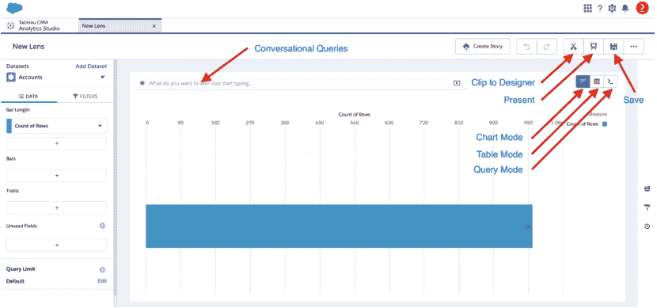

图 6.1 – TCRM 镜头 UI

你现在将学习如何在图表模式下使用镜头。

### 使用图表模式

打开 Analytics Studio 并按照以下步骤操作：

- 1. 从 **All Items** 列表中选择 **MyFirstDataset**。这将带你进入镜头 UI，镜头将在默认的图表模式下打开。
- 2. 在屏幕左侧，使用下拉列表为 **Bar Length** 选择 **Sum of Amount**。
- 3. 为 **Bars** 选择 **OwnerId.Name**。
- 4. 点击 **Sum of Amount** 旁边的下拉箭头并选择 **Sort Descending**。
- 5. 在屏幕最右侧，点击 **Formatting** 图标，它看起来像一把画笔。
- 6. 在 **Title** 框中添加标题，命名为 **My First Lens**。
- 7. 通过点击 **Save** 按钮保存你的镜头，将其命名为 **My First Lens**，并保存为 **My First Analytics App**。

恭喜！你已在 TCRM 中创建了第一个镜头。结果应如下所示：

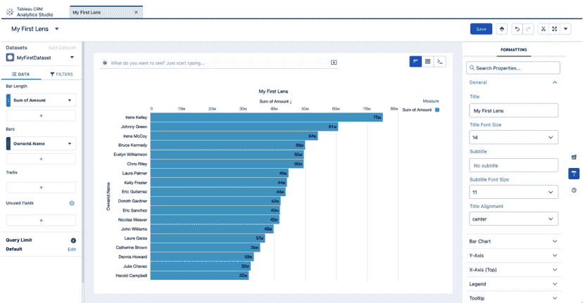

图 6.2 – 以镜头形式查看的 MyFirstDataset

在开始使用此镜头并探索 TCRM 镜头的功能之前，你需要了解管理工具，如以下屏幕截图所示：

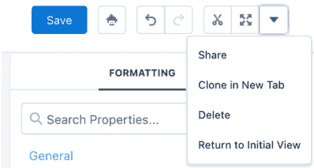

图 6.3 – 镜头管理工具

镜头管理工具如下：

- **Save**：将镜头保存到 TCRM 应用以供将来使用。
- **Create Story**：从镜头创建 Einstein Discovery 故事。
- **Undo/Redo**：撤消或重做最新操作。
- **Clip to Designer**：如果仪表板在仪表板编辑器中打开，则镜头会被剪切或导出到仪表板作为小部件。

此时，镜头应如下所示：

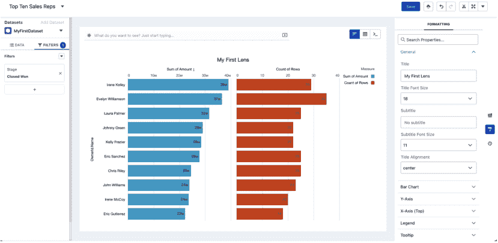

图 6.5 – 应用过滤器后镜头的进度

继续按如下方式编辑你的镜头：

- 1. 在最右侧，点击 **Charts** 按钮，它看起来像一列图表，然后在 **LINES** 下选择 **Combo** 图表。
- 2. 点击 **Formatting**（画笔图标），然后点击 **Combo Chart** 旁边的下拉箭头。点击 **Axis Mode** 下拉菜单并选择 **Dual Axis**。
- 3. 向下滚动右侧菜单，直到看到 **Legend** 下拉菜单。点击它并取消选中 **Show legend header** 复选框。
- 4. 在 **Position** 下拉菜单下，选择 **top-center**。
- 5. 向下滚动右侧菜单，直到看到 **Conditional Formatting** 下拉箭头。点击箭头，点击 **Apply Conditional Formatting To** 的下拉列表，并选择 **Measure**。
- 6. 为 **Sum of Amount** 和 **Count of Rows** 选择新的颜色。
- 7. 向上滚动（如果需要关闭已展开的区域）并通过点击箭头展开 **X-Axis**。
- 8. 为 **X-Axis** 添加自定义标题 **Sales Rep**。
- 9. 向上滚动并为 **Ranked in descending order by value of deals won** 镜头添加 **subtitle**。
- 10. 将 **Subtitle Font Size** 改为 **14**。
- 11. **Save** 你的镜头。
- 12. 点击 **Present** 按钮进入全屏演示模式。

到目前为止，你的镜头应如下所示：

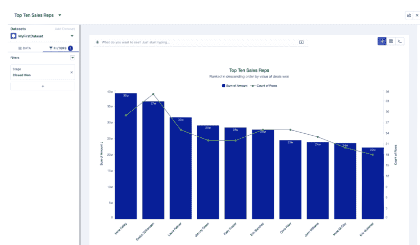

图 6.6 – 镜头进度显示为添加了条件格式和副标题的组合图

接下来，你必须创建一个可视化，它还将显示每个销售代表相对于其目标的表现：

- 1. 点击屏幕右上角的 **Exit Full Screen** 按钮，它看起来像一个 **x**。
- 2. 将图表类型更改为 **Polar Gauge**。注意这样做时，**Count of Rows** 指标会移动到 **Unused Fields**。
- 3. 点击 **Formatting** 选项卡并通过点击箭头展开 **Range Values**。
- 4. 将 **Max** 的值更改为 **4000000**。
- 5. 展开 **Trellis** 部分，将 **Type** 更改为 **Matrix**，将 **Size Ratio** 更改为 **Square**。注意镜头现在读起来容易得多。
- 6. 对 **Sum of Amount** 应用条件格式，将顶部箱的值更改为 **30000000**，并为顶部箱选择红色，为底部箱选择绿色。
- 7. 展开 **Polar Gauge** 部分并将 **Center Size** 更改为 **70%**。
- 8. 将副标题更改为 **Performance to Target ($30M)**。
- 9. **Save** 镜头。

极坐标仪表矩阵应如下所示：

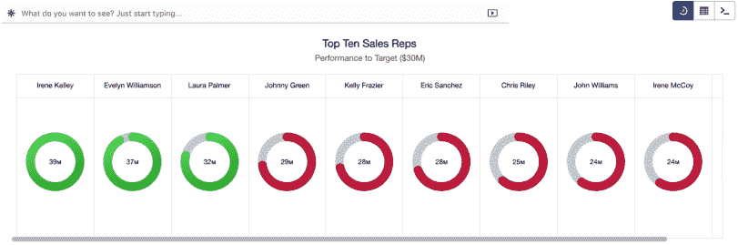

图 6.7 – 极坐标仪表矩阵

现在，让我们学习如何深入镜头数据。打开 **My First Lens** 并按照以下步骤操作：

- 1. 通过点击它选择 **Johnny Green** 的条形图。
- 2. 这样做时，**Chart Mode** 按钮旁边会出现一个新按钮。将鼠标悬停在此新按钮上以查看其 **Drill down to group selections by the chosen dimension** 功能。点击 **Drill down** 按钮。
- 3. 你可以为 Johnny Green 的记录选择一个行业或查看数据表。选择 **AccountId.Industry**。
- 4. 你现在看到的内容已按 **OwnerId.Name = Johnny Green** 过滤。如果你愿意，可以进一步向下钻取，查看单个记录的值表，等等。
- 5. 关闭镜头而不保存它。

镜头中的向下钻取功能如下所示：

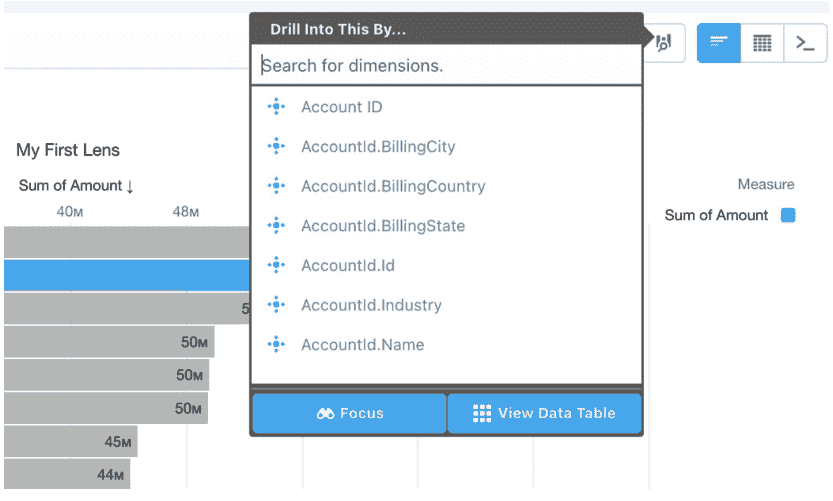

图 6.8 – 镜头中的向下钻取功能

现在，让我们创建一个新的镜头来比较指标并使用散点图了解相关性和比较。按照以下步骤操作：

- 1. 在 **My First Analytics App** 中打开 **Opportunities** 数据集。
- 2. 为 **Closed** 添加过滤器，设置为 **Open**。
- 3. 创建一个散点图图表，其中 **X-Axis** 为 **Sum of Amount**，**Y-Axis** 为 **Count of Rows**，**Bubble Size** 为 **Avg of Amount**，**Bubbles** 为 **Industry**。
- 4. 将其保存为 **My First Analytics App** 中的 **Oppty Scatter Plot**。

镜头应如下所示：

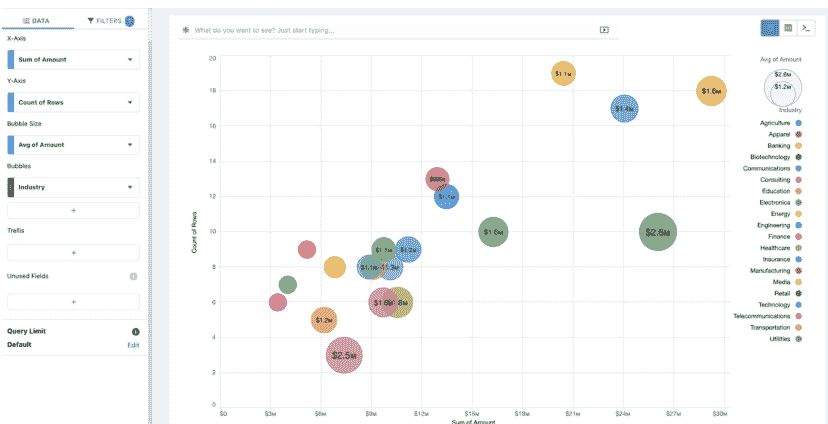

图 6.9 – 指标比较，如 Oppty Scatter Plot 镜头所示

这种可视化有什么用？散点图可用于以下目的：

- 展示两个变量之间的关系 -- 正相关或负相关、非线性或线性、以及/或强或弱
- 识别相关关系
- 识别数据模式，例如聚类

镜头的一个强大功能是能够向你的可视化添加或连接第二个数据集。让我们通过执行以下步骤来尝试此操作：

- 1. 在 My First Analytics App 中打开 Opportunities 数据集。
- 2. 在左上角，点击 Add Dataset。
- 3. 数据集默认作为 left blend 连接，但可以更改。将其保留为 Left Blend。
- 4. 对于 Bar Length，选择 Opportunities 数据集的 Sum of Amount。
- 5. 按降序对该指标进行排序。
- 6. 对于第二个 Bar Length，选择 Cases 数据集的 Count of Rows。
- 7. 对于条形图，为 **Opportunities** 和 **Cases** 数据集均选择 **Account Name**。
- 8. 选择 **Pyramid** 图表类型并按需要格式化。
- 9. 将 **Query Limit** 更改为 **10,000**。
- 10. 将镜头保存为 **My First Analytics App** 中的 **Blended Datasets**。

此镜头包含两个数据集，显示了所有有机会的账户中按账户名称划分的交易总和和案例总数。它应如下所示，具体取决于你的自定义设置：

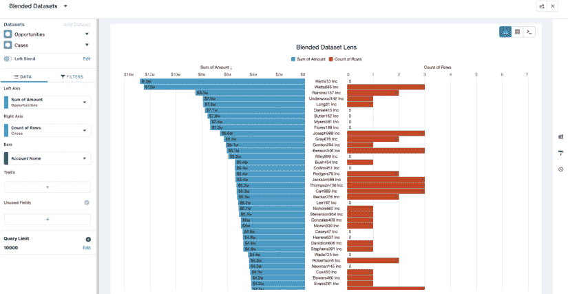

图 6.10 – Blended Datasets 镜头

能够向镜头添加第二个数据集的功能非常强大，因为它节省了使用配方创建新数据集或在 SAQL 中协同分组数据流以将两个数据集的数据合并到一个可视化中的需求。例如，这使得将机会数据和目标数据合并到一个图表中变得快速而简单。此功能还有许多其他用例。

### 使用 Show Fields 面板

在镜头 UI 的左侧，数据集名称旁边有一个下拉箭头。点击它以显示 **Show Fields** 面板。点击它以显示 **Fields** 面板，其外观如下：


### MyFirstDataset

706 行

学习使用字段面板

搜索字段...

显示隐藏字段（0）

显示字段 API 名称

### 维度

+   - Account ID
+   - AccountId.BillingCity
+   - AccountId.BillingCountry
+   - AccountId.BillingState
+   - AccountId.Id
+   - AccountId.Industry
+   - AccountId.Name
+   - AccountId.OwnerId
+   - AccountId.OwnerId.Id
+   - AccountId.OwnerId.Name
+   - Contact ID
+   - ContactId.Id
+   - ContactId.MailingCity
+   - ContactId.MailingCountry
+   - ContactId.MailingState
+   - ContactId.Name
+   - Lead Source
+   - Name
+   - Opportunity ID
+   - Owner ID

### My First Lens

数据集

添加数据集

MyFirstDataset

DATA

FILTERS

Bar Length

Sum of Amount

Bars

OwnerId.Name

Trellis

Unused Fields

Query Limit

Default

Edit

Close

Save

Figure 6.11 – The Fields panel

每个字段可用的选项如下：

+   - **Rename**: 重命名字段标签。
+   - **Hide**: 隐藏该字段。
+   - **Edit Values**（仅限维度或日期）：可在此处编辑字段标签，并为每个值添加默认颜色。
+   - **Format Numbers**（仅限度量）：可将数字格式化以满足您的需求，例如货币舍入或百分比。
+   - **Copy API Name**: 将字段 API 名称复制到剪贴板。

> **Note Regarding Changes Made in the Fields Panel**
> 需要注意的是，此处所做的任何更改都将应用于该数据集在任何地方的使用——这些是全局更改。

在掌握了迄今为止的知识后，是时候通过一个实践练习来动手实践了。

### Hands-on exercise

在您的 TCRM Analytics Studio 中按以下步骤操作：

+   1. 在 TCRM Analytics Studio 中，打开 **My First Analytics App** 并点击 **Cases** 数据集以创建新的 lens。
+   2. 将 lens 保存为 **Service Data Analysis**，保存在 **My First Analytics App** 中。
+   3. 首先，创建一张时间组合图，使用 **Avg of Case Duration** 和 **Count of Rows** 随 **Closed Date (Year-Month)** 变化。
+   4. **Save** 您的 lens。

该 lens 应如下所示：

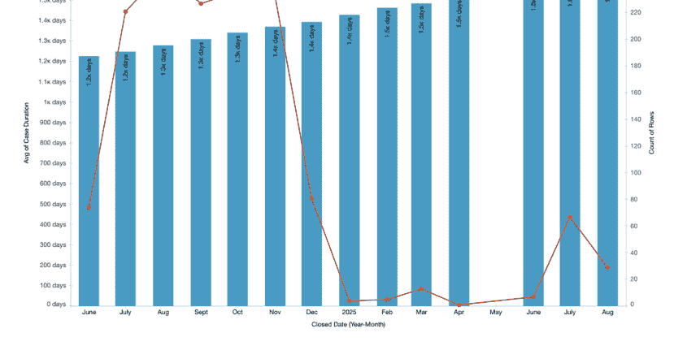

Figure 6.12 – Hands-on exercise starting point (case data)

将图表类型更改为组合图（而不是时间组合图），然后修改您的数据，使 x 轴为行业，并回答以下问题：

+   - 哪个账户行业拥有最多的案例？
+   - 哪个账户行业平均案例持续时间最长？
+   - 为某些 Account.Industry 字段设置自定义颜色并修改其值名称。
+   - 使用钻取按钮按其他维度（如 Billing Country、Priority 和 Status）对多个行业进行切片和切分。
+   - 尝试以下图表类型并了解它们各自的用途：Line、Combo、Timeline、Flat Gauge、Polar Gauge、Donut、Matrix、Waterfall 和 Scatter Plot。
+   - 查看案例优先级和状态相关性的最佳图表是什么？构建此 lens 并将其保存为副本（克隆的 lens）。
+   - 使用 trellis 功能并思考它最适合使用的场景。

通过 lens 深入挖掘您的数据，您学到了什么？以下是一些示例问题：

+   - 在仅使用点击而非代码工作时，您遇到了哪些限制？
+   - 有没有您不确定如何使用或认为在现实世界中用处不大的图表类型？
+   - 您能否创建外观和感觉完全正确的图表，还是 lens 中的自定义功能有限？

现在您已对 Chart Mode 有信心，是时候使用 TRCM lens 中的一种灵活、无代码分析工具——Table Mode 了。

### Analyzing your data using Table Mode

在本节中，您将学习如何使用 TCRM 中更灵活、更强大的工具之一——表格。

首先，让我们看看值表。

### Values table

值表用于查看记录值。打开 My First Lens 并更改为 Table Mode – Values Table。lens 将更改为表格视图，如下所示：

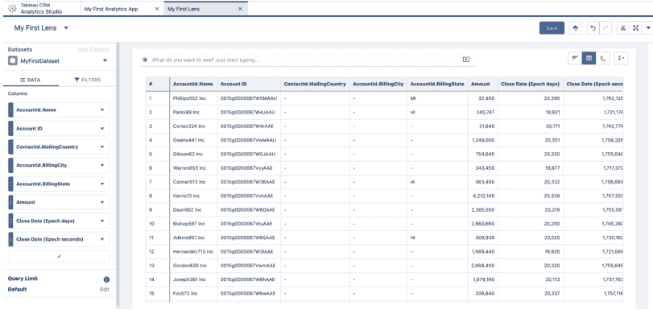

Figure 6.13 – Initial values table view

按以下步骤创建新的表格视图：

+   - 选择 **Clone in New Tab** 并保存为 **My First Table View**。
+   - 按 **Stage = Closed Won** 过滤数据。
+   - 按 **Close Date = 1/1/2025 – 30/6/2025** 过滤数据。
+   - 将 **Query Limit** 更改为 **1,000**。
+   - 根据需要编辑您的列——请参阅以下截图。
+   - 选择 **Formatting** 选项卡并选择新的表格 **theme**。
+   - 更改表格的 **spacing**。在 **Column Width** 下选择 **Fit To Widget**。
+   - 修改 **Header** 详情。
+   - 添加表格背景颜色。
+   - 删除行索引列。
+   - 点击 **Column** 选项卡并为度量列添加 **Conditional Formatting**——请参阅 **Figures 6.15 and 6.16**。
+   - 尝试 **Column** 选项卡下的其他设置。
+   - **Save** 您的 lens。

您编辑后的表格列应如下所示：

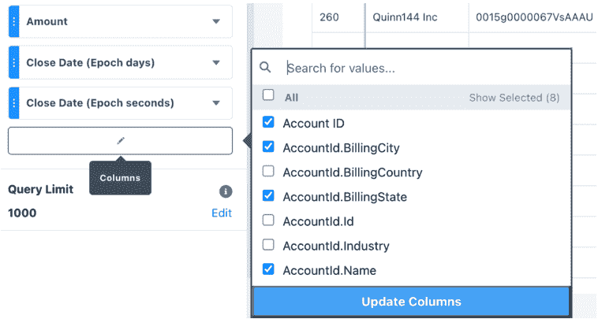

Figure 6.14 – Editing table columns

您修改后的表格可能如下所示：

| AccountId.Name | OwnerId.Name | Name | AccountId.Industry | Amount ↓ | Close Date |
|---|---|---|---|---|---|
| Carr889 Inc | Johnny Green | Opportunity for Norman1354 | Communications | 5,294,610 | 2025-01-11 |
| Stevenson954 Inc | Eric Gutierrez | Opportunity for Daniel875 | Insurance | 5,023,650 | 2025-05-08 |
| Nichols662 Inc | Catherine Brown | Opportunity for Alvarado1597 | Manufacturing | 4,824,325 | 2025-04-28 |
| Flores188 Inc | Kelly Frazier | Opportunity for Cunningham175 | Retail | 4,357,300 | 2025-02-16 |
| Torres548 Inc | Evelyn Williamson | Opportunity for Watson580 | Biotechnology | 4,090,680 | 2025-05-23 |
| Watts685 Inc | John Williams | Opportunity for Rogers1242 | Biotechnology | 3,907,275 | 2025-04-01 |
| Rios830 Inc | Johnny Green | Opportunity for McDonald1503 | Apparel | 3,851,250 | 2025-02-03 |
| Doyle498 Inc | Chris Riley | Opportunity for Martin1417 | Transportation | 3,712,300 | 2025-03-31 |
| Fleming816 Inc | Laura Palmer | Opportunity for Smith309 | Insurance | 3,709,600 | 2025-02-09 |
| Wood74 Inc | Johnny Green | Opportunity for Jackson1400 | Engineering | 3,555,960 | 2025-01-13 |
| Rodriguez608 Inc | Bruce Kennedy | Opportunity for Houston1041 | Media | 3,513,380 | 2025-05-13 |
| Joseph988 Inc | Dennis Howard | Opportunity for Weber619 | Energy | 3,474,950 | 2025-06-19 |
| Dawson161 Inc | Evelyn Williamson | Opportunity for Dennis1374 | Education | 3,463,920 | 2025-05-05 |
| Byrd23 Inc | Evelyn Williamson | Opportunity for Bates1547 | Education | 3,426,450 | 2025-06-05 |
| Rodgers79 Inc | Eric Gutierrez | Opportunity for Dennis524 | Banking | 3,390,620 | 2025-02-06 |

Figure 6.17 – Sample of a customized values table

值表对于为仪表板准备表格或逐行深入您的数据进行详细分析非常有用。您还可以使用带有 Σ 符号的汇总按钮添加小计和总计。

现在，是时候查看用于深入挖掘数据的比较表工具了。

### Compare table

比较表是用于分析数据的最强大的声明式工具之一。列编辑器可用于执行以下任务：

+   - 向表格添加计算和过滤器。
+   - 在列和行之间执行算术运算。
+   - 通过操作字符串值创建标签。
+   - 并排查看度量。
+   - 串联维度值。
+   - 创建简单的桶。
+   - 添加图像 URL。

在以下练习中，我们将使用比较表执行以下步骤：

+   1. 计算已赢交易数量的累计总和。
+   2. 按已赢交易总和对销售代表进行排名。
+   3. 计算每个代表占总体的份额。
+   4. 计算所有代表的成交赢率，按交易数量计算（现在按金额计算）。

让我们开始创建第一个比较表：

+   1. 打开 **My First Lens**。
+   2. 在新标签页中克隆 **My First Lens** 并将其保存为 **My First Compare Table**。
+   3. 更改为 **Compare Table** 模式。
+   4. 添加 **Count of Rows** 作为第二个列/度量。

现在，通过点击 **Edit this Column** 进入列编辑模式，如以下截图所示：

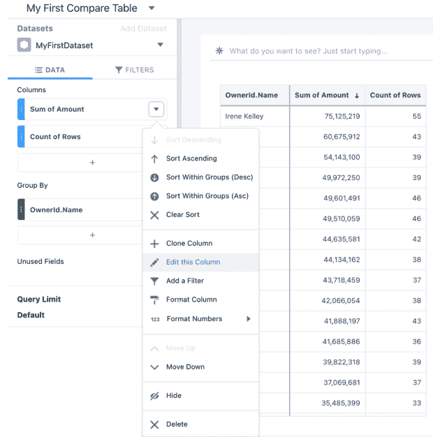

Figure 6.18 – Column editing mode


你的进度应与以下截图中显示的内容相匹配：

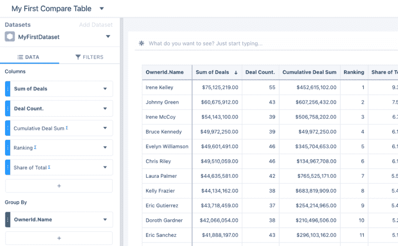

图 6.21 – 添加总占比后表格的进度对比

最后，你必须为每位代表计算交易获胜率，按交易次数计算（而非金额）：

- 1. 添加一列基于行数计数，命名为 Won。
- 2. 为此列添加一个筛选器，其中 Won = True。
- 3. 添加最后一列并将其重命名为 Win Rate。
- 4. 添加一个用于计算获胜率的简单公式，截断为两位小数，如以下代码片段所示。
- 5. 将格式设置为百分比。
- 6. 点击 Apply 然后点击 Close。
- 7. 按降序对 Win Rate 进行排序。
- 8. 点击 Save。

你的完成表格应如下所示：

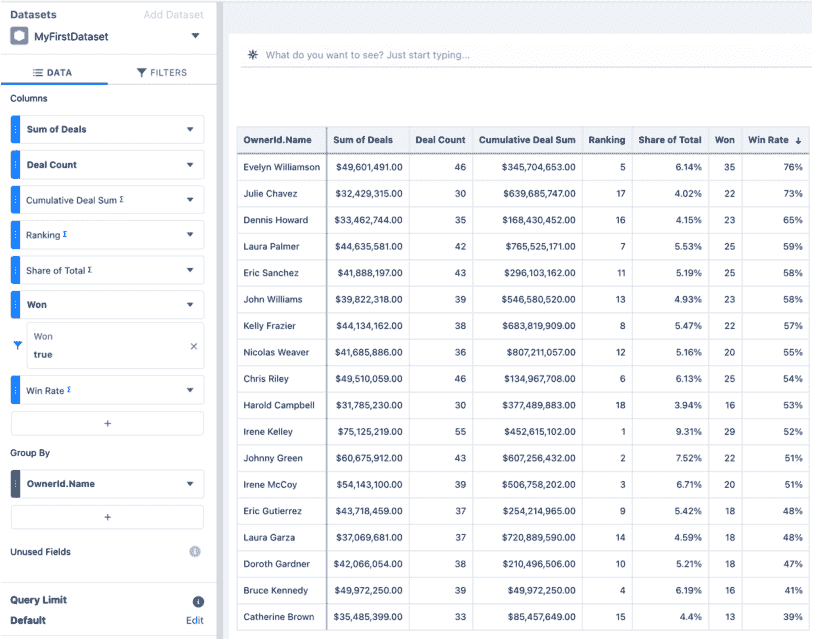

图 6.23 – 已完成的 My First Compare Table

现在，创建一个组合图表来显示交易总和和获胜率。在新标签页中克隆它并保存为 Win Rate and Sum of Deals by Sales Rep。完成的图表应如下所示：

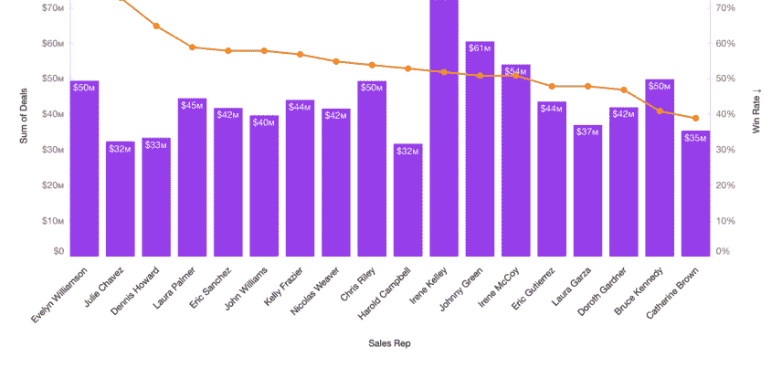

图 6.24 – 按销售代表的获胜率和交易总和

使用比较表还可以做更多的事情——深入你的开发组织自行探索吧！

### 透视表

你很可能熟悉透视表；它们是电子表格等工具中的常见功能。透视表是汇总数据和详细分析数值数据的一种交互方式。透视表可用于执行以下操作：

- 对数值数据进行小计和汇总，按类别和子类别汇总数据。
- 展开和折叠不同层级的数据，以便关注结果并在汇总级别深入细节。
- 将行移动到列或列移动到行（称为透视），以查看数据的不同汇总。
- 筛选、排序、分组和条件格式设置最有用和相关的子集数据，使你能够专注于所需的信息。

通过打开 My First Lens 并使用行业作为第二个分组创建透视表，我们在筛选结果后会看到类似以下内容：

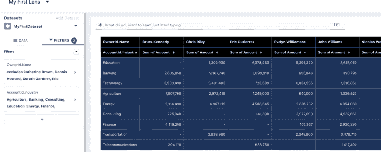

图 6.25 – 透视表示例

现在，是时候从 Table Mode 切换到 Query Mode 了。

### 查询模式

现在你对图表和表格模式已足够熟悉，唯一剩下的模式就是 TCRM lenses 中强大的基于代码的分析工具，即查询模式。查询模式利用 Salesforce Analytics Query Language（SAQL）查询你的数据，而非我们迄今为止检查的声明式和低代码方法。

查询模式如下所示：

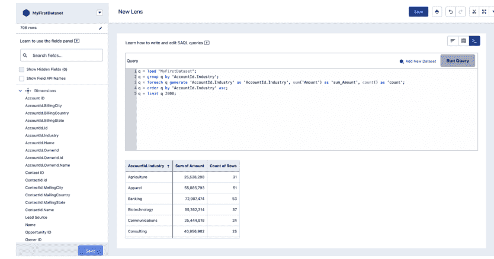

我们不会在这里深入探讨查询模式的细节，因为 SAQL 将在第 9 章《高级仪表板设计与构建》中详细研究。有关编写 SAQL 的详细参考，请参阅此处的 TCRM SAQL 开发人员指南：

https://developer.salesforce.com/docs/atlas.en-us.232.0.bi_dev_guide_saql.meta/bi_dev_guide_saql/bi_saql_intro.htm

现在你对使用 TCRM lenses 已有信心，你需要了解如何将 lenses 剪辑到仪表板中。

### 使用 lenses 创建 TCRM 分析仪表板

Lenses 可以使用 **Clip** 功能创建仪表板，或添加到现有仪表板中。虽然我们将在 *第 8 章《构建你的第一个 TCRM 仪表板》* 中详细讨论仪表板构建，但我们将快速查看如何创建简单的仪表板并添加我们之前创建的两个 lenses。请按照以下步骤操作：

- 1. 打开 **My First Lens**、**My First Table View** 和 **Service Data Analysis** lenses。
- 2. 从 TCRM Analytics Studio 主页，点击 **Create** 并选择 **Dashboard**。
- 3. 选择 **Blank Dashboard**。
- 4. 对于每个 lens，进入该 lens，点击带有剪刀图标的 **Clip to Designer** 按钮，确保该 lens 将作为小部件导出，然后点击 **Clip to Designer**。进入空白仪表板，默认名称为 **New dashboard**。将仪表板保存为 **Lens Clip**。
- 5. 将三个已剪辑的 lenses——现在作为查询位于仪表板设计器的右侧——拖到设计画布上。
- 6. 通过调整 lenses 的大小来尝试，直到你满意为止。
- 7. **Save** 该 lens。
- 8. 点击 **Preview** 查看你的仪表板或选择 **Present** 视图。

结果可能如下所示：

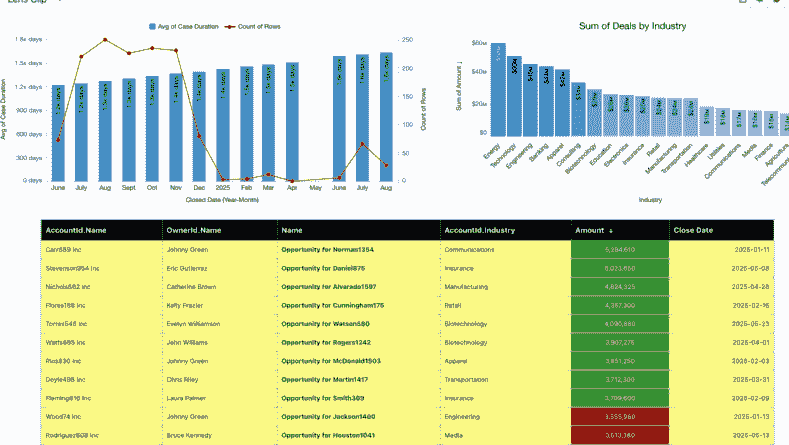

图 6.27 – 剪辑到仪表板的 Lenses

正如我们之前提到的，我们将在第 8 章《构建你的第一个 TCRM 仪表板》中更详细地讨论仪表板的设计和构建。

在结束本章之前，我想分享一些提示和建议。

### 提示和建议

让我分享一些在使用 lenses 时的提示和建议。

首先，这里有一些键盘快捷键：

- S：保存（无需使用对话框）。
- P：演示（全屏）模式。
- Esc：退出演示模式。
- L：剪辑到仪表板设计器。
- Ctrl + E（Windows）/Cmd + E（macOS）：打开 JSON 编辑器。

其次，你可以使用一些巧妙的 SAQL 在表格和透视表中对小计、总计等进行一些很酷的操作。

第三，重要的是要记住，当你在 **Fields** 面板中修改字段标签和颜色时，更改将传播到所有仪表板和 lenses。请谨慎修改！

第四，值表格中的默认行数可以使用 **Query Limit** 设置更改，或使用 SAQL limit 语句更改。

最后，请注意查询限制，因为它会对查询结果产生严重影响，并且由于默认值是 2,000，可能导致数字看起来不正确。此限制也可以在 SAQL 中编辑或删除。

### 总结

正如你所见，lenses 是 TCRM 的调查记者。在本章中，你了解了 lens 是什么，它是如何成为调查数据的灵活工具，以及 lenses 如何成为 TCRM 分析仪表板的构建块。

现在，你可以使用熟悉的 lens UI 创建、编辑和克隆 lenses。最后，你了解了如何使用 lenses 作为构建块构建仪表板。

下一章将教你如何通过利用 TCRM 安全工具来控制谁可以看到你的 lenses 和仪表板中的内容。

### 问题

以下是一些问题，供你测试对本章内容的掌握：

- Lens 使你能够做什么？
- Lens 的 Clip 命令的目的是什么？
- 命名一个透视表的使用。
- 你如何使用散点图？组合图？平滑仪表？
- 你如何共享一个 lens？
- 查询模式的目的是什么？
- 比较表有哪三种用途？
