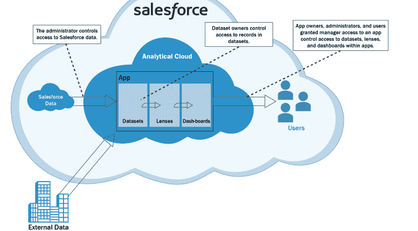
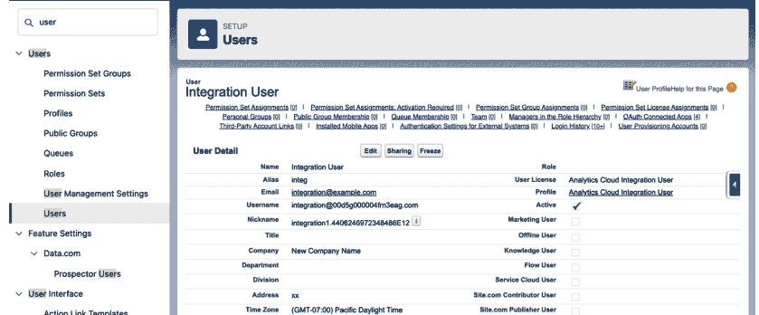
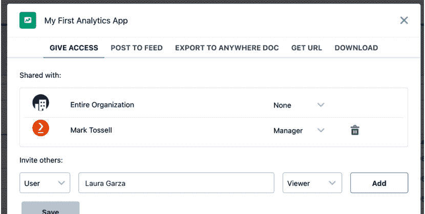
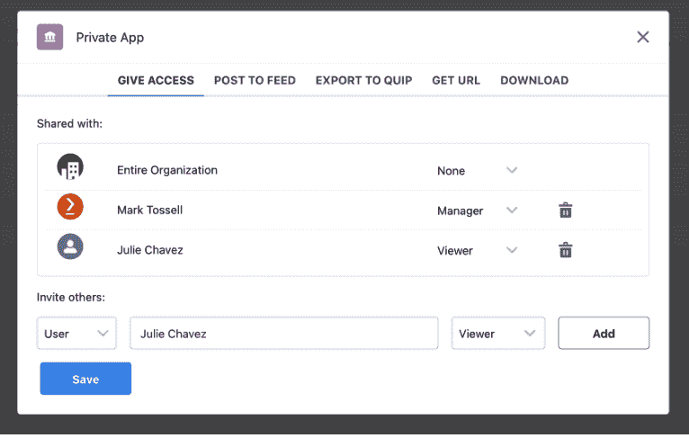
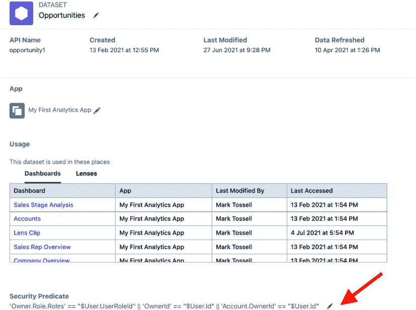
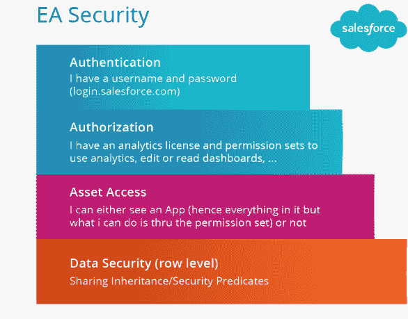

## 7 Tableau CRM 中的安全

你如何决定谁在 Tableau CRM 中可以看到什么？这是 TCRM 开发中最不为人所理解的方面之一，因此在本章中，你将学习如何保护你的 TCRM 数据。我们将首先概述 TCRM 安全。然后我们将逐步介绍 TCRM 提供的每个工具，以确定谁可以看到什么数据。

到本章结束时，你将了解 TCRM 安全的基础知识。接下来，你将能够部署和管理 TCRM 访问权限。你将了解 TCRM 应用级安全，并能够按需部署和编辑它。此外，你将能够评估和部署 Salesforce 共享继承。最后，你将能够构建和部署安全谓词。

在本章中，我们将涵盖以下主要主题：

- 什么是 TCRM 安全以及它如何工作？
- 管理 TCRM 访问权限
- 配置 TCRM 应用级安全
- 部署 Salesforce 共享继承
- 了解安全谓词的概念和用法


### 技术要求

要成功执行本章中的说明，您需要以下内容：

- 最新版本的 Google Chrome 浏览器（在处理 TCRM 时，Chrome 是首选浏览器）
- 一个可用的电子邮件地址

确保您已登录到您的 TCRM 开发组织。

让我们直接开始，对 TCRM 安全有一个高层次的了解。

### 什么是 TCRM 安全以及它是如何工作的？

在数据治理和安全的大背景下，控制在 Tableau CRM 中呈现的信息的访问至关重要。

> **重要说明**
> 
> 一旦某个字段在 TCRM 中可见，就没有办法阻止某人查看其数据。任何有权访问数据集的人都可以访问所有字段，而与 Salesforce 不同，在 Salesforce 中您可以进行字段级安全控制。

TCRM 管理员有四种安全工具可以使用：

- **Salesforce 数据访问：** 管理员可以配置 Salesforce 字段和对象的权限以实施字段级和对象级安全，这意味着可以控制对 Salesforce 数据的访问。例如，可以在摄取级别限制对敏感个人信息的访问，以防止此数据被加载到 TCRM 中。
- **TCRM 应用级安全：** 当您向用户、应用所有者和管理员分配管理权限时，他们将能够管理对应用内资产的访问——透镜、数据集和仪表板。
- **Salesforce 共享继承：** 共享继承会与在 Salesforce 中配置的共享规则同步，但受某些限制。如果使用，建议同时设置安全谓词，以防共享设置无法得到 honoring。
- **安全谓词：** 安全谓词使您能够通过灵活且可定制的行级安全功能，对数据集应用不同类型的访问控制。

以下是帮助您理解所有这些如何协同工作的示意图：



图 7.1 – TCRM 安全概述

要讨论的第一个 TCRM 安全功能是控制 Salesforce 数据的权限。

### 管理 TCRM 访问权限

要摄取数据并将其用作行级安全的一部分，您必须有权访问 Salesforce 数据。根据 TCRM/Salesforce 用户的两种系统的权限，Tableau CRM 会获得对 Salesforce 数据的访问权限。这两种 TCRM/Salesforce 用户系统如下：

- Integration User
- Security User

以下是 **Integration User** 在 Salesforce 中 **Setup** 中的视图：



图 7.2 – Integration User。请注意用户配置文件，即 Analytics Cloud Integration User

TCRM 在数据准备作业运行时使用 **Integration User** 的权限，以便从 Salesforce 对象和字段摄取数据。由于 **Integration User** 具有 **View All Data** 访问权限，因此应限制对包含敏感数据的任何字段和对象的访问。

如果数据流尝试从 **Integration User** 未被授予查看权限的字段或对象读取数据，作业将失败。

基于 User 对象，如果查询具有行级安全的数据集，TCRM 将利用 **Security User** 的权限来读取 User 对象及其字段。**Security User** 对包含在谓词中的每个 User 对象字段都需要一些读取权限。

您可能想知道，什么是谓词？当数据集的行级安全由过滤条件定义时，这就被称为谓词。请参阅 *什么是安全谓词以及如何使用它们？* 部分了解更多信息。默认情况下，**Security User** 对 User 对象的标准字段具有读取权限。如果谓词使用了自定义字段，您需要确保 **Security User** 对该字段具有读取访问权限。如果您尝试使用谓词查询数据集，而 **Security User** 没有对所有相关 User 对象字段的读取访问权限，则会触发错误。

在为 **Security User** 或 **Integration User** 设置权限时，请勿修改原始配置文件；您应始终对其克隆版本进行更改。要控制对 Salesforce 数据的访问，您应配置 **Integration User** 在 Salesforce 字段和对象上的权限。为了基于 User 对象的自定义字段实现行级安全，还需要配置 **Security User** 的权限。

> **重要说明**
> 切勿删除 **Integration User** 或 **Security User**，因为 Tableau CRM 需要这些用户来访问 Salesforce 数据。

总之，当数据被摄取并用作行级安全时，Tableau CRM 必须有权读取 Salesforce 数据。

因此，您必须确保以下事项已完成：

- 已设置 **Integration User** 的权限以管理数据流对 Salesforce 数据的访问。
- 已设置 **Security User** 的权限以基于 User 对象的自定义字段实现行级安全。

作为一个实际示例，请在您的 TCRM 开发组织中执行以下步骤：

1. 在 Salesforce 中，而不是 TCRM 中，进入 **Setup**。
2. 在 **Quick Find** 中，搜索 **Permission Sets** 并单击它。
3. 单击 **New** 创建新的权限集。
4. 在 **License** 下选择 **Analytics Cloud Integration User**。
5. 将权限集的名称设置为 **Test** 并单击 **Save**。
6. 通过选择 **Object Settings** 和 **App Permissions** 为权限集分配应用和对象级权限。为此练习选择多种选项。
7. 为权限集配置 **Apex Class Access**、**Visualforce Page Access** 和 **Flow Access** 权限。为此练习选择多种选项。
8. 此新权限集现在可以分配给 TCRM **Integration User**。
9. 在 **Salesforce Setup** 下，找到并选择 **Profiles**。
10. 选择 **Analytics Integration User** 配置文件。
11. 单击 **Clone** 按钮创建配置文件的克隆副本。
12. 通过取消选中复选框移除 **View All Data** 访问权限。
13. 将配置文件保存为 **Test**。
14. 在 **Salesforce Setup** 下，选择 **Users**。
15. 从列表中选择 **Integration User**（User, Integration）。
16. 编辑用户并将用户的配置文件更改为我们在 *步骤 11* 中创建的克隆配置文件 **Test**。
17. 导航到 **Integration User** 的 **Permission Set Assignments** 部分。
18. 将在 *步骤 6* 中新建的权限集 **Test** 分配给 **Integration User**。这使 TCRM 集成用户能够访问 Salesforce 对象和其他组件。

接下来要检查的工具是应用级安全。

### 配置 TCRM 应用级安全

正如您可能还记得我们在 *第 2 章《在 TCRM 中开发您的第一个 OOTB 分析应用》* 中学到的那样，Tableau CRM 应用类似于文件夹，使用户能够组织其数据项目并控制数据集、透镜和仪表板的访问权限以及它们如何共享。TCRM 应用的此功能使其成为限制或授予对资产访问权限的有用安全工具。

默认情况下，所有 TCRM 用户都从 **Shared App** 开始获得 Viewer 访问权限。管理员可以修改此设置以开放或限制访问。开箱即用的应用 **My Private App** 可供每个用户访问，适合个人进行中的工作。用户 **My Private App** 的内容对管理员不可见，但透镜和仪表板可以与用户共享。

此外，默认情况下，所有新应用都设置为私有。管理权限归管理员和应用所有者所有；因此，他们可以将 **VIEWER**、**EDITOR** 或 **MANAGER** 访问权限扩展到其他角色、组或用户。下面的表格快速总结了用户在不同访问级别下可以执行的操作：


|  | A | B | C | D |
|---|---|---|---|---|
| 1 | **操作** | **查看者** | **编辑者** | **管理员** |
| 2 | 查看应用中的仪表板、透镜和数据集 | × | × | × |
| 3 | 查看谁有权访问应用 | × | × | × |
| 4 | 将应用内容保存到用户具有编辑者或管理员访问权限的其他应用 | × | × | × |
| 5 | 保存对应用中现有仪表板、透镜和数据集的更改（保存仪表板需要适当的权限集许可和权限） |  | × | × |
| 6 | 更改应用的共享设置 |  |  | × |
| 7 | 重命名应用 |  |  | × |
| 8 | 更新应用中的资产可见性 |  | × | × |
| 9 | 删除应用 |  |  | × |

图7.3 – 拥有查看者、编辑者和管理员访问权限的用户可以做什么？

要向TCRM用户授予访问权限，只需在查看应用时点击页面右上角的**共享**按钮。此时会显示以下对话框，您可以按需要授予访问权限，然后点击**保存**：



图7.4 – 使用“共享”按钮授予对分析应用的访问权限

### 提示

首先，如果数据集与仪表板或透镜位于不同的应用中，TCRM用户必须能够访问这两个应用才能查看透镜或仪表板。

其次，已停用的用户将失去对其管理的所有应用的共享和删除访问权限。因此，为确保不发生这种情况，请在停用用户之前，将管理员访问权限分配给至少一名活跃用户。

作为实际示例，请按照以下步骤将新的私有仪表板共享给单个用户：

- 1. 首先，创建一个名为**私有应用**的新应用。
- 2. 现在，创建一个新的空白仪表板，并将其保存到**我的私有应用**，名称为**私有仪表板**。
- 3. 要向活跃用户Julie Chavez授予访问权限，请打开**共享**对话框，并在**邀请其他人**下添加Julie为具有**查看者**权限的用户。
- 4. 点击**添加**。
- 5. 点击**保存**。

完成的共享对话框应如下所示：



图7.5 – 完成的共享对话框，其中添加了Julie并赋予了查看者权限

现在，让我们探讨Salesforce共享继承。

### 部署Salesforce共享继承

如果您希望数据集共享设置复制Salesforce为对象应用的设置，则可以通过部署共享继承来实现。

在许多情况下，共享继承会减少或消除对复杂安全谓词的需求。另一方面，应用共享继承会增加处理数据和创建/更新数据集所需的时间——完成数据同步、配方作业等。请记住，共享设置越复杂，对数据处理时间的影响就越大。请注意，如果共享设置更复杂，数据处理所花费的时间将受到更大的影响。

Salesforce管理员很可能组合使用共享设置，为用户提供与其角色相关的Salesforce数据访问权限，包括基于以下内容的共享：

- 手动共享规则
- 角色层次结构
- 角色
- 组
- Apex管理的共享
- 基于团队的共享

您可以启用共享继承以在Tableau CRM中使用Salesforce共享设置，但仅限于有限的一组受支持对象。创建或编辑数据集时，请务必指定要从中继承共享的对象。受支持的对象如下：

- Account
- Case
- Contact
- Lead
- Opportunity

要启用共享继承，您需要打开共享继承开关。接下来，选择要用作共享源的对象。请注意，在新版Salesforce环境中，共享继承默认是开启的。

打开共享继承后，最佳做法是对对象运行“共享继承覆盖率评估”报告，然后针对该对象的用户运行，以调查共享继承对您的适用程度。在**分析**下，从**Salesforce设置**菜单中，选择**共享继承覆盖率评估**。

> **注意**
>
> 最佳做法是在将共享继承部署到生产环境之前，先在沙盒环境中进行测试。这使您能够针对环境的安全模型和数据测试用例，从而确信共享继承将按预期工作。

要打开共享继承，请按照以下步骤操作：

- 1. 在**设置快速查找**框中，输入**分析**，然后点击**设置**。
- 2. 选择**从Salesforce继承共享**，然后点击**保存**。

如果启用了**数据同步**，您必须为将用作共享源的每个对象打开共享继承。请按照以下步骤操作：

- 1. 在Tableau CRM Studio中，点击**数据管理器**。
- 2. 在**数据管理器**中，点击**连接**。
- 3. 点击该行右侧的**下拉列表**，找到要启用的对象。
- 4. 点击**行级共享**。
- 5. 打开**共享继承**。
- 6. 点击**保存**按钮。

共享继承确实有一些限制。例如，一个挑战是TCRM实例中共享规则消耗的空间量。

Salesforce共享继承的其他限制和注意事项如下：

- 仅当所有支持的对象记录各自少于400个共享描述符时，才能应用。
- 可能会影响查询、数据流和数据准备配方的性能。

有关详细的最新技术信息和规范，请访问 `https://help.salesforce.com/s/articleView?id=sf.bi_security_datasets_sharing_about.htm&type=5`。

现在，让我们探讨您可以使用的最强大且最灵活的工具：安全谓词。

### 理解安全谓词的概念和用法

TCRM中的数据可见性可以使用安全谓词来控制。正如我们之前提到的，由过滤条件定义的数据集行级安全性称为谓词。谓词可以基于以下场景控制数据可见性：

- **角色层次结构**：在Salesforce组织中，谓词可以基于用户角色过滤数据，但前提是用户已登录。用户只能查看由他们自己或Salesforce中角色层次结构下级别人员拥有的记录。
- **管理层次结构**：在User对象中，谓词可以基于User对象中的Manager字段过滤数据。因此，登录用户可以查看他们自己拥有的记录，以及管理层次结构中向其汇报的任何用户所拥有的记录。
- **登录用户的国家/地区**：谓词还可以根据登录用户的国家/地区过滤数据。来自某个国家的用户可以访问由来自同一国家的用户拥有的记录。
- **机会团队和客户团队**：如果需要根据登录用户是否是记录所有者的机会团队和客户团队的成员来管理数据可见性，则也可以使用谓词。
- **用户区域**：谓词可以基于用户区域实现行级安全性。
- **各种需求的组合**：基于这些场景的组合定义谓词。

定义安全谓词表达式时，必须使用有效的语法：

```
<数据集列> <运算符> <值>
```

这是一个例子：

```
'UserId' == "$User.Id"
```

让我们看看前述示例中的每个部分：

- `UserId`：这是数据集列的API名称。
- `==`：这是运算符。
- `$User.Id`：这是登录用户的Salesforce用户ID。

请务必注意有关谓词表达式的以下几点：

- 它们区分大小写。
- 它们不能包含超过5,000个字符。
- 在逻辑运算符前后、运算符和值之间以及列和运算符之间，至少必须有一个空格。
- 必须使用单引号括住数据集列，例如`OwnerId`。
- 表达式的值可以是Salesforce中User对象的字段值。
- User对象支持字符串、数字和多值选择列表字段。
- 值可以是字符串或数字。
- 您必须拥有相关User对象字段的读取权限才能为数据集定义谓词。

例如，以下表达式无效：

```
`'Revenue'>100`
```

它必须包含空格，如下所示：

```
`'Revenue' > 100`
```

以下是数据集安全谓词的四个示例：

- `Static Filter: 'Product.Family' == "Phones"`
- `Record Ownership: 'Opportunity.OwnerId' == "$User.Id"`
- `Role Hierarchy: 'Opportunity.OwnerId' == "$User.Id" || 'Opportunity.User_Role_Id_Path' == "$User.UserRoleId"`
- `Custom: 'Opportunity.OwnerId' == "$User.Id" || 'Opportunity.User_Role_Id_Path' == "$User.UserRoleId" || 'Opportunity.View_All_Settings' == "$User.View_All__c"`


请考虑每种值类型的要求：

| 值类型 | 要求 | 谓词表达式示例 |
|---|---|---|
| 字符串字面量 | 用双引号括起来，并对双引号进行转义。 | - `'Owner' == "Amber"`<br>- `'Stage Name' == "Closed Won"` |
| 数字字面量 | 可以是浮点或长整型数据类型。不要用引号括起来。 | - `'Expected Revenue' >= 2000.00`<br>- `'NetLoss' < -10000` |
| 字段值 | 引用User对象中的字段时，使用`$User[field]`语法。对字段使用API名称。<br><br>你可以指定类型为字符串、数字或多值选择列表的标准或自定义字段。<br><br>当为数据集定义谓词时，你必须对所有用于创建谓词表达式的User对象字段具有读取访问权限。 | - `'Owner.Role' == "$User.UserRoleId"`<br>- `'GroupID' == "$User.UserGroupId__c"`<br><br>注意：支持的User对象字段值类型为字符串、数字和多值选择列表。 |

图 7.6 – 谓词表达式中的值

如果用户尝试查询应用了无效谓词的数据集，用户将看到错误。

现在，进入你的TCRM开发组织中的Analytics Studio，并按照以下步骤操作：

1. 打开**My First Analytics App**，查看数据集列表。
2. 通过点击列表右侧的下拉箭头来编辑**Opportunities**数据集。
3. 通过点击铅笔图标（如前述表格所示）并删除谓词代码，来删除现有的安全谓词（如下方项目符号列表后的代码片段所示）。
4. **Security predicate**现在应为**None**。
5. 编辑谓词并添加**New opportunity dataset predicate**。
6. 为**Opportunities**数据集创建一个lens，并检查新谓词是否按预期工作。你可能需要注销后重新登录，谓词才能生效。
7. 通过编辑数据集并用之前的谓词替换新谓词来撤销你的操作。

你需要点击以编辑谓词的铅笔图标已在以下截图中用粗箭头标出：



图 7.7 – 显示现有安全谓词的Opportunities数据集

以下是现有的机会数据集谓词：

```
'Owner.Role.Roles' == "$User.UserRoleId" || 'OwnerId' == "$User.Id" || 'Account.OwnerId' == "$User.Id"
```

该谓词确保机会数据仅在基于角色层次结构、机会所有者和客户所有者允许的情况下可供查看。

以下是新的机会数据集谓词：

```
'OwnerId' == "$User.Id" || 'Account.OwnerId' == "$User.Id"
```

该谓词已移除基于角色层次结构的访问权限。

现在，返回并将新谓词替换为原始谓词。

有关谓词的详细参考，请参阅此处的 *Tableau CRM 安全实施指南*：

```
https://resources.docs.salesforce.com/232/latest/en-us/sfdc/pdf/bi_admin_guide_security.pdf
```

### 总结

下图提供了Tableau CRM中安全机制的有效总结：



图 7.8 – TCRM 安全概览

如你所见，在Tableau CRM中实现安全有多种选择。在本章中，你了解了这些安全工具以及如何部署它们。

你学到了什么？首先，你掌握了TCRM中安全的基础知识。接下来，你学会了如何管理TCRM访问权限。第三，你学会了如何使用应用级安全来控制对TCRM分析应用资产的访问。其次，你熟练掌握了配置和启用Salesforce共享继承。最后，你学会了如何构建和部署安全谓词，以用于更复杂、更细粒度的数据治理用例。

在下一章中，你将学习构建你的第一个TCRM仪表板。

### 问题

以下是一些测试你本章知识的问题：

- TCRM中应用级安全的目的是什么？
- 如何通过Salesforce对象和字段访问来控制TCRM安全？
- 当数据流作业运行时，TCRM使用____________用户的权限从Salesforce对象和字段中提取数据。
- Salesforce共享继承的三个限制是什么？
- 安全谓词的三个使用场景是什么？
- 安全谓词表达式的字符数不得超过多少？
- 这是一个有效的谓词表达式吗？为什么有效或无效？
  - `"Revenue">100`
- 安全谓词表达式区分大小写——对还是错？
