## 8 构建你的第一个TCRM仪表板

是时候将你的新理解付诸实践，构建你的第一个Tableau CRM（TCRM）仪表板了。学完本章，你将能够从零开始创建仪表板，浏览仪表板编辑器，添加和编辑小部件，添加页面，对数据进行切片和切块，并与他人分享你的发现。

本章将涵盖以下主要主题：

- 了解你的仪表板编辑器
- 创建仪表板并放置小部件
- 细节决定成败
- 理解使用页面进行自上而下的设计
- TCRM仪表板用户指南

### 技术要求

要成功执行本章中的操作说明，你需要以下内容：

- 最新版本的Google Chrome浏览器（使用TCRM时，Chrome是首选浏览器）
- 一个可用的电子邮件地址

确保你已登录到你的TCRM开发组织。

是时候开始构建你的第一个TCRM仪表板了！

### 了解你的仪表板编辑器

在本节中，你将亲自动手学习如何使用TCRM中的仪表板编辑器。

在Analytics Studio主页上，点击Create并选择Dashboard，然后点击Create Blank Dashboard。你将进入仪表板编辑器画布，如下所示：

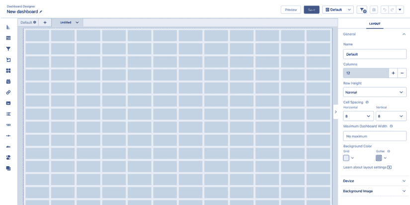

图 8.1 – 初始仪表板编辑器画布

在继续下一步之前，将你的仪表板保存为My First Analytics App中的My First Dashboard。

现在，通过点击**Default**齿轮图标来配置仪表板设置。我通常使用以下默认设置：

- **名称：** `Default`
- **列数：** 50
- **行高：** 精细
- **单元格间距：** 8（水平）和0（垂直）
- **最大仪表板宽度：** 1500
- **背景颜色：** 暂时保持原样

画布左侧有14个可用工具，如下所述；当你将它们添加到仪表板时，将对这些工具进行说明：

- 图表
- 表格
- 筛选器
- 容器
- 组件
- 日期
- 链接
- 图像
- 列表
- 数字
- 范围
- 文本
- 切换
- 导航

当你点击编辑器右上角的下拉箭头时，你有以下选项：

- **在新标签页中克隆：** 在新标签页中创建当前仪表板的克隆。
- **仪表板属性：** 常规选项和小部件默认属性。
- **选择初始值**：设置仪表板的默认筛选器和分面值；这些值将在每次打开仪表板时应用。
- **对话**：允许你使用日常对话语言查询数据。需要启用此功能并为用户分配正确的权限，用户才能查看和使用此功能。
- **连接数据源**：使用公共字段联接数据源。
- **删除**：永久删除仪表板。

现在是时候充实你的仪表板了。

### 创建仪表板并放置小部件

向您展示如何构建仪表板并帮助您熟悉仪表板编辑器的最佳方式是引导您完成一个简单的仪表板构建。

### 创建销售仪表板

我们将基于**My First Analytics App**中的**Opportunities**数据集创建一个销售仪表板。请按照以下步骤操作：

1. 点击画布右侧的**Create Query**按钮创建一个新查询。
2. 在**My First Analytics App**中选择**Opportunities**数据集。这将把你带到一个熟悉的视图，该视图几乎与lens相同。
3. 在左上角看到铅笔图标的位置，将查询重命名为**Pipeline by Close Date**。
4. 将度量（**条形长度**）更改为**Sum of Amount**。
5. 为**Close Date (Year-Month)**添加分组（**条形**）。
6. 在最右侧，点击图表图标，并将图表类型更改为**DATES & TIMES**类别中的**Time Bar**。
7. 为**Closed**添加一个筛选器，使其等于**False**的值（即开放机会）。
8. 点击**完成**，关闭窗口。

   该查询现在出现在右侧查询列表中的**Opportunities**数据集下。

9. 将查询拖到画布上。这将创建一个图表小部件。
10. 通过拖动控制柄放大小部件。
11. 点击**保存**保存你的仪表板。

请注意，前述步骤所获得的结果也可以通过从左侧菜单将图表部件拖放到画布上来获得。

仪表板现在应如下所示：

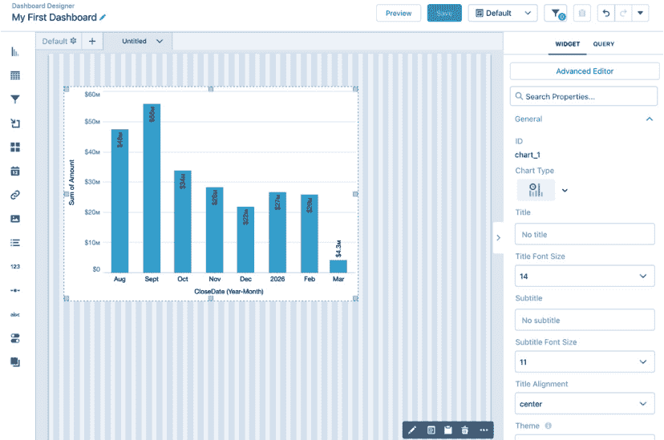

图 8.2 – 添加了管道图表的仪表板编辑器画布

### 在销售仪表板上放置部件

当你选择部件时，现在画布右下角有以下几个部件选项可用：

- **Edit Query and Widget:** 打开部件进行编辑。
- **Advanced Editor:** 打开 **Advanced Interaction Editor**。这将在 *第 9 章，高级仪表板设计与构建* 中介绍。
- **Copy widget to clipboard:** 复制部件，以便将其粘贴到此仪表板或任何打开的仪表板中。
- **Delete Widget:** 删除仪表板上的部件，但不删除查询。
- **Duplicate Widget:** 复制带有查询的部件并将其添加到仪表板。
- **View Query Properties**: 在右侧打开查询属性窗口。
- **Clone Query**: 克隆查询并打开以进行编辑。
- **Remove Query**: 从部件中移除查询并保留其格式，而不将部件从仪表板中移除。

你现在将通过以下步骤编辑管道部件：

1. 在最右侧，单击 **Formatting**（画笔）图标。
2. 在 **Title** 字段中，为部件添加标题：`Pipeline by Close Date`。
3. 将 **Title Font Size** 设置更改为 18。
4. 在 **Subtitle** 字段中，添加副标题：`All open deals`。
5. 将 **Subtitle Font Size** 设置更改为 14。
6. 将 **Title Alignment** 更改为左对齐。
7. 将 **Theme** 字段更改为 `Light`。
8. 在 **Time Bar Chart** 下，取消选中 **Show values in chart bars** 选项。
9. 在 x 轴下，添加自定义标题：**Close Date Month**。
10. 在 y 轴（左侧）下，添加自定义标题：**Deal Size**。
11. 在 y 轴下添加一条参考线，**Value** 设置为 3000000，**Label** 值为 **Target**。
12. 在 **Conditional Formatting** 下，单击 **Apply Conditional Formatting To** 并选择 **Sum of Amount**。保留默认的渐变设置。
13. 在 **Widget Style** 下，按需添加边框。
14. 添加一个文本部件为仪表板添加标题，**Sales Insights**，并按需更改字体和颜色。进入 **Preview** 模式。

前述步骤的结果应如下所示：

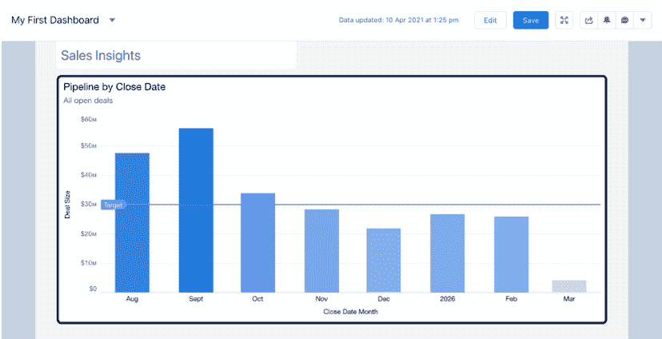

图 8.3 – 我的第一个仪表板，管道部件已完成

在继续之前，请进行一些细微更改以改善仪表板美观，具体如下：

1. 单击 **Edit** 编辑仪表板。
2. 单击 **Default** 齿轮图标打开仪表板设置。
3. 在 **Background Color** 下，将 **Grid** 更改为白色。
4. 从仪表板编辑器右上角的下拉列表中选择 **Dashboard Properties**。
5. 通过单击 **Background Color**，选择 **Custom**，并将透明度条完全拖到最左侧，将默认部件背景颜色更改为透明。
6. 添加默认部件边框，颜色为透明，宽度和半径均为 8。
7. 单击 **Save** 保存仪表板。

你现在将通过从现有管道部件开始向仪表板添加第二个部件。管道部件是主图表，通常称为 *hero chart*，它需要支持图表和指标。按照以下步骤向仪表板添加第二个部件：

1. 选择管道部件并单击 **Copy Widget**。
2. 将重复的部件粘贴到仪表板画布上。
3. 选择新部件并转到右侧的 **Widget** 面板。
4. 通过取消选中边框图标来移除部件边框。
5. 通过在格式面板中单击参考线旁边的 x 来移除目标参考线。
6. 通过单击 **Chart Type** 按钮并选择柱状图，将图表类型更改为 **Bar**。
7. 单击新部件的 **Edit Query and Widget**。
8. 将柱状分组更改为 **Stage**。
9. 按 **Descending** 顺序对 **Sum of Amount** 字段进行排序。
10. 通过取消选中 **Show legend** 复选框来移除图例。
11. 移除 y 轴上的标题。
12. 移除 x 轴（顶部）的轴和标题。
13. 选中 **Show values in chart bars**。
14. 将部件标题更改为 `Pipeline by Stage` 并将字体大小减小到 16。
15. 移除副标题。
16. 将查询重命名为 `Pipeline by Stage`。
17. 单击 **Update**。
18. 移动并调整部件大小（缩小），因为它支持第一个管道图表。
19. 通过取消选中边框图标，从仪表板标题文本部件中移除默认边框。
20. 单击 **Save**。

仪表板现在应如下所示：

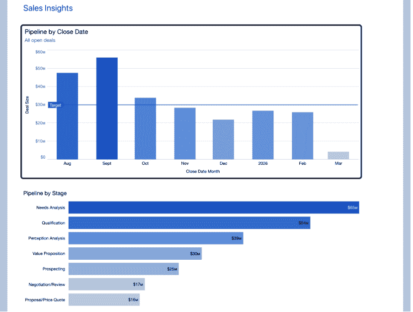

图 8.4 – 我的第一个仪表板，已添加按阶段划分的管道

### 向销售仪表板添加亮点面板

现在，是时候向你的仪表板添加一个亮点面板了。这对于引起对关键指标和仪表板过滤器的注意非常有用。为此，你可以按照以下步骤操作：

1. 按住 *Cmd* 或 *Ctrl* 同时单击每个部件以同时选择两个图表部件，然后向下拖动几行，为亮点面板腾出空间。
2. 将 **Container** 部件拖到画布上。
3. 调整/放大容器，将标题文本部件移入容器，然后确保容器填满英雄图表上方的空间。
4. 通过单击 **Create Query** 并选择 **Opportunities** 数据集来创建新的销售查询。
5. 我们想要跟踪赢得的交易总数，因此继续为 **Won = True** 添加过滤器。
6. 将查询标题更改为 **# of Deals Won**。
7. 单击 **Done**。
8. 将 **Number** 部件拖入亮点面板容器并放大。
9. 将新查询（**# of Deals Won**）拖到部件上。你现在应该看到一个带有标题 **Count of Rows** 的数字。
10. 选择 **Number** 部件并将标题更改为 **# of Deals Won**。
11. 在 **Text Style** 下，编辑数字和标题的颜色和大小，使数字突出。
12. 通过使用 **Duplicate Widget** 按钮克隆此 **Number** 部件。
13. 将新部件拖入亮点面板。
14. 编辑第二个 **Number** 部件并将度量（**Bar Length**）更改为 **Sum of Amount**。这现在捕获了赢得交易的价值。
15. 将部件查询重命名为 **Value of Deals Won**。
16. 单击 **Update**。
17. 格式化以匹配第一个数字部件。
18. 选中 **Shorten Number** 选项。
19. 为了使亮点面板突出，选择容器并将背景颜色更改为深蓝色。
20. 编辑标题和数字部件以使其突出。
21. 在仪表板设置下的 **Default** 中，将 **Cell Spacing** 更改为 0。
22. 将 **Maximum Dashboard Width** 更改为 1400。
23. 单击 **Save**。

添加亮点面板后的仪表板应如下所示：

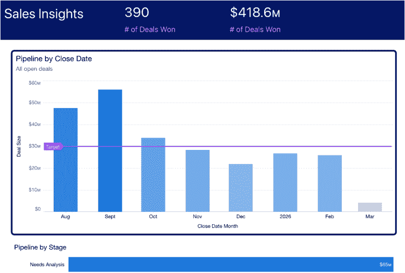

图 8.5 – 添加了亮点面板的仪表板：特写

### 向销售仪表板添加过滤器

现在，你将通过以下步骤添加全局过滤器和切换器：

1. 将 **Filter** 部件拖入容器。
2. 选择新部件并单击 **Filter**。
3. 选择 **Opportunities** 数据集，选择 **Industry** 字段，然后单击 **Create**。你现在已为仪表板创建了一个全局过滤器，使用户能够按行业深入分析。
4. 由于这将成为一个全局过滤器的小面板，请单击画布右侧的 **Widget** 面板上的 **All Global Filters** 单选按钮。
5. 单击 **Manage Global Filters** 以调出 **Dashboard Global Filters** 面板。

- 6. 在您看到**机会**数据集的位置，点击+按钮，向此数据集添加另一个筛选器，然后选择**账单国家**。
- 7. 为**机会类型**添加第三个筛选器。由于**每行筛选器数**选项设置为仅2，它尚未出现在仪表板上。
- 8. 退出**管理全局筛选器**编辑界面，点击该小部件，然后将**每行筛选器数**增加到3。
- 9. 在**仪表板全局筛选器**面板中，点击铅笔图标编辑筛选器标题。值应为**国家**、**行业**和**类型**。
- 10. 拖动**筛选器**小部件上的手柄，增大其尺寸，在右侧留出一个部件的空间。
- 11. 编辑**筛选器**小部件的格式以符合您的个人偏好。您可以在图8.6中看到一个示例。
- 12. 您需要更多空间来容纳**开关**小部件，因此请调整高亮面板小部件的大小和位置以腾出空间。
- 13. 将一个**开关**小部件拖到容器中，放在新**筛选器**小部件的右侧。
- 14. 点击**开关**并选择**账户类型**。
- 15. 将**度量字段**更改为--无--。
- 16. 将**开关**小部件的边框更改为**白色**，宽度2，半径4。
- 17. 将**文本大小**设置增加到16。
- 18. 将**文本颜色**设置更改为浅蓝色。
- 19. 点击**保存**以保存仪表板。

进入**预览**模式，查看选择不同筛选器和使用开关时会发生什么。使用这些功能，以及通过点击图表中的维度进行分面，可以非常轻松地深入钻取仪表板数据。您的仪表板现在应如下所示：

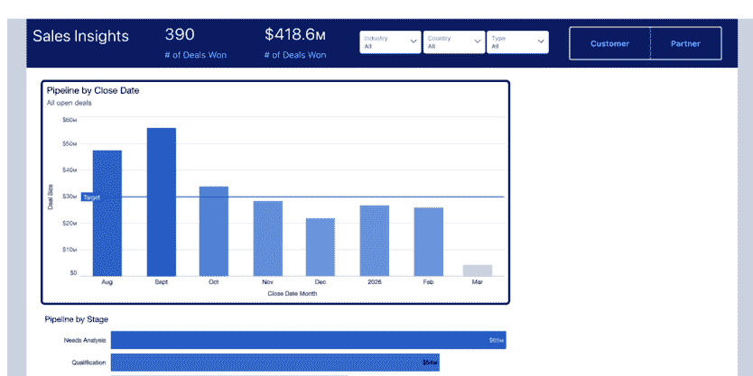

图8.6 – 添加了筛选器和开关的销售仪表板

### 向销售仪表板添加图像、日期、列表和范围小部件

您将按照以下步骤添加图像、日期、列表和范围小部件：

- 1. 通过将图像小部件拖到画布上并点击图像，为仪表板添加徽标。
- 2. 上传合适的图像，例如虚构的企业徽标。
- 3. 移除小部件边框。
- 4. 将仪表板标题移至容器底部，并根据需要调整字体大小。
- 5. 缩小图像小部件并将其放在仪表板标题上方。将图像缩放更改为适配高度。
- 6. 将一个日期小部件拖到画布上，位于开关下方，然后点击日期，选择关闭日期。
- 7. 将标题字段更改为关闭日期。
- 8. 将**日期**小部件调整为所在空间宽度的一半，使其更高，并将其移动到画布的右边缘。
- 9. 将一个**列表**小部件拖到画布上，点击**列表**，然后选择**细分**。
- 10. 将**列表**小部件的大小调整为与**日期**小部件匹配。
- 11. 将**标题**字段更改为**细分**。
- 12. 点击右侧的**查询**选项卡，并将**选择类型**更改为**多选**。
- 13. 将一个**范围**小部件拖到画布上，位于刚添加的两个小部件下方。
- 14. 拉伸**范围**小部件以填充可用空间。
- 15. 点击**范围**并选择**金额**。
- 16. 点击**保存**以保存仪表板。

在仪表板中再添加两个图表，分别用于按行业细分**销售管道**和显示**十大账户所有者**（为此使用**查询限制**）。按您觉得合适的方式设置格式。保存仪表板；它看起来应类似于这样：

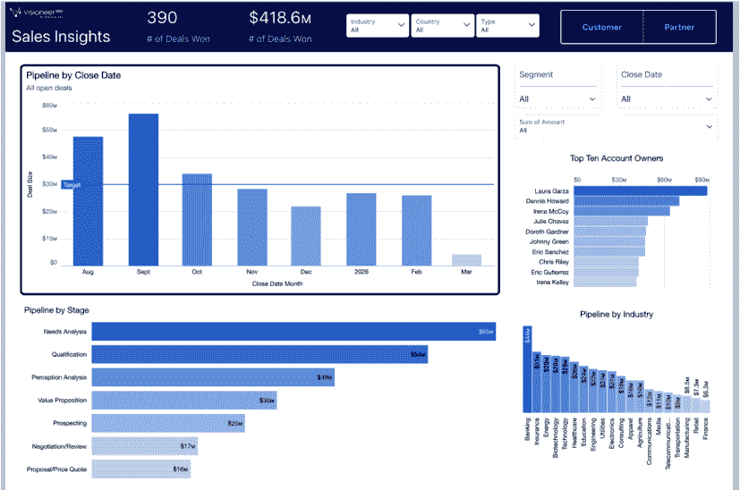

图8.7 – 已完成第一页的销售仪表板

### 魔鬼在细节中

在本节中，您将了解可用于编辑仪表板的详细选项。

在您的新仪表板中，查看查询面板及其可用选项。您可以在以下屏幕截图中看到概览：

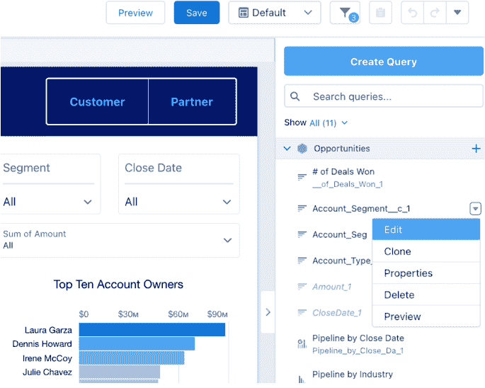

在面板中，每个查询都有五个可用操作，如下所述：

- **编辑**：打开查询进行编辑和格式化。
- **克隆**：创建查询的副本，并在**编辑**模式下打开。
- **属性**：可访问查询配置选项，例如分面、选择类型和初始选择。本节后面将提供更多详细信息。
- **删除**：从仪表板中删除查询。
- **预览**：以值表格式打开预览窗口。

关于查询属性，以下是更多详细信息：

- **显示标签**：可在此处编辑面向用户的查询标签。
- **应用全局筛选器**：如果您不希望仪表板全局筛选器应用于此查询及其驱动的小部件，请取消勾选。
- **分面**：这里有四个选项——**全部**、**包括**、**排除**和**无**。默认值**全部**意味着在其他小部件上选择值会将那些分面值应用于此查询及其驱动的小部件，这与标准仪表板行为一致。可以通过选择**包括**（选择哪些特定查询作为此查询的分面值）、**排除**（选择哪些特定查询不作为此查询的分面值）或**无**（此查询不应用分面）来修改此默认行为。
- **选择类型**：当用户点击小部件选择时，选择将应用哪种类型：**无**、**单选**、**多选**、**单选(必填)**和**多选(必填)**。
- **将选择作为分面广播**：取消勾选可关闭默认的分面行为，这意味着在此查询上做出的选择不会对其他查询进行分面。
- **初始选择**：显示为此仪表板配置的初始选择。

这些查询操作和属性使您在仪表板设计中拥有极大的灵活性。现在，让我们来看看仪表板页面的强大功能。

### 理解基于页面的自上而下设计

从业务用户的角度来看，在调查和分析数据时，不得不频繁地在仪表板之间切换是很不方便的。此外，应用于一个TCRM仪表板的筛选器不会转移到另一个仪表板。利用TCRM页面对仪表板进行灵活的自上而下设计，可以克服这些障碍，并为数据的切片和切块提供简单灵活的界面。

理解页面功能的最佳方式是将其应用到仪表板，因此请编辑您的**我的第一个仪表板**仪表板，并按照以下步骤操作：

- 1. 点击**默认**右侧、**未命名**旁边的下拉箭头，打开TCRM页面的**用户界面（UI）**。
- 2. 点击**重命名**，将现有页面重命名为**销售**。
- 3. 您可以点击+添加新的空白页，但我们希望沿用高亮面板，因此选择下拉箭头并选择克隆。此时会出现一个新页面，名为“销售的克隆”。
- 4. 将新页面重命名为营销。

以下是TCRM页面的UI：

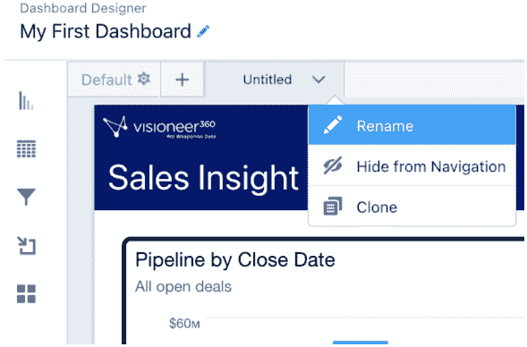

图8.9 – TCRM页面UI

现在，继续构建新页面，如下所示：

- 1. 删除除高亮面板之外的所有小部件；您可以在按住Cmd（Mac）或Ctrl（Windows）的同时单击每个小部件来选择多个小部件。别担心——它们不会从销售页面中移除！
- 2. 删除高亮面板上除徽标和标题之外的小部件。系统会询问：删除小部件和全局筛选器？点击**仅删除小部件**，因为您不想删除全局筛选器。
- 3. 点击标题文本小部件。在右侧的小部件面板上，注意有一条消息：此小部件存在于多个页面上。除非您取消链接，否则此处的更改将应用于其他页面上的实例。这很重要——如果您修改此小部件，它将修改此小部件的所有其他副本。
- 4. 点击**取消链接**。
- 5. 将标题更改为营销洞察。
- 6. 调整标题文本小部件的大小，使文本正确显示。
- 7. 保存仪表板并关闭。

在我们完善 **Marketing** 页面之前，我们首先需要创建一个名为 **Leads** 的数据集，其基于 Salesforce **Lead** 对象。根据之前章节的知识，请继续操作。我们现在希望保持简单，因此只需使用 **Lead object data** 并选择以下字段：

- **Annual Revenue**
- **City**
- **Company**
- **Converted**
- **Converted Date**
- **Country**
- **Created Date**
- **Email**
- **Employees**
- **Full Name**
- **Industry**
- **Lead Source**
- **Phone**
- **State/Province**
- **Status**

继续点击 **Create Dataset**。查看 **Data Manager** 中的监视器，并在新的 **Leads** 数据集创建完成后继续。首先，你需要添加一个页面导航器小部件，以便在 **Preview** 模式下在页面之间轻松移动。为此，请按照以下步骤操作：

- 1. 将 **Navigation** 小部件拖到你的 **Marketing** 页面上。
- 2. 移除 **Navigation** 小部件的边框。
- 3. 调整此小部件的大小，使其高出一个单元格。
- 4. 将 **Navigation** 小部件向上移动，使其紧贴 highlights 面板容器。
- 5. 格式化 **Navigation** 小部件，使其在页面上突出但不与其它小部件冲突。参见 *Figure 8.10* 中的示例。

- 6. 进入 **Sales** 页面并将所有小部件（不包括 highlights 面板）向下移动（如有需要），在键盘上使用箭头按钮同时选中多个小部件来操作。这将为 **Navigation** 小部件腾出空间。
- 7. 在画布底部的 **Move/Add** 操作下，在选中 **Navigation** 小部件时，点击 **Add to Page** 并选择 **Sales**。
- 8. **Navigation** 小部件现在应显示在 **Sales** 页面上。如有必要，将其移动到合适位置，并按需移动其它小部件。

带有 **Navigation** 小部件的仪表板应如下所示：

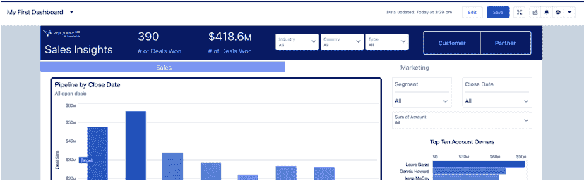

Figure 8.10 – Your dashboard with the Navigation widget in place

现在，是时候使用营销数据构建新页面了。请按照以下步骤操作：

- 1. 编辑仪表板并选择 **Marketing** 页面。
- 2. 基于 **Leads** 数据集创建一个新的查询。
- 3. 按 **Lead Source** 对行数计数进行分组。
- 4. 将查询重命名为 **Leads by Source** 并添加此标题。
- 5. 为查询选择 **Donut** 图表。
- 6. 点击 **Done**。
- 7. 你现在会注意到 **Query** 面板现在在 **Leads** 以及 **Opportunities** 下列出了查询。
- 8. 将此新的 **Leads** 查询拖到画布上。
- 9. 调整 **Chart** 小部件的大小和格式以满足你的偏好。在我的示例中，如以下屏幕截图所示，我选择创建一个饼图，将 **Center Size** 值设为 0% 并将饼图值显示为 **Percentage**。
- 10. 创建并添加一个 **Leads by Status** 的小部件——使用 Origami 图表并将图例放在顶部中央。

- 11. 创建并添加一个 **Leads Count by State and Status** 的小部件——使用堆叠柱状图。
- 12. 创建并添加一个 **Heat Map of Source and Status** 的小部件。
- 13. 格式化并编辑以满足你的偏好。
- 14. 点击 **Save** 保存仪表板。
- 15. 在 highlights 面板中为 **Lead Source** 添加一个 **List** 小部件。将 **Selection Type** 更改为 **Multiple Selection**。
- 16. 在 highlights 面板中为 **Industry** 添加一个 **List** 小部件。
- 17. 在 highlights 面板中为 **Total Leads** 添加一个 **Number** 小部件。
- 18. 在 highlights 面板中为 **Open Leads** 添加一个 **Number** 小部件（按 **Status** 过滤为不等于 **Closed**）。
- 19. 点击 **Save** 保存仪表板。

你的营销页面应如下所示：

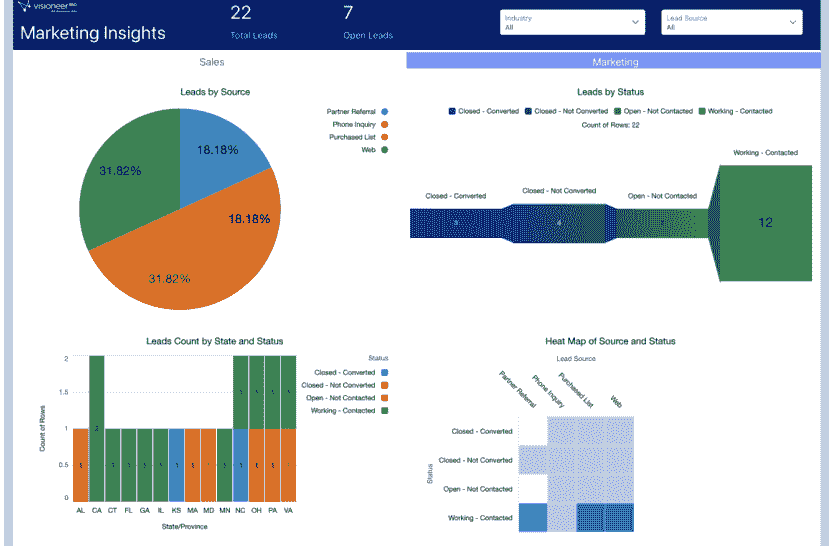

Figure 8.11 - The completed marketing analytics page

现在，我们希望连接我们的数据源，以便按 **Lead Source** 过滤时可在两个页面上应用。未连接数据源时，过滤器仅在每个单独页面上生效，因为每个页面都是使用来自一个数据集的查询创建的（**Opportunities** 或 **Leads**）。请按照以下步骤连接数据源：

- 1. 使用仪表板编辑器右上角的下拉列表，点击 **Connect Data Sources**。将出现一个对话框。
- 2. 点击 **New Connection**。
- 3. 为连接命名 **Leads and Opportunities by Source**。
- 4. 点击 **Choose Data Source 1**。
- 5. 在 **Select Data Source** 下，选择 **Opportunities**。
- 6. 在 **Select a field** 下，选择 **Lead Source**。
- 7. 点击 **Choose Data Source 2**。
- 8. 在 **Select Data Source** 下，选择 **Leads**。
- 9. 在 **Select a field** 下，选择 **Lead Source**。
- 10. 点击 **Save**。

保存连接之前的对话框应如下所示：

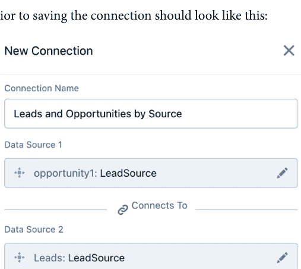

Figure 8.12 – Completed data connection dialog box

现在，是时候测试连接了。

在 **Marketing** 页面上，点击 **Lead Source** 的 **List** 小部件并选择 **Web**。页面现在将按所选值进行过滤。现在，移动到 **Sales** 页面，你会看到销售数据也已按 leads 和 deals 的 web 来源进行了过滤。

现在你已成功从头开始创建了第一个 TCRM 仪表板，包括页面的多功能性，是时候学习如何使用和共享仪表板了。

### A user's guide to a TCRM dashboard

你现在将在 **Preview** 模式下打开你的新仪表板，并作为业务用户来使用它，学习如何在 TCRM 中切片和切块你的数据。在探索数据之前，请移除 hero 图表 **Pipeline by Close Date** 上的静态目标，因为这会妨碍我们的探索。我们将在 *Chapter 9, Advanced Dashboard Design and Build* 中查看动态参考线。此外，确保所有图表小部件的 **Selection Type** 都设置为 **Multiple Selection**。

以下步骤将帮助你探索和共享你的仪表板：

- 1. 打开 **My First Dashboard** 仪表板并进入 **Present** 模式。
- 2. 通过在 **List** 小部件中选择 **MM** 和 **GB** 来按 **Segment** 过滤。
- 3. 通过在 **Sum of Amount** 下选择 **50,000 – 500,000** 来按交易规模下钻。
- 4. 我们只对新交易感兴趣，因此在 **Type** 全局过滤器下排除 **Existing Business**（使用 **Does Not Equal**）。
- 5. 通过进入 **Pipeline by Stage** 图表并选择这两个条：**Negotiation/Review** 和 **Perception Analysis** 来对仪表板进行分面。
- 6. 保存此仪表板视图。在仪表板标题旁边，点击 **Modified** 旁边的向下箭头，并选择 **Save View**。将其命名为 **Sales drill down** 并点击 **Create**。
- 7. 点击 **Save** 保存仪表板。

你的仪表板现在应如下所示的屏幕截图；请注意，由于你选择的阶段，highlights 面板中 **# of Deals Won** 的结果显示 **No Results Found**：

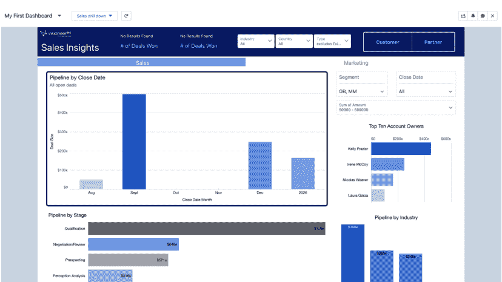

Figure 8.13 – Your dashboard in Sales drill-down view after drilling into the data

你现在将通过以下步骤共享此仪表板视图：

- 1. 点击屏幕右上角的 Share 按钮。
- 2. 有几种共享此仪表板视图的方式，但现在，你希望与有权访问此应用的同事共享链接，并附上参考截图。首先，你将点击 GET URL，然后复制统一资源定位符（URL）并将其添加到电子邮件中。
- 3. 接下来，点击 DOWNLOAD 并将仪表板视图下载为图像。将图像添加到你的电子邮件中。
- 4. 你的同事现在可以快速以图像形式查看仪表板，然后点击 URL 在 TCRM 仪表板中实时查看数据。请注意，他们的视图将保留你在切片和切块数据时应用的过滤和分面。

以下是你想要分享“我的第一个仪表盘”的 URL 时看到的内容：

我的第一个仪表盘

授予访问权限 发布到信息流 导出到任意位置 获取链接 下载

只有有权访问此仪表盘的人才能查看此链接。

https://v3602-dev-ed.my.salesforce.com/analytics/wave/dashboard?assetId=0FK5g000000Ns8jGAC&orgId=00D

在以下位置打开链接

Analytics 标签页
在 Lightning Experience 中使用 Analytics 进行探索、个性化设置、协作和操作。

Analytics Studio
整合并可视化数据，构建和生成 Analytics 应用。

图 8.14 – 分享“我的第一个仪表盘”的 URL

这是你想要将“我的第一个仪表盘”下载为图片时看到的内容：

我的第一个仪表盘

授予访问权限 发布到信息流 导出到任意位置 获取链接 下载

选择下载此资源的方式：

下载为图片

图 8.15 – 将“我的第一个仪表盘”下载为图片

接下来，让我们按照以下步骤，从仪表盘创建一个透镜，深入查看数据，并与同事分享：

- 1. 转到 **Top Ten Account Owners**（十大客户所有者）图表组件，点击组件右上角的下拉箭头。
- 2. 点击 **Explore**（探索）。
- 3. 点击 **FILTERS**（筛选器）标签页。请注意，探索透镜保留了在仪表盘级别应用于 **Opportunity Type**（商机类型）、**Amount**（金额）、**Segment**（细分）和 **Stage**（阶段）的四个筛选器。
- 4. 点击数值最高的条形，即 **Kelly Frazier**。
- 5. 点击带有放大镜图标的钻取按钮。
- 6. 在 **Drill Into This By**（按此钻取）下，搜索 **Opportunity Name**（商机名称）并选择它。
- 7. 现在你应该能看到 Kelly Frazier 的两个进行中的交易。这就是你想要的信息，因此现在点击 **Save**（保存）。
- 8. 将此透镜保存为 **Kelly's deals for discussion**（Kelly 待讨论的交易），保存在 **My Private App**（我的私有应用）下。
- 9. 现在，通过复制 **GET URL**（获取链接）下的 URL，并通过 Slack 或 Teams 分享，将此透镜与 Kelly 共享。

透镜应如下所示：

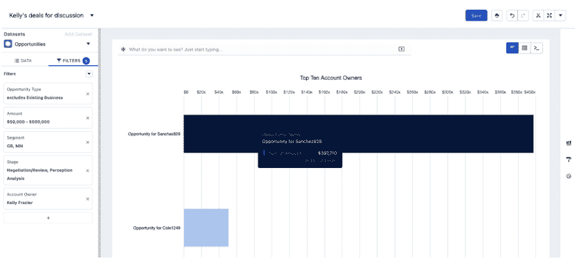

现在你已经知道如何对 TCRM 仪表盘进行切分和钻取，并与同事分享结果，让我们回顾一下本章所学的内容。

### 总结

正如你在本章中所看到的，TCRM 是一个多功能且用户友好的平台，用于构建仪表盘、分析数据和分享发现。

你到底学到了什么？首先，你现在能够识别并使用 TCRM 仪表盘编辑器中可用的工具。此外，你可以创建组件并将其添加到仪表盘。第三，你可以编辑和格式化组件以满足你的需求。另外，你对于添加和管理 TCRM 页面充满信心。最后，你应该能够熟练使用仪表盘并与他人分享发现。

下一章将教你如何在 TCRM 仪表盘中构建高级功能。

### 问答题

以下是一份测试你知识的问题列表：

- 如果你希望同事访问仪表盘的特定视图并深入查看数据，你会如何与他们分享？
- “将组件复制到剪贴板”命令的目的是什么？
- 仪表盘推荐的默认列数是多少？
- 当你从一个仪表盘切换到另一个仪表盘时，应用于第一个页面的筛选器是否仍然保留？
- 你如何在仪表盘中使用容器组件？
- 什么是自上而下的仪表盘设计？TCRM 页面如何促进这种设计？
- “Clone Query”（克隆查询）命令会克隆查询并打开它进行________________。
