## 9 高级仪表盘设计与构建

既然你已经构建了第一个仪表盘，现在是时候超越基础知识了。在本章中，你将学习高级仪表盘设计和构建。完成本章后，你将知道如何使用 Tableau CRM（TCRM）页面增强设计，使用 Salesforce Analytics 查询语言（SAQL）创建更复杂的查询，以及通过代码或点击构建交互和绑定。

你将在本章学到什么？我们将探讨以下主题：

- 页面动画的创造性使用
- 从代码开始——SAQL 简介
- 使用绑定将各部分串联起来
- 使用高级编辑器

### 技术要求

要成功执行本章中的说明，你需要以下内容：

- 最新版本的 Google Chrome 浏览器（Chrome 是使用 TCRM 时的首选浏览器）
- 一个可用的电子邮件地址

请确保你已登录到你的 TCRM 开发组织。

让我们从 TCRM 中页面动画的使用时机和方法开始。

### 页面动画的创造性使用

TCRM 页面功能使你能够创建富有创意的仪表盘，利用动画来增强仪表盘的功能和可用性。

从你的 Analytics Studio 主页，打开你在*第 8 章“构建你的第一个 TCRM 仪表盘”*中创建的 **My First Dashboard**（我的第一个仪表盘）。按照以下步骤创建一个你将使用多个页面工作的仪表盘：

- 1. 克隆它以创建一个新仪表盘，**My Advanced Dashboard**（我的高级仪表盘）。
- 2. 在 **Edit**（编辑）模式下打开这个新仪表盘。
- 3. 克隆 **Sales**（销售）页面，并将这个新页面重命名为 **Sales Clean**（简洁销售）。
- 4. 在 **Page Options**（页面选项）下拉菜单下，选择 **Hide from Navigation**（从导航中隐藏）。请注意，这会将该页面从导航组件中移除。
- 5. 移除并重新排列组件，使页面与*图 9.1* 中看到的内容一致。当系统提示移除全局筛选器组件时，选择 **Delete Widget Only**（仅删除组件）。
- 6. 点击 **Save**（保存）以保存仪表盘。

这是完成的链接组件格式：

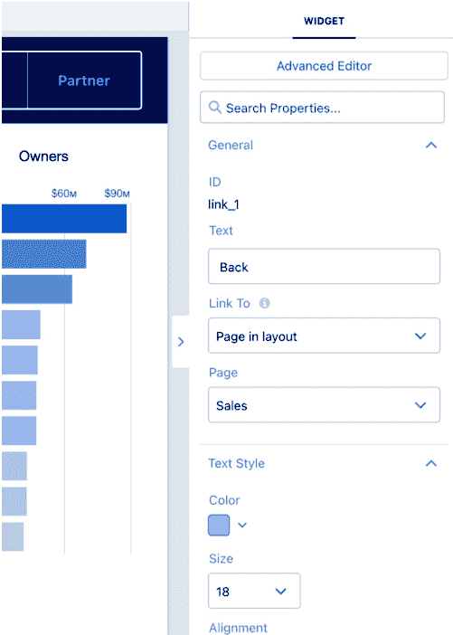

现在你的极简页面有了一个返回原始 Sales 页面的链接，你需要为用户提供一种从 Sales 页面进入极简页面的方式。按照以下步骤操作：

- 1. 复制链接组件。
- 2. 导航到 Sales 页面。
- 3. 粘贴链接组件；它应出现在页面底部。
- 4. 现在你需要为链接组件腾出空间。首先，从“Pipeline by Close Date”（按结束日期的管道）英雄图表中移除标题，并将文本保存到剪贴板。
- 5. 在页面底部添加一个容器组件，并调整其大小，以便容纳要移入的英雄图表。
- 6. 添加边框以匹配英雄图表。
- 7. 移除英雄图表的边框。
- 8. 将英雄图表拖入容器中，然后调整其大小以容纳标题。
- 9. 将新的文本组件拖入容器中。
- 10. 将链接组件移动到容器的最右侧。
- 11. 将链接组件的文本更改为“No Filters”（无筛选器），并使其链接到布局中的 `Sales Clean` 页面。
- 12. 将容器移动到页面顶部、页面导航器下方。
- 13. 进入 **Preview**（预览）模式并测试导航。
- 14. 点击 **Save**（保存）以保存仪表盘。

添加了导航的修订版英雄图表所在的 Sales 页面应如下所示：

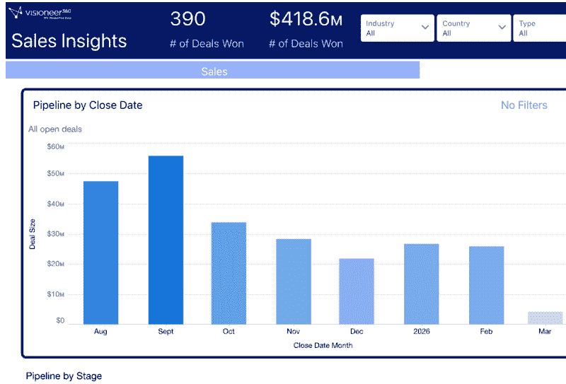

图 9.3 – 添加了导航的修订版英雄图表所在的 Sales 页面

让我们创建一个全新的仪表盘，以了解更多关于工作页面和动画的信息。将此仪表盘命名为 **Clever Pages**（巧妙页面），并按如下方式更改设置：

- 列数：50
- 行高：细
- **单元格间距：** 0
- **最大仪表盘宽度：** 1200
- **背景颜色：** 为装订线选择白色，为网格选择深色。
- 在 **Widget Default Properties**（组件默认属性）下，将背景颜色设置为透明，并添加透明边框。
- 点击 **Save**（保存）以保存仪表盘。

要开始使用你的新仪表盘，请从 **My Advanced Dashboard** 复制突出显示面板，并将其粘贴到 **Clever Pages** 仪表盘中。编辑颜色，直到得到类似这样的效果：


图 9.4 – Clever Pages 仪表盘上的突出显示面板

你现在要做的是创建一个简单的仪表盘，并学习如何使用页面进行缩放、展开和收缩。按照以下步骤创建一个主页（提前查看图 9.5 以确保你方向正确）。为组件选择深色主题：

- 1. 添加一个堆叠柱状图，标题为 **Open Pipeline by Close Date and Stage**（按结束日期和阶段显示进行中的管道）。
- 2. 将此图表的标题替换为一个链接组件，稍后将用于导航到 **Expansion**（展开）页面。
- 3. 添加一个环形图，标题为 **Open Deals by Stage %**（按阶段百分比显示进行中的交易）；将中心大小设为 0% 以创建饼图。
- 4. 添加一个热力图，标题为 **Deals Won by Industry and Lead Source**（按行业和潜在客户来源显示赢得的交易）。
- 5. 添加一个组合图，标题为 **Deals Won by Opportunity Owner**（按商机负责人显示赢得的交易），显示计数和值。
- 6. 点击 **Save**（保存）以保存仪表盘。


这就是你的新仪表板应该看起来像的样子：

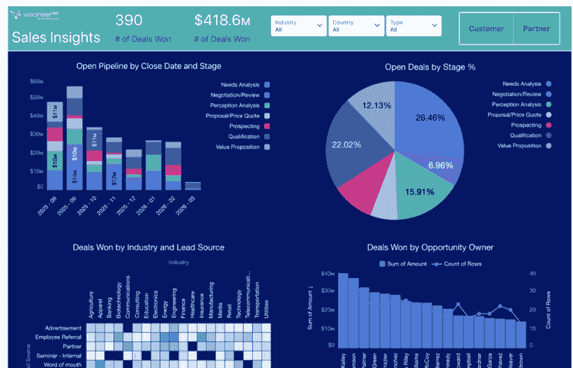

图 9.5 – Clever Pages 的成品主页

下一步是克隆此页面并使用它来创建英雄图表的扩展页面，按以下步骤操作：

1. 将现有页面重命名为 Home。
2. 克隆此页面并将新页面重命名为 Expansion。
3. 取消链接显示为标题 Open Pipeline by Close Date and Stage 的链接小部件。
4. 编辑 Home 页面上的此链接，使其指向 Expansion 页面。
5. 进入 Expansion 页面并编辑布局，使 Open Pipeline by Close Date and Stage 英雄图表非常突出。你可以移除饼图。
6. 调整用作标题的链接小部件大小，为右侧的第二个链接小部件腾出空间。
7. 将标题链接小部件指向 **Home** 页面。
8. 在右侧、英雄图表上方添加第二个链接小部件，指向 **Home** 页面。链接文本应为 Home。
9. 点击 **Save** 保存你的仪表板。

成品结果应如下所示：

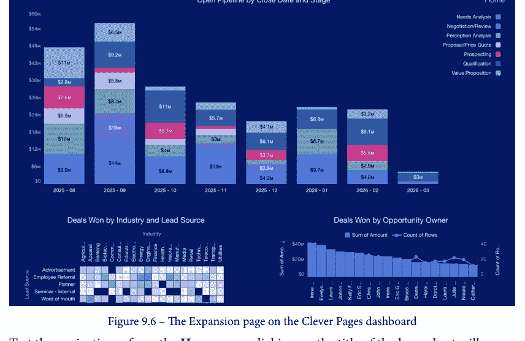

图 9.6 – Clever Pages 仪表板上的 Expansion 页面

测试导航——从 **Home** 页面，点击英雄图表的标题将展开该图表并允许详细分析；点击 **Home** 链接会带你返回，点击英雄图表标题也会返回。很棒！这种功能在仪表板设计中非常有用。例如，它可用于在图表上进行缩放以进一步分析，揭示英雄图表的更多细节，或促进数据分段。

让我们添加另一种类型的页面动画，其中钻取只需一次点击即可启用。打开 **Clever Pages** 仪表板并按以下步骤操作：

1. 克隆 **Home** 页面并将此新页面重命名为 **Industry and Lead Source**。
2. 移除文本为 **Open Pipeline by Close Date and Stage** 的链接小部件。
3. 移除除 **Deals Won by Industry and Lead Source** 之外的所有图表。
4. 将热力图图表移动到页面左上角。
5. 克隆热力图并将副本编辑为 **Pipeline by Industry and Lead Source**；更改筛选器以满足需求。
6. 添加一个标题为 **Breakdown of Deals Won and Lost by Industry** 的堆叠条形图。
7. 添加一个标题为 **Open Pipeline by Lead Source** 的条形图。
8. 移除全局筛选器（仅小部件）。
9. 在高亮面板中添加 **Lead Source and Industry** 的列表小部件。
10. 移除高亮面板中的切换小部件。
11. 在高亮面板中添加一个链接，文本为 **Go Back**，指向 **Home** 页面。
12. 进入 **Home** 页面并取消链接 **Deals Won by Industry and Lead Source** 图表。
13. 用一个链接替换此图表的标题，文本相同并指向 **Industry and Lead Source** 页面。
14. 取消链接高亮面板中的页面标题并将文本更改为 **Sales Breakdown**。
15. 测试导航。点击 **Deals Won by Industry and Lead Source** 的标题现在会带你到一个按行业和线索来源切片和切分销售数据的页面。很酷！
16. 点击 **Save** 保存你的仪表板。

结果将如下所示：

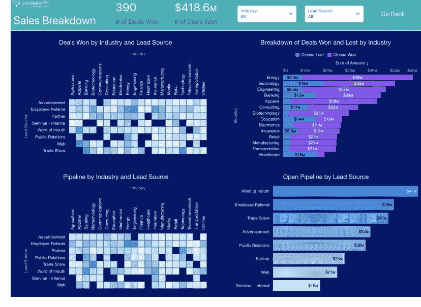

图 9.7 – 按行业和线索来源划分的销售明细

使用页面动画增强用户体验（UX）的另一种方式是使用页面来显示或隐藏详细信息面板。打开你的 Clever Pages 仪表板并按以下步骤操作：

1. 进入 Expansion 页面并克隆它。
2. 将页面重命名为 Expansion Detail。
3. 移除热力图图表。
4. 将组合图表移动到左侧并使其适合英雄图表的宽度。
5. 添加一个从上到下运行的容器小部件；参见图 9.8。
6. 将容器小部件背景颜色更改为与高亮面板匹配。
7. 取消链接说 Home 的链接小部件并将其颜色更改为白色。将此项移动到容器的右上角。
8. 在 **Home** 链接小部件左侧添加另一个链接小部件。**Text** 应为 **Back**；**Link To** 为 **Page in layout** 且 **Page** 为 **Expansion**。
9. 进入 **Expansion** 页面并取消链接 **Open Pipeline by Close Date and Stage** 链接小部件。
10. 编辑此小部件，使其现在链接到 **Expansion Detail** 页面。
11. 返回 **Expansion Detail** 页面并添加一个标题为 **Trend of Deals Won** 的时间线图表。
12. 添加一个标题为 **Pipeline by Stage** 的条形图。
13. 添加一个标题为 **Pipeline by Product Family** 的甜甜圈图。
14. 点击 **Save** 保存你的仪表板。

**Expansion Detail** 页面应如下所示：

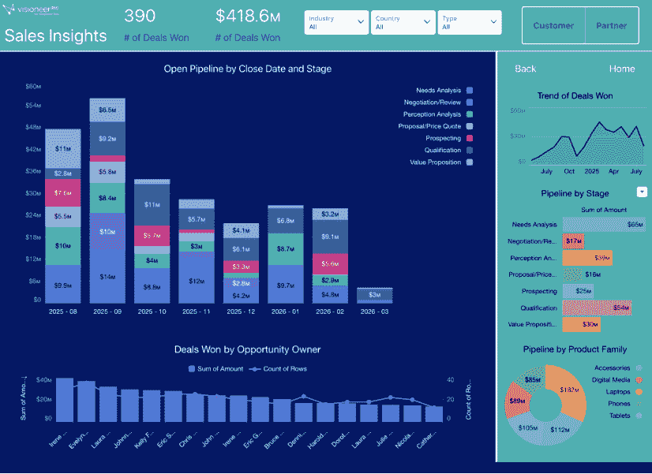

图 9.8 – Expansion Detail 页面

如果你通过点击英雄图表标题测试页面导航，你会看到页面启用了钻取，如下所示：

- Home page
- Focus on Open Pipeline by Close Date and Stage
- Details for Open Pipeline by Close Date and Stage
- Back to Focus on Open Pipeline by Close Date and Stage
- Back to Home page

作为我们使用 TCRM 页面进行智能设计的最后一个示例，让我们看看如何在图像上嵌入导航链接。按以下步骤操作：

1. 编辑 Clever Pages 仪表板。
2. 进入 Expansion Detail 页面。
3. 减小文本小部件的宽度，该小部件显示 Open Pipeline by Close Date and Stage，同时保持其居中在图表小部件上方。
4. 在页面上添加一个容器小部件，缩小其大小并将其移动到你刚刚调整大小的文本小部件左侧。
5. 从互联网下载一张透明图像。
6. 将此图像作为背景图像添加到新容器中。
7. 点击 Save 保存你的仪表板。

到目前为止，你的进度应如下所示：

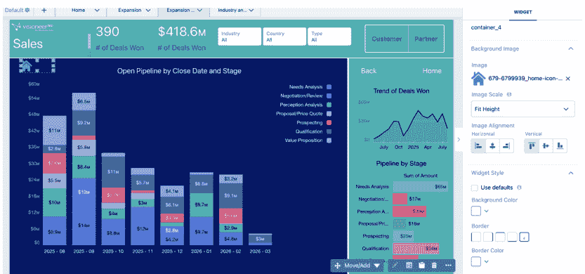

图 9.9 – 使用背景图像格式化容器

现在是时候为你的容器添加链接了！按以下步骤操作：

1. 为你的页面添加一个链接并缩小它，使其可放入新容器内。
2. 将链接移动到带有 **Home** 图标的容器上。
3. 从链接中移除所有文本。
4. 确保链接小部件具有透明背景。
5. 设置链接以导航到 **Home** 页面。
6. 点击 **Save** 保存你的仪表板。

测试你的仪表板——主页图标现在将带你返回 **Home** 页面。

让我们现在看一下 SAQL 的介绍——你在 TCRM 中进行代码的首次尝试！

### 开始使用代码 – SAQL 简介

本节将介绍你在 TCRM 中使用 SAQL 进行编码。

### 定义

我们现在将查看有关 SAQL 是什么以及何时可以使用它的详细定义。

### 什么是 SAQL？

**SAQL** 是一种运行时查询语言，可实现对数据集的即席分析。SAQL 脚本由一系列语句组成，这些语句由关键字（如 filter、group 和 order）、**标识符（IDs）**、文字或特殊字符组成。它基于 **JavaScript Object Notation (JSON)** 并与 **Apache Pig Latin (PIGQL)** 相似。SAQL 查询加载输入数据集，对其进行操作并输出结果。

这里有一个 SAQL 示例：

```
q = load "My_Dataset";
q = group q by 'Division_Name';
q = foreach q generate 'Division_Name' as 'Division_Name', sum('Amount')/sum('Quantity') as 'sum_Amt/Qty'; q = order q by 'sum_Amt/Qty' desc;
```

你在前面的片段中看到的是基本 SAQL 元素，如下所示：

- Load 语句用于加载数据
- 流 ID——在此例中为 "q"
- 使用各种 SAQL 函数和关键字的语句

### 何时使用 SAQL？

当你需要进行自定义计算、即时高级数据操作、来自不同数据集的数据协同分组（连接）、顶部/底部列表，结合绑定以在图表上使用动态值等时，可以使用 SAQL。

### SAQL 使用哪种语法？

以下是一些基本的 SAQL 语法：

- 关键字和函数以小写书写且区分大小写。
- 从数据集中调用的 **Application programming interface (API)** 名称应用单引号括起来，如下所示：'Division_Name'。
- API 名称区分大小写。
- 字符串必须用双引号括起来，例如 "Open"。

### 在哪里编辑 SAQL？

每个透镜的每一步都是基于 SAQL 的，因此可以编辑和/或添加自定义 SAQL。这些可以在 JSON 编辑器模式下查看或复制到你选择的 JSON 编辑器中。

按以下步骤查看如何查看和编辑 SAQL：

1. 从 **Opportunities** 数据集创建一个新透镜。
2. 随意向透镜添加筛选器。
3. 随意向透镜添加分组。
4. 选择两个度量。
5. 通过点击透镜中图表右上角的 **Query Mode** 按钮更改为查询模式。


This is what my example lens looks like in chart mode:

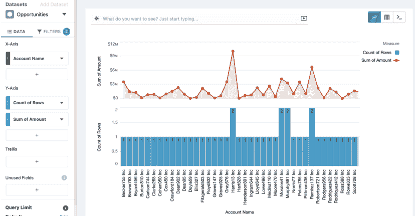

Figure 9.10 – A sample opportunity lens in chart mode

My example SAQL looks like this in query mode:

Learn how to write and edit SAQL queries ▶

```
q = load "opportunity1";
q = filter q by (!('StageName' in ["Closed Lost", "Closed Won"]) || 'StageName' is null);
q = filter q by 'Account.Industry' in ["Banking", "Biotechnology", "Communications", "Education", "Electronics"];
q = group q by 'Account.Name';
q = foreach q generate 'Account.Name' as 'Account.Name', count() as 'count', sum('Amount') as 'sum_Amount';
q = order q by 'Account.Name' asc;
q = limit q 2000;
```

| Account Name ↑ | Count of Rows | Sum of Amount |
|---|---|---|
| Becker755 Inc | 1 | $3,526,355 |
| Brewer763 Inc | 1 | $1,422,600 |
| Bryant456 Inc | 1 | $1,269,390 |
| Burton810 Inc | 1 | $136,800 |
| Carlson744 Inc | 1 | $788,800 |

Figure 9.11 – A sample opportunity lens with SAQL revealed in query mode

This is what the code looks like:

```
q = load "opportunity1";
q = filter q by (!('StageName' in ["Closed Lost", "Closed Won"]) || 'StageName' is null);
q = filter q by 'Account.Industry' in ["Banking", "Biotechnology", "Communications", "Education", "Electronics"];
q = group q by 'Account.Name';
q = foreach q generate 'Account.Name' as 'Account.Name', count() as 'count', sum('Amount') as 'sum_Amount';
q = order q by 'Account.Name' asc;
q = limit q 2000;
```

The best way to learn how SAQL works is to get your hands dirty, so let's dive into some example use cases.

### Example use cases

Here are some example use cases where SAQL is helpful.

### Union use case

Follow these steps to create and edit a Union SAQL query:

- 1. Create a lens from the **Opportunities** dataset with no grouping, using **Sum of Amount** as the measure.
- 2. Switch to **Compare Table** mode.
- 3. Filter **Sum of Amount** as follows:
  - **Opportunity Type = New Business**
  - **Account Type = Customer**
  - **Industry ≠ Agriculture, Apparel**
- 4. Clone the column and filter by selecting **Existing Business** under **Opportunity Type**.
- 5. Edit the column names as follows:
  - New Business
  - Existing Business
- 6. **Save** the lens as **Union Use Case**.

Your progress so far will look like this:

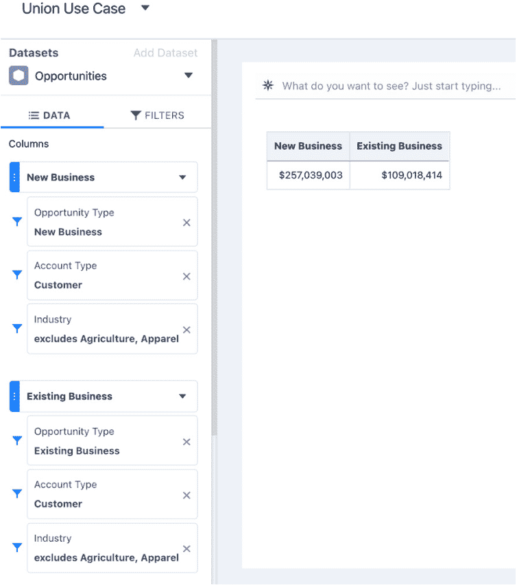

Figure 9.12 – Table view of the Union Use Case lens

- 7. Change the lens to a Funnel chart and notice that it cannot be used correctly; it shows one value at a time only. Switch to **Query Mode** to view and edit the SAQL content.

This is your starting point with the SAQL content:

```
q = load "opportunity1";
q_A = filter q by 'Type' == "New Business" && 'Account.Type' == "Customer" && (!('Account.Industry' in ["Agriculture", "Apparel"]) || 'Account.Industry' is null);
q_B = filter q by 'Type' == "Existing Business" && 'Account.Type' == "Customer" && (!('Account.Industry' in ["Agriculture", "Apparel"]) || 'Account.Industry' is null);
result = group q_A by all full, q_B by all;
result = foreach result generate sum(q_A.'Amount') as 'A', sum(q_B.'Amount') as 'B';
result = limit result 2000;
```

Notice that you have three data streams in your query: q_A, q_B, and result.

- 8. Update your code to remove the query limit and union your two columns, as follows:

```
q = load "opportunity1";
q_A = filter q by 'Type' == "New Business" && 'Account.Type' == "Customer" && (!('Account.Industry' in ["Agriculture", "Apparel"]) || 'Account.Industry' is null);
q_B = filter q by 'Type' == "Existing Business" && 'Account.Type' == "Customer" && (!('Account.Industry' in ["Agriculture", "Apparel"]) || 'Account.Industry' is null);
result = group q_A by all full, q_B by all;
result = foreach result generate sum(q_A.'Amount') as 'A', sum(q_B.'Amount') as 'B';
final1 = foreach result generate "New Business" as 'Description', sum('A') as 'Sum';
final2 = foreach result generate "Existing Business" as 'Description', sum('B') as 'Sum';
final = union final1,final2;
```

The union function combines multiple result sets into one result set. You need the same structure and field names in result sets. You do have a choice to either use a different dataset or the same dataset when it comes to creating result datasets.

When you click Run Query, you will see a table, as follows:

Learn how to write and edit SAQL queries

```
Query
1 q = load "opportunity1";
2 q_A = filter q by 'Type' == "New Business" && 'Account.Type' == "Customer" && (!('Account.Industry' in ["Agriculture", "Apparel"]) || 'Account.Industry' is null);
3 q_B = filter q by 'Type' == "Existing Business" && 'Account.Type' == "Customer" && (!('Account.Industry' in ["Agriculture", "Apparel"]) || 'Account.Industry' is null);
4 result = group q_A by all full, q_B by all;
5 result = foreach result generate sum(q_A.'Amount') as 'A', sum(q_B.'Amount') as 'B';
6 result = limit result 2000;
7
8 final1 = foreach result generate "New Business" as 'Description', sum('A') as 'Sum';
9 final2 = foreach result generate "Existing Business" as 'Description', sum('B') as 'Sum';
10 final = union final1,final2;
```

| # | Description | Sum |
|---|---|---|
| 1 | New Business | 257,039,003 |
| 2 | Existing Business | 109,018,414 |

Figure 9.13 – Table results from the Union function

You can now use a funnel or other chart type to visualize the sum broken up into two components: new and existing business.

Another use case for the Union function is to analyze the same metric showing a rolling 3 months, as follows:

```
q3 = load "opportunity";
```

```
q3 = filter q3 by date('CloseDate_Year', 'CloseDate_Month', 'CloseDate_Day') in ["3 months ago".."3 months ago"]; q3 = group q3 by ('CloseDate_Year', 'CloseDate_Month');
```

```
q3 = foreach q3 generate 'CloseDate_Year' as 'CloseDate_Year', 'CloseDate_Month' as 'CloseDate_Month', sum('Amount') as 'sum_Amount';
```

```
q2 = load "opportunity";
```

```
q2 = filter q2 by date('CloseDate_Year', 'CloseDate_Month', 'CloseDate_Day') in ["2 months ago".."2 months ago"]; q2 = group q2 by ('CloseDate_Year', 'CloseDate_Month');
```

```
q2 = foreach q2 generate 'CloseDate_Year' as 'CloseDate_Year', 'CloseDate_Month' as 'CloseDate_Month', sum('Amount') as 'sum_Amount';
q1 = load "opportunity";
q1 = filter q1 by date('CloseDate_Year', 'CloseDate_Month', 'CloseDate_Day') in ["1 months ago".."1 months ago"]; q1 = group q1 by ('CloseDate_Year', 'CloseDate_Month');
q1 = foreach q1 generate 'CloseDate_Year' as 'CloseDate_Year', 'CloseDate_Month' as 'CloseDate_Month', sum('Amount') as 'sum_Amount';
final = union q3, q2, q1;
```

### Creating buckets using the case statement

Follow these steps to try this use case for yourself:

- 1. Create a new lens from the **Opportunities** dataset.
- 2. Group by **Opportunity Name** and measure **Sum of Amount**.
- 3. Filter by **Won deals**.
- 4. Change to **Query Mode**.
- 5. Remove the `limit` statement.
- 6. Click **Save** to save your lens.

Now that you have your basic SAQL prepared, add the following case statement:

```
result = foreach q generate 'Name' as 'Name', 'sum_Amount' as 'Amount', (case when 'sum_Amount' > 2000000 then "Big" when 'sum_Amount' > 500000 then "Medium" else "Small" end) as 'Size';
```

The finished SAQL code should look like this:

```
q = load "opportunity1";
q = filter q by 'IsWon' == "true";
q = group q by 'Name';
q = foreach q generate 'Name' as 'Name', sum('Amount') as 'sum_Amount';
q = order q by 'Name' asc;
```

```
result = foreach q generate 'Name' as 'Name', 'sum_Amount' as 'Amount', (case when 'sum_Amount' > 2000000 then "Big" when 'sum_Amount' > 500000 then "Medium" else "Small" end) as 'Size';
```

When you click **Run Query**, you should see this:

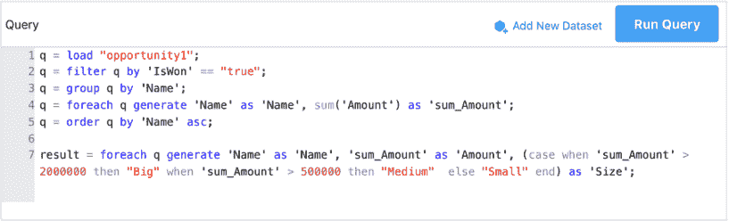

| Opportunity Name | Amount | Size |
|---|---:|---|
| Opportunity for Abbott1184 | $2,016,250 | Big |
| Opportunity for Abbott414 | $206,587 | Small |
| Opportunity for Abbott636 | $121,490 | Small |
| Opportunity for Adkins111 | $1,402,500 | Medium |
| Opportunity for Aguilar1908 | $3,314,900 | Big |
| Opportunity for Aguilar210 | $202,174 | Small |
| Opportunity for Alexander278 | $18,960 | Small |

Figure 9.14 – Bucketed results created using the Case function

> **Tip**
>
> If you're looking to dive deep into SAQL, I can recommend these resources:
>
> https://developer.salesforce.com/docs/atlas.en-us.bi_dev_guide_saql.meta/bi_dev_guide_saql/bi_saql_reference.htm
>
> https://www.salesforceblogger.com/all-about-saql/


我们现在将学习如何使用 JSON 和 **用户界面 (UI)** 创建仪表板绑定。

### 使用绑定将事物联系起来

TCRM 中的绑定是什么？绑定用于在步骤和部件之间传递值——即为动态值和选择参数化值。示例用例包括以下内容：

- 动态参考线
- 动态分组
- 动态度量
- 动态排序
- 动态图表类型

需要考虑两种类型的绑定。首先，选择绑定用于根据另一查询中的选择更新查询，例如通过切换部件选择日期范围。其次，结果绑定用于根据另一查询的结果更新查询，例如使用来自 case 语句的计算值来对数据进行分桶。

TCRM 正在慢慢远离要求使用代码创建绑定的做法，但许多用例仍需要在 JSON 中进行开发工作，如下一节所述。

### JSON 中的绑定

我们现在要谈谈 JSON。你可能熟悉 JSON，但在 TCRM 的上下文中可能不熟悉。下面的图表显示了 JSON 和 TCRM 仪表板是如何配合的：

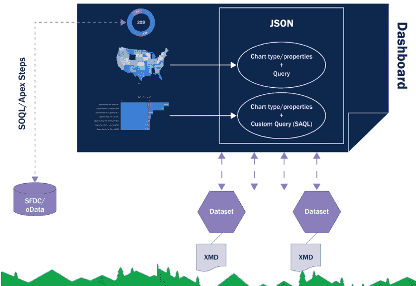

图 9.15 – JSON 和 TCRM 仪表板

在仪表板编辑器中，按 Cmd + E（或 Ctrl + E）显示仪表板背后的 JSON。JSON 只是指令的书写语言。JSON 包含所有部件/图表描述以及针对数据集运行的查询。每个图表实际上是几行 JSON，描述类型和属性以及要运行的查询。一种特殊情况是当其中一个查询直接使用 SAQL 自定义编写时。

什么是 JSON？简单来说，它是文件中用一堆用大括号 { } 括起来的键和值组成的描述性指令。值可以是文本、数值、布尔值或文本/数值的数组；你可以有多个这样的信息块。以下是 JSON 的简单分解：

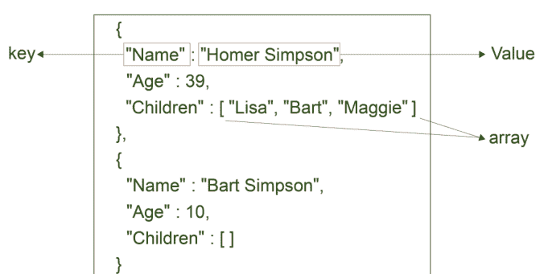

图 9.16 – JSON 的简单分解

以下是来自“我的第一个仪表板”的 JSON 摘要示例：

```
"steps": {
    "Leads_by_Status_1": {
        "broadcastFacet": true,
        "datasets": [
            {
                "id": "0Fb5g000000U115CAC",
                "label": "Leads",
                "name": "Leads",
                "url": "/services/data/v52.0/wave/datasets/0Fb5g000000U115CAC"
            }
        ],
        "isGlobal": false,
        "label": "Leads by Status",
        "query": {
            "measures": [
                [
```

```
"count",
"*"
]
],
"groups": [
"Status"
]
},
"receiveFacetSource": {
"mode": "all",
"steps": []
},
"selectMode": "multi",
"type": "aggregateflex",
"useGlobal": true,
"visualizationParameters": {
"parameters": {
"autoFitMode": "keepLabels",
"showValues": true,
"bins": {
"breakpoints": {
"high": 100,
"low": 0
},
"bands": {
"high": {
"color": "#008000",
"label": ""
},
"low": {
"color": "#B22222",
"label": ""
},
"medium": {
"color": "#ffa500",
"label": ""
```

```
```json
}
}
},
"legend": {
  "descOrder": false,
  "showHeader": true,
  "show": true,
  "customSize": "auto",
  "position": "right-top",
  "inside": false
},
"axisMode": "multi",
"tooltip": {
  "showBinLabel": true,
  "measures": "",
  "showNullValues": true,
  "showPercentage": true,
  "showDimensions": true,
  "showMeasures": true,
  "customizeTooltip": false,
  "dimensions": ""
},
"visualizationType": "hbar",
"title": {
  "fontSize": 16,
  "subtitleFontSize": 11,
  "label": "Leads by Status",
  "align": "center",
  "subtitleLabel": ""
},
"binValues": false,
"trellis": {
  "flipLabels": false,
  "showGridLines": true,
  "size": [
    100,
```

```
100
],
"enable": false,
"type": "x",
"chartsPerLine": 4
},
"columnMap": {
"trellis": [],
"dimensionAxis": [
"Status"
],
"plots": [
"count"
]
},
"showActionMenu": true,
"measureAxis2": {
"sqrtScale": false,
"showTitle": true,
"showAxis": true,
"title": "",
"customDomain": {
"showDomain": false
}
},
"measureAxis1": {
"sqrtScale": false,
"showTitle": true,
"showAxis": true,
"title": "",
"customDomain": {
"showDomain": false
}
},
"theme": "wave",
"dimensionAxis": {
```

```
"showTitle": true,
"customSize": "auto",
"showAxis": true,
"title": "",
"icons": {
    "useIcons": false,
    "iconProps": {
        "fit": "cover",
        "column": "",
        "type": "round"
    }
},
"applyConditionalFormatting": true
},
"type": "chart",
"options": {}
},
"Pipeline_by_Industry_1": {
    "broadcastFacet": true,
    "datasets": [
        {
            "id": "0Fb5g000000TV2bCAG",
            "label": "Opportunities",
            "name": "opportunity1",
            "url": "/services/data/v52.0/wave/datasets/0Fb5g000000TV2bCAG"
        }
    ],
```

```
"isGlobal": false,
"label": "Pipeline by Industry",
"query": {
    "measures": [
        [
            "sum",
            "Amount"
        ]
    ],
    "groups": [
        "Account.Industry"
    ],
    "filters": [
        [
            "IsWon",
            [
                "false"
            ],
            "in"
        ]
    ],
    "order": [
        [
            "sum_Amount",
            {
                "ascending": false
            }
        ]
    ]
},
```

仔细查看此示例，你会看到它包含构建仪表板的指令。以下示例显示了基本的部件/步骤 JSON：

### 基本部件/步骤 JSON

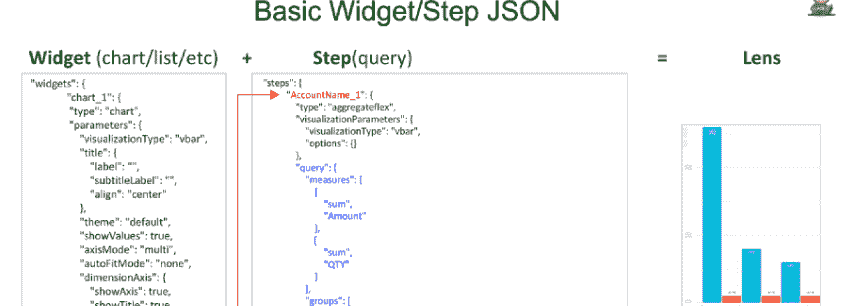

图 9.17 – 基本部件/步骤 JSON 示例

这里，我们有一个仪表板 JSON 的简化示例：

### 仪表板 JSON

#### 示例：

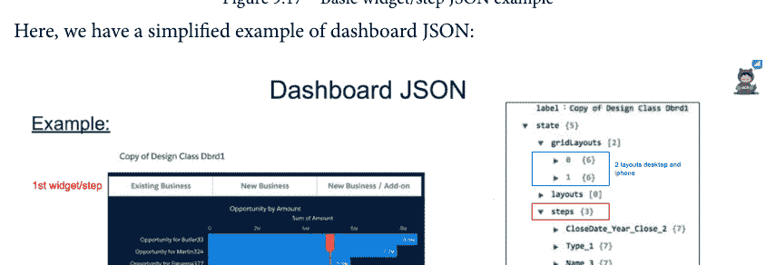

图 9.18 – 仪表板 JSON 示例

让我们看一个 JSON 绑定的简单示例——动态分组。此示例来自公开可用的 *Learning Adventure* 应用，我在本文末尾提到它。请按以下步骤操作：

- 1. 创建一个新的空白仪表板。
- 2. 创建一个切换部件 (`pillbox_1`)，其步骤 (`Grouping_Toggle_1`) 指定不同的分组。
- 3. 创建一个条形图 (`chart_1`)，其步骤 (`Dynamic_Query`) 以紧凑形式按切换部件中选择的分组对总金额进行分组。
- 4. 在 Spring 2018 版本中，引入了新的 `columnMap` 图表属性来构建更强大的可视化；但是，`columnMap` 对于此动态可视化不是必需的。将此 `columnMap {}` 参数替换为 `columnMap: null`。
- 5. 为了根据切换部件中的选择动态设置图表中的分组，请打开仪表板 JSON 并绑定 Dynamic_Query 步骤中的 groups 属性——请参阅此步骤列表之后的 code snippet。
- 6. 单击 **完成**，即可开始使用。

以下是用于绑定 Dynamic_Query 步骤中 groups 属性的 JSON：

```
```json
"groups": "{{ cell(Grouping_Toggle_1.selection, 0, \"groups\").asObject() }}"
```
```

这段代码是什么意思？让我们逐步分解如下：

- `cell(Grouping_Toggle_1.selection, 0, \"groups\")` 返回来自 Grouping_Toggle_1 步骤的所选分组，并从步骤选择中获取 `cell`（第一行，“groups”列）的值。索引 0 是第一行，索引 1 是第二行，以此类推。
- `asObject()` 将结果格式化为字符串数组，这是仪表板 JSON 中预期的格式。

这就是 *Learning Adventure* 应用中示例的外观：

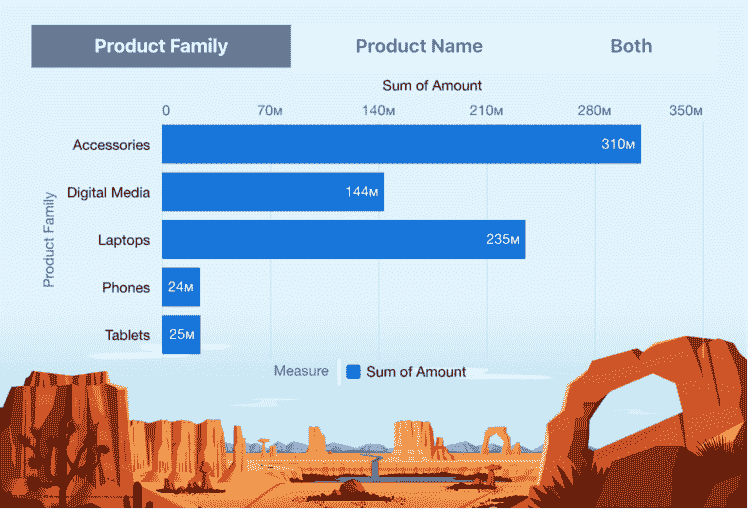

图 9.19 – 动态分组示例

有很多参考资料深入探讨 JSON、绑定等方面的细节。如前所述，我建议你从 TCRM 开发组织创建 *Learning Adventure* 应用——在 Analytics Studio 中选择创建模板化应用后，它看起来像这样：

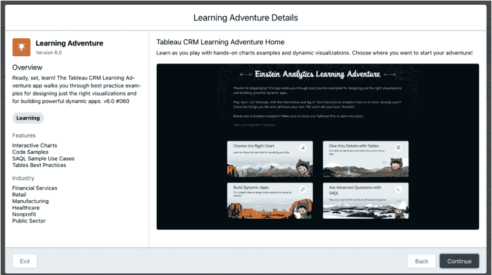

图 9.20 – Learning Adventure 应用

你也可以在此处参考 *Tableau CRM Dashboard JSON Developer Guide*：

```
https://developer.salesforce.com/docs/atlas.en-us.bi_dev_guide_json.meta/bi_dev_guide_json/bi_dbjson_intro.htm
```

现在，我们将看到如何从 UI 创建一些绑定，而无需代码。

### UI 中的绑定

有几种方法可以在不进入仪表板 JSON 的情况下创建绑定。
我们将在此处看一个示例，创建动态参考线，然后看第二个示例，我们将了解 **高级编辑器**。


按照以下步骤创建动态参考线：

- 1. 打开**我的第一个仪表盘**。
- 2. 创建一个新图表，显示按行业划分的平均交易规模（已赢单）。
- 3. 将此图表添加到**销售**页面的底部。
- 4. 创建一个新查询，计算整体的平均交易规模（已赢单）。
- 5. 在新图表的`Format`窗格中，在**Y轴**（左侧）下，选择**值**下的箭头图标，然后选择你的已赢单平均交易规模查询作为动态参考线。
- 6. 类似地，将平均交易规模添加到标签中，并加上前缀`Average =`。
- 7. 点击**保存**以保存仪表盘。

将源查询添加到线值中的效果如下：

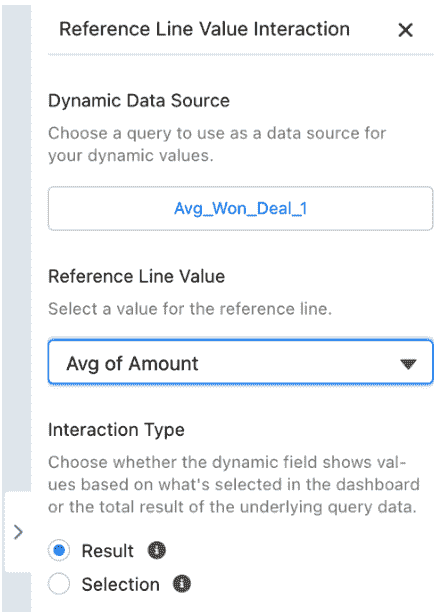

图 9.21 – 将源查询添加到线值中

完成后的动态参考线格式面板应如下所示：

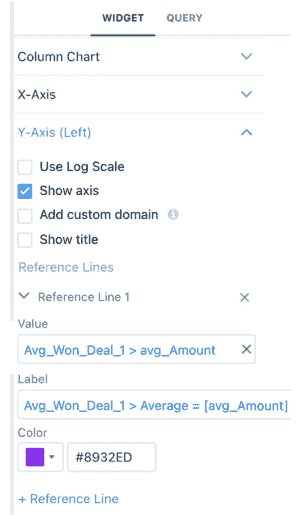

图 9.22 – 完成后的动态参考线格式面板

最终结果应如下所示：

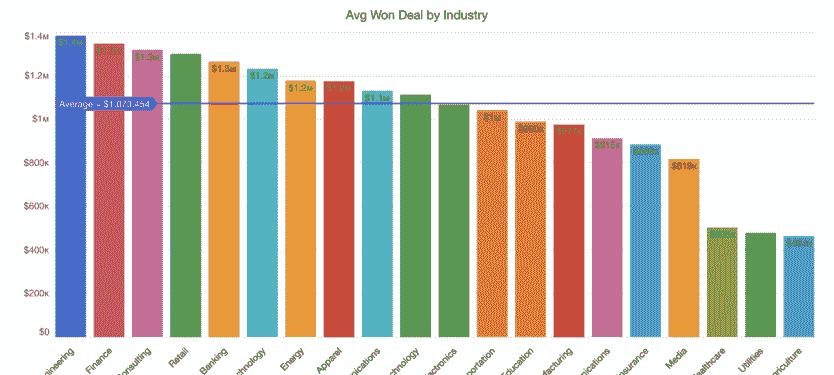

图 9.23 – 添加了动态参考线的按行业平均已赢单交易图表

- 3. 在**数据选择**下，选择**行**、**列**或**单元格**。
- 4. 在**行索引**和**列**下选择所需选项。
- 5. 使用**预览**按钮查看查询详细信息，而无需离开**交互编辑器**。
- 6. 单击左箭头。
- 7. 对于**交互类型**，选择**结果**或**选择**。
- 8. 单击**更多选项**以设置默认值或更改数据序列化函数。
- 9. 如果你愿意，在构建交互后，你可以手动编辑它。
- 10. 复制你的交互。
- 11. 将交互粘贴到JSON或SAQL中。
- 12. 单击**保存**。

现在你已经学习了如何构建更高级的仪表盘功能，让我们回顾一下本章所学的内容。

### 总结

现在你已经初步涉足了更高级的TCRM设计和构建。我鼓励你运用所学知识并善加利用——在你的开发组织中练习使用这些高级工具，并熟练掌握它们。

你学到了什么？首先，你创建和编辑了TCRM页面，以帮助你构建更高级的仪表盘功能。接下来，你通过使用SAQL了解了TCRM代码。第三，你学习了使用绑定构建动态仪表盘的基础知识。最后，你利用高级编辑器通过点击而非代码来构建交互。

下一章将教你何时需要编码，何时不需要编码。

### 问题

以下是一些测试你知识的问题：

- 给出三个使用TCRM页面的用例示例。
- 当你在仪表盘内从一个页面移动到另一个页面时，已应用的筛选器是保留还是被清除？
- 你何时可能需要SAQL？
- 关键字和函数以大写书写且不区分大小写。对还是错？
- 你在哪里编辑SAQL？
- 你使用哪个键盘快捷键来访问仪表盘JSON？
- 给出三个使用绑定使仪表盘更具交互性和动态性的用例示例。
