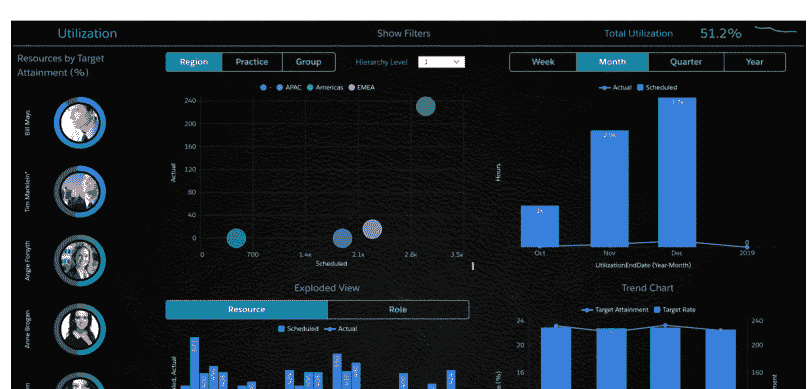
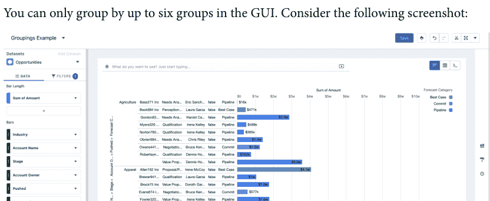
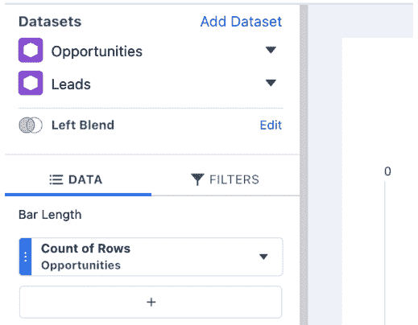

## 10 编码还是不编码？

Tableau CRM（TCRM）管理员和开发人员面临的最大挑战之一就是知道何时编码，何时不编码。这会造成相当大的困惑。本章的目的是通过大量实际示例指导你如何确定何时需要代码。

在需要代码的地方，会给出源代码示例。但请注意，本书并非旨在成为Tableau CRM开发人员的详细手册。此外，所给出的代码片段由于必要，通常只是完整源代码的一小部分。

在本章中，我们将涵盖以下主题：

- 你何时需要代码？
- 如果……你可能不需要编码……
- 歧义的情况

### 技术要求

你需要满足以下要求才能成功执行本章中的操作：

- 最新版本的Google Chrome浏览器（Chrome是使用TCRM时的首选浏览器）
- 一个可用的电子邮件地址

确保你已登录到你的TCRM开发组织。

让我们首先了解在TCRM应用程序中可能需要在哪些地方使用代码。

### 你何时需要代码？

自Salesforce于2014年推出Wave以来，TCRM的GUI确实已经取得了长足的进步。该平台的早期用户被迫在JSON、SAQL和XMD中构建一切，因为基本上没有声明式选项。现在情况不同了，每次TCRM的新版本都提供更多的点击式功能。

然而，当你在进行更高级的数据转换和仪表盘构建时，TCRM的某些应用确实需要代码。

以下是TCRM中需要部署代码的六个常见应用：

- 安全谓词
- JSON中的绑定
- SAQL表达式
- 批量操作（使用Visualforce和TCRM REST API）
- `timeseries`（已修改）
- XMD – 高级格式选项

让我们从安全谓词开始。

### 安全谓词

正如你在*第7章：Tableau CRM中的安全*中所看到的，谓词是一种为数据集定义行级安全的筛选条件。安全谓词根据需求从极其简单到高度复杂不等。所有谓词至少需要一点点代码。

例如，请看下面的代码：

```text
'FFACompanyId' == "Unknown" || 'UserCompany.c2g__User__c' == "$User.Id"
```

另一个例子如下：

```text
'Owner.Role.Roles' == "$User.UserRoleId" || 'OwnerId' == "$User.Id" || 'Account.OwnerId' == "$User.Id"
```

有关安全谓词的详细信息和说明，请参阅以下参考指南：

https://resources.docs.salesforce.com/latest/latest/en-us/sfdc/pdf/bi_admin_guide_security.pdf

接下来，你将学习如何使用代码在仪表盘JSON中创建绑定。

### JSON中的绑定

我们现在将研究在仪表盘绑定中使用JSON的几种方式。

### 动态图表

用户可以通过在仪表盘上进行切换选择来动态选择可视化类型。以下是此选择绑定可能看起来的示例：

```text
{{coalesce(cell(static_1.selection, 0, \"visualizationType\"), cell(static_1.result, 0, \"visualizationType\")).asString()}}
```

在仪表盘JSON中，它可能看起来像这样：

```json
},
    "axisMode": "multi",
    "tooltip": {
        "showBinLabel": true,
        "measures": "",
        "showPercentage": true,
        "showDimensions": true,
        "showMeasures": true,
        "customizeTooltip": false,
        "dimensions": ""
    },
    "visualizationType": "{{coalesce(cell(static_1.selection, 0, \"visualizationType\"), cell(static_1.result, 0, \"visualizationType\")).asString()}}",
    "binValues": false,
    "title": {
        "fontSize": 14,
        "subtitleFontSize": 11,
        "label": "",
        "align": "center",
        "subtitleLabel": ""
```

### 自定义选择绑定

简单选择绑定可以在GUI中通过基本的代码理解来创建和编辑，但更复杂的用例需要使用JSON。

以下是一个日期期间切换筛选器的示例：

```json
"static_1": {
    "broadcastFacet": true,
    "groups": [],
    "numbers": [],
    "selectMode": "singlerequired",
    "strings": [],
    "type": "staticflex",
    "values": [
        {
            "display": "MTD",
            "value": "month"
        },
        {
            "display": "QTD",
            "value": "quarter"
        },
        {
            "display": "YTD",
            "value": "year"
        }
    ]
},
"start": {
    "display": [
        "MTD"
    ]
},
"Customers_spending_l_1": {
    "type": "saql",
    "query": "q = load \"bankingData\";\nq = filter q by date('Date_Year', 'Date_Month', 'Date_Day') in [\"current {{cell(static_1.selection,0,\"value\").asString()}}\"..\"current day\"];\nq = group q by all;\nq = foreach q generate unique('comb.CustomerID') as 'unique_comb.CustomerID';\nq = limit q 2000;",
    "selectMode": "single",
    "broadcastFacet": true,
    "receiveFacet": true,
    "useGlobal": true,
    "numbers": [],
    "groups": [],
    "strings": [],
    "visualizationParameters":
```

### 嵌套绑定

以下是一个示例，我们希望基于嵌套选择绑定计算指标，其中选择绑定引用另一个选择绑定：

```json
"query": {
    "measures": [
        "{{cell(step_1.selection,0,cell(step_2.selection,0,\"value\")).asObject()}}"
    ],
    "groups": [
        "Account.Industry"
    ]
},
```


有关绑定的详细信息和说明，请参阅以下开发者指南：

https://resources.docs.salesforce.com/latest/latest/en-us/sfdc/pdf/bi_dev_guide_bindings.pdf

现在，我们将探讨一些需要在 SAQL 中编写代码的用例。

### SAQL 表达式

当查询需要比 GUI 所能提供的更复杂的逻辑或更高的自定义程度时，需要使用 SAQL。

### 联合（Union）

若要在一次查询中组合不同的数据流并进行处理，则需要使用 SAQL。

以下是一个计算支出占目标百分比（以 JSON 格式表示）的示例：

```
"steps": {
    "Spending_as__of_Tar_1": {
        "broadcastFacet": true,
        "groups": [],
        "label": "Spending as % of Target",
        "numbers": [],
        "query": "spend = load \"bankingData\";\nspend = group spend by ('Date_Year', 'Date_Month');\nspend = filter spend by date('Date_Year', 'Date_Month', 'Date_Day') in [\"30 days ago\"..\"current day\"];\nspend = foreach spend generate 'Date_Year' + \"~~~\" + 'Date_Month' as 'Date_Year~~~Date_Month', sum('Amount') as 'sum_Amount', 0 as 'sum_Target';\n\ntarget = load \"Industry_Targets\";\ntarget = group target by ('Date_Year', 'Date_Month');\ntarget = filter target by date('Date_Year', 'Date_Month', 'Date_Day') in [\"30 days ago\"..\"current day\"];\ntarget = foreach target generate 'Date_Year' + \"~~~\" + 'Date_Month' as 'Date_Year~~~Date_Month', sum('Target') as 'sum_Target', 0 as 'sum_Amount';\n\nboth = union spend, target;\nboth = group both by all;\nboth = foreach both generate sum('sum_Target') as 'Target', sum('sum_Amount') as 'Spend';\nboth = foreach both generate sum('Target') as 'Target', sum('Spend') as 'Spend', 100*(trunc(('Spend'/'Target'),3)) as '% of Target';\n",
}
```

另一个示例使用 union 将“去年生成”和“今年转化”的信息合并到一个表中：

```
q = load "OppOwnerAcnt";
q_A = filter q by ('AccountId.Type' == "Partner" or 'Type' == "New Business") && date('CloseDate_Year', 'CloseDate_Month', 'CloseDate_Day') in ["1 year ago".."1 year ago"] ;
q_B = filter q by ('AccountId.Type' == "Partner" or 'Type' == "New Business") && date('CloseDate_Year', 'CloseDate_Month', 'CloseDate_Day') in ["current year".."current year"] ;
result = group q_A by all full, q_B by all;
result = foreach result generate sum(q_A.'Amount') as 'A', sum(q_B.'Amount') as 'B';
final1 = foreach result generate "Last Year Generated" as 'Description', sum('A') as 'Sum';
final2 = foreach result generate "This Year Converted" as 'Description', sum('B') as 'Sum';
final = union final1,final2;
```

### 分组、汇总、小计、平均值等

添加自定义的复杂分组、汇总、小计、平均值等通常需要使用 SAQL。

下面是一个用户想要识别前 5% 客户的示例：

```
q = load "Wave_Sample_Opportunities";
q = group q by 'Account_Name';
q = foreach q generate 'Account_Name', sum('Amount') as 'sum_Revenue', rank() over ([..] partition by all order by sum('Amount')) as 'Position', sum(1) over ([..] partition by all) as 'count';
q = foreach q generate 'Account_Name', 'sum_Revenue', ( case when 'Position' >= (floor(((95*'count') + 1)/100)) then "Top 5 %" else "Rest" end ) as 'Bracket';
q = filter q by 'Bracket' != "Rest";
q = group q by ('Account_Name', 'Bracket');
q = foreach q generate 'Bracket' as 'Bracket', 'Account_Name' as 'Account Name', max('sum_Revenue') as 'sum_Revenue';
q = order q by 'sum_Revenue' desc;
```

另一个示例是计算平均交易规模，并使用它来创建动态参考线：

```
"query": "q = load \"Opportunity_MT\";\nq = filter q by 'Type' == \"New WM Client\";\nq = filter q by 'StageName' == \"Revenue Received\";\nq = group q by ('CloseDate_Year', 'CloseDate_Quarter', 'AccountId.Name');\nq = foreach q generate 'CloseDate_Year' + \"~~~\" + 'CloseDate_Quarter' as 'CloseDate_Year~~~CloseDate_Quarter', 'AccountId.Name' as 'Household', sum('Amount') as 'Amount';\nq = group q by ('CloseDate_Year~~~CloseDate_Quarter');\nq = foreach q generate 'CloseDate_Year~~~CloseDate_Quarter' as 'CloseDate_Year~~~CloseDate_Quarter', trunc(avg('Amount'),0) as 'Average';\nq = group q by all;\nq = foreach q generate trunc(avg('Average'),-2) as 'Avg Amount';",
"referenceLines": [
{
"color": "#9271E8",
"label": "Target = {{cell(gaugeRef6_1.result,0,\"target\").asString()}}",
"value": "{{cell(gaugeRef6_1.result,0,\"target\").asString()}}"
},
{
"color": "rgb(0, 161, 224)",
"label": "Avg = {{cell(Avg_of_Avg_Deals_Siz_1.result, 0,\"Avg Amount\").asObject()}}",
"value": "{{cell(Avg_of_Avg_Deals_Siz_1.result, 0,\"Avg Amount\").asObject()}}"
}
],
```

### 使用图片作为图标

可以使用图片作为图标，以增强美观性并让用户更直观地深入查看数据，如下图所示：



图 10.1 – 使用图片作为图标

以下是添加了图片作为图标的 SAQL 示例：

```
q = load "Utilization";
q = filter q by date('UtilizationEndDate_Year', 'UtilizationEndDate_Month', 'UtilizationEndDate_Day') in ["180 days ago".."current day"];
q = group q by 'ResourceName';
q = foreach q generate 'ResourceName' as 'ResourceName', first('ResourceSalesforceUserPhotoUrl') as 'ResourceSalesforceUserPhotoUrl', sum('ValueBillableHours') as 'sum_ValueBillableHours', sum('ValueCreditedHours') as 'sum_ValueCreditedHours', sum('ValueCalendarHours') as 'sum_ValueCalendarHours', sum('ValueExcludedHours') as 'sum_ValueExcludedHours', sum('ValueUtilizationTargetHours') as 'sum_ValueUtilizationTargetHours';
q = foreach q generate 'ResourceName', 'ResourceSalesforceUserPhotoUrl', (case when ('sum_ValueCalendarHours' - 'sum_ValueExcludedHours') == 0 then (case when ('sum_ValueBillableHours' + 'sum_ValueCreditedHours') > 0 then 100 else 0 end) else (('sum_ValueBillableHours' + 'sum_ValueCreditedHours') * 100 / ('sum_ValueCalendarHours' - 'sum_ValueExcludedHours')) end) as 'TotalUtilizationRate', 'sum_ValueCalendarHours', 'sum_ValueUtilizationTargetHours';
q = foreach q generate 'ResourceName',
'ResourceSalesforceUserPhotoUrl', coalesce('sum_ValueUtilizationTargetHours' * 100 / 'sum_ValueCalendarHours', 0) as 'UtilizationTargetRate', 'TotalUtilizationRate';
q = foreach q generate 'ResourceName',
'ResourceSalesforceUserPhotoUrl', (case when
'UtilizationTargetRate' == 0 then (case when
'TotalUtilizationRate' > 0 then 100 else 0 end) else
('TotalUtilizationRate' * 100 / 'UtilizationTargetRate') end)
as 'Target Attainment';
q = order q by 'Target Attainment' desc;
q = limit q 10;
```

### 按六个以上产品分组

在 GUI 中，你最多只能按六个组进行分组。请参见以下截图：



图 10.2 – 最多六组分组的机会管道

若要添加第七个分组，你需要修改 SAQL，如下所示：

```
q = load "opportunity1";
q = filter q by 'OpenClosedWonLost' == "Open";
q = group q by ('Account.Industry', 'Account.Name', 'StageName', 'Account.Owner.Name', 'Pushed', 'ForecastCategoryName', 'Account.Segment__c');
q = foreach q generate 'Account.Industry' as 'Account.Industry', 'Account.Name' as 'Account.Name', 'StageName' as 'StageName', 'Account.Owner.Name' as 'Account.Owner.Name', 'Pushed' as 'Pushed', 'ForecastCategoryName' as 'ForecastCategoryName', sum('Amount') as 'sum_Amount';
q = order q by ('Account.Industry' asc, 'Account.Name' asc, 'StageName' asc, 'Account.Owner.Name' asc, 'Pushed' asc, 'ForecastCategoryName' asc);
```

### 存储桶（复杂）

简单的存储桶可以在配方构建器中创建；更复杂的用例则需要编写代码。以下示例用于创建自定义格式的参考线：

```
"steps": {
    "Clone_of_myKPI_1": {
        "broadcastFacet": true,
        "groups": [],
        "label": "Clone of myKPI",
        "numbers": [],
        "query": "q = load \"opportunity\";\nq = group q by 'Account.Industry';\nq = foreach q generate 'Account.Industry' as 'Account.Industry', sum('Amount') as 'sum_Amount';\nq = group q by all;\nq = foreach q generate \"Median by Industry  \" + case when median(sum_Amount) >= 1000000 then number_to_string(trunc(median(sum_Amount), -6)/1000000, \"$#,###\") + \"M\" when median(sum_Amount) >= 1000 then number_to_string(trunc(median(sum_Amount), -3)/1000, \"$###\") + \"K\" else number_to_string(trunc(median(sum_Amount)), \"$###\") end as 'Median';\n\n",
    }
"measureAxis1": {
    "sqrtScale": false,
    "showTitle": true,
    "showAxis": true,
    "referenceLines": [
        {
            "color": "#FF6419",
            "label": "{{cell(myKPI_2.result,0,\"Average\").asString()}}",
            "value": "{{cell(myKPI_1.result,0,\"avg_Amount\").asObject()}}"
        },
    ]
```


```
{
    "color": "#DED800",
    "label": "{{cell(Clone_of_myKPI_1.result,0,\"Median\").asString()}}",
    "value": "{{cell(myKPI_1.result,0,\"median_Amount\").asObject()}}"
}
],
    "title": "",
    "customDomain": {
        "showDomain": false
```

有关 SAQL 的详细见解和说明，请参考以下开发者指南：

https://developer.salesforce.com/docs/atlas.en-us.bi_dev_guide_saql.meta/bi_dev_guide_saql/bi_saql_reference.htm

现在，我们来了解 TCRM 中批量操作所需的代码。

### 批量操作（使用 Visualforce 和 TCRM REST API）

在 TCRM 中构建和部署自定义批量操作需要投入相当多的工作。作为入门参考，请查看我的同事 Gayathri Shivakumar 撰写的这篇博客文章：

https://visioneer360.com.au/bulk-actions-the-secret-sauce-of-einstein-analytics/

例如，你需要创建一个 Batch Apex 来更新 Contact 记录：

```
global class BatchContactActionUpdate implements Database.Batchable<SObject> {
//Start Method
global BatchContactActionUpdate( set<Id> ContactRecId){
    this.ContactRecId = ContactRecId;
}
global Database.QueryLocator start(Database.BatchableContext BC) {
    return Database.getQueryLocator('Select Id From Contact Where Id In :ContactRecId');
}
```

### XMD – 高级格式设置选项

如今，TCRM 图形用户界面（GUI）为格式设置和自定义提供了更多控制，因此 XMD 已不像过去那样经常使用。Edit Dataset 页面允许你自定义记录操作，而 Dataset Fields 则支持自定义字段标签、维度值颜色等内容。

不过，在某些情况下，高级格式设置选项仍需要使用 XMD。你可以使用 XMD 自定义以下内容：

- 修改字段和值的显示标签。
- 隐藏字段。
- 设置度量的格式。
- 按指定数值乘以度量。
- 自定义行数度量标签。
- 修改图表中的维度值颜色。
- 为维度添加操作。
- 更改值表中的默认字段。
- 设置使用多个数据集时查询结果的格式。
- 自定义度量格式。
- 为度量添加后缀和前缀。
- 定义日历年的第一天。

以下代码展示了如何将 Amount 字段设置为 `$9,999.99` 的货币格式：

```
{
  "dataset": {},
  "dates": [],
  "derivedDimensions": [],
  "derivedMeasures": [],
  "dimensions": [
    {
      "conditionalFormatting": {},
      "customActions": [],
      "field": "Region",
      "label": "Sales Region",
```

```
"members": [],
"recordDisplayFields": [],
"salesforceActions": []
}
],
"measures": [
{
"conditionalFormatting": {},
"field": "Amount",
"format": {
"customFormat": "[\"$#,##0.00\",1]"
},
"label": "Initial Amount"
}
],
"organizations": [],
"showDetailsDefaultFields": []
}
```

有关使用 XMD 的详细见解和说明，请参考以下开发者指南：

https://developer.salesforce.com/docs/atlas.en-us.bi_dev_guide_xmd.meta/bi_dev_guide_xmd/bi_xmd_intro.htm

### 你可能不需要编写代码，如果……

随着 Salesforce 持续开发 TCRM，越来越多的高级查询和自定义操作可以在 GUI 中完成，从而减少使用代码的工作量。这符合 Salesforce “点击，而不是编码”的理念。

以下是一些过去需要代码、但现在可能不再需要代码的使用场景：

- 数据流、数据准备和配方：

除复杂使用场景外，数据流（JSON）或配方通常不需要代码。

有关仪表板 JSON 的详细参考，请参阅此开发者指南：

https://developer.salesforce.com/docs/atlas.en-us.bi_dev_guide_json.meta/bi_dev_guide_json/bi_dbjson_intro.htm.

- 动态参考线（简单）：
  现在可以在仪表板编辑器中完成。
- 简单的应用程序绑定：
  可以使用仪表板编辑器中的 **Advanced Editor** 构建简单绑定。
- 向透镜添加数据集：
  现在可以通过 GUI 中的 Add Dataset 功能向透镜添加其他数据集。显示效果如下：

### 新建透镜



图 10.3 – 向透镜添加数据集

那么，在不确定是否需要编写代码时该怎么办？

## 模棱两可的情况

你越熟悉使用 TCRM GUI 构建透镜和仪表板，就越能理解哪些情况下需要代码。最佳实践是尽可能使用 GUI，仅在无法避免时才使用代码。此外，请务必及时了解最新的 TCRM 版本，因为 GUI 的功能会随着每个版本的发布而增强。

最后再分享一个我使用代码的例子——在本例中，我自定义了 JSON 数据流，使其每次运行数据流时都能重置并刷新日期：

```
"relativeDates2": {
    "action": "computeExpression",
    "parameters": {
        "source": "substituteNewDate",
        "mergeWithSource": true,
        "computedFields": [
            {
                "defaultValue": "0",
                "precision": 18,
                "name": "dateAsEpochSec2",
                "saqlExpression": "case when 'Date_of_cancellation' is null then null else Date_of_cancellation_sec_epoch end",
                "scale": 0,
                "label": "dateAsEpochSec2",
                "type": "Numeric"
            },
            {
                "defaultValue": "0",
                "precision": 18,
                "name": "dateDifference2",
                "saqlExpression": "case when 'Date_of_cancellation' is null then null else dateAsEpochSec2 - 1522127025 end ",
                "scale": 0,
                "label": "dateDifference2",
                "type": "Numeric"
            },
            {
                "defaultValue": "0",
                "precision": 18,
                "name": "dateAsEpoch2",
                "saqlExpression": "case when 'Date_of_cancellation' is null then null else dateDifference2 + date_to_epoch(now()) end ",
                "scale": 0
```
