## 使用 TCRM 进行
## 仪表板设计的
## 最佳实践

现在你已经能够在 TCRM 中构建功能强大的仪表板，但你怎么知道*应该*构建什么？仪表板设计中有哪些常见错误？有效的仪表板设计有哪些公认原则？在设计、构建和部署 TCRM 仪表板时，有哪些最佳实践？本章将详细解释这些内容，为优秀的仪表板设计提供指导和参考。

我们将介绍以下内容：

- 仪表板设计中的常见错误
- 有效仪表板构建的设计理念
- TCRM 仪表板设计的最佳实践

### 技术要求

要成功执行本章中的说明，你需要具备以下条件：

- 最新版本的 Google Chrome 浏览器（使用 TCRM 时，Chrome 是首选浏览器）
- 一个可正常使用的电子邮箱地址

请确保已登录 TCRM 开发组织。

让我们先了解仪表板设计中的常见错误。

### 仪表板设计中的常见错误

以下是我在仪表板设计方面经常看到的最常见错误：

- 过分重视形式而忽视功能——让仪表板看起来*漂亮*，却不实用、不可操作，也无法提供帮助。
- 缺少比较——没有加入目标、平均值、基准和对比信息，无法为指标提供业务背景。
- 过度使用颜色——只是为了增加颜色而使用各种丰富的色彩，却没有明确的使用目的。
- 过犹不及——在页面中添加过多图表和指标，导致用户迷失和困惑。
- 缺乏故事性——向查看者提供了大量指标、图表、比较和洞察，却没有清晰的叙事主线。
- 杂乱——缺少留白会妨碍查看者理解和解读所展示的可视化内容。
- 忽视预期业务成果——在没有明确业务重点和交付成果的情况下，为了构建仪表板而构建仪表板。
- 使用不恰当或错误的可视化方式——谁愿意尝试解读一个包含 17 个分区的环形图？
- 令人困惑且不直观的设计——仪表板没有遵循任何直观的浏览流程。
- 数据不完整——只提供能说明一半情况的信息，会让用户感到沮丧并无法全面了解情况。
- 使用不恰当的颜色——某些颜色具有特定含义，例如红色和绿色，它们会影响你对图表的理解。


- 使用不当的数字格式——以数字和百分比展示相同的KPI有时会导致误解。
- 每个图表/组件应回答一个独特而简单的问题——不要试图将所有信息都塞进一个图表中。
- 忘记安全方面——仪表板中的聚合并不意味着用户可以访问数据集中的原始数据。
- 没有行动框架——每个仪表板都应该讲述一个故事，并且最后用户能够采取行动。

你可以在下面的仪表板中发现多少这些错误？

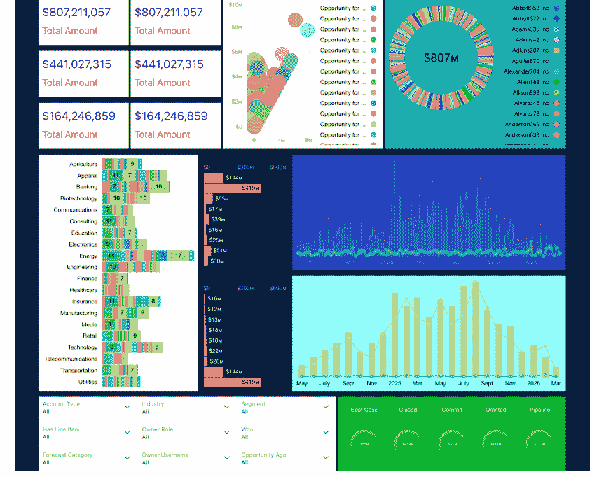

图 11.1 – 一个糟糕仪表板设计的示例

既然我们已经明白了什么*不该*做，让我们来学习一种好的设计方法。

### 有效仪表板构建的设计理念

我在工作中见过大量仪表板——其中大多数设计得很差。我为什么这么说？我怎么知道这是真的？什么才是好的仪表板设计？

以下是一些有效仪表板设计的原则。

### 好的仪表板提供可操作的见解

这一切都是为了引导用户从*数据*到*洞察*再到*行动*。如果仪表板遗漏最后一步，就是不完整且无效的。让我分享三个例子。

第一个例子是我们基于FinancialForce构建的**专业服务自动化（PSA）**仪表板中的风险洞察页面。从下面的截图可以看出，风险影响和可能性矩阵（热力图）允许你快速深入查看项目数据，然后从记录视图中对这些洞察采取行动：

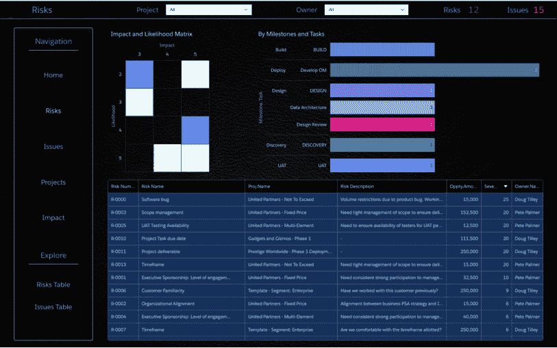

图 11.2 – 专业服务自动化的可操作风险洞察页面

第二个例子来自我们为非营利机构构建的捐赠者细分分析。下面的仪表板允许你深入查看捐赠者细分，并选择合适的群体进行募捐：

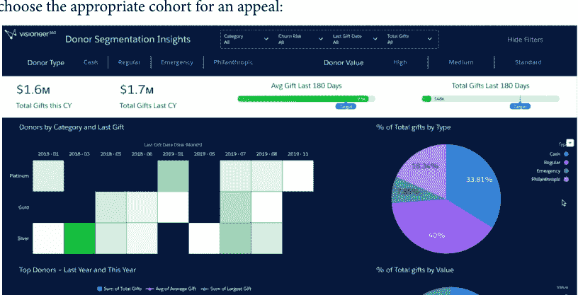

图 11.3 – 捐赠者细分仪表板

一旦选择了正确的群体，你就可以通过将捐赠者记录直接添加到Salesforce营销活动中来实施洞察，如下所示：

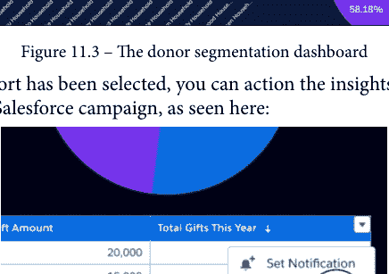

图 11.4 – 捐赠者细分记录操作

从数据到洞察再到行动的最后一个例子是学生成功洞察仪表板。在这种情况下，一旦从仪表板可视化中选定了所需的高风险学生群体，就可以在Salesforce中创建干预案例，并直接从仪表板记录表中分配给相应的学生顾问，如下面的截图所示：

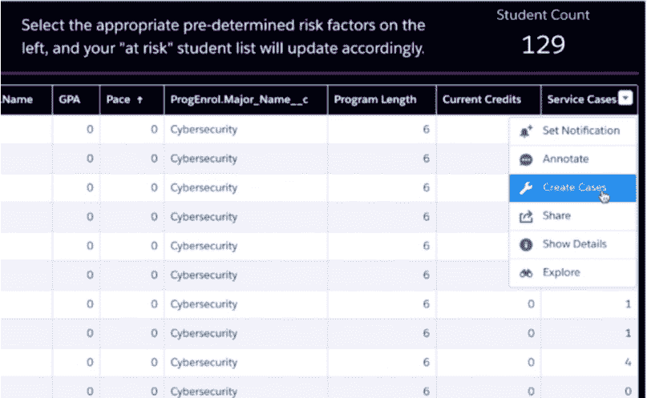

图 11.5 – 高风险学生行动列表

现在，我们将考虑业务理解在仪表板设计中的重要性。

### 好的仪表板反映并体现业务理解

设计良好的仪表板必须反映清晰的业务理解，而不仅仅是数据素养和技术技能。如果仪表板暴露出对业务背景理解不足，业务用户将不会使用它，也无法从中获益。你必须始终以业务为出发点，并在设计和构建过程中保持对业务的专注。

*数据分析 + 业务理解 = 业务洞察*

让我举三个例子。

第一个例子是为一位保险经纪人构建的索赔洞察仪表板，他需要高度定制的分析来反映非常特殊的业务需求。该仪表板改变了索赔团队的工作方式和服务客户的方式，因为它与业务背景和期望交付成果高度契合，如下面的截图所示：

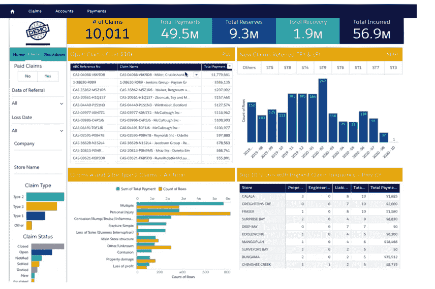

图 11.6 – 由深度业务理解驱动的索赔洞察

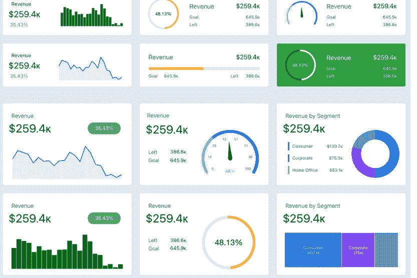

图 11.8 – 汇总磁贴提供由业务需求驱动的概览

在出色的仪表板设计中，下一个要考虑的要点是讲述故事的关键性。

### 好的仪表板用数据讲述故事

设计良好的分析会用数据讲述故事。它们将简单、清晰、简洁地叙述一个故事，从而产生清晰且可执行的业务策略。如果用户查看你的仪表板后无法理解并执行其中讲述的数据故事，那么现在正是重新设计仪表板的好时机！

数据叙事的一个例子可以在下面的仪表板中看到，其中业务绩效摘要以简洁和简单的方式清晰传达：

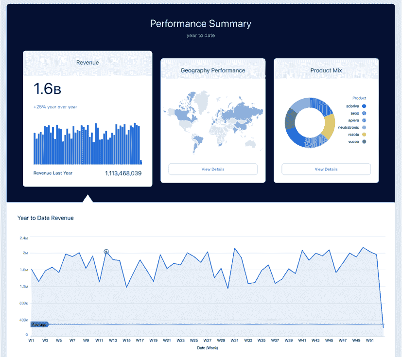

图 11.9 – 使用磁贴简单讲述业务绩效故事

另一个用数据讲述故事的例子是这个制造分析仪表板，它让用户清晰地了解材料库存、提前期以及它们对生产的影响：

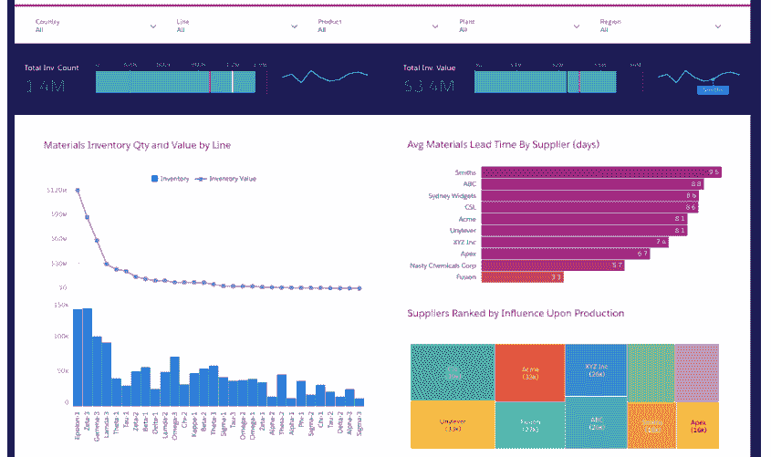

图 11.10 – 用数据讲述制造故事

关于如何让仪表板讲述故事的最后一个例子是这个筹款绩效分析仪表板，其中捐赠者、捐赠和绩效的关键指标显示在顶部，并辅以支持性洞察：

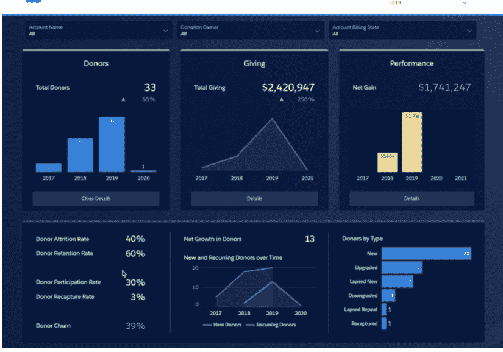

图 11.11 – 筹款绩效分析 – 清晰的数据流与故事讲述

既然你理解了用数据讲故事的重要性，你还需要认识到简洁仪表板的力量。

### 好的仪表板是简洁的

一个好的分析仪表板设计应该用数据讲述故事，而不会让用户因信息过多而不知所措和困惑。因此，在你的设计中，应消除或尽量减少以下内容：

- 杂乱
- 噪音
- 多余的信息
- 不必要的颜色使用
- 分散注意力的图形
- 任何没有明确目的出现在页面上的内容！

理想情况下，仪表板内容应适合单屏显示。

以下是一个体现简洁之美和力量的仪表板设计示例——一个简洁而有洞察力的PSA仪表板，它讲述了一个故事，没有添加任何无益或不必要的内容：

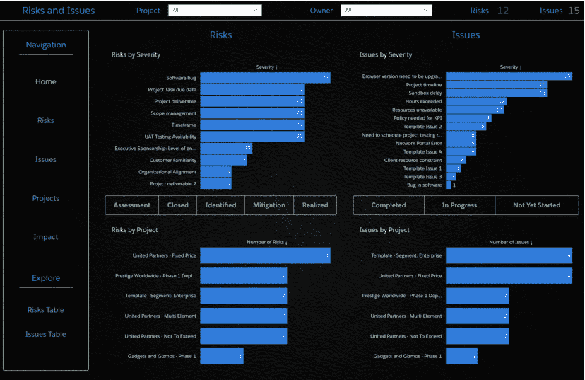

图 11.12 – 一个简单直观的PSA分析主页

注意这个设计摒弃了任何*花哨*的可视化效果，仅仅依赖朴素的柱状图。仪表板不需要*炫目*——但它确实需要*传递信息！*

下一个简洁设计的例子是为房地产开发业务构建的权益洞察仪表板。注意下面的截图，这个设计使事情变得非常简单，并充分利用留白以避免杂乱和复杂：

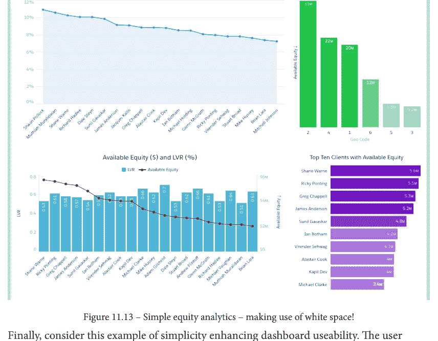

图 11.13 – 简洁的权益分析 – 充分利用留白！

最后，考虑这个简洁性提升仪表板可用性的例子。用户主页包含一个嵌入式TCRM仪表板，仅有三个图表，在用户登录时提供快速洞察。如果他们想知道更多，请注意右上角的OPEN链接：

### 图 11.14 – 主页上汇总分析的清晰可视化

当点击OPEN链接时，用户将进入一个简单的汇总主页，该页面提供概览指标和指向详情页面的链接：

### 图 11.15 – 为高管讲述故事的简洁可视化

请注意这个极简设计的几个要点：

- 用户拥有**快速链接**，可将他们带到常见的关注位置。
- 我们明智地利用了留白来呈现非常简单的布局。
- 选择这三个图表是因为每个图表都代表了业务各领域的关键指标。
- 每个磁贴的标题都是一个TCRM链接，可将用户带到详情页面。
- 没有任何多余的内容会分散用户对数据故事的注意力。
- 用户可以在30秒内浏览完此仪表板，并决定是深入探索还是继续前进。

现在，你将看到易用性在仪表板设计中的重要性。

### 好的仪表板直观且易于使用

出色的分析设计几乎无需或完全无需指导或培训即可使用。它真正直观——无需明确说明即可轻松理解或操作。当用户第一次看到直观的仪表板时，他们会确切地知道该做什么。


在以下直观的销售分析示例中，用户只需点击侧边图表的条形即可深入查看数据，并看到地图反映其选择：

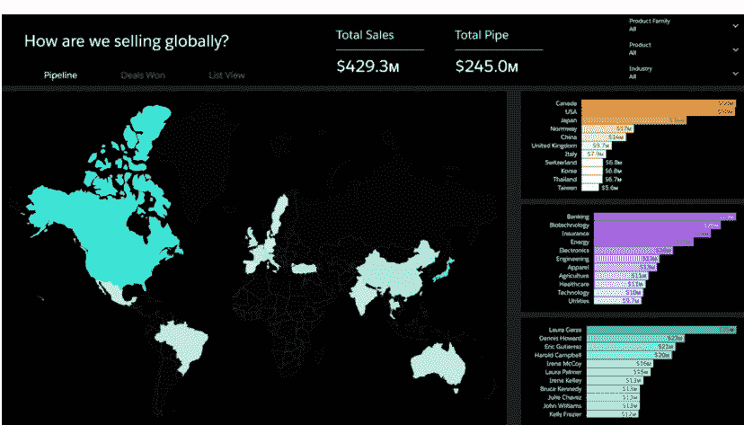

图 11.16 – 直观的全球地理销售分析

现在，我们需要探讨视觉传达的重要性。

### 优秀的仪表板通过视觉清晰传达信息

有效的分析将运用视觉理解和工具来辅助数据可视化与沟通。这包括审慎地使用以下元素：

- 颜色
- 形状
- 边框
- 对比度
- 邻近性
- 上下文

我建议你学习和运用格式塔原则，以理解人们如何看待和理解数据，包括以下原则：

- 闭合律
- 共同区域律
- 邻近律
- 相似律
- 对称律

有关格式塔原则的更多信息，请参阅以下资源：

```
https://www.interaction-design.org/literature/topics/gestalt-principles
```

在以下视觉传达示例中，我设计了一个非常简单的、高对比度的仪表板，以提供对总体趋势的洞察，并方便下钻到记录级别采取行动：

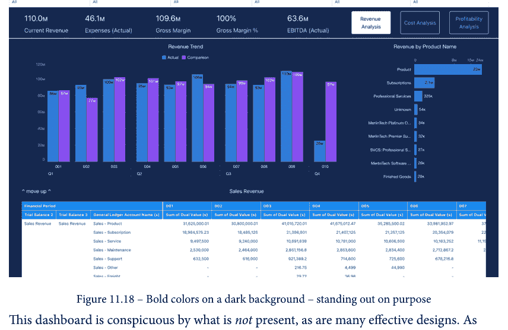

图 11.18 – 深色背景上的醒目颜色 – 有意脱颖而出

这个仪表板的醒目之处在于它没有呈现什么，许多有效的设计都是如此。正如安托万·德·圣埃克苏佩里所说：“你知道自己已经达到完美，不是当你没有什么可以添加，而是当你没有什么可以删减时。”

接下来你会看到，出色的仪表板在设计时都会考虑到目标受众。

### 优秀的仪表板会考虑受众

优秀的设计师会进入受众的思维空间。深入且全面地了解你的业务用户，以及他们将如何理解和执行你的仪表板，是设计过程中的关键一步。请考虑以下几点：

- 仪表板将如何用于后续行动？
- 读者在日常工作中需要哪些信息才能取得成功？
- 用户真正需要什么详细程度？
- 业务用户将采取哪些行动？这些行动将如何执行？
- 你将如何突出需要跟进的异常或洞察？
- 哪些用户假设和偏好可能影响你的设计选择？
- 在业务环境中，颜色意味着什么？它们可能如何被视觉解读？
- 在业务环境中，哪些图标、徽标等是用户熟悉的？
- 记得使用对色盲友好的配色方案。

下面的仪表板是一个有效设计的良好示例，它利用了设计者对目标受众的深刻理解：高管需要的是一个高层汇总页面，然后链接到详细的下钻仪表板页面：

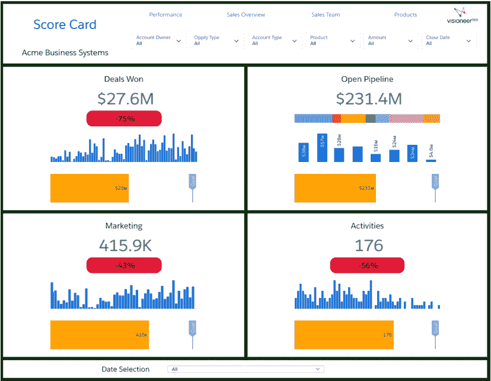

图 11.19 – 由受众理解驱动的业务记分卡

在这种情况下，每个磁贴包含以下针对所考虑业务领域的内容：

- 一个关键指标
- 一个用颜色编码以传达含义的比较度量
- 一个用于支撑关键指标的柱状图
- 一个由条形和目标构成的进度图

尽管设计看起来简单，但要有效创建这种极简设计所需的业务理解水平实际上相当高。

在以下仪表板示例中，用户是时间紧张的高管，他们只希望看到需要快速审阅的高层关键信息，并在需要时进行下钻和采取行动：

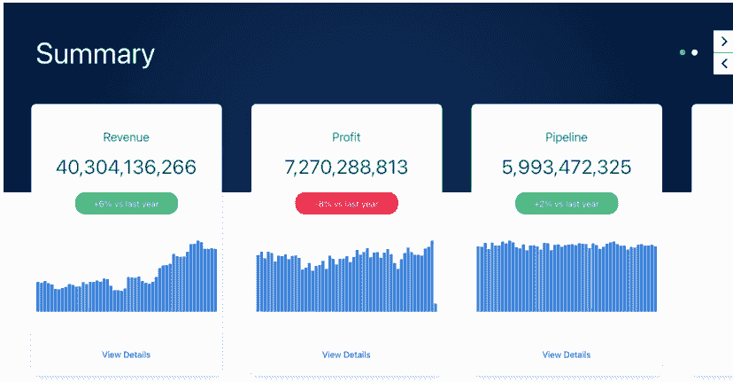

图 11.20 – 简单对于汇总仪表板很有效，并可按需下钻

接下来你将看到在仪表板设计中促进用户参与的重要性。

### 优秀的仪表板能促进用户参与

一个不被使用的仪表板就是屏幕上浪费的像素——无论它多么漂亮或多功能，都毫无价值。因此，你的设计必须促进用户参与并提高业务采用率。让我举例说明。

以下营销分析示例展示了一种设计，通过简洁、流动感和对比度，将观看者吸引到仪表板中并投入到数据讨论中：

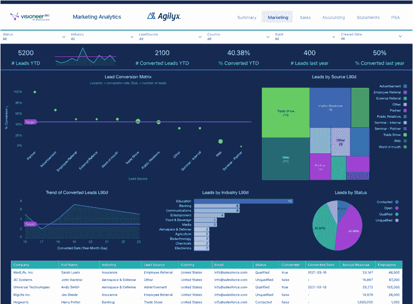

图 11.21 – 数据分析流动的营销分析

在促进用户参与方面，醒目、对比鲜明的颜色很有帮助。如下例所示，这样的设计能让信息脱颖而出，引起用户注意：

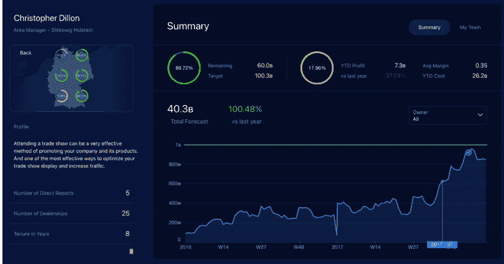

图 11.22 – 醒目的颜色、主图和支持性指标

注意，你的目光会自然地被主图、右下角的时间线吸引，然后伴随的数字和视觉效果提供支持和背景信息。

在下一个示例中，极简主义支持用户参与：

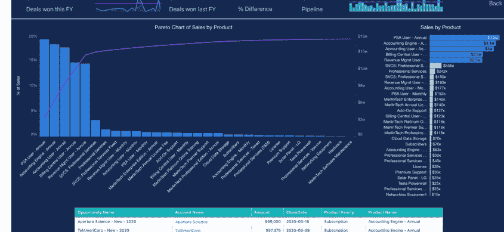

图 11.23 – 销售帕累托图中的少即是多

关于这种高度极简的设计，有几点值得注意：

- 没有任何东西会分散用户对主图（帕累托图）的注意力。
- 用户的注意力会自然地被帕累托图吸引，而该图本身快速且易于阅读。
- 通过按金额降序有意排序的“按产品销售额”条形图，可以方便地向下钻取到主图。
- 一旦用户确定了感兴趣的数据组，他们只需向下滚动即可查看各个记录，然后可以通过多种方式对这些记录采取行动。

下一个促进用户参与的仪表板示例使用了顶部清晰的重点摘要面板，辅以一行全局筛选器，并聚焦于一个关键主图——**末次触达与首次触达矩阵**：

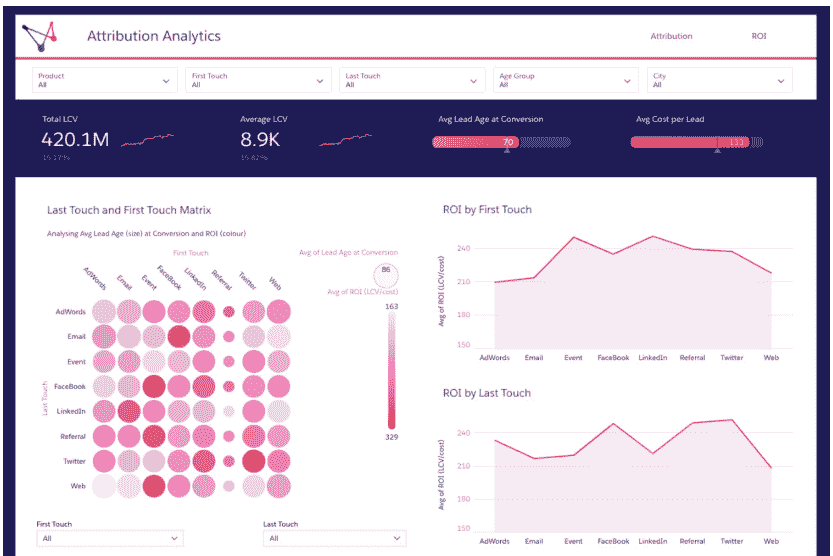

图 11.24 – 简单且可操作的营销归因分析

预测分析要呈现得易于理解且操作直观，可能颇具挑战性。下面这个示例通过使用信息丰富的颜色和两个时间线图表来支持右侧的操作表，从而很好地做到了这一点：

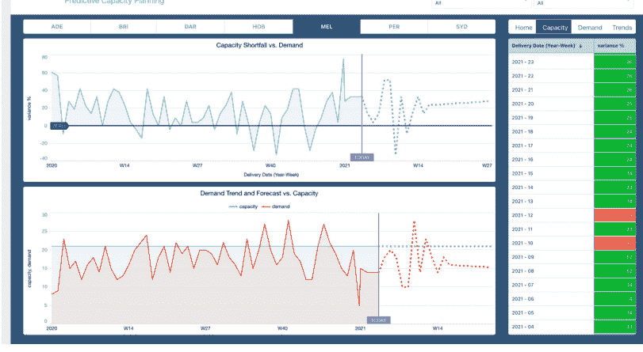

图 11.25 – 为预测性容量规划提供简单洞察

- 采用明智的布局选择。如果仪表板在视觉上组织良好，业务用户就能轻松找到所需信息。因此，我建议你从全局出发——关键洞察和标注必须一目了然。
- 始终为你的洞察提供背景信息。给你的用户提供比较值。
- 保持简单。
- 在功能性与创造性之间取得平衡——*有效*并不意味着*枯燥*。
- 为用户提供所需的详细程度，仅此而已。否则，过多的详细信息反而会分散注意力。
- 了解仪表板的使用方式和场景。例如，分析是在手机、平板还是 PC 上查看？考虑这些因素对良好的设计很重要。

我最喜欢的简单、直观且可操作的仪表板示例之一是这款销售预测工具，用户可以在其中快速可视化销售预测，并按季度、账户或阶段下钻，然后在记录表中查看各个机会并采取行动：

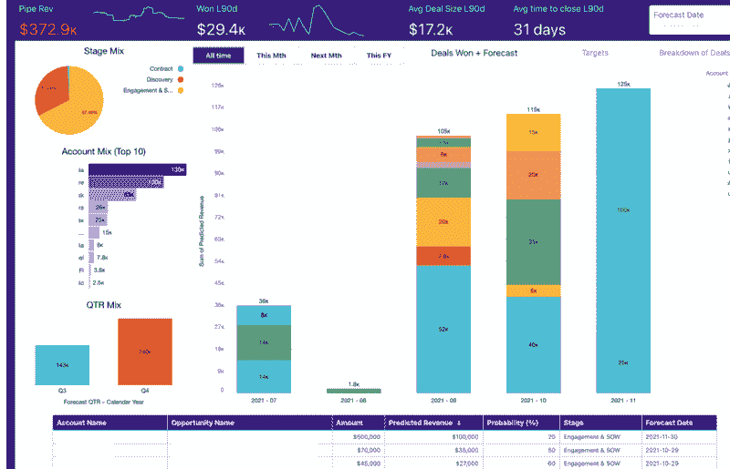

图 11.27 – 一个销售预测故事

有关仪表板设计原则的简洁总结，请参阅我的博客《*仪表板构建十诫*》：

```
https://marktossell.com/2019/06/22/the-ten-commandments-of-dashboard-building/
```

### 参考资料

以下资源对仪表板设计很有帮助：

- *《用数据讲故事》，Cole Nussbaumer Knaflic*
- *《信息仪表板设计》，Stephen Few*

既然你已经了解了优秀仪表板设计，接下来让我们看看在 TCRM 中构建仪表板的最佳实践。

### TCRM 仪表板设计中的最佳实践

在 TCRM 中构建仪表板的背景下，什么构成最佳实践？首先，让我们考虑如何最好地利用 TCRM 页面。

### 巧妙利用页面

TCRM 页面为你提供了极大的设计灵活性。通常最好的做法是巧妙地利用页面，而不是创建多个仪表板并在它们之间建立链接，因为那样会损害性能并丢失筛选器。

解释这一点的最好方式是通过示例。在**指挥中心**仪表板中，使用了多个页面，允许用户从高层汇总页面下钻到详细页面。下一张截图显示了顶层页面（即主页），这是业务用户的起点：


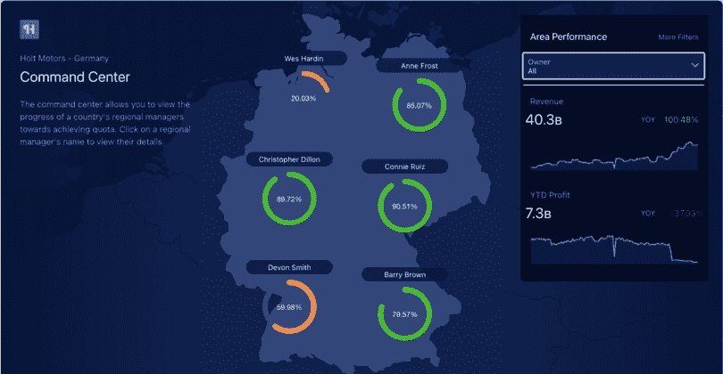

图 11.28 – 指挥中心主页

为了保持主页尽可能简单和整洁，仪表盘筛选器大部分被隐藏起来，但可以通过单击鼠标将其显示出来，如下面的截图所示：

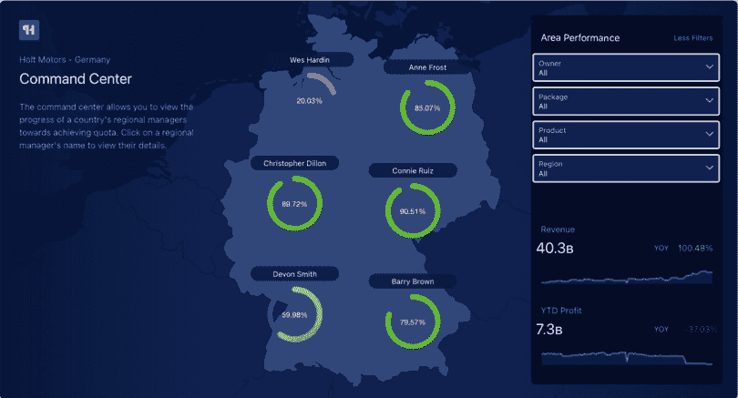

图 11.29 – 显示筛选器的指挥中心主页

业务用户的第一层钻取是团队主管摘要，其中显示团队指标和趋势。请注意，在下面的截图中，主页被最小化并放在一侧，以防用户希望返回并选择不同的团队和区域：

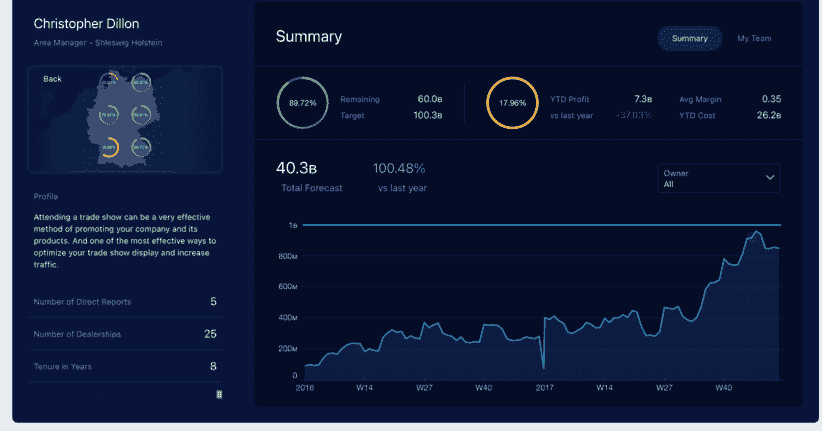

图 11.30 – 钻取页面一 – 团队主管摘要

下一层钻取是团队概览，如图 11.31 所示：

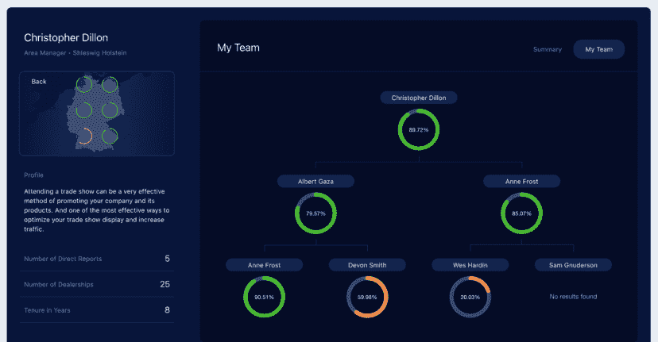

图 11.31 – 钻取页面二 – 团队概览

最后，业务用户可以单击团队成员的姓名，查看其个人绩效的详细信息，如下面的截图所示：

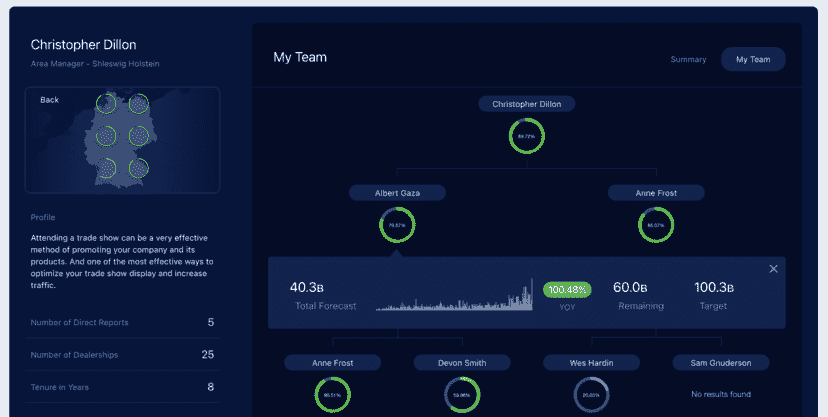

图 11.32 – 钻取页面三 – 团队成员详情

这种自上而下的设计强大且直观。这个页面是如何使用页面构建的呢？

首先，主页包含指向展开的筛选器页面和团队主管摘要页面的链接。请注意，此示例仪表盘仅包含一个团队主管摘要的页面，因为它仅用于演示目的；完整的仪表盘会包含更多页面。以下是主页设计，顶部显示了各个页面：

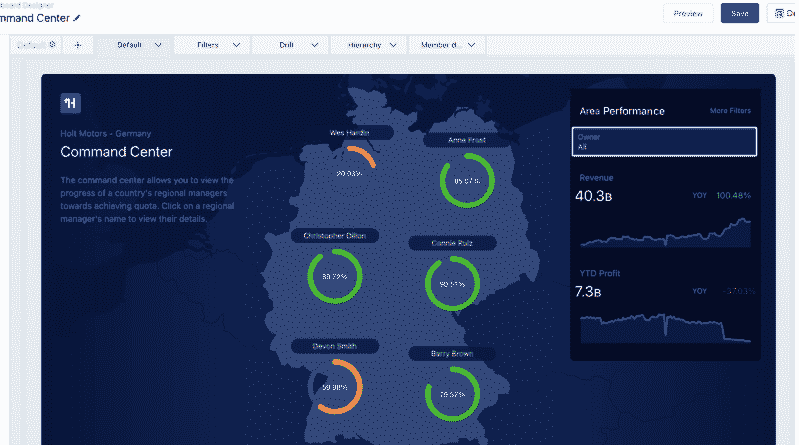

图 11.33 – 主页设计

接下来，我们看一下筛选器已展开的主页设计：

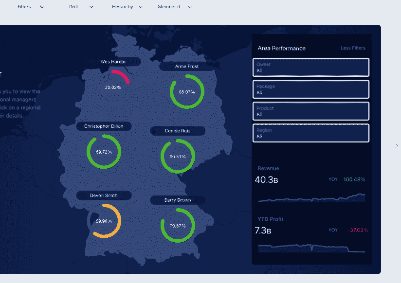

图 11.34 – 主页设计 – 筛选器已展开

强大的钻取功能是通过按顺序链接仪表盘页面实现的——这比链接各个仪表盘页面要好得多。下面的截图显示了带有团队摘要的第一个钻取页面：

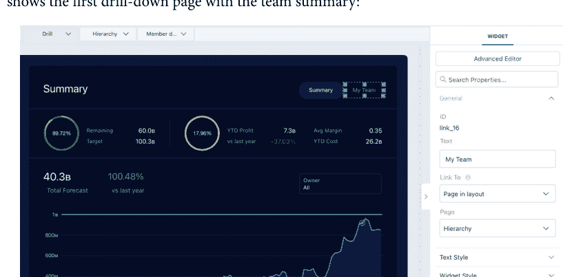

图 11.35 – 团队摘要页面设计，显示指向层级页面的链接

团队摘要页面随后链接到层级页面，如下图所示：

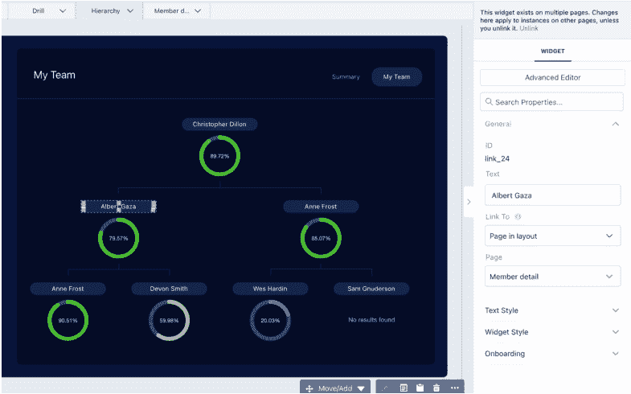

图 11.36 – 团队概览页面设计，显示指向成员详情页面的链接

最后，成员详情页面链接到团队概览页面。它还包含一个返回主页的链接，如下面的截图所示：

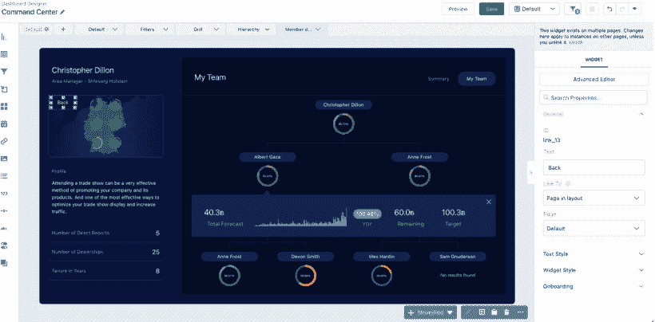

图 11.37 – 团队成员页面设计，显示返回主页的链接

现在，你将了解在仪表盘设计中最大化使用 GUI 的重要性。

### 尽可能使用 GUI 构建

我经常看到一个错误：具有开发背景的人——那些自信地使用代码构建的人——几乎用 JSON 和 SAQL 构建 TCRM 中的所有内容。结果是笨拙、臃肿的构建，其他人难以介入编辑。它不健壮，也不可扩展。

作为一般规则，最好在 GUI 的限制范围内工作，使用点击而不是代码，直到遇到瓶颈，然后根据需要补充使用 SAQL 和 JSON 进行构建。

### 明智地使用 SAQL

这一点自然从前一点引出——将 SAQL 的使用限制在绝对必要的地方。我通常会在仪表盘编辑器（以前称为“步骤”）中使用 UI 构建查询，然后切换到 SAQL 模式并完成我的查询。这也可以节省时间并防止语法错误。请记住关于这个主题的几点想法：

-   仪表盘中过多的 SAQL 查询会阻碍性能。

-   冗长、复杂且错综复杂的 SAQL 查询可能非常难以排查、编辑或扩展。

-   及时了解最新的 TCRM 版本，因为新版本通常会增加 UI 功能并减少对代码的依赖。

-   为了尽量减少 SAQL 的使用，在某些情况下，返回数据集并在那里完成基础工作，而不是在仪表盘 SAQL 中完成，可能会有所帮助。

承接最后一点，让我们看看如何返回你的数据集。

### 知道何时返回数据集

如前面的要点所述，返回数据集级别可能有助于最大程度地减少代码的使用；也就是说，聚合和转换通常最好在数据集中执行，而不是在仪表盘设计本身中构建代码。这种方法的示例包括：

-   聚合数据

-   分桶数据

仪表盘组件是一个非常强大且多功能的工具；它们甚至可以添加多个页面，因此仪表盘可以拥有页面中的页面！

在进入下一章之前，让我们看看本章学到了什么。

### 总结

你在本章学到了什么？首先，你了解了仪表盘设计中常见的错误。接下来，你学习了优秀仪表盘设计的原则以及许多实际示例。最后，你学习了 TCRM 最佳实践，包括页面的使用、代码的最小化以及仪表盘组件的使用。

在下一章中，我们将学习如何通过嵌入可操作的 TCRM 仪表盘，从数据到洞察再到行动。

### 问题

填空：

-   仔细选择你的 ______________ 类型。
-   切勿尝试将所有可用的 ________________ 放在同一页面上。
-   使用少量的 ________________ 和 ________________。
-   使仪表盘尽可能易于 ________________。
-   采用明智的 ________________ 选择。
-   始终为你的洞察提供 ________________。
-   保持事物 ________________。
-   在功能性与 ________________ 之间取得平衡 - *有效并不意味着无聊*。
-   为用户提供所需的 ________________ 级别，不要多。
-   理解仪表盘将被 ________________ 和 ________________ 使用。

### 技术要求

要成功执行本章中的说明，你需要满足以下条件：

-   最新版本的 Google Chrome 浏览器（使用 TCRM 时，Chrome 是首选浏览器）
-   一个可用的电子邮件地址

请确保已登录到你的 TCRM 开发组织。

让我们从记录操作开始。

## 在 TCRM 中创建和配置记录操作

简而言之，记录操作使您能够*对记录执行操作*。这意味着您无需从 TCRM 跳转到 Salesforce、将报表导出到 Excel，或执行任何其他笨拙的变通方法来*对洞察执行操作*——您可以直接从 TCRM 仪表盘对它们执行操作。

让我们看看如何使用已配置的记录操作对 Salesforce 记录执行操作。

### 已配置的记录操作

理解这一点的最佳方式是动手实践。我们将在您之前创建的名为**我的第一个仪表盘**的仪表盘中配置一个记录操作。请按照以下步骤操作：

1.  打开**我的第一个仪表盘**并进入**编辑**模式。
2.  从**商机**数据集创建一个值表。请务必包含**商机名称**字段。
3.  将该表添加到仪表盘的底部。
4.  单击**保存**。

您的仪表盘现在将如下所示：

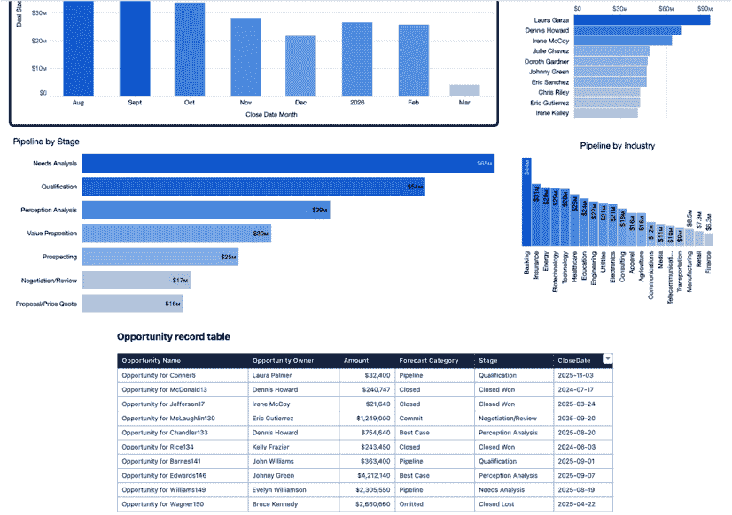

图 12.1 – 我的第一个仪表盘，已添加记录表

现在您已经添加了该表，是时候配置记录操作了，这些操作将使用户能够轻松地从数据到洞察再到行动。请按照以下步骤操作：

1.  在 Analytics Studio 中，编辑**商机**数据集。
2.  在右上角，单击**配置操作**齿轮图标。请注意，如果已经为对象上的某个字段配置了操作，您将在列表中看到它旁边有一个复选标记。
3.  选择**商机名称**字段。您将在右侧看到操作配置选项。
4.  将操作配置为具有值为“Opportunity ID”的**记录 ID 字段**。
5.  在**显示字段**下，选择**客户负责人**。如果多个 Salesforce 记录适用于所选商机，此字段将提供用于选择正确记录的信息。


Figure 12.3 – Configured record action dialog box – part two

- 13. Close and reopen the My First Dashboard dashboard. Click on the drop-down arrow on the opportunity name for any record in the table. You should see these actions:

#### Opportunity record table

| Opportunity Name | Opportunity Owner | Amount |
|---|---|---|
| Opportunity for Conner5 | Laura Palmer | $32,400 |
| Opportunity for McDonald13 | Dennis Howard | $240,747 |
| Opportunity for Jefferson17 | Irene McCoy | $21,640 |
| Opportunity for McLaughlin130 |  | $1,249,000 |
| Opportunity for Chandler133 |  | $754,640 |
| Opportunity for Rice134 |  | $243,450 |
| Opportunity for Barnes141 |  | $363,400 |
| Opportunity for Edwards146 |  | $4,212,140 |
| Opportunity for Williams149 |  | $2,305,550 |
| Opportunity for Wagner150 |  | $2,660,660 |
| Opportunity for Lewis258 | Laura Garza | $309,938 |
| Opportunity for Barrett259 | Doroth Gardner | $1,589,440 |
| Opportunity for Dennis260 | Bruce Kennedy | $2,868,400 |

Figure 12.4 – Configured record actions on the Opportunity Name field

Follow these steps to create and edit a follow-up task for a deal that requires attention:

- 1. Click on **New Task**.
- 2. Under **Subject**, select **Call**.
- 3. Enter a **Due Date** value.
- 4. Leave the **Name** field blank.
- 5. Note that the task is prefilled for the relevant opportunity under **Related To**.
- 6. Leave **Assigned To** and **Status** as they are.
- 7. Click on **Save**.
- 8. Click on **Open Record** for the opportunity and see how you are taken to the record in Salesforce.
- 9. Under the **Activity** tab for the opportunity in Salesforce, you will see the task that you just created. Click on it to be taken to the task record page.
- 10. Edit the task by changing the priority and adding comments.
- 11. Click on **Save**.

You did it! You created a task from a TCRM dashboard and edited that task in Salesforce with just a few clicks and no copying and pasting information!

Here is the task on the opportunity record:

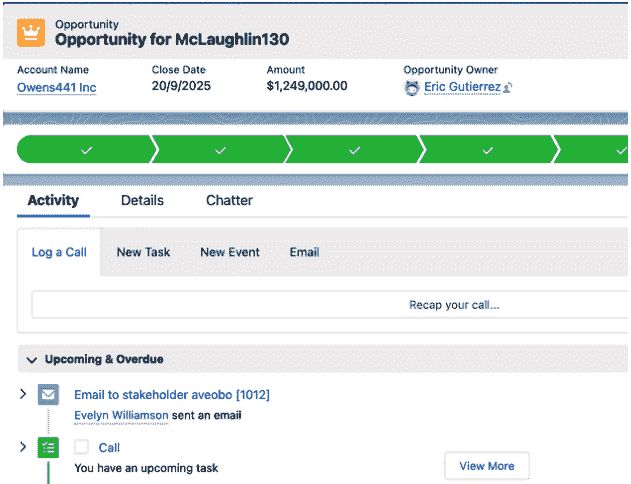

Here is the end result:

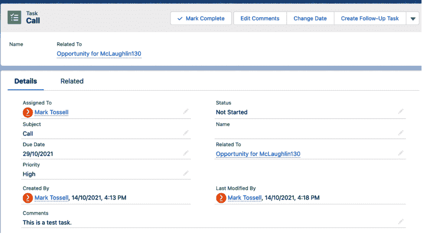

*Figure 12.6 – The final task that was created and edited via TCRM*

Keep in mind that record actions in TCRM support these objects and global actions:

- Create and update object records.
- Log a call.
- Custom actions to trigger Lightning components, flows, and Visualforce pages.
- Lightning components that use Lightning events are supported in embedded dashboards but are not supported in Analytics Studio.
- Standard Chatter actions, excluding *File*.

Global quick actions and canvas apps are not supported in TCRM configured record actions. TCRM does not support actions assigned to a page layout for the user object.

As you saw briefly in *Chapter 10, To Code, or Not to Code*, TCRM also offers the advanced functionality of bulk actions, where a group of records can be actioned in Salesforce with just a few clicks. However, as this is an advanced developer feature, it will not be covered in this book.

Let's now understand how to trigger an automation in Salesforce from TCRM.

### Why would you embed your dashboards?

One of the great struggles in the world of data analytics and business intelligence is *user adoption*. It is often the case that organizations spend hundreds of hours and many thousands of dollars on capturing, analyzing, and visualizing, only for the project to fail miserably because business users simply don’t use and apply the insights.

One way to address poor user adoption is to embed the insights in front of the user in the CRM workflow, where they will inevitably view the dashboards as they work in their **Business As Usual (BAU)** environment. This is very different, and much more effective, than asking users to remember to review dashboards during their busy workdays, even if they are only a tab away in Salesforce. It really is a game changer for analytics adoption.

Here is an example that we created for one of our clients in the **Not-For-Profit (NFP)** space. In this use case, the NFP organization wanted insights about their donors added to the Salesforce home page and account record page. Once this was achieved, the usage of TCRM insights increased drastically, and users were able to action insights as a part of their daily BAU activity in Salesforce.

Here is the NFP home page with an embedded TCRM dashboard showcasing donor segmentation insights:

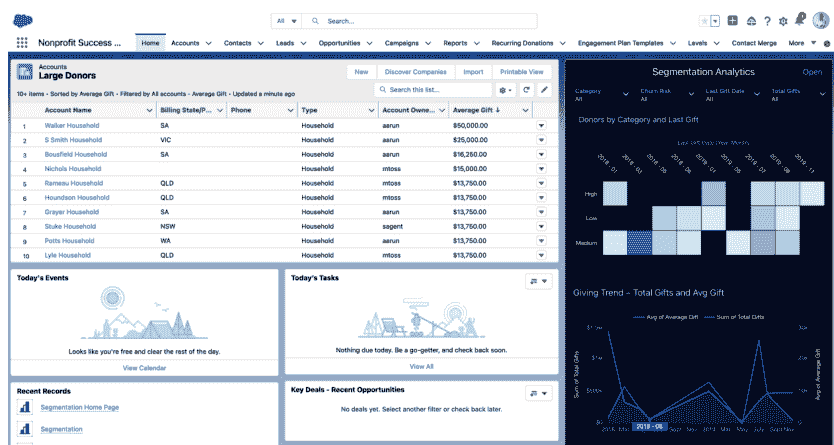

Figure 12.8 – The NFP home page with an embedded TCRM dashboard on the right

Here is the account record with rich insights added from TCRM:

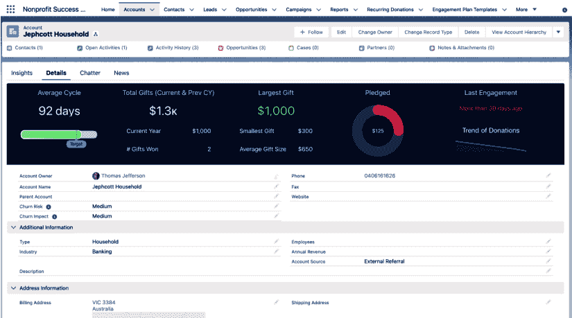

Figure 12.9 – The NFP account record page with an embedded TCRM dashboard

Is it difficult to embed TCRM dashboards in Salesforce? Do you need to be a developer? The answer to both questions is no. Let me show you how to embed your dashboards.

### How do you embed your dashboards?

The best way to learn how to embed dashboards is to do it, so follow these steps to embed a simple dashboard on the account record page in Salesforce:

- 1. Create a new blank dashboard and save it as `Mini Sales Insights` in My First Analytics App.
- 2. Create and add a chart for sales by close date month.
- 3. Create and add a chart for the pipeline by close date month.
- 4. Save your dashboard.

The end result should look like this:

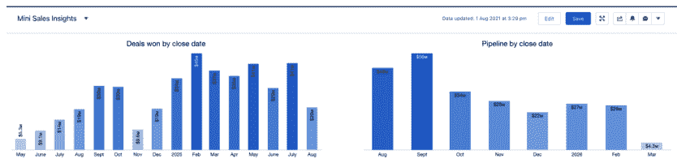

Figure 12.10 – The Mini Sales Insights dashboard

Now, let's go ahead and embed this dashboard on the account record page in Salesforce. Follow these steps:

- 1. Open any account record in Salesforce.
- 2. Click on the Setup gear icon at the top right of the page.
- 3. Click on Edit Page. You are now in the Lightning App Builder.
- 4. From the list of components on the left, select the Tableau CRM Dashboard component and drag it onto the canvas below the highlights panel.
- 5. Go into the component format panel on the right and make sure that Dashboard shows as Mini Sales Insights.
- 6. Adjust the Height value for the component so that the TCRM dashboard fits nicely on the page layout. For my example, this was a height of 400.
- 7. Leave the other options as they are.
- 8. The dashboard is ready, except that it will show information for all accounts, and we want it to show only information for the account record being displayed. To add a filter that will accomplish this, click on Add Dashboard Filter.
- 9. Select Opportunities under Dataset.
- 10. Select Account ID under Dataset Field.
- 11. Select Equals as Operator.
- 12. Select Account > Id under Object Field.
- 13. Click on OK.
- 14. Click on Save.
- 15. Activate the account record page and click on Assign as Org Default.
- 16. Go back to the account page in Salesforce (the left arrow in the top-left corner in the Lightning App Builder).

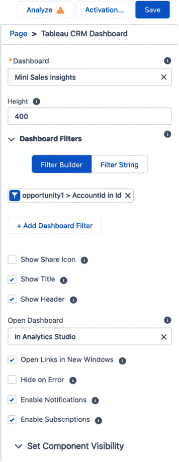

The format panel for the TCRM dashboard Lightning component should look like this:

Figure 12.11 – Completed format panel for the TCRM dashboard Lightning component

It is also worth noting that the visibility of the TCRM component can be controlled from this format panel, where filters can be added that control whether or not the embedded dashboard is visible to the logged-in user. These filters are based upon record fields or the device being used.

I trust that this book has been a help to you, wherever you may be on your TCRM journey. I encourage you to dive into the platform and use it in real-world use cases, because the best way to learn is to solve problems, build assets, and deliver solutions. Make sure that you get involved in the vibrant TCRM online community, and avail yourself of the many great online resources available for TCRM.

Please feel free to reach out to me via LinkedIn with any feedback or questions about my book or TCRM in general. I would love to hear from you!

### Questions

Answer the following questions to test your learning from this chapter:

- How do embedded dashboards aid user adoption of TCRM?
- Give three examples of configured record actions supported in TCRM.
- What is the purpose of the dashboard filter when embedding a TCRM dashboard via the Lightning App Builder?
- Give one example of how you can drive an automation in Salesforce from TCRM.


