# 第 1 章

## Xamarin.Forms 如何融入其中？

编程中有很多乐趣。分析问题、将问题分解成小块、制定解决方案、规划策略、从不同角度探讨问题以及编写代码，都有乐趣。看到程序第一次运行会带来许多乐趣，而随后急切地投入代码，让它更好、更快，则带来更多乐趣。

追查 bug、确保程序运行平稳且可预测，也常常充满乐趣。很少有事情能像最终识别出一个特别顽固的 bug 并彻底根除它那样令人愉快。

甚至当你意识到最初采取的方法并非最佳时，也有乐趣。许多开发人员发现，他们在编写程序时学到了很多，包括有更好的方式来组织代码。有时，部分甚至完全重写可以产生好得多的应用程序。这个过程就像站在自己的肩膀上，获得这种视角和知识带来了很多乐趣。

然而，编程并非所有方面都那么愉快。最糟糕的编程工作之一，是把一个现有的正常运行的程序用完全不同的编程语言重写，或者将其移植到另一个具有完全不同的应用程序编程接口（API）的操作系统上。

这样的工作可能非常辛苦。然而，这样的重写很可能很有必要：在 iPhone 上极受欢迎的应用程序在 Android 设备上可能会更受欢迎，而且只有一种方法可以找出答案。

但问题在这里：在你浏览原始源代码并将其转移到新平台时，你是一路上都保持相同的程序结构以便两个版本并行存在？还是尝试进行改进和增强？

当然，诱惑是彻底重新思考应用程序，让新版本变得更好。但两个版本之间偏离得越远，将来就越难维护。

因此，将一个应用程序分叉为两个时，一种与生俱来的恐惧感弥漫其中。每写一行代码，你都会意识到所有未来的维护工作、所有未来的修订和增强，都将变成两份工作，而不是一份。

这不是一个新问题。半个多世纪以来，开发人员一直渴望能够编写一个在多种机器上运行的程序。这正是高级语言最初被发明的原因之一，也是“跨平台开发”这一概念能够继续对程序员产生强大吸引力的原因。


## 共享代码

使用单一编程语言面向多个平台的优势，在于能够在应用程序之间共享代码。

在共享代码之前，必须为此目的进行结构化设计。尤其是自从图形用户界面广泛使用以来，程序员们已经意识到将应用程序代码划分为功能层的重要性。也许最有用的划分是用户界面代码与底层数据模型和算法之间的划分。流行的 MVC（Model-View-Controller）应用程序架构将这种代码分离正式化为 Model（底层数据）、View（数据的可视化表示）和 Controller（处理用户输入）。

MVC 起源于 20 世纪 80 年代。后来，MVVM（Model-View-ViewModel）架构基于现代 GUI 有效地对 MVC 进行了现代化改造。MVVM 将代码分为 Model（底层数据）、View（用户界面，包括视觉效果和输入）和 ViewModel（管理 Model 与 View 之间传递的数据）。

在开发面向多个移动平台的程序时，MVVM 架构可帮助开发人员将代码分离为平台特定的 View——即需要与平台 API 交互的代码——以及平台无关的 Model 和 ViewModel。

通常，这些平台无关的代码需要访问文件或网络，或者使用集合和线程。通常，这些工作会被视为操作系统 API 的一部分，但它们也可以利用 .NET Framework 类库来完成；如果该类库在每个平台上都可用，那么它实际上就是平台无关的。

应用程序中平台无关的部分随后可以被隔离出来，并且在 Visual Studio 或 Xamarin Studio 环境中放入一个单独的项目。这可以是共享资产项目（SAP）——它仅包含代码和其他可从其他项目访问的资产文件——也可以是可移植类库（PCL），它将所有公共代码封装在动态链接库（DLL）中，其他项目随后可以引用该 DLL。

无论使用哪种方法，这些公共代码都可以访问 .NET Framework 类库，因此它可以执行文件 I/O、处理全球化、访问 Web 服务、解析 XML 等等。

这意味着你可以创建一个包含四个 C# 项目的 Visual Studio 解决方案，以面向三大移动平台；或者你可以使用 Xamarin Studio 来面向 iPhone 和 Android 设备。

下图大致展示了 Visual Studio 或 Xamarin Studio 项目、Xamarin 库和平台 API 之间的相互关系：

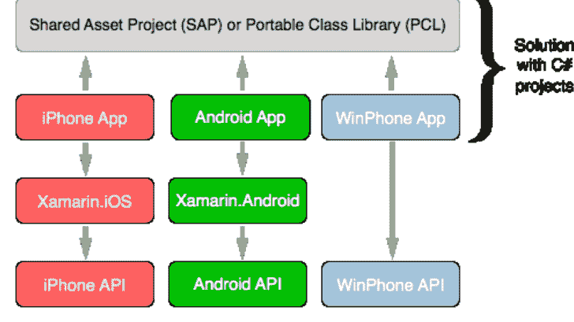

第二行的方框是实际的平台特定应用程序。它们会调用公共项目，并且（在 iPhone 和 Android 的情况下）还会调用实现原生平台 API 的 Xamarin 库。

但该图并不十分完整：它没有显示 SAP 或 PCL 调用 .NET Framework 类库的情况。PCL 可以访问其自身的 .NET 版本，而 SAP 使用集成到每个特定平台中的 .NET 版本。

在这个图中，Xamarin.iOS 和 Xamarin.Android 库看起来相当庞大，虽然它们确实重要，但它们大多只是语言绑定，并不会显著增加 API 调用的开销。

构建 iPhone 应用时，Xamarin C# 编译器像往常一样生成 C# 中间语言（IL），然后利用 Mac 上的 Apple 编译器生成本机 iPhone 机器代码，就像 Objective-C 编译器一样。应用对 iPhone API 的调用与使用 Objective-C 编写的应用完全相同。

对于 Android 应用，Xamarin C# 编译器会生成 IL，IL 在设备上与 Java 引擎并行运行的一个 Mono 版本上运行，但应用的 API 调用几乎与用 Java 编写的应用相同。

对于有非常平台特定需求、但也包含可能可共享的平台无关代码块的移动应用，Xamarin.iOS 和 Xamarin.Android 提供了出色的解决方案。你可以访问完整的平台 API，并拥有随之而来的全部能力（和责任）。

但对于可能不需要那么多平台特定性的应用，现在有一种替代方案，能让你的工作更加简单。

## Xamarin.Forms 简介

2014 年 5 月 28 日，Xamarin 推出了 Xamarin.Forms，作为名为 Xamarin 3 的 Xamarin 平台一系列增强功能的一部分。Xamarin.Forms 允许你编写可为 iPhone、Android 和 Windows Phone 编译的用户界面代码。

## Xamarin.Forms 选项

在一般情况下，Xamarin.Forms 应用程序是由三个面向三大移动平台的独立项目和一个包含公共代码的第四个项目组成——这与前一节中的图非常相似。

然而，在 Xamarin.Forms 应用程序中，这三个平台项目通常非常小——往往只包含带有少量样板启动代码的存根。共享资产项目或可移植类库项目包含应用程序的主体，包括用户界面代码：

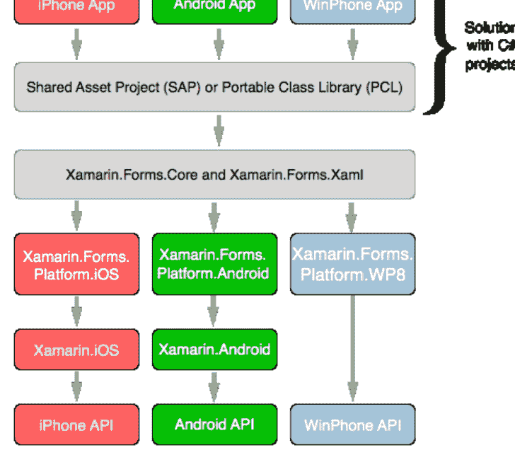

Xamarin.Forms.Core 和 Xamarin.Forms.Xaml 库实现了 Xamarin.Forms API。根据平台不同，Xamarin.Forms.Core 会使用相应的 Xamarin.Forms.Platform 库之一。这些库主要是一组称为渲染器的类，负责将 Xamarin.Forms 用户界面对象转换为平台特定的用户界面。

图表的其余部分与前面显示的相同。

例如，假设你需要前面讨论过的、允许用户在两个选项之间切换的用户界面对象。在使用 Xamarin.Forms 编程时，这被称为 `Switch`，在 Xamarin.Forms.Core 库中实现了一个名为 `Switch` 的类。在这三个平台的各个渲染器中，这个 `Switch` 被映射到 iPhone 上的 `UISwitch`、Android 上的 `Switch` 以及 Windows Phone 上的 `ToggleSwitchButton`。

Xamarin.Forms.Core 还包含一个名为 `Slider` 的类，用于显示一个水平条，用户通过操作它来选择数值。在平台特定库的渲染器中，它被映射为 iPhone 上的 `UISlider`、Android 上的 `SeekBar` 以及 Windows Phone 上的 `Slider`。

这意味着，当你编写一个包含 `Switch` 或 `Slider` 的 Xamarin.Forms 程序时，实际显示的是每个平台中实现的相关对象。

下面是一个简单的 Xamarin.Forms 程序，包含一个显示 “Hello, Xamarin.Forms!” 的 `Label`、一个显示 “Click Me!” 的 `Button`、一个 `Switch` 和一个 `Slider`。该程序正在（从左到右）iPhone、Android 和 Windows Phone 上运行：

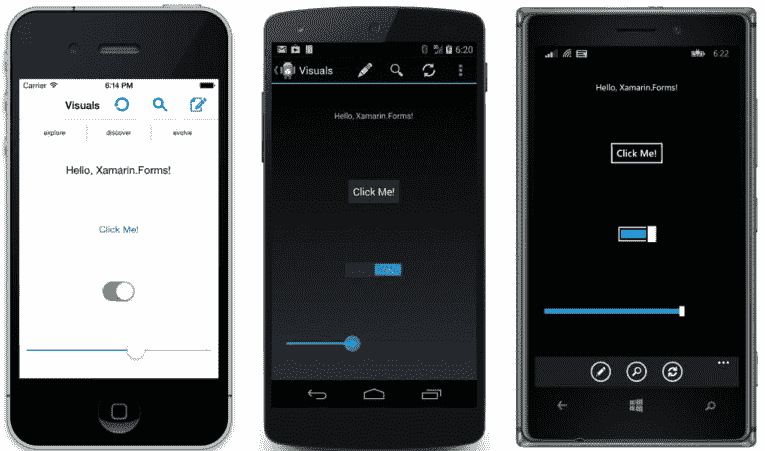

在本书中，你会反复看到这样的三联屏幕截图。它们的顺序总是相同的——iPhone、Android 和 Windows Phone——并且总是运行同一个程序。

## 机器与 IDE

如果你想开发 iPhone 应用，你将需要一台 Mac。Apple 要求必须使用 Mac 来构建 iPhone 和其他 iOS 应用程序。你需要在这台机器上安装 Xcode，当然还要安装包含所需库和 Xamarin Studio 的 Xamarin 平台。然后，你就可以在 Mac 上使用 Xamarin Studio 和 Xamarin.Forms 进行 iPhone 开发。

一旦你拥有一台安装了 Xcode 和 Xamarin 平台的 Mac，你也可以在 PC 上安装 Xamarin 平台，并使用 Visual Studio 为 iPhone 编程。PC 和 Mac 必须通过网络（如 WiFi）连接。你需要为这种互联在 Mac 上运行 Xamarin.iOS Build Host，Visual Studio 会利用它在 Mac 上构建并部署可执行文件。

虽然你可以在 PC 上运行 Xamarin Studio，但不能使用 PC 上的 Xamarin Studio 进行 iPhone 编程。

如果你想开发 Android 手机应用，你有很多灵活选择。你可以使用 Mac 上的 Xamarin Studio、PC 上的 Xamarin Studio 或 PC 上的 Visual Studio 来实现。

如果你想开发 Windows Phone 应用，你需要使用 Visual Studio 2012 或 2013，但不能使用 Express 版本。

这意味着，如果你想在单个 IDE 中面向所有三个平台，你可以在通过网络连接到 Mac 的 PC 上运行 Visual Studio 来实现。另一种选择是在 Mac 上的虚拟机中运行 Visual Studio。

## 设备与模拟器

你可以通过 USB 线将真实手机连接到机器来测试程序，也可以使用屏幕上的模拟器测试程序。

每种方法都有优缺点。真实手机对于测试复杂的触摸交互或感受启动或响应时间至关重要。但是，模拟器可以让你看到应用程序如何适应各种尺寸和外形。

运行最流畅的模拟器也许是 iPhone 模拟器。然而，由于 Mac 台式机没有触摸屏，你需要使用鼠标或鼠标垫来模拟触摸。Mac 触控板上的触摸手势不会传递到模拟器。你也可以将真实的 iPhone 连接到 Mac，但你需要将其配置为开发设备。

Windows Phone 模拟器支持多种不同的屏幕分辨率，并且往往运行得相当流畅，尽管会消耗大量内存。如果你在触摸屏上运行 Windows Phone 模拟器，你可以在模拟器屏幕上使用触摸。将真实的 Windows Phone 连接到 PC 需要解锁手机。如果你想解锁多部手机，你需要一个开发者帐户。

Android 模拟器的问题最多。它们往往又慢又不稳定，尽管在模拟大量真实 Android 设备方面常常非常灵活。另一方面，很容易


将一台真实的 Android 手机连接到 Mac 或 PC 上进行测试。你真正需要做的就是在设备上启用 USB 调试。

如果你喜欢在真实设备上测试，但又想在超出自己管理能力的更多真实设备上进行测试，可以了解一下 Xamarin Test Cloud。

## 安装

在为 Xamarin.Forms 编写应用程序之前，你需要在 Mac 和/或 PC 上安装 Xamarin 平台。请参阅 Xamarin 网站上的文章：

*http://developer.xamarin.com/guides/cross-platform/getting_started/installation*

你可能迫不及待地想创建你的第一个 Xamarin.Forms 应用程序，但在开始之前，你应当先尝试为 iPhone 和 Android 创建常规的 Xamarin 项目，以及一个常规的 Windows Phone 项目。

这一点很重要：如果你在使用 Xamarin.iOS 或 Xamarin.Android 时遇到问题，那并不是 Xamarin.Forms 的问题，你需要在使用 Xamarin.Forms 之前先解决该问题。

## 创建 iOS 应用

如果你有兴趣使用 Xamarin.Forms 来面向 iPhone，请先熟悉 Xamarin 网站上相应的入门文档：

*http://developer.xamarin.com/guides/ios/getting_started/*

这将指导你如何使用 Xamarin.iOS 库以 C# 开发 iPhone 应用程序。你真正需要做的，就是能够在真实的 iPhone 或 iPhone 模拟器上构建并部署一个简单的 iPhone 应用程序。

如果你使用的是 Xamarin Studio，可以从菜单中选择 **文件 > 新建 > 解决方案**，然后在 **新建解决方案** 对话框中，从左侧选择 **C#** 和 **iOS**，再选择 **通用**，最后从中间的模板列表中选择 **空项目**。

如果你使用的是 Visual Studio，可以从菜单中选择 **文件 > 新建 > 项目**，然后在 **新建项目** 对话框中，从左侧选择 **Visual C#** 和 **iOS**，再选择 **通用**，最后从中间的模板列表中选择 **空白应用 (iOS)**。

无论哪种情况，都要为解决方案选择位置和名称。构建并部署项目中创建的骨架应用程序。如果你在此遇到问题，这不是 Xamarin.Forms 的问题。你可能想查看 Xamarin.iOS 论坛，看看是否有人有类似问题：

*http://forums.xamarin.com/categories/ios*

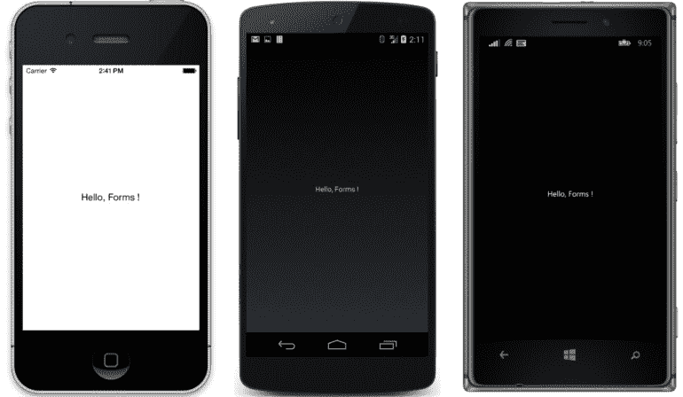

如你所见，这些平台有不同的配色方案。默认情况下，Windows Phone 的配色方案与 Android 类似，在深色背景上显示浅色文字，但这种配色方案是可以由用户更改的。即使在 Windows Phone 模拟器上，你也可以在“设置”应用的“主题”部分更改配色方案，然后重新运行程序。

应用不仅会在设备或模拟器上运行，而且会被部署。它会与手机或模拟器上的其他应用一起显示，并且可以从那里运行。如果你不喜欢应用程序图标或应用名称的显示方式，可以在各个平台项目中更改。

## Xamarin.Forms 解决方案剖析

显然，由 Xamarin.Forms 模板创建的程序非常简单，所以这是一个绝佳的机会来检查生成的代码文件，并理解它们的相互关系和工作原理。

让我们从定义你在屏幕上看到的文本的代码开始。这就是 Hello 项目中的 App.cs 文件，如果自从本章编写以来项目模板没有改变太多，它可能看起来像这样：

```
using System;
using System.Collections.Generic;
using System.Linq;
using System.Text;

using Xamarin.Forms;

namespace Hello
```

对于这三个不同的平台，你很快就会看到如何做到这一点。你也可以在这三个应用程序项目中包含特定于平台的代码。

这三个应用程序项目拥有自己的资产，即图标和元数据。如果你打算将应用程序推向市场，就必须特别关注这些资产。但在你学习如何使用 Xamarin.Forms 开发应用程序期间，通常可以忽略这些资产。你可能希望将这些应用程序项目在解决方案列表中折叠起来，因为你无需过多关注它们的内容。

但你确实应该了解这些应用程序项目中有什么，所以让我们仔细看一看。

在每个应用程序项目的 **引用** 部分，你会看到对公共项目（此处为 **Hello**）的引用，以及各种 .NET 程序集、上面列出的 Xamarin.Forms 程序集，以及适用于各个平台的额外 Xamarin.Forms 程序集：

- Xamarin.Forms.Platform.Android
- Xamarin.Forms.Platform.iOS
- Xamarin.Forms.Platform.WP8

这三个库中的每一个都定义了一个静态的 `Xamarin.Forms.Init` 方法来初始化 Xamarin.Forms 系统。你还刚刚看到，公共项目通常定义一个名为 `App.GetMainPage` 的公共静态方法。

至少，这三个应用程序项目中的每一个都必须在特定于平台的开销上下文中调用这两个方法。如果你熟悉 iOS、Android 或 Windows Phone 开发，你可能会好奇这三个平台各自如何处理从 `App.GetMainPage` 方法返回的 Xamarin.Forms `Page` 对象。

## iOS 项目

iOS 项目通常包含一个派生自 `UIApplicationDelegate` 的类。标准 Xamarin.Forms 模板定义了这样一个类，可以在 Hello.iOS 项目的 AppDelegate.cs 文件中找到。这里是删除了所有无关的 `using` 指令和注释后的代码：

```
using MonoTouch.Foundation;
using MonoTouch.UIKit;
using Xamarin.Forms;

namespace Hello.iOS
{
    [Register("AppDelegate")]
    public partial class AppDelegate : UIApplicationDelegate
    {
        UIWindow window;

        public override bool FinishedLaunching(UIApplication app,
                                               NSDictionary options)
```

由 `AndroidActivity` 类标注并由 `MainActivity` 继承。

## Windows Phone 项目

在 Windows Phone 项目中，请查看项目文件列表中位于 MainPage.xaml 文件下方的 `MainPage.xaml.cs` 文件。该文件定义了常规的 `MainPage` 类，并对从 `App.GetMainPage` 返回的对象使用 Xamarin.Forms.Platform.WP8 程序集中定义的名为 `ConvertPageToUIElement` 的扩展方法：

```csharp
using Microsoft.Phone.Controls;
using Xamarin.Forms;

namespace Hello.WinPhone
{
    public partial class MainPage : PhoneApplicationPage
    {
        public MainPage()
        {
            InitializeComponent();

            Forms.Init();
            Content = Hello.App.GetMainPage().ConvertPageToUIElement(this);
        }
    }
}
```

如果你是 Windows Phone 程序员，可能会想知道 `ConvertPageToUIElement` 返回的是 Windows Phone Canvas 对象。

你可能想在 `MainPage` 构造函数中紧接 `InitializeComponent` 之后添加以下语句：

```csharp
this.SupportedOrientations = SupportedPageOrientation.PortraitOrLandscape;
```

这将允许 Windows Phone 显示响应方向变化，并与 iPhone 和 Android 项目保持一致。

## 没什么特别的！

如果你在 Visual Studio 中创建了 Xamarin.Forms 解决方案，并且不希望面向一个或多个平台，直接删除这些项目即可。

如果你后来对这些项目改变了主意——或者你最初是在 Xamarin Studio 中创建解决方案，而现在想将它移到 Visual Studio 中以面向 Windows Phone——你可以在 Xamarin.Forms 解决方案中添加新的平台项目。在 **添加新项目** 对话框中，你可以通过选择 iOS 项目的 **通用** 类型和 **空白应用** 模板来创建 Xamarin.iOS 项目，或使用 Android 的 **空白应用** 模板创建 Xamarin.Android 项目，或使用 **应用商店应用 – Windows Phone 应用 - 空白应用 (Windows Phone Silverlight)** 模板创建 Windows Phone 项目。


对于这些新项目，你可以通过参考标准 Xamarin.Forms 模板生成的项目来获得正确的引用和样板代码。

总而言之，与普通的 Xamarin 或 Windows Phone 项目相比，Xamarin.Forms 应用并没有什么特别之处——除了 Xamarin.Forms 库。

## PCL 还是 SAP？

当你第一次创建 Hello 解决方案时，你可以从两个应用程序模板中选择：

- 空白应用（Xamarin.Forms Portable）
- 空白应用（Xamarin.Forms Shared）

第一种创建可移植类库（PCL），第二种创建仅包含共享代码文件的共享资产项目（SAP）。

在两种情况下，这个项目都会成为三个应用程序的一部分，但方式截然不同：使用 PCL 方法时，所有通用代码都捆绑到一个动态链接库中，每个应用程序项目在运行时引用并绑定该库。

使用共享资产项目方法时，通用代码文件在构建时实际上会随三个应用程序项目一起包含进去。如你所见，默认情况下 SAP 只有一个文件——上面描述的 App.cs 文件。就好像这个项目不存在，而是三个应用程序项目中各有这个文件的三个不同副本。

一些细微（甚至不太细微）的问题可能会在“空白应用（Xamarin.Forms Shared）”模板中显现出来：

iOS 和 Android 项目可以访问几乎相同版本的 .NET，但 Windows Phone 项目使用的却不是同一版本的 .NET。这意味着共享代码所访问的任何 .NET 类可能会因平台不同而有所差异。在下一章中你会看到，System.IO 命名空间中的某些文件 I/O 类就是这样。

你可以使用 C# 预处理器指令来弥补这些差异，尤其是 #if 和 #elif。在 Xamarin.Forms 模板生成的项目中，Windows Phone 和 iPhone 项目定义了一些可配合这些指令使用的符号。

这些符号是什么？

在 Visual Studio 中，右键单击“解决方案资源管理器”中的项目名称，然后选择“属性”。在属性屏幕左侧选择“生成”，然后查找“条件编译符号”字段。

在 Xamarin.Studio 中，在“解决方案”列表中选择一个应用程序项目，调用下拉工具菜单，然后选择“选项”。在“项目选项”对话框左侧选择“生成 > 编译器”，然后查找“定义符号”字段。

你会发现 iPhone 项目定义了符号 __IOS__（这是两个下划线

在 PCL 和 SAP 方法之间只是为了感受一下它们。然而，一旦你开始在应用程序中结合使用 XAML，你就会发现 XAML 文件必须放在 PCL 中。为了保持一致，本书中的大多数项目都使用 PCL 方法。使用 Xamarin.Forms 已经有一段时间的程序员通常更倾向于 PCL，但 SAP 也肯定有它的拥护者。

但为什么要选择呢？你可以在同一个解决方案中同时拥有两者。如果你已经创建了一个带有共享资产项目的 Xamarin.Forms 解决方案，你可以通过选择 **类库（Xamarin.Forms Portable）** 模板向解决方案添加一个新的 PCL 项目。应用程序项目可以同时访问 SAP 和 PCL，SAP 也可以访问 PCL。

## 用于文本的标签

让我们使用上面创建 **Hello** 解决方案的相同过程，创建一个名为 **Greetings** 的新 Xamarin.Forms 解决方案。这个新解决方案的结构更像一个典型的 Xamarin.Forms 程序，这意味着它将定义一个派生自 `ContentPage` 的新类。在本书中，大多数时候程序定义的每个类和结构都会有自己的文件。这意味着必须向 **Greetings** 项目添加一个新文件：

在 Visual Studio 中，你可以右键单击“解决方案资源管理器”中的 **Greetings** 项目，然后从菜单中选择 **添加 > 新建项**。在“添加新项”对话框的左侧选择“Visual C#”和“代码”，在中间区域选择“类”。

在 Xamarin Studio 中，从 **Greetings** 项目上的工具图标中选择菜单中的 **添加 > 新建文件**。在“新建文件”对话框的左侧选择“常规”，在中间区域选择“空类”。

无论是哪种情况，都将其命名为 GreetingsPage.cs。

GreetingsPage.cs 文件将用一个名为 **GreetingsPage** 的类的骨架代码进行初始化。你会希望这个类派生自 Xamarin.Forms 的 `ContentPage` 类，因此你需要为 Xamarin.Forms 命名空间添加一个 `using` 指令，并且需要指定你的类派生自 `ContentPage`。`GreetingsPage` 类不需要是公开的，因为它不会从 **Greetings** 项目外部被直接访问，但你需要一个无参构造函数。下面是准备好添加代码的空类：

```
using System;
using Xamarin.Forms;

namespace Greetings
{
    class GreetingsPage : ContentPage
    {
        public GreetingsPage()
        {
        }
    }
}
```

GreetingsPage 定义：

```
class GreetingsPage : ContentPage
{
    public GreetingsPage()
    {
        Label label = new Label
        {
            Text = "Greetings, Xamarin.Forms!"
        };
        this.Content = label;
    }
}
```

这种样式允许将 Label 实例直接设置到 Content 属性，就像这样：

```
class GreetingsPage : ContentPage
{
    public GreetingsPage()
    {
        this.Content = new Label
        {
            Text = "Greetings, Xamarin.Forms!"
        };
    }
}
```

对于更复杂的页面布局，这种实例化和初始化的风格能够更好地直观反映页面上布局和视图的组织方式。然而，如果你需要对这些对象调用方法或设置事件处理程序，事情并不总是像这个例子所示的那样简单。

无论你采用哪种方式，如果你能在模拟器或设备上成功地在三个平台上运行该程序，那么你将看到如下结果：

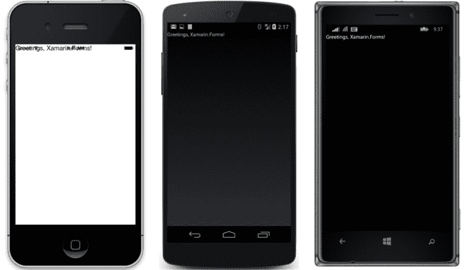

这个 Greetings 程序最令人失望的版本无疑是 iPhone：在 iOS 7 中，单页应用程序与顶部的状态栏共享屏幕。除非应用程序对此进行补偿，否则应用程序在页面顶部显示的任何内容都会与状态栏占据相同的空间。

这个问题在多页导航应用程序中会消失，但在那之前，这里有四种方法可以立即解决这个问题：

## 1. 在页面中包含内边距

Page 类定义了一个名为 Padding 的属性，它标记了页面内部周边的一个区域，内容不能侵入该区域。Padding 属性的类型是 Thickness，这是一个定义了 Left、Top、Right、Bottom 四个属性的结构体。（你可能想记住这个顺序，因为在 Thickness 构造函数和 XAML 中都会按这个顺序定义它们。）Thickness 结构还定义了一些构造函数，用于在四个侧面设置相同的边距，或者在左右和上下设置相同的边距。

在你最喜欢的搜索引擎上稍微搜索一下，你就会发现 iOS 7 状态栏的高度是 20。（你可能会问：20 什么？20 像素？其实不是。现在，只需把它们当作 20 个“单位”。在大多数 Xamarin.Forms 编程中，你不需要纠结于数值大小，但当你需要细化到像素级别时，第 5 章会提供一些指导。）你可以像这样适配状态栏：

```
class GreetingsPage : ContentPage
{
    public GreetingsPage()
```

```
```csharp
{
    this.Content = new Label
    {
        Text = "Greetings, Xamarin.Forms!"
    };

    this.Padding = new Thickness(0, 20, 0, 0);
}
```
```

现在问候语出现在距页面顶部 20 个单位的位置：

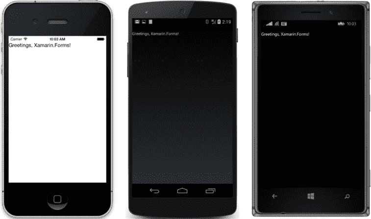

## 2. 仅针对 iOS 包含内边距

在 `ContentPage` 上设置 `Padding` 属性解决了文本覆盖 iOS 状态栏的问题，但它也在不需要此边距的 Android 和 Windows Phone 上设置了相同的边距。有没有办法只在 iPhone 上设置此边距？

有！静态的 `Device` 类包含几个属性和方法，可以让你的代码以一种非常简单直接的方式处理设备差异：

- `Device.OS` 属性返回 `TargetPlatform` 枚举的一个成员：iOS、Android、WinPhone 或 Other。
- `Device.Idiom` 属性返回 `TargetIdiom` 枚举的一个成员：Phone、Tablet、Desktop 或 Unsupported。（然而，Xamarin.Forms 目前实际上只面向手机。）

你可以在 `if` 和 `else` 语句中使用这两个属性来执行特定于某个...


particular platform.

Two methods named OnPlatform provide even more elegant solutions:

- The static generic method OnPlatform<T> takes three arguments of type T, the first for iOS, the second for Android, and the third for Windows Phone, and returns the argument for the running platform.
- The static method OnPlatform has four arguments of type Action (the .NET function delegate that has no arguments and returns void) also in the order iOS, Android, and Windows Phone, with a fourth for a default, and executes the argument for the running platform.

The Device class also defines a static method to start running a timer, to invoke the phone’s email or telephone dialer, and to run some code on the main thread. This latter method (called Device.BeginInvokeOnMainThread) comes in handy when you’re working with asynchronous methods and supplemental threads because code that manipulates the user interface can generally only be run on the main user-interface thread.

Rather than setting the same Padding property on all three platforms, you can restrict the Padding to just the iPhone by using the Device.OnPlatform generic method:

```
double topPadding = Device.OnPlatform<double>(20, 0, 0);
this.Padding = new Thickness(0, topPadding, 0, 0);
```

Explicitly specifying the type of the Device.OnPlatform arguments within the angle brackets isn’t required if the compiler can figure it out from the arguments. In this case, if the double in angle brackets is removed, the compiler would determine that the arguments are integers and then implicitly convert the integer to a double in the assignment statement.

You can simplify this code to just:

```
this.Padding = new Thickness (0, Device.OnPlatform (20, 0, 0), 0, 0);
```

This is how the Padding will be set in the programs that follow when it’s required. Of course, you can substitute some other numbers for the 0’s if you want some additional padding on the page. Sometimes a little padding on the sides makes for a more attractive display.

In Shared Asset Projects you can use the C# preprocessor directives #if and #elif as shown earlier, but the Device class has the advantage of working with both PCL projects and Shared Asset Projects.

## 3. Center the label within the page

The problem with the text overlapping the iOS status bar only occurs because the text by default is displayed at the upper-left corner. Is it possible to center the text on the page?

Xamarin.Forms supports a number of facilities to ease layout without requiring the program to perform calculations involving sizes and coordinates. The View class defines two properties named

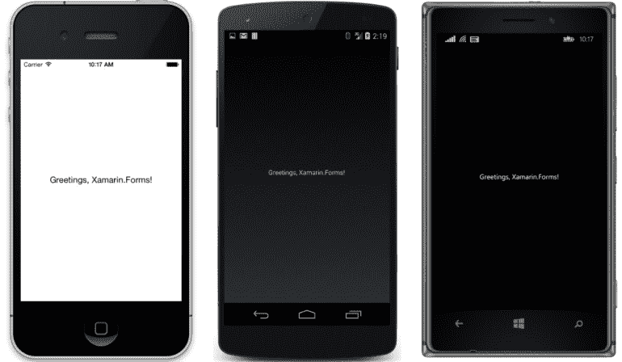

This is the version of the Greetings program that is included in the sample code for this chapter. You can use various combinations of HorizontalOptions and VerticalOptions to position the text in any of nine places relative to the screen.

You'll be learning much more about HorizontalOptions and VerticalOptions properties and the LayoutOptions structure in the pages ahead.

## 4. Center the text within the label

The Label is intended to display text up to a paragraph in length. It is often desirable to control how the lines of text are horizontally aligned: left-justified, right-justified, or centered.

The Label view defines an XAlign property for that purpose and also a YAlign property for positioning text vertically. Both properties are set to a member of the TextAlignment enumeration, which has members named Start, Center, and End to be versatile enough for text that runs from right to left or from top to bottom.

For English and other European languages, Start means left or top, and End means right or bottom.

For this fourth solution to the iOS status bar problem, set XAlign and YAlign to TextAlignment.Center.

```
class GreetingsPage : ContentPage
{
    public GreetingsPage()
    {
        this.Content = new Label
```

```
{
    Text = "Greetings, Xamarin.Forms!",
    XAlign = TextAlignment.Center,
    YAlign = TextAlignment.Center
};
}
```

Visually, the result with this single line of text is the same as setting HorizontalOptions and VerticalOptions to center, and you can also use various combinations of these properties to position the text in one of nine different locations around the page.

However, these two techniques to center the text are actually quite different, as you’ll soon see.

## Wrapping paragraphs

Displaying a paragraph of text is as easy as displaying a single line of text:

```
class BaskervillesPage : ContentPage
{
    public BaskervillesPage()
    {
        this.Content = new Label
        {
            VerticalOptions = LayoutOptions.Center,
            Text =
                "Mr. Sherlock Holmes, who was usually very late in " +
                "the mornings, save upon those not infrequent " +
                "occasions when he was up all night, was seated at " +
                "the breakfast table. I stood upon the hearth-rug " +
                "and picked up the stick which our visitor had left " +
                "behind him the night before. It was a fine, thick " +
                "piece of wood, bulbous-headed, of the sort which " +
                "is known as a \u201CPenang lawyer.\u201D Just " +
                "under the head was a broad silver band, nearly an " +
                "inch across, \u201CTo James Mortimer, M.R.C.S., " +
                "from his friends of the C.C.H.,\u201D was engraved " +
                "upon it, with the date \u201C1884.\u201D It was " +
                "just such a stick as the old-fashioned family " +
                "practitioner used to carry\u2014dignified, solid, " +
                "and reassuring."
        };

        this.Padding = new Thickness(5, Device.OnPlatform(20, 5, 5), 5, 5);
    }
}
```

Notice the use of embedded Unicode codes for opened and closed "smart quotes" (\u201C and \u201D) and the em-dash (\u2014). Padding has been set for 5 units around the page to avoid the text butting up against the edges of the screen, but the VerticalOptions property has been used

Label also allows specifying color, and a little experimentation with color will demonstrate the profound difference between HorizontalOptions and VerticalOptions, and XAlign and YAlign.

## Text and background colors

As you've seen, the Label view displays text in a color appropriate for the device. You can override that behavior by setting two properties named TextColor and BackgroundColor. Label itself defines TextColor but inherits BackgroundColor from VisualElement, which means that Page and Layout also have a BackgroundColor property.

You set TextColor and BackgroundColor to a value of type Color, which is a structure that defines 16 static fields for obtaining common colors. Here are two of them used in conjunction with XAlign and YAlign to center the text:

```
class GreetingsPage : ContentPage
{
    public GreetingsPage()
    {
        this.Content = new Label
        {
            Text = "Greetings, Xamarin.Forms!",
            XAlign = TextAlignment.Center,
            YAlign = TextAlignment.Center,
            BackgroundColor = Color.Yellow,
            TextColor = Color.Blue
        };
    }
}
```

The result might surprise you. As these screenshots illustrate, the Label actually occupies the entire area of the page (including underneath the iOS status bar), and the XAlign and YAlign properties position the text within that entire area:

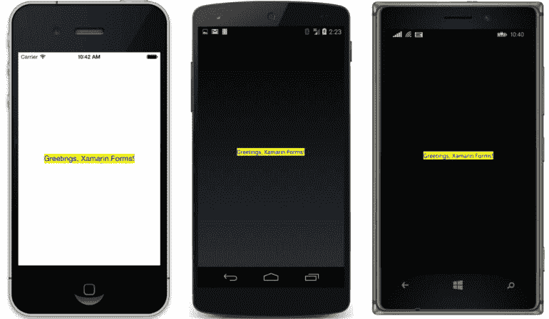

The default values of HorizontalOptions and VerticalOptions are not LayoutOptions.Start as the default appearance of the text might suggest. The default values are instead LayoutOptions.Fill. This is the setting that causes the Label to fill the page. The default XAlign and YAlign values of TextAlignment.Start are what caused the text to be positioned at the upper-left in the first version of the Greetings program.

You might wonder: What are the default values of the TextColor and BackgroundColor properties, because the default values result in different colors for the different platforms?

The default values of TextColor and BackgroundColor are actually a special color value named Color.Default that does not represent a real color but instead is used to reference the text and background colors appropriate for the particular platform.

Let’s explore color in more detail.

## The Color structure

Internally, the Color structure stores colors in two different ways:

- As red, green, and blue (RGB) values of type double that range from 0 to 1. Read-only properties named R, G, and B expose these values.
- As hue, saturation, and luminosity values of type double that also range from 0 to 1. These values are exposed with read-only properties named Hue, Saturation, and Luminosity.

The Color structure also supports an alpha channel for indicating degrees of opacity. A read-only


`Color` 的 `A` 属性公开了这个值，其范围从透明度为 0 到不透明度为 1。所有这些属性都是只读的。`Color` 值一旦创建便不可变。

可以通过以下几种方式创建 `Color` 值。三个构造函数是最简单的方式：

- `new Color(double grayShade)`
- `new Color(double r, double g, double b)`
- `new Color(double r, double g, double b, double a)`

参数的取值范围为 0 到 1。`Color` 还定义了几个静态创建方法，包括：

- `Color.FromRgb(double r, double g, double b)`
- `Color.FromRgb(int r, int g, int b)`
- `Color.FromRgba(double r, double g, double b, double a)`
- `Color.FromRgba(int r, int g, int b, int a)`
- `Color.FromHsla(double h, double s, double l, double a)`

带整数参数的两个静态方法假定参数范围为 0 到 255，这是 RGB 颜色的常用表示方式。在内部，构造函数只需将整数值除以 255.0，即可将其转换为 `double`。

注意！你可能会认为下面的调用会创建红色：

```csharp
Color.FromRgb(1, 0, 0)
```

然而，C# 编译器会将这些参数视为整数。因此将调用整数版本的方法，第一个参数会被除以 255.0，结果将接近于零。如果希望调用带有 `double` 参数的方法，应明确指定：

```csharp
Color.FromRgb(1.0, 0, 0)
```

`Color` 还为打包的 `uint` 格式以及字符串中的十六进制格式定义了静态创建方法。

`Color` 结构还定义了 16 个 `Color` 类型的公共静态只读字段。下面列出了这些字段，以及 `Color` 结构内部用于定义它们的整数 RGB 值和相应的 `Hue`、`Saturation` 与 `Luminosity` 值。为便于说明，部分数值进行了四舍五入：

| Color Fields | Red | Green | Blue | Hue | Saturation | Luminosity |
|---|---:|---:|---:|---:|---:|---:|
| White | 255 | 255 | 255 | 0 | 0 | 1.00 |
| Silver | 192 | 192 | 192 | 0 | 0 | 0.75 |
| Gray | 128 | 128 | 128 | 0 | 0 | 0.50 |
| Black | 0 | 0 | 0 | 0 | 0 | 0 |
| Red | 255 | 0 | 0 | 1.00 | 1 | 0.50 |
| Maroon | 128 | 0 | 0 | 1.00 | 1 | 0.25 |

例如，也可以使用视图集合初始化 `Children` 方法，其方式类似于之前初始化 `FormattedString` 对象的 `Spans` 集合。

`ColorList` 程序将页面的 `Content` 属性设置为 `StackLayout` 对象，然后使用 16 个 `Label` 视图初始化其 `Children` 属性：

```csharp
class ColorListPage : ContentPage
{
    public ColorListPage()
    {
        this.Padding =
            new Thickness (5, Device.OnPlatform (20, 5, 5), 5, 5);

        this.Content = new StackLayout
        {
            Children =
            {
                new Label
                {
                    Text = "White",
                    TextColor = Color.White
                },
                new Label
                {
                    Text = "Silver",
                    TextColor = Color.Silver
                },

                …

                new Label
                {
                    Text = "Purple",
                    TextColor = Color.Purple
                }
            }
        };
    }
}
```

不必查看全部 16 个子 `Label` 视图的代码，了解这个示例即可。下面是运行结果：

```csharp
// 遍历 Color 结构的属性。
foreach (PropertyInfo propInfo in
             typeof(Color).GetRuntimeProperties())
{
    MethodInfo methodInfo = propInfo.GetMethod;

    if (methodInfo.IsPublic &&
        methodInfo.IsStatic &&
        methodInfo.ReturnType == typeof(Color))
    {
        stackLayout.Children.Add(
            CreateColorLabel((Color) propInfo.GetValue(null),
                             propInfo.Name));
    }
}

this.Padding = new Thickness(5, Device.OnPlatform(20, 5, 5), 5, 5);

// 将 StackLayout 放入 ScrollView。
this.Content = new ScrollView
{
    Content = stackLayout
};
}

Label CreateColorLabel(Color color, string name)
{
    Color backgroundColor = Color.Default;

    if (color != Color.Default)
    {
        // 标准亮度计算
        double luminance = 0.30 * color.R +
                           0.59 * color.G +
                           0.11 * color.B;

        backgroundColor = luminance > 0.5 ? Color.Black : Color.White;
    }

    // 创建 Label。
    return new Label
    {
        Text = name,
        TextColor = color,
        BackgroundColor = backgroundColor,
        Font = Font.SystemFontOfSize(NamedSize.Large)
    };
}
```

在构造函数的末尾，`StackLayout` 被设置为 `ScrollView` 的 `Content` 属性，而后者又被设置为页面的 `Content` 属性。

在代码中向 `StackLayout` 添加子项时，通常最好让 `StackLayout` 与最终显示它的页面保持断开状态。每添加一个新子项，`StackLayout` 的大小都会发生变化；如果 `StackLayout` 已经连接到页面，就会产生大量并不必要的布局活动。

该类中的 `CreateColorLabel` 方法通过设置具有对比度的背景色，尝试让每种颜色都清晰可见。该方法根据红、绿、蓝三个分量的标准加权平均值计算亮度，然后选择白色或黑色作为背景色。

这种方法不适用于 `Transparent`，因此完全无法显示该项；对于 `Color.Default`，该方法将其作为特殊情况处理，并使用 `Color.Default` 作为背景显示该颜色（无论它实际是什么颜色）。

下面是运行结果，但其美观程度仍然相当有限：

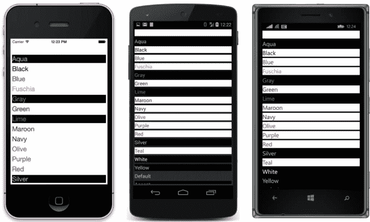

不过，你可以滚动查看该显示内容。

前面提到过，`Layout<T>` 类定义了 `StackLayout` 所继承的 `Children` 属性。泛型 `Layout<T>` 类派生自非泛型的 `Layout` 类，而 `ScrollView` 也派生自这个非泛型的 `Layout` 类。从理论上讲，`ScrollView` 是一种布局对象——即使它只有一个子项。

从屏幕截图可以看到，`Label` 的背景色延伸到了 `StackLayout` 的整个宽度，这意味着每个 `Label` 都与 `StackLayout` 一样宽。

让我们进行一些实验，以便更好地理解 Xamarin.Forms 的布局。对于这些实验，可以暂时为 `StackLayout` 和 `ScrollView` 设置不同的背景色：

```csharp
class ReflectedColorsPage : ContentPage
{
    public ReflectedColorsPage()
    {
        StackLayout stackLayout = new StackLayout
        {
            BackgroundColor = Color.Blue
        };
        ...
        this.Content = new ScrollView
        {
            BackgroundColor = Color.Red,
            Content = stackLayout
        };
    }
    ...
}
```

布局对象通常默认具有透明背景，因此虽然它们会占据屏幕上的区域，却不会直接显示出来。为布局对象临时设置颜色，是准确查看它们在屏幕上位置的好方法。这也是调试复杂布局的一种实用技巧。

你会发现，蓝色的 `StackLayout` 会在各个 `Label` 视图之间的空隙中显现出来——这是 `StackLayout` 的默认 `Spacing` 属性造成的；此外，它还会透过 `Color.Default` 对应的 `Label` 显现出来，因为该 `Label` 具有透明背景。

尝试将所有 `Label` 视图的 `HorizontalOptions` 属性设置为 `LayoutOptions.Start`：

```csharp
return new Label
{
    Text = name,
    TextColor = color,
    BackgroundColor = backgroundColor,
    Font = Font.SystemFontOfSize(NamedSize.Large),
    HorizontalOptions = LayoutOptions.Start
};
```

现在，`StackLayout` 的蓝色背景更加明显了，因为所有 `Label` 视图只占用文本所需的水平空间，并且都被推到左侧。由于每个 `Label` 视图的宽度不同，这种显示效果甚至比第一个版本更难看！

现在移除 `Label` 中的 `HorizontalOptions` 设置，改为在 `StackLayout` 上设置 `HorizontalOptions`：

```csharp
StackLayout stackLayout = new StackLayout
{
```


- `LayoutOptions.End`
- `LayoutOptions.Fill`

`View` 类建立的默认值是 `LayoutOptions.Fill`，这意味着视图会填充其容器。

正如你所见，当 `Label` 是垂直 `StackLayout` 的子视图时，在其上设置 `VerticalOptions` 并不会产生什么区别。`StackLayout` 本身会将子视图的高度限制为它们所需的高度，因此子视图在该槽位内没有垂直移动的自由。

请做好心理准备，这条规则稍后会有所修正！

`LayoutOptions` 结构还有四个尚未讨论的静态字段：

- `LayoutOptions.StartAndExpand`
- `LayoutOptions.CenterAndExpand`
- `LayoutOptions.EndAndExpand`
- `LayoutOptions.FillAndExpand`

你可能还记得，`LayoutOptions` 有两个实例属性，名为 `Alignment` 和 `Expands`。这四个 `LayoutOptions` 实例的 `Expands` 属性都被设置为 `true`。在管理页面布局时，这个 `Expands` 属性可能非常有用，但初次接触时可能会让人感到困惑。以下是 `Expands` 在垂直 `StackLayout` 中发挥作用的条件：

- 垂直 `StackLayout` 的高度必须小于其容器的高度。换句话说，`StackLayout` 中必须存在一些额外未使用的垂直空间。
- 第一个条件意味着，垂直 `StackLayout` 的 `VerticalOptions` 设置不能是 `Start`、`Center` 或 `End`，因为那样会导致 `StackLayout` 的高度等于其子视图的总高度，因而没有额外空间。
- `StackLayout` 的至少一个子视图必须将其 `VerticalOptions` 设置为 `Expands` 属性为 `true`。

如果满足这些条件，`StackLayout` 就会将额外的垂直空间平均分配给所有将 `VerticalOptions` 设置为 `Expands` 为 `true` 的子视图。子视图如何占据该空间取决于 `Alignment` 设置：`Start`、`Center`、`End` 或 `Fill`。

下面是一个名为 `VerticalOptionsDemo` 的程序，它使用反射在垂直 `StackLayout` 中创建带有所有可能的 `VerticalOptions` 设置的 `Label` 对象。背景色和前景色交替使用，这样你就能确切看到每个 `Label` 占用了多少空间。该程序使用语言集成查询（LINQ）对 `LayoutOptions` 结构的字段进行排序，以便在视觉上更清晰地展示：

```
class VerticalOptionsDemoPage : ContentPage
{
    public VerticalOptionsDemoPage()
    {
        Color[] colors = { Color.Yellow, Color.Blue };
        int flipFlopper = 0;

        // Create Labels sorted by LayoutAlignment property.
        IEnumerable<Label> labels =
            from field in typeof(LayoutOptions).GetRuntimeFields()
            where field.IsPublic && field.IsStatic
            orderby ((LayoutOptions)field.GetValue(null)).Alignment
            select new Label
            {
                Text = "VerticalOptions = " + field.Name,
                VerticalOptions = (LayoutOptions)field.GetValue(null),
                XAlign = TextAlignment.Center,
                Font = Font.SystemFontOfSize(NamedSize.Large),
                TextColor = colors[flipFlopper],
                BackgroundColor = colors[flipFlopper = 1 - flipFlopper]
            };

        // Transfer to StackLayout.
        StackLayout stackLayout = new StackLayout();

        foreach (Label label in labels)
        {
            stackLayout.Children.Add(label);
        }

        this.Padding = new Thickness(0, Device.OnPlatform(20, 0, 0), 0, 0);
        this.Content = stackLayout;
    }
}
```

你不妨仔细研究一下结果：

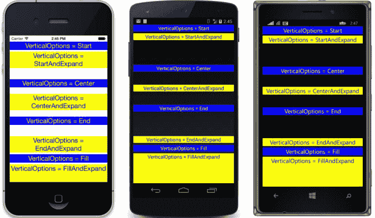

那些黄字蓝底的 `Label` 视图，是其 `VerticalOptions` 属性设置为不带 `Expands` 标志的 `LayoutOptions` 值。如果在垂直 `StackLayout` 中，某个项的 `LayoutOptions` 值未设置 `Expands` 标志，那么该 `VerticalOptions` 设置会被忽略。正如你所见，这个 `Label` 在垂直 `StackLayout` 中只占据它所需的垂直空间。

这个 `StackLayout` 中所有子视图的总高度小于 `StackLayout` 本身的高度，因此 `StackLayout` 有额外空间。它有四个子视图的 `VerticalOptions` 属性设置为带有 `Expands` 标志的 `LayoutOptions` 值，因此这些额外空间会被平均分配给这四个子视图。

在这四种情况中——即蓝字黄底的 `Label` 视图——`LayoutOptions` 值的 `Alignment` 属性指示了子视图在包括额外空间在内的区域内的对齐方式。第一个（`VerticalOptions` 属性设置为 `LayoutOptions.StartAndExpand`）位于额外空间的上方。第二个（`CenterAndExpand`）位于额外空间的中间。第三个（`EndAndExpand`）位于额外空间的下方。然而，在这三种情况下，`Label` 都只获得了它所需的垂直空间，正如背景色所显示的那样。其余空间属于 `StackLayout`，它显示的是页面的背景色。

最后一个 `Label` 的 `VerticalOptions` 属性设置为 `LayoutOptions.FillAndExpand`。在这种情况下，`Label` 占据了包括额外空间在内的整个区域，正如大片的黄色背景所示。文本位于该区域的顶部；这是因为 `YAlign` 的默认设置是 `TextAlignment.Start`。将其设置为其他值，即可在区域内垂直定位文本。

`LayoutOptions` 的 `Expands` 属性只在视图是 `StackLayout` 的子视图时才起作用。在其他上下文中，它是多余的。

## Frame 和 BoxView

两种简单的矩形视图经常用于展示目的：

`BoxView` 是一个简单的填充矩形。它派生自 `View`，并定义了一个默认为透明的 `Color` 属性。

`Frame` 显示一个围绕某些内容的矩形边框。`Frame` 通过 `ContentView` 派生自 `Layout`，并从中继承了 `Content` 属性。`Frame` 的内容可以是单个视图，也可以是包含多个视图的布局。`Frame` 从 `VisualElement` 继承了 `BackgroundColor` 属性，该属性在 iPhone 上为白色，但在 Android 和 Windows Phone 上为透明。`Frame` 从 `Layout` 继承了 `Padding` 属性，并将其初始化为所有边各 20 个单位，以便为内容留出一些呼吸空间。`Frame` 本身定义了一个默认为透明的 `OutlineColor` 属性，以及一个默认为 `true` 的 `HasShadow` 属性，但阴影只在 iPhone 上显示。

如果 `BoxView` 或 `Frame` 在尺寸上没有受到任何限制——也就是说，如果它们不在 `StackLayout` 中，并且其 `HorizontalOptions` 和 `VerticalOptions` 设置为默认值 `LayoutOptions.Fill`——这些视图会扩展以填充其容器。

例如，尝试修改 **Greetings** 程序，让 `GreetingsPage` 构造函数将 `Label` 放入 `Frame` 中。务必为 `Frame` 设置 `OutlineColor`：

```
class GreetingsPage : ContentPage
{
    public GreetingsPage()
    {
        this.Content = new Frame
        {
            OutlineColor = Color.Accent,
            Content = new Label
            {
                Text = "Greetings, Xamarin.Forms!"
            }
        };
    }
}
```

你可能根本不会注意到 `Frame`，因为它已经扩展以填满整个页面。将 `Frame` 上的 `HorizontalOptions` 和 `VerticalOptions` 属性设置为 `LayoutOptions.Center`（例如）：

```
class GreetingsPage : ContentPage
{
    public GreetingsPage()
    {
        this.Content = new Frame
        {
            OutlineColor = Color.Accent,
            HorizontalOptions = LayoutOptions.Center,
            VerticalOptions = LayoutOptions.Center,

            Content = new Label
            {
                Text = "Greetings, Xamarin.Forms!"
            }
        };
    }
}
```

现在，`Frame` 会紧贴文本（但带有默认的 20 单位内边距）并位于页面中央：

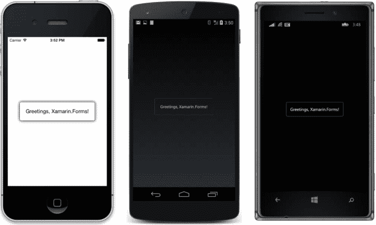

`BoxView` 默认是透明的，所以你需要设置颜色：

```
class GreetingsPage : ContentPage
{
    public GreetingsPage()
    {
        this.Content = new BoxView
        {
            Color = Color.Accent
        };
    }
}
```

`BoxView` 会填满其容器的整个区域，就像 `Label` 使用默认 `HorizontalOptions` 或 `VerticalOptions` 设置时那样。尝试在 `BoxView` 上设置这些属性：

```
class GreetingsPage : ContentPage
{
    public GreetingsPage()
```


```
{
    this.Content = new BoxView
    {
        Color = Color.Accent,
        HorizontalOptions = LayoutOptions.Center,
        VerticalOptions = LayoutOptions.Center
    }
}
```

现在，BoxView 将采用其默认尺寸，即 40 个单位见方。BoxView 之所以是这个大小，是因为 BoxView 将其 WidthRequest 和 HeightRequest 属性初始化为 40。

这些 WidthRequest 和 HeightRequest 属性需要稍作解释：

VisualElement 定义了 Width 和 Height 属性，但这两个属性是只读的。VisualElement 还定义了 WidthRequest 和 HeightRequest 属性，它们既可设置也可获取。通常，所有这些属性都被初始化为 -1（这实际上意味着它们未定义），但某些 View 派生类（例如 BoxView）会将 WidthRequest 和 HeightRequest 属性设置为特定值。

在页面布局之后，Width 和 Height 属性表示视图的实际尺寸——即视图在屏幕上占用的区域。由于 Width 和 Height 是只读的，它们仅用于提供信息。

如果你希望 View 具有特定大小，可以设置 WidthRequest 和 HeightRequest 属性。但正如其名称所示，这些属性表示请求的大小或首选大小。如果允许视图填充其容器，这些属性将被忽略。但如果不允许，这些属性将决定视图的大小。

BoxView 将自己的 WidthRequest 和 HeightRequest 属性设置为 40。你可以将这些设置视为 BoxView 在没有其他意见的情况下所希望的大小。你已经看到，当允许 BoxView 填充页面时，WidthRequest 和 HeightRequest 会被忽略。如果 HorizontalOptions 设置为 LayoutOptions.Left、Center 或 Right，或者 BoxView 是水平 StackLayout 的子级，WidthRequest 就会生效。HeightRequest 的行为类似。

试试这个：

```
class GreetingsPage : ContentPage
{
    public GreetingsPage()
    {
        this.Content = new BoxView
        {
            Color = Color.Accent,
            HorizontalOptions = LayoutOptions.Center,
            VerticalOptions = LayoutOptions.Center,
            WidthRequest = 200,
            HeightRequest = 100
        }
    }
}
```

现在我们得到一个具有该特定大小的 BoxView：

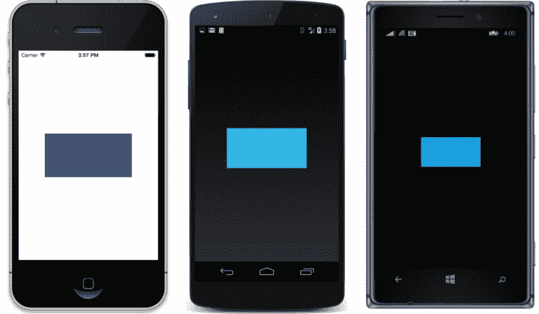

让我们在增强的颜色列表中同时使用 Frame 和 BoxView。ColorBlock 程序的页面构造函数与 ReflectedColors 中的构造函数几乎相同，只是它调用名为 CreateColorView 的方法而不是 CreateColorLabel。该方法如下：

```
class ColorBlockPage : ContentPage
{
    ...

    View CreateColorView(Color color, string name)
    {
        return new Frame
        {
            Content = new StackLayout
            {
                Orientation = StackOrientation.Horizontal,
                Spacing = 15,
                Children =
                {
                    new BoxView
                    {
                        Color = color
                    },
                    new Label
                    {
                        Text = name,
                        Font = Font.BoldSystemFontOfSize(NamedSize.Medium),
                        VerticalOptions = LayoutOptions.Center
                    },
                    new Label
                    {
                        Text = String.Format("{0:X2}-{1:X2}-{2:X2}",
                            (int)(255 * color.R),
                            (int)(255 * color.G),
                            (int)(255 * color.B)),
                        VerticalOptions = LayoutOptions.Center,
                        IsVisible = color != Color.Default
                    }
                }
            }
        };
    }
}
```

`CreateColorView` 方法返回一个 `Frame`，其中包含一个水平 `StackLayout`，有一个 `BoxView` 指示颜色，以及两个 `Label` 视图分别显示颜色名称及其 RGB 组成。对于 `Color.Default` 值，这个 RGB 显示没有意义，因此在那种情况下第二个 `Label` 的 `IsVisible` 属性设置为 `false`。该 `Label` 仍然存在，但在页面渲染时被当作不存在。

现在这是一个可滚动的颜色列表，已经开始让我们有点自豪了：

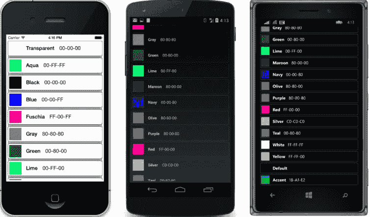

## 一个 StackLayout 中的 ScrollView？

通常将 `StackLayout` 放在 `ScrollView` 中，但你能把 `ScrollView` 放在 `StackLayout` 中吗？你为什么要这样做呢？

在像 Xamarin.Forms 这样的布局系统中，通常的规则是：不能把滚动视图放在堆栈中。`ScrollView` 需要有特定的高度，才能计算其内容高度与自身高度之间的差值。这个差值就是 `ScrollView` 可以滚动其内容的量。如果 `ScrollView` 在 `StackLayout` 中，它就无法获得这个特定的高度。`StackLayout` 希望 `ScrollView` 尽可能短，这要么是 `ScrollView` 内容的高度，要么是零，而这两种方案都不可行。

那么，为什么你还会想把 `ScrollView` 放在 `StackLayout` 中呢？

有时候这正是你需要的。考虑一个实现滚动的简单电子书阅读器。你可能希望页面顶部有一个 `Label` 始终显示书名，后面是一个 `ScrollView`，其中包含一个 `StackLayout`，用于显示书的内容。让这个 `Label` 和 `ScrollView` 成为一个填充页面的 `StackLayout` 的子级会很方便。

使用 Xamarin.Forms，这种事情是可能的。如果你给 `ScrollView` 设置 `VerticalOptions` 为 `LayoutOptions.FillAndExpand`，它确实可以成为 `StackLayout` 的子级。`StackLayout` 会将其他子级不需要的多余空间分配给 `ScrollView`，这样 `ScrollView` 就有了特定的高度。

**BlackCat** 项目显示埃德加·爱伦·坡的短篇小说《黑猫》的文本，该文本存储在一个名为 TheBlackCat.txt 的文本文件中，采用每段一行的格式。

有时，将应用程序所需的文件（例如这个短篇小说）直接嵌入到程序可执行文件中，或者——在 Xamarin.Forms 应用程序的情况下——直接嵌入到可移植类库 DLL 中，会很方便。这些文件称为嵌入资源，TheBlackCat.txt 文件在程序中的角色正是如此。

**BlackCat** 是一个 PCL 应用程序。在 SAP 应用程序中也可以做类似的事情，但要困难一些，因为这三个平台引用的资源名称不同。

要在 Visual Studio 或 Xamarin Studio 中创建嵌入资源，你通常需要先从项目菜单中选择 **添加 > 新建文件夹** 选项，在项目中创建一个文件夹。例如，用于文本文件的文件夹可以叫做 **Texts**。该文件夹是可选的，但有助于组织程序资产。然后，对于该文件夹，你可以在 Visual Studio 中选择 **添加 > 现有项**，或在 Xamarin Studio 中选择 **添加 > 添加文件**。导航到该文件，在 Visual Studio 中选择并点击 **添加**，或在 Xamarin Studio 中点击 **打开**。

现在这里是要点：一旦文件成为项目的一部分，请从文件关联的菜单中打开 **属性** 对话框。指定该文件的 **生成操作** 为 **嵌入的资源**。这一步很容易忘记，但至关重要。

对 **BlackCat** 项目已经这样做了，因此 TheBlackCat.txt 文件被嵌入到 BlackCat.dll 文件中。

在代码中，可以通过调用 `System.Reflection` 命名空间中 `Assembly` 类定义的 `GetManifestResourceStream` 方法来检索该文件。要获取 PCL 的程序集，你只需获取程序集中定义的任何类的 `Type`。你可以将 `typeof` 用于从 `ContentPage` 派生的页面类型，或者对该类的实例使用 `GetType`。然后在此 `Type` 对象上调用 `GetTypeInfo`。`Assembly` 是结果 `TypeInfo` 对象的属性：

```
Assembly assembly = this.GetType().GetTypeInfo().Assembly;
```

在 `Assembly` 的 `GetManifestResourceStream` 方法中，你需要指定资源的名称。对于嵌入资源，该名称不是资源的文件名，而是资源 ID。由于这个 ID 看起来可能有点像完全限定的文件名，所以很容易混淆。

资源 ID 以程序集的默认命名空间开头。这不是 .NET 命名空间！要获取 Visual Studio 中程序集的默认命名空间，请从项目菜单中选择 **属性**，然后在属性对话框中选择左侧的 **库**，并查找 **默认命名空间** 字段。在 Xamarin Studio 中，从项目菜单中选择 **选项**，然后在 **项目选项** 对话框中选择左侧的 **主设置**，并查找标记为 **默认命名空间** 的字段。

对于 **BlackCat** 项目，该默认命名空间与程序集相同：“BlackCat”。但实际上，你可以将默认命名空间设置为任何你想要的值。

资源 ID 以默认命名空间开头，后跟句点，再后面是可能使用的文件夹名，然后是另一个句点和文件名。在本例中，资源 ID 是“BlackCat.Texts.TheBlackCat.txt”，你会在代码中看到它被传递给 `GetManifestResourceStream` 方法。该方法返回一个 .NET `Stream` 对象，可以从中创建 `StreamReader` 来读取文本行。

最好对从 `GetManifestResourceStream` 返回的 `Stream` 对象和 `StreamReader` 对象使用 `using` 语句，因为这样可以在不再需要这些对象时正确地释放它们。

出于布局目的，`BlackCatPage` 构造函数创建了两个 `StackLayout` 对象：`mainStack` 和 `textStack`。文件的第一行（包含故事标题和作者）成为 `mainStack` 中加粗且居中的 `Label`；所有后续行都放入 `textStack`。`mainStack` 还包含一个带有 `textStack` 的 `ScrollView`。

```
class BlackCatPage : ContentPage
{
    public BlackCatPage()
    {
        StackLayout mainStack = new StackLayout();
        StackLayout textStack = new StackLayout
        {
            Padding = new Thickness(5),
            Spacing = 10
```


```csharp
};

// Get access to the text resource.
Assembly assembly = this.GetType().GetTypeInfo().Assembly;
string resource = "BlackCat.Texts.TheBlackCat.txt";

using (Stream stream = assembly.GetManifestResourceStream (resource))
{
    using (StreamReader reader = new StreamReader (stream))
    {
        bool gotTitle = false;
        string line;

        // Read in a line (which is actually a paragraph).
        while (null != (line = reader.ReadLine()))
        {
            Label label = new Label
            {
                Text = line,

                // Black text for ebooks!
                TextColor = Color.Black
            };

            if (!gotTitle)
            {
                // Add first label (the title) to mainStack.
                label.HorizontalOptions = LayoutOptions.Center;
                label.Font = Font.SystemFontOfSize(NamedSize.Medium,
                    FontAttributes.Bold);

                mainStack.Children.Add(label);
                gotTitle = true;
            }
            else
            {
                // Add subsequent labels to textStack.
                textStack.Children.Add(label);
            }
        }
    }
}

// Put the textStack in a ScrollView with FillAndExpand.
ScrollView scrollView = new ScrollView
{
    Content = textStack,
    VerticalOptions = LayoutOptions.FillAndExpand,
    Padding = new Thickness(5, 0)
};

// Add the ScrollView as a second child of mainStack.
mainStack.Children.Add(scrollView);

// Set page content to mainStack.
```

```csharp
Children =
{
    button,
    new ScrollView
    {
        VerticalOptions = LayoutOptions.FillAndExpand,
        Content = loggerLayout
    }
};
}

void OnButtonClicked(object sender, EventArgs args)
{
    // Add Label to scrollable StackLayout.
    loggerLayout.Children.Add(new Label
    {
        Text = "Button clicked at " + DateTime.Now.ToString("T")
    });
}
```

本书中的程序中，事件处理程序的名称以单词 On 开头，其后是触发事件的视图的某种标识，有时只是视图类型，然后是事件名称。在本例中得到的名称是 OnButtonClicked。

Clicked 处理程序在 Button 创建后立即附加到 Button：

```csharp
button.Clicked += OnButtonClicked;
```

然后组装页面。请注意，ScrollView 的 VerticalOptions 设置为 FillAndExpand，这样它就可以与 Button 共享 StackLayout，同时仍然可见且可滚动。

以下是几次点击后的显示：

```csharp
addButton = new Button
{
    Text = "Add",
    HorizontalOptions = LayoutOptions.CenterAndExpand
};
addButton.Clicked += OnButtonClicked;

removeButton = new Button
{
    Text = "Remove",
    HorizontalOptions = LayoutOptions.CenterAndExpand,
    IsEnabled = false
};
removeButton.Clicked += OnButtonClicked;

this.Padding = new Thickness(5, Device.OnPlatform(20, 0, 0), 5, 0);

// Assemble the page.
this.Content = new StackLayout
{
    Children =
    {
        new StackLayout
        {
            Orientation = StackOrientation.Horizontal,
            Children =
            {
                addButton,
                removeButton
            }
        },

        new ScrollView
        {
            VerticalOptions = LayoutOptions.FillAndExpand,
            Content = loggerLayout
        }
    }
};
}

void OnButtonClicked(object sender, EventArgs args)
{
    Button button = (Button)sender;

    if (button == addButton)
    {
        // Add Label to scrollable StackLayout.
        loggerLayout.Children.Add(new Label
        {
            Text = "Button clicked at " + DateTime.Now.ToString("T")
        });
    }
    else
    {
        // Remove topmost Label from StackLayout
        loggerLayout.Children.RemoveAt(0);
    }
    // Enable "Remove" button only if children are present.
    removeButton.IsEnabled = loggerLayout.Children.Count > 0;
}
```

两个按钮都设置了 HorizontalOptions 的值为 CenterAndExpand，这样它们就可以使用水平 StackLayout 在屏幕上很好地排列。

请注意，当 Clicked 处理程序检测到 removeButton 时，它只是对 Children 属性调用 RemoveAt 方法。如果没有子项会发生什么？

在该程序中不可能发生这种情况！应用程序开始时，removeButton 的 IsEnabled 属性被初始化为 false。当按钮以这种方式被禁用时，它看起来不可用，实际上也是不可用的。它不会触发 Clicked 事件。在 Clicked 处理程序的末尾，removeButton 的 IsEnabled 属性仅在 loggerLayout 至少有一个子项时才设置为 true。

这说明了一个很好的通用规则：如果你的代码需要确定按钮 Clicked 事件是否有效，那么最好通过将 IsEnabled 设置为 false 来完全防止无效的按钮点击。

## 匿名事件处理程序

如今许多 C# 程序员喜欢将小型事件处理程序定义为匿名 lambda 函数。这使得事件处理代码可以非常接近触发事件的对象的实例化和初始化，而不是文件中的其他位置。它还允许在事件处理程序中引用对象，而无需将这些对象存储为字段。

下面是一个名为 ButtonLambdas 的程序，它有一个显示数字的 Label 和两个按钮。一个按钮将数字加倍，另一个按钮将数字减半。通常数字和标签变量会保存为字段。但由于匿名事件处理程序是在构造函数中在这两个变量定义之后立即定义的，因此事件处理程序可以访问它们：

```csharp
class ButtonLambdasPage : ContentPage
{
    public ButtonLambdasPage()
    {
        // Number to manipulate.
        double number = 1;

        // Create the Label for display.
        Label label = new Label
        {
            Text = number.ToString(),
            Font = Font.SystemFontOfSize(NamedSize.Large),
            HorizontalOptions = LayoutOptions.Center,
            VerticalOptions = LayoutOptions.CenterAndExpand
        };

        // Create the first Button and attach Clicked handler.
        Button timesButton = new Button
        {
            Text = "Double",
            Font = Font.SystemFontOfSize(NamedSize.Large),
            HorizontalOptions = LayoutOptions.CenterAndExpand
        };
        timesButton.Clicked += (sender, args) =>
        {
            number *= 2;
            label.Text = number.ToString();
        };

        // Create the second Button and attach Clicked handler.
        Button divideButton = new Button
        {
            Text = "Half",
            Font = Font.SystemFontOfSize(NamedSize.Large),
            HorizontalOptions = LayoutOptions.CenterAndExpand
        };
        divideButton.Clicked += (sender, args) =>
        {
            number /= 2;
            label.Text = number.ToString();
        };

        // Assemble the page.
        this.Content = new StackLayout
        {
            Children =
            {
                label,
                new StackLayout
                {
                    Orientation = StackOrientation.Horizontal,
                    VerticalOptions = LayoutOptions.CenterAndExpand,
                    Children =
                    {
                        timesButton,
                        divideButton
                    }
                }
            }
        };
    }
}
```

与前一个程序一样，两个按钮共享一个水平 `StackLayout`：

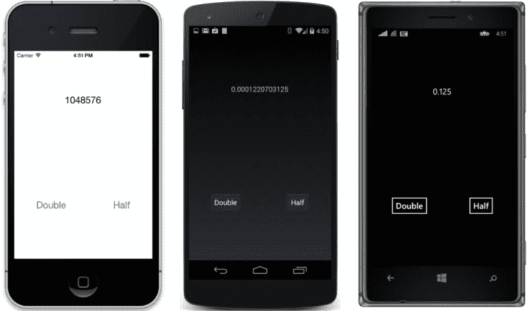

将事件处理程序定义为匿名 lambda 函数的缺点是它们不能在多个视图之间共享。

## 使用 ID 区分视图

在 **TwoButtons** 程序中，你看到了一种通过比较对象来区分视图并共享事件处理程序的技术。当需要区分的视图不是很多时，这种方法效果很好，但对于计算器程序来说将是糟糕的做法。

`Element` 类专门定义了类型为 `string` 的 `StyleId`，用于标识视图。将其设置为应用程序方便的值即可。你可以使用 `if` 和 `else` 语句、`switch` 和 `case` 来测试这些值，或者使用 `Parse` 方法将字符串转换为数字或枚举成员。

下面的程序不是计算器，但它是一个数字键盘，这肯定是计算器的一部分。该程序名为 **SimplestKeypad**，使用 `StackLayout` 来组织键的行和列。 （该程序的一个目的就是演示 `StackLayout` 并不是这项工作的合适工具！）

该程序创建了总共四个 `StackLayout` 实例。`mainStack` 为垂直方向；三个水平 `StackLayout` 对象排列九个非零数字按钮。为了简单起见，键盘采用电话排序而不是计算器排序：

```csharp
class SimplestKeypadPage : ContentPage
{
    Label displayLabel;
    Button backspaceButton;
```


```csharp
public SimplestKeypadPage()
{
    // Create a vertical stack for the entire keypad.
    StackLayout mainStack = new StackLayout
    {
        VerticalOptions = LayoutOptions.Center,
        HorizontalOptions = LayoutOptions.Center
    };

    // First row is the Label.
    displayLabel = new Label
    {
        Font = Font.SystemFontOfSize(NamedSize.Large),
        VerticalOptions = LayoutOptions.Center,
        XAlign = TextAlignment.End
    };
    mainStack.Children.Add(displayLabel);

    // Second row is the backspace Button.
    backspaceButton = new Button
    {
        Text = "\\u21E6",
        Font = Font.SystemFontOfSize(NamedSize.Large),
        IsEnabled = false
    };
    backspaceButton.Clicked += OnBackspaceButtonClicked;
    mainStack.Children.Add(backspaceButton);

    // Now do the 10 number keys.
    StackLayout rowStack = null;

    for (int num = 1; num <= 10; num++)
    {
        if ((num - 1) % 3 == 0)
        {
            rowStack = new StackLayout
            {
                Orientation = StackOrientation.Horizontal
            };
            mainStack.Children.Add(rowStack);
        }

        Button digitButton = new Button
        {
            Text = (num % 10).ToString(),
            Font = Font.SystemFontOfSize(NamedSize.Large),
            StyleId = (num % 10).ToString()
        };
        digitButton.Clicked += OnDigitButtonClicked;

        // For the zero button, expand to fill horizontally.
        if (num == 10)
        {
            digitButton.HorizontalOptions = LayoutOptions.FillAndExpand;
        }
}
rowStack.Children.Add(digitButton);
}

this.Content = mainStack;
}

void OnDigitButtonClicked(object sender, EventArgs args)
{
    Button button = (Button)sender;
    displayLabel.Text += (string)button.StyleId;
    backspaceButton.IsEnabled = true;
}

void OnBackspaceButtonClicked(object sender, EventArgs args)
{
    string text = displayLabel.Text;
    displayLabel.Text = text.Substring(0, text.Length - 1);
    backspaceButton.IsEnabled = displayLabel.Text.Length > 0;
}
}
```

十个数字键共享同一个 `Clicked` 处理程序。`StyleId` 属性表示与该键关联的数字，因此它可以附加到 `Label` 显示的字符串上。`StyleId` 恰好与 `Button` 的 `Text` 属性相同，并且也可以使用 `Text` 属性，但通常情况下并没有那么方便。

退格 `Button` 在功能上足够不同，以至于需要它自己的 `Clicked` 处理程序，尽管肯定可以将这两种方法合并为一种，以利用它们共有的代码。

为了使键盘的尺寸稍大一些，所有文本都使用 `NamedSize.Large` 创建的 `Font` 对象。以下是 **KeypadStack** 程序的三种渲染效果：
