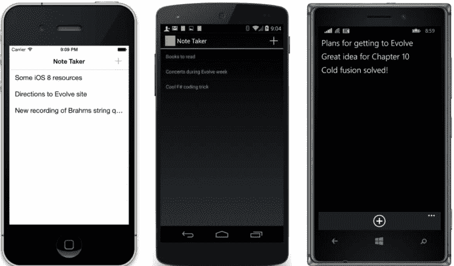
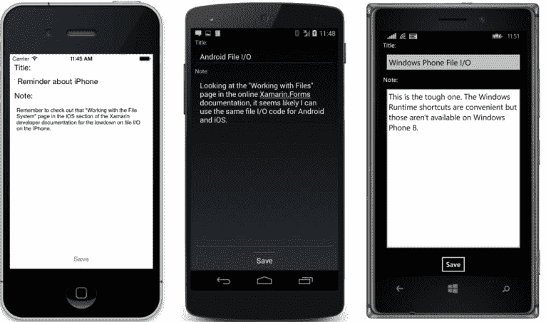

# 第 3 章
## 构建应用：基础设施

有时像这样的编程教程可能会在直接解决实际应用需求之前涵盖大量内容。本章和下一章试图避免这种常见问题。

这两个章节介绍了一个从头开始构建的实际应用程序。这不会是一个非常复杂的应用程序，但它可用且有用。该应用程序的名称是 **NoteTaker**，它允许你做笔记并保存它们。

每个笔记都是一些文本——任意多的文本——以及一个可选的标题。如果不指定标题，将从笔记的前几个词为你生成一个标题。

当程序在下一章末尾最终完成时，它将具有以下主屏幕：



那是已创建笔记标题的可滚动列表。**New** 按钮由加号符号表示，作为顶部或底部的工具栏项出现。点击该按钮，程序将导航到输入新笔记的页面：

我们通过无知而斗争来获取知识和技能所带来的问题。

在本章中，**NoteTaker** 程序经历了六个不同的版本。它们编号为 1 到 6，但版本号更像是 0.1 到 0.6。在通过这六个版本增强此程序的过程中，会遇到以下主题：

- 用于编辑文本的 `Entry` 和 `Editor` 视图
- 移动环境中的文件输入/输出（I/O）
- 异步操作
- 属性更改通知
- 数据绑定

下一章将深入多页面架构、页面导航、用于显示项目集合的强大的 `ListView`，以及处理应用程序生命周期问题。

### Version 1. The Entry and Editor views

**NoteTaker** 应用绝对需要一些文本输入。一些手机有物理键盘，但绝大多数仅限于虚拟屏幕键盘。当然，这些键盘因平台而异，并且通常也因文本输入类型而异。

Xamarin.Forms 为获取文本输入定义了两个视图：

- `Entry` 用于单行文本
- `Editor` 用于多行文本

`Entry` 和 `Editor` 都派生自 `InputView`，后者派生自 `View`。

所有三个平台都有适用于不同类型文本输入的各种虚拟键盘样式。例如，用于输入 URL 的键盘应与用于输入电话号码的键盘不同。因此，`InputView` 定义了一个名为 `Keyboard` 的属性，其类型为 `Keyboard`，该类定义了七个适用于不同键盘用途的静态只读 `Keyboard` 类型属性：

- `Default`
- `Text`
- `Chat`
- `Url`
- `Email`

`Entry` 和 `Editor` 定义了 `Focused` 和 `Unfocused` 事件，用于发出获得和失去输入焦点的信号。`IsFocused` 属性指示特定视图当前是否具有输入焦点。程序可以通过在视图上调用 `Focus` 方法来尝试将焦点设置到特定视图。方法返回 `true` 如果焦点更改成功。这些与焦点相关的成员由 `Visual-Element` 定义，它是所有 UI 元素的基类，但它们实际上仅与 `Entry` 和 `Editor` 相关。

`Entry` 和 `Editor` 都定义了 `Text` 属性，公开视图当前显示的文本。程序可以初始化此 `Text` 属性，然后允许用户编辑该文本。

`Entry` 和 `Editor` 都定义了 `Completed` 事件，当用户发出编辑完成的信号时触发。这是程序访问 `Text` 属性并保存结果的绝佳机会。

`Entry` 和 `Editor` 还定义了 `TextChanged` 事件，当 `Text` 属性更改时触发。记住 .NET `string` 对象是不可变的。`string` 对象在创建后本身不能更改。每当 `Entry` 或 `Editor` 的内容更改时，它都是一个全新的 `string` 对象，而不是一个修改过的 `string` 对象。`TextChanged` 事件可以成为应用程序按字符监控文本输入并在用户发出输入完成信号之前响应更改的宝贵手段。

你可能会认为 `Entry` 比 `Editor` 简单一些，因为它只处理单行文本。然而，`Entry` 有三个 `Editor` 没有的附加属性：

- `TextColor` — 一个 `Color` 值
- `IsPassword` — 一个布尔值，导致字符被屏蔽
- `Placeholder` — 在 `Entry` 中出现的浅色文本，一旦用户开始输入就会消失。

**NoteTaker** 程序需要一个页面，其中包含一个 `Entry` 用于用户输入笔记的标题，以及一个 `Editor` 用于输入笔记本身。对于此程序的第一个版本——称为 **NoteTaker1**——让我们不要做太多超出在页面上放置这两个视图以及用于标识的几个 `Label` 视图的事情。

`Editor` 允许输入无限量的文本，并在内部实现滚动。正如你在上一章中用 `ScrollView` 发现的那样，与页面上的其他视图共享可滚动视图需要将 `VerticalOptions` 属性设置为 `LayoutOptions.FillAndExpand`。

以下是 `NoteTaker1Page` 类：

```
class NoteTaker1Page : ContentPage
{
    public NoteTaker1Page()
    {
        this.Padding = new Thickness(10, Device.OnPlatform(20, 0, 0), 10, 0);
```




底部标注为 **Save** 的 **按钮** 目前没有任何功能。这样的按钮无疑是用来将笔记保存到文件的。然而，要做到这一点，我们需要知道如何保存文件，以及稍后如何将它们重新加载回来。

文件输入/输出并未包含在 Xamarin.Forms API 中。然而，许多移动应用都需要一些文件 I/O，哪怕只是为了保存设置和临时数据。因此，文件 I/O 可能是绕过 Xamarin.Forms API、并使用各个平台的编程接口来实现应用某些关键功能的最有力理由。

## 版本 2：文件输入/输出

传统上，文件输入/输出是最基本的编程任务之一，但移动设备上的文件 I/O 与桌面端略有不同。在桌面上，用户和应用程序通常可以访问整个磁盘，磁盘上的文件按目录结构组织。在移动设备上，存在几个标准文件夹——例如图片或音乐——但特定于应用程序的数据通常被限制在私有存储区域内。

熟悉 .NET 的程序员知道，`System.IO` 命名空间包含了大多数标准文件 I/O 支持。这个命名空间中最重要的类可能是静态的 `File` 类，它不仅提供了一组创建新文件和打开现有文件的方法，还包含了一些能够在一次方法调用中完成整个文件读取或写入操作的方法。

例如，`File.WriteAllText` 方法有两个 `string` 类型的参数——一个文件名和文件内容。该方法会创建文件（必要时替换同名的现有文件），将内容写入文件，然后关闭文件。`File.ReadAllText` 方法类似，但会将文件内容作为一个大的 `string` 对象返回。这些方法似乎非常适合保存和检索笔记的任务。

Xamarin.iOS 和 Xamarin.Android 库中包含一个由 Xamarin 针对这两个移动平台专门定制的 .NET 版本。`System.IO` 命名空间中 `File` 类的方法映射到 iOS 和 Android 平台上相应的文件 I/O 函数。这意味着你可以在 iPhone 和 Android 应用程序中使用 `File` 类的方法——包括 `File.WriteAllText` 和 `File.ReadAllText`。

让我们稍作实验：

进入 Visual Studio 或 Xamarin Studio，加载目前创建的任何 Xamarin.Forms 解决方案，例如 **NoteTaker1**。在 iOS 或 Android 项目中调出一个代码文件。在构造函数或方法中，键入 `System.IO` 命名空间名称，然后键入一个句点。你会看到该命名空间中所有可用类型的列表。如果你随后键入 `File` 并加上句点，你会看到 `File` 类中的所有静态方法，包括 `WriteAllText` 和 `ReadAllText`。

然而，在 Windows Phone 项目中，你使用的是由 Microsoft 创建并针对 Windows Phone 平台进行了精简的 .NET 版本。如果你键入 `System.IO.File` 并加上句点，你会看到一个相当精简的 `File` 类，它并*不*包含 `WriteAllText` 和 `ReadAllText`，尽管它确实包含创建和打开文本文件的方法。

现在，进入 Xamarin.Forms 可移植类库项目中的任何代码文件，键入 `System.IO` 并加上句点。现在你甚至看不到 `File` 类！它在 PCL 中不存在。这是为什么？PCL 被配置为支持多个目标平台。PCL 中实现的 API 必然是这些目标平台 API 的交集。

适用于 Xamarin.Forms 的 PCL 包含以下平台：

- .NET Framework 4.5
- Windows 8
- Windows Phone Silverlight 8
- Xamarin.Android
- Xamarin.iOS

注意其中包含了 Windows 8，它引入了一个名为 Windows Runtime（或 WinRT）的 API。Microsoft 为 WinRT 彻底改造了文件 I/O，并创建了一套全新的文件 I/O API。`System.IO.File` 类在 PCL 中不存在，因为它不是 WinRT 的一部分。

尽管 `File` 类在可移植类库项目中不存在，但你可能会想知道在共享资产项目中可以使用哪种 `File` 类。嗯，这取决于编译的目标平台是什么。你可以在 iOS 和 Android 项目中使用 `File.WriteAllText` 和 `File.ReadAllText`，但不能在 Windows Phone 项目中使用。你的 Windows Phone 项目需要其他方式。

### 跳过可怕的部分？

你可能已经怀疑文件 I/O 这个话题会变得棘手，你是对的。但想想我们在这里试图做什么：我们试图用公共代码库针对三个不同的移动平台。这并不容易，而且我们在前进过程中必定会遇到一些崎岖的地形。

所以问题必须是：打个比方说，你喜欢穿越险恶的地形徒步攀登山顶，欣赏壮丽的景色吗？还是更希望有人从山顶拍照并通过电子邮件发送给你？

如果你属于后一类，你可能会更倾向于跳过本章的大部分内容，直接跳到本章末尾以及下一章中给出的相对简单优雅的 Xamarin.Forms 文件 I/O 解决方案。在此之前，你将遇到的一些过渡代码既可怕又难看。

如果你选择走这条上山的长路，你会明白为什么这段旅程是必要的，也会理解平台差异背后的基本原理——即使在像文件 I/O 这样的日常工作中也是如此。

在上一章中，你看到了 Xamarin.Forms 的 Device 类如何成为处理平台差异的宝贵工具。但 Device 类引用的代码必须在所有三个平台上都可编译。文件 I/O 的情况并非如此，因为不同平台可以访问不同的 API。这意味着平台差异无法使用 Device 类来管理，必须通过其他方式处理。此外，共享资产项目和可移植类库项目的解决方案也不同。

因此，对于接下来两个版本的 NoteTaker，SAP 和 PCL 将有单独的解决方案。版本 2 的两个不同解决方案分别命名为 NoteTaker2Sap 和 NoteTaker2Pcl。

### SAP 中的预处理

在共享资产项目中处理平台差异比 PCL 更直接一些，并且涉及更传统的编程工具，所以让我们从那里开始。

在共享资产项目的代码文件中，你可以使用 C# 预处理指令 `#if`、`#elif`、`#else` 和 `#endif`，以及为三个平台定义的条件编译符号。这些符号是用于 iOS 的 `__IOS__` 和用于 Windows Phone 的 `WINDOWS_PHONE`；Android 没有条件编译符号，但 Android 可以被识别为既不是 iOS 也不是 Windows Phone。

NoteTaker2Sap 项目在 `FileHelper.cs` 文件中包含一个名为 `FileHelper` 的类。你可以像为派生自 `ContentPage` 的类添加新文件一样，将这样的文件添加到项目中。

`FileHelper.cs` 文件使用 C# 预处理指令将代码分为两个部分。第一部分适用于 iOS 和 Android，并且在没有定义 `WINDOWS_PHONE` 标识符时编译。第二部分适用于 Windows Phone。

两个部分都包含三个公共静态方法，名为 `Exists`、`WriteAllText` 和 `ReadAllText`。在第一部分中，这些函数的 iOS 和 Android 版本使用标准静态 `File` 方法，但使用从 `Environment.GetFolderPath` 方法获取的文件夹名称，参数为 `Environment.SpecialFolder.MyDocuments`：

```
namespace NoteTaker2Sap
{
    static class FileHelper
    {
#if !WINDOWS_PHONE // iOS and Android
        public static bool Exists(string filename)
        {
            string filepath = GetFilePath(filename);
            return File.Exists(filepath);
        }

        public static void WriteAllText(string filename, string text)
        {
            string filepath = GetFilePath(filename);
            File.WriteAllText(filepath, text);
        }

        public static string ReadAllText(string filename)
        {
            string filepath = GetFilePath(filename);
            return File.ReadAllText(filepath);
        }

        static string GetFilePath(string filename)
        {
            string docsPath = Environment.GetFolderPath(Environment.SpecialFolder.MyDocuments);
            return Path.Combine(docsPath, filename);
        }

#else // Windows Phone
        public static bool Exists(string filename)
        {
            return File.Exists(filename);
        }

        public static void WriteAllText(string filename, string text)
        {
            StreamWriter writer = File.CreateText(filename);
            writer.Write(text);
            writer.Close();
        }

        public static string ReadAllText(string filename)
        {
            StreamReader reader = File.OpenText(filename);
            string text = reader.ReadToEnd();
        }
    }
}
```


```csharp
reader.Close();
return text;
}

#endif

}
}
```

当共享资产项目针对 Windows Phone 编译时，`File.WriteAllText` 和 `File.ReadAllText` 方法并不存在，因此这些方法不能出现在 Windows Phone 代码部分。不过，静态的 CreateText 和 OpenText 方法是可用的，可以用来获取 StreamWriter 和 StreamReader 对象。这段 Windows Phone 代码在“不会引发异常”这个意义上可以工作，但你很快会看到，它实际上达不到你想要的效果。还需要其他方式。

除了处理底层文件 I/O 的 FileHelper 类之外，NoteTaker2Sap 项目还包含另一个名为 Note 的新类。这个类将一条笔记关联的两个字符串对象封装在名为 Title 和 Text 的简单读写属性中。这个类还包含名为 Save 和 Load 的方法，它们调用 FileHelper 中的相应方法：

```csharp
namespace NoteTaker2Sap
{
    class Note
    {
        public string Title { set; get; }

        public string Text { set; get; }

        public void Save(string filename)
        {
            string text = this.Title + "\n" + this.Text;
            FileHelper.WriteAllText(filename, text);
        }

        public void Load(string filename)
        {
            string text = FileHelper.ReadAllText(filename);

            // Break string into Title and Text.
            int index = text.IndexOf('\n');
            this.Title = text.Substring(0, index);
            this.Text = text.Substring(index + 1);
        }
    }
}
```

请注意，Save 方法只是用换行符把两个字符串对象连接成一个字符串，而 Load 方法再把它们分开。

最后，NoteTaker2SapPage 类的页面布局与第一个程序非常相似，但它包含两个分别标记为 Save 和 Load 的按钮，并使用 Note 类来执行这些操作。整个过程中使用的文件名是“test.note”：

```csharp
class NoteTaker2SapPage : ContentPage
{
    static readonly string FILENAME = "test.note";

    Entry entry;
    Editor editor;
    Button loadButton;

    public NoteTaker2SapPage()
    {
        // Create Entry and Editor views.
        entry = new Entry
        {
            Placeholder = "Title (optional)"
        };

        editor = new Editor
        {
            Keyboard = Keyboard.Create(KeyboardFlags.All),
            BackgroundColor = Device.OnPlatform(Color.Default,
                                                Color.Default,
                                                Color.White),
            VerticalOptions = LayoutOptions.FillAndExpand
        };

        // Create Save and Load buttons.
        Button saveButton = new Button
        {
            Text = "Save",
            HorizontalOptions = LayoutOptions.CenterAndExpand
        };
        saveButton.Clicked += OnSaveButtonClicked;

        loadButton = new Button
        {
            Text = "Load",
            IsEnabled = FileHelper.Exists(FILENAME),
            HorizontalOptions = LayoutOptions.CenterAndExpand
        };
        loadButton.Clicked += OnLoadButtonClicked;

        // Assemble page.
        this.Padding = new Thickness(10, Device.OnPlatform(20, 0, 0), 10, 0);

        this.Content = new StackLayout
        {
            Children =
            {
                new Label
                {
                    Text = "Title:"
                },
                entry,
                new Label
                {
                    Text = "Note:"
                },
                editor,
                new StackLayout
                {
                    Orientation = StackOrientation.Horizontal,
                    Children =
                    {
                        saveButton,
                        loadButton
                    }
                }
            }
        };
    }

    void OnSaveButtonClicked(object sender, EventArgs args)
    {
        Note note = new Note
        {
            Title = entry.Text,
            Text = editor.Text
        };
        note.Save(FILENAME);
        loadButton.IsEnabled = true;
    }

    void OnLoadButtonClicked(object sender, EventArgs args)
    {
        Note note = new Note();
        note.Load(FILENAME);
        entry.Text = note.Title;
        editor.Text = note.Text;
    }
}
```

请注意，Load 按钮的初始化会调用 FileHelper.Exists 来判断文件是否存在；如果文件不存在，则禁用该按钮。之后，当文件第一次被保存时，该按钮会被启用。

你大概需要亲自确认一下这确实有效——也就是说，信息真的被保存到了设备（或手机模拟器）上。在 Entry 和 Editor 中输入一些内容，然后按 Save 保存这些信息。清空 Entry 和 Editor（或输入新文本），再按 Load 恢复已保存的信息。

下面这一点很重要：如果你终止程序或关闭手机，然后重新运行程序，保存的文件仍然存在。

嗯，在三种平台中的两种平台下，保存的文件仍然存在。它在 iOS 和 Android 上有效，但在 Windows Phone 上无效。尽管 Windows Phone 的 Save 和 Load 按钮似乎能正常工作，而

```csharp
[assembly: Dependency(typeof(NoteTaker2Pcl.iOS.FileHelper))]

namespace NoteTaker2Pcl.iOS
{
    class FileHelper : IFileHelper
    {
        public bool Exists(string filename)
        {
            string filepath = GetFilePath(filename);
            return File.Exists(filepath);
        }

        public void WriteAllText(string filename, string text)
        {
            string filepath = GetFilePath(filename);
            File.WriteAllText(filepath, text);
        }

        public string ReadAllText(string filename)
        {
            string filepath = GetFilePath(filename);
            return File.ReadAllText(filepath);
        }

        string GetFilePath(string filename)
        {
            string docsPath = Environment.GetFolderPath(
                Environment.SpecialFolder.MyDocuments);
            return Path.Combine(docsPath, filename);
        }
    }
}
```

这些方法的实际实现与你已经见过的代码相同，只不过用实例方法代替了静态方法。但请注意该文件的两个必要特征：

- 该类实现了 PCL 中定义的 IFileHelper 接口。因为它实现了该接口，所以接口中定义的三个方法必须在此类中声明为 public。
- 在命名空间定义之前，声明了一个名为 Dependency 的特殊程序集级特性。

Dependency 是一个特殊的 Xamarin.Forms 特性，由 DependencyAttribute 类定义，专门用于 DependencyService 类。Dependency 特性只指定类的类型，但它会帮助 DependencyService 类在应用程序项目中定位接口的实现。

Android 项目中也有一个类似的文件：

```csharp
using System;
using System.IO;
using Xamarin.Forms;

[assembly: Dependency(typeof(NoteTaker2Pcl.Droid.FileHelper))]

namespace NoteTaker2Pcl.Droid
{
    class FileHelper : IFileHelper
    {
        public bool Exists(string filename)
        {
            string filepath = GetFilePath(filename);
            return File.Exists(filepath);
        }

        public void WriteAllText(string filename, string text)
        {
            string filepath = GetFilePath(filename);
            File.WriteAllText(filepath, text);
        }

        public string ReadAllText(string filename)
        {
            string filepath = GetFilePath(filename);
            return File.ReadAllText(filepath);
        }

        string GetFilePath(string filename)
        {
            string docsPath = Environment.GetFolderPath(
                Environment.SpecialFolder.MyDocuments);
            return Path.Combine(docsPath, filename);
        }
    }
}
```

Windows Phone 项目中则是：

```csharp
using System;
using System.IO;
using Xamarin.Forms;

[assembly: Dependency(typeof(NoteTaker2Pcl.WinPhone.FileHelper))]

namespace NoteTaker2Pcl.WinPhone
{
    class FileHelper : IFileHelper
    {
        public bool Exists(string filename)
        {
            return File.Exists(filename);
        }

        public void WriteAllText(string filename, string text)
        {
            StreamWriter writer = File.CreateText(filename);
```


```
writer.Write(text);
writer.Close();
}

public string ReadAllText(string filename)
{
    StreamReader reader = File.OpenText(filename);
    string text = reader.ReadToEnd();
    reader.Close();
    return text;
}
}
```

现在艰难的工作已经完成。你会记得 NoteTaker2Sap 中的 Note 类调用了 FileHelper.WriteAllText 和 FileHelper.ReadAllText。NoteTaker2Pcl 中的 Note 类非常相似，但它是通过静态 DependencyService.Get 方法引用这两个方法。这是一个通用方法，需要接口作为通用参数，但随后能够调用该接口中的任何方法：

```
namespace NoteTaker2Pcl
{
    class Note
    {
        public string Title { set; get; }

        public string Text { set; get; }

        public void Save(string filename)
        {
            string text = this.Title + "\n" + this.Text;
            DependencyService.Get<IFileHelper>().WriteAllText(filename, text);
        }

        public void Load(string filename)
        {
            string text = DependencyService.Get<IFileHelper>().ReadAllText(filename);

            // Break string into Title and Text.
            int index = text.IndexOf('\n');
            this.Title = text.Substring(0, index);
            this.Text = text.Substring(index + 1);
        }
    }
}
```

在内部，DependencyService 类在特定平台项目中搜索接口实现并调用指定的方法。

NoteTaker2PclPage 类几乎与 NoteTaker2SapPage 相同，只是它在 Load 按钮初始化期间也使用 DependencyService.Get 来调用 Exists 方法。

```
LoadButton = new Button
```

```
{
    Text = "Load",
    IsEnabled = DependencyService.Get<IFileHelper>().Exists(FILENAME),
    HorizontalOptions = LayoutOptions.CenterAndExpand
};
```

当然，NoteTaker2Pcl 版本与 NoteTaker2Sap 存在相同的缺陷，即它不会为 Windows Phone 持久保存数据。

## 版本 3. 转向异步

数据未为 Windows Phone 持久保存，因为文件 I/O 代码不正确。Xamarin.Forms 应用程序面向 Windows Phone 8，后者实现了 Windows 8 应用程序可用的 WinRT 文件 I/O 的一个子集，主要位于新的 Windows.Storage 和 Windows.Storage.Streams 命名空间中。

Windows Phone 8 仍然支持一些 Windows Phone 7 从 Silverlight 继承的旧文件 I/O 函数，但这些函数不推荐用于新的 Windows Phone 8 应用程序。Windows Phone 8 应用程序应改用 WinRT 文件 I/O API，本书中的程序遵循这一建议。

Windows 8 和 Windows Phone 8 中这一新文件 I/O 类集合的部分推动力在于，认识到从桌面应用程序相对不受限制的文件访问向更沙盒化的环境过渡。为了存储应用程序私有的<|message|>


```
}
string GetFilePath(string filename)
{
    string docsPath = Environment.GetFolderPath(Environment.SpecialFolder.MyDocuments);
    return Path.Combine(docsPath, filename);
}
}
}
```

Android 版本非常相似。Windows Phone 版本包含的方法在最内层的嵌套异步回调中调用已完成的函数：

```
```csharp
using System;
using Windows.Foundation;
using Windows.Storage;
using Windows.Storage.Streams;
using Xamarin.Forms;

[assembly: Dependency(typeof(NoteTaker3Pcl.WinPhone.FileHelper))]

namespace NoteTaker3Pcl.WinPhone
{
    class FileHelper : IFileHelper
    {
        public void Exists(string filename, Action<bool> completed)
        {
            StorageFolder localFolder = ApplicationData.Current.LocalFolder;
            IAsyncOperation<StorageFile> createOp = localFolder.GetFileAsync(filename);
            createOp.Completed = (asyncInfo, asyncStatus) =>
            {
                completed(asyncStatus != AsyncStatus.Error);
            };
        }

        public void WriteAllText(string filename, string text, Action completed)
        {
            StorageFolder localFolder = ApplicationData.Current.LocalFolder;
            IAsyncOperation<StorageFile> createOp =
                localFolder.CreateFileAsync(filename,
                    CreationCollisionOption.ReplaceExisting);
            createOp.Completed = (asyncInfo1, asyncStatus1) =>
            {
                IStorageFile storageFile = asyncInfo1.GetResults();
                IAsyncOperation<IRandomAccessStream> openOp =
                    storageFile.OpenAsync(FileAccessMode.ReadWrite);
                openOp.Completed = (asyncInfo2, asyncStatus2) =>
                {
                    IRandomAccessStream stream = asyncInfo2.GetResults();
                    DataWriter dataWriter = new DataWriter(stream);
                    dataWriter.WriteString(text);
                    DataWriterStoreOperation storeOp = dataWriter.StoreAsync();
                    storeOp.Completed = (asyncInfo3, asyncStatus3) =>
                    {
```

```
```csharp
public void ReadAllText(string filename, Action<string> completed)
{
    StorageFolder localFolder = ApplicationData.Current.LocalFolder;
    IAsyncOperation<StorageFile> createOp = localFolder.GetFileAsync(filename);
    createOp.Completed = (asyncInfo1, asyncStatus1) =>
    {
        IStorageFile storageFile = asyncInfo1.GetResults();
        IAsyncOperation<IRandomAccessStream> openOp =
            storageFile.OpenReadAsync();
        openOp.Completed = (asyncInfo2, asyncStatus2) =>
        {
            IRandomAccessStream stream = asyncInfo2.GetResults();
            DataReader dataReader = new DataReader(stream);
            uint length = (uint)stream.Size;
            DataReaderLoadOperation loadOp = dataReader.LoadAsync(length);
            loadOp.Completed = (asyncInfo3, asyncStatus3) =>
            {
                string text = dataReader.ReadString(length);
                dataReader.Dispose();
                completed(text);
            };
        };
    };
}
```
```

为了隐藏对 `DependencyService.Get` 方法的调用，**NoteTaker3Pcl** 项目中添加了另一个文件。此类让程序中的其他代码可以使用看起来正常的静态 `FileHelper` 方法：

```
```csharp
namespace NoteTaker3Pcl
{
    static class FileHelper
    {
        static IFileHelper fileHelper = DependencyService.Get<IFileHelper>();

        public static void Exists(string filename, Action<bool> completed)
        {
            fileHelper.Exists(filename, completed);
        }

        public static void WriteAllText(string filename, string text, Action completed)
        {
            fileHelper.WriteAllText(filename, text, completed);
        }
    }
}
```
```

```
```csharp
// Check if the file is available.
FileHelper.Exists(FILENAME, (exists) =>
{
    loadButton.IsEnabled = exists;
});
```
```

这能修复 Windows Phone 上 **Load** 按钮首次按下时的问题吗？不能。`OnLoadButtonClicked` 方法仍然在从文件加载文本之前就将 `Entry` 和 `Editor` 设置为 `Note` 类的属性文本。要正常工作，该代码需要在将它们传输到 `Editor` 和 `Entry` 之前知道 `Note` 属性何时被设置。或者页面类需要知道 `Note` 对象的 `Title` 和 `Text` 属性何时发生变化。

基本问题涉及存在属性在值发生变化时不通知任何人的情况。我们能对此做些什么吗？

## 版本 4. 我会在属性更改时通知你

让我们退一步。

到目前为止，程序的所有版本都包含一个派生自 `ContentPage` 的类，该类显示一个用户界面，允许用户输入和编辑两段文本。这两段文本也存储在一个名为 `Note` 的类中。此 `Note` 类存储了页面类用户界面的底层数据。

这两个类实际上是同一数据的两个方面——一个类为用户编辑数据提供呈现，另一个类处理更低级别的任务，包括在文件系统中的加载和保存数据。

理想情况下，在任何时候，这两个类都应该处理相同的数据。但事实并非如此。页面类不知道 `Note` 类中的数据何时发生变化，而 `Note` 类也不知道 `Entry` 和 `Editor` 视图中的文本何时发生变化。

保持用户界面与底层数据同步是一个常见问题，并且有标准解决方案可以修复该问题。其中最重要的一项是名为 `INotifyPropertyChanged` 的接口。它在 .NET 的 `System.ComponentModel` 命名空间中定义如下：

```
```csharp
interface INotifyPropertyChanged
{
    event PropertyChangedEventHandler PropertyChanged;
}
```
```

整个接口仅由一个名为 `PropertyChanged` 的事件组成，但该事件为类提供了一种简单通用的方式来通知可能感兴趣的任何其他类其某个属性的值已更改。

```
{
    text = value;
    if (PropertyChanged != null)
    {
        PropertyChanged(this, new PropertyChangedEventArgs("Text"));
    }
}
get
{
    return text;
}
}
public void Save(string filename)
{
    string text = this.Title + "\n" + this.Text;
    FileHelper.WriteAllText(filename, text, () => { });
}
public void Load(string filename)
{
    FileHelper.ReadAllText(filename, (string text) =>
    {
        // Break string into Title and Text.
        int index = text.IndexOf('\n');
        this.Title = text.Substring(0, index);
        this.Text = text.Substring(index + 1);
    });
}
}
```

各种 FileHelper 类与 NoteTaker3Pcl 中的相同。

NoteTaker4Page 类将 `Note` 的实例定义为字段（如程序的上一版本），但现在构造函数还附加了 `Note` 现在定义的 PropertyChanged 事件的处理程序：

```
note.PropertyChanged += (sender, args) =>
{
    switch (args.PropertyName)
    {
        case "Title":
            entry.Text = note.Title;
            break;
        case "Text":
            entry.Text = note.Text;
            break;
    }
};
```

这当然可以是一个命名事件处理程序，并且它可以使用 if 和 else 而不是 switch 和 case 来识别正在更改的属性。然后它将属性的新值设置为 `Entry` 或 `Editor` 的 Text 属性。

看起来不错，但它在 Windows Phone 上仍然无法工作。当你点击 Load 按钮时，你会得到一个 Unauthorized Access 异常。现在问题出在哪里？

问题在于：通常情况下，异步方法的回调不会在发起操作的同一线程中执行。相反，回调在执行异步操作的后台线程中执行。

让我们逐步跟踪：当你按下 Load 按钮时，Windows Phone 的 ReadAllText 方法执行。当文本获取到后，它会在另一个执行线程中调用 completed 方法。在 `Note` 中的 Load 方法中，该 completed 方法设置 Title 和 Text 属性。新的 Title 属性导致 PropertyChanged 事件触发，而在该处理程序中，新的 Title 属性被设置为 Entry 视图的 Text 属性。

因此，Entry 视图是从用户界面线程以外的线程访问的，而这是不允许的。这就是为什么会引发异常。

幸运的是，这个问题的修复方法相当简单。`Device` 类有一个 `BeginInvokeOnMainThread` 方法，其参数类型为 `Action`。只需将你想要在 UI 线程中执行的代码封装在该 `Action` 参数的主体中。最简单的方法是将整个 switch 和 case 包装在该回调中：

```
note.PropertyChanged += (sender, args) =>
{
    Device.BeginInvokeOnMainThread(() =>
    {
        switch (args.PropertyName)
        {
            case "Title":
                entry.Text = note.Title;
                break;

            case "Text":
                editor.Text = note.Text;
                break;
        }
    });
};
```

`Device.BeginInvokeOnMainThread` 有效地等待 UI 线程从操作系统的线程调度程序获得时间片，然后运行指定的代码。

有了这个更改，你会发现重新运行 Windows Phone 应用后，你只需按一次 Load，Entry 和 Editor 就会被设置成保存的值。它们不是在 Load 按钮的处理程序中设置的，而是在属性实际使用从文件加载的值更新时，在 PropertyChanged 处理程序中设置的。


```csharp
{
    Text = "Save",
    HorizontalOptions = LayoutOptions.CenterAndExpand
};
saveButton.Clicked += OnSaveButtonClicked;

loadButton = new Button
{
    Text = "Load",
    IsEnabled = false,
    HorizontalOptions = LayoutOptions.CenterAndExpand
};
loadButton.Clicked += OnLoadButtonClicked;

// Check if the file is available.
FileHelper.Exists(FILENAME, (exists) =>
{
    loadButton.IsEnabled = exists;
});

// Handle the Note's PropertyChanged event.
note.PropertyChanged += (sender, args) =>
{
    Device.BeginInvokeOnMainThread(() =>
    {
        switch (args.PropertyName)
        {
            case "Title":
                entry.Text = note.Title;
                break;

            case "Text":
                editor.Text = note.Text;
                break;
        }
    });
};

// Handle the Entry and Editor TextChanged events.
entry.TextChanged += (sender, args) =>
{
    note.Title = args.NewTextValue;
};

editor.TextChanged += (sender, args) =>
{
    note.Text = args.NewTextValue;
};

// Assemble page.
this.Padding = new Thickness(10, Device.OnPlatform(20, 0, 0), 10, 0);

this.Content = new StackLayout
{
```

两个对象属性的同步，使得对一个属性的更改会自动触发对另一个属性的更改。

## 简化 INotifyPropertyChanged 类

实现 `INotifyPropertyChanged` 的类通常比 `Note` 类具有更多可更改的属性。因此，最好简化 set 访问器，以避免混淆属性和字段名称，或拼写错误属性名称文本。

一种简化方法是将事件的实际触发封装在受保护的虚方法中：

```csharp
protected virtual void OnPropertyChanged(string propertyName)
{
    if (PropertyChanged != null)
    {
        PropertyChanged(this, new PropertyChangedEventArgs(propertyName));
    }
}
```

现在 `Title` 属性看起来像这样：

```csharp
public string Title
{
    set
    {
        if (title != value)
        {
            title = value;
            OnPropertyChanged("Title");
        }
    }
    get
    {
        return title;
    }
}
```

`OnPropertyChanged` 方法被设为 protected 和 virtual，因为你可能会编写一个增强的 `Note` 类，从此 `Note` 类派生但包含更多属性。派生类需要访问此方法。

但让我们暂停一下来改进我们的 `INotifyPropertyChanged` 处理。建议先获取处理程序，然后对同一个对象执行空值检查和事件调用：

```csharp
protected virtual void OnPropertyChanged(string propertyName)
{
    PropertyChangedEventHandler handler = PropertyChanged;
    if (handler != null)
        handler(this, new PropertyChangedEventArgs(propertyName));
}
```

在多线程环境中，`PropertyChanged` 处理程序可能在空值检查和调用之间被分离，此代码可防止空引用异常的发生。

你可以在简化 `OnPropertyChanged` 方法方面更进一步。C# 5.0 引入了对 `CallerMemberNameAttribute` 的支持以及一些相关属性。此属性允许你用调用方法或属性的名称替换可选的方法参数。

在 `OnPropertyChanged` 方法中，通过将其赋值为 null 使参数可选，并在其前面加上方括号中的 `CallerMemberName`：

```csharp
protected virtual void OnPropertyChanged([CallerMemberName] string propertyName = null)
{
    PropertyChangedEventHandler handler = PropertyChanged;
    if (handler != null)
        handler(this, new PropertyChangedEventArgs(propertyName));
}
```

你需要为该属性添加 `System.Runtime.CompilerServices` 的 using 指令。现在 `Title` 属性可以不带参数调用 `OnPropertyChanged`，并且 `propertyName` 参数将自动设置为属性名称 “Title”，因为 `OnPropertyChanged` 的调用源自此处：

```csharp
public string Title
{
    set
    {
        if (title != value)
        {
            title = value;
            OnPropertyChanged();
        }
    }
    get
    {
        return title;
    }
}
```

这避免了可能拼写错误的文本属性名称，并在程序开发过程中更改属性名称时无需担心同时更改文本字符串。`CallerMemberName` 被发明的主要原因之一就是为了简化实现 `INotifyPropertyChanged` 的类。

还可以更进一步。你需要定义一个名为 `SetProperty` 的泛型方法，例如，并为其添加 `CallerMemberName` 属性，但需要将其从 `OnPropertyChanged` 中移除：

```csharp
bool SetProperty<T>(ref T storage, T value, [CallerMemberName] string propertyName = null)
{
    if (Object.Equals(storage, value))
        return false;

    storage = value;
    OnPropertyChanged(propertyName);
    return true;
}

protected virtual void OnPropertyChanged(string propertyName)
{
    PropertyChangedEventHandler handler = PropertyChanged;
    if (handler != null)
        handler(this, new PropertyChangedEventArgs(propertyName));
}
```

`SetProperty` 方法需要访问 backing field 和新值，但会自动完成其余过程，并在属性被更改时返回 true。 （如果你在 set 访问器中执行一些额外的处理，可能需要使用此返回值。）现在 `Title` 属性看起来像这样：

```csharp
public string Title
{
    set
    {
        SetProperty(ref title, value);
    }
    get
    {
        return title;
    }
}
```

尽管 `SetProperty` 是一个泛型方法，但 C# 编译器可以从参数中推断出类型。整个属性定义变得如此简短，你可以在单行上简洁地编写访问器，而不会掩盖操作：

```csharp
public string Title
{
    set { SetProperty(ref title, value); }
    get { return title; }
}
```

以下是 PCL 项目 `NoteTaker5` 中的新 `Note` 类：

```csharp
class Note : INotifyPropertyChanged
{
    string title, text;

    public event PropertyChangedEventHandler PropertyChanged;

    public string Title
    {
        set { SetProperty(ref title, value); }
        get { return title; }
    }

    public string Text
    {
```

```csharp
entry.TextChanged += (sender, args) =>
{
    note.Title = args.NewTextValue;
};
```

你可以通过为 Entry 视图的 `PropertyChanged` 事件安装处理程序并检查 `Text` 属性来做几乎相同的事情：

```csharp
entry.PropertyChanged += (sender, args) =>
{
    if (args.PropertyName == "Text")
        note.Title = entry.Text;
};
```

从某种意义上说，Entry 和 Editor 定义的 `TextChanged` 事件是多余且不必要的。它仅为了程序员的方便而提供。

Xamarin.Forms 中的许多类由于派生自实现此接口的名为 `BindableObject` 的类而自动实现 `INotifyPropertyChanged`。`BindableObject` 还定义了一个受保护的虚方法 `OnPropertyChanged`。

顾名思义，`BindableObject` 对 Xamarin.Forms 中的数据绑定支持很重要，但该类对 `INotifyPropertyChanged` 的实现只是故事的一部分，而且坦率地说，是较容易的部分。

让我们通过一些实验开始探索 `BindableObject` 的更神秘的部分。在 `NoteTaker` 程序的早期版本之一中，尝试使用一些文本初始化 Entry 视图：

```csharp
entry.Text = "This is some text";
```

现在当你运行程序时，Entry 会用此文本初始化。但现在尝试用此方法调用替换该属性设置：

```csharp
entry.SetValue(Entry.TextProperty, "This is some text");
```

这同样有效。这两个语句在功能上是相同的。

看看传递给 `SetValue` 的那个奇怪的第一个参数：它被称为 `Entry.TextProperty`，表明它是静态的，但它根本不是属性。它是 Entry 类的一个静态字段。它也是只读的，并且在 Entry 类中定义如下：

```csharp
public static readonly BindableProperty TextProperty;
```

一个类的字段被命名为 `TextProperty` 有点奇怪，但事实就是如此。然而，由于它是静态的，它独立于可能存在或不存在的任何 Entry 对象而存在。

如果你查看 Entry 类的文档，你会看到它定义了四个属性——`Text`、`TextColor`、`IsPassword` 和 `Placeholder`——你还会看到四个对应的公共静态只读 `BindableProperty` 类型字段，名称为 `TextProperty`、`TextColorProperty`、`IsPasswordProperty` 和 `PlaceholderProperty`。


这些属性和字段密切相关。实际上，在 Entry 类内部，Text 属性是这样定义的：

```
public string Text
{
    set { SetValue(Entry.TextProperty, value); }
    get { return (string)GetValue(Entry.TextProperty); }
}
```

所以你明白了，应用程序对 Entry.TextProperty 调用 SetValue 与设置 Text 属性完全等价，而且也许还会快那么一点点！

Entry 中 Text 属性的内部定义并不是秘密信息。这是标准代码。SetValue 和 GetValue 方法由 BindableObject 定义，这个类也为许多 Xamarin.Forms 类实现了 INotifyPropertyChanged。维护 Text 属性的所有实际工作都发生在这些 SetValue 和 GetValue 调用中。GetValue 方法需要强制转换，因为它被定义为返回 object。

静态的 Entry.TextProperty 对象的类型是 BindableProperty，你可能会正确地推测它是与 BindableObject 相关的类，但重要的是要在心中区分它们：BindableObject 是许多 Xamarin.Forms 类派生自的类，并为 BindableProperty 类型的对象提供支持。

BindableProperty 对象有效地扩展了标准 C# 属性的功能。可绑定属性提供了系统化的方式来：

- 定义属性
- 为属性提供默认值
- 存储它们的当前值
- 提供验证属性值的机制
- 在单个类中维护相关属性之间的一致性
- 响应属性更改
- 在属性即将更改和已更改时触发通知

此外，BindableObject 和 BindableProperty 还为动画和数据绑定提供机制。它们是 Xamarin.Forms 基础设施的重要组成部分。

名为 Text 的属性与名为 TextProperty 的 BindableProperty 之间的紧密关系，体现在程序员谈论这些属性的方式上：有时程序员会说 Text 属性“由”名为 TextProperty 的 BindableProperty“支撑”，因为 TextProperty 为 Text 属性提供基础设施支持。但一种常见的简便说法是，Text 本身就是一个“可绑定属性”，通常没有人会感到困惑。

并非每个 Xamarin.Forms 属性都是可绑定属性。ContentPage 的 Content 属性和 `Layout<T>`（StackLayout 派生自它）的 Children 属性都不是可绑定属性。有时对非可绑定属性的更改会触发 PropertyChanged 事件，但这并不能保证。只有可绑定属性才能保证触发 PropertyChanged 事件。

在本书后面，你将看到如何定义自己的可绑定属性。

## 自动数据绑定

正如你所见，可以在 Entry 和 Editor 上安装事件处理程序来确定 Text 属性何时更改，并利用这一时机设置 Note 类的 Title 和 Text 属性。类似地，你可以使用 Note 类的 PropertyChanged 事件来保持 Entry 和 Editor 的更新。

换句话说，NoteTaker4 程序将对象和属性配对，使它们互相跟踪彼此的值。当一个属性更改时，另一个也会更新。

事实证明，这类任务非常常见，这就是 Xamarin.Forms 允许使用一种称为数据绑定的技术来自动化此类任务的原因。

数据绑定涉及源和目标。源是发生变化的对象和属性，目标是随之被更改的对象和属性。但这是一种简化。虽然在任何特定数据绑定中，目标和源之间的区别都有明确定义，但有时这些属性会以不同方式相互影响：有时目标会促使源更新，有时源和目标会相互更新。

Xamarin.Forms 中的数据绑定机制使用 PropertyChanged 事件来确定源属性何时已更改。因此，数据绑定中使用的源属性必须是实现了 INotifyPropertyChanged 的类的一部分（直接实现或通过继承实现），并且当该属性更改时，该类必须触发 PropertyChanged 事件。（实际上这并不完全正确：如果源属性从不更改，数据绑定要工作并不需要 PropertyChanged 事件，但这只是一种“一次性”数据绑定，没什么意思。）

数据绑定的目标属性必须由 BindableProperty 支持。正如你将看到的，这一要求是由数据绑定的编程接口强制的。你不能在未引用 BindableProperty 对象的情况下设置数据绑定！

在 NoteTaker5 程序中，Entry 和 Editor 的 Text 属性是绑定目标，因为它们由名为 TextProperty 的可绑定属性支持。Note 类的 Title 和 Text 属性是绑定源。Note 类实现了 INotifyPropertyChanged，因此当这些源属性更改时会触发 PropertyChanged 事件。

你可以用两个语句定义一个数据绑定，使目标属性随着源属性的值保持更新：第一条语句通过将目标对象的 BindingContext 属性设置为源对象，将两个对象关联起来。在本例中，源对象是 Note 类的实例：

在内部，这四个语句会设置类似的事件处理程序。数据绑定机制就是这样工作的。

然而，这四个语句实际上可以减少到三个语句。方法如下：

BindingContext 属性有一个非常特殊的特性。一个页面上的多个数据绑定很可能共享同一个 BindingContext。这个小例子就是如此。因此，BindingContext 属性会通过页面的可视化树进行传播。换句话说，如果你在页面上设置 BindingContext，它会传播到该页面上的所有视图，但那些将自己的 BindingContext 属性设置为其他值的视图除外。你可以在 StackLayout 上设置 BindingContext，它将传播到该 StackLayout 的所有子级（及其他后代）。上面显示的两个 BindingContext 设置可以替换为在页面本身上设置一个：

```
this.BindingContext = note;
```

这些自动数据绑定是 NoteTaker5Page 类的一部分。此外，Load 和 Save 按钮的处理程序已变成 lambda 函数，所有变量都已移到构造函数中，代码此刻看起来相当简洁：

```
class NoteTaker5Page : ContentPage
{
    static readonly string FILENAME = "test.note";

    public NoteTaker5Page()
    {
        // Create Entry and Editor views.
        Entry entry = new Entry
        {
            Placeholder = "Title (optional)"
        };

        Editor editor = new Editor
        {
            Keyboard = Keyboard.Create(KeyboardFlags.All),
            BackgroundColor = Device.OnPlatform(Color.Default,
                Color.Default,
                Color.White),
            VerticalOptions = LayoutOptions.FillAndExpand
        };

        // Set data bindings.
        Note note = new Note();
        this.BindingContext = note;
        entry.SetBinding(Entry.TextProperty, "Title");
        editor.SetBinding(Editor.TextProperty, "Text");

        // Create Save and Load buttons.
        Button saveButton = new Button
        {
            Text = "Save",
            HorizontalOptions = LayoutOptions.CenterAndExpand
```

通过用数据绑定替换显式事件处理程序，我们也成功忘掉了 Note 类中 PropertyChanged 事件从辅助线程触发的问题。使用数据绑定时，你不必担心这一点。

最终，NoteTaker 应用程序将不再处理单个 Note 对象，而是拥有一个 Note 对象集合。有了这些数据绑定，你可以通过将任意一个 Note 对象设置为页面的 BindingContext 来查看和编辑它。不过这要等到下一章。

与此同时，让我们看看是否能进一步简化这个页面代码。一个主要的候选是那些基于 FileHelper.Exists 调用来启用 Load 按钮的代码。也许解决这个问题还会简化程序的其他一些部分。

## 版本 6：等待结果

正如你所见，异步操作可能难以管理。有时代码执行的顺序与你预期的不同，需要花些心思才能弄清楚发生了什么。异步编程可能永远都不会像单线程编码那样简单，但 2012 年发布的 C# 5.0 已经缓解了处理异步操作的部分困难。C# 5.0 引入了一种革命性的变化，改变了程序员处理异步操作的方式。这一变化由一个名为 async 的关键字和一个名为 await 的操作符组成。

async 关键字主要用于向后兼容。而 await 操作符才是重头戏。它让程序员可以像处理相对普通的命令式编程语句一样处理异步函数，而无需使用回调方法。

让我们看一个可能出现在 Windows Phone 8 程序中的异步方法的通用用法。你的程序中有一个方法，它调用操作系统中的异步方法，并设置一个实现为单独方法的 Completed 处理程序。注释表示该方法中可能出现的一些其他代码：

```
void SomeMethod()
{
    // Often some initialization code
    IAsyncOperation<SomeType> asyncOp = sysClass.LongJobAsync(...);
    // Some additional code
    asyncOp.Completed = MyCompletedHandler;
    // And perhaps still more code
}
```

设置 Completed 属性的语句会快速返回，而实际的异步操作在后台继续运行。SomeMethod 中的所有代码都会在回调方法被调用之前执行。如果你选择忽略后台过程中遇到的取消或错误，Completed 处理程序可能如下所示：

```
void MyCompletedHandler(IAsyncOperation<SomeType> op, AsyncStatus status)
```

变量。

如果你能组织代码，消除标记为“一些附加代码”和“也许还有更多代码”的两条注释，那么你可以跳过对 `IAsyncOperation` 对象的赋值，直接获取结果：

```csharp
async void SomeMethod()
{
    // Often some initialization code
    SomeType myResult = await sysClass.LongJobAsync(...);
    // Code using the result of the asynchronous operation
}
```

这就是 `await` 的惯用方式——作为异步运行的方法与保存结果的赋值语句之间的运算符。

别被 `await` 运算符的名字骗了！代码实际上并不是在那里等待。`SomeMethod` 方法会返回，处理器可以自由运行其他代码。只有当异步操作完成时，`SomeMethod` 中的代码才会从它停下的地方继续执行。

当然，每当我们处理文件 I/O 时，都应该做好应对问题的准备。如果文件不存在，或者存储空间不足，会发生什么？即使没有问题发生，有时错误结果也是正常的：Windows Phone 版本的 `Exists` 方法使用 `Completed` 处理程序中报告的错误来确定文件是否存在。那么，使用 `await` 时如何处理错误呢？

如果你使用 `await` 执行遇到错误或被取消的异步操作，`await` 会抛出异常。如果你需要处理错误或取消，可以将 `await` 运算符放在 `try`/`catch` 块中，看起来像这样：

```csharp
SomeType myResult = null;
try
{
    myResult = await sysClass.LongJobAsync(...);
}
catch (OperationCanceledException)
{
    // handle a cancellation
}
catch (Exception exc)
{
    // handle an error
}
```

现在让我们在一些实际代码中使用 `await`。下面是 NoteTaker5 中旧版 `ReadAllText` 方法的 Windows Phone 版本：

```csharp
public void ReadAllText(string filename, Action<string> completed)
{
    StorageFolder localFolder = ApplicationData.Current.LocalFolder;
    IAsyncOperation<StorageFile> createOp = localFolder.GetFileAsync(filename);
    createOp.Completed = (asyncInfo1, asyncStatus1) =>
    {
        IStorageFile storageFile = asyncInfo1.GetResults();
        IAsyncOperation<IRandomAccessStreamWithContentType> openOp =
            storageFile.OpenReadAsync();
        openOp.Completed = (asyncInfo2, asyncStatus2) =>
        {
            IRandomAccessStream stream = asyncInfo2.GetResults();
            DataReader dataReader = new DataReader(stream);
            uint length = (uint)stream.Size;
            DataReaderLoadOperation loadOp = dataReader.LoadAsync(length);
            loadOp.Completed = (asyncInfo3, asyncStatus3) =>
            {
                string text = dataReader.ReadString(length);
                dataReader.Dispose();
                completed(text);
            };
        };
    };
}
```

这里有三个嵌套的 `Completed` 处理程序。因为方法在第一个 `Completed` 处理程序执行之前就返回了，所以不可能从方法中返回文件的内容。文件内容必须通过传递给方法的函数返回。

下面是使用 `await` 重写后的版本：

```csharp
public async void ReadAllText(string filename, Action<string> completed)
{
    StorageFolder localFolder = ApplicationData.Current.LocalFolder;
    IStorageFile storageFile = await localFolder.GetFileAsync(filename);
    IRandomAccessStream stream = await storageFile.OpenReadAsync();
    DataReader dataReader = new DataReader(stream);
    uint length = (uint)stream.Size;
    await dataReader.LoadAsync(length);
    string text = dataReader.ReadString(length);
    dataReader.Dispose();
    completed(text);
}
```

注意方法上的 `async` 修饰符。`async` 修饰符不会改变方法的签名，因此该方法仍然被视为 `IFileHelper` 接口中 `ReadAllText` 方法的正确实现。

`await` 运算符出现了三次；前两次作用于返回对象的方法，第三次作用于 `LoadAsync` 方法，该方法只执行操作而不返回任何内容。

在幕后，C# 编译器将这个方法分成了四个执行块。方法在第一个 `await` 运算符处返回给调用者（`Note` 类），然后在 `GetFileAsync` 方法完成时恢复执行，接着在下一个 `await` 处再次离开，依此类推。

实际上，`ReadAllText` 方法有可能从头到尾按顺序执行。如果异步方法在执行到 `await` 运算符之前就完成了操作，执行就会像普通函数调用一样继续下去。这是一种性能优化，在移动设备相对较快的固态文件 I/O 中经常发挥作用。

让我们稍微改进一下这个 `ReadAllText` 方法。`DataReader` 类实现了 `IDisposable` 接口，并包含一个 `Dispose` 方法。如果不调用 `Dispose`，可能会使文件保持打开状态。调用 `Dispose` 还会关闭 `DataReader` 所基于的 `IRandomAccessStream`。`IRandomAccessStream` 也实现了 `IDisposable`。

最好将 `IDisposable` 对象包含在 `using` 块中。这可以确保即使在块内抛出异常，也会自动调用 `Dispose` 方法。`ReadAllText` 的更好实现是这样的：

```csharp
public async void ReadAllText(string filename, Action<string> completed)
{
    StorageFolder localFolder = ApplicationData.Current.LocalFolder;
    IStorageFile storageFile = await localFolder.GetFileAsync(filename);
    using (IRandomAccessStream stream = await storageFile.OpenReadAsync())
    {
        using (DataReader dataReader = new DataReader(stream))
        {
            uint length = (uint)stream.Size;
            await dataReader.LoadAsync(length);
            string text = dataReader.ReadString(length);
            completed(text);
        }
    }
}
```

现在就不需要显式调用 `Dispose` 了。

当然，我们仍然要为向 `ReadAllText` 方法传递回调函数而烦恼。但还有什么替代办法呢？如果方法在第一个 `await` 运算符处真正返回给调用者，那么方法怎么能返回文件的文本内容呢？相信 C# 编译器。如果它能实现 `await`，那么它肯定也能让你创建自己的异步方法。

让我们用名为 `ReadTextAsync` 的方法替换 `ReadAllText`。这个新名称反映了这样一个事实：该方法本身是异步的，可以配合 `await` 运算符调用，返回包含文件内容的字符串。

为此，`ReadTextAsync` 方法需要返回一个 `Task` 对象。`Task` 类定义在 `System.Threading.Tasks` 中，是 .NET 中异步操作的标准表示。`Task` 类的功能相当丰富，但在这种情况下只需要用到其中的一小部分。`System.Threading.Tasks` 命名空间实际上定义了两个 `Task` 类：

- `Task` 用于不返回任何内容的异步方法
- `Task<TResult>` 用于返回 `TResult` 类型对象的异步方法

这些是 Windows 8 中 `IAsyncAction` 和 `IAsyncOperation<TResult>` 接口的 .NET 等价物，并且有扩展方法可以将 `Task` 对象转换为 `IAsyncAction` 和 `IAsyncOperation<TResult>` 对象。

这个新方法不是返回 void，而是可以返回 `Task<string>`。回调参数不再需要，在方法内部，文件的内容像普通方法一样被返回：

```csharp
public async Task<string> ReadTextAsync(string filename)
{
    StorageFolder localFolder = ApplicationData.Current.LocalFolder;
    IStorageFile storageFile = await localFolder.GetFileAsync(filename);
    using (IRandomAccessStream stream = await storageFile.OpenReadAsync())
    {
        using (DataReader dataReader = new DataReader(stream))
        {
            uint length = (uint)stream.Size;
            await dataReader.LoadAsync(length);
            return dataReader.ReadString(length);
        }
    }
}
```

编译器处理其余部分。`return` 语句看起来是返回一个字符串对象，即 `ReadString` 方法的返回值，但 C# 编译器会自动将该值包装在 `Task<string>` 对象中，并实际在第一个 `await` 运算符执行时从方法中返回该对象。

现在可以使用 `await` 运算符调用这个 `ReadTextAsync` 方法了。

当然，重新定义这些文件 I/O 函数的方法签名会对整个程序产生影响。如果我们想继续使用 `DependencyService` 来调用与平台无关的方法——这是非常可取的——那么 iOS 和 Android 的方法应该有相同的签名。这意味着 NoteTaker6 版本的 `IFileHelper` 由以下三个异步方法组成：

```csharp
using System.Threading.Tasks;

namespace NoteTaker6
{
    public interface IFileHelper
    {
        Task<bool> ExistsAsync(string filename);
        Task WriteTextAsync(string filename, string text);
        Task<string> ReadTextAsync(string filename);
    }
}
```

方法中不再有回调函数。`Task` 对象有自己的回调机制。

以下是 Windows Phone 版本 `FileHelper` 对 `IFileHelper` 的完整实现：

```csharp
using System;
```


using System.Threading.Tasks;
using Windows.Storage;
using Windows.Storage.Streams;
using Xamarin.Forms;

[assembly: Dependency(typeof(NoteTaker6.WinPhone.FileHelper))]

namespace NoteTaker6.WinPhone
{
    class FileHelper : IFileHelper
    {
        public async Task<bool> ExistsAsync(string filename)
        {
            StorageFolder localFolder = ApplicationData.Current.LocalFolder;

            try
            {
                await localFolder.GetFileAsync(filename);
            }
            catch
            {
                return false;
            }
            return true;
        }

        public async Task WriteTextAsync(string filename, string text)
        {
            StorageFolder localFolder = ApplicationData.Current.LocalFolder;
            IStorageFile storageFile =
                await localFolder.CreateFileAsync(filename,
                    CreationCollisionOption.ReplaceExisting);

            using (IRandomAccessStream stream =
                await storageFile.OpenAsync(FileAccessMode.ReadWrite))
            {
                using (DataWriter dataWriter = new DataWriter(stream))
                {
                    dataWriter.WriteString(text);
                    await dataWriter.StoreAsync();
                }
            }
        }

        public async Task<string> ReadTextAsync(string filename)
        {
            StorageFolder localFolder = ApplicationData.Current.LocalFolder;
            IStorageFile storageFile = await localFolder.GetFileAsync(filename);
            using (IRandomAccessStream stream = await storageFile.OpenReadAsync())
            {
                using (DataReader dataReader = new DataReader(stream))
                {
                    uint length = (uint)stream.Size;
                    await dataReader.LoadAsync(length);
                    
using System.Runtime.CompilerServices;
using System.Threading.Tasks;

namespace NoteTaker6
{
    class Note : INotifyPropertyChanged
    {
        ...

        public Task SaveAsync(string filename)
        {
            string text = this.Title + "\n" + this.Text;
            return FileHelper.WriteTextAsync(filename, text);
        }

        public async Task LoadAsync(string filename)
        {
            string text = await FileHelper.ReadTextAsync(filename);

            // Break string into Title and Text.
            int index = text.IndexOf('\n');
            this.Title = text.Substring(0, index);
            this.Text = text.Substring(index + 1);
        }

        ...
    }
}

这两个方法都不返回值，但由于它们是异步的，方法会返回一个可等待的 Task 对象。处理此类方法有几种方式。SaveAsync 方法直接返回 FileHelper.WriteTextAsync 的返回值，这也是一个 Task 对象。LoadAsync 方法没有返回语句，尽管它当然也可以以一个空的返回语句结尾。SaveAsync 方法也可以有一个隐式的空返回语句，但 WriteTextAsync 调用之前必须加上 await，并且由于存在该 await 运算符，方法需要 async 修饰符：

```
public async Task SaveAsync(string filename)
{
    string text = this.Title + "\n" + this.Text;
    await FileHelper.WriteTextAsync(filename, text);
}
```

这些新的函数定义也需要更改 NoteTaker6Page 构造函数中的代码，并且你有几种选择。你可以像这样为**加载**按钮定义 Clicked 处理程序：

```
loadButton.Clicked += (sender, args) =>
{
    note.LoadAsync(FILENAME);
};
```

你会收到编译器警告，提示你可能需要考虑使用 `await` 运算符。但严格来说，你并不需要。实际情况是，`Clicked` 处理程序调用了 `LoadAsync`，但不会等待它完成。`Clicked` 处理程序会在文件被加载之前就返回到触发事件的按钮。

你可以在 lambda 函数中使用 `await`，但必须在参数列表前加上 `async` 修饰符：

```
loadButton.Clicked += async (sender, args) =>
{
    await note.LoadAsync(FILENAME);
};
```

对于**保存**按钮，你可能希望在保存操作完成之前不要启用**加载**按钮，因此你需要在那里加上 `await`：

```
saveButton.Clicked += async (sender, args) =>
{
    await note.SaveAsync(FILENAME);
    loadButton.IsEnabled = true;
};
```

实际上，如果你开始考虑异步文件 I/O，你可能会开始感到不安——而且这是有道理的。例如，如果你按下**保存**按钮，在文件仍在保存的过程中，你又按下了**加载**按钮，会怎样？会不会导致异常？会不会因为文件的一半尚未保存而只加载了一半？

在用户界面层面是可以避免这类问题的。如果你想在特定时间禁止按下某个按钮，可以禁用该按钮。下面介绍程序如何防止按钮相互干扰或自我干扰：

```
saveButton.Clicked += async (sender, args) =>
{
    saveButton.IsEnabled = false;
    loadButton.IsEnabled = false;
    await note.SaveAsync(FILENAME);
    saveButton.IsEnabled = true;
    loadButton.IsEnabled = true;
};
```

```
loadButton.Clicked += async (sender, args) =>
{
    saveButton.IsEnabled = false;
    loadButton.IsEnabled = false;
    await note.LoadAsync(FILENAME);
    saveButton.IsEnabled = true;
    loadButton.IsEnabled = true;
};
```

对于这些非常小的文件和固态存储器，你不太可能遇到问题，但小心谨慎总没有坏处。

// Create Entry and Editor views.
Entry entry = new Entry
{
    Placeholder = "Title (optional)"
};

Editor editor = new Editor
{
    Keyboard = Keyboard.Create(KeyboardFlags.All),
    BackgroundColor = Device.OnPlatform(Color.Default,
                                    Color.Default,
                                    Color.White),
    VerticalOptions = LayoutOptions.FillAndExpand
};

// Set data bindings.
Note note = new Note();
this.BindingContext = note;
entry.SetBinding(Entry.TextProperty, "Title");
editor.SetBinding(Editor.TextProperty, "Text");

// Create Save and Load buttons.
Button saveButton = new Button
{
    Text = "Save",
    HorizontalOptions = LayoutOptions.CenterAndExpand
};

Button loadButton = new Button
{
    Text = "Load",
    IsEnabled = false,
    HorizontalOptions = LayoutOptions.CenterAndExpand
};

// Set Clicked handlers.
saveButton.Clicked += async (sender, args) =>
{
    saveButton.IsEnabled = false;
    loadButton.IsEnabled = false;
    await note.SaveAsync(FILENAME);
    saveButton.IsEnabled = true;
    loadButton.IsEnabled = true;
};

loadButton.Clicked += async (sender, args) =>
{
    saveButton.IsEnabled = false;
    loadButton.IsEnabled = false;
    await note.LoadAsync(FILENAME);
    saveButton.IsEnabled = true;
    loadButton.IsEnabled = true;
};
