# 第 4 章

## 构建应用：架构

**NoteTaker** 应用已经从概念发展为单页程序，其中包含了保存和检索笔记所需的大部分基础架构。现在它必须扩展为一个可以显示和维护多条笔记的多页应用。

本章说明了为该增强版本实现所有必要功能的步骤。需要两个重要的 Xamarin.Forms 可视化元素：第一个是 `NavigationPage`，它允许程序在多个页面之间导航；第二个是 `ListView`，它显示可滚动且可选择的项目列表，通常是相同类型的项目。在本程序中，`ListView` 将显示多个 `Note` 对象。

指定某些程序操作还需要 `ToolbarItem`。严格来说，`ToolbarItem` 并不是一个可视化元素，但它用于指定工具栏上的项目，该工具栏显示在页面顶部（iOS 和 Android）或底部（Windows Phone）。

从程序员的角度来看，传统桌面应用编程与移动应用编程之间的一大区别是需要理解应用程序生命周期。在移动应用启动到终止之间，应用可能会被挂起。此时，应用保存其数据（包括临时数据）非常重要，这些数据是在应用重新启动时重新创建应用内容所必需的。应用程序生命周期编程也是创建真实应用的重要组成部分。

## 版本 7：页面导航

到目前为止，本书中的所有程序都基于单个派生自 `ContentPage` 的类的单个实例。相比之下，**NoteTaker7** 包含两个派生自 `ContentPage` 的类，分别名为 `HomePage` 和 `NotePage`。程序启动时，会显示 `HomePage`，其中列出你在之前的会话中输入的所有笔记。用户可以从 `HomePage` 导航到 `NotePage` 以输入新笔记，或编辑、删除现有笔记，然后导航回 `HomePage`，后者会显示更新后的列表。

Xamarin.Forms 为页面导航提供的方法都由 `Xamarin.Forms` 命名空间中的 `INavigation` 接口定义：

```
public interface INavigation
{
    Task PushAsync(Page page);
    Task<Page> PopAsync();
    Task PopToRootAsync();
    Task PushModalAsync(Page page);
}
```


```csharp
Task<Page> PopModalAsync();
}
```

这些都是异步方法，这意味着它们会立即返回，而导航操作则继续进行。

正如你可能从这些方法名称中推断出的那样，Xamarin.Forms 中的页面导航的工作方式类似于熟悉的后进先出栈：每次 `PushAsync` 调用都会将当前页面压入栈并导航到指定的页面。每次调用 `PopAsync` 都会将前一个页面从栈中弹出并导航回该弹出页面。这种架构用户非常熟悉，因为 Web 浏览器的工作方式类似。

显式调用 `PopAsync` 并非总是必需的，因为用户通常可以使用 Android 或 Windows Phone 上的硬件返回按钮，或由 iOS 和 Android 作为页面导航用户界面的一部分自动提供的返回按钮来向后导航。`PopToRootAsync` 调用本质上会清空栈并返回到主页。未来的章节（本预览版中未包含）将更详细地讨论页面和导航，包括用于弹出页面导航的 Modal 方法。

`INavigation` 接口由 Xamarin.Forms 内部的一个类实现，但该类可通过 `VisualElement` 定义的 `Navigation` 属性返回的对象访问。非常经常，使用页面本身的 `Navigation` 属性来导航到另一个页面会很方便。例如：

```csharp
this.Navigation.PushAsync(new AnotherPage());
```

然而，如果更方便，你也可以使用页面上任何视图的 `Navigation` 属性。

要在 Xamarin.Forms 应用程序中启用页面导航，`App.GetMainPage` 方法应返回 `NavigationPage` 的实例而不是 `ContentPage`。幸运的是，此更改非常容易。如果 `HomePage` 派生自 `ContentPage`（在 NoteTaker7 应用程序中就是这种情况），那么 `App.GetMainPage` 只需将该页面的新实例传递给 `NavigationPage` 构造函数并返回结果即可。以下是 NoteTaker7 中的 App 类：

```csharp
namespace NoteTaker7
{
    public class App
    {
        public static Page GetMainPage()
        {
            return new NavigationPage(new HomePage());
        }
    }
}
```

这会将一个 `ContentPage` 对象转换为一个 `NavigationPage` 对象。

严格来说，将 `ContentPage` 包装在 `NavigationPage` 中对于 Windows Phone 并不是必需的，但你需要它用于 iOS 和 Android，因此最简单的方法是为三个平台都使用相同的代码。

对于 iOS 和 Android，此更改对页面的视觉外观有明显影响。页面顶部会预留一个区域用于页面标题，你可以使用 `Page` 定义的 `Title` 属性来设置。你在启用页面导航时应设置此 `Title` 属性。

**NoteTaker7** 中的 `HomePage` 类派生自 `ContentPage`，构造函数设置了该 `Title` 属性。构造函数还创建了一个居中的 `Button`，其文本为“Add New Note”，并有一个 `Clicked` 处理程序，该处理程序根据当前日期和时间生成唯一的文件名并导航到 `NotePage`：

```csharp
namespace NoteTaker7
{
    class HomePage : ContentPage
    {
        public HomePage()
        {
            this.Title = "Note Taker 7";

            Button button = new Button
            {
                Text = "Add New Note",
                HorizontalOptions = LayoutOptions.Center,
                VerticalOptions = LayoutOptions.Center
            };

            button.Clicked += (sender, args) =>
            {
                // Create unique filename.
                DateTime datetime = DateTime.UtcNow;
                string filename = datetime.ToString("yyyyMMddHHmmssfff") + ".note";

                // Navigate to new NotePage.
                this.Navigation.PushAsync(new NotePage(filename));
            };

            this.Content = button;
        }
    }
}
```

以下是 **NoteTaker7** 在三个平台上运行时此页面的外观：

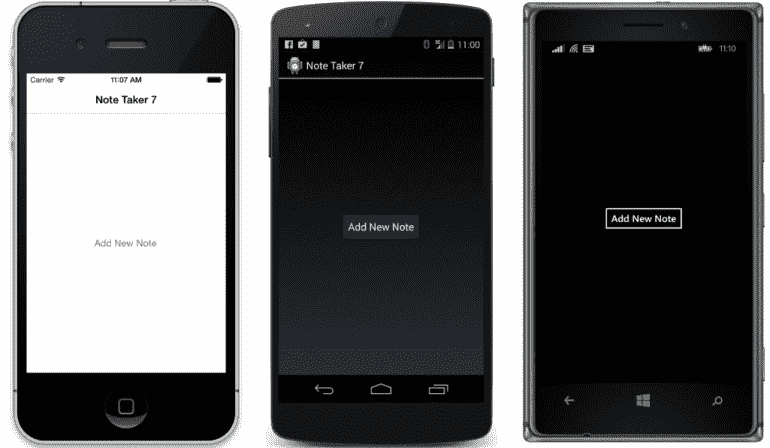

注意 iPhone 和 Android 上的标题。使用 iPhone 上的 `NavigationPage` 时，你不再需要担心页面上的任何内容占用与状态栏相同空间，无论是在主页上还是从该页面导航到的任何页面上。

NoteTaker7 中的 Note、IFileHelper 和 FileHelper 类与 NoteTaker6 中的相同。

`NotePage` 类与程序早期版本中的页面类相似。它派生自 `ContentPage`，但定义了一个带有一个字符串参数的构造函数，指示笔记的文件名。此构造函数将文件名保存为私有字段，设置 `Title` 属性，并构建页面的其余部分：

```csharp
namespace NoteTaker7
{
    class NotePage : ContentPage
    {
        string filename;
        Note note = new Note();

        public NotePage(string filename)
        {
            this.filename = filename;
            Title = "New Note";

            // Create Entry and Editor views.
            Entry entry = new Entry
            {
                Placeholder = "Title (optional)"
            };
```

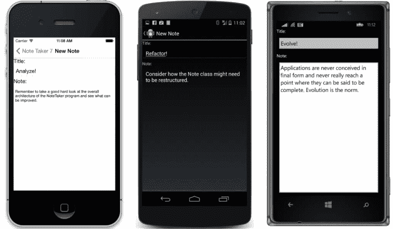

再次注意，此页面的 `Title` 属性显示在 iOS 和 Android 屏幕顶部，并且左侧的角度括号提示点击此处可导航回主页。此外，Android 和 Windows Phone 设备底部最左侧的按钮也会导航回主页。

那么加载和保存按钮在哪里呢？嗯，加载按钮在这里没有意义，因为在这个版本的程序中 `NotePage` 仅在具有新文件名时显示。文件尚不存在。然而，`NotePage` 应该有一些保存笔记的功能。

它确实有。在使用页面导航时，利用 `Page` 类定义的两个受保护的虚拟方法 `OnAppearing` 和 `OnDisappearing` 通常很方便。`OnAppearing` 方法在导航到页面时被调用，而 `OnDisappearing` 方法在从页面导航离开时被调用。在 `NotePage` 类中，`OnAppearing` 在这里没做什么（只是为了对称性而显示），但 `OnDisappearing` 重写是存储 `Note` 对象的完美时机：

```csharp
namespace NoteTaker7
{
    class NotePage : ContentPage
    {
        ...
        protected override void OnAppearing()
        {
            base.OnAppearing();
        }
        protected override void OnDisappearing()
        {
            // Only save it if there's some text somewhere.
            if (!String.IsNullOrWhiteSpace(note.Title) ||
                !String.IsNullOrWhiteSpace(note.Text))
            {
                note.SaveAsync(filename);
            }
            base.OnDisappearing();
        }
    }
}
```

这意味着用户无需费心显式保存笔记。在导航回主页时会自动完成。

你可能会想：如果用户在导航返回之前终止应用程序怎么办？或者让应用程序在 `NotePage` 仍处于活动状态时运行，然后关闭手机？是的，这确实是个问题。但这实际上是涉及 *应用程序生命周期* 的主题问题，而在这一章结束之前将会讨论这个问题。

## Version 8. Notes in the ListView

随着 **NoteTaker** 程序增强为显示多个笔记，一些重构可能很有必要。目前，`Note` 对象和与该 `Note` 对象关联的文件名并不是紧密关联的。程序有可能使用与 `LoadAsync` 方法不同的文件名调用 `Note` 的 `SaveAsync` 方法。

让我们修复这个问题。在 **NoteTaker8** 中，让我们将文件名传递给 `Note` 构造函数，该构造函数将其保存为名为 `Filename` 的公共只读属性。最终你会看到使此属性公开的原因。然而，由于此 `Filename` 属性在构造函数中设置且永不更改，因此该属性没有理由触发 `PropertyChanged` 事件。这允许 `LoadAsync` 和 `SaveAsync` 方法被重新定义为无参数。以下是新版本的相关部分：

```csharp
namespace NoteTaker8
{
    class Note : INotifyPropertyChanged
    {
        string title, text;

        public event PropertyChangedEventHandler PropertyChanged;

        public Note(string filename)
        {
            this.Filename = filename;
        }

        public string Filename { private set; get; }
```


```
public Task SaveAsync()
{
    string text = this.Title + "\n" + this.Text;
    return FileHelper.WriteTextAsync(this.Filename, text);
}

public async Task LoadAsync()
{
    string text = await FileHelper.ReadTextAsync(this.Filename);

    // Break string into Title and Text.
    int index = text.IndexOf('\n');
    this.Title = text.Substring(0, index);
    this.Text = text.Substring(index + 1);
}

...
}
}
```

这意味着 `NotePage` 的新版本必须在其构造函数中传入一个 `Note` 对象，而不是文件名：

```
namespace NoteTaker8
{
    class NotePage : ContentPage
    {
        Note note;

        public NotePage(Note note)
        {
            this.note = note;
            Title = "New Note";

            // Create Entry and Editor views.
            Entry entry = new Entry
            {
                Placeholder = "Title (optional)"
            };

            Editor editor = new Editor
            {
                Keyboard = Keyboard.Create(KeyboardFlags.All),
                BackgroundColor = Device.OnPlatform(Color.Default,
                                                   Color.Default,
                                                   Color.White),
                VerticalOptions = LayoutOptions.FillAndExpand
            };

            // Set data bindings.
            this.BindingContext = note;
```

```
entry.SetBinding(Entry.TextProperty, "Title");
editor.SetBinding(Editor.TextProperty, "Text");

// Assemble page.
this.Content = new StackLayout
{
    Children =
    {
        new Label { Text = "Title:" },
        entry,
        new Label { Text = "Note:" },
        editor,
    };
};
...
}
```

构造函数将自身的 BindingContext 设置为该 Note 对象。

## 枚举文件

NoteTaker7 的前一版本在用户从 NotePage 导航离开并返回到 HomePage 时，会将新笔记保存在本地应用程序存储中。但 NoteTaker8 的重大变化是提供了一个显示所有已保存笔记的功能。可以考虑几种策略来实现此功能。可以将本地存储中包含所有单个笔记文件名的主列表保存在一个特殊文件中。或者，程序也可以使用文件 I/O 设施来枚举文件夹中的所有笔记文件。

NoteTaker8 采用了第二种策略，但这要求文件助手增强以包含获取应用程序存储文件夹中所有文件的方法。以下是带有新方法 `GetFilesAsync` 的新 `IFileHelper`：

```
namespace PlatformHelpers
{
    public interface IFileHelper
    {
        Task<bool> ExistsAsync(string filename);

        Task WriteTextAsync(string filename, string text);

        Task<string> ReadTextAsync(string filename);

        Task<IEnumerable<string>> GetFilesAsync();

        Task DeleteFileAsync(string filename);
    }
}
```

请注意，还添加了 `DeleteFileAsync` 方法。目前还不需要，但在应用程序的下一个版本中将需要它。

还请注意，命名空间已更改为更通用的名称。你使用 `DependencyService` 创建的接口和类很可能在其他应用程序中也很有价值。为所有 `DependencyService` 助手使用一致的命名空间名称会很方便。

新 `IFileHelper` 的 iOS 和 Android 实现类似。以下是 iOS 版本，但仅显示新方法：

```
namespace PlatformHelpers.iOS
{
    class FileHelper : IFileHelper
    {
        ...

        public Task<IEnumerable<string>> GetFilesAsync()
        {
            // Sort the filenames.
            IEnumerable<string> filenames =
                from filepath in Directory.EnumerateFiles(GetDocsFolder())
                select Path.GetFileName(filepath);

            return Task<IEnumerable<string>>.FromResult(filenames);
        }

        public Task DeleteFileAsync(string filename)
        {
            File.Delete(GetFilePath(filename));
            return Task.FromResult(true);
        }

        string GetDocsFolder()
        {
            return Environment.GetFolderPath(Environment.SpecialFolder.MyDocuments);
        }

        string GetFilePath(string filename)
        {
            return Path.Combine(GetDocsFolder(), filename);
        }
    }
}
```

`Directory.EnumerateFiles` 方法返回完全限定的文件名，因此 `GetFilesAsync` 使用少量 LINQ 去掉目录路径，只保留文件名。这是为了与 `WriteTextAsync` 和 `ReadTextAsync` 方法兼容，这些方法只需要文件名并自行提供目录路径。

Windows Phone 版本使用 WinRT `StorageFolder` 方法：

```
namespace PlatformHelpers.WinPhone
{
    ...

    public async Task<IEnumerable<string>> GetFilesAsync()
    {
        StorageFolder localFolder = ApplicationData.Current.LocalFolder;

        IEnumerable<string> filenames =
            from storageFile in await localFolder.GetFilesAsync()
            select storageFile.Name;

        return filenames;
    }

    public async Task DeleteFileAsync(string filename)
    {
        StorageFolder localFolder = ApplicationData.Current.LocalFolder;
        StorageFile storageFile = await localFolder.GetFileAsync(filename);
        await storageFile.DeleteAsync();
    }
}
```

最后，可移植类库中的静态 `FileHelper` 类也已扩展：

```
namespace PlatformHelpers
{
    static class FileHelper
    {
        static IFileHelper fileHelper = DependencyService.Get<IFileHelper>();

        public static Task<bool> ExistsAsync(string filename)
        {
            return fileHelper.ExistsAsync(filename);
        }

        public static Task WriteTextAsync(string filename, string text)
        {
            return fileHelper.WriteTextAsync(filename, text);
        }

        public static Task<string> ReadTextAsync(string filename)
        {
            return fileHelper.ReadTextAsync(filename);
        }

        public static Task<IEnumerable<string>> GetFilesAsync()
        {
            return fileHelper.GetFilesAsync();
        }

        public static Task DeleteFileAsync(string filename)
        {
```

```
return fileHelper.DeleteFileAsync(filename);
```

这些现在是 FileHelper 类的最终版本（至少对于 NoteTaker 应用程序而言）。

## ListView

NoteTaker8 需要一种列出所有笔记的方式。它可以使用 Label 视图来显示每条笔记的标题，然后将所有这些 Label 视图收集到 ScrollView 内的 StackLayout 中。但存在一个视图可以为你完成大部分工作，甚至更多。这就是 ListView，每当你需要显示可滚动的对象列表时，这就是你的首选视图——特别是如果对象是同一种类型。

基本上你用一组对象填充 ListView，ListView 就会显示它们。你可能会认为 ListView 显示的对象必须是某种视图，但事实并非如此。ListView 显示的对象通常是数据对象，你可以精确控制 ListView 如何显示这些数据对象。关于其工作原理的完整讨论将在稍后的章节中进行，遗憾的是该章节不在本预览版中。

ListView 显示的项目是可选择的。用户只需轻按一个项目即可选择它。ItemSelected 事件在新项目被选择时发出信号，而 SelectedItem 属性则揭示该项目。在 NoteTaker 的下一个版本中，此功能将用于编辑和删除笔记。

你通过将 ListView 的 ItemsSource 属性设置为实现 IEnumerable 接口的集合对象来指定要显示的项目。这是与最通用类型的集合相关联的 .NET 接口。数组实现了 IEnumerable，因此数组符合条件。更常见的是，ListView 的 ItemsSource 属性被设置为 List<T> 的实例。例如，如果 list 是 List<T> 的实例，那么你可以这样设置 ItemsSource：

```
listView.ItemsSource = list;
```

ListView 随后会显示集合中的所有项目，如有必要则进行滚动。

非常经常地，你希望 ListView 显示的数据项集合作为另一个对象的属性公开。例如，假设一个名为 Data 的类定义了一个名为 CollectionProp 的属性，该属性实现了 IEnumerable，并且 data 是该类的一个实例。你可以这样设置 ItemsSource 属性：

```
listView.ItemsSource = data.CollectionProp;
```

但如果在 CollectionProp 属性已设置为 ItemsSource 属性之后集合发生了变化，会发生什么？

对于集合而言，“变化”这个词究竟意味着什么？


实际上集合可能发生变化有三种不同方式！理解集合相关的不同类型的变化将帮助你设计数据和用户界面，以便 `ListView` 始终显示最新最好的数据项。

这是第一种变化类型：也许 `Data` 实例的 `CollectionProp` 属性在应用程序启动时返回一个特定的 `List<T>` 对象，然后发生了某些事情，该属性返回了一个不同的 `List<T>` 对象。这是一个完全不同的集合，包含不同的项。如果是这种情况，那么 `Data` 类应实现 `INotifyPropertyChanged`，并在 `CollectionProp` 属性更改时触发 `PropertyChanged` 事件。因此，`ListView` 的 `ItemsSource` 属性不应简单地设置为 `CollectionProp` 属性，而必须通过数据绑定绑定到该属性：

```
listView.BindingContext = data;
listView.SetBinding(ListView.ItemsSourceProperty, "CollectionProp");
```

这就是集合可能发生变化的一种方式。这里是第二种方式：`CollectionProp` 属性返回的 `List<T>` 对象在程序运行期间可能保持不变，但项可能会动态地添加到集合中或从集合中移除，或者以某种方式重新排序或重新排序，当然你希望 `ListView` 显示能够反映更新后的内容。

这是 **NoteTaker8** 需要处理的变化类型。**NoteTaker8** 中的 `ListView` 将显示笔记集合，但用户可以在程序运行期间向集合添加笔记和删除笔记。`ListView` 必须响应这些更改。起初，这听起来像是一个困难的要求。`ListView` 如何确定设置为（或绑定到）其 `ItemsSource` 属性的集合已获得新项或丢失了现有项？

当然是通过事件！你已经知道 `System.ComponentModel` 命名空间中定义的 `INotifyPropertyChanged` 接口，如下所示：

```
public interface INotifyPropertyChanged
{
    event PropertyChangedEventHandler PropertyChanged;
}
```

`System.Collections.Specialized` 命名空间包含一个相关且相似的接口，名为 `INotifyCollectionChanged`：

```
public interface INotifyCollectionChanged
{
    event NotifyCollectionChangedEventHandler CollectionChanged;
}
```

集合类可以实现此接口，并在对象添加到集合或从集合中移除时，或项以某种方式重新排序时通知外部世界。与 `NotifyCollectionChangedEventHandler` 关联的事件参数提供了有关此更改的详细信息。

`ListView` 知道 `INotifyCollectionChanged`。每当集合对象设置为其 `ItemsSource` 属性时，`ListView` 会检查该集合对象是否实现此接口。如果是，`ListView` 会在该集合对象的 `CollectionChanged` 事件上附加一个处理程序。然后 `ListView` 会在对象添加到集合或从集合中移除时（或如果对象以某种方式重新排序）收到通知，并相应地更新 `ListView` 显示。

现在我们只需要一个实际实现 `INotifyCollectionChanged` 的类，而确实有一个：它位于 `System.Collections.ObjectModel` 命名空间中，它是一个名为 `ObservableCollection` 的泛型类，这是一个很棒的名字，因为它暗示通过使用 `CollectionChanged` 事件你可以观察集合内部发生的情况。

集合还可能以第三种方式发生变化。也许集合对象本身没有变化，并且对象没有添加到集合中或从集合中移除，但集合中对象的属性发生了变化。例如，假设你的集合包含多个主要城市的 `Weather` 对象。集合本身永远不会改变，但 `Weather` 类包含一个 `Temperature` 属性，该属性在一天中不断变化。如果此 `Weather` 对象实现 `INotifyPropertyChanged` 并在 `Temperature` 属性更改时触发 `PropertyChanged` 事件，`ListView` 也能响应这些更改。

NoteTaker8 确实需要一个 `ObservableCollection`，所以让我们先处理它。让我们创建一个将存储 `Note` 对象集合的类。`NoteFolder` 类有一个名为 `Notes` 的单个属性，其类型为 `ObservableCollection<Note>`。构造函数调用一个异步方法，该方法使用 `FileHelper.GetFilesAsync` 获取所有文件，然后按文件名排序。（请记住，文件名是根据 `Note` 对象创建的日期和时间构造的，因此这些文件名将按文件创建的顺序排序。）然后为每个文件名创建一个 `Note` 对象，调用 `LoadAsync` 方法将文件加载到 `Note` 对象中，并将其添加到 `Notes` 集合中：

```
namespace NoteTaker8
{
    class NoteFolder
    {
        public NoteFolder()
        {
            this.Notes = new ObservableCollection<Note>();
            GetFilesAsync();
        }

        public ObservableCollection<Note> Notes { private set; get; }

        async void GetFilesAsync()
        {
            // Sort the filenames.
            IEnumerable<string> filenames =
                from filename in await FileHelper.GetFilesAsync()
                where filename.EndsWith(".note")
                orderby (filename)
                select filename;

            // Store them in the Notes collection.
```

请注意，`ListView` 的 `ItemsSource` 属性设置为 `App.NoteFolder.Notes`。`ListView` 可滚动，因此如果它与 `StackLayout` 中的其他视图（如此页面的 `Button`）共享，则必须具有 `VerticalOptions` 设置为 `FillAndExpand`。

当单击 `Button` 时，`HomePage` 构造一个唯一的文件名，实例化一个 `Note` 对象，并导航到 `NotePage`，该页面（如你所见）将其 `BindingContext` 设置为该 `Note`。你尚未看到的是 `NotePage` 的新的 `OnDisappearing` 重写：

```
namespace NoteTaker8
{
    class NotePage : ContentPage
    {
        ...
        protected override void OnDisappearing()
        {
            // Only save it if there's some text somewhere.
            if (!String.IsNullOrWhiteSpace(note.Title) ||
                !String.IsNullOrWhiteSpace(note.Text))
            {
                note.SaveAsync();
                App.NoteFolder.Notes.Add(note);
            }
            base.OnDisappearing();
        }
    }
}
```

新的 `OnDisappearing` 保存新的 `Note` 对象并将其添加到 `App.NoteFolder.Notes` 集合中。随着 `HomePage` 重新进入视图，`ListView` 显示新的 `Note` 对象。

然而，当你尝试添加新的 `Note` 对象时，你会发现 `ListView` 显示并不那么有启发性：

```
Children =
{
    new Label { Text = "Title:" },
    entry,
    new Label { Text = "Note:" },
    editor,
};

if (isNoteEdit)
{
    // Cancel button.
    Button cancelButton = new Button
    {
        Text = "Cancel",
        HorizontalOptions = LayoutOptions.CenterAndExpand
    };

    cancelButton.Clicked += async (sender, args) =>
    {
        bool confirm = await this.DisplayAlert("Note Taker",
            "Cancel note edit?",
            "Yes", "No");

        if (confirm)
        {
            // Reload note.
            await note.LoadAsync();

            // Return to home page.
            await this.Navigation.PopAsync();
        }
    };

    // Delete button
    Button deleteButton = new Button
    {
        Text = "Delete",
        HorizontalOptions = LayoutOptions.CenterAndExpand
    };

    deleteButton.Clicked += async (sender, args) =>
    {
        bool confirm = await this.DisplayAlert("Note Taker",
            "Delete this note?",
            "Yes", "No");

        if (confirm)
        {
            // Delete Note file and remove from collection.
            await note.DeleteAsync();
            App.NoteFolder.Notes.Remove(note);

            // Return to home page.
            await this.Navigation.PopAsync();
        }
    }
```


};

StackLayout horzStack = new StackLayout
{
    Orientation = StackOrientation.Horizontal,
    Children =
    {
        cancelButton,
        deleteButton
    }
};

stackLayout.Children.Add(horzStack);
}

this.Content = stackLayout;
}

protected override void OnAppearing()
{
    base.OnAppearing();
}

protected override void OnDisappearing()
{
    // Only save it if there's some text somewhere.
    if (!String.IsNullOrWhiteSpace(note.Title) ||
        !String.IsNullOrWhiteSpace(note.Text))
    {
        note.SaveAsync();

        if (!isNoteEdit)
        {
            App.NoteFolder.Notes.Add(note);
        }
    }

    base.OnDisappearing();
}
}

只有在构造函数的 `isNoteEdit` 参数为 `true` 时，才会创建**取消**和**删除**按钮。当你导航到 `NotePage` 编辑笔记，但输入了一点内容后决定放弃这些编辑时，会用到**取消**按钮。没有**确定**按钮来确认你的编辑。只需导航回主页即可。

在删除某些内容或取消操作时，从用户那里获得确认是一种礼貌的做法。出于确认目的，Xamarin.Forms 的 `Page` 类定义了一个 `DisplayAlert` 方法，它会显示一个原生平台警报框。`DisplayAlert` 存在三种不同的版本。用于**取消**和**删除**选项的那个版本有两个参数来定义两个按钮的文本，如果点击第一个按钮则返回 `true`。`DisplayAlert` 是异步的——这意味着

## 版本 10. 添加模板单元格

如果你试验 NoteTaker9 的编辑功能，你可能会发现一个 bug。如果你编辑标题——或者笔记没有标题，但你编辑了用于标题的那部分文本——你将不会在 ListView 中看到笔记的更新版本。终止程序并重新启动它，你的编辑才会出现。

问题在于使用 ToString 方法在 ListView 中显示 Note 的简单方式。在简单情况下，ListView 使用的正是这个方式，但这并不足够。ListView 在首次显示这些项目时会调用每个项目的 ToString 方法，但当 ToString 可能返回不同的值时，它却从未得到通知。

修复这个问题需要对 ListView 进行更深入的使用。

为了显示 ItemsSource 集合中的项目，ListView 使用一个称为 cell（单元格）的对象。这个 cell 是一个视图（或视图树），用作模板。ListView 使用这个 cell 为集合中的每个项目生成相同的视图（或视图树）。通常，这会导致所有项目以完全相同的方式显示。然而，这个 cell 可以包含数据绑定，这些绑定引用 ListView 项目（此处为 Note 对象）中的属性。

你可以通过使用 ViewCell 创建自己的 cell，但也可以使用几个预置的 cell。最简单的是 TextCell，它仅由一个 Label 组成。如果未指定 cell，ListView 会使用 TextCell，但显式指定 TextCell 的好处是，你可以将 Text 属性绑定到 Note 中的某个属性。

Note 需要一个新属性来标识 ListView 中的对象。我们把这个属性称为 Identifier。Identifier 属性将返回与之前版本的 Note 中 ToString 方法相同的字符串，但最大的区别是 Identifier 属性还会触发 PropertyChanged 事件。

如果 Title 属性发生变化，Identifier 属性也必须变化；如果 Title 属性为空且 Text 属性发生变化，Identifier 也会随之变化。

以下是 Note 中相关的新逻辑：

```
namespace NoteTaker10
{
    class Note : INotifyPropertyChanged
    {
        string title, text, identifier;

        ...

        public string Title
        {
            set
            {
                if (SetProperty(ref title, value))
```

请记住，如果属性正在发生变化，SetProperty 方法会返回 true，因此 set 访问器可以使用该返回值来执行额外的逻辑。Title 和 Text 属性使用这个返回值来调用 MakeIdentifier。其逻辑基本上与原来的 ToString 方法相同。ToString 重写已被移除。虽然带有 ToString 方法的类通常比不带 ToString 方法的类更受青睐，但在使用 ListView 时，通常最好确认模板正在工作。

另一个更改涉及新 HomePage 中的 ListView：

```
// Create and initialize ListView.
ListView listView = new ListView
{
    ItemsSource = App.NoteFolder.Notes,
    ItemTemplate = new DataTemplate(typeof(TextCell)),
    VerticalOptions = LayoutOptions.FillAndExpand
};

listView.ItemTemplate.SetBinding(TextCell.TextProperty, "Identifier");
```

ListView 从其父类 ItemsView<T> 继承了 ItemsSource 和 ItemTemplate 属性。ItemTemplate 属性的类型是 DataTemplate，而 DataTemplate 构造函数需要派生自 Cell 的类的 Type 对象。DataTemplate 使用这个 Type 对象来生成可视化对象，以显示 ListView 中的项目。

对于这个 ListView，DataTemplate 构造函数的参数是 typeof(TextCell)。TextCell 基本上是在 Label 外包装的一个 Cell，因此对于 ListView 中的每个项目，DataTemplate 对象都会使用 TextCell 生成一个 Label 来显示该项目。这是最简单的模板类型；本书的最终版本将展示如何创建更复杂的模板。

这里是要点：尽管 DataTemplate 不从 BindableObject 派生，你仍然可以在它上面设置数据绑定。DataTemplate 定义了自己的 SetBinding 方法。数据绑定目标必须是 cell 的属性，在此情况下是 TextCell 定义的 Text 属性。数据绑定源是 ListView 中项目的一个属性，在此情况下是 Note 类的一个属性，具体来说就是 Identifier。

当生成 Label 对象以渲染 ListView 中的每个项目时，此绑定会从 DataTemplate 转移到 Label 对象的 Text 属性。每个 Label 的 BindingContext 被设置为与该项目关联的 Note 对象。

NoteTaker10 的视觉效果与 NoteTaker9 相同，但当你更改笔记的标题时——或者当标题为空而你更改文本时——ListView 显示的文本也会随之更改。

Bug 已消除。

## 版本 11. 构建工具栏

HomePage 有一个**添加新笔记**按钮，NotePage 有两个按钮：**取消**和**删除**。这些实际上不应该是按钮，而应该是工具栏项。在 Windows Phone 中，你可以将工具栏项添加到 ContentPage，但 iOS 和 Android 将工具栏项限制为 NavigationPage 或从 NavigationPage 导航到的页面。

`ToolbarItem` 类不像 `Button` 和 `ListView` 那样派生自 `View`。它实际上只是一个用于通过以下属性定义工具栏项特征的类：

- `Name` — 可能显示的文本
- `Icon` — 作为资源存储的位图（最常见的是 PNG）的文件名
- `Order` — `ToolbarItemOrder` 枚举的一个成员：`Default`、`Primary` 或 `Secondary`
- `Priority` — 一个整数

`Order` 属性决定 `ToolbarItem` 是作为图像（`Primary`）还是文本（`Secondary`）出现。Windows Phone 限制为四个 `Primary` 项，而 iPhone 和 Android 超过这个数量就会开始变得拥挤，所以这是一个合理的限制。额外的 `Secondary` 项仅显示文本。在 iPhone 上，它们出现在 `Primary` 项下方；在 Android 和 Windows Phone 上，直到用户点击垂直或水平省略号，它们才会显示在屏幕上。

当然，`Icon` 属性对 `Primary` 项至关重要，`Name` 属性对 `Secondary` 项至关重要，但 Windows Phone 还会使用 `Name` 在 `Primary` 项的图标下方显示简短的文本提示。

当 `ToolbarItem` 被点击时，它会触发 `Activated` 事件，而不是 `Button` 那样的 `Clicked` 事件，但概念是相同的。（`ToolbarItem` 也有像 `Button` 一样的 `Command` 和 `CommandParameter` 属性；这些属性用于数据绑定，并且将在本预览版之外的后续章节中演示。）

`ToolbarItem` 构造函数允许你指定所有这些属性（`Command` 和 `CommandParameter` 除外）以及 `Activated` 事件的处理程序。

`ToolbarItem` 的实例不能像视图那样添加到 `StackLayout` 中。它必须添加到 `Page` 的 `ToolbarItems` 属性中。这个 `ToolbarItems` 属性的类型是 `IList<ToolbarItem>`。一旦你将 `ToolbarItem` 添加到此集合中，`ToolbarItem` 的属性就不能再更改。这些属性设置会在内部用于构造特定于平台的对象。

当然，使用 `ToolbarItem` 最困难的地方在于为 `Icon` 属性组装位图图像。每个平台对这些图标的颜色构成和尺寸有不同的要求，而且每个平台在图像方面也有略有不同的惯例。标准的图标用于


例如，共享功能在 Android 和 Windows Phone 上有所不同。

出于这些原因，每个平台项目拥有自己的工具栏图标集合，而不是在公共的 PCL 项目中使用一组共享图标，这是合理的。然后 PCL 项目引用这些平台图像。

让我们从提供适合 ToolbarItem 的图标集合的两个平台开始。

## Android 的图标

Android 网站提供了可供下载的工具栏图标集合，网址如下：

http://developer.android.com/design/downloads

下载名为“操作栏图标包”（Action Bar Icon Pack）的 ZIP 文件。

解压缩后的内容组织为两个主要目录：Core_Icons（23 张图像）和 Action Bar Icons（144 张图像）。这些全部是 PNG 文件，Action Bar Icons 按目录名称以四种不同的尺寸提供：

- drawable-mdpi（中等每英寸点数）— 32 像素见方
- drawable-hdpi（高每英寸点数）— 48 像素见方
- drawable-xhdpi（超高 DPI）— 64 像素见方
- drawable-xxhdpi（超超高 DPI）— 96 像素见方

这些目录名很特殊。它们与你在 Android 项目中用于存储所需图标位图的文件夹名称相同。如果你在这些目录中提供不同大小的图标，运行时将选择适合特定设备的尺寸。

Core_Icons 文件夹也将其图标排列到四个目录中，具有相同的四种尺寸，但这些目录名为 mdpi、hdpi、xhdpi 和 unscaled。

Action Bar Icons 文件夹还有一个额外的目录组织，使用 holo_dark 和 holo_light 名称。通常，对于 Android，你会希望使用透明背景上带有白色前景的 PNG 文件；这就是 holo_dark 文件夹中文件的颜色构成，意味着它们是为深色背景设计的。holo_light 图标在透明背景上带有黑色前景；它们在 Finder 和 Windows 资源管理器中更容易看到，但在大多数情况下，你应该使用 holo_dark 图标。

Core_Icons 文件夹只包含透明背景上带有白色前景的图标。

如果你自己复现 NoteTaker11，请使用 Visual Studio 或 Xamarin Studio 首先在 Android 项目的 Resources 文件夹中创建四个子文件夹：drawable-mdpi、drawable-hdpi、drawable-xhdpi 和 drawable-xxhdpi。（在 Visual Studio 和 Xamarin Studio 中，上下文菜单项都是 Add 和 New Folder。）然后将现有的位图文件添加到这些文件夹中。在 Visual Studio 中，上下文菜单项是 Add 和 Existing Item。在 Xamarin Studio 中，它是 Add 和 Add Files。你会想要

## ARM嵌入式系统复习题

1. 什么是嵌入式系统？它有哪些特点？试举出两个日常生活中使用嵌入式系统的例子。

2. 嵌入式系统一般由哪几个主要部分构成？请分别说明各部分的作用。

3. 什么是ARM处理器？ARM的含义是什么？它有哪些基本特征？

4. 什么是哈佛结构和冯·诺依曼结构？它们的主要区别是什么？ARM处理器一般采用哪种结构？

5. ARM处理器的工作模式有哪些？如何理解各工作模式之间的切换？

6. ARM处理器有哪几种寻址方式？各自的特点是什么？

7. ARM指令集中，比较常用的指令有哪些？其功能分别是什么？

8. 简述ARM处理器的异常中断类型，并说明ARM处理器对异常中断的响应过程。

9. 简述ARM处理器中存储器的字节序，并说明大端格式和小端格式的区别。

```

};

cancelItem.Activated += async (sender, args) =>
{
    bool confirm = await this.DisplayAlert("Note Taker",
        "Cancel note edit?",
        "Yes", "No");

    if (confirm)
    {
        // Reload note.
        await note.LoadAsync();

        // Return to home page.
        await this.Navigation.PopAsync();
    }
};

this.ToolbarItems.Add(cancelItem);

// Delete toolbar item.
ToolbarItem deleteItem = new ToolbarItem
{
    Name = "Delete",
    Icon = Device.OnPlatform("discard.png",
        "ic_action_discard.png",
        "Images/delete.png"),

    Order = ToolbarItemOrder.Primary
};

deleteItem.Activated += async (sender, args) =>
{
    bool confirm = await this.DisplayAlert("Note Taker",
        "Delete this note?",
        "Yes", "No");

    if (confirm)
    {
        // Delete Note file and remove from collection.
        await note.DeleteAsync();
        App.NoteFolder.Notes.Remove(note);

        // Return to home page.
        await this.Navigation.PopAsync();
    }
};

this.ToolbarItems.Add(deleteItem);
}

this.Content = stackLayout;
}
}
...
}
}
```

NotePage 显示这两个项，并像之前的 Button 视图一样实现它们：

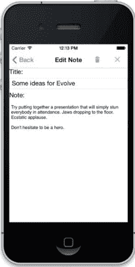

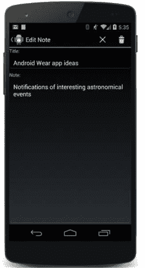

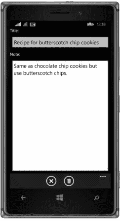

## 版本 12. 应用程序生命周期事件

假设某人正在使用 NoteTaker 程序，并决定输入新笔记或编辑现有笔记。用户在 Entry 和 Editor 视图中输入一些文本，然后被打断——也许是电话。之后，用户关闭了手机。

下次启动 NoteTaker 程序时会发生什么？进行中的新笔记——或对现有笔记的编辑——是否应该被丢弃？这似乎不合理，但如果你考虑到 NoteTaker 仅在 NotePage 类的 OnDisappearing 重写期间保存笔记，那正是将要发生的事情。

这个问题能做什么？一种方法是为 Entry 和 Editor 视图的 TextChanged 事件附加处理程序，并在每次文本更改时保存文件。但这会造成大量文件操作，而且如果用户决定取消编辑，你需要有某种特殊规定。

这个问题在过去并不是程序员所担心的。台式电脑上的程序有打开和保存文件的特定命令，如果你作为用户试图关闭程序而不先保存文档，程序会询问你是否要保存你的工作。但如果你碰巧在保存之前关掉了电脑，那就是你的问题了！

移动设备的期望非常不同。用户期望应用程序能准确记住他们上一次与程序交互时在做什么。

```
event Action Suspending;

event Action Resuming;
}
}
```

只有两个事件，使用最简单的事件处理程序类型：不带参数且无返回值的 Action。

### iOS 实现

该接口的 iOS 实现的构造函数为 iOS 的 ObserveDidEnterBackground 和 ObserveWillEnterForeground 通知设置了处理程序。当这些通知发生时，处理程序分别触发 Suspending 和 Resuming 事件：

```
[assembly: Dependency(typeof(PlatformHelpers.iOS.LifecycleHelper))]

namespace PlatformHelpers.iOS
{
    class LifecycleHelper : ILifecycleHelper
    {
        public event Action Suspending;

        public event Action Resuming;

        public LifecycleHelper()
        {
            UIApplication.Notifications.ObserveDidEnterBackground(
                (sender, args) =>
                {
                    if (Suspending != null)
                        Suspending();
                });

            UIApplication.Notifications.ObserveWillEnterForeground(
                (sender, args) =>
                {
                    if (Resuming != null)
                        Resuming();
                });
        }
    }
}
```

不要忘记 Dependency 特性！

### Android 实现

Android 实现有点麻烦。Android 的 Activity 类定义了受保护的虚拟 OnPause 和 OnResume 方法，因此你需要在标准 Xamarin.Forms 解决方案模板中创建的 MainActivity 类中重写这些方法。这些重写随后应调用

```
{
    App.NoteFolder.Notes.Add(note);
}
}

// Detach handlers for Suspending and Resuming events.
helper.Suspending -= OnSuspending;
helper.Resuming -= OnResuming;

base.OnDisappearing();
}

void OnSuspending()
{
    // Save transient data and state.
    string str = note.Filename + "\x1F" +
        isNoteEdit.ToString() + "\x1F" +
        note.Title + "\x1F" +
        note.Text;

    // Run entire WriteTextAsync in separate thread.
    Task task = Task.Run(() =>
    {
        FileHelper.WriteTextAsync(App.TransientFilename, str);
    });

    // Wait for it to finish before finishing event handler.
    task.Wait();
}

async void OnResuming()
{
    // Delete transient data and state.
    if (await FileHelper.ExistsAsync(App.TransientFilename))
    {
        await FileHelper.DeleteFileAsync(App.TransientFilename);
    }
}
}
```

但看看 OnSuspending 处理程序如何调用 FileHelper.WriteTextAsync：它用该调用定义了一个 lambda 函数，并将其传递给一个返回 Task 对象的 Task.Run 创建方法，然后在该对象上调用 Wait。这是怎么回事？

这解决了 Windows Phone 中显现出的一个问题。当 Windows Phone 挂起程序时，当前的 PhoneApplicationService 会触发一个 Deactivated 事件。当该 Deactivated 事件的处理程序返回时，Windows Phone 操作系统会假定应用程序已完成所有需要做的事情，然后挂起应用的活动。听起来合理，对吧？

然而，如果 Deactivated 处理程序正在调用异步方法——例如那些需要用于


writing program data to a file—then the Deactivated handler returns control to the operating system at the first await operator or the first assignment of a Completed handler. The process of saving the file is still going on in the background, but these operations won’t complete because the program is now suspended.

To get around that problem, the OnSuspending handler passes the call to FileHelper.WriteTextAsync to a Task.Run creation method. This causes the entire WriteTextAsync operation to run in a separate thread of execution. The Wait call effectively waits for that entire operation to complete. Because WriteTextAsync is not running in the user-interface thread, other code can run in the user-interface thread during this time, but the OnSuspending handler is blocked from concluding until WriteTextAsync has concluded.

HomePage must check for the existence of that special file and navigate to NotePage if it exists. Because asynchronous operations are involved and constructors can’t have an async modifier, this job is relegated to a separate method named CheckForSavedInfo. This method reads the string from the file, breaks it down into the component pieces, creates a Note object, initializes the Title and Text properties with the saved text, and then navigates to NotePage:

```
namespace NoteTaker12
{
    class HomePage : ContentPage
    {
        public HomePage()
        {
            ...
            CheckForSavedInfo();
        }

        async void CheckForSavedInfo()
        {
            if (await FileHelper.ExistsAsync(App.TransientFilename))
            {
                // Read the file.
                string str = await FileHelper.ReadTextAsync(App.TransientFilename);

                // Delete the file.
                await FileHelper.DeleteFileAsync(App.TransientFilename);

                // Break down the file contents.
                string[] contents = str.Split('\x1F');
                string filename = contents[0];
                bool isNoteEdit = Boolean.Parse(contents[1]);
                string entryText = contents[2];
                string editorText = contents[3];

                // Create the Note object and initialize it with saved data.
                Note note = new Note(filename);
                note.Title = entryText;
                note.Text = editorText;
```

```
// Navigate to NotePage.
NotePage notePage = new NotePage(note, isNoteEdit);
await this.Navigation.PushAsync(notePage);
}
```

NotePage should then be restored to the same state as when the user left it.

DependencyService is not the only way to deal with application lifecycle issues in a Xamarin.Forms application. Because the PCL does not need to make calls into the platform projects, the MessageCenter class can also provide a means for the platforms to signal application lifecycle activity to the shared project.

Some final advice: Dealing with application lifecycle issues is an important part of mobile development, and you’ll have best results if you plan ahead. You should build application lifecycle handling into the application from the very beginning. Don’t leave it to the end. If you’re getting around to handling application lifecycle issues in the twelfth version of your program, you’re doing it wrong. It’s going to feel like a hack, and it might even appear like a hack.

## 美化界面

The source code for this chapter includes a final version of the program called simply NoteTaker. Screenshots from this version appear at the beginning of Chapter 3. This version was given an application icon, which is used in the start screens on the phone, and which you can also see in the upper-left corner of the Android page in those first three screenshots. In addition, the NoteTaker program appears in the start screens of the three platforms with the name “Note Taker” with two words rather than “NoteTaker”.

These represent the first couple steps you should take when preparing an application for the market. There is much more to be done, of course, but that really comes under the category of iOS development, and Android development, and Windows Phone development rather than Xamarin.Forms development.

The application icon for NoteTaker was designed in Sketch 3 (a popular drawing program for the Mac) and exported to a bunch of different sizes.

If you are preparing an iOS application specifically for iPhone and not the iPad, it should have application icons of five different sizes added to the Resources folder. The filenames indicate the size: Icon-29.png, Icon-57.png, Icon-58.png, Icon-114.png, and Icon-120.png. These should have a Build Action of BundleResource.

In the Info.plist file, in the iPhone Deployment Info section in Visual Studio (or the iOS Application Target section in Xamarin Studio), you can specify an Application Name that is a little

```
{ bool isBaseGenericType; Type baseGenericTypeDef; public TypeInformation(Type type) { this.Type = type; TypeInfo typeInfo = type.GetTypeInfo(); this.BaseType = typeInfo.BaseType; if (this.BaseType != null) { TypeInfo baseTypeInfo = this.BaseType.GetTypeInfo(); this.isBaseGenericType = baseTypeInfo.IsGenericType; if (this.isBaseGenericType) { this.baseGenericTypeDef = baseTypeInfo.GetGenericTypeDefinition(); } } } public Type Type { private set; get; } public Type BaseType { private set; get; } public bool IsDerivedDirectlyFrom(Type parentType) { if (this.BaseType != null && this.isBaseGenericType) { if (this.baseGenericTypeDef == parentType) { return true; } } else if (this.BaseType == parentType) { return true; } return false; } }
```

A very important part of this class is the IsDerivedDirectlyFrom method, which will return true if passed an argument that is this type's base type. This determination is complicated if generic classes are involved, and that issue largely accounts for the complexity of the class.

The ClassAndSubclasses class is considerably shorter:

```
namespace ClassHierarchy { class ClassAndSubclasses { public ClassAndSubclasses(Type parent)
```

```
void AddChildrenToParent(ClassAndSubclasses parentClass,
    List<TypeInformation> classList)
{
    foreach (TypeInformation typeInformation in classList)
    {
        if (typeInformation.IsDerivedDirectlyFrom(parentClass.Type))
        {
            ClassAndSubclasses subclass =
                new ClassAndSubclasses(typeInformation.Type);
            parentClass.Subclasses.Add(subclass);
            AddChildrenToParent(subClass, classList);
        }
    }
}

void AddItemToStackLayout(ClassAndSubclasses parentClass, int level)
{
    // If assembly is not Xamarin.Forms, display full name.
    string name = parentClass.Type.Name;
    TypeInfo typeInfo = parentClass.Type.GetTypeInfo();

    if (typeInfo.Assembly != xamarinFormsAssembly)
    {
        name = parentClass.Type.FullName;
    }

    // If generic, display angle brackets and parameters.
    if (typeInfo.IsGenericType)
    {
        Type[] parameters = typeInfo.GenericTypeParameters;
        name = name.Substring(0, name.Length - 2);
        name += "<";

        for (int i = 0; i < parameters.Length; i++)
        {
            name += parameters[i].Name;
            if (i < parameters.Length - 1)
                name += ", ";
        }
        name += ">";
    }

    // Create Label and add to StackLayout
    Label label = new Label
    {
        Text = String.Format("{0}{1}", new string(' ', 4 * level), name),
        TextColor = parentClass.Type.GetTypeInfo().IsAbstract ?
            Color.Accent : Color.Default
    };

    stackLayout.Children.Add(label);

    // Now display nested types.
```

```
foreach (ClassAndSubclasses subclass in parentClass.Subclasses)
    AddItemToStackLayout(subclass, level + 1);
}
```

The recursive AddChildrenToParent method assembles the linked list of ClassAndSubclasses instances from the flat classList collection.

The AddItemToStackLayout is also recursive because it is responsible for adding the ClassesAndSubclasses linked list to the StackLayout object by creating a Label view for each class with a little blank space at the beginning for the proper indentation.

The method displays the Xamarin.Forms types with just the class names but the .NET types with the fully-qualified name to distinguish them. The method uses the platform highlight color for classes that are not instantiable either because they are abstract or static:

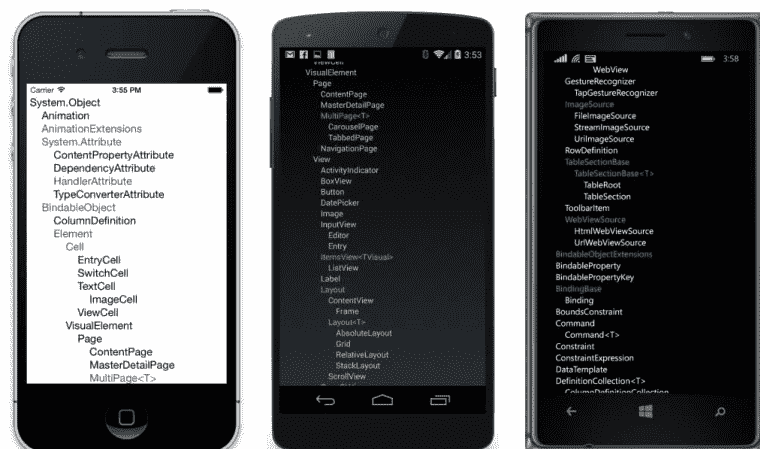

Overall, you'll see that the Xamarin.Forms visual elements have the following general hierarchy:

```
System.Object
    BindableObject
        Element
            VisualElement
                View
                    ...
                    Layout
                        ...
                        Layout<T>
```


在 Microsoft Windows 世界中，类似的技术被称为*设备无关像素*（DIPs）或*设备无关单位*（DIUs）。对于 Microsoft 程序员来说，桌面视频显示器的分辨率被假定为 96 DIUs，这恰好比 72 DPI 高 1/3。

然而，手机有一些不同的规则：现代手机达到的像素密度通常远高于桌面显示器。更高的像素密度使文本和其他视觉对象在难以辨认之前可以缩得更小。

手机通常也比桌面或笔记本电脑屏幕更靠近用户的脸。这种差异也意味着手机上的视觉对象可以比桌面或笔记本电脑屏幕上的相似对象小得多。由于手机的物理尺寸远小于桌面显示器，缩小视觉对象是非常可取的，因为这允许更多内容适应屏幕。

Apple 继续将 iPhone 上的设备无关单位称为*点*，但对于 Apple 所有高密度显示屏——Apple 以品牌名*Retina*称呼——每点有两个像素。这对于 iPhone、iPad 和 MacBook Pro 都适用。

例如，iPhone 4 的 3.5 英寸屏幕的 640 × 960 像素尺寸的实际像素密度约为 320 DPI。对于程序员来说，屏幕的尺寸似乎是 320 × 480 点。iPhone 3 实际上确实有 320 × 480 的像素尺寸，并且点等于像素，因此对于程序员来说，iPhone3 和 iPhone4 的显示器看起来尺寸相同。但这个尺寸意味着每英寸 160 点的转换因子，而不是 72。

iPhone 5 有 4 英寸屏幕，但像素尺寸是 640 × 1136，像素密度与 iPhone 4 大致相同。对于程序员来说，这个屏幕的尺寸是 320 × 768 点。

Android 的做法非常相似：Android 设备有各种各样的尺寸和像素尺寸，但 Android 程序员总是使用*密度无关像素（dps）*作为单位。像素和 dps 之间的关系设定为每英寸 160 dps，这意味着 Apple 和 Android 的设备无关单位非常相似。

然而，微软在 Windows Phone 上采取了不同的方法。Windows Phone 7 设备具有统一的像素尺寸 480 × 800，通常称为 WVGA（宽视频图形阵列）。Windows Phone 7 程序员以像素为单位使用此显示器工作，这意味着 Windows Phone 隐含假定像素密度约为 240 DPI，这是 iPhone 和 Android 设备假定像素密度的 1.5 倍。

使用 Windows Phone 8，允许多种更大的屏幕尺寸：768 × 1280（WXGA 或宽扩展图形阵列）、720 × 1280（使用高清晰度电视术语称为 720p）和 1080 × 1920（称为 1080p）。

对于这些额外的显示尺寸，程序员使用设备无关单位工作。内部缩放因子在像素和设备无关单位之间转换，以便纵向模式下的屏幕宽度始终看起来为 480 像素宽。缩放因子为 1.6（适用于 WXGA）、1.5（720p）和 2.25（1080p）。

被分配了一个大小。你可以在你的 `ContentPage` 派生类中重写此方法，而不是处理 `SizeChanged` 事件，但 `OnSizeAllocated` 有时会在大小实际上没有变化时被调用。

注意到 **WhatSize** 程序不会在其 `SizeChanged` 事件处理程序中创建新的 `Label`。它当然可以创建一个新的 `Label` 并将其设置为页面的新内容（在这种情况下，先前的 `Label` 将不再被引用，因此符合垃圾回收的条件），但这不必要且浪费。程序在其构造函数中只创建一个 `Label`，然后仅设置 `Text` 属性来指示页面的新大小：

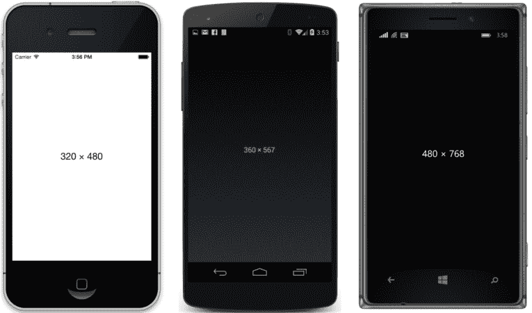

作为记录，这三个图像中屏幕的来源如下：

- **iPhone Retina (3.5 英寸) / iOS 7.1** 模拟器，像素尺寸为 640 × 960。
- 一部 LG Nexus 5，屏幕尺寸为 1080 × 1920 像素。
- 一部 Nokia Lumia 925，屏幕尺寸为 768 × 1280 像素。

注意到在 Android 上，程序感知到的垂直大小不包括状态栏或底部按钮所占用的区域；Windows Phone 上的垂直大小不包括状态栏所占用的区域。

如果应用程序设置为响应设备方向变化，页面大小会反映手机的方向。这意味着当你将手机或模拟器左右旋转时，**WhatSize** 显示的数字会改变。当这三部手机转向侧面时，它们显示以下尺寸：

- iPhone：480 × 320。

``` 
// Add NamedSize fonts to StackLayout.
foreach (NamedSize namedSize in Enum.GetValues(typeof(NamedSize)))
{
    stackLayout.Children.Add(
        new Label
        {
            Text = String.Format("System font of named size {0}",
                namedSize),
            Font = Font.SystemFontOfSize(namedSize),
            TextColor = Color.Black
        });
}

// Resolution in device-independent units per inch.
double resolution = Device.OnPlatform(160, 160, 240);

// Draw horizontal separator line.
stackLayout.Children.Add(
    new BoxView
    {
        Color = Color.Accent,
        HeightRequest = resolution / 80
    });

// Add numeric sized fonts to StackLayout.
int[] ptSizes = { 4, 6, 8, 10, 12 };

foreach (double ptSize in ptSizes)
{
    double fontSize = resolution * ptSize / 72;

    stackLayout.Children.Add(
        new Label
        {
            Text = String.Format("System font of point size " +
                "{0} and font size {1:F1}",
                ptSize, fontSize),
            Font = Font.SystemFontOfSize(fontSize),
            TextColor = Color.Black
        });
}

    this.Padding = new Thickness(5, Device.OnPlatform(20, 5, 5), 5, 5);
    this.Content = stackLayout;
}
``` 

为了便于三个屏幕之间的比较，背景已统一设置为白色，标签设置为黑色。

注意插入到两个 foreach 语句之间的 StackLayout 中的 BoxView。`HeightRequest` 设置使其设备无关高度约为 1/80 英寸，并且它类似于水平分隔线。

由此产生的字号在三个平台之间也许不如你希望的那么一致，但它们提供一个粗略的概念，让你了解可以期望什么：

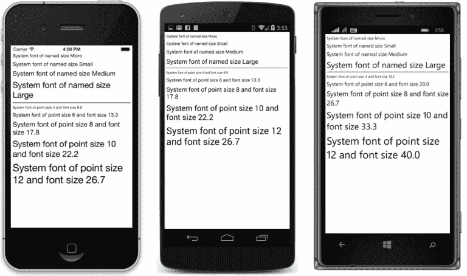

有趣的是，使用设备分辨率计算出的数字大小在平台之间似乎比命名大小更一致，至少在这些设备上是这样。

你可能需要将一块文本适配到特定的矩形区域。有两个数字可以帮助完成这项工作：

第一个是行距。这是每个文本行 `Label` 视图的垂直高度。它与 `Font.SystemFontOfSize` 方法中指定的字号大致相关，如下所示：

- iOS: *LineSpacing* = 1.2 * *FontSize*
- Android: *LineSpacing* = 1.2 * *FontSize*
- Windows Phone: *LineSpacing* = 1.3 * *FontSize*

第二个有用的数字是平均字符宽度。这大约是字号的一半，无论平台如何：

- *AverageCharacterWidth* = 0.5 * *FontSize*

例如，假设你想将一个包含 80 个字符的文本字符串适配到 320 单位的宽度中。你希望字号尽可能大。将宽度（320）除以字符数的一半（40），你得到字号 8，可用于 `Font.SystemFontOfSize` 方法。对于某种程度不确定且无法预先测试的文本，你可能希望使这个计算更保守一些以避免意外。（或者，你可以在 Label 上设置一个 SizeChanged 处理程序并动态调整字号，但该过程将生成另一个 SizeChanged 事件，因此该过程可能很棘手。）

以下程序使用行距和平均字符宽度将一段文本适配到页面中——或者更确切地说，适配到页面减去 iPhone 顶部状态栏所占据的区域。为了在程序中更容易排除状态栏，程序使用了 ContentView。

ContentView 派生自 Layout，但仅向它从 Layout 继承的内容添加了一个 Content 属性。ContentView 是 Frame 的基类，否则似乎没有明显的用途——除非它变得非常方便。

你可能已经注意到，Xamarin.Forms 没有边距的概念，传统上它类似于 padding，区别在于 padding 在视图内部并且是视图的一部分，而 margin 在视图外部并且实际上是父视图的一部分。

Xamarin.Forms 没有 margin 属性，但你可以很容易地用 ContentView 模拟它。如果你需要为视图设置边距，将该视图放入 ContentView 并设置 ContentView 的 Padding 属性。ContentView 从 Layout 继承了 Padding 属性。

EstimatedFontSize 程序以稍微不同的方式使用 ContentView：它在页面上设置惯用的 Padding 以避免 iOS 状态栏，然后将 ContentView 设置为该页面的内容。因此，此 ContentView 与页面大小相同，但不包括 iOS 状态栏。

正是在这个 ContentView 上附加了 SizeChanged 事件，并且正是这个 ContentView 的大小用于计算文本字号。该计算在注释中描述：

``` 
class EstimatedFontSizePage : ContentPage
{
    Label label;

    public EstimatedFontSizePage()
    {
        // Create the Label.
        label = new Label();

        // Put the Label in a ContentView.
        ContentView contentView = new ContentView
        {
            Content = label
        };

        // Monitor the ContentView size changes!
        contentView.SizeChanged += OnContentViewSizeChanged;

        // A little padding for iOS.
        this.Padding = new Thickness(0, Device.OnPlatform(20, 0, 0), 0, 0);
    }
```


```
Device.StartTimer(TimeSpan.FromSeconds(1), OnTimerTick);
}

void OnPageSizeChanged(object sender, EventArgs args)
{
    // Scale the font size to the page width
    //      (based on 11 characters in the displayed string).
    if (this.Width > 0)
        clockLabel.Font = Font.SystemFontOfSize(this.Width / 6);
}

bool OnTimerTick()
{
    // Set the Text property of the Label.
    clockLabel.Text = DateTime.Now.ToString("h:mm:ss tt");
    return true;
}
}
```

程序创建一个用于显示时间的 Label，然后设置两个事件：页面的 SizeChanged 事件用于更改字体大小，Device.StartTimer 事件用于按一秒的间隔触发。两个事件处理程序都只是更改 Label 的属性。Device.StartTimer 事件必须返回 true 以继续计时，返回 false 以停止计时。

OnTimerTick 方法为 DateTime 指定了一个自定义格式字符串，该字符串产生 10 或 11 个字符，但其中两个是大写字母，它们比平均字符宽度更宽。SizeChanged 处理程序隐式假设显示 12 个字符，将字体大小设置为页面宽度的 1/6：

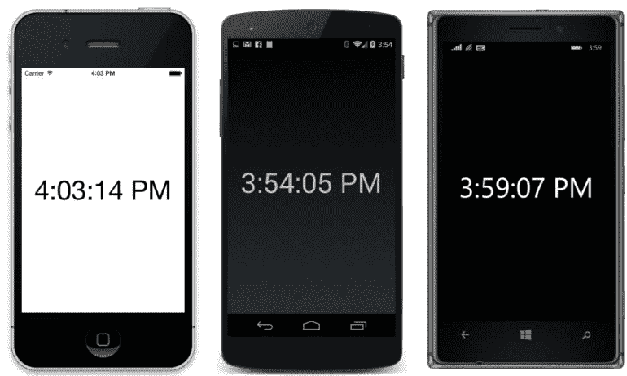

当然，在横屏模式下文本要大得多。不幸的是，本书的截图仅针对竖屏模式设计，因此你需要将本书侧过来才能看到程序在横屏模式下的样子：

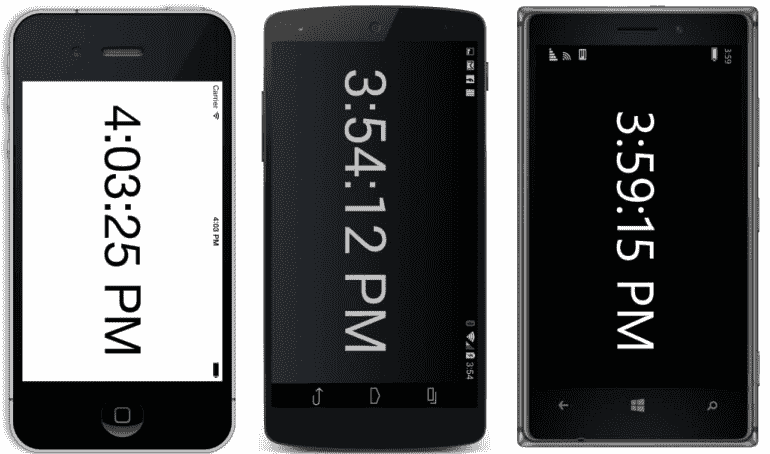

当然，这个一秒钟的计时器并不会在每秒开始时精确触发，因此显示的时间可能与该设备上的其他时间显示不完全一致。你可以通过设置更快的计时器触发频率来提高精度。性能不会受到太大影响，因为显示仍然每秒只更新一次，并且在此期间不需要新的布局周期。

## 图像与位图

就呈现而言，文本是必不可少的，但图片嘛……嗯，图片通常也是必不可少的。

名为 `Image` 的视图之于位图，正如 `Label` 之于文本。`Image` 显示的位图可以来自网站（或通过 URL 访问），也可以作为资源绑定到程序的 PCL 中，还可以是各个平台项目或 SAP 的内容，或者可以通过 .NET `Stream` 对象进行访问。

`Image` 定义了一个 `Source` 属性，你可以将其设置为 `ImageSource` 类型的对象，后者定义了四个用于引用位图的静态方法，分别是：

- `ImageSource.FromUri` 用于通过网络访问位图。
- `ImageSource.FromResource` 用于访问作为资源存储在应用程序 PCL 中的位图。
- `ImageSource.FromFile` 用于访问作为内容存储在平台项目或 SAP 中的位图。

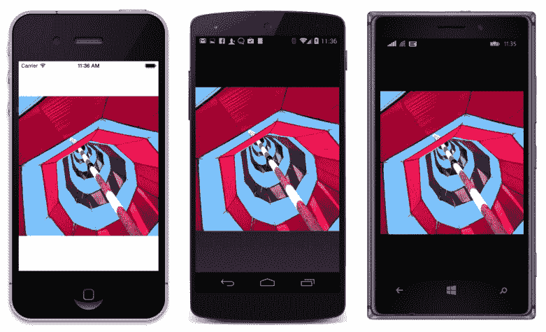

无论位图尺寸小于还是大于页面尺寸，这种精确适配都会发生。这个位图恰好是 4096 像素见方，但你可以像下面这样指定 uri 变量来下载一个更小的文件：

```
string uri = "http://developer.xamarin.com/demo/IMG_1415.JPG?width=100";
```

图像仍然会被拉伸以适应该区域。

因此，当你在竖屏和横屏模式之间旋转手机或模拟器时，渲染的位图可能会改变大小，并且你会在位图未覆盖的顶部和底部或左侧和右侧看到一些空白区域。你可以使用 Image 从 VisualElement 继承的 BackgroundColor 属性为该区域着色。

Image 定义了一个控制位图渲染方式的 Aspect 属性。默认设置是枚举成员 `Aspect.AspectFit`，这意味着位图在保持自身纵横比的同时适合其父级边界。

试试这样做：

```
class BitmapFromWebsitePage : ContentPage
{
    public BitmapFromWebsitePage()
    {
        string uri = "http://developer.xamarin.com/demo/IMG_1415.JPG";

        this.Content = new Image
        {
            Source = ImageSource.FromUri(new Uri(uri)),
            Aspect = Aspect.Fill
        };
    }
}
```

- iOS：**BundleResource**
- Android：**AndroidResource**
- Windows Phone：**Content**

## 绝对布局与附加可绑定属性

下面是 Xamarin.Forms 类层次结构，显示了从 `Layout` 派生的所有类：

```
System.Object
    BindableObject
        Element
            VisualElement
                View
                    Layout
                        ContentView
                            Frame
                            ScrollView
                        Layout<T>
                            AbsoluteLayout
                            Grid
                            RelativeLayout
                            StackLayout
```

你已经见过 `ContentView`、`Frame` 和 `ScrollView`（它们都有一个 `Content` 属性，你可以将其设置为单个子元素）以及 `StackLayout`（它从 `Layout<T>` 继承了 `Children` 属性）。`Grid` 和 `RelativeLayout` 实现了更复杂的布局模型；`Grid` 将在下一章中探讨，而 `RelativeLayout` 将在本预览版未包含的后续章节中介绍。

乍一看，`AbsoluteLayout` 类实现了一种相当原始的布局模型——一种可回溯到早期图形用户界面那段并不那么美好的旧时光的模型，那时程序员必须逐个调整屏幕上每个元素的大小和位置。

使用 `AbsoluteLayout` 时，到目前为止你学到的大部分布局规则都不再适用。当 `View` 是 `ContentPage` 或 `StackLayout` 的子元素时，`HorizontalOptions` 和 `VerticalOptions` 属性非常重要；但当 `View` 是 `AbsoluteLayout` 的子元素时，它们*完全没有效果*。相反，程序必须为 `AbsoluteLayout` 的每个子元素指定一个特定位置。子元素也可以被赋予特定大小，或者允许其自行确定大小。

你可以像使用 `StackLayout` 一样，将子视图添加到 `AbsoluteLayout` 的 `Children` 集合中：

```
absoluteLayout.Children.Add(child);
```

附加可绑定属性是一种通用机制，允许一个类定义的属性存储在另一个类的实例中，但附加可绑定属性主要用于布局类。正如你将在下一章中看到的，`Grid` 定义了附加可绑定属性来指定每个子元素的行和列。

程序可能很难为 `AbsoluteLayout` 的子元素确定合适的宽度和高度，但通常你并不需要这样做。如果你在传递给 `AbsoluteLayout.SetLayoutBounds` 的 `Rectangle` 中，为宽度和高度参数指定静态只读属性 `AbsoluteLayout.AutoSize`，那么子元素将根据它自行计算的宽度和高度来确定大小。

`AbsoluteLayout` 重新定义了其 `Children` 属性，以提供一些快捷方式。你可以在将子视图添加到 `AbsoluteLayout` 时指定初始位置和大小：

```
absoluteLayout.Children.Add(child, new Rectangle(x, y, width, height));
```

或者，如果你希望视图自动调整大小：

```
absoluteLayout.Children.Add(child, new Point(x, y));
```

但是，如果在子元素已添加到 `Children` 集合后需要更改其位置和大小，则必须使用静态 `AbsoluteLayout.SetLayoutBounds` 方法。

可以推测，使用 `AbsoluteLayout` 比使用 `StackLayout` 更困难。通常，让 Xamarin.Forms 和其他 `Layout` 类为你处理大部分布局复杂性要容易得多。但对于某些特殊应用来说，`AbsoluteLayout` 是理想的选择。

其中一个特殊应用是 **DotMatrixClock**，它使用模拟的 5 × 7 点阵显示屏显示当前时间的数字。每个点都是一个 `BoxView`，在屏幕上单独调整大小和位置，并根据该点的亮灭状态着色为红色或浅灰色。可以设想，这个时钟的点可以组织在嵌套的 `StackLayout` 元素或 `Grid`（下一章介绍）中，但无论如何，每个 `BoxView` 都需要被赋予一个大小。这些视图数量庞大且排列规整，这表明与必须以更通用方式执行位置计算的布局相比，程序员更清楚如何在屏幕上安排它们。

`numberPatterns` 和 `colonPatterns` 字段定义了 10 个数字和冒号分隔符的点阵模式：

```
class DotMatrixClockPage : ContentPage
{
    // 5 x 7 dot matrix patterns for 0 through 9.
    static readonly int[,] numberPatterns = new int[10, 7, 5]
    {
        {
            { 0, 1, 1, 1, 0 }, { 1, 0, 0, 0, 1 }, { 1, 0, 0, 1, 1 }, { 1, 0, 1, 0, 1 },
            { 1, 1, 0, 0, 1 }, { 1, 0, 0, 0, 1 }, { 0, 1, 1, 1, 0 }
        },
        {
            { 0, 0, 1, 0, 0 }, { 0, 1, 1, 0, 0 }, { 0, 0, 1, 0, 0 }, { 0, 0, 1, 0, 0 },
```


```
{ 0, 0, 1, 0, 0}, { 0, 0, 1, 0, 0}, { 0, 1, 1, 1, 0}
},
{
    { 0, 1, 1, 1, 0}, { 1, 0, 0, 0, 1}, { 0, 0, 0, 0, 1}, { 0, 0, 0, 1, 0},
    { 0, 0, 1, 0, 0}, { 0, 1, 0, 0, 0}, { 1, 1, 1, 1, 1}
},
{
    { 1, 1, 1, 1, 1}, { 0, 0, 0, 1, 0}, { 0, 0, 1, 0, 0}, { 0, 0, 0, 1, 0},
    { 0, 0, 0, 0, 1}, { 1, 0, 0, 0, 1}, { 0, 0, 1, 1, 0}
},
{
    { 0, 0, 0, 1, 0}, { 0, 0, 1, 1, 0}, { 0, 1, 0, 1, 0}, { 1, 0, 0, 1, 0},
    { 1, 1, 1, 1, 1}, { 0, 0, 0, 1, 0}, { 0, 0, 0, 1, 0}
},
{
    { 1, 1, 1, 1, 1}, { 1, 0, 0, 0, 0}, { 1, 1, 1, 1, 0}, { 0, 0, 0, 0, 1},
    { 0, 0, 0, 0, 1}, { 1, 0, 0, 0, 1}, { 0, 0, 1, 1, 0}
},
{
    { 0, 0, 1, 1, 0}, { 0, 1, 0, 0, 0}, { 1, 0, 0, 0, 0}, { 1, 1, 1, 1, 0},
    { 1, 1, 0, 0, 1}, { 1, 0, 0, 0, 1}, { 0, 1, 1, 1, 0}
},
{
    { 1, 1, 1, 1, 1}, { 0, 0, 0, 0, 1}, { 0, 0, 0, 1, 0}, { 0, 0, 1, 0, 0},
    { 0, 1, 0, 0, 0}, { 0, 1, 0, 0, 0}, { 0, 1, 0, 0, 0}
},
{
    { 0, 1, 1, 1, 0}, { 1, 0, 0, 0, 1}, { 1, 0, 0, 0, 1}, { 0, 1, 1, 1, 0},
    { 1, 0, 0, 0, 1}, { 1, 0, 0, 0, 1}, { 0, 1, 1, 1, 0}
},
{
    { 0, 1, 1, 1, 0}, { 1, 0, 0, 0, 1}, { 1, 0, 0, 0, 1}, { 0, 1, 1, 1, 1},
    { 0, 0, 0, 0, 1}, { 0, 0, 0, 1, 0}, { 0, 1, 1, 0, 0}
};

// Dot matrix pattern for a colon.
static readonly int[,] colonPattern = new int[7, 2]
{
    { 0, 0}, { 1, 1}, { 1, 1}, { 0, 0}, { 1, 1}, { 1, 1}, { 0, 0}
};

// Total dots horizontally and vertically.
const int horzDots = 41;
const int vertDots = 7;

// BoxView colors for on and off.
static readonly Color colorOn = Color.Red;
static readonly Color colorOff = new Color(0.5, 0.5, 0.5, 0.25);

AbsoluteLayout absoluteLayout;

// Box views for 6 digits, 7 rows, 5 columns.
BoxView[,] digitBoxViews = new BoxView[6, 7, 5];
};
    colonBoxViews[colon, row, col] = boxView;
    absoluteLayout.Children.Add(boxView);
}

// Set the page content to the AbsoluteLayout.
this.Padding = new Thickness(10, 0);
this.Content = absoluteLayout;

// Set two event handlers.
this.SizeChanged += OnPageSizeChanged;
Device.StartTimer(TimeSpan.FromSeconds(1), OnTimer);

// Initialize with a manual call to OnTimer.
OnTimer();
}

...
}
```

构造函数中，时间数字的 BoxView 对象根本未着色，但两个冒号的 BoxView 则根据 colonPattern 数组设置了 Color 属性。构造函数没有为任何 BoxView 对象指定位置或大小。定位和大小必须基于页面的大小和方向。

DotMatrixClockPage 构造函数最后为页面的 SizeChanged 事件设置事件处理程序，并设置一个一秒定时器。

SizeChanged 处理程序负责根据屏幕的宽度和高度对所有的 BoxView 对象进行定位和调整大小。为了在显示器的完整宽度内尽可能大，每个 BoxView 占据屏幕宽度减去内边距后的 1/41。然后使用该值在水平和垂直方向定位各个 BoxView 对象，其大小为该值的 85%。请注意对静态 AbsoluteLayout.SetLayoutBounds 方法的调用：

```
class DotMatrixClockPage : ContentPage
{

...

void OnPageSizeChanged(object sender, EventArgs args)
{
    double increment = (this.Width - this.Padding.HorizontalThickness) / horzDots;

    // Dot size (so 0.15 * increment for dot gap).
    double size = 0.85 * increment;

    // Begin the LayoutBounds settings.
    double x = 0;

    for (int digit = 0; digit < 6; digit++)
    {
        for (int col = 0; col < 5; col++)
        {
            double y = 0;

            for (int row = 0; row < 7; row++)
            {
                AbsoluteLayout.SetLayoutBounds(
                    digitBoxViews[digit, row, col],
                    new Rectangle(x, y, size, size));
                y += increment;
            }
            x += increment;
        }
        x += increment;

        if (digit == 1 || digit == 3)
        {
            int colon = digit / 2;

            for (int col = 0; col < 2; col++)
            {
                double y = 0;

                for (int row = 0; row < 7; row++)
                {
                    AbsoluteLayout.SetLayoutBounds(
                        colonBoxViews[colon, row, col],
                        new Rectangle(x, y, size, size));
                    y += increment;
                }
                x += increment;
            }
            x += increment;
        }
    }
    ...
}
```

Device.StartTimer 事件处理程序看起来应该相当复杂，因为它负责根据当前时间的数字设置每个 BoxView 的 Color 属性。然而，numberPatterns 数组和 digitBoxViews 数组的定义之间的相似性使得它出奇地简单：

```
class DotMatrixClockPage : ContentPage
{
    ...
    bool OnTimer()
    {
        DateTime dateTime = DateTime.Now;
        // Convert 24-hour clock to 12-hour clock.
        int hour = (dateTime.Hour + 11) % 12 + 1;

        // Set the dot colors for each digit separately.
        SetDotMatrix(0, hour / 10);
        SetDotMatrix(1, hour % 10);
        SetDotMatrix(2, dateTime.Minute / 10);
        SetDotMatrix(3, dateTime.Minute % 10);
        SetDotMatrix(4, dateTime.Second / 10);
        SetDotMatrix(5, dateTime.Second % 10);
        return true;
    }

    void SetDotMatrix(int index, int digit)
    {
        for (int row = 0; row < 7; row++)
            for (int col = 0; col < 5; col++)
            {
                bool isOn = numberPatterns[digit, row, col] == 1;
                Color color = isOn ? colorOn : colorOff;
                digitBoxViews[index, row, col].Color = color;
            }
    }
}
```

结果如下：

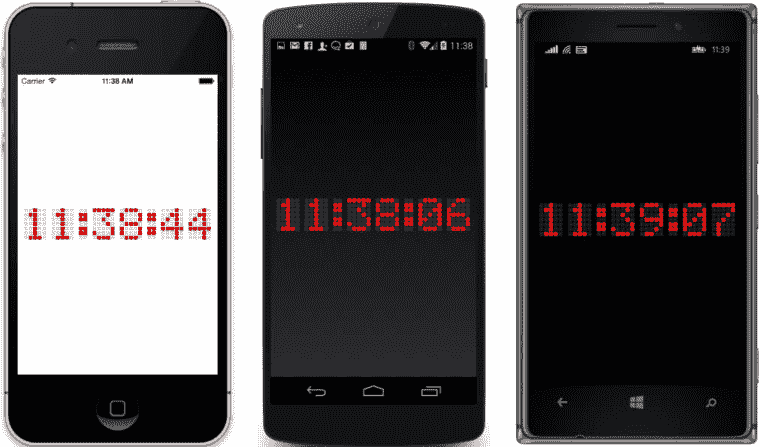

当然，越大越好，所以你可能会想把手机（或书）横过来，让内容大到可以从房间另一头看清：

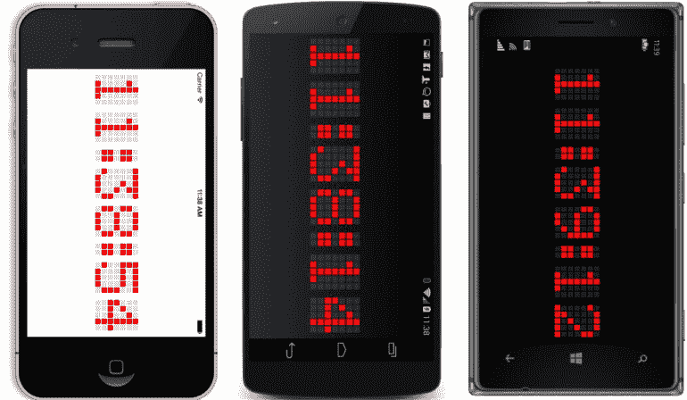

### 按比例使用 AbsoluteLayout

- None（等于 0）
- XProportional（1）
- YProportional（2）
- PositionProportional（3）
- WidthProportional（4）
- HeightProportional（8）
- SizeProportional（12）
- All（0xFFFFFFFF）

你可以通过对 AbsoluteLayout 的子元素应用附加的可绑定属性，通过以下静态方法设置比例标志：

```
AbsoluteLayout.SetLayoutFlags(child, flags);
```

或者，你可以使用 Add 方法的第三个参数来指定 Rectangle 边界：

```
absoluteLayout.Children.Add(child, rect, flags);
```

例如，如果使用 SizeProportional 标志，并将子元素的宽度设置为 0.25、高度设置为 0.10，则该子元素将占 AbsoluteLayout 宽度的 ¼ 和高度的 1/10。

PositionProportional 标志与此类似，但它会考虑子元素的大小：位置 (0, 0) 将子元素放在左上角，位置 (1, 1) 将子元素放在右下角，位置 (0.5, 0.5) 将子元素在 AbsoluteLayout 内居中。

让我们改写 DotMatrixClock 程序以使用此功能，并将其命名为 ProportionalDotMatrixClock。程序的大部分内容保持不变。AbsoluteLayout 对象仍然需要保存为字段，但冒号的 BoxView 对象数组可以去掉。所有的定位和调整大小现在都在构造函数中基于一个假定纵横比为 41:7 的 AbsoluteLayout 执行，该比例涵盖了 41 个 BoxView 宽度和 7 个 BoxView 高度。

```
class ProportionalDotMatrixClockPage : ContentPage
{
    ...
    AbsoluteLayout absoluteLayout;
    // Box views for 6 digits, 7 rows, 5 columns.
    BoxView[,] digitBoxViews = new BoxView[6, 7, 5];
    public ProportionalDotMatrixClockPage()
    {
        // Everything goes in the AbsoluteLayout.
        absoluteLayout = new AbsoluteLayout
        {
            VerticalOptions = LayoutOptions.Center
        };
        // BoxView dot dimensions.
        const double height = 0.85 / vertDots;
        const double width = 0.85 / horzDots;
        // Create and assemble the BoxViews.
        double xIncrement = 1.0 / (horzDots - 1);
        double yIncrement = 1.0 / (vertDots - 1);
        double x = 0;
        for (int digit = 0; digit < 6; digit++)
        {
            for (int col = 0; col < 5; col++)
            {
                double y = 0;
                for (int row = 0; row < 7; row++)
                {
                    // Create the digit BoxView and add to layout.
                    BoxView boxView = new BoxView();
                    digitBoxViews[digit, row, col] = boxView;
```


```
absoluteLayout.Children.Add(boxView,
                            new Rectangle(x, y, width, height),
                            AbsoluteLayoutFlags.All);

y += yIncrement;
}
x += xIncrement;
}
x += xIncrement;

// Colons between the hours, minutes, and seconds.
if (digit == 1 || digit == 3)
{
    int colon = digit / 2;

    for (int col = 0; col < 2; col++)
    {
        double y = 0;

        for (int row = 0; row < 7; row++)
        {
            // Create the BoxView and set the color.
            absoluteLayout.Children.Add(
                new BoxView
                {
                    Color = colonPattern[row, col] == 1 ?
                            colorOn : colorOff
                },
                new Rectangle(x, y, width, height),
                AbsoluteLayoutFlags.All);

            y += yIncrement;
        }
        x += xIncrement;
    }
    x += xIncrement;
}

// Set the page content to the AbsoluteLayout.
this.Padding = new Thickness(10, 0);
this.Content = absoluteLayout;

// Set two event handlers.
this.SizeChanged += OnPageSizeChanged;
Device.StartTimer(TimeSpan.FromSeconds(1), OnTimer);

// Initialize with a manual call to OnTimer.
OnTimer();
}

void OnPageSizeChanged(object sender, EventArgs args)
{
    // No chance a display will have an aspect ratio > 41:7
    absoluteLayout.HeightRequest = vertDots * this.Width / horzDots;
}
```

}
...
}

现在 SizeChanged 处理程序变成了一个单一语句。AbsoluteLayout 会自动水平拉伸以填充页面的宽度（减去内边距），因此 HeightRequest 实际上只是设置纵横比。

为了定位每个 BoxView，构造函数按如下方式计算比例的 xIncrement 和 yIncrement 值：

```
double xIncrement = 1.0 / (horzDots - 1);
double yIncrement = 1.0 / (vertDots - 1);
```

如果 AbsoluteLayout 的工作方式略有不同——如果在使用比例定位时它不考虑子元素的大小——那么这些分母将是 horzDots（设为 41）和 vertDots（设为 7），而 41 个 BoxView 的水平位置将从 0 / 41 到 40 / 41。然而，由于 AbsoluteLayout 会考虑大小，最右边的 BoxView 必须具有 1 的水平位置，这意味着水平位置必须从 0 / 40 到 40 / 40。

然而，每个 BoxView 的大小是基于宽度为 41 和高度为 7 的：

```
const double height = 0.85 / vertDots;
const double width = 0.85 / horzDots;
```

该程序在功能上与未使用比例定位和大小的程序相同，但除了 AbsoluteLayout 本身的高度外，所有重新计算都是自动化的。

该程序具有更简单的事件处理和更少的“活动部件”。从这个角度来看，AbsoluteLayout 的这个特性类似于数据绑定，这将在下一章中更深入地探讨。

## 交互式界面

许多 Xamarin.Forms 视图是交互式的，并响应触摸手势——点击和拖动——其中一些还读取键盘输入。

这些交互式视图融合了用户和程序员都熟悉的范式甚至名称：用户可以使用 `Button` 触发命令，使用 `Slider` 和 `Stepper` 从一系列值中指定一个数字，使用 `Entry` 和 `Editor` 从手机键盘输入文本，并使用 `Picker`、`ListView` 和 `TableView` 从集合中选择项目。

本章专门用于演示其中几个交互式视图的使用。你已经见过 `Entry` 和 `Editor`，而对各种集合视图的详细介绍要等到预览版以外的章节才会出现，但本章探讨了几种流行的交互式视图。在此过程中，本章更深入地介绍了数据绑定，并介绍了功能强大的 `Grid` 布局。

## 视图概览

Xamarin.Forms 的初始版本包含 19 个可实例化的类，它们派生自 `View` 但不派生自 `Layout`。你在前几章中已经见过其中七个类：`Label`、`BoxView`、`Button`、`Entry`、`Editor`、`ListView` 和 `Image`。

七个视图（包括两个你已经见过的）允许用户选择或与基本 .NET 和 C# 数据类型交互：

| 数据类型 | 视图 |
|---|---|
| `Double` / `double` | `Slider`、`Stepper` |
| `String` / `string` | `Entry`、`Editor` |
| `Boolean` / `bool` | `Switch` |
| `DateTime` | `DatePicker`、`TimePicker` |

本章的大部分重点都放在这些视图上。尚未讨论的剩余视图有：

- `SearchBar`，一个单行文本输入，带有一个专门用于启动搜索的按钮。
- `WebView`，用于显示网页或 HTML。

```
}

void OnSliderValueChanged(object sender, ValueChangedEventArgs args)
{
    sliderValueLabel.Text = args.NewValue.ToString();
}

...

}
```

事件处理程序的第一个参数是触发事件的对象，在本例中为 `Slider`，第二个参数提供有关此事件的更多信息。`ValueChangedEventArgs` 具有两个类型为 double 的属性，名为 `OldValue` 和 `NewValue`。处理程序只是将 `NewValue` 转换为字符串并将其设置为 `Label` 的 `Text` 属性。

`Stepper` 具有与 `Slider` 相同的属性，但增加了 `Increment` 属性，其类型也是 double。只是为了多样性，`Stepper` 的 `ValueChanged` 处理程序是一个本地 lambda 函数：

```
class SliderStepperSwitchPage : ContentPage
{
    Label sliderValueLabel, stepperValueLabel, switchToggledLabel;

    public SliderStepperSwitchPage()
    {
        ...

        // Create a Stepper and set event handler.
        Stepper stepper = new Stepper
        {
            VerticalOptions = LayoutOptions.EndAndExpand,
            HorizontalOptions = LayoutOptions.Center
        };
        stepper.ValueChanged +=
            (object sender, ValueChangedEventArgs args) =>
            {
                stepperValueLabel.Text = args.NewValue.ToString();
            };

        // Create a label to display the Stepper value.
        stepperValueLabel = new Label
        {
            Font = Font.SystemFontOfSize(NamedSize.Large),
            VerticalOptions = LayoutOptions.StartAndExpand,
            HorizontalOptions = LayoutOptions.Center
        };

        ...
    }
}
```

由于此事件处理程序是构造函数本地的，因此不需要将 `stepperValueLabel` 保存为字段，但如果不保存，你需要将 lambda 函数的定义移动到 `Label` 定义之后。

`Switch` 视图有两个状态：开和关（或表示是和否，或 true 和 false，或你想怎么理解都可以）。`Switch` 使用名为 `IsToggled` 的 `bool` 类型属性指示当前状态，并触发 `Toggled` 事件以指示该属性的变化。你可能倾向于给 `Switch` 视图命名为 `switch`，但那是 C# 关键字，所以你需要选择其他名称：

```
class SliderStepperSwitchPage : ContentPage
{
    Label sliderValueLabel, stepperValueLabel, switchToggledLabel;

    public SliderStepperSwitchPage()
    {
        ...

        // Create a Switch and set event handler.
        Switch switcher = new Switch
        {
            VerticalOptions = LayoutOptions.EndAndExpand,
            HorizontalOptions = LayoutOptions.Center
        };
        switcher.Toggled += OnSwitcherToggled;

        // Create a Label to display the Switch value.
        switchToggledLabel = new Label
        {
            Font = Font.SystemFontOfSize(NamedSize.Large),
            VerticalOptions = LayoutOptions.StartAndExpand,
            HorizontalOptions = LayoutOptions.Center
        };

        ...
    }

    ...

    void OnSwitcherToggled(object sender, ToggledEventArgs args)
    {
        Switch switcher = (Switch)sender;
        switchToggledLabel.Text = switcher.IsToggled.ToString();
    }
}
```

尽管 `ToggledEventArgs` 具有类型为 `bool` 的 `Value` 属性，表示 `Switch` 的新状态，但事件处理程序选择将第一个参数强制转换为 `Switch` 对象并获取


value from the IsToggled property. That's valid as well.

The constructor concludes by assembling all six views in a StackLayout:

```
public SliderStepperSwitchPage()
{
    ...
    // Put them all in a StackLayout.
    this.Content = new StackLayout
    {
        Children =
        {
            slider,
            sliderValueLabel,
            stepper,
            stepperValueLabel,
            switcher,
            switchToggledLabel,
        }
    };
}
```

The VerticalOptions setting of each view has been set to visually group each interactive view with its corresponding Label. But when the program first starts up, the Text property of each Label is null, and hence the Label has zero height. As soon as you begin manipulating the views, the Text properties are set from the event handlers, and the views will shift vertical position slightly. As you can see, these three views have very different appearances on the three platforms, but they are functionally pretty much the same:

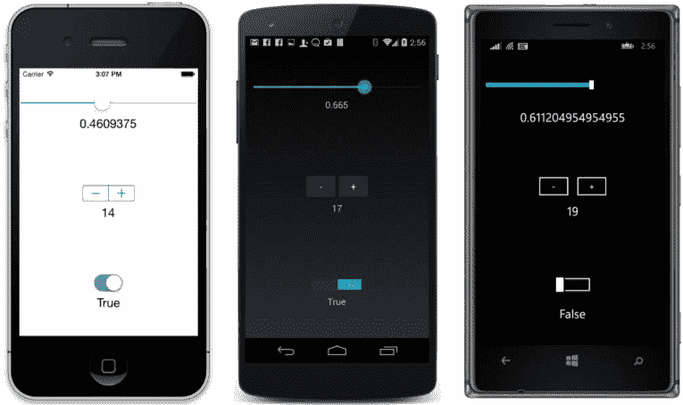

A little experimentation reveals that the default Minimum and Maximum values are 0 and 1 for the Slider, but 0 and 100 for the Stepper, and of course you can change them. The Stepper has a default Increment value of 1.

If you don’t like the many decimal places displayed for the Slider on the iPhone and Windows Phone, you can easily fix that with a formatting string appropriate for double:

```
sliderValueLabel.Text = args.NewValue.ToString("F2");
```

Suppose you want to initialize the Value property of the Slider after instantiating it:

```
Slider slider = new Slider
{
    VerticalOptions = LayoutOptions.EndAndExpand
};
slider.ValueChanged += OnSliderValueChanged;
slider.Value = 0.5;
```

This code will cause a NullReferenceException to be raised. The problem is that setting the Value property triggers a call to the OnSliderValueChanged handler, which references a Label that hasn’t been created yet. You can avoid this problem by setting the Value property before attaching the event handler, or after instantiating the Label. Or, the event handler can check if the Label object is not null before attempting to set its Text property.

Instead of setting the Value property of Slider to 0.5, try this:

```
slider.Value = 0;
```

This statement will not result in a NullReferenceException because it will not trigger the ValueChanged event to be fired. The event is called ValueChanged and not ValueSet for a reason: The event is not fired unless the Value property has actually changed.

If you want the Label views to display the initial values at program startup, your code can set the Text properties to the appropriate values when the Label views are created. Or, you can “fake” an event by calling the event handlers directly, perhaps at the end of the constructor after everything has been created.

Or, you can use data bindings.

## Data binding

The SliderStepperSwitch program sets event handlers so that the Text property of a Label tracks the value of the interactive view. Tasks such as this can be automated with the same data-binding techniques you saw in the NoteTaker programs in Chapter 3 and 4.

As you learned at that time, data bindings link the value of a property of one object with the value of a property of another object to keep the values synchronized. These two objects are distinguished as

a source and a target. In the simplest case, the source is an object with a property that changes value, and the target is another object with a property that is changed as a result. However, the relationship between source and target can be reversed: Changes in the target can update the source, or the source and target can update each other.

A data-binding target object must derive from BindableObject and the target property must be backed by a bindable property. This restriction is imposed by the data-binding API. A data-binding source should implement the INotifyPropertyChanged interface. This is the standard way for a data-binding source to indicate when its property has changed.

In real-world programming, probably the most common forms of data bindings are similar to those illustrated by the NoteTaker programs: The data-binding target is a view, such as the Entry and Editor views. All user-interface classes in Xamarin.Forms derive from BindableObject and many of their properties are backed by bindable properties. Typically, the data-binding source is a data object that implements INotifyPropertyChanged.

However, BindableObject also implements INotifyPropertyChanged, which means that Xamarin.Forms views can be data-binding sources as well as targets. Data bindings between views on the same page are sometimes called view-to-view bindings.

Suppose a view named sourceView has a property named SourceProp. Suppose also that targetView is an instance of the GreatView class that defines a property named TargetProp backed by a BindableProperty named GreatView.TargetPropProperty. You can define a data binding to keep the SourceProp property updated with the value of the TargetProp property with two statements. The first statement associates the two objects by setting the BindingContext property of the target object to the source object:

```
targetView.BindingContext = sourceView;
```

This BindingContext property is defined by BindableObject. The second statement involves the SetBinding method (also defined by BindableObject), which links the two properties:

```
targetView.SetBinding(GreatView.TargetPropProperty, "SourceProp");
```

BindableObject defines one SetBinding method, and that’s supplemented by two additional SetBinding extension methods defined in the BindableObjectExtensions class. The SetBinding call shown in the example above is defined in that extensions class. You’ll see more complex alternatives later in this chapter.

You can pretty much guess what’s going on behind the scenes: A handler for the PropertyChanged event is attached to sourceView, and that handler looks for a property named "SourceProp". When that property changes, the event handler can use .NET reflection to obtain the value of sourceView.SourceProp and then call SetValue on the targetView object with an argument of GreatView.TargetPropProperty.

The SliderStepperSwitchBindings program features a page constructor that begins by assembling the now familiar Slider, Stepper, Switch, and Label views but does not save any objects as fields

```
targetView.SetBinding (GreatView.TargetPropProperty, binding);
```

You’ll see examples at the end of this chapter.

A special facility exists for data conversion when the target property is of type string, which is the case for the labels. You can direct the binding logic to use String.Format for this conversion by simply supplying a standard .NET formatting string. Here are the three bindings for the labels. The first one doesn’t require setting the BindingContext because it’s already set:

```
sliderValueLabel.SetBinding (Label.TextProperty,
    new Binding ("Value", BindingMode.Default, null, null,
    "The Slider value is {0:F2}"));
```

```
stepperValueLabel.BindingContext = stepper;
stepperValueLabel.SetBinding (Label.TextProperty,
    new Binding ("Value", BindingMode.Default, null, null,
    "The Stepper value is {0}"));
```

```
switchToggledLabel.BindingContext = switcher;
switchToggledLabel.SetBinding (Label.TextProperty,
    new Binding ("IsToggled", BindingMode.Default, null, null,
    "The Switch is toggled {0}"));
```

When you run this program you’ll notice a big change in the labels compared with the earlier programs: All three Label views display valid text before the views are manipulated (except that you won’t be able to see the one with the Opacity of zero). When a data binding is first defined, it accesses the value of the source property and sets the value to the target.

The three screenshots show this enhanced text and the translucency of the first label:

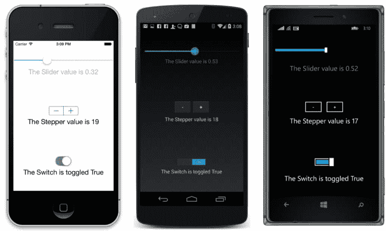


严格来说，数据绑定并不是 Xamarin.Forms 接口的必要组成部分。你可以用显式的事件处理器完成数据绑定能做的所有事情。但数据绑定可以为你安装和管理这些事件处理器，因此它允许你编写事件处理更少的代码，看起来“活动部件”也更少。

数据绑定定义中容易出现错误的一个元素是源属性名，你用文本字符串来表示。Visual Studio 和 Xamarin Studio 不会在你拼写错误时发出警告，但绑定将无法工作，而且问题可能很难找到。

你可以用 SetBinding 方法的泛型形式来避免拼写错误。前面你看到过将 Slider 的 Value 属性绑定到 Label 的 Opacity 属性的绑定，像这样定义：

```csharp
sliderValueLabel.SetBinding (Label.OpacityProperty, "Value");
```

你也可以改用这种形式：

```csharp
sliderValueLabel.SetBinding<Slider> (Label.OpacityProperty, src => src.Value);
```

泛型参数是 Slider，即源对象的类型，而源 Value 属性则以访问该属性的 lambda 表达式形式表示。该方法使用 .NET 反射来获取字符串属性名。

你也可以对 SetBinding 方法的较长版本做类似处理。下面这条语句将 Label 的 Text 属性绑定到 Slider 的 Value 属性：

```csharp
sliderValueLabel.SetBinding (Label.TextProperty,
    new Binding ("Value", BindingMode.Default, null, null,
        "The Slider value is {0:F2}"));
```

与其使用 Binding 构造函数作为第二个参数，你可以使用静态（且泛型）的 Binding.Create 方法：

```csharp
sliderValueLabel.SetBinding (Label.TextProperty,
    Binding.Create<Slider> (src => src.Value, BindingMode.Default, null, null,
        "The Slider value is {0:F2}"));
```

如果你同时也在开发定义源属性的代码，这些替代形式是更受青睐的，因为你可以重命名这些源属性，而不必担心破坏定义数据绑定的代码。

下面是 WhatSize 程序的一个新版本，它同时使用了 Binding 创建的两种形式（这种做法在现实生活中可能会让日后需要维护该程序的人对这种看似不一致的意图感到困惑）：

```csharp
class WhatSizeBindingsPage : ContentPage
{
    public WhatSizeBindingsPage()
    {
        Font font = Font.SystemFontOfSize(NamedSize.Large);

        // Create Label views for displaying page width and height.
        Label widthLabel = new Label
        {
            Font = font
        };

        Label heightLabel = new Label
        {
            Font = font
        };

        // Define bindings on Labels.
        widthLabel.BindingContext = this;
        widthLabel.SetBinding (Label.TextProperty,
            Binding.Create<ContentPage> (src => src.Width,
                BindingMode.OneWay,
                null, null, "{0:F0}"));

        heightLabel.BindingContext = this;
        heightLabel.SetBinding (Label.TextProperty,
            new Binding ("Height",
                BindingMode.OneWay,
                null, null, "{0:F0}"));

        // Assemble a horizontal StackLayout with the three labels.
        this.Content = new StackLayout
        {
            Orientation = StackOrientation.Horizontal,
            Spacing = 0,
            HorizontalOptions = LayoutOptions.Center,
            VerticalOptions = LayoutOptions.Center,
            Children =
            {
                widthLabel,
                new Label
                {
                    Text = " x ",
                    Font = font
                },
                heightLabel
            }
        };
    }
}
```

注意使用了没有间距的水平 StackLayout 来视觉上拼接三段文本，使其看起来像单行。

当你将手机在纵向和横向之间切换时，数值完全通过数据绑定更新。

## 日期和时间选择

虽然 DateTime.Now 属性的信息可以用多种方式显示，但有时应用程序需要允许用户选择日期或时间。为此目的，Xamarin.Forms 包含 DatePicker 和 TimePicker 视图。

两者非常相似。这两个视图显示日期或时间，点击视图会调用平台特定的日期或时间选择器。在 iPhone 和 Android 上，这些选择器占据屏幕的一部分；在 Windows Phone 上，它占据整个屏幕。然后用户输入新的日期或时间并指示完成。

DatePicker 有三个类型为 DateTime 的属性：

- MinimumDate，初始化为 1900 年 1 月 1 日
- MaximumDate，初始化为 2100 年 12 月 31 日
- Date，初始化为 DateTime.Today

程序可以按需设置这些属性。Date 属性也反映用户的选择。

DatePicker 使用正常的 ToString 方法显示所选日期，但你可以将视图的 Format 属性设置为自定义的 .NET 格式字符串。初始值为 "d"——“短日期”格式。

下面是一个程序，让你选择两个日期并计算它们之间的天数：

```csharp
class DaysBetweenDatesPage : ContentPage
{
    static readonly string dateFormat = "D";
    DatePicker fromDatePicker, toDatePicker;
    Label resultLabel;

    public DaysBetweenDatesPage()
    {
        // Create DatePicker views.
        fromDatePicker = new DatePicker
        {
            Format = dateFormat,
            HorizontalOptions = LayoutOptions.Center
        };
        fromDatePicker.DateSelected += OnDateSelected;

        toDatePicker = new DatePicker
        {
            Format = dateFormat,
            HorizontalOptions = LayoutOptions.Center
        };
        toDatePicker.DateSelected += OnDateSelected;
```

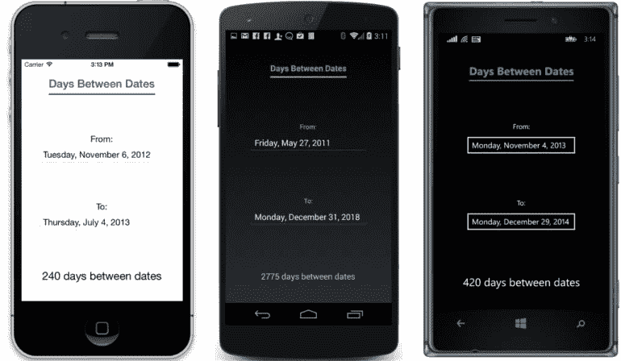

TimePicker 比 DatePicker 简单一些。它只定义 Time 和 Format 属性，且不包含指示新 Time 值的事件。如果你需要收到通知，可以为 PropertyChanged 事件安装处理器。

## 自定义视图：单选按钮

你可以在 Xamarin.Forms 中创建自定义视图。后面的章节（不在预览版中）将向你展示如何通过为每个平台编写特殊的类，即渲染器，来创建自定义视图。

然而，也可以在 Xamarin.Forms 中直接创建自定义视图。一种方法是派生一个 ContentView 类，并将其 Content 属性设置为 StackLayout（例如），然后在上面组装一个或多个视图。你可能还需要定义一两个属性，以及可能的一些事件，但你会希望利用 BindableObject 和 BindableProperty 类建立的现有基础设施。

让我们尝试创建一个经典的单选按钮。单选按钮的名字来源于老式汽车中的收音机选台按钮。这些收音机有一排按钮，但一次只能按下其中一个，所以按下按钮会使之前按下的按钮弹起，给玩收音机的孩子带来极大的乐趣。

在功能上，单选按钮与 Xamarin.Forms Switch 类似，因为它在开和关状态之间切换。然而，单选按钮总是以组出现。单选按钮是互斥的，因此选择任意一个单选按钮会自动取消选中其他所有按钮。

下面显示的自定义 RadioButton 视图定义了三个属性，尽管还可以定义更多

这两个 Label 视图有 Text 属性，但 RadioButton 派生的 ContentView 没有 Text 属性，因此 RadioButton 必须定义一个。此外，为了允许数据绑定和其他 Xamarin.Forms 功能，RadioButton 还必须定义一个名为 TextProperty 的 BindableProperty 对象。

这个 TextProperty 是一个定义为 public 且 static 的字段，它还应定义为 readonly，这意味着它必须在字段定义或静态构造函数中设置。BindableProperty 类有静态 Create 方法来创建 BindableProperty 对象：

```csharp
class RadioButton : ContentView
{
    ...
    public static readonly BindableProperty TextProperty =
        BindableProperty.Create("Text",                 // property name
            typeof(string),                              // property type
            typeof(RadioButton),                         // this type
            null);                                       // initial value
    ...
}
```

这是一个相对简单的可绑定属性定义。提供了属性名和类型，以及定义属性的类类型和初始值。对 BindableProperty.Create 方法的更广泛使用允许你指定在属性即将更改时、更改后调用的方法，以及用于验证和强制转换。

正常的 Text 属性随后以非常标准的方式引用可绑定属性：

```csharp
class RadioButton : ContentView
{
    ...
    public string Text
    {
        set { SetValue(TextProperty, value); }
        get { return (string)GetValue(TextProperty); }
    }
    ...
}
```

你会注意到 BindableProperty.Create 方法需要属性名作为文本字符串，如果你拼写错误，属性将无法正常工作，而且很难追踪问题。因此，可用的 Create 方法的泛型替代方案会为你推导属性名和类型。RadioButton 使用其中一种方法来定义 Font 属性：

```csharp
class RadioButton : ContentView
{
    ...
    // Define the Font bindable property and property.
    public static readonly BindableProperty FontProperty =
```


```csharp
BindableProperty.Create<RadioButton, Font>
    (radio => radio.Font,                 // property
        Font.SystemFontOfSize(NamedSize.Large));   // initial value

public Font Font
{
    set { SetValue(FontProperty, value); }
    get { return (Font)GetValue(FontProperty); }
}
…
}
```

Create 方法使用反射来获取 Font 属性名称的字符串表示。Font 属性被初始化为 Large 大小，因为 Medium 大小无法提供足够的触控目标。

现在 RadioButton 具有 Text 和 Font 属性，但这些属性的值必须设置在 RadioButton 在其构造函数中创建的两个 Label 视图上。这可以通过为刚刚定义的 Text 和 Font 属性设置属性更改处理程序来实现，但数据绑定提供了一种更简单的方法。在以下在 RadioButton 构造函数中定义的数据绑定中，目标是 Label 视图，源是 RadioButton 本身：

```csharp
class RadioButton : ContentView
{
    …
    public RadioButton()
    {
        …
        // Set the bindings.
        checkLabel.BindingContext = this;
        checkLabel.SetBinding(Label.FontProperty, "Font");

        textLabel.BindingContext = this;
        textLabel.SetBinding(Label.TextProperty, "Text");
        textLabel.SetBinding(Label.FontProperty, "Font");
        …
    }
    …
}
```

RadioButton 还需要一个 Toggled 事件和一个由 IsToggledProperty 可绑定属性支持的 IsToggled 属性。此 BindableProperty 对象的定义包含对属性更改时调用的方法的引用：

```csharp
class RadioButton : ContentView
{
    …
    // Define the Toggled event, IsToggled bindable property and property.
    public event EventHandler<ToggledEventArgs> Toggled;

    public static readonly BindableProperty IsToggledProperty =
        BindableProperty.Create("IsToggled",
            typeof(bool),      // property type
            typeof(RadioButton),  // this type
            false,                // initial value
            BindingMode.TwoWay,   // default binding
            null,                 // validation
            OnIsToggledPropertyChanged);

    public bool IsToggled
    {
        get { return (bool)GetValue(IsToggledProperty); }
        set { SetValue(IsToggledProperty, value); }
    }
    ...
}
```

在静态 BindableProperty.Create 方法中引用的 OnIsToggledPropertyChanged 方法会在 IsToggled 属性更改时被调用。然而，由于该方法在静态字段定义中被引用，因此该方法本身也必须是静态的。它的签名如下：

```csharp
static void OnIsToggledPropertyChanged(BindableObject sender,
    object oldValue, object newValue)
{
    ...
}
```

每当 RadioButton 实例的 IsToggled 属性更改时，就会调用此方法。然而，此方法时静态的！如果存在多个 RadioButton 实例（这是很正常的），此方法如何知道哪个 RadioButton 被切换了？

很简单：第一个参数是其 IsToggled 属性已更改的实际 RadioButton 实例，而第二个和第三个参数表示旧值和新值。这意味着你可以安全地将第一个参数强制转换为 RadioButton 类型对象：

```csharp
static void OnIsToggledPropertyChanged(BindableObject sender,
    object oldValue, object newValue)
{
    // Get the object whose property is changing.
    RadioButton radioButton = (RadioButton)sender;
    ...
}
```

然后你可以继续进行。

但通常很方便让此静态方法调用实例方法，并让实例方法完成所有工作。这就是 RadioButton 中所做的方式。此方法基本上必须执行三项工作：

- 设置适当的字符以指示选中或未选中状态。
- 触发 IsToggled 事件。
- 如果 IsToggled 为 true，则将所有 RadioButton 兄弟的 IsToggled 设置为 false。

以下是 IsToggled 属性更改处理程序的静态和实例版本：

```csharp
class RadioButton : ContentView
{
    // Property changed handler for the IsToggled property.
    static void OnIsToggledPropertyChanged(BindableObject sender,
                                            object oldValue, object newValue)
    {
        // Get the object whose property is changing.
        RadioButton radioButton = (RadioButton)sender;
        radioButton.OnIsToggledPropertyChanged((bool)oldValue, (bool)newValue);
    }

    void OnIsToggledPropertyChanged(bool oldValue, bool newValue)
    {
        this.checkLabel.Text = newValue ? checkOn : checkOff;

        // Fire the event.
        if (this.Toggled != null)
        {
            this.Toggled(this, new ToggledEventArgs(this.IsToggled));
        }

        // If toggled on, toggle off all siblings.
        if (this.IsToggled)
        {
            Layout<View> parent = this.ParentView as Layout<View>;

            if (parent != null)
            {
                foreach (View view in parent.Children)
                {
                    if (view is RadioButton && view != this)
                    {
                        ((RadioButton)view).IsToggled = false;
                    }
                }
            }
        }
    }
}
```

只剩下一件缺失的事：RadioButton 尚未响应触摸。每当 RadioButton 被轻触时，它必须将其 IsToggled 属性设置为 true。

Xamarin.Forms 视图可以通过 GestureRecognizer 对象获取触摸输入。对于轻触，你创建一个 TapGestureRecognizer 类型的对象，并提供一个在轻触发生时调用的回调方法。（这是目前唯一可用的 GestureRecognizer 类型。）然后将此 TapGestureRecognizer 添加到视图的 GestureRecognizers 集合中。

```csharp
};
radioButton.Toggled += OnRadioButtonToggled;
radioStack.Children.Add(radioButton);

radioButton = new RadioButton
{
    Text = "Blue",
    StyleId = "#0000FF"
};
radioButton.Toggled += OnRadioButtonToggled;
radioStack.Children.Add(radioButton);

// A BoxView to display the selected color.
boxView = new BoxView
{
    VerticalOptions = LayoutOptions.FillAndExpand
};

this.Padding = new Thickness(0, Device.OnPlatform(20, 0, 0), 0, 0);

// Build the page.
this.Content = new StackLayout
{
    Children =
    {
        new Frame
        {
            HorizontalOptions = LayoutOptions.Center,
            Content = radioStack
        },
        boxView
    }
};

// Initialize.
((RadioButton)radioStack.Children[0]).IsToggled = true;
}

void OnRadioButtonToggled(object sender, ToggledEventArgs args)
{
    if (args.Value)
    {
        // Set the color from the StyleId string.
        boxView.Color = Color.FromHex(((RadioButton)sender).StyleId);
    }
}
}
```

请注意，每个 RadioButton 的 StyleId 属性都被设置为颜色的十六进制字符串表示形式。OnRadioButtonToggled 事件处理程序只需将其传递给 Color.FromHex 方法以设置 BoxView 的新颜色。（这是一种相当不寻常的 StyleId 用法。如果想将 Color 值等信息与视图一起存储，最好从视图派生并添加一个简单类型的读写属性。）

```csharp
public static void SetRadioState(this View view, bool isToggled)
{
    // Check if the property is actually changing.
    if (instances[view].toggledState != isToggled)
    {
        // Set the new value.
        instances[view].toggledState = isToggled;

        // Fire the handler.
        instances[view].toggledHandler(view);

        // If being toggled, untoggle all the siblings.
        if (isToggled)
        {
            Layout<View> parent = view.ParentView as Layout<View>;

            if (parent != null)
            {
                foreach (View sibling in parent.Children)
                {
                    if (sibling != view && instances.ContainsKey(sibling))
                    {
                        sibling.SetRadioState(false);
                    }
                }
            }
        }
    }
}

public static bool GetRadioState(this View view)
{
    return instances[view].toggledState;
}
```

你可以在任何 View 派生类上调用 AttachRadioToggler 并提供一个更改处理程序。SetRadioState 和 GetRadioState 扩展方法是必要的，因为不存在扩展属性。

作为对 toggledHandler 方法的调用的响应，程序可以以任何想要的方式更改 View。例如，如果你使用 Label 作为项目，可以更改字体或不透明度。你将在即将到来的 ColorScroll 程序中看到一个示例。

## Mastering the Grid

Grid 是一种强大的布局机制，它将子元素组织到行和列的单元格中。起初 Grid 看起来很像 HTML 表格，但表格用于展示目的，而 Grid 仅用于布局。例如，Grid 中没有标题的概念。


```csharp
HorizontalOptions = LayoutOptions.Center
};

// First row with Label and backspace Button.
displayLabel = new Label
{
    Text = "0",
    Font = Font.SystemFontOfSize(NamedSize.Large),
    XAlign = TextAlignment.End,
    YAlign = TextAlignment.Center
};
grid.Children.Add(displayLabel, 0, 2, 0, 1);

backspaceButton = new Button
{
    Text = "\u21E6",
    Font = Font.SystemFontOfSize(NamedSize.Large),
    BorderWidth = 1,
    IsEnabled = false
};
backspaceButton.Clicked += OnBackspaceButtonClicked;
grid.Children.Add(backspaceButton, 2, 0);

// Now do the 10 number keys.
for (int num = 0; num < 10; num++)
{
    Button numberButton = new Button
    {
        Text = num.ToString(),
        Font = Font.SystemFontOfSize(NamedSize.Large),
        StyleId = num.ToString(),
        BorderWidth = 1
    };
    numberButton.Clicked += OnNumberButtonClicked;

    int left = (num == 0) ? 0 : (num + 2) % 3;
    int right = (num == 0) ? 3 : left + 1;
    int top = (12 - num) / 3;
    int bottom = top + 1;
    grid.Children.Add(numberButton, left, right, top, bottom);
}

    this.Content = grid;
}
...
}
```

两个事件处理程序保持不变。

代码已大大简化，即使在计算 left、right、top 和 bottom 以创建自下而上的计算器键盘而不是自上而下的电话键盘时也是如此。之前的程序需要六个 StackLayout 实例；现在只有一个 Grid。

请注意，`HorizontalOptions` 和 `VerticalOptions` 是在 `Grid` 上设置的以将其居中显示在页面上，但这些属性未设置在任何子项上。`HorizontalOptions` 和 `VerticalOptions` 对 `Grid` 的子项**没有效果**，但 `XAlign` 和 `YAlign` 属性已设置在 `Label` 上以垂直居中文本并将其保持在右侧：

三个并排的屏幕截图显示 KeypadGrid 程序在 iPhone、Android 和 Windows Phone 上显示的数字键盘。

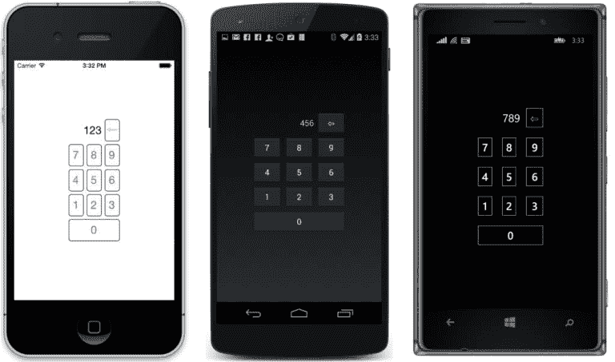

与垂直 `StackLayout` 中的水平 `StackLayout` 不同，`Grid` 已将按钮放置在整齐的直列中。

然而，它并不完全正确：在键盘上，你可能希望所有键的大小相同，但在该程序中它们并不相同。问题在 Windows Phone 上尤其明显：第三列比中间列更宽，因为每列的宽度基于该列中最宽的视图，而在默认的 Windows Phone 字体中，6 和 9 比其他数字更宽。

默认情况下，`Grid` 的列和行的大小基于子视图的大小。有两种替代方案：你可以为每列宽度或行高度指定设备无关单位中的特定大小。或者，你可以按比例在单元格之间分配空间。

对于这两种替代方案，你需要使用 `Grid` 定义的 `ColumnDefinitions` 和 `RowDefinitions` 属性。这些分别是 `ColumnDefinition` 和 `RowDefinition` 对象的集合，每个对象分别指示列宽或行高。

`ColumnDefinition` 有一个名为 `Width` 的属性，`RowDefinition` 有一个名为 `Height` 的属性，你将两者都设置为 `GridLength` 类型的<|message|>。你有三个选项，并且可以为 `Grid` 的每一列或每一行使用不同的选项：

- `Auto`：这是默认值。列宽或行高基于子宽度和高度。
- `Absolute`：设备无关单位中的列宽或行高。
- `Star`：类似于 HTML 表格中的星号（asterisk）选项，按比例分配空间。

如果没有对应特定列或行的 `ColumnDefinition` 或 `RowDefinition` 对象，则使用 `Auto`。

尝试在 `KeypadGridPage` 构造函数中在创建 `Grid` 之后任何时间插入此代码：

```csharp
for (int col = 0; col < 3; col++)
{
    grid.ColumnDefinitions.Add(new ColumnDefinition
    {
        Width = new GridLength(1, GridUnitType.Star)
    });
}
```

现在所有列的宽度都相同：

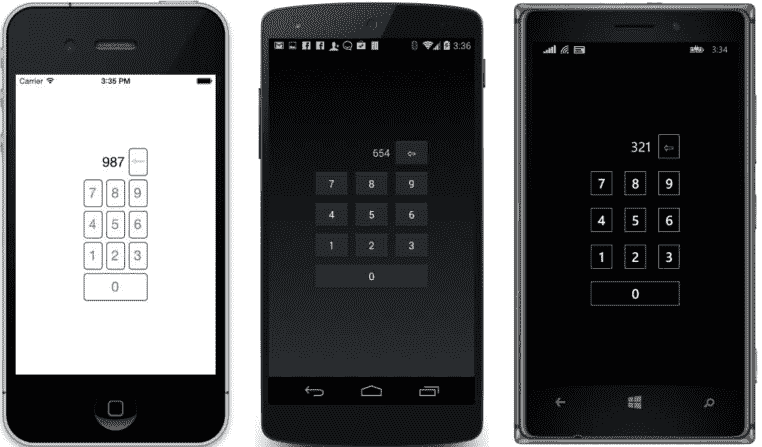

`Star` 选项根据 `GridLength` 的第一个参数按比例分配空间。在上面的示例中，三列的相对宽度都为 1，但如果你改为将其设置为 `(col + 1)`：

```csharp
for (int col = 0; col < 3; col++)
{
    grid.ColumnDefinitions.Add(new ColumnDefinition
    {
        Width = new GridLength(col + 1, GridUnitType.Star)
    });
}
```

那么第二列的宽度将是第一列的两倍，第三列的宽度将是三倍。

你可以用这种方式指定设备无关单位（例如 150）中的宽度或高度：

`new GridLength(150, GridUnitType.Absolute)`

或使用单参数构造函数：

`new GridLength(150)`

你可以使用以下方式将其设置为 Auto：

`new GridLength(1, GridUnitType.Auto)`

或使用静态属性：

`GridLength.Auto`

在布局过程中，Grid 首先汇总水平和垂直方向上的所有 Absolute 和 Auto 大小，然后在所有 Star 宽度和高度之间分配剩余空间。

可以创建一个单维度 Grid。AddHorizontal 和 AddVertical 方法将子项追加到行或列的末尾，这些方法也适用于 IEnumerable<View> 集合，例如数组。

## Grid 和附加绑定属性

尽管 Grid 为包含单元格索引的 Add 方法以及 AddHorizontal 和 AddVertical 方法重新定义了其 Children 属性，但你也可以使用常规的 Add 方法：

```csharp
grid.Children.Add (child);
```

乍一看这似乎不够，因为它不包含指示该子项的列和行的参数。但与 AbsoluteLayout 一样，Grid 定义了附加绑定属性，让你指定该信息。你可以使用这两个静态方法设置 Grid 子项的列和行：

```csharp
Grid.SetColumn (child, 2);
Grid.SetRow (child, 3);
```

Grid 还定义了静态 Grid.SetColumnSpan 和 Grid.SetRowSpan 方法。行和列跨度默认为 1。Grid 还定义了静态 Get 方法来获取当前值。与 AbsoluteLayout 类定义的静态方法一样，这些方法通过引用附加绑定属性来实现。Grid.SetColumn 和 Grid.SetRow 调用等同于在子视图对象上进行的以下调用：

```csharp
child.SetValue (Grid.ColumnProperty, 2);
child.SetValue (Grid.RowProperty, 3);
```

这就是静态属性的定义方式。

调用

```csharp
grid.Children.Add (child, 2, 3);
```

与调用以下内容没有区别：

```csharp
Grid.SetColumn (child, 2);
Grid.SetRow (child, 3);
grid.Children.Add (child);
```

快捷方法使用 Grid 定义的静态方法和 Add 调用实现。

在许多情况下，当你使用扩展的 Add 方法定义 Grid 内容时，你不需要使用这些静态方法或费心 Grid 附加绑定属性。然而，有时它们非常方便，可以在以后更改 Grid 内容的行和列。例如，在 Grid 中移动子项是适应页面方向变化的一种方式。

这里有一个名为 ColorScroll 的程序，它由一个“控制面板”组成，其中包含三个用作单选按钮的 Label 视图，以及三个用于选择颜色的带标签的 Slider 视图。产生的颜色由占据页面一半的 BoxView 显示。

在纵向模式下，控制面板位于底部，BoxView 位于顶部：

**ColorScroll** 还有另一种灵活性：它允许你使用滑块以十六进制 RGB 值、浮点 RGB 值或 HSL 值指定颜色。控制面板顶部三个 `Label` 视图使用前面显示的 `RadioExtensions` 类；未选中的项其 `Opacity` 属性设置为 0.5。`ColorScrollPage` 类中的许多字段——包括 `ColorMode` 枚举和三个标签数组——都存在于支持这三种颜色表示之间的切换：

```csharp
class ColorScrollPage : ContentPage
{
    Grid mainGrid;
    StackLayout controllersStack;
    BoxView boxView;
    Label[] labels = new Label[3];
    Slider[] sliders = new Slider[3];

    enum ColorMode
    {
        RgbHex,
        RgbFloat,
        Hsl
    }

    ColorMode currentColorMode = ColorMode.RgbHex;
    Color currentColor = Color.Aqua;
    bool ignoreSliderValueChanges;

    string[] rgbHexFormat = { "Red = {0:X2}", "Green = {0:X2}", "Blue = {0:X2}" };
    string[] rgbFloatFormat = { "Red = {0:F2}", "Green = {0:F2}", "Blue = {0:F2}" };
    string[] hslFormat = { "Hue = {0:F2}", "Saturation = {0:F2}", "Luminosity = {0:F2}" };
    ...
}
```

像往常一样，构造函数执行大部分布局。有两个 `Grid` 布局。名为 `mainGrid` 的一个是占据整个页面的 2 × 2 `Grid`；一个单元格包含带有所有用于控制颜色的视图的 `StackLayout`，包括一个带有三个单选按钮标签的三列 `Grid`。为了使其更突出，这个三列 `Grid` 的 `VerticalOptions` 属性设置为 `LayoutOptions.CenterAndExpand` 以使用所有额外的垂直空间。

```csharp
class ColorScrollPage : ContentPage
{
    ...

    public ColorScrollPage()
    {
        // Define a 2 x 2 Grid that will be modified for portrait
        // or landscape in SizeChanged handler.
        mainGrid = new Grid
        {
            ColumnDefinitions =
            {
                ...


controllersStack.Children.Add(radioGrid);

// 为三个颜色分量创建标签和滑块。
for (int component = 0; component < 3; component++)
{
    labels[component] = new Label
    {
        XAlign = TextAlignment.Center
    };
    controllersStack.Children.Add(labels[component]);

    // 为所有滑块设置相同的 ValueChanged 处理程序。
    sliders[component] = new Slider();
    sliders[component].ValueChanged += OnSliderValueChanged;
    controllersStack.Children.Add(sliders[component]);
}

// 构建页面。
this.Padding = new Thickness(0, Device.OnPlatform(20, 0, 0), 0, 0);
this.Content = mainGrid;

// 设置 SizeChanged 处理程序。
SizeChanged += OnPageSizeChanged;

// 初始化滑块值。
SetSlidersAndBindings();
}
...
}

页面的 SizeChanged 处理程序负责根据宽高比调整 mainGrid 的行和列定义，并将 BoxView 和包含控制面板的 StackLayout 放置在适当的单元格中。尽管其中一些设置无论方向如何都相同——并且列和行默认为零——但将它们全部定义和重新定义在一个地方可以使意图更清晰：

```
class ColorScrollPage : ContentPage
{
    ...
    void OnPageSizeChanged(object sender, EventArgs args)
    {
        // 竖屏模式。
        if (this.Height > this.Width)
        {
            // 调整列和行定义。
            mainGrid.ColumnDefinitions[0].Width = new GridLength(1, GridUnitType.Star);
            mainGrid.ColumnDefinitions[1].Width = new GridLength(0);
            mainGrid.RowDefinitions[0].Height = new GridLength(1, GridUnitType.Star);
            mainGrid.RowDefinitions[1].Height = GridLength.Auto;

```
```
// 设置 BoxView 和 StackLayout 的行和列。
Grid.SetColumn(boxView, 0);
Grid.SetRow(boxView, 0);

Grid.SetColumn(controllersStack, 0);
Grid.SetRow(controllersStack, 1);
}
// 横屏模式。
else
{
    // 调整列和行定义。
    mainGrid.ColumnDefinitions[0].Width = new GridLength(1, GridUnitType.Star);
    mainGrid.ColumnDefinitions[1].Width = new GridLength(1, GridUnitType.Star);
    mainGrid.RowDefinitions[0].Height = new GridLength(1, GridUnitType.Star);
    mainGrid.RowDefinitions[1].Height = new GridLength(0);

    // 设置 BoxView 和 StackLayout 的行和列。
    Grid.SetColumn(boxView, 0);
    Grid.SetRow(boxView, 0);

    Grid.SetColumn(controllersStack, 1);
    Grid.SetRow(controllersStack, 0);
}
}

...

}
```
```

充当单选按钮的三个 `Label` 视图的事件处理程序有两个任务：设置 `Label` 的 `Opacity` 以指示哪个被选中，以及设置新的颜色模式。然而，实际对滑块和标签进行所有更改的工作被委派给一个单独的方法：

```
```csharp
class ColorScrollPage : ContentPage
{
    ...

    void OnRadioLabelToggled(View view)
    {
        // 设置 Opacity 以指示切换状态。
        view.Opacity = view.GetRadioState() ? 1.0 : 0.5;

        // 可能更改当前颜色模式。
        if (view.GetRadioState())
        {
            ColorMode newColorMode =
                (ColorMode) Enum.Parse(typeof(ColorMode), view.StyleId);

            if (currentColorMode != newColorMode)
            {
                currentColorMode = newColorMode;
```
```
```
SetSlidersAndBindings ();
    }
  }
}
...
}
```

`SetSlidersAndBindings` 方法负责根据新的颜色模式设置所有 `Slider` 属性。例如，对于十六进制 RGB 模式，每个 `Slider` 的 Maximum 属性必须设置为 255。根据颜色模式，`Slider` 值本身必须基于当前颜色的 R、G、B 或 Hue、Saturation 和 Luminosity 属性来设置。

`SetSlidersAndBindings` 还负责从三个 `Slider` 视图的 `Value` 属性设置到标识这些滑块的三个 `Label` 视图的绑定。这些绑定使用定义为字段数组的格式字符串组。对于浮点 RGB 或 HSL 模式，格式规范为“F2”，对于十六进制 RGB 模式，格式规范为“X2。”

这就是问题所在。`Slider` 的 `Value` 属性的类型为 `double`，如果你尝试用“X2”格式化一个 `double`，将会引发异常。

在代码中，从 `double` 转换为 `int` 只是一个简单的强制转换。但在定义数据绑定时，你无法直接访问从源到目标传递的数据。那么该如何实现呢？

幸运的是，`Binding` 构造函数和 `Binding.Create` 方法都有一个类型为 `IValueConverter` 的参数，专门用于此目的。`IValueConverter` 是一个定义了 `Convert` 和 `ConvertBack` 两个方法的接口。你提供一个实现此接口的类来执行所需的转换。`Convert` 方法在属性值从源传递到目标时被调用。`ConvertBack` 方法仅在 `TwoWay` 或 `OneWayToSource` 绑定中起作用，用于将目标类型转换为源类型。

以下是将 double 转换为 int 的 `IValueConverter` 实现：

```
public class DoubleToIntegerConverter : IValueConverter
{
    public object Convert(object value, Type targetType,
                          object parameter, CultureInfo culture)
    {
        return (int)(double)value;
    }

    public object ConvertBack(object value, Type targetType,
                              object parameter, CultureInfo culture)
    {
        return (double)(int)value;
    }
}
```

尽管这无疑是最简单的 `IValueConverter` 实现之一，但它们通常并不复杂。在 `Convert` 中，`value` 参数是源的值，返回值传递给目标。你可以通过检查 `targetType` 参数来自定义该方法，该参数是目标属性的类型。你还可以从 `Binding` 构造函数或 `Binding.Create` 方法传递一个 `parameter`。你将在后续章节中看到更多示例。

`SetSlidersAndBindings` 方法在需要为绑定时实例化 `DoubleToIntConverter`。在实际程序中，程序生命周期内只需要一个 `DoubleToIntConverter` 实例，你可以将其作为字段实例化。

```
class ColorScrollPage : ContentPage
{
    …

    void SetSlidersAndBindings()
    {
        // 不要处理滑块的 ValueChange 事件！
        ignoreSliderValueChanges = true;

        double sliderMax = 1;
        string[] format = null;
        IValueConverter valueConverter = null;

        // 为颜色模式设置局部变量。
        switch (currentColorMode)
        {
            case ColorMode.RgbHex:
                sliderMax = 255;
                format = rgbHexFormat;
                valueConverter = new DoubleToIntegerConverter();
                break;

            case ColorMode.RgbFloat:
                format = rgbFloatFormat;
                break;

            case ColorMode.Hsl:
                format = hslFormat;
                break;
        }

        // 将标签绑定到滑块。
        for (int i = 0; i < 3; i++)
        {
            sliders[i].Maximum = sliderMax;
            labels[i].BindingContext = sliders[i];
            labels[i].SetBinding(Label.TextProperty,
                new Binding("Value", BindingMode.OneWay, valueConverter, null, format[i]));
        }

        // 现在设置滑块值。
        Color currentColor = this.currentColor;
```

## 免费电子书

从技术概述到特定主题的深入分析，从 Microsoft Press 获取 *免费* 电子书：

**www.microsoftvirtualacademy.com/ebooks**

以 PDF、EPUB 和/或 Kindle 的 Mobi 格式下载你的免费电子书。

在 Microsoft Virtual Academy 寻找其他优秀资源，在那里你可以学习新技能并借助专家提供的免费 Microsoft 培训推动职业发展。


## 既然你已经读完了这本书...

## 告诉我们你的想法！

这本书有用吗？
它教会了你想要学习的内容吗？
还有改进的空间吗？

请通过 http://aka.ms/tellpress 告诉我们

你的反馈会直接送达 Microsoft Press 的员工手中，我们会阅读每一条回复。提前感谢！


