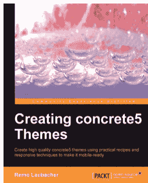
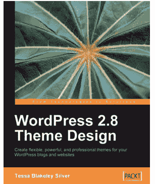
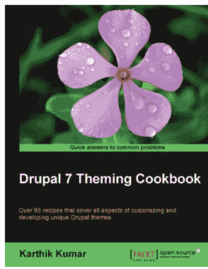
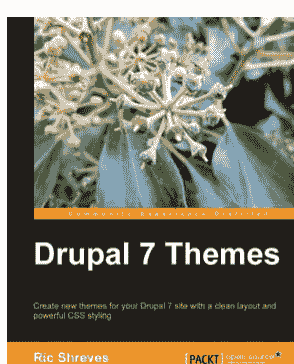

## 索引

### 符号
- blockcontent class 126

### A
学术版 10
活动菜单项，水平菜单 49
Additional CSS 样式：字段 137
地址：字段 145
全部打开菜单 56
区域 87
art-block Artisteer 类 129
文章，内容
  编写 62, 63
Artisteer
  关于 5
  高级技术 90
  CMS 系统 80-83
  内容准备，优点 110
  内容准备，缺点 110
  自定义 15-17
  脚注，移除 21, 22
  面向设计师 8
  面向业余爱好者 8
  面向网页开发人员和程序员 9
  面向网页开发公司 9
  Home & Academic 版 10
  HTML 模板 79
  Joomla! 模板位置，检查 91
  最新版本，下载 URL 10
  新建项目 11, 12
  程序，界面 13
  项目，预览 14
  项目，保存 18, 19
  建议工具 14
模板 10, 11
模板，导出 20, 21
试用版 10
试用版，转为完整版 11
URL 113
使用者 8, 10
与其它软件工具对比 6, 7
Artisteer 生成的类 133
art-nostyle 类 129
artx 文件 19
属性，网站
  关于 24
  颜色 27
  布局 27, 28
  单列布局 28
  页面，宽度 26
  三列布局 30
  双列布局 29
  排版 27

### B
背景按钮 32
背景，模板 38, 39
空白模板 31
块位置 53

### C
CMS
  关于 79
  内容准备，优点 110
  内容准备，缺点 110
CMS 系统
  关于 80-82
  使用 81
CMS 模板
与静态页面模板对比 83-86
CMS 模板元素
关于 88
帖子页脚图标 89, 90
帖子页眉图标 88
代码文件
下载，URL 114
着色选项，水平菜单 48
颜色，属性 27
颜色和字体选项卡 70
颜色，模板 38
配色主题
关于 27
油漆 74
列，模板 36-38
内容区域
关于 25
幻灯片 68, 69
内容，Joomla! 模板
导入 102, 103
内容布局按钮 60
内容准备
在 CMS 中，优点 110
在 CMS 中，缺点 110
内容准备
在 Artisteer 中，缺点 110
内容准备
在 Artisteer 中，缺点 110
内容，模板
关于 36-38, 57-59
文章，编写 62-64
配色主题 74
列 57, 58
图像，插入 64-66
布局，修改 62
行 57-59
幻灯片，插入 67
样式选项 60
排版 70-73
内容，WordPress 模板
导入 107, 108
控件按钮 92
CSS
添加，到项目 134-137
文件，修改 137-139
CSS 选项面板 134
CSS 前缀：字段 134
自定义 HTML 模块 101

### D
设计师 8
DIV 元素 126, 132
DotNetNuke 主题，WordPress 模板 109
Drupal 主题，WordPress 模板 108
示例文本
URL 63
动态网站 79, 80

### E
编辑字体集 71
编辑超链接选项 145, 146
编辑图像组 44
编辑形状组 43
编辑排版按钮 72
元素，网站
关于 24, 25
内容区域 25
页脚 26
页眉 25
水平菜单 25
特殊块 25
垂直菜单 25
点击展开 55
悬停展开菜单 56
重新加载展开 55
导出到字段 21
导出窗口 97

### F
填充按钮 76
flash 46
文件夹名称字段 21
字体集按钮 71
页脚
模板，位置 93, 95
页脚，元素 26
页脚，Joomla! 模板
修改 101
页脚，模板
关于 74
布局组 75
页脚，WordPress 模板 106
脚注
移除 21, 22

### G
galleryName 146

### H
页眉，模板
关于 25, 42
flash 46
图片 44
位置 92
形状 44, 45
幻灯片 70
标语 42, 43
标题 42, 43
业余爱好者 8
主页
属性 41
水平菜单
关于 25, 47, 48
活动菜单项 49
区域 48
着色选项 48
悬停菜单项 49
项目选项 48
非活动菜单项 49
水平菜单，Joomla! 模板 100
悬停菜单项 49
HTML 模板 79

### I
图像链接
在幻灯片中 113-117
图像选项窗口 66, 145, 146
图像
插入 64, 65
从模板导入内容按钮 102
包含 ARTX 项目选项 21, 98
包含内容选项 98, 107
内部工作表页脚 75
项目选项，水平菜单 48
项目 49

### J
Joomla! 安装程序
URL，用于下载新版本 95
Joomla! 模板
关于 95
区域 96
内容，导入 102, 103
导出 97, 98
页脚，修改 101
水平菜单 100
安装 98
安装，步骤 99
位置，检查 91
设置 99
标语 99
标题 99
垂直菜单 100

### L
布局
关于 27, 28
单列布局 28
三列布局 30
双列布局 29
布局按钮 32
布局，模板
关于 33
工作表选项窗口 34
工作表宽度按钮 34
长度和位置，布局组
填充按钮 76
内部工作表页脚 75
边距按钮 76
页面宽度，屏幕高度页脚 76
分隔符按钮 77
工作表宽度，屏幕高度页脚 76
长度选项 47
级别，菜单
关于 49, 50
多列 - Megamenu 51
多列 - Megamenu 扩展 52
无子菜单 - 无子项 50
单列 - 扩展 51
单列 - 多级 50

### M
许可证密钥：字段 11
Lightbox
添加 141-147
Lightbox 样式 66
Lokesh Dhakar
URL 141
边距按钮 76
边距选项 47
蒙版 46
菜单
级别 49
显示的页面，确定 56, 57
菜单区域，水平菜单 48
菜单块按钮 54, 56
菜单样式按钮 54
菜单，WordPress 模板 107
菜单，模板
水平菜单 47, 48
垂直菜单 52-54
模块
样式 122-127
模块类后缀字段 124
运动按钮 69
多列
Megamenu 51
Megamenu，扩展 52

### N
名称/URL 字段 41, 42
导航器按钮 69
下一步按钮 11
无块选项 53
无子菜单
无子项 50

### O
确定按钮 147
onClick 事件 115
单列
扩展 51
多级 50
单列布局 28
一级 55
选项按钮 105, 134

### P
页面
垂直菜单，切割 117-122
页面面板 88
页面，模板
关于 40
添加 40
主页，属性 41
名称/URL 字段 41, 42
属性 41, 42
移除 40
标题字段 42
页面宽度 26
油漆 74
面板模式
与窗口模式对比 36
非活动菜单项，水平菜单 49
路径：
字段 98
包含 ARTX 项目选项 98
包含内容选项 98
ZIP 归档选项 98
路径字段 21
图片
关于 44
排序 46
悬停弹出菜单 56
帖子页脚图标 89, 90
帖子页眉按钮 89
帖子页眉图标 88
帖子页眉图标，CMS 模板元素 88
预览字段 72
在浏览器中预览功能 14
预览属性 144
程序员 9

### R
半径选项 56
rel 属性 146
调整拼贴到图像选项 68
调整图像到拼贴选项 68

### S
保存排版按钮 73
分隔符按钮 77
形状
关于 44, 45
蒙版 46
排序 46
工作表选项窗口 34
工作表宽度按钮 34
工作表宽度，屏幕高度页脚 76
显示评论选项 89
显示打印选项 88
幻灯片
关于 67
图像链接 113-117
在内容区域 68
在页眉 70
运动按钮 69
导航器按钮 69
播放按钮 69
调整拼贴到图像选项 68
调整图像到拼贴选项 68
使用原始尺寸选项 68
标语 42, 43
标语，Joomla! 模板 99
标语，WordPress 模板 106
软件工具
与 Artisteer 对比 6
标准版或家庭版 10
静态页面模板
与 CMS 模板对比 83-86
静态网站 79
样式按钮 32
样式按钮 60
样式选项 60
建议颜色按钮 32
建议设计按钮 32
建议设计图标 14
建议设计标签 14
建议字体按钮 32
Szablonik
URL 113

### T
模板
关于 23
背景 38, 39
背景按钮 32
空白模板 31
颜色 38
列 36, 37
内容 36, 37, 57, 59
创建 30, 31
页脚 74-76
页眉 42
主页 32
布局 33-35
布局按钮 32
菜单 47
页面 40
位置，在页脚 93-95
位置，在页眉 92
样式按钮 32
建议颜色按钮 32
建议设计按钮 32
建议字体按钮 32
建议工具 33
模板，导出
导出到字段 21
文件夹名称字段 21
包含 ARTX 项目选项 21
路径字段 21
模板字段 20
ZIP 归档选项 21
模板字段 20
三列布局 30, 86
标题 42, 43
标题，Joomla! 模板 99
标题参数 116
标题，WordPress 模板 106

- **试用版，Artisteer**
- 转换为完整版 11
- **双列布局 29**
- **排版 27**
- **U**
- 使用原始尺寸选项 68
- **V**
- **垂直菜单**
- 关于 25, 52
- 行为 54
- 块位置 53
- 剪切，从某些页面 117-122
- 布局组 53
- 菜单块按钮 54
- 菜单样式按钮 54
- 无块选项 53
- 建议工具 53
- **垂直菜单行为**
- 全部打开菜单 56
- 点击展开 55
- 悬停展开菜单 56
- 随重新加载展开 55
- 一级 55
- 悬停弹出菜单 56
- **垂直菜单组 18**
- **垂直菜单，Joomla! 模板 100**

- **W**
- **网页开发者 9**
- **网页**
- 复制，创建 140, 141
- **网站**
- 关于 23
- 属性 26
- 元素 24, 25
- 部件 24
- **所见即所得 (WYSIWYG)**
- 编辑器 7, 81
- **小部件，WordPress 模板 104**
- **窗口模式**
- 与面板模式对比 36
- **WordPress 模板**
- 关于 103
- 内容，导入 107, 108
- DotNetNuke 主题 109
- Drupal 主题 108
- 导出 104, 105
- 页脚，自定义 106
- 菜单 107
- 设置 106
- 标语 106
- 标题 106
- 小部件 104
- **Z**
- ZIP 归档选项 21, 98

## 感谢您的购买
使用 Artisteer 创建模板

## 关于 Packt Publishing

Packt，发音为 'packed'，于 2004 年 4 月出版了其第一本书 "*Mastering phpMyAdmin for Effective MySQL Management*"，此后继续专注于出版针对特定技术和解决方案的高度聚焦的书籍。

我们的书籍和出版物分享了您同行 IT 专业人士在适应和定制当今系统、应用程序和框架方面的经验。我们的解决方案型书籍为您提供知识和能力，以便定制您正在使用的软件和技术来完成工作。与您过去看到的 IT 书籍相比，Packt 的书籍更具体、更少泛泛而谈。我们独特的商业模式使我们能够为您提供更聚焦的信息，让您了解更多所需的内容，减少不必要的内容。

Packt 是一家现代且独特的出版公司，专注于为开发者、管理员和新手等社区生产优质、前沿的书籍。
如需了解更多信息，请访问我们的网站：www.packtpub.com。

## 为 Packt 撰稿

我们欢迎所有有意撰稿的人士的咨询。书稿提案请发送至 `author@packtpub.com`。如果您的书稿想法仍处于早期阶段，并且您希望在撰写正式书稿提案之前先进行讨论，请联系我们；我们的其中一位约稿编辑会与您联系。

我们不仅寻找已出版的作者；如果您具备扎实的专业技术技能但缺乏写作经验，我们经验丰富的编辑可以帮助您发展写作事业，或为您提供专业知识的额外回报。

## 创建 Concrete5 主题

ISBN: 978-1-78216-164-6      平装：160 页

使用实用的配方和响应式技术创建高质量的 concrete5 主题，使其适合移动设备

- 1. 掌握 concrete5 架构
- 2. 学习如何创建 concrete5 主题
- 3. 了解如何使主题具有响应性以改善其在小型设备上的表现

## WordPress 2.8 主题设计

ISBN: 978-1-84951-008-0      平装：292 页

为您的 WordPress 博客和网站创建灵活、强大且专业的主题

- 1. 通过创建功能齐全、独特的主题来掌控 WordPress 网站的外观和感觉，涵盖最新的 WordPress 功能
- 2. 使用 Flash 和 AJAX 技术为您的主题添加交互性
- 3. 提供专家指导，附带自定义主题设计的实用分步说明
- 4. 包含设计技巧、窍门和故障排除思路

[PACKT]
出版

## Drupal 7 主题制作食谱

ISBN: 978-1-84951-676-1      平装：364 页

超过 95 个配方，涵盖定制和开发独特 Drupal 主题的各个方面

- 1. 为您的 Drupal 主题增添亮点
- 2. Drupal 7 的完整更新，增加了有关 Field API、Views 和 Panels 的信息
- 3. Packt Cookbook 系列的一部分，包含大量解决最常见主题问题的实用配方

## Drupal 7 主题

ISBN: 978-1-84951-276-3      平装：320 页

使用简洁的布局和强大的 CSS 样式为您的 Drupal 7 网站创建新主题

- 1. 学习创建新的 Drupal 7 主题
- 2. 无需 Drupal 主题经验
- 3. 发现创建和修改主题的技巧和工具
- 4. 第一本指导您了解 Drupal 7 中可用新元素和主题的书籍
