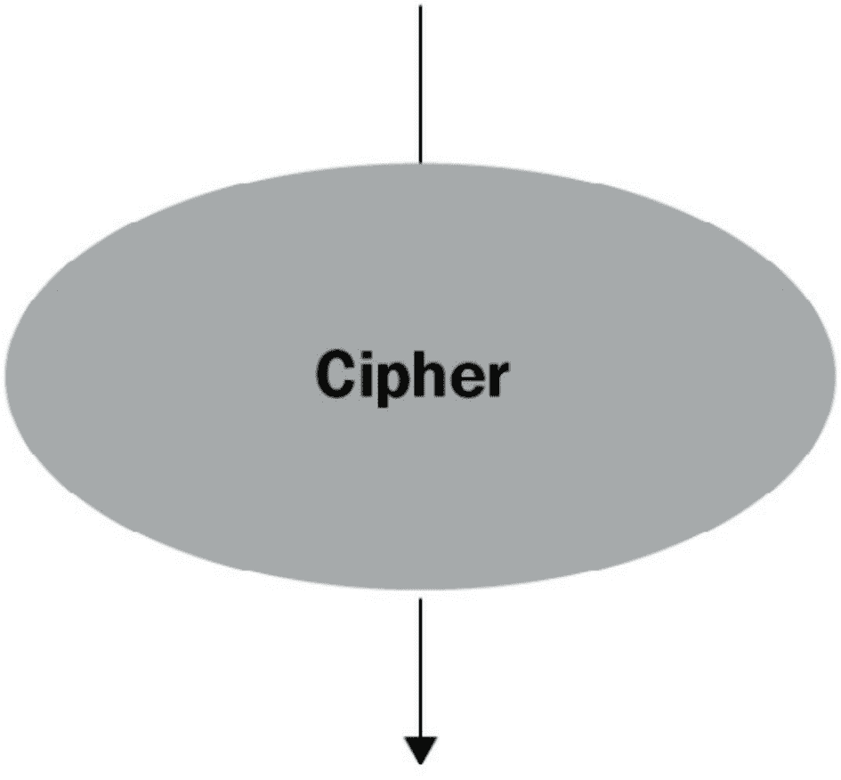
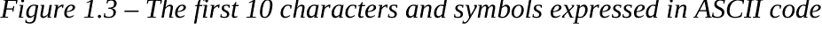
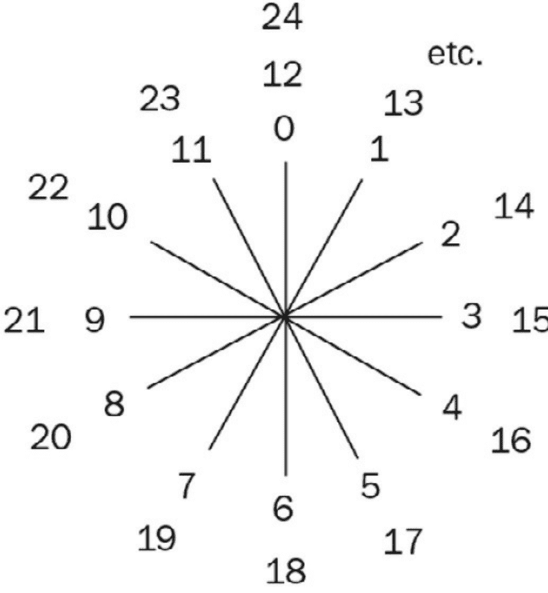
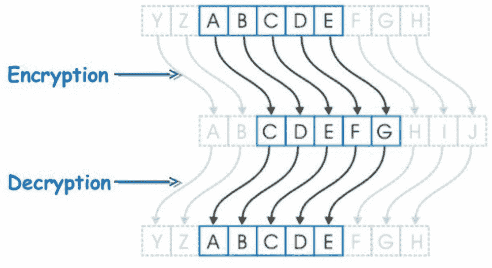
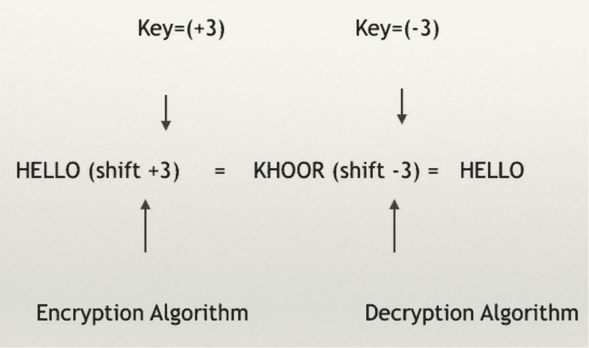
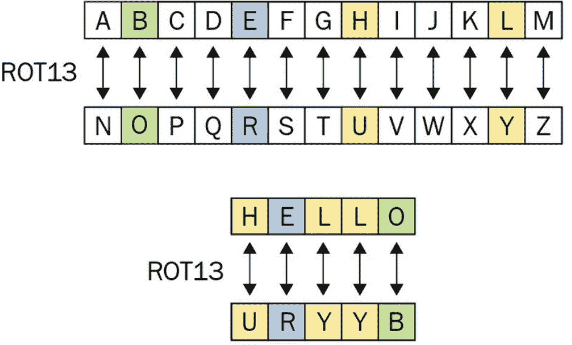
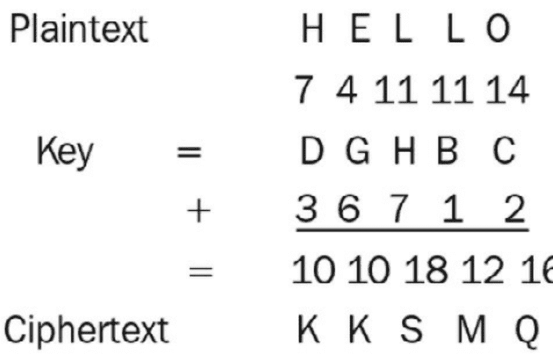

# 1 深入探索密码学

# 加入我们的 Discord 图书社区

[https://packt.link/SecNet](https://packt.link/SecNet)

本章介绍密码学的基本概念、它的用途以及为什么它在信息技术中如此重要。本章还纵览了密码学历史上的主要算法，从凯撒算法到弗纳姆密码，以及其他不太为人知的算法，如比尔密码。然后，**Rivest-Shamir-Adleman (RSA)**、Diffie–Hellman 以及其他著名算法将在本书后续部分中详细描述。最后，本章将为您提供学习密码学和维护安全支柱的工具。在本章中，我们将涵盖以下主题：

+   - 密码学简要介绍
+   - 本书使用的基本定义和主要数学符号
+   - 二进制转换与 ASCII 码
+   - 费马最后定理、素数和模运算
+   - 主要密码算法的历史及其中一些算法的解释（罗塞塔密码、凯撒密码、ROT13、比尔密码、弗纳姆密码）
+   - 安全记法（语义安全、可证明安全、一次性密码本等）

## 密码学导论

密码学中最重要的事情之一就是理解定义和记法。我从来都不喜欢定义和记法，首先，因为我是唯一一个使用自己发明的记法的人。但我意识到，达成一致非常重要，尤其是当我们讨论与数学相关的内容时。因此，在本节中，我将介绍与密码学相关的基础信息和引用。我们先从算法的定义开始。在数学和计算机科学中，**算法**是一系列定义明确的、可由计算机实现的有限指令序列。一个重要的问题是：什么是密码？**密码（cipher）**是一种能够将明文（消息）转换为不可理解文本（密文或密码文）的任何类型的系统：

### 消息

(算法)

(算法)

### 密文

### 图 1.1 – 加密过程

为了从密码中获得效用，我们必须建立两个操作：加密和解密。简单来说，我们必须在一段时间内保持消息的机密性和安全性。我们将 **M** 定义为所有消息的集合，**C** 定义为所有密文的集合。**加密**是一种操作，通过应用函数 **E**，将一般消息 **m** 转换为密文 **c**：m -------- > f(E) -------- > c。**解密**是一种操作，通过应用函数 **D**，从密文 **c** 返回明文消息 **m**：c -------- > f(D) -------- > m。在数学上，**D(E(M)) = M**。这意味着 **E** 和 **D** 函数互为逆函数，并且 **E** 函数必须是单射的。**单射**意味着不同的 **M** 值必须对应不同的 **C** 值。请注意，我使用大写字母还是小写字母（如（**M**）或（**m**））并不重要；目前这无关紧要。目前，我随意使用了圆括号，但稍后我将使用方括号来区分函数中的秘密元素与已知元素，其中秘密元素将使用方括号。因此，秘密消息 **M** 将写成 **[M]**，就像任何其他秘密参数一样。在这里，我们只负责展示算法的工作原理；实现则留给工程师。还有一个对加密/解密至关重要的记法。要加密和解密消息，必须设置密钥。在密码学中，密钥是决定密码算法或密码功能输出的参数。没有密钥，算法将不会产生任何有用的结果。我们将 **K** 定义为用于加密和解密 **M** 的所有密钥的集合，将 **k** 定义为单个加密或解密密钥，也称为会话密钥。然而，这两种定义密钥的方式（密钥集合为 **K**，单个密钥为 **k**）将始终被使用，并指定密钥的类型（私有或公开）。现在我们已经理解了密码记法的主要概念，是时候解释私钥和公钥之间的区别了：

+   - 在密码学中，私钥或密钥（**Kpr**），表示为 **[K]** 或 **[k]**，是一种加密/解密参数，只有一方、双方或多方知道，用于交换秘密消息。
+   - 在密码学中，公钥（**Kpu**）或（**K**）是一种加密密钥，所有想发送秘密消息或验证用户身份的人都知道。

那么，私钥和公钥的主要区别是什么？区别在于，私钥既用于加密又用于解密消息，而公钥仅用于加密消息以及验证人和计算机的身份（数字签名）。这是一个实质且非常重要的问题，因为它决定了对称加密和非对称加密之间的区别。让我们给出这两种加密方法的通用定义：

- **对称加密**仅使用一个共享密钥来同时加密和解密消息。
- **非对称加密**使用更多参数来生成一个公钥（用于加密消息）和一个私钥（用于解密消息）。

稍后我们将看到，私钥在对称加密中用于使用同一密钥加密/解密消息，在非对称加密中通常用于解密；而公钥仅用于非对称加密中的消息加密和数字签名。稍后你将看到这两类密钥的功能，但现在请记住，私钥同时用于对称和非对称加密，而公钥仅用于非对称加密。请注意，我无意讨论学术定义和符号，所以请尝试理解每个元素的范围和用途。

密码学中的主要问题之一是密钥的传输，即密钥交换。这个问题在数学家和密码学家社区中引发了激烈的争论，因为很难确定如何在避免物理交换的情况下传输密钥。例如，如果Alice和Bob想要交换密钥（在非对称加密出现之前），唯一可信的方式是在某个地方进行实体会面。这种情况在电信系统和互联网大规模普及后引发了许多问题。第一个问题是，互联网通信依赖于在不安全信道上的数据交换。你可以很容易地理解，如果Alice通过不安全的公共通信信道与Bob通信，私钥就很有可能会被泄露，这对通信的安全性和隐私性极其危险。

因此，出现了一个问题：如果我们使用对称密码来保护我们的秘密信息，我们*如何安全地交换密钥？*一个简单的答案是：我们必须提供一条*安全信道*来交换密钥。有人可能会回答：*我们如何提供安全信道？*我们将在本书后面找到答案，或者更确切地说是多个答案。即使在严峻的军事应用中，例如冷战期间美苏领导人之间的传奇*热线*，也使用对称通信密钥；如今，通常使用非对称加密来交换密钥。一旦密钥交换完成，接下来的通信会话将与对称加密相结合，对传输的消息进行加密。由于许多原因，非对称加密是交换密钥的好方法，并且适用于身份验证和数字签名。在计算上，对称加密更好，因为它可以使用更低位长度的密钥，从而节省大量带宽和时间。因此，总的来说，其算法使用256-512位的密钥就能高效地保证安全性，而例如非对称RSA加密则需要4000位以上。我将在后面分析非对称/对称加密算法时详细解释为什么以及如何实现这一点。虽然本书将分析多种密码技术，但本质上我们可以将所有算法分为两大类：对称加密和非对称加密。我们需要更多定义来更好地理解密码学：

- **明文**：在密码学中，这表示未加密的文本，或者任何可能公开暴露的内容。例如，**（明早10点见）**就是明文。
- **密文**：在密码学中，这表示执行加密过程后的文本结果。例如，**明早10点见**可能变成密文**[x549559*ehebicbm3494]**。

正如我之前提到的，我用不同的括号来区分明文和密文。具体来说，圆括号(...)表示明文，方括号[...]表示密文。

## 二进制数、ASCII码与符号

当我们用计算机处理数据时，通常会将数据表示为由**0**和**1**组成的比特串。因此，数字可以被转换为比特（基2），而不是像我们的数字系统那样使用基10。让我们看看转换机制是如何工作的。例如，数字**(123)**可以写成基10中的**1*10^2+2*10^1+3*10^0**。同样，我们可以将一个基10的数字转换为基2的数字。这里我们以数字**29**为例：

**数字29转换为基2（比特）**

| 步骤 | 操作 | 结果 | 余数 | 转换（基2） |
|---|---:|---:|---:|---|
| 步骤1： | 29 / 2 | 14 | 1 | (11101)₂ |
| 步骤2： | 14 / 2 | 7 | 0 | |
| 步骤3： | 7 / 2 | 3 | 1 | |
| 步骤4： | 3 / 2 | 1 | 1 | |
| 步骤5： | 1 / 2 | 0 | 1 | |

*图1.2 – 数字29转换为基2（比特）*

除法的余数在密码学中非常重要，因为**模运算**基于余数的概念。我们将在下一节深入探讨这个主题，届时我会解释素数和模运算。

为了将字母转换为计算机可编码的二进制系统，美国标准协会于1960年发明了ASCII码。根据ASCII网站的定义：“ASCII

代表美国信息交换标准代码。它是一种7位字符代码，其中每一位代表一个唯一的字符。” 以下是ASCII码表的前10个字符示例：

| DEC | OCT | HEX | BIN | Symbol | HTML | Number Description |
|---:|---:|---:|---:|---|---|---|
| 0 | 000 | 00 | 00000000 | NUL | &#000; | 空字符 |
| 1 | 001 | 01 | 00000001 | SOH | &#001; | 标题开始 |
| 2 | 002 | 02 | 00000010 | STX | &#002; | 文本开始 |
| 3 | 003 | 03 | 00000011 | ETX | &#003; | 文本结束 |
| 4 | 004 | 04 | 00000100 | EOT | &#004; | 传输结束 |
| 5 | 005 | 05 | 00000101 | ENQ | &#005; | 询问 |
| 6 | 006 | 06 | 00000110 | ACK | &#006; | 确认 |
| 7 | 007 | 07 | 00000111 | BEL | &#007; | 响铃 |
| 8 | 010 | 08 | 00001000 | BS | &#008; | 退格 |
| 9 | 011 | 09 | 00001001 | HT | &#009; | 水平制表 |
| 10 | 012 | 0A | 00001010 | LF | &#010; | 换行 |

请注意，在我的实现中，我经常使用由 **Wolfram Mathematica** 研究软件生成的字符 **88** 作为 X 来表示要加密的消息编号。在ASCII码中，数字 **88** 对应符号 **X**，如下例所示：`88 130 58 01011000 X &#88;` 大写 X 你可以前往本书末尾的*附录*部分，查看本书中所有的符号表示，包括算法及其Mathematica代码实现。

## 费马大定理、素数及模运算

当我们谈论密码学时，我们必须始终牢记这门学科本质上与数学和逻辑相关。在我开始解释**费马大定理**之前，我想介绍一些贯穿全书的基本符号，以避免混淆并更好地理解主题。重要的是要知道，一些符号，如 =、≡（等价）和 :=（最后一个可以在Mathematica中用于计算=），我可能会互换使用。这只是告诉你两个元素在同等程度上相互对应；无论是在有限域中（别担心，你会熟悉这个术语）、计算机科学还是常规代数中，这都无关紧要。数学家们可能会对此感到震惊，但我相信你的智慧，你会寻找实质而不是形式。另一个符号 ≈（近似）可以用来表示相似的近似元素。你还会遇到 ^（指数）符号，例如以经典方式表达幂运算：a^x（**a** 的 **x** 次方）。≠ 符号，你从高中就应该记得，意思是**不等于**，这与 = 的意义相同，即不等价。不过，你总会得到方程式的解释，所以如果你不太熟悉数学和逻辑符号，你可以依靠描述。无论如何，我会在遇到新符号时逐一解释。

素数是一个只能被自身和1整除的整数，例如，2、3、5、7...23...67...p。素数是数学的基石，因为所有其他合数都由它们产生。现在，让我们看看费马大定理是什么、在哪里应用，以及为什么它对我们有用。费马大定理是与素数密切相关的经典数学中最优秀、最美丽的定理之一。根据维基百科：“在数论中，费马大定理（有时称为费马猜想，尤其是在较早的文本中）指出，对于任何大于2的整数n，不存在三个正整数a、b和c满足方程a^n + b^n = c^n。n = 1和n = 2的情况自古以来就知道有无穷多组解。”换句话说，它告诉我们，对于以下方程，对于任何指数 **n>3**，≥3，都不存在整数 **a**、**b** 或 **c** 满足该和：a^n+b^n = c^n。为什么这个定理对我们如此重要？首先，因为费马大定理与素数密切相关。事实上，根据素数的性质，为了证明费马大定理，只需证明以下内容：a^p+b^p ≠ c^p。这里，**p** 是任何大于2的素数。费马声称他有*一个证明，大得无法写进笔记的页边距*。费马本人在一篇论文中指出，他有一个优美的证明。

*图 1.4 – 使用时钟进行模运算的示例*

费马小定理指出，*如果* **(p)** *是质数，那么对于任意整数* **(a)** *，将其提升至质数* **(p)** *次方后，我们得到* **(a)** *作为以下方程的结果：* a^p ≡ a (mod p) *例如，如果 a = 2 且* **p = 3**，*则* 2^3 = 2 (mod 3)。*换句话说，我们计算除法* **8 : 3 = 2** *的余数，余数为 2。费马小定理是费马素性检验的基础，也是……之一*

图 1.5 – 罗塞塔石碑，上面检测到三种语言

象形文字是一个国家的人民之间交流的一种形式。让-弗朗索瓦·商博良被公认为自 1822 年起破译罗塞塔石碑的人。然而，博学者托马斯·杨被埃及学家们认定为第一个发表了部分正确的罗塞塔石碑译文的人。我们将在第 11/12 章再次遇到托马斯·杨，讨论量子密码学时。杨是第一个发现与光子相关的波粒二象性效应的人，这对量子力学非常重要。将来如果我们与外星文明取得联系，破译未知语言这一同样的问题也可能会出现。2007 年 6 月 20 日，一个名为 SETI（https://www.seti.org/）的项目聚焦于此：“从微生物到外星智慧，SETI 研究所是美国唯一一个完全致力于在宇宙中寻找生命的组织。”也许有一天，如果我们与外星生物取得联系，我们最终会理解它们的语言。你可以想象，对于从未接触过这种交流形式的人来说，象形文字（在当时）看起来就像外星语言一样难以理解。

## 凯撒密码

继续我们的历史之旅，我们发现，在罗马帝国时期，密码学被用于从将军向指挥官和士兵传递消息。事实上，我们发现了著名的凯撒密码。为什么这种加密方法在密码学史上如此著名？这不仅是因为它被凯撒使用过——凯撒是最勇敢的罗马政治家/将军之一——还因为这种方法可能是最早运用数学的方法之一。这种密码被广泛称为移位密码。移位技术非常简单：只需将你想要加密的每个字母在字母表中移动固定的位数，最终效果就是每个字母被替换为另一个字母。例如，如果我决定移动三个字母，那么 A 将变成 D，E 变成 H，依此类推。例如，在这种情况下，通过将每个字母移动三位，我们隐式地创建了一个密钥为 [K=3] 的秘密密码：

### 凯撒密码：数学基础

*图 1.6 – 凯撒密码在加密和解密过程中的字母换位*

这显然是一种对称密钥加密方法。在这种情况下，算法的工作方式如下：

- 使用此密钥：(+3)。
- 消息：**HELLO**。
- 加密：取每个字母并向前移动 +3 步。
- 解密：取每个字母并向后退 -3 步。

你可以在下图中看到凯撒算法的加密和解密过程如何通过使用 **key = +3** 进行；你会注意到，单词 **HELLO** 在加密后变成 **KHOOR**，然后在解密后又回到 **HELLO**：

*图 1.7 – 使用凯撒算法进行加密和解密*

正如你可以想象的，如果我们像前面的示例那样设置一个固定的密钥，凯撒算法很容易被普通计算机破解。这种方案非常简单，而对于加密算法来说，简单本身不是问题。然而，主要问题在于其底层数学的极端线性。使用暴力破解法，即先猜测所使用的算法（在这里是移位密码），然后尝试所有组合来发现密钥，我们可以轻松破解代码。我们最多只需检查 25 种组合：英文字母表中的所有字母（26 个）减去一个（即原本可理解的明文形式）。这与现代计算机为了破解现代加密算法而必须进行的数十亿次尝试相比，简直微不足道。然而，这种算法有一个更复杂的版本，能极大地提高加密效率。如果我每个字母都更换密钥，并利用该密钥替换字母生成密文，那么事情就变得非常有趣了。让我们看看如果用这样的方法加密 **HELLO** 会发生什么：

- 写出字母表。
- 选择一个口令短语（也称为密钥短语），例如 [JULIUSCAESAR]，并重复它，将字母表中的每个字母与第二行中口令短语的一个字符对应起来，如下面的截图所示。
- 在我们定义了要加密的消息后，对于组成消息的每个字符（在第一行），选择密钥短语中对应的字符（在第二行）。
- 选取第二行中选定的对应字符来生成密文。

觉得有点复杂？别担心，下面的示例会让一切变得清晰。让我们用密钥短语 [JULIUSCAESARJULIUS...] 加密 HELLO：

| 密钥 | 值 |
|---|---|
| 字母表 | A B C D E F G H I J K L M N O P Q R S T U V W X Y Z |
| 口令短语 | J U L I U S C A E S A R J U L I U S C A E S A R J U |
| 密文 | A U R R L |

HELLO = AURRL

图 1.8 – 使用密钥短语加密 HELLO 会使攻击变得困难得多

因此，使用字母表和一个密钥（或者更确切地说，一个口令短语或密钥短语）JULIUSCAESAR（不带空格重复）加密明文 HELLO，我们得到对应的密文：AURRL。所以，H 变成 A，E 变成 U，L 变成 R（两次），O 变成 L。之前，在凯撒密码中，我们只需检查 25 种组合就能找到密钥；而在这里，情况发生了一些变化，有 (26!) 种可能性来发现密钥！也就是把 1 × 2 × 3 … × 26 相乘，结果是 403,291,461,126,605,635,584,000,000。这无疑是一个非常巨大的数字。事实上，它大约是宇宙中所有原子的三分之一。即使在计算上，即使对于使用暴力破解法的现代计算机来说，发现密钥也是相当困难的。构建这样的密码图的另一个优点是，密钥词或密钥短语很容易记住，因此可以轻松地算出密文。但让我们来看一种使用类似技术并用于商业场景的密码。

## ROT13

一个在互联网上使用的现代算法示例是 **ROT13**。本质上，这是一种源自凯撒密码的简单密码，移位量为 (+13)。在计算上，破解凯撒密码很容易，但它产生了一个有趣的效果：如果我们向左或向右移位，我们会得到相同的结果。就像前面的示例一样，在 ROT13 中，我们必须选择与预先选定的密钥相对应的字母。本质上，这里的区别在于，我们不是应用密钥短语来生成密文，而是使用英文字母表中的 13 个字母作为*密钥生成器*。ROT13 在加密时只处理英文字母表中出现的字母，而不处理数字、符号或其他字符，这些字符会原样保留。ROT13 函数本质上是用一个密钥对明文进行加密，该密钥由前 13 个字母转置到后 13 个字母确定，而后 13 个字母则相反。请看下面的示例，以便更好地理解该加密方案：

*图 1.9 — ROT13 中的加密方案*

正如你在前图中所见，**H** 变为 **U**，**E** 变为 **R**，**L** 变为 **Y**（两次），**O** 变为 **B**：**HELLO = URYYB**。密钥由字母表中前 13 个字母组成，一直到 **M**，它变为 **Z**，然后序列绕回 **N**，它变为 **A**，**O** 变为 **B**，依此类推，直到 **Z** 变为 **M**。**ROT13** 在 20 世纪 80 年代初被用来隐藏 **net.jokes** 新闻组中可能具有冒犯性的笑话，或模糊答案。此外，尽管 ROT13 并非用于高度保密，但在某些情况下仍被用来向不精明的垃圾邮件机器人隐藏电子邮件地址。ROT13 也被用于规避垃圾邮件过滤器，例如掩盖电子邮件内容。由于该算法极其脆弱，因此不建议使用最后这种功能。然而，**网景通信器**——即发布 [https://www.mozilla.org](https://www.mozilla.org) 的浏览器组织——曾使用 ROT13 来存储电子邮件密码。此外，Windows XP 也使用 ROT13 来隐藏某些注册表项，因此你可以理解，有时即使是大型企业也可能在通信安全与隐私方面有所欠缺。

## 比尔密码

回到密码学历史，我想向你展示一种令人惊叹的加密方法，尽管现代计算器拥有强大的计算能力，但其密码至今仍未被破译。很多时候，密码学被用来隐藏珍贵的信息或迷人的宝藏，就像**比尔密码**背后那段神秘的故事一样。为了更好地理解这种密码所采用的加密方法，我认为了解一下比尔及其宝藏的故事（或传说）会很有趣。这个故事涉及价值超过 2000 万美元的埋藏宝藏、一组神秘的加密文件、狂野西部的牛仔，以及一位毕生致力于破译这些文件的酒店老板。整个故事记载于 1885 年出版的一本小册子中。故事（你可以在这里找到完整版本：[http://www.unmuseum.org/bealepap.htm](http://www.unmuseum.org/bealepap.htm)）始于 *1820 年 1 月*，在弗吉尼亚州*林奇堡*的*华盛顿酒店*，一个名叫*托马斯·J·比尔*的人入住于此。酒店老板*罗伯特·莫里斯*与比尔成了朋友，由于*莫里斯先生*被认为是一个值得信赖的人，他收到了一个盒子，里面装着三份写满数字的神秘文件。历经无数波折和多年的努力，三份加密文件中只有第二份被破译。

比尔密码到底是什么样子？以下内容由三页组成，只包含数字，且顺序明显随机。第一份文件内容如下：71, 194, 38, 1701, 89, 76, 11, 83, 1629, 48, 94, 63, 132；第二份文件（已被破译）内容如下：115, 73, 24, 807, 37, 52, 49, 17, 31, 62, 647, 22, 7, 15；第三份文件内容如下：317, 8, 92, 73, 112, 89, 67, 318, 28, 96, 107, 41, 631, 78。第二个密码在 1885 年左右被成功破译。在这里，我将讨论这类密码的主要考量。

由于密码中的数字远远超过字母表中的字母数量，我们可以推断它不是替换密码，也不是换位密码。因此，我们可以假设每个数字代表一个字母，但这个字母是从外部文本中的一个单词中获得的。遵循这一准则的密码被称为书本密码：在书本密码中，一本书或任何其他文本都可以作为密钥。那么，这里真正有效的密钥就是从文本中获取字母的方法。

利用这一系统，第二个密码通过参考《美国独立宣言》得以破译。为参考文本（《美国独立宣言》）中的每个单词分配一个数字，然后取密钥（本例中即第二个密码所对应的数字列表）所选中的每个单词的首字母，我们就能推断出明文。这种密码极为巧妙的一点在于，密钥文本（《美国独立宣言》）是公开的，但同时，除了消息的预期接收者之外，全世界都不知道它。只有当某人同时掌握密钥（数字列表）和“密钥文本”时，才能轻松解密消息。

让我们来看一下破译第二个密码的过程：

- 从第一个单词到最后一个单词，为文本中的每个单词按顺序分配一个数字。
- 使用密码中包含的数字，提取每个单词的首字母。
- 读取明文。

以下是《美国独立宣言》的开头部分（截至第 115 个单词），显示每个单词及其对应编号：When (1) in (2) the (3) course (4) of (5) human (6) events (7) it ... 以下数字代表第二个密码的前几行；如你所见，粗体单词（及其对应编号）与我们在密文中找到的数字相对应：115, 73, 24, 807, 37, 52, 49, 17, 31, 62, 647, 22, 7, 15。以下是将密码与密钥文本（《美国独立宣言》）结合进行解密的结果，即提取每个对应单词的首字母，也就是明文：115 = instituted = I，73 = hold = h，24 = another = a，807 = …… 依此类推……我没有包含完整的《美国独立宣言》；这些只是前 115 个单词。但如果你愿意，可以访问 [http://www.unmuseum.org/bealepap.htm](http://www.unmuseum.org/bealepap.htm) 并尝试练习重建完整的明文。

下面（有一些缺失的字母）是对第一句话的重建：I have deposited in the county of Bedford...... 如果我们继续下去，将数字与《美国独立宣言》中对应单词首字母的数字进行比较，解密结果将如下：

> *我将以下物品存放在贝德福德县，距离比福德家约四英里处的一个坑道或地窖中，位于地面以下六英尺。这些物品由编号为“3”的文件中所列各方共同拥有，特此说明：第一批存物包括一千零十四磅黄金和三千八百一十二磅白银，于 1819 年 11 月存入。第二批于 1821 年 12 月存入，包括一千九百零七磅黄金和一千二百八十八磅白银；还有珠宝，这些珠宝是在圣路易斯用白银换来的，以省去运输费用，价值 13,000 美元。上述物品被安全地包装在带铁盖的铁罐中。地窖大致用石头砌成，容器放在坚实的石头上，并用其他石头覆盖。编号为“1”的文件描述了地窖的确切位置，因此找到它不会有任何困难。*

许多其他密码学家和密码分析者曾试图破译比尔密码的第一和第三部分，但均徒劳无功。其他人，比如发现了价值数亿美元海底财宝的寻宝者*梅尔·费舍尔*，也曾前往贝德福德搜索该地区以寻找宝藏，但未能成功。也许比尔的故事只是一个传说；又或许它是真实的，但没有人会知道宝藏在哪里，因为没有人能破译第一份密码。又或者，宝藏永远不会被挖出，因为已经有人找到了它。无论如何，这个故事真正有趣的地方在于，在没有计算机或电子机器的帮助下，仅凭脑力、一支笔和一张纸，就实现了如此强大的密码。

矛盾的是，假设攻击者使用暴力破解，探索当时世界上所有的文本，那么破解密码所需的尝试次数从 1 到无穷大不等。更重要的是，如果密钥文本不公开，而是由发送者本人编写并保密，那会怎样？在这种情况下，如果密码分析者没有密钥（即不掌握密钥文本），他们破解密码的可能性为零。

比尔密码之所以令人感兴趣，还因为这类算法在现代密码学或未来可能拥有新的应用。其中一些应用可能与云计算中加密数据的研究方法有关。

## 弗纳姆密码

**弗纳姆密码**是一种安全性最高的密码，因为它在理论上完全安全。由于它使用与明文等长的真正随机的密钥，因此被称为**完美密码**。这不过是基于香农信息熵原理的熵与随机性问题，它决定了密文中每个比特出现的概率相等。我们将在*第 8 章“量子密码学”*中再次讨论该算法，届时我们会介绍量子密钥分发，以及在确定量子密钥后加密明文的相应方法。另一个有趣的实现是 Hyper Crypto Satellite（超级加密卫星），它使用该算法，利用卫星无线电通信传输并以无限比特串形式表示的随机密钥来加密明文。

但现在，让我们继续探索该算法的主要特征。

该算法的基本要素是每次会话只使用一次密钥。这一特性使得该算法在密文攻击面前无懈可击；即使在极少数情况下密钥被盗，也会在下一次传输时更换。

方法非常简单：将密钥与消息逐位相加（**模 2**），即可得到密文。在本书中，我们会多次看到这种称为 **XOR（异或）** 的方法，尤其是在*第 2 章“对称加密简介”*中讨论对称加密时。只需记住，密钥必须与消息长度相同。

一个数值示例如下：

- **00101001** (plaintext)
- **10101100** (key): Adding each bit (**mod 2**)
- **10000101** (ciphertext)

**步骤 1：** 使用 ASCII 码将明文转换为比特串。**步骤 2：** 生成与明文长度相同的随机密钥。**步骤 3：** 通过对明文按位与密钥进行模 2 加法（XOR）加密并得到密文。**步骤 4：** 通过对密文与密钥进行加法的逆运算解密并再次得到明文。为了用数字和字母举例，我们将回到 **HELLO**。假设每个字母对应一个数字，从 **0 = A, 1 = B, 2 = C, 3 = D, 4 = E** … 依此类推直到 **25 = Z**。随机密钥是 **[DGHBC]**。加密将呈现以下置换：

*图 1.10 – Vernam 算法中的加密方案*

因此，在字母置换后，**[HELLO]** 的加密结果是 **[KKSMQ]**。你可以通过逆过程自行创建一个练习来解密 **[KKSMQ]** 密文：对密文应用 **f(-K)**，返回 **HELLO** 明文。我只想指出这一点：该系统的可能漏洞以及如何生成一个非常随机的密钥。该方法曾是 **卫星国际空间会议** 的候选，但当时我决定不将其公之于众。

## 安全性和计算方面的说明

我们本章看到的所有算法都是对称的。仍然未解决的基本问题是密钥的传输。正如我已经说过的，这个问题将在下一章我们探索的非对称加密中得到解决。在本节中，我们将分析与密码算法安全性相关的计算问题。一般而言。书中后面，我们将专注于我们将分析的任何算法的安全性。为了作类比，我们可以说在密码学中，链条的薄弱环节会破坏整个链条。这与使用非常强大的密码算法来保护数据但将密码留在计算机屏幕上的问题相同。换句话说，密码算法必须在数学问题方面具有相似的安全等级。为了用示例阐明这一概念：因数分解和离散对数问题目前具有相似的计算特性；然而，如果明天其中一个问题被解决，那么基于两者的算法将变得无用。让我们深入分析密码学中普遍认可的一些原则。第一个论断是 *密码学必须开源*。使用术语 *开源*，我指的是算法，而不是显然的密钥。换句话说，我们必须依赖 **Kerckhoffs 原则**，该原则指出如下： "*密码系统即使在除密钥之外系统的所有内容都是公开知识的情况下也应是安全的。Kerckhoffs 原则不仅适用于密码和密码本，也适用于一般的安全系统：每一种秘密都造成一个潜在的故障点。换句话说，保密是脆弱性的主要原因——因此很可能使系统容易发生灾难性崩溃。相反，开放性提供了延展性。*" – Bruce Schneier 在实践中，支撑加密代码的算法必须为人所知。依赖算法的保密性来交换秘密信息既无用也危险。原因是，本质上，如果一个算法必须被开放社区使用（就像互联网一样），就不可能保密它。第二个论断是 *算法的安全性很大程度上取决于其* 基础数学问题。作为示例，RSA 是密码学历史上最著名、最广泛使用的算法之一，其支撑的数学问题是因数分解。因数分解本质上是将一个数分解为其除数：21 = 3 × 7。对于小整数，找到 21 的除数 **3** 和 **7** 很容易，但众所周知，增加数字位数会使因数分解问题呈指数级增长。我们将在本书中深入分析 RSA 等非对称算法，尤其是在 *第 3 章，非对称加密* 中，我将解释非对称加密。但在这里，足以解释为什么 RSA 用于保护金融、情报和其他非常敏感的秘密。原因是支撑 RSA 的数学问题（因数分解）对于当前一代计算机来说仍然是一个难题。然而，在本介绍性部分，我无法更深入地分析 RSA，所以我将限制在说 RSA 不仅因因数分解问题而受到攻击，还有另一个在计算上同样有竞争力的、即 **离散对数** 问题。书中后面，我们甚至将分析这两个难题的计算问题。现在，我们假设（不正确地，正如 99% 的密码学文本所做的那样）支撑 RSA 安全性的支柱是因数分解。在 *第 6 章，公钥/私钥密码学中的新算法* 中，我将展示一种对 RSA 算法的攻击，该攻击依赖于不同于因数分解的问题。这与本节开头解释的链条薄弱环节的相似之处。如果算法中的某一点出错，算法的基础安全性就会失效。无论如何，让我们看看当我们仅依赖因数分解问题尝试破解 RSA 时会发生什么，使用暴力破解。在这种情况下，只是为了让你了解分解 250 位 RSA 数的计算能力所需，分解一个大半素数如果我们处理的是数百位或数千位数字，绝非易事。只是为了演示，RSA-250 是一个由 250 个十进制数字组成的 829 位数，用当前一代的计算机很难破解。该整数在 *2020 年 2 月* 被分解，总计算时间为约 2,700 核年，使用 **Intel Xeon Gold 6130** 2.1 GHz。如许多因数分解记录一样，这一记录是使用 100 台多台机器的网格和一种提升其计算能力的优化算法完成的。第三个论断是 *实际安全性总是比理论安全性更低*。例如，如果我们分析 Vernam 密码，我们可以很容易理解该算法在实践中的实现非常困难。因此，我们可以说 Vernam 在理论安全性上是不可攻破的，但在实际安全性上并非如此。该假设的一个推论是：实现一个算法意味着将其理论方案付诸实践并为其增加更多复杂性。因此，*复杂性是安全的敌人*。系统越复杂，可攻击点就越多。另一个考虑与算法的安全等级有关。我们可以通过考虑香农理论和 *完美保密* 概念更好地理解这一概念。克劳德·香农在 1949 年给出的完美保密的定义基于统计和概率。然而，关于最大安全等级，香农理论认为，如果攻击者对消息内容的了解在检查密文前后相同，即使攻击者拥有无限资源，密文仍保持完美保密。也就是说，消息对攻击者关于消息内容的了解精确地没有提供任何信息。为了更好地理解这一概念，我邀请你思考不同级别或安全等级，在这些等级中，任何程度都是安全的，但呈递减梯度。换句话说，最高级别是最强，最低级别是最弱，但在中间，有一个不确定的等级区域，取决于对手的技术计算水平。重要的是有多少等级被认为是安全的，有多少不安全并不重要。我认为，本质上，我们必须考虑什么肯定是安全的，什么不是安全的，但也必须考虑在特定时间内什么可以被接受为安全。考虑到这一点，让我们看看完美保密和安全之间的区别：

- 密码系统如果满足至少两个条件，可被认为具有 *完美保密*：
  - 即使对手拥有无限计算能力也无法被破解。
  - 通过分析密文 **[c]**，无法获得有关消息 **[m]** 和密钥 **[k]** 的任何信息（即 Vernam 在特定条件下是理论上完美保密的系统）。
- 密文是 *安全的*，即使理论上对手可以破解密码系统（即如果他们拥有量子计算能力和一个运行良好的因数分解算法），但其基础

数学问题在当时被认为非常难以解决。在某些条件下，可以使用密码（例如 RSA、Diffie-Hellmann 和 El Gamal），因为根据经验证据，因式分解和离散对数仍然是难以解决的问题。

因此，安全性的概念是动态的而且非常模糊。现在安全的东西明天可能就不安全了。如果量子计算机变得有效，或者明天发现了一种能够破解因式分解问题的强大算法，RSA 以及所有经典密码学将会怎样？我们将在 *第 8 章，量子密码学* 中回到这些问题。现在，我可以说大多数 *经典* 密码学算法将被量子计算机的颠覆性计算能力所破解，但我们还不知道何时会发生。在某些条件下，我们会看到 **量子密钥交换** 可以被视为 **完美保密系统**。但它并不总是有效，因此目前未被使用。一些一次性密码本系统现在可以被认为高度安全（也许是半完美保密），但一切都取决于实际实现。最后，请记住一条重要规则：链条中的薄弱环节会破坏一切。因此，总而言之，我们可以注意到以下几点：

- 密码学必须是开源的（算法必须为人所知），密钥除外。
- 算法的安全性很大程度上取决于其底层数学问题。
- 复杂性是安全的敌人。
- 安全是一个动态概念：完美安全只是一个理论问题。

## Summary

在本章中，我们涵盖了密码学的基本定义；我们复习了二进制系统和 ASCII 码的知识，并且我们还探索了质数、费马方程和模数数学。然后，我们对经典密码算法如凯撒、比尔和维尔纳姆进行了概述。最后，在最后一节中，我们从哲学和技术角度分析了安全性，区分了密码学中安全等级与复杂性等级的关系。在下一章，我们
