# 2 Symmetric Encryption Algorithms

## Join our book community on Discord

https://packt.link/SecNet


在对密码学有了概述之后，现在是时候介绍对称加密中的主要算法及其逻辑和数学原理了。在 *第 1 章，深入密码学* 中，我们看到了一些对称密码系统，例如 **ROT13** 和 **维尔纳姆密码**。在进一步描述现代对称算法之前，我们需要对分组密码的构造有一个概述。如果您还记得，对称加密是通过发送方和接收方之间共享的密钥来执行的，反之亦然。但我们如何同时实现既稳健（在安全性意义上）又易于执行（在计算上）的对称算法呢？让我们通过比较非对称加密与对称加密来看看如何回答这个问题。非对称加密的主要问题之一是执行操作并不容易（尤其是解密），由于在推荐的安全级别下执行此类算法所需的计算能力很高。这一问题意味着非对称加密不适合传输长消息，但更适合交换密钥。因此，通过使用使用相同共享密钥执行的对称加密/解密，我们获得了交换加密消息的更顺畅方案。在本章中，我们将学习以下主题：

- 理解布尔逻辑的基础
- 理解简化 DES 的基础
- 理解并分析 DES、三重 DES 和 DESX
- 理解 AES（Rijndael）——对称加密中的实际标准
- 对对称算法实施一些逻辑和实际攻击

到本章结束时，您将理解如何实现、管理和攻击对称算法。

## Notations and operations in Boolean logic

为了理解对称算法的机制，有必要回顾布尔逻辑中的一些符号以及在二进制系统上的这些运算。正如我们在第 1 章《深入密码学》中已经看到的，二进制系统使用一组位 {0,1}。因此，处理布尔函数意味着对一系列位执行逻辑计算以生成答案，该答案可能是 TRUE 或 FALSE。最常用的函数是 XOR（异或）、OR（析取）和 AND（合取）。但还有一些其他符号也将在后面解释。布尔电路旨在确定一个变量 (x) 与另一个变量 (y) 结合是否满足条件 TRUE 或 FALSE。这个问题被称为布尔可满足性问题（SAT），在计算机科学中具有特别重要的意义。SAT 是第一个被证明为 NP-完全的问题。问题如下：给定一个特定函数，是否存在 TRUE 或 FALSE 的赋值使得表达式结果为 TRUE？命题逻辑的公式是可满足的，如果存在一个赋值可以确定命题为 TRUE。如果对于所有可能的变量赋值结果都是 FALSE，则该命题被称为不可满足的。这在算法理论中非常重要，例如用于搜索引擎的实现，甚至在硬件设计或电子电路中。让我们举一个命题逻辑的例子：

- **前提 1：** *如果天空晴朗，那么天气晴朗。*
- **前提 2：** *天空没有云。*
- **结论：** *天气晴朗为 TRUE。*

正如你在 *图 2.1* 中看到的，从输入开始并通过算法在逻辑电路上进行处理，我们得到 **TRUE** 或 **FALSE** 的结论。所有这些概念将在本书的后续章节中特别有用，尤其是 *第 5 章，零知识协议简介*，当我们谈论 **零知识** 时，以及 *第 9 章，加密搜索引擎*，我们在其中谈论一个使用加密数据工作的搜索引擎：

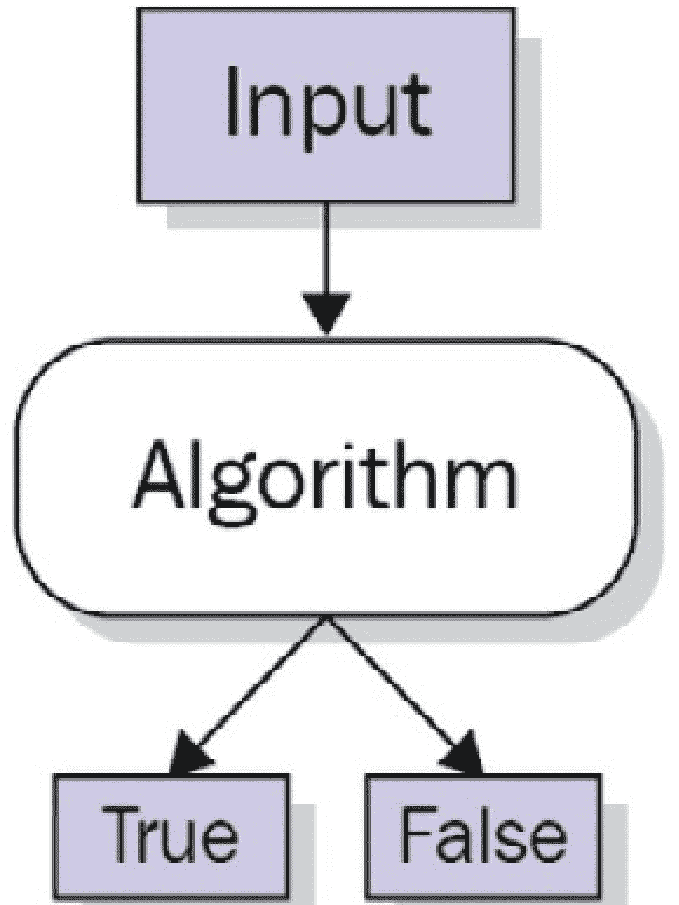

### Figure 2.1 – A Boolean circuit gives two opposite variables as output

布尔电路中执行的基本操作如下：

- **AND (conjunction)**: 用符号 (**X^Y**) 表示。当 **X** 与 **Y** 同时为真时，此条件得到满足。因此，我们处理的是诸如 **pear AND apple** 之类的命题，例如。如果我们在搜索某些内容（假设是一个包含句子和单词的数据库），设置 **AND** 运算符将选择包含两个单词（**pear** 和 **apple**）的所有元素，而不仅仅是一个。现在让我们探索该运算符在数学模式下的工作原理。**AND** 运算符在数学中转置为 (**X * Y**) 的乘法。以下是两个元素所有逻辑组合的 *真值表* 的表示。正如你所见，只有当 **X * Y = 1** 时，才意味着合取条件 (**X^Y**) 得到满足：

### Figure 2.2 – Mathematical table for "AND"

- **OR (disjunction)**: 用符号 (**X V Y**) 表示。当 **X** 或 **Y** 中的至少一个元素为真时，此条件得到满足。因此，我们处理的是诸如 **pear OR apple** 之类的命题。我们的数据库搜索示例将选择包含两个单词中至少一个（**pear** 或 **apple**）的所有元素。

在下面的表中，你可以看到 **OR** 运算符转置为数学运算 (**X+Y**) 。至少一个变量取值为 **1**，因此满足析取条件 (**X V Y**)，由两个变量的和表示：

### Table of the truth for “OR”

| x | y | x + y |
|---|---|---|
| 0 | 0 | 0 |
| 0 | 1 | 1 |
| 1 | 0 | 1 |
| 1 | 1 | 1 |

Figure 2.3 – Mathematical table for "OR"


### “NOT”（非）的真值表

| x | （非）x |
|---|--------|
| 0 | 1 |
| 1 | 0 |

图 2.4 – “NOT”（非）的数学真值表

这些基本的布尔运算符 AND、OR 和 NOT 可以用维恩图表示如下：

### XOR（异或）表

| A ⊕ B | [A（异或）B] |
| --- | --- |
| 0 ⊕ 0 | = 0 |
| 0 ⊕ 1 | = 1 |
| 1 ⊕ 0 | = 1 |
| 1 ⊕ 1 | = 0 |

图 2.6 – 表示 0 和 1 之间的 XOR（异或）运算

XOR（异或）逻辑运算符不仅用于加密算法，还用作奇偶校验器。如果我们在逻辑电路中使用 XOR 来检查一个 8 位字中的奇偶校验位，它可以验证该字中 1 的总数是偶数还是不是偶数。现在我们已经探讨了布尔逻辑背后的运算，是时候分析对称算法家族中的第一个算法：DES。

明文首先被分成块。由于每个块分别加密，我们只需要分析一个块即可。密钥 [K] 由 9 位组成，消息 [M] 由 12 位组成。算法的主体部分与 DES 一样，是 S-Box，其中 S 代表替代（Substitution）。对称算法的真正复杂性和非线性函数就在这里。算法的其余部分只是对位的排列和移位，普通计算机可以自动完成，因此没有必要对此过于纠结。在这种情况下，S-Box 是一个 4X16 矩阵，输入为 6 位，输出为 4 位。我们会发现，S-Box 存在于所有现代对称加密算法中，如 DES、Triple DES、Bluefish、Blowfish 和 AES。四行由连续的 2 位表示，如下所示：00011011 而 16 列则由 4 位组成，顺序如下：0000 0001 0010 ..... ..... ..... ..... 1111 矩阵中的元素由 0 到 15 之间的随机数组成，这意味着它们在同一行内不会重复。为了更好地理解 S-Box 的实现方式和工作原理，这里有一个例子：011011。这串位有两个外部位 01 和四个中间位 1101。在这种情况下（在二进制系统中，使用 N2 表示法），(01)₂ 对应第二行，(1101)₂ 对应第 13 列。通过找到列和行的交叉点，我们得到 (1001)₂。你可以在下图中看到所描述的 S-Box 矩阵的二进制数表示：

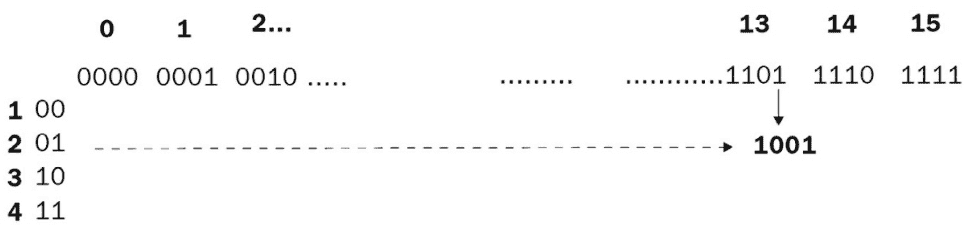

图 2.7 – 用二进制数表示的 4X16 S-Box 矩阵（交叉点）

同样的矩阵也可以用十进制数表示如下：

|  | 0 | 1 | 2 | 3 | 4 | 5 | 6 | 7 | 8 | 9 | 10 | 11 | 12 | 13 | 14 | 15 |
|---|---|---|---|---|---|---|---|---|---|---|---|---|---|---|---|---|
| 1 | 2 | 12 | 4 | 1 | 7 | 10 | 11 | 6 | 8 | 5 | 3 | 15 | 13 |  | 14 | 9 |
| 2 | 14 | 11 | 2 | 12 | 4 | 7 | 13 | 1 | 5 | 0 | 15 | 10 | 3 | 9 | 8 | 6 |
| 3 | 4 | 2 | 1 | 11 | 10 | 13 | 7 | 8 | 15 | 9 | 12 | 5 | 6 | 3 | 0 | 14 |
| 4 | 11 | 8 | 12 | 7 | 11 | 14 | 2 | 3 | 6 | 15 | 0 | 9 | 10 | 4 | 5 | 3 |

图 2.8 – 用十进制数表示的 4X16 S-Box 矩阵

这里，数字 **9** 表示第 **2** 行和第 **13** 列的交叉点。因此，第 **2** 行和第 **13** 列交叉得到的数字，用二进制表示为 **(1001)₂**，在十进制系统中对应 **9**。现在我们已经清楚 S-Box 是什么以及它是如何设计的，可以看看算法是如何工作的了。

## 位初始化

由 12 位组成的消息 **M** 被分成两部分：**L₀** 和 **R₀**，其中左半部分 **L₀** 由前 6 位组成，右半部分 **R₀** 由后 6 位组成：

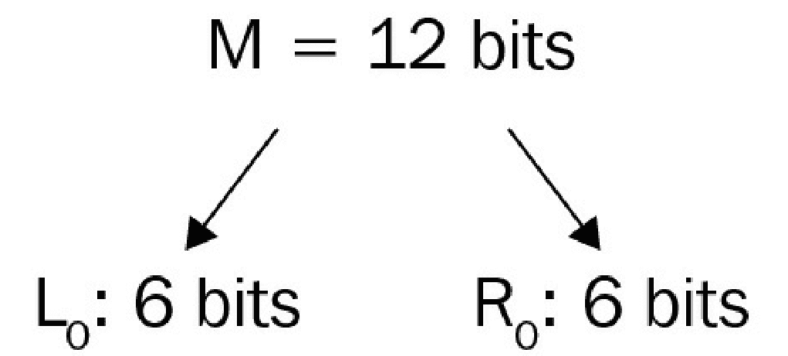

如上图所示，L₀ = (011001)₂ 已通过 f [12434356] 进行扩展。然后，L₀: 011001 将扩展为 (01010101)₂，如下图所示：

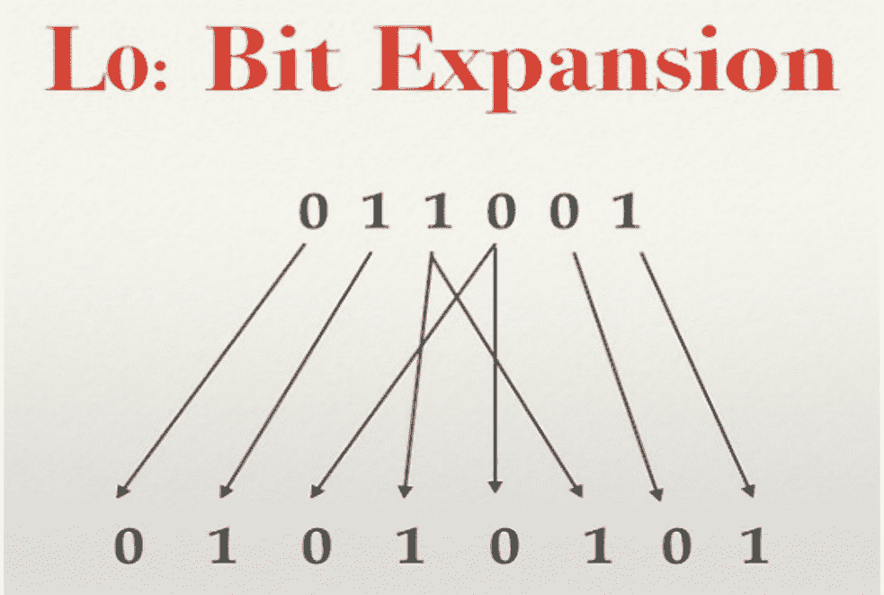

图 2.11 – L₀ (011001)₂ 的 8 位扩展

使用相同的模式 f [12434356] 将 6 位 R₀: (100110)₂ 输入扩展为 8 位，在 Rᵢ₋₁ = (100110)₂ 下，我们得到以下结果：

## R0：位扩展

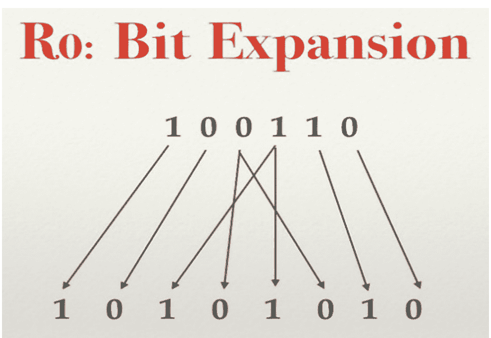

图 2.12 – R₀ (100110)₂ 的 8 位扩展

因此，Rᵢ₋₁ 的扩展结果将是 (10101010)₂。

## 密钥生成

正如我们之前所说，主密钥 [K] 由 9 位组成。每一轮我们都有不同的加密密钥 [Kᵢ]，它由主密钥的 8 位生成，从第 i 轮加密开始计数。让我们举一个例子来说明与第四轮相关的密钥 K₄ 的生成：

+   - K = 010011001（9 位密钥，即主密钥）
+   - K₄ = 01100101（由 K 取得的 8 位）

下图将帮助你更好地理解这个过程：

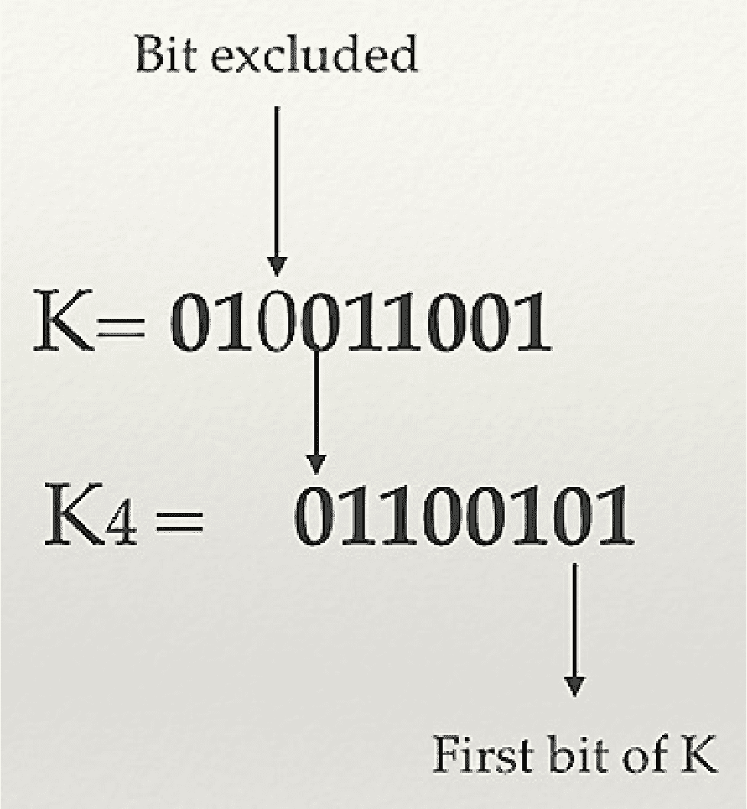

*图 2.13 – 密钥生成示例*

如上图所示，我们正在处理第四轮加密，因此从主密钥 **[K]** 的第四位开始计数以生成 **[K4]**。

## 位加密

为了执行位加密 **E**，我们在扩展后的 **R<sub>i-1</sub> = (100110)<sub>2</sub>** 与 **K<sub>i</sub> = (01100101)<sub>2</sub>** 之间使用 **XOR** 函数。我将此输出称为 **E(K<sub>i</sub>)**：Exp(R<sub>i−1</sub>) K<sub>i</sub> = 10101010 01100101 = E(K<sub>i</sub>) (11001111)。此时，我们将由 8 位组成的 **E(K<sub>i</sub>)** 分成两部分：左边 4 位，右边 4 位：L(EK<sub>i</sub>) = (1100)<sub>2</sub>，R(EK<sub>i</sub>) = (1111)<sub>2</sub>。现在，我们用两个 2×8 的 S-Box 矩阵分别处理左边的 4 位和右边的 4 位，这两个矩阵的每个元素由 3 位组成。如前所述，输入是 4 位：第一位是行，后三位表示一个二进制数以指示列（和前面一样，只是位数更少）。因此，0 表示第一行，1 表示第二行。类似地，000 表示第一列，001 表示第二列，依此类推，直到 111。我们将这两个 S-Box 称为 S1 和 S2。下图展示了它们各自的元素：

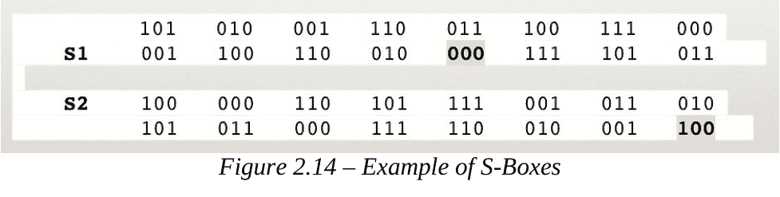

**L(E(K<sub>i</sub>)) = (1100)<sub>2</sub>** 由 **S1** 处理；因此，第二行 **(1)<sub>2</sub>** 和第四列 **(100)<sub>2</sub>** 的交叉元素就是输出，此处用数字 **(000)<sub>2</sub>** 表示。**R(E(K<sub>i</sub>)) = (1111)<sub>2</sub>** 由 **S2** 处理；因此，第二行 **(1)<sub>2</sub>** 和第七列 **(111)<sub>2</sub>** 的交叉元素就是输出，此处用数字 **(100)<sub>2</sub>** 表示。最后一步是将得到的两个输出连接起来，这里用符号 ∥ 表示，这将生成密文：S1(L(E(K<sub>i</sub>))) = (000)<sub>2</sub> ∥ S2(R(E(K<sub>i</sub>))) = (100)<sub>2</sub>。下图展示了函数 *f* 的第一轮（右侧）加密在数学上是如何工作的：

## DES 中的密钥生成

基于*香农的混淆与扩散原理*，DES 与大多数对称算法一样，通过对位进行置乱来获得这两种效果。如前所述，DES 主密钥是一个 64 位密钥。密钥的位从 1 到 64 编号，其中每第八位被忽略，如下表中突出显示的列所示：

## DES 输入密钥

| 1 | 2 | 3 | 4 | 5 | 6 | 7 | 8 |
| 9 | 10 | 11 | 12 | 13 | 14 | 15 | 16 |
| 17 | 18 | 19 | 20 | 21 | 22 | 23 | 24 |
| 25 | 26 | 27 | 28 | 29 | 30 | 31 | 32 |
| 33 | 34 | 35 | 36 | 37 | 38 | 39 | 40 |
| 41 | 42 | 43 | 44 | 45 | 46 | 47 | 48 |
| 49 | 50 | 51 | 52 | 53 | 54 | 55 | 56 |
| 57 | 58 | 59 | 60 | 61 | 62 | 63 | 64 |

*图 2.16 – DES 主密钥中被取消选择的位*

在取消选择这些位之后，新密钥是一个 56 位密钥。此时，对 56 位密钥进行第一次置换。该操作的结果是


*混淆*比特位置；然后，密钥被分成两个28位的子密钥，称为**C0**和**D0**。完成此操作后（始终在同一行中进行，以产生一定的混淆和扩散效果），它会按照下表所示的循环移位过程进行处理：

| 轮次 | 1 | 2 | 3 | 4 | 5 | 6 | 7 | 8 | 9 | 10 | 11 | 12 | 13 | 14 | 15 | 16 |
|---|---:|---:|---:|---:|---:|---:|---:|---:|---:|---:|---:|---:|---:|---:|---:|---:|
| 移位位数 | 1 | 1 | 2 | 2 | 2 | 2 | 2 | 2 | 1 | 2 | 2 | 2 | 2 | 2 | 2 | 1 |

**图2.17 – 展示DES中每一轮密钥移位的位数**

如果你查看上面的表格，你会注意到第1、2、9和16轮仅向左移位1位；所有其他轮次向左移位2位。让我们以**C0、D0**（密钥最初划分为28位左半部分和28位右半部分）为例，用二进制表示如下：

C0 = 1111000011001100101010101001   D0 = 01010101011001100111100011

从**C0**和**D0**出发，将生成**C1**和**D1**，如下所示：

C1 = 1110000110011001010101010011   D1 = 10101010110011001111000111

如果你专注于**C0 --> C1**的生成步骤，就能更好地理解其工作原理——它就是将C0相对于C1的所有位简单地向左移动一位：

C0 = 1111000011001100101010101001
C1 = 1110000110011001010101010011

循环移位完成后，如前所述，下一步是对56位的子密钥进行48位的选择处理。这是一种简单的位置置换：仅举一个例子，第14位移动到第一个位置，第32位移动到最后一个位置（第48位）。如下表所示，某些位（例如第18位）会在新配置中被丢弃，因此你不会在表中找到它们。在比特压缩过程结束时，只选出48位；因此，有8位被丢弃：

| 14 | 17 | 11 | 24 | 1 | 5 | 3 | 28 | 15 | 6 | 21 | 10 |
|---:|---:|---:|---:|---:|---:|---:|---:|---:|---:|---:|---:|
| 23 | 19 | 12 | 4 | 26 | 8 | 16 | 7 | 27 | 20 | 13 | 2 |
| 41 | 52 | 31 | 37 | 47 | 55 | 30 | 40 | 51 | 45 | 33 | 48 |
| 44 | 49 | 39 | 56 | 34 | 53 | 46 | 42 | 50 | 36 | 29 | 32 |

**图2.18 – 48位子密钥中的变换与压缩**

在下图中，你可以看到密钥生成的整个过程，它结合了**奇偶校验丢弃**、**左移位**和**压缩**：

| 轮次 | 移位 |
| --- | --- |
| 1、2、9、16 | 一位 |
| 其他 | 两位 |

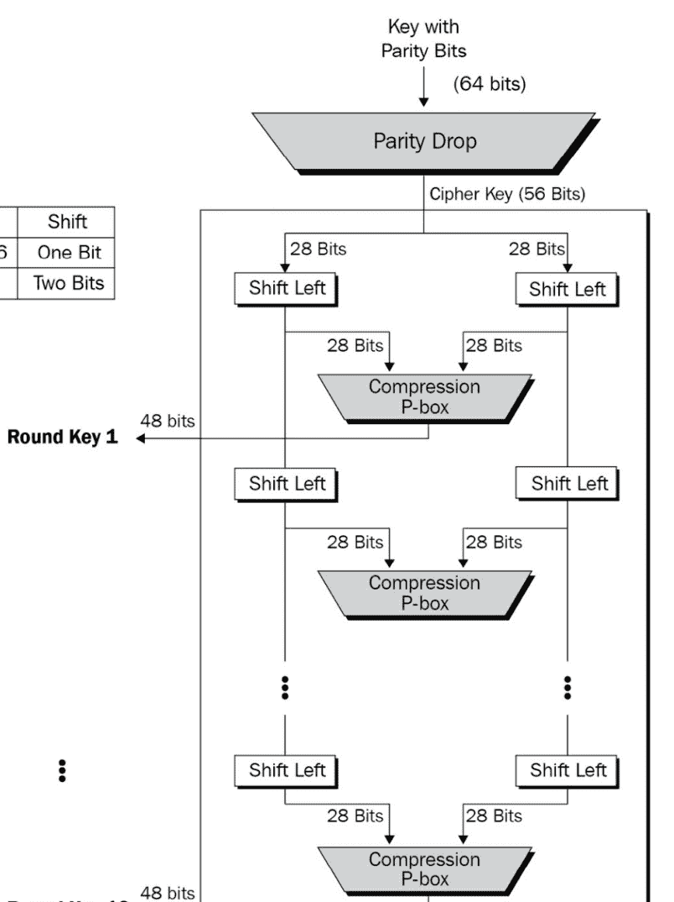

**图2.19 – 密钥生成方案**

凭借这种压缩/混淆/置换技术，DES能够为每一轮确定不同的48位子密钥。这使得DES难以被破解。

## 加密

生成密钥之后，我们便可以开始对消息[M]进行加密。DES的加密方案由三个阶段组成：

- **第1步 – 初始置换：** 首先，消息[M]的比特位通过一个我们称之为**初始置换（IP）**的函数进行置换。从密码学的角度来看，这一操作似乎并不会增强算法的安全性。置换之后，64位被分为32位的**L0**和32位的**R0**，就像我们在简化DES中所做的那样。

- **第2步 – 加密轮次：** 对于**0 ≤ i ≤ 16**，执行以下操作：

  Li = Ri-1

  计算**Ri = Li-1 ⊕ f(Ri-1, Ki)**。这里，**Ki**是从密钥**K**（第j轮密钥）获得的48位字符串，**f**是一个扩展函数，类似于前面为简易DES所描述的**f**函数。基本上，对于**i = 1**（第一轮），我们有：

  L1 = R0

  R1 = L0 ⊕ f(R0, K1)

- **第3步 – 最终置换：** 算法在第16轮（最后一轮）的最后部分包括以下内容：

  - 交换左半部分**L16**与右半部分**R16**，以获得（**R16, L16**）
  - 应用IP的逆置换**INV**，以获得密文**c**，其中**c = INV(IP(R16, L16))**

下图是DES加密方案的直观表示：

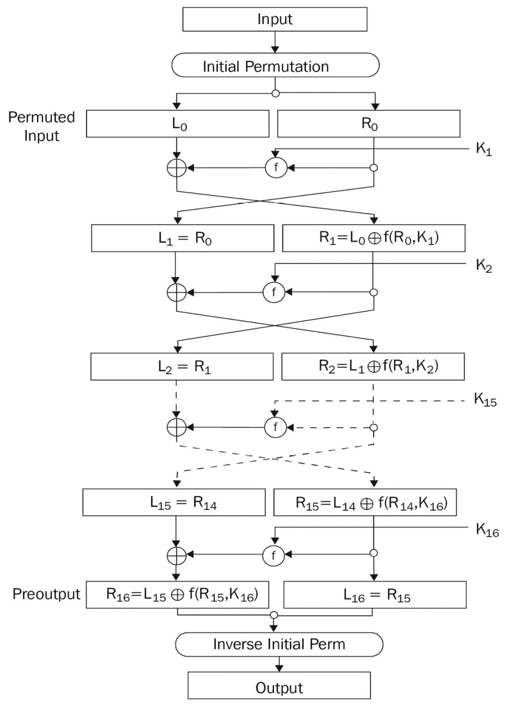

**图2.20 – DES加密**

总结一下DES的加密阶段，我们执行了一个复杂的密钥生成过程，其中在64位主密钥上进行了48位子密钥的选择。因此有以下三个步骤：初始置换、加密轮次和最终置换。既然我们已经分析了加密过程，接下来可以进入DES解密分析。

## 解密

DES解密非常容易理解。实际上，为了恢复明文，我们执行加密的逆过程。解密的过程与加密完全相同，只是将密钥的顺序（K₁…K₁₆）颠倒为（K₁₆…K₁）。在下图中，你可以看到解密过程的流程图：

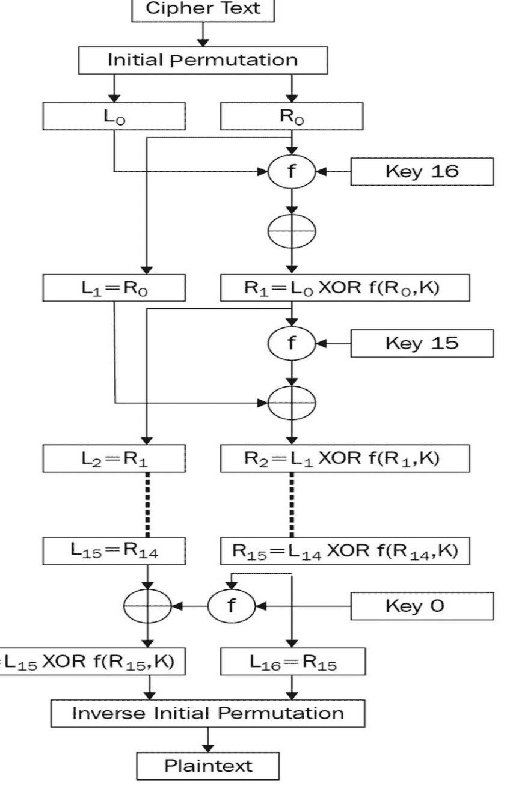

**图2.21 – DES解密过程**

因此，描述解密过程如下：取密文并对其执行初始置换IP，然后将**L0**（左半部分）与**R0 = f(R0, K16)**进行**XOR**运算。然后每一轮继续如此进行，最后执行最终置换，最终得到明文。现在我们已经走到了DES算法流程的终点，接下来让我们继续分析该算法及其漏洞。

## DES 算法分析

进一步深入算法的细节，我们可以发现一些有趣的东西。DES中一个最有趣的步骤是每一轮在子密钥（**K1, K2...K16**）与消息的一半部分**[M]**之间执行的**XOR**运算。在这一步中，我们找到了S盒：即前面在简化DES中描述的函数*f*。正如我们之前所看到的，S盒是DES中一个特殊的矩阵，由4行16列（4×16的S盒）组成，由NSA固定：

**图2.22 – DES中的S盒矩阵**

看一下DES第五轮中S盒的具体内容：2、12、4、1、7、10、11、6、8、5、3、15、13、0、14、9、14、11、2。你可能会注意到，这些数字的取值范围在0到(R_i-1) 16 - 1 = 15之间。因此，48位输入在与[K_i]执行XOR运算后将精确产生48位输出。此外，如果你仔细观察，在第14列中，所有数字都非常小：0、9、3和4。这种组合会对安全性构成问题吗？如果我告诉你，在S盒中使用较小的数字并不会成为问题，你可能会感到困惑。另一个可能自然浮现的问题是：“为什么密钥只有56位而不是64位？”因为，正如我已经提到的，另外8位用于奇偶校验。实际上，初始主密钥长度为64位，因此密钥中每隔8位就会被丢弃一位。最终结果是56位密钥，如下表所示：

| 1 | 2 | 3 | 4 | 5 | 6 | 7 | 8 | 9 | 10 | 11 | 12 | 13 | 14 | 15 | 16 |
|---|---|---|---|---|---|---|---|---|---|---|---|---|---|---|---|
| 17 | 18 | 19 | 20 | 21 | 22 | 23 | 24 | 25 | 26 | 27 | 28 | 29 | 30 | 31 | 32 |
| 33 | 34 | 35 | 36 | 37 | 38 | 39 | 40 | 41 | 42 | 43 | 44 | 45 | 46 | 47 | 48 |
| 49 | 50 | 51 | 52 | 53 | 54 | 55 | 56 | 57 | 58 | 59 | 60 | 61 | 62 | 63 | 64 |

**图2.23 – DES密钥生成算法中被丢弃的位**

还有一个可能源于DES所采用加密方法的担忧。在初始置换之后，正如你所看到的，比特位仅通过f(R_i-1, K_i)函数在右侧进行加密。你可能会问，这是否比加密所有比特位更不安全？如果你正确分析该方案，你会注意到每一轮中，比特位都会从左侧交换到右侧，然后进行加密，再反之亦然。这种技术就像一个包裹，使得所有比特位都能被加密，而不仅仅是乍看之下的右半部分。回顾初始置换和最终置换函数，你可能会问：进行初始置换和逆置换后，最终结果不是相互抵消了吗？正如我已经提到的，像那样执行比特置换没有任何密码学意义。原因是，在70年代，将比特位插入硬件比现在要复杂得多。总而言之，我可以这样说，DES中所采用的整个过程


替换、置换、E扩展和位移动产生了*混淆*和*扩散*。在本节开头，当我提到*克劳德·香农*在《*通信的数学理论*》中提出的安全密码原理时，已经引用了这一概念。

## 破解 DES

自DES诞生以来，针对破解DES的攻击历史充满趣闻。1975年，学术界开始对56位密钥长度的安全性产生怀疑。许多文章相继发表；*惠特尼·迪菲*和*马丁·赫尔曼*（即《*第3章，非对称加密*》中提到的*迪菲-赫尔曼密钥交换*的两位作者）曾有过一个非常有趣的预测：一台价值2000万美元（1977年）的计算机可以在1天内破解DES。20多年后，1998年，**电子前沿基金会（EFF）**开发了一台名为**DES破解机**的专用计算机来破解DES。EFF花费不到25万美元，使用了嵌入26块电子板中的37,050个单元。经过56小时，这台超级计算机成功解密了一个挑战中的明文消息对象，因为解密该密文可获得1万美元的奖励。所采用的方法是一种简单的*暴力*方法，用于分析**2^56**（约7200万亿）个可能密钥所给出的所有可能位组合。EFF使用包含1,500个微芯片（工作频率为40 MHz）的硬件，在4.5天的运行时间内破解了DES。想象一下，仅1个微芯片就需要38年才能遍历全部密钥。此时，权威机构决定用新的对称密钥算法替换该算法，于是AES出现了。但在探索AES之前，让我们分析一些可能针对DES的攻击。接下来我将介绍一些可能的DES攻击，并考虑到这些方法大多也用于攻击大多数对称算法。其中一些攻击专门针对分组密码，而另一些也适用于流密码。区别在于，流密码每次加密1字节，而分组密码每次加密约128位（一个分组）：

- **暴力攻击：**这种基本攻击方法可用于任何已知密码，即尝试所有可能性来找到密钥。如果你还记得，DES的密钥长度是56位，这意味着攻击者需要穷举全部72,057,594,037,927,936种可能（**2^56**）。但是，我们并不需要尝试所有密钥，因为根据松井充的统计证明，使用(2^47)个已知明文就可以破解16轮DES。这并非一项可以掉以轻心的计算，但尽管如此，自90年代初以来，DES一直是可以破解的算法。如果你感兴趣，可以参考松井充的论文：[https://link.springer.com/content/pdf/10.1007/3-540-48285-7_33.pdf](https://link.springer.com/content/pdf/10.1007/3-540-48285-7_33.pdf)

- **线性密码分析：**这本质上是一种基于已知明文的统计攻击方法。它不能保证每次都成功，但大多数时候有效。其思路是从已知输入（明文）出发，最终确定加密密钥，进而确定由该密钥生成的所有其他输出。
- **差分密码分析：**这种方法技术性较强，需要观察DES内部的一些弱点（类似其他对称算法）。这种攻击方法从选定的明文出发，试图发现明文或密钥。与线性密码分析（需要从难以获得的已知明文开始）不同，攻击者是在掌握选定明文的情况下进行操作的。

最后但同样重要的一点是，DES的一个漏洞称为*弱密钥*：这些密钥根本无法执行任何加密。这非常危险，因为如果使用它们，你会得到明文。这些密钥在密码学中是众所周知的，必须避免使用。当密钥生成过程中产生的16个密钥全部相同时，就会出现这种情况。让我们看一个这个问题的例子：

- **所有位均为0000000000000000或1111111111111111的位序列**
- **交替位序列，即0101010101010101或1010101010101010**

在全部四种情况下，加密都是自动可逆的，换句话说，如果你对同一个密文执行两次加密，你将得到原始明文。

## 三重 DES

正如我之前提到的，DES的主要弱点之一是56位的密钥长度。因此，为了增加密钥数量并延长其使用寿命，提出了**三重DES**这个新版本的DES。3DES的逻辑与DES相同；区别在于这里我们用三个不同的密钥运行算法三次。下图展示了一个有助于更好地理解3DES的方案：

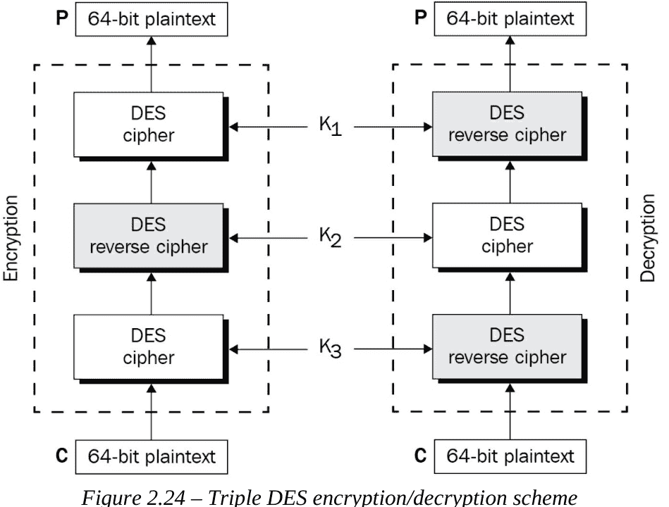

让我们根据上图所示的方案来看看DES中的加密和解密阶段是如何工作的。3DES的加密过程如下：

- 使用[**K₁**]密钥进行单DES加密明文分组。
- 现在，使用[**K₂**]密钥对*步骤1*的输出进行单DES解密。
- 最后，使用[**K₃**]密钥对*步骤2*的输出进行单DES加密。

*步骤3*的输出就是密文（**C**）。

## 3DES 中的解密

密文的解密是一个逆向过程。用户首先使用[**K₃**]解密，然后使用[**K₂**]解密，最后使用[**K₁**]解密。

## DESX

DES系列的最后一个算法是**DESX**。这是对DES密钥的强化，由*罗纳德·李维斯特*（RSA的合著者之一）提出。由于DES加密/解密与之前相同，这里需要选择三个密钥：[**K₁**]、[**K₂**]和[**K₃**]。执行的加密如下：c = [K3] EK1 ([K2] [M]) 首先，我们要执行加密（**Eₖ**），在[**K₂**]和消息[**M**]之间进行**XOR**运算。然后，我们应用DES，使用[**K₁**]进行56位加密。最后，我们将输出**Eₖ₁**、**XOR**和[**K₃**]相加。这种方法允许我们将虚拟密钥增加到**64 + 56 + 64 = 184**位，而不是正常的56位：

## AES 描述

讨论AES本身就足以占用一章的篇幅。在本节中，我将对该算法进行概述。如果你有兴趣了解更多，可以参考NIST在2001年11月26日发布的文件，见文档《*FIPS PUB 197*》。在本章中，我仅限于高层级地描述该算法，并给出我的评论和建议。最重要的是，为避免混淆，我将以其他论文中未见的另一种方式分析AES。我对AES的分析将基于将算法划分为不同步骤。我将这些步骤称为**密钥扩展**和**初始轮密钥加**；然后，正如你稍后将看到的，每个步骤又分为四个子步骤，称为**字节代换变换**、**行移位变换**、**列混合**和**轮密钥加**。重要的是理解算法的方案，然后每一轮的工作方式类似，你可以很容易地理解128位密钥的10轮、192位的12轮和256位的14轮机制。**密钥扩展（KE）**的工作原理如下：

- 固定的128位密钥输入扩展为取决于AES大小的密钥长度：128、192或256。
- 然后，创建**[K₁], [K₂],...[Kᵣ]**子密钥，用于加密每一轮（通常向该轮添加**XOR**）。
- AES使用一种称为Rijndael*密钥调度*的特殊方法，将短主密钥扩展为一定数量的轮密钥。

**初始轮密钥加（F-ARK）**的工作原理如下。这是第一步操作。算法取第一个密钥**[K₁]**，并将其添加到**AddRoundKey**：使用当前块与扩展密钥的一部分进行按位**XOR**。**第R₁轮到第Rₙ₋₁轮**的工作原理如下。每一轮（除了最后一轮）分为四个步骤，称为层，包含以下内容：

- **字节代换（SB）变换：**这一步是基本的非线性步骤，通过特定的S盒执行（我们已经在DES中看到了S盒的工作原理）。你可以在下图中看到AES的S盒。
- **行移位（SR）变换：**这是一种位的打乱，...

导致多轮扩散。

- **MixColumns（列混合）转换：** 此步骤与 SR 范围类似，但应用于列。
- **AddRoundKey（轮密钥加）：** 轮密钥与上一层的结果进行**异或**。

下图展示了以十六进制表示的 S-Box Rijndael：

| X\Y | 0 | 1 | 2 | 3 | 4 | 5 | 6 | 7 | 8 | 9 | a | b | c | d | e | f |
| --- | --- | --- | --- | --- | --- | --- | --- | --- | --- | --- | --- | --- | --- | --- | --- | --- |
| 0 | 63 | 7C | 77 | 7B | F2 | 6B | 6F | C5 | 30 | 01 | 67 | 2B | FE | D7 | AB | 76 |
| 1 | CA | 82 | C9 | 7D | FA | 59 | 47 | F0 | AD | D4 | A2 | AF | 9C | A4 | 72 | C0 |
| 2 | B7 | FD | 93 | 26 | 36 | 3F | F7 | CC | 34 | A5 | E5 | F1 | 71 | D8 | 31 | 15 |
| 3 | 04 | C7 | 23 | C3 | 18 | 96 | 25 | 9A | 07 | 12 | 80 | E2 | EB | 27 | B2 | 75 |
| 4 | 09 | 83 | 2C | 1A | 1B | 6E | 5A | A0 | 52 | 3B | D6 | B3 | 29 | E3 | 2F | 84 |
| 5 | 53 | D1 | 00 | ED | 20 | FC | B1 | 5B | 6A | CB | BE | 39 | 4A | 4C | 58 | CF |
| 6 | D0 | EF | AA | FB | 43 | 4D | 33 | 85 | 45 | F9 | 02 | 7F | 50 | 3C | 9F | A8 |
| 7 | 51 | A3 | 40 | 8F | 92 | 9D | 38 | F5 | BC | B6 | DA | 21 | 10 | FF | F3 | D2 |
| 8 | CD | 0C | 13 | EC | 5F | 97 | 44 | 17 | C4 | A7 | 7E | 3D | 64 | 5D | 19 | 73 |
| 9 | 60 | 81 | 4F | DC | 22 | 2A | 90 | 88 | 46 | EE | B8 | 14 | DE | 5E | 0B | DB |
| a | E0 | 32 | 3A | 0A | 49 | 06 | 24 | 5C | C2 | D3 | AC | 62 | 91 | 95 | E4 | 79 |
| b | E7 | C8 | 37 | 6D | 8D | D5 | 4E | A9 | 6C | 56 | F4 | EA | 65 | 7A | AE | 08 |
| c | BA | 78 | 25 | 2E | 1C | A6 | B4 | C6 | E8 | DD | 74 | 1F | 4B | BD | 8B | 8A |
| d | 70 | 3E | B5 | 66 | 48 | 03 | F6 | 0E | 61 | 35 | 57 | B9 | 86 | C1 | 1D | 9E |
| e | E1 | F8 | 98 | 11 | 69 | D9 | 8E | 94 | 9B | 1E | 87 | E9 | CE | 55 | 28 | DF |
| f | 8C | A1 | 89 | 0D | BF | E6 | 42 | 68 | 41 | 99 | 2D | 0F | B0 | 54 | BB | 16 |

*图 2.26 – Rijndael S-Box*

最后一轮执行除了第 3 层：**MC** 之外的所有前几轮操作。在上述所有过程针对每一轮运行 **n** 次之后（取决于密钥大小：如果密钥为 256 位，则为 14 轮），AES 加密获得密文（**C**），如下图所示：

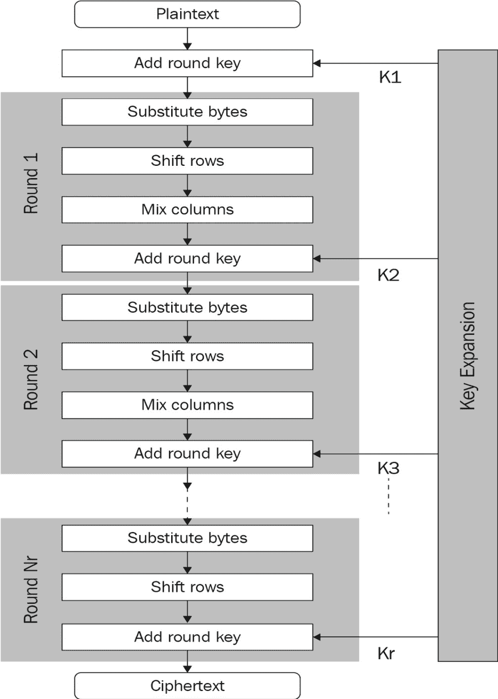

明文
轮密钥加
第 1 轮
字节代换
行移位
列混合
轮密钥加
K1
K2
第 2 轮
字节代换
行移位
列混合
轮密钥加
K3
第 N 轮
字节代换
行移位
轮密钥加
Kr
密钥扩展
密文

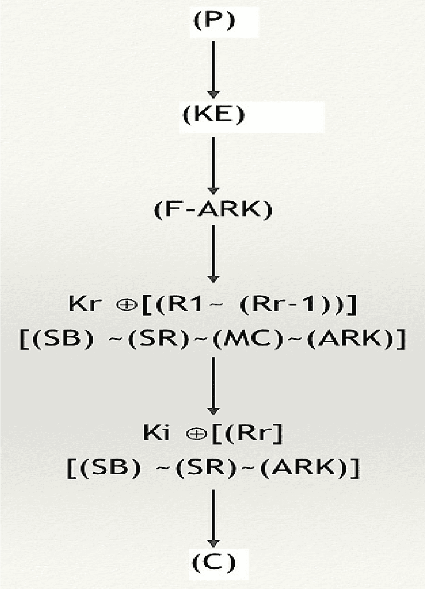

图 2.28 – 使用数学函数重新绘制 AES 流程图

从上图提出的方案中，我们可以注意到以下几点：

- **K_r [(R_1~ (R_{r-1}))]** 表示每个轮密钥（**K_r**）之间执行的所有数学过程，与每一轮的*内部函数*进行**异或**，从第一轮（F-ARK 之后）到最后一轮（不包括）。因此，在 **[(R1~ (Rr-1))]** 内部，我们找到 **[(SB)~(SR)~(MC)~(ARK)]** 函数。
- 在最后一轮中，如你所注意到的，MC 不存在。

在下图中，你可以看到 AES 中加密和解密的完整过程：

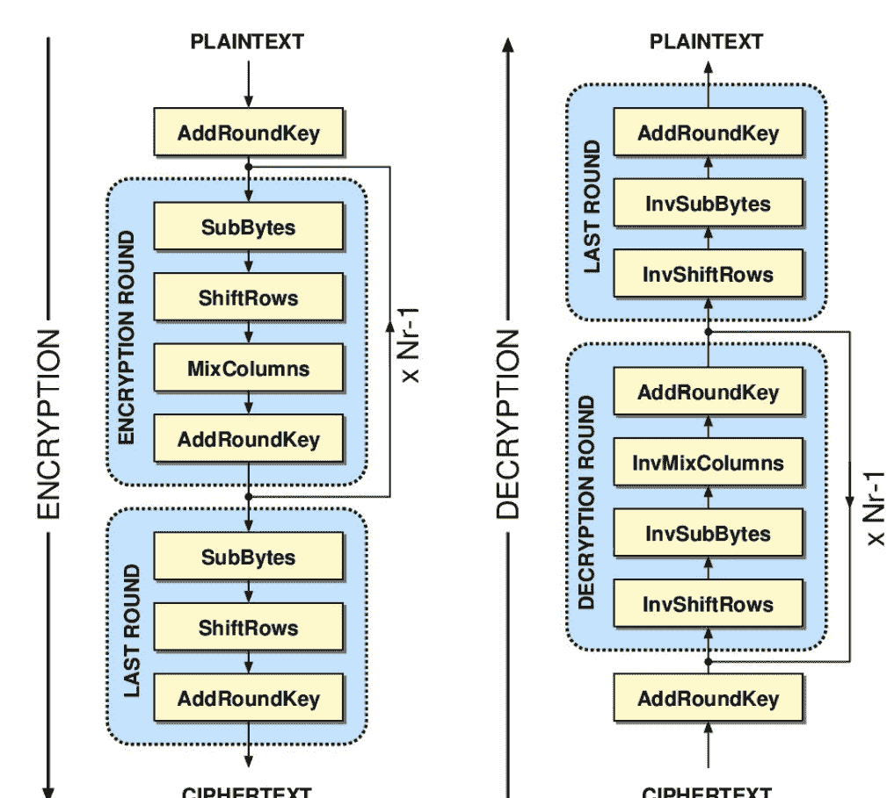

图 2.29 – AES 中的加密和解密方案

在描述了 AES 的加密和解密操作之后，我们现在分析该算法上的攻击和漏洞。

## AES 中的攻击与漏洞

NSA 和 NIST 的出版物认为 AES 对任何已知类型的攻击都是不可攻破的。然而，AES 有其漏洞；事实上，每一个可实现系统都存在漏洞。

**重要提示**

回想一下 NIST 报告提到的 AES 可能存在的漏洞（2000 年 10 月 2 日记录）。你可以在 [https://www.nist.gov/news-events/news/2000/10/commerce-department-announces-winner-global-information-security](https://www.nist.gov/news-events/news/2000/10/commerce-department-announces-winner-global-information-security) 阅读。

NIST 文档中指出，*每个候选算法都被要求支持 128、192 和 256 位的密钥长度。对于 128 位密钥长度，大约有 340,000,000,000,000,000,000,000,000,000,000,000（340 后跟 36 个零）种可能的密钥。* 然而，尽管理论上 AES 仍然不可攻破，**(-x%)**，即使用尽全世界的暴力破解手段（你将在*第 9 章，加密搜索引擎*中看到 AES 的计算分析），任何算法中仍然总是可能找到漏洞。在实现阶段常见到漏洞。事实上，请注意如果你使用例如 ECB 模式的 AES 会发生什么。我们已经在 DES 中看到了 ECB 模式。这种基本实现包括将明文划分为多个块，并对每个明文块 P，计算密文 C：`C = Encr(P)`。你可以在下图中看到 ECB 模式加密的方案：

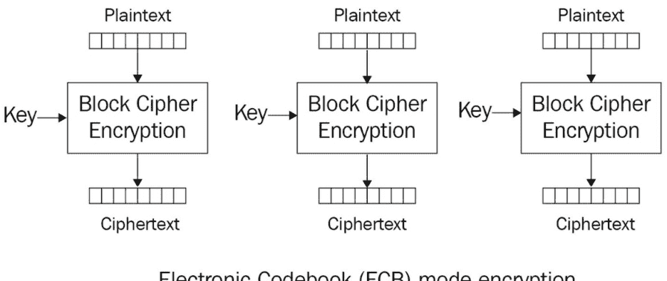

电子密码本（ECB）模式加密

*图 2.30 – ECB 模式加密*

如果 AES 以 ECB 模式实现，如上图所示，在中间（原始图像和用

```
CF A3 1C F4 67 F3 2D 49.....
```

加密的图像之间），你会发现相同的模式被重复。一个非常著名的例子是 ECB 模式下的企鹅图像：即使原始图像和加密图像看起来不同，加密图像中仍然存在可辨认的结构，这表明 ECB 模式不能很好地隐藏明文中的模式。

## ECB 模式实现示例：重放攻击

假设 Alice 通过 ATM 使用 AES 以 ECB 模式加密她的银行卡信息。当她输入密码时，ATM 会向银行发送类似以下内容的加密消息：

- **消息**：`A3 2F 1B 7C ...`（加密的账户信息）

- 银行在检查账户后回答：**[OK]**。

如果 Eve 正在监听通信并截获了加密消息，她可以简单地重复该操作几次，直到她从账户中偷走 Alice 的所有钱。银行只会认为 Alice 正在进行多次 ATM 取款，而如果不对这种攻击采取行动，受害者（Alice）将失去她账户中的所有钱。这个技巧有效是因为 Eve 多次重新发送相同的复制消息。如果 **【K】** 密钥在每次加密会话中都不改变，Eve 就可以尝试这种攻击。一个非常有效的解决方案是只接受每个会话不同的密码文，这消除了对称加密用于多次传输的问题。否则，为了防止这种攻击，AES 的实现之一（就像其他分组密码一样）是 CBC 密码块链接。CBC 执行分组加密，基于前一个块的值生成输出。我们将在*第 9 章，加密搜索引擎*中的*CSE 计算分析*部分再次看到这种实现，届时我会介绍我们在 CBC 模式中实现 AES 加密的 CSE。这里我只解释它是如何工作的。CBC 方法使用 64 位块大小用于明文、密文和初始化向量 **IV**。本质上，**IV** 是一个随机数，有时称为*盐*，与明文进行**异或**以计算块。只需记住以下内容：

- **E** = 加密
- **D** = 解密
- **C** = 密文

### 加密过程如下：

- 计算初始块 **C₀**，取明文第一块（**P₀**）与初始化向量（**IV**）进行**异或**：

```
C0 = E (P0 IV)
```

- 每个后续块通过将前一个密文块与明文块进行**异或**，并对结果进行加密来计算：

```
Ci = E ( Pi Ci-1)
```

### 解密过程如下：

- 要获得明文（**P₀**），将收到的第一个密文块（**C₀**）的解密结果与初始化向量（**IV**）进行**异或**：

```
P0 = D (C0) IV
```

- 要获得所有其他明文（**Pᵢ**），我们必须对收到的密文（**Cᵢ**）的解密结果与除第一个之外的所有其他密文进行**异或**：

```
Pi= D (Ci) Ci-1
```

下图表示了 CBC 模式加密的方案：

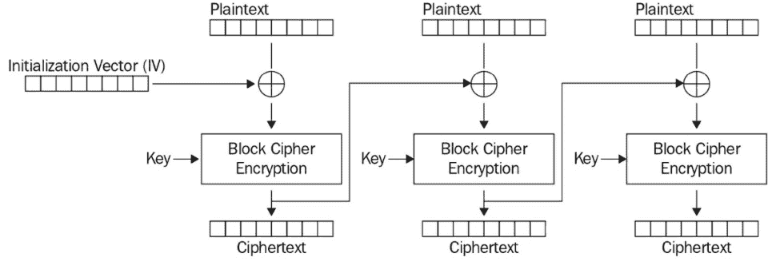

密码块链接（CBC）模式加密

*图 2.32 – CBC 模式加密方案*

AES 是一种健壮的对称算法，直到 2009 年，唯一成功的攻击是所谓的侧信道攻击。这类攻击主要与 AES 在某些特定应用中的实现有关。以下是侧信道攻击的列表：

- **缓存攻击：** 通常，一些信息存储在内存缓存中（计算机中的一种二级内存）；如果攻击者远程监视缓存访问，他们可以窃取密钥或明文。为了避免这种情况，有必要保持内存缓存干净。


- **Timing attack:** 这是一种利用执行加密所需时间的方法，其基于时序与参数值之间的相关性。如果攻击者已知消息的一部分或密钥的一部分，他们可以比较实际执行时间和建模的执行时间。从本质上讲，这更可以被视为对代码不良实现的一种*物理*攻击，而非逻辑攻击。无论如何，这种攻击不仅适用于 AES，还适用于 RSA、D-H 以及其他依赖于参数相关性的算法。

- **Power monitoring attack:** 就像时序攻击一样，硬件实现中可能存在固有的潜在漏洞。你可以在以下链接找到一个有趣的攻击实验，涉及 Arduino Uno 上 AES 128 位实现的功耗相关性。该攻击影响了该算法的 **ARK** 和 **SB** 函数，通过监控设备的功耗获得了完整的 16 字节密文密钥。对于硬件爱好者来说，这是一种令人兴奋的攻击：
  https://www.tandfonline.com/doi/full/10.1080/23742917.2016.1231523

- **Electromagnetic attack:** 这是另一种针对算法实现的攻击。曾有一项攻击尝试在 FPGA 上进行，通过示波器测量从天线发出的辐射。

最后，AES 的真正问题在于密钥交换。由于这是一种对称算法，Alice 和 Bob 必须在执行加密和解密操作之前就共享密钥达成一致。即使 AES 的少数应用可以在没有密钥交换的情况下实现，大多数应用仍需要非对称算法来弥补密钥传输的不足。我们将在下一章探索非对称加密时更好地理解这一概念。此外，在分析 CSE 时，我们将在 *第 9 章，Crypto Search Engine* 中看到一个不需要任何密钥交换的应用。

## Summary

在本章中，你学习了对称加密。我们探讨了理解对称加密、KE 和 S-Box 功能所必需的布尔运算。然后，我们深入研究了简单 DES、DES、3DES 和 DESX 的工作原理及其主要漏洞和攻击。在这些主题之后，我们分析了 AES（Rijndael），包括其实现架构以及使该算法如此强大的步骤的逻辑。关于 AES 的漏洞和攻击，你已经了解了 ECB 模式与 CBC 模式之间的差异如何使其容易受到分组密码实现攻击的影响。最后，我们探讨了一些适用于大多数密码算法的知名侧信道攻击。这些主题至关重要，因为现在你已经学会了如何实现一种对称密码算法，并且对它的特殊性有了更多的了解。我们将在下一章看到许多与此部分相关的关联。*第 9 章，Crypto Search Engine* 将解释 CSE，该系统采用 AES 作为在云中传输加密文件的一种算法。现在你已经了解了对称加密的基础知识，是时候分析非对称加密了。
