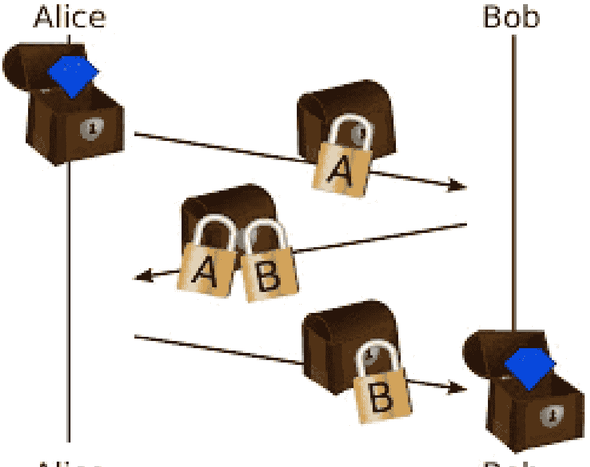
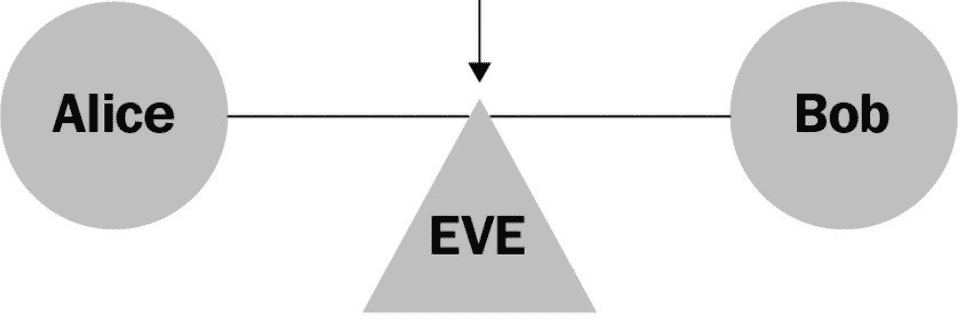
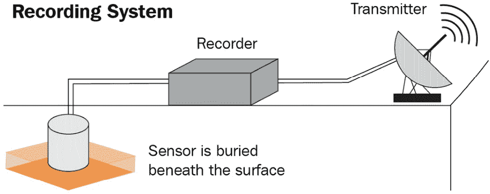
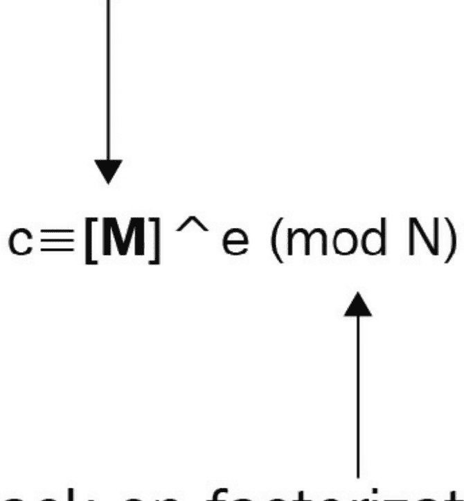

# 3 Asymmetric Encryption

## Join our book community on Discord

https://packt.link/SecNet

非对称加密意味着使用不同的密钥对来加密和解密消息。非对称加密的同义词是公钥/私钥加密，但在非对称加密和公钥/私钥加密之间存在一些差异，我们将在本章中发现这些差异。从这种革命性加密/解密方法的历史略说起，我们将了解不同类型的非对称算法以及它们如何帮助保护我们的信用卡、身份和数据。本章将涵盖以下主题：

- 公钥/私钥与非对称加密
- Diffie-Hellman 密钥交换及相关的中间人问题
- RSA 和一个针对国际威胁的有趣应用
- 对 RSA 的常规和非常规攻击的介绍
- **Pretty Good Privacy (PGP)**
- ElGamal 及其可能存在的漏洞

让我们开始吧！

## Introduction to asymmetric encryption

私钥/公钥加密最重要的功能是在两个参与方之间交换密钥，同时提供安全的信息交易。要充分理解非对称加密，我们必须了解其背景。这种密码学在我们的日常生活中尤为重要。这是负责保护我们财务秘密的密码学分支，例如信用卡和在线账户；生成我们在生活中不断使用的密码；以及通常安全地与他人共享敏感数据并保护我们的隐私。让我们了解一下这个迷人密码学分支的历史。非对称密码学的故事始于 20 世纪 70 年代末，但在 20 世纪 80 年代，随着互联网和数字经济的兴起，计算机开始进入家庭而得到发展。20 世纪 70 年代末至 80 年代是史蒂夫·乔布斯创立苹果公司的时期，也是美国与苏联冷战时期。这也是意大利、法国和德国等许多西方国家经济繁荣的时期。最后，也是互联网诞生的时期。西方集团与东方集团的对立，美国盟友一方，苏联集团另一方，在分裂的柏林城市中形成了对立的间谍网络。在此期间，对称密码学中交换的密钥达到了美国政府的 **通信安全局 (COMSEC)** 负责传输密码密钥，每天运输大量密钥的地步，该局负责传输密码密钥。这种问题情况恶化到了崩溃的边缘。仅举一个例子，在 20 世纪 70 年代的 DES 算法中，银行通过快递员派遣密钥并当面交接。美国的 **国家安全局 (NSA)** 在拥有全球最强大的计算资源的情况下，也在密钥分发问题上苦苦挣扎。密钥分发问题似乎无解，即使对于致力于解决与世界未来相关最困难问题的 RAND 等大型公司也是如此——RAND 是另一家旨在管理未来问题和防止崩溃性故障的强大机构。我认为，有时，崩溃点只是清理局势的一种方式，而不是简单地忽视它。有时，问题有不同的解决方式。在非对称加密的情况下，无论政府投入多少资金，也无论拥有无限计算能力和多位大脑服务的超级计算机，都无法解决一个乍看之下似乎很容易解决的问题。现在你已经对非对称加密解决的主要问题有了大致了解，即密钥交换（实际上，我们将看到在 RSA 中，这个问题被转化为消息的直接传输），让我们深入探索参与这一极其有趣的密码学分支历史的先驱们。

## The pioneers

密码学家有时看起来很奇怪；有时他们可能是内向者，有时可能是外向者。*Whitfield Diffie* 就是这种情况，他是一位独立的自由思想家，既不受政府雇佣，也不受任何大公司的雇佣。我第一次在 2016 年旧金山的一个会议上见到 Diffie，当时他正在与他的著名同事 *Martin Hellman* 和 *Ronald Rivest* 讨论密码学。给我留下最深刻印象的事情之一是他优雅的白色着装，与他高大的身材、长长的白发和白胡子形成鲜明对比。就像一个永远年轻、仍停留在 20 世纪 60 年代的人，他的当代人可能是华尔街证券交易所的代理人，也可能是印度的圣人。他是现代密码学的奠基人之一，他的姓名将永远铭刻在公钥/私钥加密的历史中。Diffie 出生于 1944 年，1965 年毕业于波士顿的麻省理工学院。毕业后，他从事网络安全领域的工作，后来成为 20 世纪 70 年代最真实的独立密码学家之一。他被描述为 *cyberpunk*，以纪念 20 世纪 60 年代和 70 年代的 *new wave* 科幻运动，在该运动中，控制论、人工智能和黑客文化结合成一个反乌托邦的未来主义设定，倾向于关注 *低生活和高科技的结合*。早在 20 世纪 60 年代，美国国防部开始资助一项名为 **国防高级研究计划局 (DARPA)**，也称为 **ARPA** 的通信领域新先进研究计划。ARPA 的主要项目是将军事计算机连接起来，以在电信中创建更具弹性的安全等级。该项目旨在防止核攻击事件中的通信中断，但网络也允许科学家之间发送调度和信息，以及已执行的计算，以利用连接计算机的空闲容量。**ARPANET** 于 1969 年正式启动，仅连接了四个站点，随后迅速增长，以至于到 1982 年，该项目催生了互联网。20 世纪 80 年代末，许多普通用户已连接到互联网，此后他们的数量

爆炸了。当 ARPANET 正在成长时，Diffie 开始思考有一天，每个人都会拥有一台计算机，并且借助它互相发送电子邮件。他还设想了一个世界，在那里产品可以通过互联网销售，真正的货币被信用卡所取代。他对隐私和数据安全的高度关注使 Diffie 着迷于一个问题：如何在完全不知道电缆另一端是谁的情况下与他人进行通信。此外，加密消息和文档通常是在发送极有价值的信息时进行的；数据加密开始被普通大众用来隐藏信息并与其他人分享秘密。这正是密码学使用变得普遍的时期，它不仅仅局限于军事、政府或学术界。需要解决的主要问题是，如果两个素不相识的人通过互联网相遇，如何在除了文档本身之外不交换任何额外信息的情况下加密/解密共享文档，而该文档是通过数学参数进行加密/解密的？这就是密钥交换问题的核心。1974 年某一天，Diffie 前往 IBM 的 *Thomas Watson* 实验室进行访问，在那里他受邀发表演讲。他谈到了攻击密钥分配问题的各种策略，但房间里的人对他的解决方案持非常怀疑的态度。只有一个人分享了他的愿景：他是 IBM 的高级密码学家，提到一位斯坦福教授最近访问过实验室，并且对该问题有类似的愿景。这个人是 Martin Hellman。Diffie 如此兴奋，以至于当晚他就驱车前往美国的另一边加利福尼亚州帕洛阿尔托拜访 Hellman 教授。Diffie 与 Hellman 之间的合作将在密码学中因创造该领域最美丽的算法之一而闻名：**Diffie-Hellman 密钥交换**。我们将在下一节分析这一开创性算法。

## Diffie-Hellman 算法

要理解 **Diffie-Hellman (D-H)** 算法，我们可以依赖所谓的 *思想实验* 或 *心理表征*，这是爱因斯坦经常使用的理论表征方法。思想实验是一个假设场景，你在其中在心理上将自己带入比纯理论方式面对问题更真实的情况。例如，爱因斯坦使用了一个非常流行的思想实验来解释相对论理论。他使用了从不同位置观察移动火车的比喻，火车内外的人都是观察者。我将在本书中经常应用这些心理形象化表征。让我们想象我们有两个角色，Alice 和 Bob，他们想交换一条消息（在纸上），但城市里的主要邮局会检查所有信件的内容。因此，Alice 和 Bob 为如何秘密发送信件而苦恼，同时避免任何侵入；例如，把钥匙放在金属笼子里寄给 Bob。但由于 Bob 没有打开笼子的钥匙，Alice 和 Bob 必须先在某个地方见面，以便 Alice 把钥匙交给 Bob。再次，我们回到了交换钥匙的问题。经过很多很多次尝试，似乎不可能找到一个逻辑解决方案来解决这个问题，但终于有一天，Diffie 在 Hellman 的支持下找到了解决方案，Hellman 后来对此说：“*上帝奖励傻瓜！*” 让我们探索 Alice 和 Bob 应该做什么来交换密钥的心理表征：

- **步骤 1：** Alice 把她的秘密信息放在一个用铁挂锁锁住的金属盒子里寄给 Bob，但自己保留钥匙。现在，请记住 Alice 用自己的钥匙锁住盒子，并且没有把它交给 Bob。
- **步骤 2：** Bob 用自己的私钥再给盒子加上一个锁，然后重新寄回给 Alice。因此，Bob 第一次收到盒子时，他无法打开它。他只是给盒子再加了一个锁。
- **步骤 3：** 当 Alice 第二次收到盒子时，她可以自由地取下自己的挂锁，因为盒子仍然用 Bob 的钥匙锁着，如下图所示，当 Alice 最后一次重新寄出盒子时。请记住，信息始终在盒子内部。现在，盒子仅用 Bob 的挂锁锁着。
- **步骤 4：** 当 Bob 这次收到盒子时，他可以打开它，因为盒子仅用他的挂锁锁着。最后，Bob 可以阅读 Alice 发送的信息内容，该内容一直保存在盒子内部。

正如你所见，Alice 和 Bob 从未见面交换任何挂锁钥匙。请注意，在这个例子中，盒子从 Alice 到 Bob 发送了两次，而在算法中则不是：

前面的解释和表征并不是算法的确切做法，但它提供了一个被认为不可解决的问题的实用解决方案：密钥交换问题。现在，我们必须把这种实际论证转变成逻辑数学表征。首先，我们将回到使用模数学，同时利用有限域中运算的一些特定性质。

## 离散对数

我将尝试在不使用过多符号的情况下解释密码学背后的数学，只是我不想让你感到困惑，或用沉重的数学论文来充斥这本书。这不在本书的范围之内。

当我们谈论有限域时，我们考虑的是一个有限的整数群 (**n**)，(**Z**)，位于一个环中——让我们说，(**Zn**)。这个数字群将受到与标准整数相同的数学规律的约束，例如运算。由于我们在这里在一个称为 (**modulo n**) 的有限域中工作，我们必须考虑涉及模数学的一些关键问题。正如我们在上一章看到的那样，在 *模数* 中运算意味着每次到达集合末尾时都回绕到第一个数字。这就像钟表数学，当我们到达 12 时回绕到 1。基本上，请记住在有限域中，存在一个 *数值周期*，其中数字和域运算的结果会重复出现。

例如，如果我们有一个由七个整数组成的集合，{**0, 1, 2, 3, 4, 5, 6**}，通常简写为 (**Z7**)，我们对这个有限域内执行的所有运算都会回绕到该域的整数中。

以下是有限域 (**Z7, +, x**)、加法和乘法的运算简短示例。由于所有运算 (**modulo 7**) 都有效，我们必须考虑数字每次超过 7 时都会回绕到 **0**：

1 x 1 ≡ 1 (mod 7)  
2 x 4 ≡ 1 (mod 7)  
3 + 5 ≡ 1 (mod 7)  
3 x 5 ≡ 1 (mod 7)

让我们使用这种计数方式，并认为 = 符号等价于 ≡，这就是我们在小学学到的数学，其中 **2 + 2 = 4** 如果我们考虑例如模 3 的有限域则不完全适用：2 + 2 ≡ 1 (mod 3)。

从高中数学中，我们回忆起 `log_a(z)` 对数是一个函数，其中 (**a**) 是底数。我们必须确定给 (**a**) 的指数以得到数字 (**z**)。所以，例如，如果 **a = 10** 且 **z = 100**，我们发现对数是 **2**，我们说 **100 的以 10 为底的对数是 2**。如果我们使用 Mathematica 计算对数，我们必须使用不同的记法，即 **Log[10, 100] = 2**。

在离散域中工作时，事情变得更加复杂，因此我们不再使用普通对数，而是开始使用离散对数。所以，让我们说我们必须解一个这样的方程：

`a^[x] ≡ b (mod p)`

这将是一个非常困难的问题，即使我们知道 (**a**) 和 (**b**) 的值，因为没有已知的有效算法可以求解离散对数，即 [**x**]。

### 重要说明

我使用了方括号来表示 [**x**] 是秘密的。技术上 [**x**]

是一种离散幂运算，但求解离散对数和离散幂的问题在计算难度上是相同的。

现在让我们更深入一点，解释这个运算的动态原理。考虑计算下面的表达式：2^4 ≡ (x) (mod 13) 首先，我们计算 2^4 = 16，然后用 16 除以 13，商为 1，余数为 3，因此 x = 3。离散对数正是其逆运算：2^[y] ≡ (x) (mod 13) 在这种情况下，我们已知底数为 2，需要计算 [y]。可以证明，能够生成 (x) 的 [y] 有无限多个解。以前面的例子来说，我们有：2^[y] ≡ 3 (mod 13) 求 [y]：一个解是 y = 4，但并非唯一解。对于这个方程的所有整数 (n)，结果 3 同样成立：[y] = [y + (p-1)*n] 让我们证明 n = 1 的情况：2^[4+(13-1)*1] ≡ 2^16 (mod 13)，而 2^16 ≡ 3 (mod 13)。n = 2 时同样成立：2^[4 +(13-1)*2] ≡ 2^28 (mod 13)，而 2^28 ≡ 3 (mod 13)。以此类推……因此，该方程对所有整数（即 (n ≥ 0)）都有无限多个解：[y] ≡ 2^[4 + 12 n] (mod 13)。目前还没有在多项式时间内求解离散对数的方法。因此，在数学和密码学中，这个问题都被认为是非常难解的，即使攻击者拥有强大的计算能力。最后，我们需要引入生成元 (g) 的定义和记号：它是一个特殊的数，我们说 (g) 生成整个群 (Zp)。如果 (p) 是素数，这意味着 (g) 可以取 1 到 p-1 之间的任意值。

## 解释 D-H 算法

D-H 并不是严格意义上的非对称加密算法，但它可以被恰当地定义为公钥/私钥算法。非对称加密与公钥/私钥之间的区别不仅是形式上的，更是实质性的。在后面的 RSA 部分（一个纯粹的非对称算法）中，你会更好地理解这一区别。相反，D-H 得到一个共享密钥，该密钥用于对称加密消息 [M]。用对称算法执行的加密会与 D-H 共享密钥传输相结合，以生成密文 C：对称算法 E((D-H[k]), M) = C 换句话说，我们用

D-H 算法生成共享密钥 [k]，然后用 AES 或其他对称算法加密消息 [M]。D-H 并不直接加密秘密消息；它只能确定双方之间的共享密钥。这是一个关键点，我们将在下一段看到。然而，为了在离散域中工作，并利用离散对数问题在共享密钥时保护其免受攻击者的攻击，迪菲和赫尔曼实现了密码学中最健壮、最著名的算法之一。下面我们看看 D-H 是如何工作的：

- **第 1 步：**爱丽丝和鲍勃首先就参数达成一致：(g) 作为环 (Zp) 中的生成元，以及一个素数 p（模 p）。
- **第 2 步：**爱丽丝选择一个秘密数字 [a]，鲍勃选择一个秘密数字 [b]。

爱丽丝计算 **A ≡ g^a (mod p)**，鲍勃计算 **B ≡ g^b (mod p)**。

- **第 3 步：**爱丽丝将 (A) 发送给鲍勃，鲍勃将 (B) 发送给爱丽丝。
- **第 4 步：**爱丽丝计算 **ka ≡ B^a (mod p)**，鲍勃计算 **kb ≡ A^b (mod p)**。

**[ka = kb]** 将成为爱丽丝和鲍勃之间的共享密钥。下面是该算法的一个数值示例：

- **第 1 步：**爱丽丝和鲍勃就他们将要使用的参数达成一致，即 g = 7 和（模 11）。
- **第 2 步：**爱丽丝选择一个秘密数字 (3)，鲍勃选择一个秘密数字 (6)。

爱丽丝计算 **7^3 (mod 11) ≡ 2**，鲍勃计算 **7^6 (mod 11) ≡ 4**。

- **第 3 步：**爱丽丝将 (2) 发送给鲍勃，鲍勃将 (4) 发送给爱丽丝。
- **第 4 步：**爱丽丝计算 **4^3 (mod 11) ≡ 9**，鲍勃计算 **2^6 (mod 11) ≡ 9**。

数字 **[9]** 就是爱丽丝和鲍勃的共享密钥 **[k]**。

## 分析该算法

在算法的*第 2 步*中，爱丽丝计算 **A = g^a (mod p)**，鲍勃计算 **B = g^b (mod p)**。爱丽丝和鲍勃交换了 **(A)** 和 **(B)**，这是单向函数的公共参数。*单向函数*之所以得名，是因为不可能 **(-x%)** 从公共参数 **(A)** 反推出秘密私钥 **[a]**（对 **(B)** 和 **[b]** 也是如此），这是由离散对数的健壮性所决定的（参见*“离散对数”*一节）。模幂运算的另一个性质是，我们可以将 **B^a** 和 **A^b (mod p)** 写成如下形式：**B^a ≡ (g^b)^a (mod p)**，**A^b ≡ (g^a)^b (mod p)**。因此，根据模指数运算的性质，我们有：**g^(b*a) ≡ g^(a*b) (mod p)**。例如，我们有：

- 爱丽丝：**(7^6)^3 ≡ 7^(6*3) ≡ 9 (mod 11)**
- 鲍勃：**(7^3)^6 ≡ 7^(3*6) ≡ 9 (mod 11)**

这就是使 D-H 算法得以成立的数学技巧。现在我们已经理解了该算法，接下来让我们指出它的缺陷以及可能对其进行的攻击。

## 对 D-H 算法的可能攻击与密码分析

对 D-H 算法最常见的攻击是**中间人（MiM）攻击**。MiM 攻击是指攻击者潜入通信信道，窃听、阻断或篡改发送方与接收方之间的通信。通常，这种攻击由伊芙（攻击者）冒充对话中的两个真实参与者之一来实现：

*图 3.2 – 伊芙是“中间人”*

回顾 D-H 算法*第 3 步*中的内容，爱丽丝和鲍勃交换了他们的公共参数 **(A)** 和 **(B)**。在这里，爱丽丝将 **(A)** 发送给鲍勃，然后鲍勃将 **(B)** 发送给爱丽丝。现在，伊芙（攻击者）通过冒充爱丽丝来干扰通信。因此，MiM 攻击看起来像这样：

- **第 3 步：**爱丽丝将 **(A)** 发送给鲍勃，鲍勃将 **(B)** 发送给爱丽丝。
- **在这里，我们就遇到了 MiM 攻击：**伊芙将 **(E)** 发送给鲍勃，然后鲍勃将 **(B)** 发送给伊芙，以为她是爱丽丝。

让我们分析爱丽丝的函数 **A ≡ g^a (mod p)** 和鲍勃的函数 **B ≡ g^b (mod p)**。如果这是在普通算术中而不是在有限域中进行的，这一过程将至关重要。还有另一种可能的攻击，也被称为**生日攻击**，它是针对离散对数最著名的攻击之一。众所周知，在一群人中，至少有两个人会共享同一个生日，因此在循环群中，有可能找到一些相等的值（碰撞）来求解离散对数。

### 重要说明

**(E)** 这里代表伊芙的公钥参数，它是由她的私钥生成的，而不是加密。

与它的逻辑简洁性相匹配的是，其内部隐藏着如此强大的力量，以至于 40 年后，它仍然被用于保护全球超过 80% 的商业交易。它的首字母缩写来自三位发明者的名字——**Rivest、Shamir 和 Aldemar**。**RSA** 正是我们所称的完美的非对称算法。实际上，在 1997 年，英国密码机构 CESG 将公钥加密的发明归功于 1970 年的詹姆斯·埃利斯（James Ellis），该机构还宣称，1973 年，克利福德·科克斯（Clifford Cocks）撰写了一份文档，展示了与 RSA 算法类似的一个版本。非对称算法的核心概念是加密密钥和解密密钥不同。回想我在*“Diffie-Hellman 算法”*一节中关于挂锁的类比，当我描述 D-H 算法时，我们看到任何人都（不仅仅是爱丽丝和鲍勃）可以用挂锁锁住盒子。这就是 MiM 的真正问题所在，因为无法识别挂锁究竟是属于鲍勃还是爱丽丝。为了克服这个问题，可以进行另一个有趣的思维实验，使用类似的类比，但稍微改变一下条件。假设爱丽丝复制了许多她的挂锁，并将这些副本寄送到全国的每个邮局，而将能打开所有这些挂锁的钥匙保存在一个秘密的地方。如果鲍勃想给爱丽丝发送一条秘密消息，他可以去邮局索取爱丽丝的挂锁，把消息放进盒子里，然后锁上。这样，鲍勃（发送者）从锁上盒子的那一刻起就无法再打开它，但当爱丽丝收到盒子时，她可以用她独有的安全钥匙打开它。基本上，在 RSA 中（与 D-H 相反），鲍勃用爱丽丝的公钥加密消息。加密过程结束后，即使是鲍勃也无法解密该消息，而爱丽丝可以用她的私钥解密。正是这一步将非对称加密的概念从纯粹的理论转变为实际应用。RSA 发现了如何用接收者的公钥加密消息并用私钥解密的方法。为了实现这一点，RSA 需要一种特殊的数学函数，稍后我们详细探讨该算法时，我会进一步解释。如前所述，这个算法有三位发明者。当时他们都是波士顿麻省理工学院的研究人员。我们说的是上世纪 70 年代末。在 D-H 算法发明之后，罗纳德·里维斯特对这种新型密码学极为着迷。他先邀请了数学家伦纳德·阿德勒曼（Leonard Adleman），随后计算机科学系的另一位同事阿迪·沙米尔（Adi Shamir）也加入了团队。里维斯特试图实现的是以数学方式发送秘密

message encrypted with a public key and decrypt it with the private key of the receiver. However, in D-H, the message can only be encrypted once the key has been exchanged, using the same shared key. Here, the problem was to find a way to send the message that had been encrypted with a public key and decrypted through the private key. But as I've said, it needed a very particular inverse mathematical function. This is the real added value of the RSA invention that we are going to discover shortly.

The tale of this discovery, as Rivest told it, is funny. It was April 1977 when Rivest and Adleman met at the home of a student for Easter. They drank a little too much wine and at about midnight, Rivest went back home. He started to think over the problem that had been tormenting him for almost a year. Laying on his bed, he opened a mathematics book and discovered the function that could be perfect for the goal that the group had.

The function he found was a particular inverse function in modular mathematics related to the factorization problem.

As I introduced in *Chapter 1, Deep Diving into Cryptography*, the problem of factorizing a large number made by multiplying two big prime numbers is considered very hard to solve, even for a computer with immense computation power.

## Explaining RSA

To understand this algorithm, we will consider Alice and Bob exchanging a secret message. Let's say that Bob wants to send a secret message to Alice, given the following:

- **M**: The secret message
- **e**: A public parameter (usually a fixed number)
- **c**: The ciphertext or cryptogram
- **p, q**: Two large random prime numbers (the private keys of Alice)

The following is the public and private key generation. As you will see, the core of RSA (its magic function) is generating Alice's private key, [d].

Key generation:

Alice's public key, (N), is given by the following code:

N = p*q

As we mentioned earlier, multiplying two big prime numbers makes (N) very difficult to factorize, and makes it generally very difficult for an attacker to find [p] and [q].

Alice's private key, [d], is given by the following code:

[d] * e ≡ 1 (mod [p-1]*[q-1])

Bob performs the encryption:

c ≡ M^e (mod N)

Bob sends the ciphertext, (c), to Alice. She can now decrypt (c) using her private key, [d]:

c^d ≡ M (mod N)

And that's it!

**Note:** The bold elements – M, d, p, and q – in the algorithm are protected and secret.

**Numerical example:**

M = 88
e = 9007
p = 101
q = 67
N = 6767

**Step 1:** Bob's encryption is as follows:

88^9007 ≡ 6621 (mod 6767)

Alice receives a cryptogram, that is, c = 6621.

**Step 2:** Alice's decryption is as follows:

9007 * d ≡ 1 (mod (101-1)*(67-1))
d = 3943
6621^3943 ≡ 88 (mod ...)

As you can see, the secret message, [M] = 88, comes back from Alice's private key, [d] = 3943.

## Analyzing RSA

There are several elements to explain but the most important is to understand why this function, which is used for decrypting (c) and obtaining [M], works:

M ≡ c^[d] (mod N)

This is Step 2; that is, the decryption function. I have just inverted the notation by putting [M] on the left.

The reason it works is hidden in the key generation equation:

[d] * e ≡ 1 (mod [p-1]*[q-1])

[d] is Alice's private key. For Euler's theorem, the function will probably be verified because the numbers [p] and [q] are very big and [M] is probably a co-prime of (N).

If this equation is verified, then we can rewrite the encryption stage as follows:

(M^e)^d (mod N)

For the properties of the powers and Euler's theorem, we have the following:

M^(e*d) (mod N)
de ≡ 1 (mod (p-1)*(q-1))

That is the same as writing M^1 = M (mod N). So, by inserting [d] inside the decryption stage, Alice can obtain [M].

## Conventional attacks on the algorithm

All the attacks that will be explained in the first part of this section are recognized and well known. That is why we are talking about conventional attacks on RSA. The first three methods of attack on RSA are related to the (mod N) public parameter. To perform an attack on N = p*q, the attacker could do the following:

- Use an *efficient* algorithm of factorization to discover **p** and **q**.
- Use new algorithms that, under certain conditions, can find the numbers.
- Use a quantum computer to factorize **N** (in the future).

Let's analyze the following three cases:

- In the first case, an efficient algorithm of factorization is not yet known. The most common methods are as follows:
  - The general number field sieve algorithm
  - The quadratic sieve algorithm
  - The Pollard algorithm
- In the second case, if (**n**) is the number of digits of **N = p*q** and the attacker knows the first (**n/4**) digits or the last (**n/4**) digits of [**p**] or [**q**], then it will be possible to factorize (**N**) in an efficient way. Anyway, there is a very remote possibility of knowing it. For example, if [**p**] and [**q**] have 100 digits and the first (or the last) 50 digits of [**p**] are known, then it's possible to factorize **N**.

For more information, you can refer to Coppersmith's method of factorization. More cases related to Coppersmith attacks, as explained later in this section, are where the exponents, (**e**) or [**d**], and even the plaintext, [**M**], are too short.

- If an attacker uses a quantum computer, it will be theoretically possible to factorize **N** in a short time with Shor's algorithm, and I am convinced that in the future, other, more efficient quantum algorithms will arise. I will explain this theory in more detail in *Chapter 8, Quantum Cryptography*, where we talk about quantum computing and Q-cryptography.

Finally, if we have a very short piece of plaintext, [**M**], and even the exponent, (**e**), is short, then RSA could be breakable. This is because the power operation, **M^e**, remains inside modulo **N**. So, in this phase of encryption, let's say we have the following:

M^e < N

Here, it's enough to use the **e-th** root of (**c**) to find [**M**].

### Important Note

I have used open brackets, **[M]**, to denote that the message has been decrypted.

**Numerical example:**

M = 2
e = 3
N = 77
2^3 ≡ 8 (mod 77)

Since **e = 3**, by performing a simple cubic root, √, we can obtain the message in cleartext:

8^(1/3) = 2

Here, we are working in linear mathematics and no longer in modular mathematics.

A way to overcome this problem is to lengthen the message by adding random bits to it. This method is very common in cryptography and cybersecurity and is known as **padding**. There are different ways to perform padding, but here, we are talking about **bit padding**.

As we covered in *Chapter 1, Deep Diving into Cryptography*, we can use ASCII code to convert text into a binary system, so the message, **[M]**, is a string of bits. If we add random bits (usually at the end, though they could also be added at the start), we will obtain something like this:

. . . | 1011 1001 1101 0100 0010 0111 **0000 0000** |

As you can see, the bold digits represent the padding. This method can be used to pad messages that are any number of bits long, not necessarily a whole number of bytes long; for example, a message of 23 bits that is padded with 9 bits to fill a 32-bit block.

Now that we are more familiar with RSA and modular mathematics properties, we'll explore the first interesting application that was implemented with this algorithm.

## The application of RSA to verify international treaties

Let's say that Nation Alpha wants to monitor seismic data from Nation Beta to be sure that they don't experiment with any nuclear bombs in their territory. A set of sensors has been installed on the ground of Nation Beta to monitor its seismic activity, recorded, and encrypted. Then, the output data is transmitted to Nation Alpha, let's say, via a satellite. This interesting application of RSA works as follows:

- Nation Alpha, **(A)**, wants to be sure that Nation Beta, **(B)**, doesn't modify the data.
- Nation Beta wants to check the message before sending it (for spying purposes).

对应于密文，(y)，确实只能由知道私钥，[d] 的人生成。如果 Beta 之前曾试图通过改变 (x) 的值来操纵装有传感器的盒子内部的加密，那么 Beta 就很难得到有意义的消息。正如我们之前提到的，在此协议中，RSA 被倒置了，加密是使用私钥 [d] 执行的，而不是 (e) 这个公共参数，这是通常发生的情况。本质上，Beta 在修改加密时的困难在于得到一个有意义的数字或消息。即使 (x) 参数事先已知，尝试修改密文 (y) 也具有与执行离散对数相同的复杂度（这是一个我们已经看到的难以解决的问题）。我们通过参考以下图表来可视化该过程：

## 地震记录系统

Sensor is buried beneath the surface

Satellite Transmitter

Recorder

Figure 3.3 – The sensor buried underground with the data transmitted via satellite

现在我们已经学会了如何使用 RSA 算法执行的国际条约，我想介绍一个将在第 6 章《公钥/私钥加密中的新算法》中稍后讨论的部分，涉及对 RSA 算法及其最著名的库 OpenSSL 的非常规攻击。

## 非常规攻击

我称这些算法为 *非常规*，因为它们是由我实现的，并且直到现在尚未经过测试和发表。我们在继续阅读本书时会看到，这些针对 RSA 的 *非常规攻击* 甚至对其他非对称加密算法也有效。这些非常规攻击在 2011 年至 2014 年间实现，其范围在于在不知道 Alice 的解密密钥 **[d]** 以及 (**N**) 背后的素数秘密 **[p]** 和 **[q]** 的情况下恢复秘密消息 **[M]**。我将在本节中展示这些非常规攻击，但我将在 *第 6 章，新算法在公钥/私钥加密中* 中更详细地介绍这些方法。其中一些攻击用于 RSA，但可以转用于本章涵盖的大多数非对称算法。一种可能在未来破解因式分解问题的全新算法是 *NextPrime*。它源自一位挚友在 2009 年向我解释机制的 *遗传算法*，Gerardo Iovane。在他的文章 *The Set of Prime Numbers* 中，Gerardo Iovane 描述了如何从一个简单算法开始，通过从模式中剔除非素数来获得所有素数。

### Note

For a more accurate and thorough discussion of Gerardo Iovane's genetic algorithm, you can read *The Set of Prime Numbers* at https://arxiv.org/abs/0709.1539.

经过多年的工作和许多头痛之后，我得出了一个代表曲线的数学函数；该曲线上的每个位置代表一个素数，而在许多位置之间存在由两个素数生成的半素数 (**N**)。该曲线在几何上代表了宇宙中的所有素数。事实证明，(**N**) 的位置始终位于曲线上两个素数 **[p]** 和 **[q]** 位置之间，并且 (**N**) 与它们的位置几乎等距。也可以证明素数具有非常清晰的顺序，并非如人们所相信的那样随机放置且无序。两个素数对象 **[p]** 和 **[q]** 之间的 *距离*，其乘积决定了 (**N**)，相当于位于 **[p]** 和 **[q]** 之间的素数个数。例如，17 和 19 之间的 *素数距离* 为零，1 和 100 之间的距离为 25，10,000 和 10,500 之间的距离仅为 55。目前，该算法仅在特定条件下有效：例如，当 **[p]** 和 **[q]** *彼此相当接近* 时（在多项式距离内）。然而有趣的是，两个素数有多大并不重要。我用该算法进行了一些测试，使用了 10^1,000 位量级的素数。仅为说明这些数字有多大，你可以认为 10^80 代表宇宙中的粒子数。例如，一个 10^1,000 位量级的半素数对应于 RSA 的公钥长度约为 3,000 位（目前密码学中使用最大的公钥之一）。如果两个素数彼此接近，使用 NextPrime 算法可以在几秒钟内处理完毕。在撰写本书时，我正在基于量子计算机开发 NextPrime 算法的版本。它可能是下一代量子计算因式分解算法（类似于我们在 *第 8 章，量子密码学* 中将要研究的 Shor 算法）。现在，让我们继续分析攻击 RSA 的其他可能性。如以下图表所示，算法中有两个攻击点：一个是 (N) 的因式分解，另一个是离散幂，**[M^e]**：

## 对离散对数的攻击

## 对因式分解的攻击

> *Figure 3.4 – Points where it is possible to attack RSA*

密码学家的大多数 *常规* 分析都集中在对 **(N)** 进行因式分解，正如我们所见。但 RSA 不仅存在因式分解问题；还有另一个与指数 **(e)** 相关的问题，我们将在 *第 6 章，新算法在公钥/私钥密码学* 中看到。

这些方法本质上是 *后门*，可以在不知道发送者的秘密参数 **[d]**、**[p]** 和 **[q]** 的情况下恢复消息 **[M]**。我们将在 *第 6 章，新算法在公钥/私钥密码学* 中理解，当我们分析这些攻击方法时，它们相当于在 RSA 算法及其主要库 OpenSSL 内部创建一个后门。我们已经检查过的 RSA 范式指出，一旦消息被交付，Bob（发送者）就无法退回消息。
**然而，如果我们应用那些非常规方法来破解 RSA，这一范式就不再有效。** Bob 可以自行创建他的“伪加密”以退回消息 **[M]**，该消息使用 Alice 的公钥加密，而伪密文可以通过 RSA 的解密阶段由 Alice 解密。这种方法是否是不合理的模型，不代表实际情境，还是具有实际用途？我将把这个问题的答案留给 *第 6 章，新算法在公钥/私钥密码学*。现在，让我们探索另一种基于 RSA 实现的协议，它已成为流行的软件：PGP。

## PGP

**Pretty Good Privacy (PGP)** 可能是世界上使用最广泛的加密软件。PGP 由 Philip Zimmermann 在冷战期间实现。Philip 开始计划带家人搬到新西兰，因为他相信，在核攻击事件中，这个与世隔绝的国家将受到原子毁灭的影响较小。在某个时候，在计划搬往新西兰时，他的想法发生了变化，他决定留在美国。为了与朋友沟通，Zimmermann，这位反核活动家，开发了 PGP 以保护通过互联网传输的消息和文件。他以开源的方式发布软件，非商业用途免费。当时，大于 40 位的密码系统被视为弹药。也就是说，密码学仍然被视为军事武器。如果你决定为新的密码系统申请专利，你必须获得国防部授权才能发表。这是一个 PGP 遇到的问题，它从未使用小于 128 位的密钥。违反这一法律要求的处罚和刑事起诉非常严重，这就是为什么 Zimmermann 多年来一直处于 *待决法律状态* 直到

美国政府决定关闭调查并为他洗清嫌疑。PGP 并不是一个合适的算法，而是一个协议。这里的创新只是将非对称加密与对称加密合并。该协议使用非对称加密算法来交换密钥，并使用对称加密来加密消息并获得密文。此外，还需要数字签名来识别用户并避免中间人攻击。以下是该协议的步骤：

- **步骤 1：** 密钥使用非对称加密算法传输（ElGamal、RSA）。
- **步骤 2：** 通过非对称加密传输的密钥成为对称加密的会话密钥（DES（请记住我们已经看到它现在可以被破解）、Triple DES、IDEA 和 AES – 我们在 *第 2 章，对称加密简介* 中介绍过这些）。
- **步骤 3：** 使用数字签名来识别用户（我们将在 *第 4 章，介绍哈希函数和数字签名* 中研究 RSA 数字签名）。
- **步骤 4：** 使用对称密钥进行解密。

PGP 是一个非常好的协议，用于提供极好的隐私并保护商业秘密的传输。

### ElGamal 算法

该算法是 D-H 算法的非对称版本。ElGamal 旨在克服 D-H 中中间人问题以及密钥所有权签名不可行的难题。此外，ElGamal（就像 RSA 一样）是一个真正的非对称算法，因为它在事先交换密钥的情况下加密消息。这里的困难通常与求解离散对数有关。正如我们稍后会看到的，这里也存在一个与因式分解相关的问题。ElGamal 是我们将要探索的第一个呈现新元素的算法：一个由发送方选择并保密的整数随机数，**[k]**。这是一个重要的创新元素，因为它使加密具有“临时性”，即 **[k]** 使加密函数不可预测。此外，我们将在 *第 5 章，零知识协议简介* 中经常看到这个新元素与零知识协议相关。让我们看看该算法的实现方式以及它如何用于传输秘密消息，[M]。

Alice 和 Bob 始终是两个参与者。Alice 是发送方，Bob 是接收方。下面的图表显示了 ElGamal 算法的流程：

**公共参数**

- (p)：素数
- (g)：生成元

**密钥生成**

- **Alice：** 随机选择 [k] 整数秘密
- **Bob：** 选择 [b] 作为他的私钥；Bob 计算 B ≡ g^b (mod p)（这段话类似于 D-H）

**Alice 的加密**

- y1 ≡ g^k (mod p)
- y2 ≡ M*B^k (mod p)
- Alice 向 Bob 发送 (y1, y2)

**Bob 的解密**

- Kb ≡ y1^b (mod p)
- y2 * InvKb ≡ M (mod p)

*图 3.5 – ElGamal 算法的加密/解密*

如 Bob 解密的最后一步所示，我们可以看到 (mod p) 中的一个逆乘法。这种操作本质上是在有限域中执行的除法。因此，如果 A 的逆是 B，我们有 A*B = 1 (mod p)。下面的示例展示了使用 Mathematica 实现的这种倒数模函数的实现。现在，在解释了算法之后，让我们看一个数值示例来理解它。

**公开定义的参数**

公共参数是 p（一个大素数）和 g（一个生成元）：

- p = 200003
- g = 7

**密钥生成**

Alice 选择一个随机数 [k] 并保密。

- k = 23（Alice 的私钥）。

Bob 从他的私钥 [b] 开始计算他的公钥 (B)：

- b = 2367（Bob 的私钥）
- B ≡ 7^2367 (mod 200003)
- B = 151854

**Alice 的加密**

Alice 生成一个秘密消息 [M]：

- M = 88

然后，Alice 计算 (y1, y2)，她将发送给 Bob 的两个公共参数：

- y1 ≡ 7^23 (mod 200003)
- y1 = 90914
- y2 ≡ 88 * 151854^23 (mod 200003)
- Alice 将参数发送给 Bob（y1 = 90914；y2 = 161212）。

**Bob 的解密**

首先，Bob 通过将 y1 = 90914 提升到他的私钥 **b** = 2367 来计算 (Kb)：

- Kb ≡ 90914^2367 (mod 200003)
- Kb = 10923。

使用 Reduce[Kb*x − 1, x, Modulus -> p]（使用 Wolfram Mathematica 执行）在 (mod p) 中求倒数 Kb：

- Inverted Kb ≡ 192331 (mod 200003)。

最后，Bob 可以恢复消息 **[M]**。Bob 取 (y2) 并乘以 **[Inverted Kb]**，恢复消息 [M]：

- y2 * InvKb ≡ M (mod 200003)。

最终结果是消息 **[M]**：

- 161212 * 192331 ≡ 88 (mod 200003)。

ElGamal 加密用于免费的 **GNU Privacy Guard (GnuPG)** 软件。多年来，GnuPG 获得了广泛的流行，成为私人通信和数字签名的事实上的标准免费软件。GnuPG 使用 PGP 的最新版本来交换加密密钥。如需了解更多信息，您可以访问该软件的网页：[https://gnupg.org/software/index.xhtml](https://gnupg.org/software/index.xhtml)。

### 重要说明

正如我之前提到的，ElGamal 算法背后的基本问题被认为是离散对数。这是因为，正如我们所见，公共参数和密钥都是由依赖于离散对数的方程定义的。

例如，**B ≡ g^b (mod p); Y1 ≡ g^k (mod p)** 和 **Kb ≡ y1^b (mod p)** 都是与离散对数相关的函数。

尽管离散对数问题被认为是 ElGamal 中的主要问题，但我们也有因式分解问题，如下所示。让我们回到加密函数 **(y2)**：y2 ≡ M*B^k (mod p)。在这里，你可以看到存在乘法。因此，攻击者也可以尝试通过对 **(y2)** 进行因式分解来获得消息。如果我们简化该函数会更清楚：H ≡ B^k (mod p)。然后，我们有以下关系：y2 ≡ M*H (mod p)。这可以重写为：M ≡ y2/H (mod p)。正如你所见，(y2) 是 **[M*H]** 的乘积。如果有人能找到 **(y2)** 的因子，他们很可能能找到 **[M]**。
