# 4 哈希函数和数字签名

- 哈希函数
- 使用 RSA 和 ElGamal 的数字签名
- 盲签名

因此，让我们首先介绍哈希函数及其主要用途。然后我们将更深入地对数字签名算法进行分类。

## 哈希函数的基本解释

哈希函数在密码学中被广泛用于许多应用。正如我们在 *第 3 章，非对称算法* 中已经看到的那样，其中一个应用是在消息被数字签名时对交换的消息进行 *盲化*。这是什么意思？当 Alice 和 Bob 使用任何非对称算法交换消息时，为了识别发送方，通常需要签名。一般来说，我们可以说签名是针对消息 **[M]** 执行的。出于我们稍后会学到的原因，直接对秘密消息进行签名是不鼓励的，因此发送方必须首先将消息 **[M]** 转换为一个函数 **(M')**，每个人都可以看到。这个函数称为 **M 的哈希**，在本章中将用以下符号表示：**f(H)** 或 **h[M]**。我们将在本章后面更关注哈希与数字签名之间的关系。然而，我将哈希函数与数字签名一起放在本章中，主要是因为哈希函数对于签名消息至关重要，即使我们可以在数字签名的范围之外找到与哈希函数相关的许多应用，例如与区块链相关的应用，如 *分布式哈希表*。它们在搜索引擎领域也有用处。因此，我们的第一个问题是：什么是哈希函数？答案可以在这个词的含义中找到：hash——*切碎*，在这种情况下指的是消息或任何其他信息的内容被压缩成更小的一部分。*给定任意长度的消息 [M] 作为输入，运行哈希函数 f(H)，我们得到一个确定固定维度的输出（消息摘要）(M')*。如果你还记得在 *第 2 章，对称加密简介* 中看到的位扩展（*Exp-function*），这在概念上与哈希很接近。位扩展函数使用给定的位输入进行扩展。我们在哈希函数中具有相反的任务，其中输入维度大于哈希的位值。我们称哈希函数（或简单地称为哈希）为 **单向函数**。我们稍后会看到这个属性


单向性对于哈希函数的分类至关重要。单向函数意味着从一个方向计算结果很容易，但从函数输出反推原始消息则极其困难（甚至不可能）。让我们看看哈希函数所具备的性质：

- 给定输入消息 [M]，可以非常快速地计算出其消息摘要 h(M)。
- 从通过 h(M) 计算得到的输出 (M') 反推出原始消息 [M] 几乎是不可能的。
- 在计算上应当难以找到两个不同的输入消息 [m1] 和 [m2]，使得：

  h(m1) = h(m2)

在这种情况下，我们可以说该哈希函数是强无碰撞的。

举一个哈希函数的例子：如果我们想要维基百科全部内容的消息摘要，它会变成如下所示的固定长度位串：

1010101010010000001000010100101101011011111010101001010 101010100……

（一个非常长的消息：大英百科全书编码）

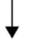

[0101010101010011011111001010]

（160 位的消息摘要）

图 4.1 – 哈希摘要示例

另一个很好的哈希函数比喻可以是漏斗绞肉机，如下所示，它将明文作为输入进行消化，输出固定长度的哈希：

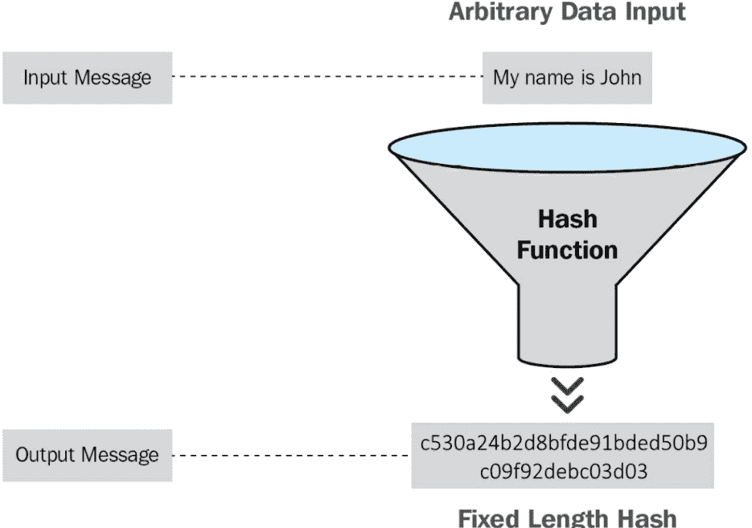

*图 4.2 – 用“漏斗绞肉机”象征哈希函数*

接下来的问题是：哈希函数为什么用、用在哪里？回顾本章开头所说的，在密码学中，哈希函数被广泛用于各种不同的场景：

- 哈希函数通常用于非对称加密，以避免在收集数字签名时暴露原始消息 **[M]**（本章后面会讲到）。相反，原始消息的哈希以 **(M')** 作为替代物来证明发送者的身份。
- 哈希用于检查消息的完整性。在这种情况下，接收方基于原始消息的数字哈希 **(M')**，可以轻松检测是否有人修改了原始消息 **[M]**。事实上，例如在大英百科全书 **[M]** 的整个内容中只改变 1 个比特，其哈希函数 **h(M)** 的哈希值 **h(M')** 将与之前的完全不同。哈希函数的这一特性至关重要，因为我们需要一个强大的函数来验证原始内容未被修改。
- 此外，哈希函数还用于数据库索引。我们将在本书中多次看到这些函数。在*第 9 章“加密搜索引擎”*中实现的*加密搜索引擎*里会大量用到它们，在*第 8 章“量子密码学”*中也会看到。实际上，哈希函数是*抗量子*的候选方案，这意味着哈希函数*在特定条件下*能够抵御量子计算机的攻击。
- 安全哈希函数的基础概念是：给定输出 **h(M)**，从该输出反推原始消息是困难的。

满足这类特性的函数是*离散对数*，我们在讨论非对称加密时已经见过：g^a = y (mod p)，你可能还记得，给定输出 (y) 并且知道 (**g**)，很难找到秘密私钥 **[a]**。然而，像离散对数这样的函数在实践中似乎太慢，而且也不够强。如上面所见，哈希函数的一个特点是计算快速。我们已经了解了哈希函数及其特性，现在来看实现哈希函数的主要算法。

## 主要哈希算法概述

由于哈希算法是一种特殊的数学函数，它从可变输入产生固定长度的位输出，因此它应当是无碰撞的，这意味着很难找到两个产生相同哈希值的不同输入消息。哈希算法有很多类型，但最常见和最重要的是 **MD5**、**SHA-2** 和 **CRC32**，本章我们将重点介绍**安全哈希算法（SHA）** 家族。最后，作为知识补充，还有 **RIPEMD-160**，这是欧盟科学家在 20 世纪 90 年代初开发的算法，有 160 位版本以及 256 位和 320 位的其他版本。该算法没有像 SHA 家族那样成功，但它可能是安全性的合适候选，因为至今它从未被攻破。SHA 家族由**美国国家安全局（NSA）** 开发，是本章的研究对象。我将提供必要的知识，帮助你理解和学习 SHA 家族的工作原理。特别是 **SHA-256** 是目前使用的哈希函数。

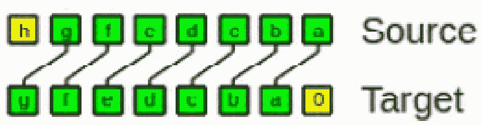

图 4.4 – 左移位运算示意图

例如，十进制数 23，在字节表示中是 00010111。如果我们执行一次左移位，会得到以下结果：

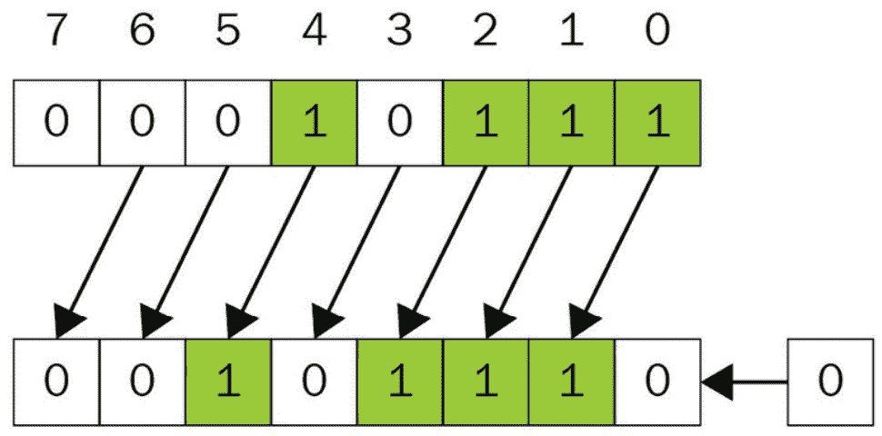

图 4.5 – 左移位运算示例（移动 1 位）

左移位运算后的结果是 (00101110)₂ = 十进制 46。

- **X >> r**：这是右移位运算。它与上一个运算类似，但将位向右移动。

下图展示了右移位运算的示意图：

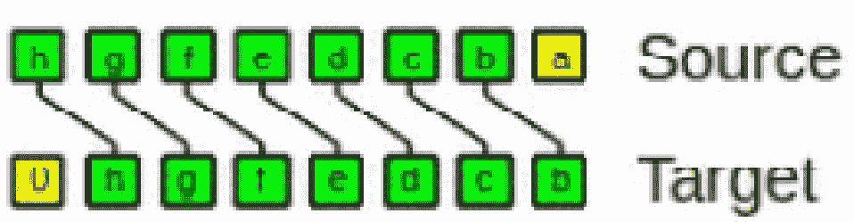

图 4.6 – 右移位运算示意图（移动 1 位）

和前面一样，我们以十进制数 23 为例，它在字节表示中是 00010111。如果执行一次右移位运算，结果将是十进制数 11，如下例所示：

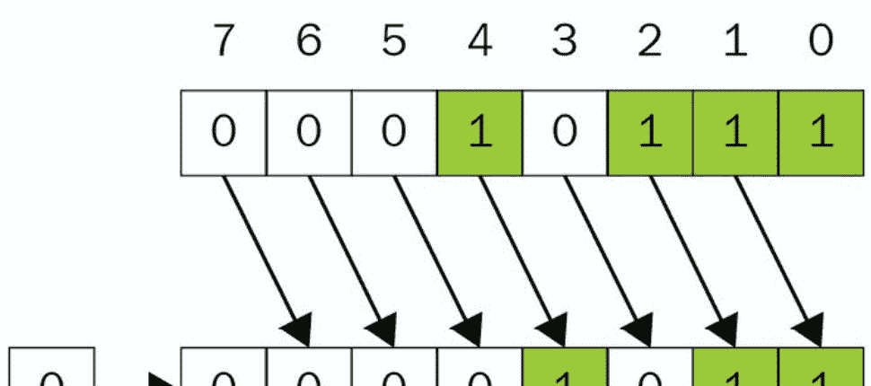

图 4.7 – 右移位运算示例（移动 1 位）

- **X <<< r**：这是左循环移位。这个运算符（也表示为 <<<）表示位的循环旋转，类似于移位，但关键区别在于初始部分变成了末尾部分。它在 SHA-1 算法中用于将变量 A 和 B 分别旋转 5 位和 30 位（A<<<5; B<<<30），这一点将在下一节中进一步说明。

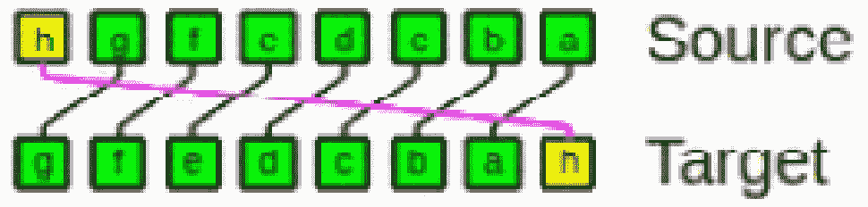

图 4.8 – 左循环移位示意图（移动 1 位）

如果我们将左循环移位应用于十进制数 23 的二进制表示，会得到以下结果：

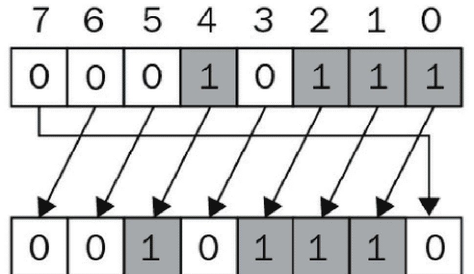

图 4.9 – 左循环移位示例

在这种情况下，左循环移位运算的结果与左移位运算相同：(00101110)₂ = 46。但是，如果执行右循环移位，会得到以下结果：

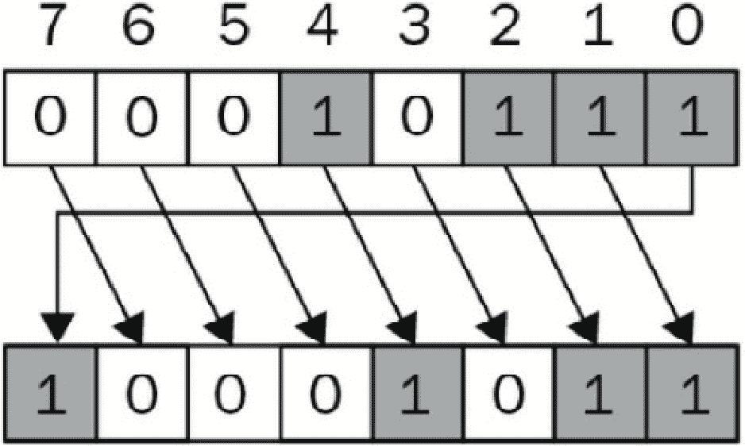

在这种情况下，运算结果是 **(10001011)₂ = 139**，以十进制表示。

- 这个运算符表示模 **和 (X+Y) (mod 2^32)**，在 SHA 中用于表示该运算，你稍后在我们分析 SHA-1 算法时会看到（*图 4.14*）。

在分析了用于执行哈希函数的逻辑运算符之后，要实现哈希函数还需要考虑两个问题：

- 在 SHA 中，例如有一些常量 (**Kt**)，范围从 **0 到 n**（我们将在下一节中看到）。
- 记号通常用十六进制表示。

现在让我们看看十六进制系统是如何工作的。它使用 0 到 9 的二进制数，每个数字由 4 位组成，例如：0 = 0000，1 = 0001，2 = 0010，… 9 = 1001。然后，从 10 到 15 有 6 个大写字母，**A、B、C、D、E、F**，总共达到 16（hex）。


numbers: A = 1010, B = 1011, …, F = 1111。 为了更好地理解，在下面的图中，你可以看到二进制、十六进制和十进制系统之间的比较：

| Binary | Hexadecimal | Decimal |
|---|---|---|
| *b = 2* | *b = 16* | *b = 10* |
| 0000 | 0 | 0 |
| 0001 | 1 | 1 |
| 0010 | 2 | 2 |
| 0011 | 3 | 3 |
| 0100 | 4 | 4 |
| 0101 | 5 | 5 |
| 0110 | 6 | 6 |
| 0111 | 7 | 7 |
| 1000 | 8 | 8 |
| 1001 | 9 | 9 |
| 1010 | A | 10 |
| 1011 | B | 11 |
| 1100 | C | 12 |
| 1101 | D | 13 |
| 1110 | E | 14 |
| 1111 | F | 15 |

*Figure 4.11 – Comparison between binary, hexadecimal, and decimal systems*

十六进制系统用于表示字节，其中 1 个字节是 8 位二进制数。例如，1 个字节（8 位）表示为 (1111 0010)₂ = [F2]₁₆ = 242。

现在我们有了定义哈希函数的工具，让我们继续实现 SHA-1，它是 SHA 家族中最简单的模型。

## Explanation of the SHA-1 algorithm

**Secure Hash Algorithm 1 (SHA-1)** 由 NSA 设计。自 2005 年以来，它已被认为不安全，并被其继任者 SHA-2 和 SHA-3 取代。在本节中，我们将简单地将 SHA-1 作为案例研究，以更好地理解哈希函数的实现方式。

SHA-1 基于迭代过程返回 160 位输出。这个概念在接下来的几行中会更清晰。对于其他哈希函数，消息 **[m]** 由可变位输入组成，被拆分为 512 位定长块：**m = [m₁, m₂, m₃, …, mₗ]**。在本节的最后一部分，你将看到如何将 2,800 位的输入消息 **[m]** 转换为每个 512 位的块 **[m₁, m₂, …, mₗ]**。

块通过压缩函数 **f(H)** 进行处理，该函数将当前块与上一轮得到的结果结合起来。有四轮，对应于变量 **t**，其范围分为如 *Figure 4.12* 所示的四个 t 范围，每个范围由 20 步组成，共 80 步。每次迭代可以看作是一个计数器，沿着每个由 20 个值组成的范围的值运行。

如 *Figures 4.12 and 4.13* 所示，每次迭代使用常数 **Kₜ** 和对应轮的运算 **fₜ(B, C, D)**。每一轮依次更新子寄存器（A, B, C, D, E）。在第 4 轮结束时，当 t = 79 时，子寄存器（A, B, C, D, E）被加到子寄存器（H₀, H₁, H₂, H₃, H₄）上，以获得最终的 160 位哈希值。

现在让我们检查 SHA-1 中常数的问题。常数是固定数字，以十六进制表示，并根据特定标准定义。选择 SHA 中常数时采用的一个重要标准是避免碰撞。碰撞发生在哈希函数对两个不同的块给出相同的结果时，从不同的常数开始。因此，即使有人可能会认为更改常数的值是个好主意，也不要尝试更改它们，因为这可能会导致碰撞问题。在 SHA-1 中，例如，给定的常数如下：

Kₜ = {

- 5A827999 if 0 ≤ t ≤ 19
- 6ED9EBA1 if 20 ≤ t ≤ 39
- 8F1BBCDC if 40 ≤ t ≤ 59
- CA62C1D6 if 60 ≤ t ≤ 79

}

*Figure 4.12 – The Kₜ constants in SHA-1*

其中，在 t 的不同范围内，常数 Kₜ 对应不同的值，如前图所示。除了常数之外，我们还有函数 fₜ(B, C, D) 定义如下：

fₜ(B, C, D) = {

- (B ∧ C) ∨ ((¬B) ∧ D) if 0 ≤ t ≤ 19
- B ⊕ C ⊕ D if 20 ≤ t ≤ 39
- (B ∧ C) ∨ (B ∧ D) ∨ (C ∧ D) if 40 ≤ t ≤ 59
- B ⊕ C ⊕ D if 60 ≤ t ≤ 79

}

*Figure 4.13 – The fₜ function*

SHA-1 的第一个初始寄存器是 X₀，一个由五个子寄存器（H₀, H₁, H₂, H₃, H₄）生成的 160 位哈希函数，每个子寄存器为 32 位。我们将在第 2 步中使用十六进制数表示的常数来初始化这些子寄存器。

现在让我们通过将过程分为四个步骤来解释 SHA-1 算法，以获得 160 位的最终哈希值：

- **Step 1 –** 从消息 [m] 开始，进行位连接操作，使得：

  y = m₁ || m₂ || m₃ || … || mₗ

  其中 || 符号表示消息 [mₗ] 的每个块由 512 位组成的位的连接。

- **Step 2 – Initialization of the sub-registers:** H₀ = 67452301, H₁ = EFCDAB89, H₂ = 98BADCFE, H₃ = 10325476, H₄ = C3D2E1F0。

你可能会注意到，这些常数以十六进制表示。它们是由该算法的设计者 NSA 选择的。

- **Step 3 –** 对于 **j = 0, 1, …, L − 1**，执行以下指令：

  a) **mⱼ = W₀ || W₁ || … || W₁₅**，其中每个 **Wⱼ** 由 **32** 位组成。

  b) 对于 **t = 16** 到 **79**，置：

  **Wₜ = (Wₜ₋₃ ⊕ Wₜ₋₈ ⊕ Wₜ₋₁₄ ⊕ Wₜ₋₁₆) <<< 1**

  c) 在开始时，我们置：

  **A = H₀, B = H₁, C = H₂, D = H₃, E = H₄**

  每个变量（A, B, C, D, E）长度为 32 位，总子寄存器长度为 160 位。

  d) 对于 80 次迭代，其中 **0 ≤ t ≤ 79**，依次执行以下步骤：

  **T = (A <<< 5) + fₜ(B, C, D) + E + Wₜ + Kₜ**

  **E = D, D = C, C = (B <<< 30), B = A, A = T**

  子寄存器（A, B, C, D, E）被加到子寄存器（H₀, H₁, H₂, H₃, H₄）：

  **H₀ = H₀ + A, H₁ = H₁ + B, H₂ = H₂ + C, H₃ = H₃ + D, H₄ = H₄ + E**

- **Step 4 –** 取以下作为输出：

  **H₀ || H₁ || H₂ || H₃ || H₄**

  这是 **160** 位的哈希值。这里可以看到 SHA-1 的方案（子寄存器为 **A, B, C, D, E**）：

## Notes and example on SHA-1

在本节中，我们将更详细地分析 SHA-1 算法。由于步骤 1 和 2 只是消息初始化和子寄存器初始化，算法的核心在于步骤 3，其中可以看到一系列数学运算，包括位连接、XOR、位移、位转置和位加法。

最后，步骤 4 将输出减少到 160 位，只是因为每个子寄存器 H₀、H₁、H₂、H₃ 和 H₄ 为 32 位。

在步骤 1 中，我们提到输入提供的最小块消息必须为 512 位。消息 [m] 可以分为 512 位的块，如果原始消息短于 512 位，我们必须应用填充操作，涉及添加位以完成块。

SHA-1 用于计算任意消息的 160 位长度的消息摘要，输入为消息。输入消息是一个位串，因此消息的长度是构成消息的位数（即空消息长度为 0）。如果消息中的位数是 8 的倍数（一个字节），为了紧凑，我们可以用十六进制表示消息。相反，如果消息不是字节的倍数，则必须应用填充。

填充的目的是使填充后消息的总长度为 512 的倍数。由于 SHA-1 在计算消息摘要时按顺序处理 512 位的块，获得强消息摘要的技巧是哈希函数必须在迭代运算中涉及的位上提供最佳的混淆/扩散等级。

填充过程由以下一系列步骤组成：

- SHA-1 首先取原始消息并附加 1 位，然后是一串 0 位。
- 添加 0 位以确保新消息的长度是 512 位的倍数。
- 为此目的，新消息的最终长度将为 n × 512。

例如，如果原始消息长度为 2,800 位，它将被 1 位填充在末尾，然后是 207 位。因此，我们将有 2,800 + 1 + 207 = 3,008 位。然后，为了使填充结果为 512 的倍数，使用除法算法，注意 3,008 = 5 × 512 + 448，所以为了达到 512 的倍数，我们用 64 个零填充消息。因此，我们最终得到 3,008 + 64 = 3,072，这就是填充后消息的位数，可被 512（每块位数）整除。

## Example of one block encoded with SHA-1

让我们通过一个实际例子来理解这一点：

- **Step 1 – Padding the message:**

  假设我们想用 SHA-1 编码消息 **abc**，其在二进制系统中表示为：

  **abc = 01100001 01100010 01100011**

  以十六进制，字符串为：

  **abc = 616263**

  如以下图所示，消息通过附加 1，然后添加足够多的 0 直到消息长度变为 448 位来进行填充。由于消息 **abc** 的长度为 24 位，因此添加了另外 423 位。然后在末尾添加表示消息长度的 64 位，产生一个 512 位长的消息：

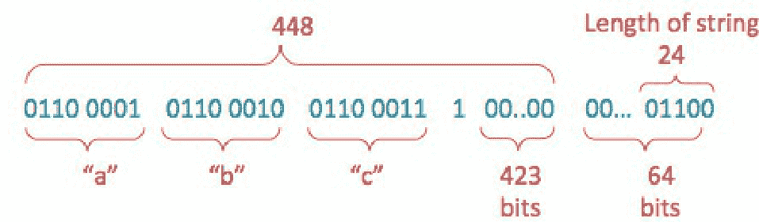

*Figure 4.15 – Padding of the message in SHA-1*

- **Step 2 – Initialization of the sub-registers:**

  子寄存器 H₀、H₁、H₂ 和 H₃ 的初始哈希值将为：

  H[0] = 67452301  
  H[1] = EFCDAB89  
  H[2] = 98BADCFE  
  H[3] = 10325476  
  H[4] = C3D2E1F0

- **Step 3 – Block contents:**

  W[0] = 61626380  
  W[1] = 00000000  
  W[2] = 00000000  
  W[3] = 00000000  

  **On the sub-registers:**

  | A | B | C | D | E |
  |---|---|---|---|---|
  | t = 0: 011 |  |  |  |  |


寄存器：H[0] = 67452301 + 42541B35 = A9993E36 H[1] = EFCDAB89 + 5

- **第 4 步 – 结果：**

  执行完四轮后，字符串 **abc** 的 160 位哈希最终消息摘要为：A9993E36 4706816A BA3E2571 7850C26C 9CD0D89D

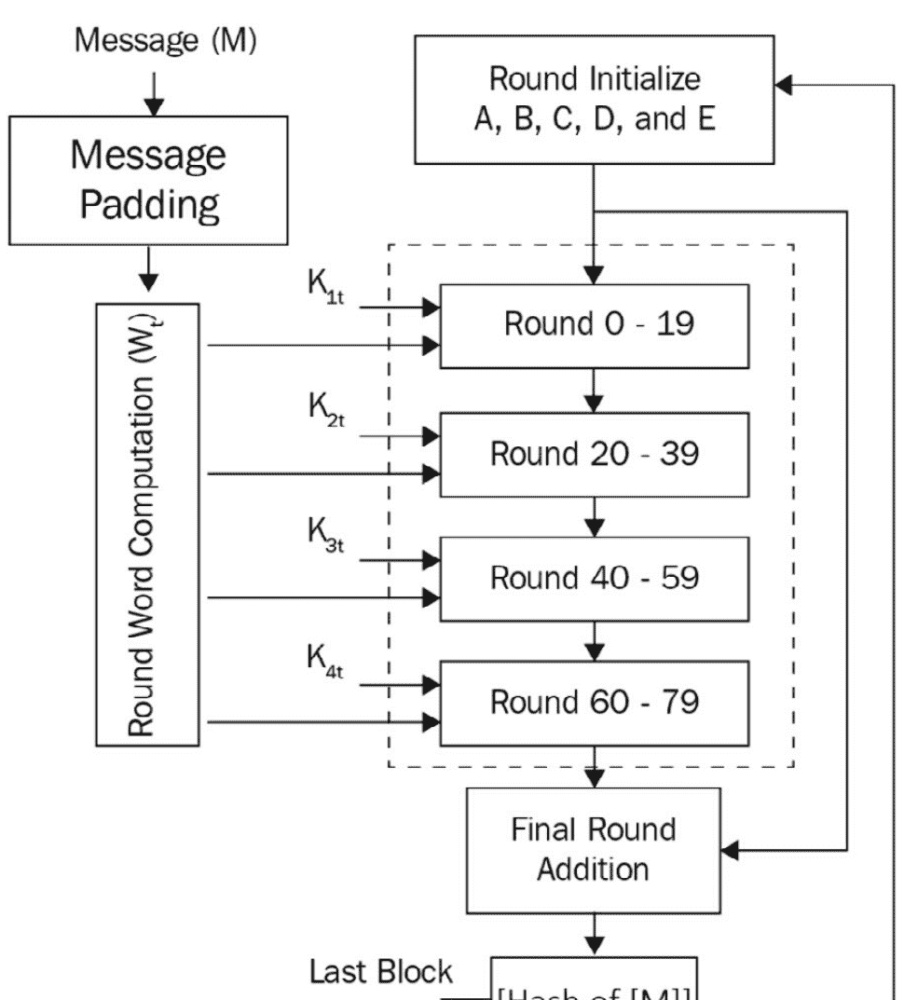

图 4.16 – SHA-1 中的完整一轮

现在我们已经了解了哈希函数，接下来可以探索数字签名。

## 认证与数字签名

在密码学中，**认证**问题是最有趣也最难解决的问题之一。认证是访问控制过程中最敏感的功能之一（也是使用最广泛的功能）。认证基于三种方法：

- 基于*只有用户知道*的信息（例如密码）
- 基于*只有用户持有*的物品（智能卡、设备或令牌）
- 基于*表征用户*的特征（例如指纹、虹膜扫描，以及通常意义上一个人的生物特征）

除了这三种方法之外，还有一种方法涉及*只有用户持有、且与唯一表征他们的特征相关*的东西：**脑电波**。例如，当你看到一张图片或想到它时，你大脑激活的脑电波是独一无二的，不同于表征另一个人的任何其他脑电波。这项发明与人类/计算机之间的认证有关。换句话说，利用脑密码（Brain Password），可以解锁计算机和电话等设备，并访问 Web 应用程序。我将在*第 6 章《公钥/私钥密码学的新算法》*中介绍脑密码。在下一节中，我们将分析一种基于数字签名的认证方法。请记住（我们稍后会看到），还有类似的认证方法，例如基于零知识的方法，这将在*第 5 章《零知识协议入门》*中进一步介绍。让我们看看基于公钥/私钥加密的数字签名认证方法是如何工作的。考虑一个例子：Alice 想要向 Bob 发送一条消息。她知道 Bob 的公钥（如 RSA 中的公钥），因此 Alice 使用 RSA 加密消息 **[M]** 并将其发送给 Bob。让我们看看 Alice 发送消息时面临的一些常见问题：

- Bob 如何确定这条消息来自 Alice（*认证问题*）？
- 在 Bob 收到消息后，Alice 总是可以否认她是发送者（*不可否认性*）。
- 另一个可能的问题是，消息 **[M]** 可能被篡改。

我们现在将探讨如何以数学方式签署消息，以及任何人都可以如何验证签名。回顾第 3 章《非对称加密》中的 RSA 算法，我们知道 Bob 的加密过程如下：基于 Alice 的公钥 (Na) 执行加密，并定义方括号 [M] 中的秘密元素：[M]^e ≡ c (mod Na)，其中 (Na) 是接收者（Alice）的公钥。因此，Bob 将使用 Alice 的公钥加密消息 [M]，而 Alice 将使用她的私钥 [da] 执行以下操作来解密 [M]：c^[da] = [M] (mod Na)，其中参数 [da] 是 Alice 的私钥，由以下运算给出：INV (e) ≡ [da] mod (p-1)(q-1)。Bob 的数字签名和身份验证过程如下：

- 第 1 步：Bob 选择两个大素数 [p1, q1]，并将它们保密。
- 第 2 步：Bob 计算 Nb = [p1] * [q1]，并将 (Nb) 作为他的公钥发布。
- 第 3 步：Bob 计算他的私钥 [db]，使得：

  ```
  INV (e) ≡ [db] mod (p1-1)(q1-1)
  ```

- 第 4 步：Bob 执行签名：

  ```
  S ≡ [M]^[db] (mod Nb) 其中 (S) 和 (Nb) 是公开的，而 [db] 是秘密的。
  ```

那 [M] 呢？[M]（即消息）应该是秘密的，并且只在 Bob 和 Alice 之间共享。然而，数字签名应该能被所有人验证。我们稍后将处理这个问题。现在让我们验证签名 (S)。

- 第 5 步：验证签名：

  签名验证是上述过程的逆过程。Alice（或任何人）可以验证以下等式：S^e ≡ [M] (mod Nb)。如果上述等式成立，则 Alice 接受消息 [M]。在分析 [M] 的问题之前，让我们借助一个数值示例来理解该算法。数值示例：回顾第 3 章《非对称加密》中的 RSA 示例，我们有以下由 RSA 算法给出的数值参数：[M] = 88, e = 9007。Alice 的参数如下：[p] = 101, [q] = 67, Na = 6767。让我们执行 RSA 的所有步骤，以展示数字签名消息的完整过程：

- 第 1 步 – Bob 的加密如下：

  [M]^e ≡ c (mod N), 88^9007 ≡ 6621 (mod 6767), c = 6621

- 第 2 步 – Bob 将为消息 [M] 生成签名 (S)，如下所示：

  Bob 选择两个素数 [p1, q1]：[p1] = 211, [q1] = 113, Nb = 211 * 113 = 23843。[db] 的模方程为：

  9007 * [db] ≡ 1 (mod (211-1)*(113-1))

  [db] = 9103

  现在，Bob 可以对消息进行签名：[M]^[db] ≡ S (mod Nb), 88^9103 ≡ 19354 (mod 23843), S = 19354。Bob 将 (c, S) 对发送给 Alice，即 (6621, 19354)。

- 第 3 步 – Alice 的解密如下：

  c^[da] ≡ [M] (mod Na)。Alice 计算 [da]：9007 * [da] ≡ 1 (mod (101-1)*(67-1)), [da] = 3943。Alice 解密密文 (c) 并获得消息 [M]：c^[da] ≡ [M] (mod Na), 6621^3943 ≡ 88 (mod 6767)

- 第 4 步 – 验证 Bob 的身份：

  如果签名 (S) 取参数 (e) 次方后得到消息 [M]，那么 Alice 可以确信消息确实是由 Bob 发送的：S^e ≡ [M] (mod Nb), 19354^9007 ≡ 88 (mod 23843)。确实，Alice 得到了消息 M=88。

### 重要说明

我希望有人已经注意到，消息 [M] 可以被任何人验证，而不仅仅是 Alice，因为 (S, e, Nb) 都是公开参数。因此，如果 Bob 使用原始消息 [M] 而不是其哈希 h[M] 来生成签名 (S)（参见上面的加密过程），那么任何知道 Bob 公钥的人都可以轻松恢复消息 [M]！只需解出以下方程即可恢复秘密消息 [M]：S^e ≡ x (mod Nb)。其中参数 (S, e, Nb) 都是已知的。在这种情况下，哈希函数就派上了用场。对消息执行哈希函数 h[M] = (m) 后，Bob 将发送 (c, S) 对，并签署 (m) 而不是 [M]。Alice 已经收到了加密消息 [M]，因此只有 Alice 可以验证：h[M] = m。如果为 TRUE，则 Bob 的身份将通过 Alice 的验证；如果为 FALSE，Bob 的身份声明将被拒绝。

## 为什么数字签名有效？

如果除 Bob 之外的任何人尝试使用此签名，他们都会遇到离散对数问题。实际上，在以下等式中生成 [db] 对攻击者来说是一个难题：m^[db] ≡ S (mod Nb)。此外，即使攻击者知道 (m, S)，计算 [db] 仍然非常困难。在这种情况下，我们处理的是离散对数问题，就像我们在第 3 章《非对称算法》中看到的那样。让我们通过一个例子来理解如果 Eve（攻击者）试图修改签名会发生什么：Eve（攻击者）将 [db] 替换为 (de)，计算伪造的数字签名 (S')：m^(de) ≡ S' (mod Nb)。如果 Eve 能够诱使 Alice 接受签名 (S')，那么 Eve 就可以通过假装自己是 Bob 进行中间人（MiM）攻击，用 (S') 替换真正的签名 (S)。但是当 Alice 验证签名 (S') 时，她会发现它不对应于 Bob 执行的正确签名，因为消息的哈希是 (m') 而不是 (m)：(S')^e ≡ m' (mod Nb)，m' ≠ m。因此，Alice 拒绝该数字签名，并且不会打开来自该伪造地址的任何消息。这就是为什么密码学家还需要非常关注哈希之间的碰撞。现在我们得到了不同的结果，即 (m') 而不是 (m)，Alice 意识到存在问题，并且不接受消息 [M]。这就是签名 (S) 的作用。上述攻击只是一个简单的技巧，但还有一些更聪明、更隐蔽的攻击，我们将在第 6 章《公钥/私钥密码学的新算法》中介绍非常规攻击时再作讨论。

## 使用 ElGamal 算法的数字签名


## ElGamal

ElGamal 是一种公钥-私钥算法，正如我们在 *第 3 章，非对称算法* 中所见，基于 *Diffie-Hellman 密钥交换*。在 ElGamal 中，我们对消息的签名方式与 RSA 不同，但所有方式都是有效的。回顾 ElGamal 加密技术，我们有以下元素：

- **(g, p)**: 公共参数
- **[a]**: Alice 的私钥
- **[M]**: 秘密消息
- **B ≡ g^[b] (mod p)**: Bob 的公钥
- **A ≡ g^[a] (mod p)**: Alice 的公钥

**Alice 的加密：** y1 ≡ g^[k] (mod p), y2 ≡ [M] * B^[k] (mod p)

> **Note**
>
> 请记住，方括号内的元素表示秘密参数；其他所有都是公开的。

现在，如果 Alice 想给消息加上她的数字签名，她将对消息做一个 *哈希*，**h[M]**，以保护消息 **[M]**，然后将结果传输给 Bob 以证明她的身份。为了对消息 **[M]** 进行签名，Alice 首先必须生成消息的哈希值：**h[M] = m**。现在，Alice 可以使用 **[M]** 的摘要值 → **(m)** 进行明文操作，因为正如我们之前所学，从其密码学哈希值 **(m)** 回到 **[M]** 几乎是不可能的。Alice 计算签名 **(S)** 使得：

- **Step 1** – 求 **[k]** 在 **(mod p-1)** 下的逆元：

```
[INVk] ≡ [k]^(-1) (mod p-1)
```

- **Step 2** – 执行方程：

```
S ≡ [INVk] * (m - [a] * y1) (mod p-1)
```

Alice 将公共参数 **(m, y1, S)** 发送给 Bob。

- **Step 3** – 在第一次验证中，Bob 执行 **V1**：

```
V1 ≡ A^y1 * y1^S (mod p)
```

验证步骤之后，如果 h[M] = m，Bob 得到验证的第二个参数 V2：

```
V2 ≡ g^m (mod p)
```

最后，如果 V1 = V2，Bob 接受该消息。

现在，让我们借助一个数值示例更好地理解该算法。

### Numerical example

假设秘密消息的值为 **[M] = 88**。我们为其他公共参数分配以下值：

- g = 7
- p = 200003
- h[M] = 77

第一步是私钥和公钥的“密钥初始化”：

- **[b] = 2367** (Bob 的私钥)
- **[a] = 5433** (Alice 的私钥)

在初始化过程中，Alice 计算密钥的逆元（步骤 1），然后计算签名（步骤 2）：

- **Step 1** – Alice 计算 [k] 在 (mod p-1) 下的逆元：

```
[INVk] ≡ [k]^(-1) (mod p-1) = 23^(-1) (mod 200003 - 1) = 34783
```

- **Step 2** – Alice 现在可以得到签名 (S)：

```
S ≡ [INVk] * (m - [a] * y1) (mod p-1)
S ≡ 34783 * (77 - 5433 * 90914) (mod 200002) = 72577
```

Alice 将公共参数 **(m, y1, S) = (77, 90914, 72577)** 发送给 Bob。

- **Step 3** – 凭借这些参数，Bob 可以执行第一次验证 (V1)。因此，他计算 V2。如果 V2 = V1，Bob 接受数字签名 (S)：

```
V1 ≡ A^y1 * y1^S (mod p)
V1 ≡ 43725^90914 * 90914^72577 (mod 200003)
```

对于第二次验证 (V2)：

```
V2 ≡ g^m (mod p)
V2 ≡ 7^77 (mod 200003) = 76561
```

Bob 验证 V1 = V2。

考虑到使该算法工作的底层问题，我们可以说它与离散对数相同。事实上，让我们分析验证函数：

```
V1 ≡ A^y1 * y1^S (mod p)
```

所有元素都由离散幂构成，正如我们已经知道的那样，即使指数或底数已知，从离散幂中反推也是一件困难的问题（目前）。说离散幂和对数确保该算法的安全性是不够的。正如我们在第 3 章《非对称密码学》中所见，以下函数也可能成为问题：

```
y2 ≡ [M] * B^[k] (mod p)
```

它由乘法给出。如果我们能够恢复 [k]，那么我们就发现了 [M]。因此，该算法不仅面临离散对数问题，还面临因子分解问题。

现在你已经了解了数字签名的用途和实现，让我们继续探索另一个有趣的密码协议：盲签名。

## Blind signatures

David Chaum 发明了 **盲签名**。他为匿名化 *数字支付* 而苦苦寻找一种密码系统。1990 年，David 创立了 *eCash*，这是一种采用不可追踪货币的系统。不幸的是，该项目在 1998 年破产，但 Chaum 将永远被铭记为数字货币的先驱之一，也是现代加密货币的创始人之一，与比特币一起。

Chaum 想要解决的底层问题如下：

- 找到一种能够避免电子支付 *双花问题* 的算法。
- 使数字系统 *安全且匿名* 以保证用户的 *隐私*。

1982 年，Chaum 发表了一篇题为 *Blind Signatures for Untraceable Payments* 的文章。以下是对文章中描述的盲签名的工作原理及其实现方式的解释。

对消息进行 *盲* 签名意味着在不知道内容的情况下进行签名。它不仅可用于数字支付，如果 Bob 例如想公开注册他创造的东西而不让他人知道其发明的细节时也可以使用。盲签名的另一个应用是在电子投票机中，在那里有人做出选择（例如，在总统选举或政党选举中）。在这种情况下，投票结果（传输的消息）显然必须为接收者所知，但如果投票者希望确保其选票被计入，则投票者的身份必须保持秘密（这正是盲签名的正确功能）。

我将在 *第 6 章，公钥/私钥密码学中的新算法* 中介绍 *MBXI 密码* 的一种创新盲签名方案，在那里我将介绍我在 2011 年发明并获得专利的 MBXI 包括在内的公钥/私钥新密码。让我们现在通过使用 RSA 进行盲签名来看看 David Chaum 的协议如何工作。

### Blind signature with RSA

假设 Bob 有一个重要的秘密，他不想在确定的日期之前公开。例如，他发现了一种治疗冠状病毒以避免癌症的强大疗法，并渴望获得诺贝尔奖。Alice 代表诺贝尔奖委员会。Alice 挑选两个大的秘密素数 **[pa, qa]**：

- **[pa * qa] = Na**，这是 Alice 的公钥。
- **(e)** 是 RSA 中已定义的相同公共参数。

参数 **[da]** 是 Alice 的私钥，由以下运算给出：

```
INV(e) ≡ [da] mod (pa−1)(qa−1)
```

假设 **[M1]** 是属于 Bob 的秘密。我只是称它为 **[M1]** 以将其与常规的 **[M]** 区分开来。Bob 挑选一个随机数 **[k]** 并将其保密。现在 Bob 可以对 **[M1]** 进行盲签名协议：

- **Step 1** – Bob 对 **[M1]** 执行加密 **(t)** 以 *盲化* 消息：

```
t ≡ [M1] * [k]^e (mod Na)
```

Bob 将 (t) 发送给 Alice。

- **Step 2** – Alice 可以通过以下运算执行盲签名：

```
S ≡ t^[da] (mod Na)
```

Alice 将 (S) 发送给 Bob，Bob 可以验证盲签名是否对应消息 [M1]。

- **Step 3** – 验证：

Bob 计算 **(V)**：

```
S / [k] ≡ V (mod Na)
```

然后他可以验证以下内容：

```
V^e ≡ [M1] (mod Na)
```

如果最后一次运算为 **TRUE**，则意味着 Alice 已有效地对 **[M1]** 进行了 *盲* 签名。在这种情况下，Bob 可以确信以下内容：

```
[M1]^[da] ≡ V (mod Na)
```

由于除了 Alice 之外没有人能够在不解决 *离散对数* 问题的情况下执行函数 **(S)**（如 *第 3 章，非对称算法* 中已见），签名者一定是 Alice。这句话在任何其他变量出现之前都成立；例如，当有人找到解决离散对数的逻辑方法或量子计算机达到足以破坏算法的量子比特数时，就像我们在第 8 章《量子密码学》中将看到的那样。

让我们看一个例子以更好地理解该协议。

### Numerical example

Alice 定义的参数如下：

```
pa = 67
qa = 101
e = 17
```

因此，公钥 (Na) 为：

```
67 * 101 = Na = 6767
```

Alice 的私钥为：

```
da ≡ 1/e (mod (pa-1)(qa-1)) = 17^(-1) (mod 6600) = 1553
```

- **Bob 挑选一个随机数 [k]：**

```
k = 29
```

Bob 计算 (t)：

```
t ≡ M1 * k^e ≡ 88 * 29^17 = 3524 (mod 6767)
```

- **Bob 将 (t) 发送给 Alice ———————————> Alice 现在可以对 (t) 进行盲签名：**

```
S ≡ t^[da] ≡ 3524^1553 = 1533 (mod 6767)
```

- **Bob 可以验证 (S) <———————————— Alice 发送 (S = 1533)：**

```
S / k ≡ V (mod Na)
1533 / 29 ≡ 2853 (mod 6767)
```

`Reduce[k*x == S, x, Modulus -> Na]`

Bob 接受签名 (S)。

正如你从这个例子和对盲签名的解释中看到的那样，Alice 确信 Bob 的发现（冠状病毒癌症疗法）属于他，而 Bob 可以在某个日期之前不声明其确切内容的情况下保留他的发明。

### Notes on the blind signature protocol

你可以对 [M1] 进行双重检查，这样你就能意识到 Alice 确实在不知道其值的情况下签署了 [M1]：

```
M1^[da] ≡ V (mod Na)
88^1553 ≡ 2853 (mod 6767)
```

关于盲签名需要一个警告，因为 Alice 不知道她将要签署的内容，因为 [M1] 隐藏在 (t) 中。因此，Bob 也可能试图说服 Alice 签署一张 100 万美元的支票。采用此类协议存在很多危险。

另一个考虑涉及可能的攻击。正如你在这里看到的，我们面临一个因子分解问题：

```
t ≡ M1 * [k]^e (mod Na)
```

我们可以看出 (t) 是 [X * Y] 的乘积：

```
X = M1  <—— 因式分解问题
Y = k^e
```

攻击者无法确定 [k] 并不重要，因为他们总可以尝试找到


[M1] 通过对 φ(t) 进行因式分解，如果 [M1] 是一个小数，例如。这其实就是 M1 = 0 的情况，因为显然 φ(t) 会为零，攻击者可以发现消息 M = 0。另一方面，如果我们假设，例如，(k^e) 是一个小数，由于 [k] 是随机的，那么攻击者可以执行以下操作：

`Reduce[(k^e)*x == t, x, Modulus -> Na]`

x = MESSAGE

在这种情况下，如果不幸地 [k^e] (mod Na) 是一个小数，攻击者就可以恢复消息 [M1]。你在阅读下一章后将理解，盲签名是零知识协议的先驱；这是下一章第 5 章《*零知识协议导论*》的研究对象。实际上，我们在这里发现的一些元素，例如随机数 [k]、盲签名的执行以及接收者执行的最后验证步骤 V = S/k，都运用了启发零知识协议的逻辑。

## 小结

在本章中，我们分析了哈希函数、数字签名和盲签名。在介绍哈希函数之后，我们从描述这些单向函数背后的数学运算开始，接着解释了 SHA-1。然后，我们通过实际的数值示例解释了使用 RSA 和 ElGamal 的数字签名，并研究了它们可能存在的漏洞。最后，我们引入了盲签名协议，将其作为实现电子投票和数字支付系统的加密工具。

因此，现在你已经了解了什么是哈希函数以及如何实现它。你也知道什么是数字签名，特别是你已经熟悉了 RSA 和 ElGamal 中的签名方案。我们还了解了可能导致数字签名泄露的漏洞以及如何修复它们。

最后，你已经了解了盲签名的用途及其应用领域。这些主题至关重要，因为我们在本书的后续章节中会大量使用它们。它们对于理解第 5 章《*零知识协议导论*》中解释的零知识协议，以及第 6 章《*公钥/私钥密码学中的新算法*》中讨论的其他算法特别有用。最后，第 6 章将研究针对数字签名的新攻击方法。现在你已经学习了哈希函数和数字签名的基础知识，是时候在下一章中详细分析零知识协议了。

## 在 Discord 上加入我们的图书社区

https://packt.link/SecNet


正如我们在数字签名中已经看到的那样，认证问题是密码学在不久的将来将要面临的最重要、最复杂和最引人入胜的挑战之一。想象一下，你想在网上向一个不认识你的人证明你的身份。首先，你会被要求提供你的姓名、姓氏和地址；更进一步，你会被要求提供你的社会安全号码和其他能识别你的敏感数据。当然，你知道通过互联网暴露这些数据可能非常危险，因为有人可能会窃取你的私人信息并将其用于邪恶目的。

不久前，我看了一个给我留下深刻印象的视频。我甚至决定把它插入到我的关于隐私和安全的演示中，并在硅谷举行的一次与智慧城市相关的活动中展示了它，我当时被邀请去演讲。视频开始时，一个所谓的魔术师邀请人们进入一个搭建在城市中央的帐篷。魔术师一个接一个地读出每个人的过去和关于他们未来的某些事情。令人难以置信的是，这位魔术师（之前从未见过任何受访者）竟然知道那些惊讶的参与者生活的细节，而这些细节只有他们自己应该知道。

怎么可能？这真的是魔术，还是只是个把戏？在视频的结尾，把戏被揭穿了。魔术师知道参与者生活的所有细节——财务状况、拥有的资产，甚至信用卡号码——这要感谢一群坐在幕布后面的技术黑客，他们努力挖掘他们能找到的关于参与者的所有数字秘密。如果一个黑客知道你的身份，他们可以很容易地找出你大部分的数字生活。

在另一种情况下，你可能读过一则新闻：一伙窃贼在一个购物中心放置了一台假 ATM。每次有人插入银行卡并输入 PIN 码时，一台计算机就会记录这些信息，然后 ATM 拒绝操作。一旦从卡中收集到信息并窃取到 PIN 码，黑客就可以克隆这些卡，连同 PIN 码一起复制，然后在真正的 ATM 机上取钱。

如何阻止这种骗局？在许多情况下，需要敏感信息，例如密码和其他私人信息。如果黑客获得这些与个人或机器关联的信息，他们可以轻易地窃取身份，并对受害者造成严重破坏。

解决这类问题的一种方法是不要透露任何敏感信息，例如姓名、姓氏、地址、社会安全号码或 PIN 码，但这并不总是可能的。另一种方法是通过给出*知识证明*来避免暴露私人信息。知识证明本质上是一种避免提供超出必要信息，或在不暴露个人数据的情况下证明自己身份的方式。这些密码学协议被称为**零知识协议（ZKP）**，我们将在本章中学习它们。

在本章中，我们将涵盖以下主题：

- 零知识协议的主框架和逻辑
- 非交互式和交互式 ZKP（Schnorr 协议），包括示例和可能的攻击
- SNARK 协议和 Zcash 简述
- 单轮 ZKP
- 作者的新协议：ZK13 和零认证协议

现在你已经了解了 ZKP 的世界以及它们的用途，是时候深入分析密码学中使用的主要场景和协议了。

## ZKP 的主要场景——数字洞穴

想象这样一个奇妙的场景：佩奇必须向维克多证明她能够打开*阿里巴巴*洞穴中间的一扇锁着的门，这个洞穴是一个环形洞穴，只有一个入口/出口，可以从两个方向到达，如下图所示。我想你已经注意到，我把两个角色佩奇和维克多的名字从通常的 Alice 和 Bob 换掉了，因为这里需要验证，**佩奇**和**维克多**这两个名字与**证明者（P）**和**验证者（V）**的首字母更匹配。

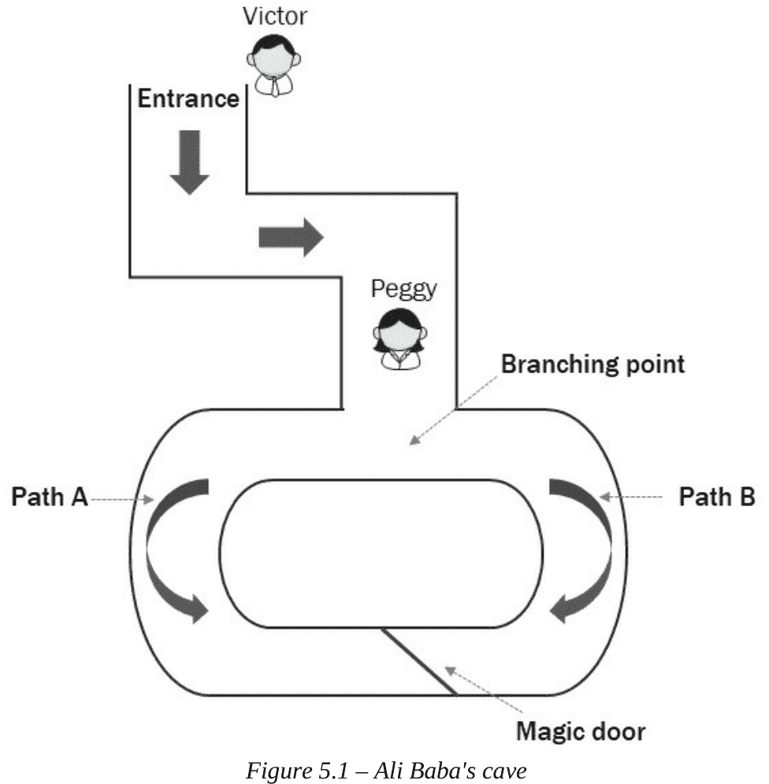

这个例子涉及现代版的阿里巴巴洞穴，洞穴中间的门通过一个秘密电子密码锁锁定，密码足够强大，可以阻止任何不知道秘密组合的人进入。现在，假设佩奇必须向维克多证明她知道打开门的密码，但不能把数字透露给他。因此，佩奇面临的挑战是*不*向维克多透露门的密码，因为佩奇不确定维克多是否知道它，而且她不想给维克多任何关于密码的信息。她只需要向维克多证明她可以从洞穴的另一侧出来。

换句话说，ZKP 是一个挑战，其答案不是透露所需的精确信息，而仅仅是证明解决底层问题的能力。事实上，证明知道某事的自然方式是透露它，验证也就自然而然地发生了。然而，这种直接展示你所知道的方法可能会透露超出所需的信息。通过 ZKP，佩奇可以避免泄露数字门的密码，同时，维克多可以肯定（即使他不知道密码），如果他看到佩奇从洞穴的另一侧出来，他就知道佩奇知道密码。

实现 ZKP 的方法有很多，因为正如你可以想象的那样，在许多场景中可能需要进行此类验证。例如，你可以把佩奇想象成一个人，把维克多想象成一台机器（ATM 或服务器）。佩奇必须向机器证明自己的身份，但她不想透露任何敏感数据，例如她的姓名或姓氏。她只需要向机器证明她确实是应该成为的那个人。在这种情况下，目的是避免泄露佩奇的身份。ZKP 可以应用在这里。

ZKP 可以应用的另一个用例是计算机网络中虚拟机的认证。我们将在第 9 章《*加密搜索引擎*》中介绍这个用例，届时我们将使用 ZKP 来抵御中间人攻击。ZKP 可以应用于除认证之外的其他类型的挑战，例如核裁军和区块链领域。

现在，我们将深入探讨 ZKP 的应用，从分析用于证明陈述的非交互式协议开始。

## 非交互式 ZKP

我们将在本节中分析的协议是一个**非交互式 ZKP**。这意味着证明者必须证明该陈述，假设


- Eve（攻击者）选择一个随机数 **[r]**，并计算以下内容：

**[r] \* (v1) ≡ e (mod N)**

**[r]** 和 **(e)** 是公开的，因此这是众所周知的。通过这个函数，Eve 可以提取出 **(v1)**。

- 与此同时，Eve 计算以下内容：

**e \* x ≡ c (mod N)**

参数 **(e, c)** 也是已知的。与第 1 步一样，这是模 **N** 下的逆乘法运算。该操作的目的是获得 **[x]**。然后，Eve 使用 **[x]**，将 **[x]** 乘以 **[r]**，得到 **(v2)**：

**x \* r ≡ v2 (mod N)**

Eve 将 **(v1, v2)** 发送给 Victor，Victor 可以验证以下等式：

**v1 \* v2 ≡ c (mod N)**

Eve 可以冒充 Peggy，即使她并不知道 **[m]**，也可以声称自己知道 **[m]**！

**数值示例：** **r = 39** 是 Eve 选择的秘密数字。（**N**、**c**、**e**）与前一个示例中的公共参数相同（**N = 2430101**、**c = 160613**、**e = 9007**）。

- **步骤 1：** Eve 计算 **v1**：

**e \* r^-1 ≡ v1 (mod N)**

**9007 \* 436172 = 1557988 (mod 2430101)**

**v1 = 1557988**

- **步骤 2：** Eve 计算 **v2**。

下一步操作是求解 **e \* x ≡ c (mod N)**，通过逆模乘法得到 **(x)**：

**9007 \* x = 160613 (mod 2430101)**

**x = 2031892**

然后，Eve 使用 **x** 计算 **v2**，执行以下运算：**x \* r ≡ v2 (mod N)**，得到 **v2**：

**v2 = 1480556**

在得到 **v2** 后，Eve 将（**v1 = 1557988**；**v2 = 1480556**）发送给 Victor。

- **步骤 3：** 验证阶段。

最后，Victor 可以验证以下等式：

**v1 \* v2 ≡ c (mod N)**

**1557988 \* 1480556 = 160613 (mod 2430101)**

攻击成功了！

### 重要说明

如果 Peggy 本人并不知道 **[m]**，但希望让 Victor 相信她知道，那么她自己也可能是这个骗局的主要参与者。

这种攻击之所以有效，是因为 **(c)** 中包含 **[m]**，而我无需通过展示 **[m]** 的值来证明。该协议并不要求展示 **[m]** 或其哈希值 **[H(m)]**，因为 Peggy 不想向 Victor 透露任何关于 **[m]** 的信息。请记住，这*不是*一个身份验证协议，而是一个 Peggy 知道 **[m]** 的断言（或知识）证明。为了完整性，我们还必须补充说明，**(c)** 并不是两个大素数的乘积（如 **N** 那样），这一点你可能已经在示例中注意到了。因此，该协议的逻辑基础很薄弱：要找到两个乘积为 **(c)** 的数并不那么困难，即使 **(c)** 是一个很大的数。举个假设的例子，你可以设想这样一个场景：有两个国家，**(A)** 必须向 **(B)** 证明它拥有原子弹的配方。使用这种零知识证明（ZKP），**(A)** 可以在实际上不知道 **[m]**（原子弹的配方）的情况下，声称自己知道 **[m]**。在某些条件下，这种攻击是可以避免的，其中一种条件如下：

如果 Victor 已经知道 **[m]**，那么他可以要求 Peggy 向他发送消息的哈希值 **H[m]**。然后，Victor 可以验证（**v1** 和 **v2**）是否为正确的值，并根据哈希值与 **[m]** 的对应关系接受或拒绝该验证。在这种情况下，问题在于该协议的目的原本不是要证明某个已知的事实，而是要独立地证明某件事，无论它是否已知。最后这一点非常重要，因为如果 Victor 知道 **[m]**，该协议就有效；如果 Victor 不知道 **[m]**，该协议就失效。为了避免这些问题，我们必须切换到一种*交互式*协议，我们将在下一节中看到。

## Schnorr 的交互式 ZKP

我们在前一节中看到的协议是一种非交互式协议，Peggy 和 Victor 之间并不互动，而只是存在一个*承诺*。该承诺要求 Peggy 必须向 Victor 表明她知道消息 **[m]**，同时不泄露关于它的任何信息。于是，她试图向 Victor 证明自己能够解决 RSA 难题（或其他困难的数学问题），以此作为她诚实的证明。然而，我们也已经看到，这个协议可以通过一个数学技巧被*绕过*。让我们看看下面这个交互式 ZKP 是否更健壮，能否防止可能具有破坏性的攻击。我们仍然以 Peggy 和 Victor 为主要角色。那么，让我们假设如下：

- **p** 是一个大素数。
- **g** 是（**Zp**）的生成元。
- **B ≡ g^a (mod p)** 是 Peggy 的公共参数。
- （**p**、**g**、**B**）是公共参数。
- **[a]** 是承诺涉及的秘密数字。

Peggy 声称她知道 **[a]**；假设 **[a]** 是打开钱包中一定数额资金的密码。为了证明这一说法，Peggy 和 Victor 采用以下交互式协议：

- **步骤 1：** Peggy 选择一个随机整数 **[k]**，其中 **1 ≤ k < p-1**。

她执行以下计算：**V ≡ g^k (mod p)**。Peggy 将 **(V)** 发送给 Victor。

- **步骤 2：** Victor 选择一个随机整数 **(r)**，其中 **1 ≤ r < p-1**。

Victor 将 **(r)** 发送给 Peggy。

- **步骤 3：** Peggy 计算如下：

**w ≡ (k - a \* r) (mod p-1)**。Peggy 将 **(w)** 发送给 Victor。

- **步骤 4：** 最后，Victor 验证如下：

**V ≡ g^w \* B^r (mod p)**。如果该等式成立，Victor 就应该相信 Peggy 知道 **[a]**。

让我们看看为什么该协议应该有效，以及为什么最后一个函数 **(V)** 能表明 Peggy 确实知道 **[a]**（即该承诺）。首先，我将说明为什么该协议在数学上是成立的，然后给出该协议的一个数值示例。

## 交互式 ZKP 的演示

回顾以下公式：

**V ≡ g^k (mod p)**

**B ≡ g^a (mod p)**

**w ≡ k - a \* r (mod p-1)**

现在，我们将前面所有的等式代入最后一步的验证中。

智能合约的执行（对 Peggy 而言）和所收到的付款（对 Victor 而言）均成功完成。然而，智能合约中固有的许多细节不会被透露。因此，zk-SNARKs 所起的作用对于掩盖这些秘密并执行智能合约至关重要。为了能够工作，该协议必须快速、安全且易于实现。正如我们已经看到的那样，你会注意到这正是零知识证明（ZKP）的目的——在不信任的环境中更轻松地穿行。在这里，我们讨论的是区块链和虚拟支付，但本质上这个过程是相似的。因此，在这种环境中，zk-SNARKs 通过保护智能合约所涉及的步骤，同时证明所有这些步骤都已执行，来保守秘密。这样，它们就保护了个人和公司的隐私。请记住——并不是因为你要变得极度怀疑，而是因为你应该现实一点——上述说法在特定条件下才成立，我会尝试如下解释：

- 证明者给出的证明与选作知识证明的基础算法具有相同的计算难度。
- 不存在通过捷径或伪造证明来欺骗验证者的数学方法（例如，将伪造的参数代入 **V ≡ g^w \* B^r (mod p)** 等式中，以避免知道 **[a]**）。

那么，让我们来看看 zk-SNARK 是如何工作的。

## 理解 zk-SNARK 的工作原理

在本节中，首先我将尝试概述 zk-SNARKs 的一般工作原理，然后我们将介绍一个与基于离散对数的知识证明相关的 zk-SNARK 协议。正如我们在其他 ZKP 中已经看到的，一个 zk-SNARK 由三个部分或要素组成——（G）、（P）和（V）：

- **G：** 这是一个密钥生成器，它使用一个私密参数（即声明或另一个随机密钥）来生成公共参数，这些公共参数由私钥给定。
- **P：** 这是一个证明算法，用于说明证明者想要证明的内容。
- **V：** 这是一个验证算法，返回 TRUE 或 FALSE。


验证者提供的布尔变量。我现在将演示，使用 ZKP（尤其是 zk-SNARK 协议）*不*足以保持 **[w]** 秘密，但如果它同时为 **FALSE**，则有可能使陈述被证明为 **TRUE**。

让我们看看在 *Interactive ZKP* 部分（Schnorr）中解释的类似协议示例在非交互方式（zk-SNARK 模式）下会如何工作。在此协议中，我们有 Anna 作为证明者和 Carl 作为验证者。这里，Anna 必须证明 **[a]** 为她所知。Anna 计算她的私钥，(y)，由以下给出：y ≡ g^a (mod p) (**g** 是生成元（如 D-H 或我们在本书中已看到的其他私钥-公钥算法）。然后，Anna 在 **p-1** 内选取一个随机值 **[v]**，她将其保密，并且因此可以计算以下：t ≡ g^v (mod p)。Anna 计算 **(c)** 作为三个参数 (**g, y, t**) 的哈希函数，她可以按如下方式计算 **(r)**：r ≡ v − c*a (mod p-1)。验证者 Carl 可以验证以下：t ≡ g^r * y^c (mod p)。最后，如果验证验证了该函数的两个项，则 Carl 接受 Anna 提出的陈述 **[a]** 为 **TRUE**。现在我们已经分析了该 ZKP 在 zk-SNARK 环境中的工作原理，让我们在介绍数值示例之前先看看对该协议的攻击。

## 演示对 zk-SNARK 协议的攻击

此攻击由我在 2019 年 6 月执行，仅说明没有任何东西是完全安全的。假设 Eve 是一个 **人工智能 (AI)** 服务器。我们假设 Eve（AI）拦截了 **H(g, y, t)** 公共哈希函数并执行 MiM 攻击。当 Peggy 发送 **(v)** 给 Victor 时，Eve 用 **(c1) = H1(g, y, t1)** 替换 **(c) = H(g, y, t)**，记住 **(H)** 是哈希函数，而 **(t1)** 由以下给出：t1 ≡ g^v1 (mod p)。正如你可能已经注意到的，用 **(v1)** 替换 **(v)** 与之前攻击中用 **(k1)** 替换 **(k)** 的技巧相同。简单地说，Eve 可以将 **(r1)** 置为如下：r1 = v1。现在，Eve 命令 AI（连接到互联网的智能第三方服务器）向 Carl 发送 **(r1, v1, c1)**，Carl 可以验证以下：t1 ≡ g^r1 * y^c1 (mod p)。由于以下原因，很容易证明 **t1 = g^v1**：y^(p-1) ≡ 1 (mod p)。最后，由于我们已将 **c1 = p-1** 且 **r1 = v1**，最终效果将为

如下：t1 ≡ g^v1 ≡ g^v1 * 1 (mod p) **数值示例：** p = 3571 g = 7 x = 23 Anna 的公钥如下：y ≡ g^x (mod p) 7^23 = 907 (mod 3571) y = 907 现在，我将向你展示 Anna 如何向 Carl 证明以获取秘密数字 [x]。她选择 v = **67**，如下：

t ≡ g^v (mod p) 7^67 = 584 (mod 3571) t = 584 假设哈希 (**g**，y，t) 如下：c = 37 她按如下方式计算 r：r ≡ v - c*x (mod p-1) (67 - 37*23) ≡ 2786 (mod 3570-1) r = 2 发送 (**r**，**t**，**c**) = (**2786, 584, 37**) 给 Carl。Carl 可以验证以下：g^r * y^c ≡ t (mod p-1) 7^2786 * 907^37 = 584 (mod 3571)

AI 拦截了公共参数 (**y**)、(**t**) 和 (**r**)。Eve 保持 (**y**) 不变，但她用 (**t1**) 更改 (**t**) 并用 (**r1**) 更改 (**r**)，执行中间人攻击：v1 = 57 Eve 计算以下：t1 ≡ 7^57 (mod 3571) t1 = 712 v1 = r1 = 57 c1 = p-1 = 3570 Eve 向 Carl 发送 (**r1, t1, c1**) = (**57, 712, 3570**)。Carl 验证以下：t1 ≡ g^r1 * y^c1 (mod p) 我突出显示了 Eve 替换的参数，(**t1, r1, c1**); 她保持 (**y, g, p**) 不变。将新参数代入验证方程，我们有以下：7^57 * 907^3570 ≡ 712 (mod 3571) 确实，Carl 能够验证 **t1 = 712** 与来自 Eve 的接收参数相对应。从本质上讲，如果 Carl 无法识别 **r1 = v1** 和/或他不接受 **c = p-1**，那么这个技巧就成功了，Eve 可以取代 Anna。那么，对抗这种攻击应采取哪些保护措施？如果这种攻击以更复杂的方式实施，可能很难避免它。请注意，参数 (**y**)，Anna 的公钥，它“封装”了陈述的私有键 **[a]** 对象，在攻击期间未被修改。无论如何，zk-SNARK 可以使用其他方法和协议来实现证明陈述；我们将在下一节看到这些算法和协议是什么。区块链和加密货币正在迅速发展，以寻找新的匿名身份验证用户的方法。然而，由于该主题相对较新，最好努力找到所有可能的攻击及其修复方法。

## 如何在 Zcash 加密货币中使用 zk-SNARK 的简要说明

在本节中，我们将分析 Zcash 背后的 zk-SNARK，一种新的加密货币，它旨在保护交易的安全性和隐私性，如 2020 年 11 月 12 日发布的一篇科学论文（*Demystifying the Role of zk-SNARKs in Zcash*）中所讨论的：”Zcash 算法的底层原理是它提供了一个功能齐全的、基于账本的数字货币，具有强大的隐私保证，而确保隐私的根源完全在于构建适当的 zk-SNARK。“ 一篇关于 Zcash 的博客就零知识证明发表了以下声明：*允许一方（证明者）向另一方（验证者）证明某个陈述是真实的，而不会透露超出陈述本身有效性之外的任何信息。* 在一种称为“知识证明”的零知识形式中，证明者可以在不透露任何有关内容的敏感信息的情况下证明一个陈述。但正如我们到目前为止所看到的，这些协议基于难以解决的问题，例如因式分解和离散对数，我们在前几节中看到其中一些可能容易受到各种攻击。采用 ZKP 的一个原因是无需透露太多关于你的敏感数据或服务器身份的信息来对自己进行身份验证。另一个使用 ZKP 的原因是证明你知道 *某物* 而你想保密。这里，我们有两种主要不同的情况：

- 在第一种情况下，假设验证者不知道陈述的内容。
- 在第二种情况下，假设验证者已经知道陈述的内容，只需要验证其 *正确性*。

如果决定采用 *非交互式协议* 而不是 *交互式协议*，所有事情会变得更加复杂，因为在第一种情况下，验证者不需要提供任何进一步的输入。事实上，正如你所看到的，如果证明者和验证者之间交换参数，这可能会增加算法的安全性。另一方面，我们知道交互式协议需要许多步骤才能达到目标，因此它们不像非交互式协议那样常用。正如我们在前几节中看到的，我展示了一些能够欺骗验证者，使其相信不真实事物的攻击；此外，如果验证者不知道陈述的内容，发送虚假的数学参数来欺骗他们就 *更容易*。现在，密码学的情况正在迅速变化，原因有两个：

- 密码学需要解决隐私问题并匿名化互联网和电子商务中日益增多的交易的数据
- 数字支付和加密货币的使用增加

为了匿名化数字金钱的交换并确保加密货币交易中用户的隐私，zk-SNARK 在多种情况下被采用。用于我们看到的两个主要问题（RSA 和离散对数）的验证几乎已经过时。它们正在为 Zcash 中看到的一种用例让位于新的、更复杂、更难解决的问题。为了实现完美的零知识隐私，Zcash 实施了一套复杂的函数系统来确定交易的 **有效性**。在 Zcash 的共识系统中，使用 zk-SNARK，目标是在不知道交易内容和条款的情况下对交易的有效性给出响应。Zcash 采用复杂的方案来匿名化交易并获得交易是否有效的最终答案。这里，我尝试对电路进行示意：Computation → Arithmetic circuit → R1CS → QAP → zk-SNARK

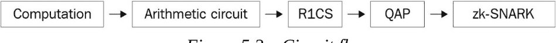

图 5.2 – 电路流程

让我们逐一分析这些函数代表什么。第一步是将交易有效性转化为数学函数，最终必须汇总为逻辑表达式。这一步是通过创建一个算术电路来完成的，类似于布尔电路（我们在 *第 2 章，对称加密简介* 和 *第 3 章，非对称加密* 中看到过），由数学基本运算（+、-、* 和 /）和布尔运算符（**AND, OR, NOT, and XOR**）组成，使得程序收敛到只有一个 *门*，即所有操作链的结果，如下例所示，计算表达式 **(a+b)*b*c**：


Figure 5.3 – An example of an arithmetic circuit. Inputs: a, b, and c. Output: (a+b)*b*c

As you can see, the arithmetic (or algebraic) circuit converges in only a single gate all the operations performed on the inputs: a, b, and c. Looking at this circuit, from left to right, we have the single terms (a, b, and c); first, (a) is added to (b), then (b) is multiplied by (c), and finally, the result is multiplied by the result of the previous sum. All that is mathematically expressed in only one final gate. We can represent layers and layers of these operations, reducing them all to one arithmetic circuit. The second step is a Rank 1 Constraint System (R1CS) representation. In R1CS, we have a group of three vectors (A, B, and C), as you can see in the following figure. The solution to satisfy the system is a new vector (S) given by an operation of a (.) dot product between the vectors, of which the final result has to be zero. So, R1CS has this scheme of operations and must satisfy the following equation with a result of zero: (S • A) * (S • B) - (S • C) = 0 For example, this is a satisfied R1CS system:

inventors of Zcash put so much effort into this system? It is probably because the inventors aspired to create the *perfect ZKP*. Indeed, in the paper entitled *Aurora: Transparent Succinct Arguments for R1CS*, the authors stated that their goal is to obtain transparent zk-SNARKs that satisfy the following conditions:

- **Post-quantum security**: *This is motivated by the desire to ensure the long-term security of deployed systems and protocols.*
- **Concrete efficiency**: *We seek argument systems that not only exhibit good asymptotics (in argument size and prover/verifier time), but also demonstrably offer good efficiency via a prototype.*

Given the high expectations predicted by the authors for this protocol, let's go on to explore the final steps of the sequence. This protocol offers a probabilistic solution by performing a multiplication of polynomials. If the two polynomials match at a random point, we can be confident that the chosen point verifies the proof correctly. The reason for this transformation is that instead of checking the constraints individually, as in R1CS, we can now check all the constraints at the same time. Here, you can see an example of how the vector verification looks in a QAP:


*Figure 5.5 – An example of the vector verification in a QAP*

Can you recognize the differences between this representation and the *checksum* in R1CS? In both cases, if the logic gate is equal to zero, the result given by the dot (.) product of the checks passes; if at least one of the (**x**) coordinates gives a non-zero result, this means that the values going into and out of that logic gate are inconsistent. But at this point, there could be a problem: if someone knows in advance which point the verifier chooses to check the validity, they can generate an invalid polynomial, but it could still satisfy that point. Essentially, this is a dangerous step and could be vulnerable to attacks. To overcome this problem, Zcash applied sophisticated techniques to zk-SNARKs in order to evaluate the polynomials *blindly*. These mathematical techniques used in Zcash, such as homomorphic encryption and pairings of elliptic curves, help to blind the operations but increase complexity. We will look at these issues in the next section, but now we will finish discussing the entire process of zk-SNARKs in Zcash. As I said at the beginning of the Zcash explanation, the goal of the protocol is to determine whether a statement (in this case, a transaction) is true or false, thereby preventing the *double-spending* problem.

## Conclusions and the weaknesses of zk-SNARKs in Zcash

As we saw in the previous section, one of the weak points of this protocol can be found in QAP. As I have explained, Zcash has tried to overcome this problem using homomorphic evaluation, in other words, keeping the polynomials *in blind*. The issue is that homomorphic encryption usually causes bit-overflow; moreover, the protocols and schemes required to achieve fully homomorphic encryption are very complex. As you already know, my theory is that *in cryptography, complexity is the enemy of security*. I won't enter this debate now because it's not within the scope of the book to analyze the entire protocol of Zcash. Imagine the scenario discussed in the *Non-interactive ZKPs* section based on the RSA problem. If I have to demonstrate to an expert that I hold the formula for an atomic bomb, then the experts will probably ask me to show something more than a hash function of the document, [**m**], that states the proof. The verifier will be convinced only when they get substantial proof. In other words, ZKPs are limited in the amount of evidence of knowledge they are able to provide.

doesn't know **[x]**. That is the exciting point, and the innovation of this protocol: even if Victor doesn't know **[x]**, by using this protocol, he can be confident that Peggy knows it. In other words, what the authors of this protocol did was apply the D-H protocol to the ZKP use case. If you look at the simplified version of the protocol shown below, you will get an even better understanding of the steps required. There are only two, essentially:

- Initialization of the parameters for Peggy is **g, b, p,** and **x**.
- Victor generates a random **y**.

**Step 1:** Victor sends the following to Peggy: c ≡ g^y (mod p) **Step 2:** Peggy sends the following to Victor: r ≡ c^x (mod p) Instantly, Victor can verify the following: r ≡ b^y (mod p) As you can see, there are only two steps required to perform this protocol and verify the statement **[x]** through Victor's validation of the parameter (**r**). This protocol gave me the inspiration to build a new protocol, which we will explore in the next section. My research has allowed me to reduce the number of steps to one.

## A new Algorithm proposed by the Author: ZK13 – a ZKP for authentication and key exchange

The **ZK13** protocol was invented and patented by me in 2013. It's a non-interactive protocol that solves an issue that was very important to my **Crypto Search Engine (CSE)** project (explained in Chapter 9): authentication without the need of a public key. In this section, we will analyze this ZKP that's used for authentication. It doesn't matter whether it's humans or computers; we could call this protocol a **ZK-proof of authentication**. To better understand the problem, imagine Alice and Bob want to share a common secret, something that only they know. Let's say that the secret is the answer to the following question: how many birds were counted at the lake shoreline today? The answer is known only to Alice and Bob, unless they have revealed it to someone, but this is a problem we will take into consideration later. For now, nobody else can know the answer except Alice and Bob. We can consider the number of birds counted as a shared secret, a key that doesn't need to be exchanged. It is shared by Alice and Bob, a key that is implicitly formed by a common experience. So, besides the authentication problem, there is also the problem of verifying a

private **Pre-Shared Key (PSK)**. Indeed, under ZK13, Alice tells Bob to use the secret shared key (the number of birds counted) as a secret password, **[private key]**. What's even more interesting here (and this is where it really differs from the D-H key exchange algorithm we saw before) is that the secret key is not *really* exchanged at all, but instead is simply something that is known to both parties and is only verified. So, the problems that this ZKP can solve are several. Here, we will just consider the authentication problem. Later in the book, we will analyze how to use a ZKP to exchange a shared private key. In 2013, I was drawing up the architecture of the CSE, a project that has absorbed a large part of my professional life. We will talk in detail about the CSE in *Chapter 9, Crypto Search Engine*. At the time, one of the toughest problems to solve with the CSE's architecture was finding a cryptographic method to identify the **Virtual Machines (VMs)** network. Since the algorithm chosen was symmetric, the problem was to find a method of authentication that would work with the symmetric algorithm. As you already know from *Chapter 2, Introduction to Symmetric Encryption*, it's common to think that symmetric algorithms don't have a digital signature method of authentication because they do not have public keys. At first glance, it doesn't seem easy to find such a method of authentication, but it can be possible if the process starts with a shared secret. The goal was to prevent a man-in-the-middle attack by an external hostile VM against a network. To overcome all these issues, I considered implementing a new ZKP. Taking a look at the most popular ZKPs, I did consider Schnorr (presented earlier in this chapter) as a candidate. But an *interactive protocol* didn't fit well. This scheme needs more steps between the prover and verifier, generating latency in the communication. So, I decided to implement a new *personal* zero-knowledge non-interactive protocol. After many studies and a pinch of inventiveness, I designed ZK13. Before analyzing it, I will explain what constraints I worked under:

- The secret shared key (the challenge) has to be embedded inside the VM database. Therefore, engineers could *inject* the secret parameter **[s]** into both of the VMs without exchanging any keys through an asymmetric algorithm.
- The goal of ZK13 is to enable parties to identify each other by sharing a small amount of sensitive information. This means exchanging only the minimum amount of sensitive information (that is, the hash of **[m]**:


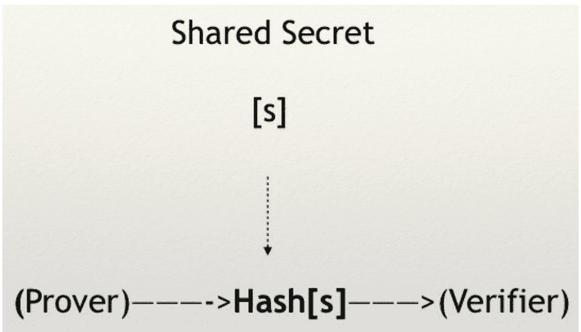

图 5.6 – 共享哈希[s]秘密的方案

让我们深入探讨 ZK13 并看看它是如何工作的。Bob（VM-1）必须向 Alice（VM-2）证明他知道秘密 [s]，以便使用 CSE 系统向 Alice 发送一组加密文件。请记住 [s] 存储在 Alice 和 Bob 这两个 VM 的大脑中，作为一种先天性注入的秘密。Bob 选择一个随机数 [k]（zk-SNARK 的 (G) 元素或随机密钥生成器）。这个随机数 [k] 在每个会话中生成并销毁：

公开参数：
p：这是一个质数。
g：这是生成元。

密钥初始化：
[k]：这是 Bob 的随机密钥。
秘密参数：
[s]：这是共同共享的秘密。
H[s]：这是秘密 [s] 的哈希值。

步骤 1a：Bob 按如下方式计算 (r)：
r ≡ g^k (mod p)
r ≡ g^k (mod p)
假设共享的秘密是 [s]，但实际上 VM 使用 H[s]，即 [s] 的哈希函数进行操作。

步骤 1b：Bob 计算 [F]，一个在每个会话中都会改变的秘密参数（只是因为 [k] 改变）：
H[s]*k ≡ F (mod p-1)
现在，Bob 用 (g) 的 [F] 次幂来证明 (P)，即 zk-SNARK 的第二个元素：
g^F ≡ P (mod p)
Bob 将配对 (P, r) 发送给 Alice。

步骤 2：验证步骤 (V) 根据以下函数验证证明 (P)：
[s] ---> H[s]^r
[Hs] ≡ g^F (mod p)
如果：
V ≡ r^[Hs] = P (mod p)
Alice 继续对 [s] 进行哈希：H[s]，

然后如果 **V = P** 她接受认证；如果 (**V**) 不等于 (**P**)，她不接受验证。在这种情况下，正如我们在初始条件中所假设的那样，**[s]** 假定为 Alice 所知。正如你所见，ZK13 只在两步中工作，但验证者（这里是 Alice）必须知道秘密 **[s]**；否则，不可能验证证明。

**数值示例：**
现在，让我们看一下 ZK13 协议的数值示例：
**公开参数：**
p = 2741
g = 7
**秘密参数：**
H[s] = 88
k = 23
g^k ≡ r (mod p)
7^23 ≡ 2379 (mod 2741)
r
Bob 计算 **[F]** 然后是 (**P**)：
[Hs] * k ≡ F (mod p-1)
88 * 23 ≡ 2024 (mod 2741-1)
F = 2024
g^F ≡ 验证以下内容：
r^[Hs] ≡ P (mod p)
2379^88 ≡ 132 (mod 2741)
Alice 再次检查 **[Hs] = [s]** 是否成立；如果为 **TRUE**，则意味着 Bob 确实知道秘密 **[s]**。
现在我们已经用数值示例证明了 ZK13 的有效性，我想演示它在数学上的工作原理。

### 演示 ZK13 协议

由于 **P ≡ g^F (mod p)**，我们想要证明的是以下内容：
P ≡ g^F ≡ r^s (mod p)
（在这里，我使用 **[s]** 进行演示而不是 H[**s**]。）
由于 **r ≡ g^k (mod p)**，将 (**r**) 代入前述等式，我们得到以下内容：
P ≡ g^F ≡ (g^k)^s (mod p)
我们还知道 **F** 为：
F ≡ s*k (mod p-1)
最后，对于模幂的性质，代入 **[F]** 和 (**r**) 之后，我们得到以下内容：
P ≡ g^(s*k) ≡ (g^k)^s ≡ g^(k*s) (mod p)
基本上，我已将参数 (**P**)，即 Bob 创建的证明，替换为其自身参数的元素，证明了秘密 **[s]** 包含在 (**P**) 中。因此，(**P**) 必须与 Bob 生成并连同证明 (**P**) 一起发送给 Alice 的 *临时* 参数 (**r**)^[**s**] 匹配。如果 Alice 知道 **[s]**，那么她就可以确定 Bob 也知道 **[s]**，因为 (**P**) 包含 **[s]**。这就是我们想要证明的。

### ZK13 协议的注意事项和可能的攻击

你会同意我，使用此协议，可以在一次传输中确定对秘密 **[s]** 的知识证明。在解释算法时，我将其分为三个步骤，但实际上，

只有两个步骤（只有一次传输），因为 (G) 密钥生成操作是离线的。因此，步骤 1a 和 1b 可以有效地合并为仅一个步骤。

### 对 ZK13 的可能攻击

假设 Eve（攻击者）想冒充 Alice 或 Bob，制造中间人攻击。这可以按如下方式完成。Eve 用 (r1) 替换 (r)，生成一个伪造的 (k1)，通过计算以下内容：
r1 ≡ g^k1 (mod p)
但当 Eve 计算 [F] 时，她不知道 H[s]（因为假设 [s] 会保持秘密）。因此，此攻击失败。相反，她可以收集 (r, P) 并在下一个会话中重放这些参数，激活所谓的重放攻击。此攻击在这里可以避免，因为 (r) 由随机 [k] 生成，因此可以避免接受先前选择中已出现过的 (r)。所以，这是一个可能面临的攻击，我们看到了如何避免它。

## 总结

现在你对 ZKPs 是什么以及它们用于什么有了清晰的理解。在本章中，我们详细分析了不同种类的 ZKP，既有交互式也有非交互式。在这些协议中，我们看到了一个使用 RSA 作为底层问题的 ZKP，我提出了一种将其破解的原创方法。然后，我们看到了以交互方式用于身份验证的 Schnorr 协议，我提出了对其进行攻击的尝试。继续下去，我们探索了 zk-SNARKs 协议和诡异的月球数学，只是为了看看某些其他问题的复杂性。其中，我们看到了攻击基于离散对数 zk-SNARK 的有趣方法。我们深入研究了 Zcash 及其协议，以了解如何匿名化这种加密货币的交易。稍后在本章中，我们遇到了并分析了一个基于 D-H 算法的非交互式协议。最后，我们探索了 ZK13，一种非交互式协议，以及它如何使用共享秘密来启用 VM 的身份验证。最后，我们探索了 zkSNARKs 在加密货币世界中的应用，特别是用于匿名化交易。你熟悉了一些攻击方案，例如中间人攻击，并使用了一些数学技巧来尝试 ZKP。主题

## 在 Discord 上加入我们的图书社区

https://packt.link/SecNet


椭圆曲线是去中心化金融的新前沿。Satoshi Nakamoto 采用了一种特定的椭圆曲线来实现比特币中数字货币的传输，称为 **secp256K1**。让我们看看它是如何工作的，以及这种非常强大的加密的主要特性是什么。在本章中，我们将学习椭圆曲线密码学的数学基础。这个主题涉及几何、模数学、数字签名和逻辑。此外，我将介绍为比特币数字签名实现的一种特殊类型的椭圆曲线，即 secp256K1。最后，我们将讨论对椭圆曲线进行攻击的可能性。因此，在本章中，我们将涵盖以下主题：

- 椭圆曲线上密码学的起源
- 椭圆曲线的数学和逻辑基础
- 基于椭圆曲线的 Diffie–Hellman 密钥交换
- secp256K1 上的 ECDSA 解释 – 比特币的数字签名
- 对椭圆曲线的可能攻击

让我们深入探讨这个基于几何并应用于密码学的有趣主题。

## 椭圆曲线的概述

大约在 1985 年，Victor Miller 和 Neal Koblitz 开创了 *椭圆曲线* 用于密码学用途。后来，Hendrik Lenstra 向我们展示了如何使用它们来分解整数。椭圆曲线本质上是笛卡尔平面上特定数学方程的几何表示。我们将开始在 2D 平面上分析它们的几何模型，同时意识到它们的扩展和更深层次的表示是在 3D 或 4D 中，涉及无理数和虚数。现在不要担心这些问题；在本章后面会变得更清晰。**椭圆曲线密码学 (ECC)** 用于实现我们在前几章中看到的一些算法，例如 **RSA**、**Diffie–Hellman (D–H)** 和 **ElGamal**。此外，在数字货币革命兴起之后，一种特定的椭圆曲线类型称为 secp256K1 以及一种数字签名算法称为 **椭圆曲线数字签名算法 (ECDSA)** 已被用于对比特币应用数字签名，以确保交易成功执行。本章旨在一步步带你发现椭圆曲线背后的逻辑并将其转置到数字世界应用中。据估计，使用 313 位椭圆曲线加密提供的<|message|>安全级别与传统非对称系统中 4,096 位加密相当。如此少的位数可以在许多需要高性能时序和带宽的实现中很方便，例如移动应用程序。因此，让我们开始探索椭圆曲线的基础，它涉及几何、数学以及我们在本书前几章中看到的许多逻辑属性。

## 椭圆曲线上的运算

第一个观察是椭圆曲线不是 *椭圆*。椭圆曲线的一般数学形式如下：

```
E: y^2 = x^3 + ax^2 + bx + c
```

> **重要说明**
>
> **E：** 表示椭圆曲线的形式，参数 (**a**、**b** 和 **c**) 是曲线的系数。


### plot

y² = x³ + 73

### Implicit plot:

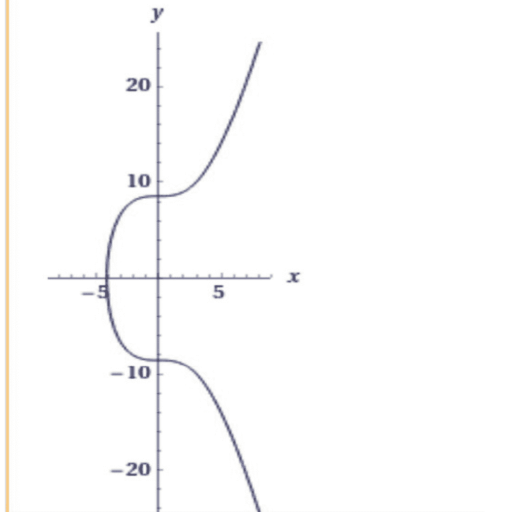

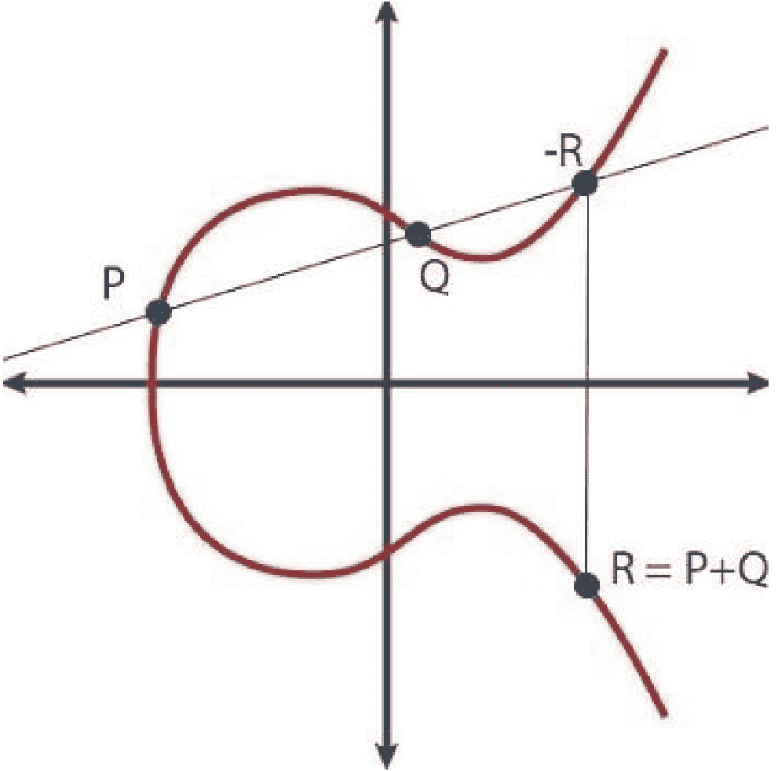

*Figure 7.2 – Adding and doubling points on the elliptic curve*

Now, let's look at how the addition point will be represented algebraically. First, we take the coordinates of P and Q, and then calculate (s), as follows: s = (yP - yQ) / (xP - xQ). To compute **xR**, the x coordinate of point R, we have to perform this operation: xR = s^2 - (xP + xQ). To compute **yR**, the y coordinate of point R, we have to perform this operation: yR = s(xP - xR) - yP. What about computing **P + P = R = 2P**, the so-called **point double**? If we want to represent a P point added to itself

so that it becomes 2P, the geometrical representation is given by the tangent passing through the P point and intersecting the curve at the R point, and again finding the reflexed point of the sum that is the symmetric point R, as shown here:

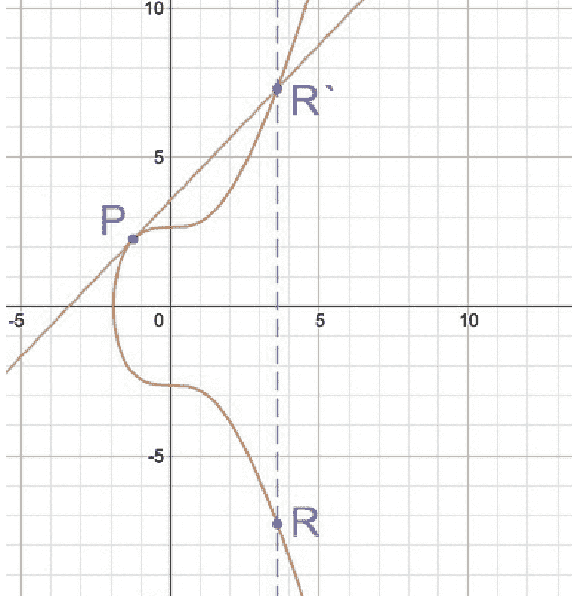

Figure 7.3 – 2P point double

Geographically, it is very similar to computing the sum of the point, as we saw in the preceding example.We have to draw the tangent line in the **P** point, and we find the point of intersection between the line and the curve in the **R'=(-2P)** point; finally, the reflexed x-axis point on the curve will give the **P** double point, that is, **R (2P)**.What about computing **P+P** algebraically? In this case, (**t**) will be the following: t = (3XP^2 + a)/2YP Remember that (**a**) is a parameter of the curve.So, to find the x coordinate of **R**, we have the following: xR = t^2 - 2XP The equation for the y coordinate of **R** is as follows: yR = t (xP - xR) - yP There is one more case we need to address when we operate with elliptic curves: how to add vertical points.Here is **O** represented by the *point of infinity*, given by the **SUM** value between **P** and **Q** if **xP = xQ**:

called **repeated addition**, and it can be represented as follows: Q = {P + P+ P + P...+ P} n-times As we have to add the coordinates of a point to itself, we can figure out the scalar multiplication as the sum of a point with itself **n** times, so we have, for example, the following: P + P = 2P This, as we have seen, is the formula of double point (geometrically represented in *Figure 7.3*) transposed into an algebraic representation of **SUM**. Always remember that we are dealing with a curve, so the coordinates of the new intersection point are as follows: 2P (X2P, Y2P) For the same logic, we can go on with **3P**, **4P**, ... **7P**: R = 3PR = 2P +P Then we follow with **4P**: R = 4PR = 2P + 2P Then we follow with **5P**: R = 5PR = 2p + 2P + P Then we follow with **6P**: R = 6PR = 2P + 2P +2P Alternatively, it can be given like this: R = 2(3P)R = 2 (2P+ P) Finally, we have the following: R = 7PR = P + (P + (P + (P + (P + (P + (P)))))) Alternativ it can be given like this: R = 7PR = P + 6PR = P + 2(3P)R = P + 2(P + 2P) It is called multiplication, but in reality, scalar multiplication is more of a *breakdown* of the **R** number in a scalar mode because, as you can see, step by step, it is going to be reduced to the minimal entity of **P**: so, for instance, **7P** becomes a product of **P** and **2P**.Following this logic, if we have to multiply a **K** number with **P**, we have to break it down to obtain a sum of minimal elements (**P+P**) or a **2P** double point that will compose the multiplication required. Because of the formulas, we rely on addition and multiplication, as we saw in *Figure 7.5*.If we have **9P**, for example, we will have the following: 9P = 2(3P) + 3P9P = 2(2P + P) + 2P + P9P = P + 2P + 2(2P+ P) Now that we have understood this operation's logic, let's discover why these operations are so important to generate a cryptographic system on elliptic curves.As we saw in the previous chapters (for example, D–H in *Chapter 3, Asymmetric Encryption*) about cryptography, we are looking for one-way functions. These particular functions allow it to be easy to compute in one direction but are very difficult to perform in the opposite sense. In other words, it isn't easy to reverse-engineer the result. Similarly, in elliptic curves, we have to find a function such as a discrete logarithm that allows us to perform a *one-way* function.We'll now define the discrete logarithm problem transposed on an elliptic curve.It's stated that *scalar multiplication* is a one-way function.Given an elliptic curve: **E**.Known: **P**, **Q** is a multiple of **P**.Find **k**: Such that **Q = k * P**.It is a *hard problem to solve*. This is called a discrete

logarithm problem of Q to the P base, and it is considered hard to solve because to find k means to calculate very complex operations. I will proceed with an example to better understand what we are dealing with. Example: In the elliptic curve group defined by the following, what is the discrete logarithm k of Q = (4,5) to the P = (16,5) base?

y2 = x3 + 9x + 17 over the field F23. One (naïve) way to find k is to compute multiples of P until Q. The first few multiples of P are as follows:

P = (16,5) 2P = (20,20) 3P = (14,14) 4P = (19,20) 5P = (13,10) 6F 9P = (4,5) = Q, the discrete logarithm of Q to the P base is k = 9. In a real application, k would be large enough that it would be infeasible to determine k in this manner. This is the fundamental principle behind the D-H algorithm implemented on elliptic curves that we will discover next.

## Implementing the D-H algorithm on elliptic curves

In this section, we will implement the D–H algorithm on elliptic curves. We saw the D–H algorithm in Chapter 3, Asymmetric Encryption. You should remember that the problem underlying the D–H key exchange is the discrete logarithm. Here, we will demonstrate that the discrete logarithm problem could be transposed on elliptic curves too. First of all, we are dealing with an elliptic curve (mod p). The base point or generator point is the first element in the D–H original algorithm represented by (g), and here we denote it by (G). Let's look at some elements to take into consideration:

+   - G: This is a point on the curve that generates a cyclic group.

Cyclic group means that each point on the curve is generated by a repeated addition (we have seen point addition in the previous section).

+   - Another concept is the order of G denoted by (n):

ord(G) = n The order of (G) = (n) is the size of the group. The order (n) is also the smallest positive integer [k], giving us the following: kG = O (Infinity Point)

+   - The next element to take into consideration is the h cofactor:

**h** = (number of points on E )/n In other words, (**h**) can be defined as the number of points on **E (mod p)** divided by the order of the curve (**n**). **h = 1** is optimal. If **h > 4**, the curve is more vulnerable to attacks. Let's now analyze step by step how D–H transposed on **E** works. **Step 1: Parameter initialization:** Now let's look at the public shared parameters to initialize the D–H model on **E (mod p)**: {p, a, b, G, n, h} **p** is the (mod **p**) as we have already seen in the original D–H algorithm. **a** and **b** are the parameters of the curve. **G** is the generator. **n** is the order of **G**. **h** is the cofactor. **Step 2: Crafting the shared key on E (mod p): [K]** After the parameter initialization, Alice and Bob will define the type of the curve to adopt among the family of **E (mod p)**: y^2 = x^3 + a x + b (mod p) Bob picks up a **[β]** private key such that **1≤ [β] ≤ n-1**. Alice picks up a **[α]** private key such that **1≤ [α] ≤ n-1**. After choosing random keys, Bob and Alice can compute their public keys. Bob computes the following: B = [β] * G Alice computes the following: A = [α] * G Now (like in the original D–H algorithm), there is a generation of shared keys exchanging the public parameters:

+   - Bob sends **B** (**xB** and **yB**) to Alice.
+   - Alice receives **B**.
+   - Alice sends **A** (**xA** and **yA**) to Bob.
+   - Bob receives **A**.
+   - Bob computes the following:
+   
+   K = [β]*A
+   
+   - Alice computes the following:
+   
+   K = [α] * B
+   
+   - Finally, Bob and Alice hold the same information: the point on **E**: **[K]**.

This point, **[K]**, is the shared key between Alice and Bob.

### Important Note

If Eve (the attacker) wants to know **[K]**, she has to know **[α]** or **[β]**, the private keys of Alice and Bob, given by the following functions:


**B = [β] * G 或 A = [α] * G**

要恢复 **[K]**，Eve 必须能够在 **E (mod p)** 上求解离散对数，而正如我们所见，这是一个难以求解的问题。

**以下是一个数值示例：** 假设曲线的域如下：

**E: y² = x³ + 2x + 2 (mod 17)**

你可以在 *图 7.6* 中查看此 **E** 的绘制。

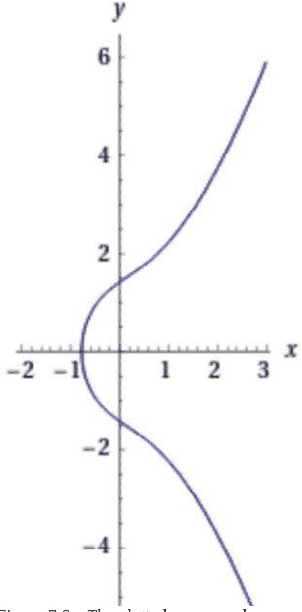

*图 7.6 – 用作实现 D–H 算法示例的绘制曲线*

生成点如下： **G = (5, 1)**。

首先，我们必须找到曲线 **n** 的阶。为此，我们应计算所有点，直到达到允许循环群的最小整数。因此，我们开始计算 **2G**。

使用倍点公式，我们有以下内容：

t = (3xP² + a) / 2yP

t = (3 × 5² + 2) / (2 × 1) = 77 × 2⁻¹ = 13

回顾我们已计算出 **t**。可以利用它来找到点 **2G** 的 **x** 和 **y** 坐标：

x₂G = t² − 2xG = 13² − 2 × 5

x₂G = Mod[13² − 2 × 5, 17] = 6 (mod 17)

我们找到了 **2G** 的坐标：

**2G = (6, 3)**

现在，我们应继续计算 **3G, 4G, ..., nG**，直到找到无穷远点 **Oᴳ**。手工完成工作量很大，但这也是一个很好的练习供你自己练习。我将让你计算所有标量乘法直到 **Oᴳ** 点，给出部分点的结果：

**G = (5, 1)**  
**2G = (6, 3)**  
**3G = (10, 6)**  
...  
**9G = (7, 6)**  
**10G = (7, 11)**

这一直持续到无穷远点 **Oᴳ** 如下：

**19G = Oᴳ**

这意味着 **G** 的阶为：

**n = 19**

因此，**E** 的参数如下：

**G = (5, 1); n = 19**

Bob 选取 **Beta**：

**Beta = 9**

Alice 选取 **Alpha**：

**Alpha = 3**

Bob 计算他的公钥 (**B**)：

**B = 9G = (7, 6)**

Alice 计算她的公钥 (**A**)：

**A = 3G = (10, 6)**

Alice 将 **A** 发送给 Bob：

**[β] * A = 9A = 9(3G) = 8G = (13, 7)**

Bob 将 **B** 发送给 Alice：

**[α] * B = 3B = 3 × (9G) = 8G = (13, 7)**

因此，正如你所见，共享密钥为：

**[K] = (13, 7)**

示例中使用的参数太小，无法在实际环境中实现。实际上，数字必须大于我在前述示例中使用的数字。然而，该算法在计算上比原始 D–H 算法更容易，可以使用更小的参数和密钥。但是，我们必须依赖由专业密码学家和数学家设计的结构良好且架构良好的曲线。

### 重要说明

在 **E (mod p)** 上实现 D–H 不一定能防止 MiM 攻击，就像原始 D–H 算法一样（如 *第 3 章《非对称加密》中所述*）。

现在我们对椭圆曲线及其运算更有信心，可以通过一个有趣的椭圆曲线案例，分析用于比特币数字签名 ECDSA 的算法。

## 椭圆曲线 secp256k1 – 比特币数字签名

**ECDSA** 是比特币架构中使用的数字签名方案，采用名为 secp256k1 的椭圆曲线，由 **高效加密标准组 (SECG)** 标准化。ECDSA 在以下方程中建议 **(a = 0)** 和 **(b = 7)** 作为参数：

**E: y² = x³ + 7**

如需更正式的介绍，你可以阅读 SECG 发布的文档 [https://www.secg.org/sec2-v2.pdf](https://www.secg.org/sec2-v2.pdf)，其中可以找到与 Koblitz 曲线及其它位长姐妹曲线相关的 256 位推荐参数。这是 secp256k1 在实平面中的表示：

plot y² = x³ + 7

### 隐式绘图：

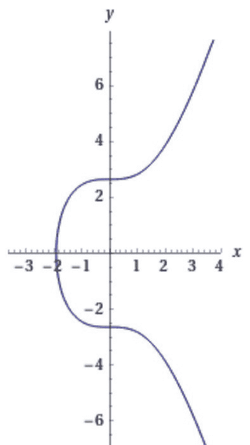

*图 7.7 – secp256k1 椭圆曲线*

正如我们所知，椭圆曲线有一部分在实平面可见，另一部分由开发者选择。在比特币中，我们将看到将选择多少位数作为模数 (**p**)、阶 (**n**) 和基点 (**G**) 以使 secp256k1 安全。现在让我们继续探索数字签名 ECDSA 算法在 secp256k1 中的实现方式。

### 第 1 步 – 生成密钥

**[d]** 私钥是在范围 **1 ≤ k ≤ n − 1** 内随机选择的一个数，其中 **n** 是 **G** 的阶。该数字必须为 256 位长，以便计算随机数的哈希值与 SHA-256，从而输出一个 256 位数。这是确保数字确实为 256 位长的方法。记住，如果输出的数字小于 **(n − 1)**，则密钥将被接受；如果不是，则会再次尝试。

公钥 (**KPub**) 由以下方程导出：

`KPub = Kpriv * G`

因此，可能的私钥数量与 **G** 的阶相同：**n**。要从私钥 **[d]** 计算公钥 (**Q**)，在 secp256k1 中，我们必须使用以下方程：

`Q ≡ [d] * G (mod p)`

方程的结果将是 **Q**（公钥）。完成此操作后，我们可以转到计算数字签名。

假设 Alice 是签名的发送者，她的 **[d]**、**(G)** 和 **(Q)** 参数已经计算完毕。在实际情况下，Victor 是验证者（矿工），他必须验证真实的所有权。让我们继续了解如何在 secp256k1 中签署比特币交易。

### 第 2 步 – 在 secp256k1 中执行数字签名

记住，要签署文档 **[M]**，或更准确地说在这种情况下比特币中的值 **[B]**（如我们在 *第 4 章《介绍哈希函数和数字签名》中讨论的*），始终建议计算 **Hash[B] = z**。因此，我们将签署 **z**，即消息的哈希值，而非直接签署 **[M]**。

我们需要的另一个参数是 **[k]**，它是临时密钥（或会话密钥）。执行数字签名 **(S)** 的子步骤与公钥/私钥算法类似。这里的区别在于离散对数是通过标量乘法获得的：

- Alice 选择一个随机秘密 **[k]**，得到以下结果： **1 ≤ k ≤ n − 1**。
- 她计算坐标 **R(x, y) = k * G**。
- Alice 找到 **r ≡ x (mod n)**，即 **R(x, y)** 的 x 坐标。
- Alice 计算 **S ≡ (z + r × d) / k (mod p)**。这是数字签名。

Alice 将 (**r**, **S**) 对发送给 Victor 以验证数字签名。

### 第 3 步 – 验证数字签名

Victor 收到 (**r**, **S**) 对。现在他可以验证 **S** 是否确实由 Alice 生成。要验证 **S**，Victor 将遵循以下协议：

- 检查 **r** 和 **S** 是否都包含在 **1** 和 **n − 1** 之间。
- 计算 **w ≡ S⁻¹ (mod n)**。
- 计算 **U ≡ z × w (mod n)**。
- 计算 **V ≡ r × w (mod n)**。
- 在 secp256k1 中计算点： **R(x, y) = UG + VQ**。
- 验证 **r ≡ Rₓ (mod n)**。

如果 **r** 与 **Rₓ (mod n)**——**R** 点的 x 坐标——对应，则验证者接受对应于比特币值 **[B]** 的签名 **S**，其所有者声称拥有声明的比特币数量。

没有实际示例的支持，很难理解如此复杂的协议。在 secp256k1 上对比特币交易进行数字签名时执行的某些操作相当复杂，难以解释，需要实际示例来理解。

### secp256k1 上数字签名的一个数值练习

在本节中，我们将深入研究 secp256k1 的数字签名，以便理解实现和验证数字签名的操作机制。

假设，例如，曲线的参数如下：

- **p = 67**（模 p）
- **G = (2, 22)**
- **阶 n = 79**
- **私钥: [d] = 2**

由于我们选择了一个非常简单的私钥，只需执行一次倍点即可获得公钥 (**Q**)：

**Q = d * G**

在这种情况下，我们继续计算公钥 (**Q**)。首先，我们将使用以下公式计算倍点：

t = (3xP² + a) / 2yP

t = (3 × 2² + 0) / (2 × 22) = 12 / 44 = 49

Q = d * G

使用数字意味着用数字替换 **[d]** 和 **G**：

**Q = 2 × (2, 22)**

依靠倍点公式，让我们找到 **Q** 的坐标（x 和 y），从 x 开始：

xQ = t² − 2xG

xQ ≡ 49² − 2 × 2 = 52 (mod 67)

xQ = 52

同样，让我们找到 **Q** 的 y 坐标：

yQ = t(xG − xQ) − yG

yQ ≡ 49(2 − 52) − 22 = 7 (mod 67)

yQ = 7

因此，公钥 (**Q**) 的坐标如下：

**Q(x, y) = (52, 7)**

现在，Alice 可以执行她的数字签名 (**S**)。首先，Alice 计算 **H[M] = z** 哈希。假设 **z = 17** 是 **[B]** 值比特币的哈希。

Alice 为 **[k]** 会话密钥选择一个随机秘密数：

**k = 3**

Alice 计算 **R(x, y) = k * G** 坐标：

**k * G = 3 * G = G + 2G**

我们已经计算出 **2G = (52, 7)**，因此可以依靠附加公式计算 **G + 2G = (2, 22) + (52, 7)**。

让我们回顾椭圆曲线上点加法的公式：

t₁ = (yQ − yG) / (xQ − xG)

要计算 **xR**，即 **R** 点的 x 坐标，我们必须求解此操作：

t₁ ≡ (7 − 22) / (52 − 2) (mod 67)

t₁ ≡ 60 (mod 67)

我们正在寻找 **xR**：

xR ≡ t₁² − (xG + xQ) (mod 67)

xR ≡ 60² − (2 + 52) = 62 (mod 67)

考虑 **R** 的 x 坐标：

**r = 62 (mod 79) = 62**

此时，我们可以通过应用公式执行签名：

S ≡ (z + r × d) / k (mod p)

S ≡ (17 + 62 × 2) / 3 (mod 67) = 47

我们获得了一个非常重要的点——签名 (**S**)：

**S = 47**

Alice 将 (**S = 47, r = 62**) 对发送给 Victor。

为了验证数字签名，Victor 收到 **(S, r) = (47, 62)**。Victor 可用的公共参数如下：

- **z = 17**
- **n = 79**（G 的阶）
- **G = (2, 22)**
- **基点 Q = (52, 7)**

首先，Victor 必须检查以下内容：

**1 ≤ (47, 62) ≤ (79 − 1)**

事实上，这里就对了——签名通过了第一次检查。

Victor 现在计算 **w**，即数字签名 (**S**) 的逆：

w ≡ S⁻¹ (mod n)

这，如我们之前多次所见，意味着执行 **S (mod n)** 的逆函数：

`Reduce[(S) * x == 1, x, Modulus -> (n)] = Reduce[(47) * x == 1, x,`


Victor calculates

(U): u ≡ z * w (mod n)  
u ≡ 17 * 37 (mod 79)  
u = 76  

Now Victor is able to verify the signature:  
v ≡ r * w (mod n)  
v ≡ 62 * 37 (mod 79)  
v = 3  

The game is not finished yet; we have to *compute* through scalar multiplication the coordinates of V = 3 on secp256k1. To do that, we have to perform the following equation:  

R(x, y) = U*G + V*Q  

We will split the preceding equation into two parts: (UG) and (VQ). We start by calculating **UG**:  

u*G = 76G = 2*38G = 2*(2*19G) = 2*(2*(G + 18G)) = 2*(2*(G + 2*(9G)))  

In order to reduce **76G** through scalar multiplication, we have to perform six point-doubling operations and two point additions. This shortcut will come in handy when the numbers are very large. There is *no* efficient algorithm able to perform such an operation of reduction like this, so we have to use our brain. We already know the results of 2G = 2*(2,22) = (52,7), so we can reformulate the preceding operations, 2*(52,7) = (21,42), already calculated by me, and we arrive at this further reduction:  

UG = 2 * ((52, 7) + 2*((2, 22) + (21, 42))) = 2 * ((52, 7) + 2*(...))  

The next step, we have to calculate **VQ = 3Q = Q + 2Q**. One method to perform this scalar multiplication is first to calculate **2Q = 2*(52,7) = (25,17)**. Then we proceed to compute Q + 2Q = (52,7) + (25,17):  

VQ = (52, 7) + (25, 17) = (11, 20)  
VQ = (11, 20)  

Finally, we can add UG + VQ in a unique adding point:  

R(x,y) = U*G + V*Q  
R(x,y) = (62,4) + (11,20)  
R(x,y) = (62,6)  

The last verification, Victor can check the following:  

r ≡ Rx (mod n)  

In fact, it turns out as follows:  

r = 62 = Rx = 62 (mod 79)  

So, finally Victor accepts the signature! We have seen how complex it is even if we use small numbers to delve inside this protocol, as we have demonstrated in this example. So, you can imagine the enormous complexity that must be involved if the parameters are 256 bits or more. This elliptic curve is proposed to protect the ownership of Bitcoin. The signer, through their signature (S), can demonstrate they own the **[B]** value corresponding to the computed hash (**z**). It's verified that secp256k1 is a particular elliptic curve, as we saw at the beginning of this section when I mentioned the characteristics of this curve, which, being different from others, is more efficient and has parameters chosen in a particular way to be implemented. If you are curious about the implementation and the digital signature ECDSA algorithm, you can visit the NIST web page and the **Institute of Electrical and Electronics Engineers (IEEE)**. NIST has published a list of different kinds of ECC and the recommended parameters of the relative implementations. You can find the document at this link:  

[https://nvlpubs.nist.gov/nistpubs/SpecialPublications/NIST.SP.800-78-4.pdf](https://nvlpubs.nist.gov/nistpubs/SpecialPublications/NIST.SP.800-78-4.pdf).  

IEEE is a private organization dedicated to promoting publications, conferences, and standards. This organization released the IEEE P1363-2000 (Standards Specification for Public-Key Cryptography), where it is possible to find the specifications to implement the ECC. In the next section, you will find an attack against ECDSA private keys made by a hacker group calling itself *fail0verflow*, which announced it had recovered the secret keys used by Sony to sign in to the PlayStation 3. However, this attack worked because Sony didn't properly implement ECDSA, using a static private key instead of a random one.

## Attacks on ECDSA and the security of elliptic curves

This attack on ECDSA can recover the private key, **[d]**, if the random key (ephemeral key), **[k]**, is not completely random or it is used multiple times for signing the hash of the message (**[z]**). This attack, implemented to extract the signing key used for the PlayStation 3 gaming console in 2010, recovered the keys of more than 77 million accounts. To better understand this disruptive attack (because it will recover not only the message but also the private key, **[d]**), we will divide it into two steps. In this example, we consider the case when two messages, **[M]** and **[M1]**, are digitally signed using the same private keys, **[k]** and **[d]**.

### Step 1 – Discovering the random key, [k]

The signature (**S = 47**) generated at the time (**t0**) from the hash of the message, **[M]**, as we know, is given by the following mathematical passages:  

s ≡ (z + r*d)/k (mod n)  

Here it is presented in numbers:  

s ≡ (17 + 62 * 2)/3 (mod 79) = 47  
s = 47  

Suppose now we know **z1 = 23** (the hash of the second message, **[M1]**) transmitted at the time (**t1**) and generating the signature (**S1**). Moreover, we are supposed to know the second signature (**S1**) given by the equation:  

s1 ≡ (z1 + r*d)/k (mod n)  

Using the **Reduce** function of Mathematica, we have the following result for **(S1)**:  

`Reduce[k*x == (z1 + r*d), x, Modulus -> (n)] = 49`  
`S1 = 49`  

Given **(S − S1) * k ≡ (z − z1) (mod n)**. Substituting the parameters in the preceding equation with the numbers of our example, we can easily gain **[k]** using the **Reduce** modular function of Mathematica, as follows:  

`Reduce[(47 - 49)*x == (17 - 23), x, Modulus -> (79)]`  
`k = 3`  

After we get **[k]**, we can also gain the private key, **[d]**. Let's see what happens in the next step.

### Step 2 – Recovering the private key, [d]

After we have recovered the random key, **[k]**, we can easily compute the private key, **[d]**. We know that **(S)** is given by the following equation:  

`S = (z + r*d)/k`  

Switching **(k)** from denominator to numerator at the left side, we can write the equation in the following form:  

`S*k = z + r*d`  

From knowing **(k) = 3**, we can find **[d]** because also all the other parameters **(S, z, r)** are public. So, we can find **[d]** by writing the previous equation as follows:  

`d = (S*k − z)/r`  

All the parameters on the right side are known. We can write it out in numbers, as follows:  

`(47 * 3 − 17)/r = 2`  

That is the number of the private key, **[d] = 2**, discovered. Analyzing this attack, we come to a question: what happens if someone can find a method to generate multiple signatures (S1, S2, and Sn) starting from (z1, z2, and zn) or generate multiple signatures starting from (z)? In other words, as (z) comes from the hash of the message (the value of Bitcoin recovered in a wallet) that we have called **[B]**, what happens if we can generate an S1 signature starting from (z)? I invite you to think about this question because if that is possible, then it should be possible to generate multiple signatures on a single transaction, all verified by the receivers. Let's now see a brief analysis of ECC's computational power compared to other encryptions. Elliptic curve efficiency compared with the classic public/private key cryptography algorithm is shown in the following table. You can immediately perceive the lowest key size used in elliptic curves compared to the RSA/DSA algorithms. The equivalence you see in the following figure also takes into consideration the symmetric scheme key size (**Advanced Encryption Standard (AES)**, for example). This scheme is undoubtedly shorter than the elliptic curve, but here is a comparison because, as you already know, the elliptic curve is able to spread out digital signatures differently by symmetric scheme encryption, so the effective comparison has to be done with asymmetric encryption:

### Comparable Key Sizes for Equivalent Security

| Symmetric scheme (key size in bits) | ECC-based scheme (size of n in bits) | RSA/DSA (modulus size in bits) |
|---:|---:|---:|
| 56 | 112 | 512 |
| 80 | 160 | 1024 |
| 112 | 224 | 2048 |
| 128 | 256 | 3072 |
| 192 | 384 | 7680 |
| 256 | 512 | 15360 |

> _Figure 7.9 – William Stallings' table of comparison – ECC versus classical cryptography_

As you can see, 256-bit encryption performed on ECC is equivalent to a 3,072-bit key on RSA. Moreover, we can compare a 512-bit key on elliptic curve to a key size on RSA of 15,360 bits. Compared with symmetric encryption (AES, for example), ECC needs double the amount of bits.

### Important Note

A warning regarding the key's length: it doesn't matter how long the modulus is or how big the key size is – if an algorithm logically breaks out, nothing will repair its defeat.

## Considerations about the future of ECC

Now that we have seen how a practical attack on ECDSA works, one of the most interesting questions we should ask for the future is the following: Is _elliptic curve cryptography resistant to classical and quantum attacks?_ At a

glance, the answer could be that most elliptic curves are not vulnerable (if well implemented) to most traditional attacks, except for the same ones we find against the classic discrete logarithm (such as Pollard Rho or a birthday attack) and man-in-the-middle attacks in D–H ECC. In the quantum case, however, Shor's algorithm can probably solve the elliptic curve problem, as we will see in the next chapter, dedicated to quantum cryptography. Thus, if someone asks: are my Bitcoins secured for the next 10 or 20 years? We can answer: under determinate conditions, yes, but if the beginning of the quantum-computing era generates enough qubits to break the classical discrete logarithm problem, it will probably break the ECC discrete logarithm problem in polynomial time too. So, I agree with Jeremy Wohlwend (a Ph.D. candidate at MIT), who wrote about *Elliptic Curve Cryptography: Pre and Post Quantum:* "Sadly, the day that quantum computers can work with a practical number of qubits will mark the end of ECC as we know it."

## Summary

In this chapter, we have analyzed some of the most used elliptic curves. We have seen what an elliptic curve is and how it is designed to be used in cryptography. ECC has algorithms and protocols designed mainly to cover secrets related to public/private encryption systems, such as the D–H key exchange and the digital signature. In particular, we analyzed the discrete logarithm problem transposed into ECC, so we have familiarized ourselves with the operations at the core of ECC, such as adding points on the curve and scalar multiplications. These kinds of operations are quite different from the addition and multiplication we are familiar with; here, indeed, lies the strength of elliptic curves. After the experimentation done on D–H ECC, we analyzed in detail secp256k1, which is the elliptic curve used to implement digital signatures on Bitcoin protocol through the ECDSA. So, now that you have learned about elliptic curves and systems as alternative methods in public/private encryption, you can understand that one of the best properties of these curves is the grade of efficiency in their implementation, which can be a lower key size. At the end of this chapter, we asked a question about ECC's robustness regarding quantum attacks. It was with this answer that I introduced the topic of *Chapter 8, Quantum Cryptography*. This chapter will, for sure, cover one of the most intriguing and bizarre topics of this book. Quantum computing and quantum cryptography will be the new challenge for cryptography's future.
